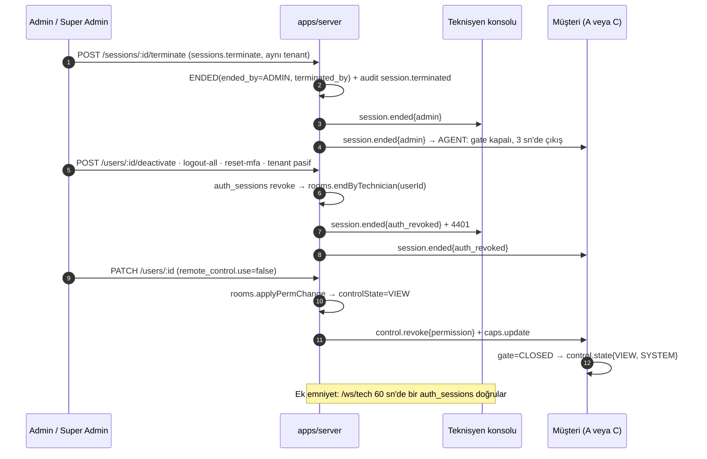

# Sequence Akışları
Ana belge: `docs/mimari.md` §2. Mesaj adları `docs/mimari-protokol.md`, uçlar `docs/mimari-api.md` ile birebirdir.

## A1. Oturum oluşturma + tarayıcı modu katılımı
```mermaid
sequenceDiagram
  autonumber
  participant T as Teknisyen konsolu
  participant S as apps/server
  participant DB as MySQL
  participant C as Müşteri tarayıcısı
  T->>S: POST /api/v1/sessions (çerez, CSRF)
  S->>S: yetki sessions.create, limit (açık ≤3, 20/sa)
  S->>DB: INSERT support_sessions(token_hash, active_code(8), tech_verify_code, PENDING, expires_at)
  S-->>T: {link, code(8), techVerifyCode, expiresAt}
  T->>S: WS /ws/tech?sessionId (Origin+çerez+sahiplik)
  S-->>T: hello{peerPresent:false}
  Note over T,C: Link e-posta/kopyala ile iletilir
  C->>S: GET /session/{token} (Next sayfası, tüketmez)
  C->>S: POST /public/sessions/resolve {token, clientKind:BROWSER}
  S-->>C: tenant, teknisyen, techVerifyCode, consentText, joinNonce(60 sn)
  C->>C: Ad + KVKK onayı + dolandırıcılık uyarısı → "Paylaşımı Başlat" → getDisplayMedia
  C->>S: POST /public/sessions/join {joinNonce, name, consentTextId}
  S->>S: consentTextId tenant+is_current? (G-24); lobi ≤3? ret listesi?
  S-->>C: wsTicket, admitCode (yalnız bu misafire) — tüketim YOK
  C->>S: WS /ws/guest (Sec-WebSocket-Protocol: rs.v1, rs.ticket.*)
  S-->>C: lobby.wait{expiresAt} → "Teknisyen onayı bekleniyor — kodunuz 4821"
  S-->>T: peer.pending{guestId, name, BROWSER} (audit guest.pending)
  Note over T,C: Teknisyen telefonda kodu sorar, müşteri okur (G-01)
  T->>S: guest.admit{admitCode}
  alt kod eşleşmez
    S-->>T: error ADMIT_CODE_INVALID (5. hatada lobi boşalır)
  else eşleşir
    S->>DB: TX: UPDATE … SET ACTIVE, consumed_at, active_code=NULL, mode=BROWSER WHERE id AND status=PENDING AND expires_at>now (count=1?) → session_consents(VIEW,GRANTED, join anındaki onay), audit guest.admitted
    Note over S,DB: count=0 (iptal/süre doldu/çift admit kazandı) → rollback, misafire session.ended, teknisyene error CONFLICT (mimari-protokol §3.2)
    S-->>C: hello{iceServers(HMAC, ≤60 dk), reconnectToken, caps}
    S-->>T: peer.joined{guestKind:BROWSER}
  end
  T->>S: sdp.offer (recvonly video + ctl, file DC)
  S->>C: sdp.offer
  C->>S: sdp.answer (+ ekran track)
  S->>T: sdp.answer
  T-->>C: ice ↔ ice (sunucu üzerinden)
  T-->C: DTLS-SRTP medya (P2P veya TURN)
  C->>S: share.state{sharing}
```
Not (P3 giriş şartı 2): tüketim **yalnız** admit'teki tek atomik koşullu UPDATE ile olur; resolve ve join okur ama yazmaz, iptal/süre dolumu ile yarışta tek kazanan InnoDB satır kilidiyle belirlenir (mimari-protokol §3.2; P2 kalıbı `sessions/repo.ts` `cancelPending`). Resolve/join Origin kuralı: tarayıcı Origin'li + `clientKind=BROWSER` (ADR-0012).
Not: getDisplayMedia join'den önce çağrılır; müşteri seçimi iptal ederse join yapılmaz (AC-30). Ret: `guest.reject{guestId}` → misafire `session.ended{rejected}`, oturum PENDING, kod geçerli (AC-113). Admit öncesi misafirden gelen `sdp.*`/`ice` → 1008.

## A2. Go istemci modu — kodla eşleme
```mermaid
sequenceDiagram
  autonumber
  participant C as Müşteri tarayıcısı
  participant S as apps/server
  participant A as Go istemci
  participant T as Teknisyen konsolu
  C->>S: GET /public/agent/download?ref
  S-->>C: Destek-48291376.exe (aynı jenerik binary, yalnız dosya adı farklı; yalnız PENDING+süresi dolmamış, kod yolu hız sınırı — mimari-api)
  A->>A: SetDefaultDllDirectories(SYSTEM32) (G-08); os.Executable() → regex (\d{8}) ; yoksa kod giriş alanı
  A->>S: POST /public/sessions/resolve {code, clientKind:AGENT} (TLS doğrulamalı, Origin YOK → yalnız AGENT kabul, ADR-0012)
  alt 404/410/429
    S-->>A: hata → "Kod geçersiz/süresi doldu" (AC-97)
  else geçerli
    S-->>A: tenant, logo, teknisyen, techVerifyCode, consentText, joinNonce
  end
  A->>A: Karşılama (alan adı, sürüm, SHA-256 ilk 8, uyarı) + KVKK onayı + monitör seçimi (AC-98, 106, 125, 128)
  A->>S: POST /public/sessions/join
  S-->>A: wsTicket, admitCode
  A->>S: WS /ws/guest (subprotocol ticket, Origin yok, kind=AGENT)
  S-->>A: lobby.wait → bekleme ekranı "Teknisyeninize şu kodu söyleyin: 4821"
  S-->>T: peer.pending{guestId, name, AGENT}
  T->>S: guest.admit{admitCode} (müşterinin okuduğu kod)
  S->>S: TX: atomik koşullu UPDATE (count=1) + consent + audit (A1 ile aynı, mimari-protokol §3.2)
  S-->>A: hello{iceServers, reconnectToken, caps}
  S-->>T: peer.joined{guestKind:AGENT}
  T->>S: sdp.offer (video recv + ctl, file, input DC)
  S->>A: sdp.offer
  A->>S: sdp.answer (H.264 track)
  Note over A: gate=CLOSED, "Ekranınız izleniyor" göstergesi (AC-103)
  A->>S: share.state{sharing, monitors[]}
```

## A3. Kontrol izni ver / reddet / kapat
```mermaid
sequenceDiagram
  autonumber
  participant T as Teknisyen konsolu
  participant S as apps/server
  participant A as Go istemci (izin kapısı)
  T->>S: control.request
  S->>S: remote_control.use? guestKind=AGENT? değilse error FORBIDDEN (AC-51, 34)
  S->>S: ret sonrası 30 sn / oturumda 5 istek aşıldı mı? → error RATE_LIMITED (G-03)
  S->>A: control.request
  A->>A: Diyalog: odak "Reddet", Enter/Space etkisiz, 1,5 sn sonra etkin, imleç altında değil; enjekte tıklama yok sayılır
  alt Reddet
    A->>S: control.state{VIEW, source:DENIED}
    S->>S: session_consents(CONTROL,DENIED) + audit
    S->>T: control.state → "Kontrol reddedildi"
  else İzin ver
    A->>A: gate=OPEN, kırmızı "Uzaktan kontrol aktif — <ad>" çerçevesi
    A->>S: control.state{GRANTED, UI}
    S->>S: audit yazılamazsa → control.revoke{audit} (fail-closed, G-15)
    S->>T: control.state → input göndermeye başla
    T-->>A: input DC: m.move / m.btn / k ...
    A->>A: gate.IsOpen() && !localSuspend → SendInput
  end
  Note over A: Müşteri "Kontrolü kapat" veya Ctrl+Shift+F12
  A->>A: gate=CLOSED (anında; sonraki input düşer, AC-101)
  A->>S: control.state{VIEW, UI|HOTKEY}
  S->>S: session_consents(CONTROL,REVOKED) + audit (AC-111)
  S->>T: control.state → "Kontrol müşteri tarafından kapatıldı" (≤1 sn, AC-50)
  Note over T: Teknisyen "Kontrolü bırak" / bekleyen istekte "Vazgeç" (ADR-0013, protokol §3.3)
  T->>S: control.release | control.cancel
  S->>A: control.release | control.cancel
  A->>A: gate=CLOSED, açık diyalog kapanır (yanıt yok)
  S->>T: control.state{VIEW, TECH}
  S->>S: release: session_consents(CONTROL,REVOKED,TECH) + audit control.released · cancel: audit control.cancelled
  Note over S,A: Teknisyen kopması: S→A control.revoke{reconnect} + peer.left{tech}; A ikisinden biriyle kapıyı kapatır (iki katman)
```

## A4. Kopma, yeniden bağlanma, sonlandırma
```mermaid
sequenceDiagram
  autonumber
  participant T as Teknisyen
  participant S as apps/server
  participant G as Müşteri (A veya C)
  G--xS: WS kopar (ping 2 kez yanıtsız / close)
  S->>S: room.controlState=VIEW, disconnectTimer=120 sn
  S->>T: peer.left{disconnect}
  G->>G: gate=CLOSED; üstel bekleme (1,2,4,8 sn…)
  G->>S: WS /ws/guest (subprotocol rs.reconnect.<token>, ≤120 sn)
  alt guestSocket hâlâ bağlı
    S-->>G: 403 + audit reconnect.conflict (G-10)
  else
    S->>S: hash eşleşir → timer iptal, hello{reconnectToken yeni, iceServers}; lobi yok, kontrol VIEW
  end
  S->>T: peer.joined → T yeni offer (ICE restart / yeni PC)
  alt 120 sn doldu (iki taraf da yoksa veya guest gelmedi)
    S->>S: ENDED(end_reason=timeout) + audit (AC-25)
  end
  T->>S: session.end (onay diyaloğu sonrası, AC-59)
  S->>S: ENDED(ended_by=TECH), quality_summary kaydı
  S->>G: session.ended{tech}
  G->>G: AGENT: gate kapalı, yarım .part silinir (%TEMP% yazımı yok, ADR-0004 r2), 3 sn içinde çıkış (AC-107)
```
Teknisyen tarafı kopması da aynı 120 sn kuralı ile; teknisyen sayfayı yenilediğinde çerez + sahiplik ile odaya döner.
Max süre (AC-13): `maxDurationTimer` 5 dk kala `session.warning`, sonunda `session.ended{max_duration}`.
İptal (AC-8): `POST /cancel` → DB CANCELLED + `active_code=NULL` + açık resolve/guest soketlerine `session.ended{cancelled}`; join TX'i `status=PENDING` koşullu UPDATE yapar (yarış yok).

## A5. Yönetici zorla sonlandırma ve canlı yetki iptali (G-04)

