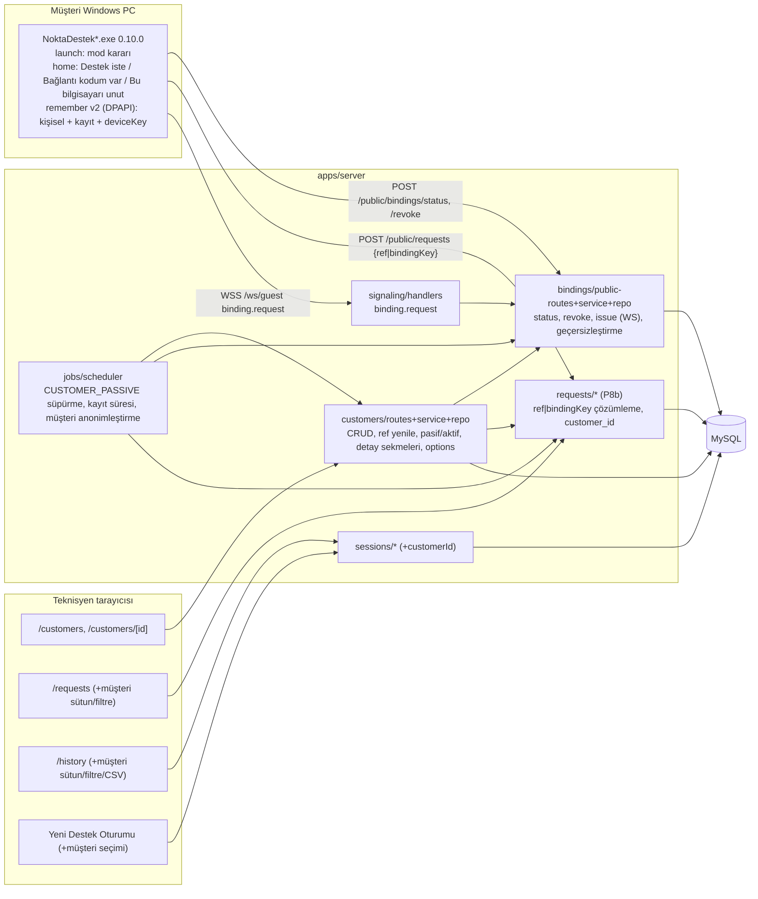

# Mimari — E10 Müşteri firmalar ve kalıcı istemci (P8c)

Tarih: 2026-11-12 · Durum: TASLAK **r2** (r2: güvenlik tasarım turu E10 G-E10-1..9, K19, K20 işlendi — bağlayıcı ayrıntı **§15**; §15 önceki bölümlerle çelişirse §15 geçerlidir) · Ana belge: `docs/mimari.md` (bu dosya onun ayrılmaz ekidir; §-numaraları ana belgeyle aynı anlamdadır).
Girdi: `docs/gereksinimler-e10.md`, `docs/gereksinimler-kabul-kriterleri-e10.md` (AC-165..AC-195). Önceki ek: `docs/mimari-e9.md` (P8b; bu belge onu **değiştirmez, genişletir**).
Bağlayıcı sözleşmeler: `docs/mimari-api.md` "Müşteriler ve bilgisayar kaydı (P8c)", `docs/mimari-protokol.md` §6. ADR: **ADR-0017** (yeni, bilgisayar kaydı), ADR-0004 r4, ADR-0006 r5.
Açık sorular S18–S21 gereksinimdeki varsayılanlarla kabul edildi (§14 K16).

## 1. Özet ve kısıtlar

Tenant kendi **müşteri firmalarını** (`customers`) kaydeder. Her müşteri, Genel bağlantıyla aynı biçimde (`[a-z2-7]{16}`) ve **aynı ad alanında** tekil bir ref alır; dosya `NoktaDestek-<etiket>-<ref>.exe` olur. İkili aynıdır, 0.9.x istemci bu dosyayla talep açabilir. Talep ve oturum `customer_id` taşır.
Başarılı bir istemci oturumundan sonra (misafir admit edildi = VIEW GRANTED), 0.10.0 istemci `/ws/guest` üzerinden sunucudan **bilgisayar kaydı** (`device_bindings`) ister. Sunucu bilgisayar başına ayrı bir anahtar (`rsb_…`, 256 bit) üretir ve yalnız SHA-256 özetini saklar. İstemci anahtarı mevcut DPAPI dosyasına (`hatirla.bin`, format v2) yazar. Kayıt **yalnız talep açar**; oturum, TURN veya ticket yetkisi vermez.

| Kısıt / karar      | Değer                                                                                                                                                                                                                                                                                                               | Kaynak                   |
| ------------------ | ------------------------------------------------------------------------------------------------------------------------------------------------------------------------------------------------------------------------------------------------------------------------------------------------------------------- | ------------------------ |
| Stack              | Değişmez. Yeni bağımlılık **yok** (web combobox kendi primitifimiz; Go yalnız `x/sys/windows`)                                                                                                                                                                                                                      | ADR-0002..0005           |
| Yeni env           | **Yok**                                                                                                                                                                                                                                                                                                             | —                        |
| Ref ad alanı       | `request_refs` kayıt tablosu (PK `ref`): Genel + müşteri ref'leri, emekliler dahil; bir ref asla yeniden verilmez                                                                                                                                                                                                   | ADR-0006 r5, AC-168      |
| Kayıt anahtarı     | `rsb_` + base64url(32 bayt) = 47 karakter; DB'de `key_hash` = SHA-256 hex; her oturumda döndürülür (rotasyon)                                                                                                                                                                                                       | ADR-0017, AC-181, V22    |
| Kayıt verme kanalı | `/ws/guest`, admit (`hello`) **sonrası**: sunucu yalnız ticket kaydındaki `clientVersion ≥ 0.10.0` ise `binding.offer` gönderir → istemci `binding.request` → `binding.issued`. `hello` genişletilmez (0.9.x sıkı ayrıştırıcı kırılır); eski sunucu teklif göndermediği için istemci de istemez (geri alma güvenli) | ADR-0017 §2, protokol §6 |
| Kayıtla talep      | `POST /public/requests` gövdesinde `ref` **ya da** `bindingKey` (tam biri)                                                                                                                                                                                                                                          | mimari-api P8c           |
| Sayaçlar           | Türetilmiş (talep tablosundan `COUNT`/`MAX`, sayfa başına tek grup sorgusu); sayaç sütunu yok                                                                                                                                                                                                                       | AC-166, AC-178, V24      |
| Arama / tekillik   | Uygulamada katlanmış anahtarlar: `name_key` (UQ tenant içinde), `search_key` (`LIKE`); katlama fonksiyonu contracts'ta tek tanım                                                                                                                                                                                    | AC-166, AC-167, V25      |
| Uyumluluk          | Dosya adı biçimi aynı; `MIN_AGENT_VERSION` değişmez; 0.9.x'e giden `request.closed.reason` eşlenir (§5.4)                                                                                                                                                                                                           | AC-191, R21              |

**Basitlik ilkeleri:** müşteri sayaçları türetilir; kayıt tablosu tenant başına bilgisayar başına tek satır (yerinde güncelleme); geçersizleşme hem kullanım anında (sorgu koşulu) hem iş/TX ile (`key_hash = NULL`) yapılır. Genişleme noktaları §7.

## 2. Bileşenler ve sorumluluklar



| Bileşen             | Dosya                                                                                                                        | Sorumluluk                                                                                                                                                                                                       | Sorumlu olmadığı                            |
| ------------------- | ---------------------------------------------------------------------------------------------------------------------------- | ---------------------------------------------------------------------------------------------------------------------------------------------------------------------------------------------------------------- | ------------------------------------------- |
| Müşteri uçları      | `apps/server/src/customers/{routes,service,repo}.ts` (yeni)                                                                  | CRUD, ad tekilliği, ref üretimi/yenileme (registry), pasif/aktif, liste + türetilmiş sayaçlar, detay sekmeleri, `options`, Genel bağlantı (salt okunur), anonimleştirme işi, audit                               | Talep durum makinesi (P8b servisi çağrılır) |
| Ref çözümleme       | `apps/server/src/requests/ref.ts` (genişler) + `requests/repo.ts`                                                            | `resolveRef(ref)` → `{tenant, settings, customer\|null}`; tenant ve müşteri sorguları **paralel** çalışır (zaman farkı yok); `newRequestRef()` + `request_refs` INSERT (5 deneme)                                | —                                           |
| Kayıt servisi       | `apps/server/src/bindings/{service,repo,public-routes}.ts` (yeni)                                                            | `issue(sessionCtx, previousKey?)`, `status(key)`, `revoke(key)`, `findActive(key)` (talep oluşturmada), `revokeForCustomer/General/Tenant`, `expireIdle()`                                                       | Oturum/TURN (kasıtlı olarak bağlantısı yok) |
| WS işleyici         | `apps/server/src/signaling/handlers.ts` + `types.ts`                                                                         | `binding.request` (yalnız ADMITTED + AGENT + ACTIVE), oturum başına ≤ 3                                                                                                                                          | —                                           |
| Talep servisi (P8b) | `requests/{service,public-routes,panel,repo,ws,jobs}.ts`                                                                     | `ref` ya da `bindingKey` ile oluşturma, `customer_id`/`binding_id`, `CUSTOMER_PASSIVE`, liste filtresi, `request.new.customerFirm`, eski istemciye neden eşlemesi                                                | —                                           |
| Oturum (P2/P8)      | `sessions/{routes,service,repo,history,history-repo}.ts`                                                                     | `customerId` girdisi (aktif + aynı tenant), kabul TX'inde talepten kopya, geçmiş filtresi/sütunu/CSV                                                                                                             | —                                           |
| Zamanlayıcı         | `jobs/scheduler.ts`                                                                                                          | 30 sn: pasif müşterinin bekleyen talepleri → `CANCELLED(CUSTOMER_PASSIVE)`, pasif tenant'ın etkin kayıtları → `TENANT_PASSIVE`. Günlük 03:30: boşta kalan kayıtlar → `EXPIRED`; pasif müşteri PII anonimleştirme | —                                           |
| Panel               | `apps/web/app/(panel)/customers/**`, `components/ui/combobox.tsx` (yeni), side-nav, requests/history/sessions değişiklikleri | §9                                                                                                                                                                                                               | —                                           |
| Go istemci          | `apps/agent-win/internal/{launch (yeni),remember,request,api,signal,flow,ui}`, `cmd/noktadestek/main.go`                     | §8                                                                                                                                                                                                               | Sunucu tarafı sınırlar                      |

### 2.1 Akışlar (özet; sequence `docs/mimari-akislar.md` A7 olarak eklenir — backend P8c-1)

**A7a — Kayıt verilmesi (her başarılı istemci oturumu):**

1. İstemci herhangi bir yoldan (`Destek-<kod>`, talep, kayıt) `/ws/guest`'e bağlanır; misafir admit edilir (kod yolunda lobi kabulü, talep yolunda "Ekranımı paylaş"). Sunucu `session_consents(VIEW, GRANTED)` yazar, `hello` gönderir.
2. Sunucu commit sonrası, `hello`'nun hemen ardından ve yalnız istemci sürümü ≥ 0.10.0 ise (resolve/talep `clientVersion`'ı ticket kaydında taşınır) `binding.offer{}` gönderir. İstemci yalnız teklif alınca `binding.request{previousKey?}` gönderir (`previousKey` = dosyadaki anahtar, **yalnız** dosyadaki sunucu kökeni bu sunucuysa).
3. Sunucu (§3.4 kuralları, tek TX): oturum ACTIVE + misafir ADMITTED + `guestKind=AGENT` + tenant aktif + (oturumun müşterisi varsa) müşteri aktif. `previousKey` aynı tenant'ın etkin satırını gösteriyorsa satır **yerinde** güncellenir (yeni anahtar, `customer_id` = oturumun müşterisi, `last_used_at`); başka tenant'ınsa o satır `REPLACED` ile geçersizlenir ve yeni satır eklenir; yoksa bu oturumda daha önce verilmiş satır güncellenir (yanıtı kaybolan istek), o da yoksa yeni satır. Audit `binding.issued`.
4. Commit → `binding.issued{bindingKey, tenantName, customerFirmName, renewed}`. İstemci DPAPI dosyasına yazar. Yazamazsa sessiz; oturum etkilenmez. Kayıt başka firmaya geçtiyse oturum sonu ekranında "Bu bilgisayar artık <firma> için kayıtlı" (AC-187).

**A7b — Kayıtla talep:**

1. İstemci açılır, mod kararı (§8.1) "kayıt" çıkar → `POST /public/bindings/status {bindingKey, clientVersion}` → firma, müşteri adı, aydınlatma, bekleme.
2. Ana ekran: "Bu bilgisayar <tenant> – <müşteri> için kayıtlı" + "Destek iste". Form → `POST /public/requests {bindingKey, …}` → sunucu TX'inde `device_bindings` koşullu `UPDATE last_used_at … WHERE key_hash=? AND revoked_at IS NULL` (count=0 → `BINDING_INVALID`) → talep `customer_id = binding.customer_id`, `binding_id`. Sonrası E9 akışı aynen (`/ws/request`, kabul, "Ekranımı paylaş", A7a ile kayıt yenilenir).
3. `404 BINDING_INVALID` herhangi bir adımda → istemci kaydı siler (kişisel bilgiler kalır), AC-185 metnini gösterir, "Bağlantı kodum var" etkin.

**A7c — "Bu bilgisayarı unut":** yerel dosya + tmp + boşsa klasör ≤ 1 sn silinir; ardından bellekteki anahtarla `POST /public/bindings/revoke` (2 sn zaman aşımı, en iyi çaba); "Bu bilgisayar unutuldu".

## 3. Veri modeli (dba, P8c-1 migration `20261112120000_p8c_customers`)

Ortak kurallar ana belge §3 / mimari-e9 §3 ile aynı: ULID `CHAR(26)`, `DATETIME(3)` UTC, FK `RESTRICT`, enum = `VARCHAR(20)` + ikili CHECK (ADR-0014), biçimler `REGEXP_LIKE(…,'c')`, tenant tutarlılığı bileşik FK `(x_id, tenant_id)`. Prisma 7 (`prisma-client` generator) şemaya alanları ve ilişkileri yazar; CHECK'ler ve fonksiyonel kısıtlar `migration.sql`'de elle.

### 3.1 `customers` (yeni)

| Alan                   | Tip                        | Kural                                                                                                                                               |
| ---------------------- | -------------------------- | --------------------------------------------------------------------------------------------------------------------------------------------------- |
| id                     | CHAR(26) PK                |                                                                                                                                                     |
| tenant_id              | CHAR(26) FK tenants        |                                                                                                                                                     |
| name                   | VARCHAR(100)               | 2..100 kod noktası, trim, Cc/Cf/Zl/Zp yok (zod `customerFirmNameSchema`); CHECK `CHAR_LENGTH(name) BETWEEN 2 AND 100`                               |
| name_key               | VARCHAR(200) `utf8mb4_bin` | `foldKey(name)` (contracts, §3.6); **UQ(tenant_id, name_key)** — pasifler dahil (V25, AC-167)                                                       |
| search_key             | VARCHAR(400) `utf8mb4_bin` | `foldKey(name) + ' ' + foldKey(contact_name ?? '') + ' ' + rakamlar(phone ?? '')`; her yazımda servis yeniden hesaplar                              |
| file_label             | VARCHAR(20)                | CHECK `REGEXP_LIKE(file_label,'^[A-Za-z0-9]{1,20}$','c')`; varsayılan `suggestFileLabel(name)` (P8b `fileLabelOf` contracts'a taşınır); tekil değil |
| request_ref            | CHAR(16) **UQ**            | `^[a-z2-7]{16}$`; her zaman dolu; geçerlilik = `status='ACTIVE'` (pasifte değer kalır, 404 döner)                                                   |
| ref_rotated_at         | DATETIME(3)?               | Son yenileme/yeniden aktif etme                                                                                                                     |
| contact_name           | VARCHAR(80)?               | Kişisel (AC-195); boş → NULL                                                                                                                        |
| phone                  | VARCHAR(16)?               | E.164 (AC-134 normalizasyonu); CHECK biçim                                                                                                          |
| email                  | VARCHAR(254)?              |                                                                                                                                                     |
| note                   | VARCHAR(1000)?             | Düz metin; `\n` serbest, diğer Cc ve bidi/sıfır genişlik yasak                                                                                      |
| status                 | VARCHAR(20) vars. `ACTIVE` | `ACTIVE\|PASSIVE` (ikili CHECK)                                                                                                                     |
| passive_at             | DATETIME(3)?               | CHECK `(status='PASSIVE') = (passive_at IS NOT NULL)`                                                                                               |
| anonymized_at          | DATETIME(3)?               | CHECK `anonymized_at IS NULL OR (contact_name IS NULL AND phone IS NULL AND email IS NULL AND note IS NULL)`                                        |
| created_by             | CHAR(26)? FK users         |                                                                                                                                                     |
| created_at, updated_at | DATETIME(3)                |                                                                                                                                                     |

İndeksler: `UQ(request_ref)`, `UQ(tenant_id, name_key)`, `UQ(id, tenant_id)` (bileşik FK hedefi), `IX(tenant_id, status, name_key)` (liste + varsayılan sıra), `IX(tenant_id, created_at)` (tarih sırası), `IX(status, passive_at)` (anonimleştirme işi), `IX(created_by)`.
Silme: **hard delete yok** (V23, kapsam dışı 7). Pasif + saklama süresi sonunda PII anonimleştirme (§3.7).

### 3.2 `request_refs` (yeni — tek ref ad alanı, ADR-0006 r5)

| Alan        | Tip                 | Kural                                                                    |
| ----------- | ------------------- | ------------------------------------------------------------------------ |
| ref         | CHAR(16) **PK**     | `^[a-z2-7]{16}$`                                                         |
| tenant_id   | CHAR(26) FK tenants |                                                                          |
| customer_id | CHAR(26)?           | FK `(customer_id, tenant_id)` → `customers(id, tenant_id)`; NULL = Genel |
| created_at  | DATETIME(3)         |                                                                          |

Kural: **her** ref üretimi (Genel tembel oluşturma, Genel yenileme, müşteri oluşturma, müşteri yenileme, yeniden aktif etme) aynı TX'te önce buraya INSERT edilir; PK çakışması (`P2002`) → yeni ref, en çok 5 deneme. Satır asla silinmez/güncellenmez → emekli ref yeniden verilmez (eski dosya başka sahibe "dirilemez"). Çözümleme bu tablodan **yapılmaz** (güncel ref sahibin sütunundadır); tablo yalnız tekillik ve iz içindir. İndeks: `IX(customer_id, tenant_id)` (FK), `IX(tenant_id)`.
Migration geri doldurma: `INSERT INTO request_refs (ref, tenant_id, customer_id, created_at) SELECT request_ref, tenant_id, NULL, created_at FROM tenant_request_settings`.

### 3.3 `device_bindings` (yeni — bilgisayar kaydı, ADR-0017)

| Alan                   | Tip                           | Kural                                                                                                                                      |
| ---------------------- | ----------------------------- | ------------------------------------------------------------------------------------------------------------------------------------------ |
| id                     | CHAR(26) PK                   | Audit `entity_id`                                                                                                                          |
| tenant_id              | CHAR(26) FK tenants           |                                                                                                                                            |
| customer_id            | CHAR(26)?                     | FK `(customer_id, tenant_id)` → customers; NULL = Genel kayıt                                                                              |
| key_hash               | CHAR(64)? **UQ**              | SHA-256 hex(`rsb_…` tam dize); geçersizleşince **NULL** (AC-195)                                                                           |
| client_version         | VARCHAR(20)                   | Son veren istemci sürümü (`^\d{1,3}\.\d{1,3}\.\d{1,3}$`)                                                                                   |
| first_session_id       | CHAR(26)                      | FK `(first_session_id, tenant_id)` → support_sessions                                                                                      |
| last_session_id        | CHAR(26)                      | FK `(last_session_id, tenant_id)` → support_sessions; yanıtı kaybolan isteğin yeniden verilmesi için                                       |
| issue_count            | INT vars. 1                   | CHECK ≥ 1 (yenileme sayısı; gözlem)                                                                                                        |
| last_used_at           | DATETIME(3)                   | Verme/yenileme ve kayıtla **başarılı talep oluşturma** anı (V28; `status` sorgusu güncellemez — K21)                                       |
| revoked_at             | DATETIME(3)?                  |                                                                                                                                            |
| revoke_reason          | VARCHAR(20)?                  | `FORGOTTEN\|REPLACED\|CUSTOMER_ROTATED\|CUSTOMER_PASSIVE\|GENERAL_ROTATED\|TENANT_PASSIVE\|EXPIRED\|ADMIN_REVOKED` (ikili CHECK; r2 §15.2) |
| active_session_id      | CHAR(26) **STORED üretilmiş** | `IF(revoked_at IS NULL, last_session_id, NULL)`, **UQ** — oturum başına en çok bir etkin kayıt (r2 §15.3)                                  |
| created_at, updated_at | DATETIME(3)                   |                                                                                                                                            |

CHECK'ler: `(revoked_at IS NULL) = (key_hash IS NOT NULL)`, `(revoked_at IS NULL) = (revoke_reason IS NULL)`, `REGEXP_LIKE(key_hash,'^[0-9a-f]{64}$','c')`.
İndeksler: `UQ(key_hash)` (MySQL'de çoklu NULL serbest), `UQ(id, tenant_id)` (talep FK hedefi), `IX(tenant_id, customer_id, revoked_at)` (müşteri/Genel toplu geçersizleştirme), `IX(revoked_at, last_used_at)` (boşta kalma işi), `IX(last_session_id, tenant_id)`, `IX(first_session_id, tenant_id)`.
Kişisel veri **yok** (IP, ad, cihaz adı tutulmaz; IP audit satırında). Hard delete P13 retention'da (`revoked_at` + tenant saklama süresi; önce bu kayda bağlı talepler — FK RESTRICT).

### 3.4 Kayıt kuralları (servis, tek TX; `bindings/service.ts`)

| İşlem                                                                                                                              | SQL koşulu / sıra                                                                                                                                                                                                                                                                                                                                                                                                                                                                                                                                                                                                                                                                                                                                                                                                                                                                                                                                        |
| ---------------------------------------------------------------------------------------------------------------------------------- | -------------------------------------------------------------------------------------------------------------------------------------------------------------------------------------------------------------------------------------------------------------------------------------------------------------------------------------------------------------------------------------------------------------------------------------------------------------------------------------------------------------------------------------------------------------------------------------------------------------------------------------------------------------------------------------------------------------------------------------------------------------------------------------------------------------------------------------------------------------------------------------------------------------------------------------------------------- |
| Verme (`binding.request`) — **r2: koşullara §15.1 bayat kaynak kuralı, adımlara §15.3 sırası ve §15.4 müşteri ataması geçerlidir** | (1) `support_sessions WHERE id AND status='ACTIVE' AND mode='AGENT'` + bellekte misafir ADMITTED; (2) tenant `ACTIVE` ve silinmemiş; oturum `customer_id` doluysa `customers WHERE id AND tenant_id AND status='ACTIVE'` (değilse `error{CONFLICT}`, kayıt yok); oturumun müşterisi yoksa Genel için `tenant_request_settings` tembel oluşturulur (ref + `request_refs`); (3) `previousKey` → `SELECT … WHERE key_hash=? AND revoked_at IS NULL FOR UPDATE`: aynı tenant → `UPDATE SET key_hash=:yeni, customer_id=:oturumun, last_session_id, last_used_at=now, issue_count+1, client_version`; başka tenant → o satır `REPLACED` (hash NULL) + INSERT; (4) `previousKey` yok/eşleşmedi → `WHERE last_session_id=:sid AND revoked_at IS NULL` satırı varsa aynı UPDATE; (5) aksi INSERT; (6) audit `binding.issued{customerId, renewed, replacedOtherTenant}` (actor `customer`). Oturum başına ≤ 3 istek (bellek sayacı, aşımda `error{RATE_LIMITED}`) |
| Kullanım (status / talep)                                                                                                          | `SELECT b.*, t.status, c.status, ts.retention_days FROM device_bindings b JOIN tenants t … LEFT JOIN customers c … WHERE b.key_hash=? AND b.revoked_at IS NULL` + koşullar: tenant ACTIVE, (customer NULL veya ACTIVE), `last_used_at > now − retention_days`. Biri tutmazsa **aynı** 404 `BINDING_INVALID` (§5.2). Talepte TX içinde koşullu `UPDATE … SET last_used_at=now WHERE id AND key_hash=? AND revoked_at IS NULL` (count=0 → `BINDING_INVALID`, ROLLBACK)                                                                                                                                                                                                                                                                                                                                                                                                                                                                                     |
| Unut (`POST /public/bindings/revoke`)                                                                                              | `UPDATE SET revoked_at=now, revoke_reason='FORGOTTEN', key_hash=NULL WHERE key_hash=? AND revoked_at IS NULL`; her durumda 204 (oracle yok); count=1 ise audit `binding.revoked{reason}`                                                                                                                                                                                                                                                                                                                                                                                                                                                                                                                                                                                                                                                                                                                                                                 |
| Müşteri ref yenileme / pasife alma                                                                                                 | Aynı TX: `UPDATE … SET revoked_at, revoke_reason='CUSTOMER_ROTATED'\|'CUSTOMER_PASSIVE', key_hash=NULL WHERE tenant_id AND customer_id=? AND revoked_at IS NULL`; sayı müşteri audit'ine `revokedBindings`                                                                                                                                                                                                                                                                                                                                                                                                                                                                                                                                                                                                                                                                                                                                               |
| Genel ref yenileme (P8b `rotateRef`)                                                                                               | Aynı TX: `… 'GENERAL_ROTATED' WHERE tenant_id AND customer_id IS NULL AND revoked_at IS NULL`                                                                                                                                                                                                                                                                                                                                                                                                                                                                                                                                                                                                                                                                                                                                                                                                                                                            |
| Tenant pasif                                                                                                                       | `revokeForTenant(tenantId)` — P9 tenant pasife alma servisi çağırır (`cancelAllForTenant` yanında); 30 sn süpürücü yedek (`tenants.status='PASSIVE'` olan etkin satırlar). Kullanım anı kontrolü zaten 404 verir                                                                                                                                                                                                                                                                                                                                                                                                                                                                                                                                                                                                                                                                                                                                         |
| Boşta kalma (V28)                                                                                                                  | Günlük 03:30: `… 'EXPIRED' WHERE revoked_at IS NULL AND last_used_at <= now − tenant_settings.retention_days` (1000'lik partiler)                                                                                                                                                                                                                                                                                                                                                                                                                                                                                                                                                                                                                                                                                                                                                                                                                        |

### 3.5 Mevcut tabloların genişlemesi (expand-only)

| Tablo              | Değişiklik              | Kural                                                                                                                                                                                                     |
| ------------------ | ----------------------- | --------------------------------------------------------------------------------------------------------------------------------------------------------------------------------------------------------- |
| `support_requests` | `customer_id CHAR(26)?` | FK `(customer_id, tenant_id)` → customers; NULL = Genel (AC-175, 176)                                                                                                                                     |
|                    | `binding_id CHAR(26)?`  | FK `(binding_id, tenant_id)` → device_bindings; kayıtla açılan talep. API `viaBinding` bundan türer                                                                                                       |
|                    | `cancel_reason` CHECK   | `CUSTOMER\|DISCONNECTED\|TENANT_PASSIVE\|CUSTOMER_PASSIVE\|BINDING_REVOKED` (ikili CHECK yeniden yazılır; r2 §15.2)                                                                                       |
|                    | İndeks                  | `IX(tenant_id, customer_id, created_at)` (müşteri detayı, sayaçlar, filtre), `IX(binding_id, tenant_id, status)` (kayıt başına 1 bekleyen)                                                                |
| `support_sessions` | `customer_id CHAR(26)?` | FK `(customer_id, tenant_id)` → customers; kabul TX'inde talepten kopyalanır (AC-177) veya `POST /sessions` `customerId` (AC-180). Not: mevcut `customer_name` **misafir kişinin** adıdır, firma değildir |
|                    | İndeks                  | `IX(tenant_id, customer_id, created_at)` (geçmiş filtresi, müşteri detayı)                                                                                                                                |
| `consent_texts`    | seed yeni sürüm         | Bilgisayar kaydı (ne, nerede, ne kadar, nasıl silinir) + müşteri yetkili kişi verisi saklama (AC-188)                                                                                                     |

AC-177 eşitliği (talep ve oturum müşterisi aynı) bileşik FK'lerle tenant düzeyinde DB'de, değer eşitliği kabul TX'inde kopya + entegrasyon testiyle sağlanır (çapraz tablo CHECK MySQL'de yok).

### 3.6 Katlama ve etiket (contracts `packages/contracts/src/api/customers.ts`, web + server ortak)

- `foldKey(s)`: NFKC → `İ I ı → i`, `Ş→s Ğ→g Ç→c Ö→o Ü→u` (büyük/küçük) → `toLowerCase()` (Türkçe harfler önceden eşlendiği için yer ayarsız güvenli) → NFKD + `\p{M}` silme → `\s+`→tek boşluk → trim. Birim testi fixture `fixtures/customers.json` ("ŞİŞLİ Ltd." = "şişli ltd" = "SISLI LTD").
- `suggestFileLabel(name)`: P8b `fileLabelOf` taşınır (davranış aynı; server `requests/ref.ts` bunu içe aktarır).
- Arama: `q` (trim, 2..100) → `foldKey(q)`; telefon için ayrıca rakamlar; `search_key LIKE CONCAT('%', :q, '%')` (`%`, `_`, `\` kaçışlı). Tenant başına ≤ 1.000 müşteri → `IX(tenant_id,status,name_key)` aralığında tarama yeterli (§7).

### 3.7 Saklama ve anonimleştirme

| Veri                                             | Süre                                                                                      | İşlem                                                                                                                                                                                                        |
| ------------------------------------------------ | ----------------------------------------------------------------------------------------- | ------------------------------------------------------------------------------------------------------------------------------------------------------------------------------------------------------------ |
| customers PII (contact_name, phone, email, note) | Pasif + tenant `retention_days` (90–730), `passive_at`'ten                                | Günlük 03:30: NULL + `search_key` yeniden + `anonymized_at`; audit `customer.anonymized` (system). Yeniden aktif edilen müşteride alanlar boş kalır. Admin her an alanı boşaltabilir (PATCH, audit — AC-195) |
| customers.name, file_label, ref                  | Süresiz (tüzel kişi; geçmiş raporu)                                                       | —                                                                                                                                                                                                            |
| device_bindings                                  | Etkin: son kullanımdan `retention_days`; geçersiz satır audit için kalır, `key_hash` NULL | Hard delete P13                                                                                                                                                                                              |
| request_refs                                     | Süresiz (ad alanı)                                                                        | Kişisel veri yok                                                                                                                                                                                             |
| support_requests/sessions `customer_id`          | Mevcut retention (P8b §3.6, P13)                                                          | Firma kimliği kişisel veri değildir; anonimleştirmede korunur                                                                                                                                                |

### 3.8 Grants ve migration sırası

`prisma/sql/grants.sql` ekleri:

```sql
-- P8c customers: oluşturma/düzenleme/pasif/anonimleştirme UPDATE'tir; hard delete yok.
GRANT SELECT, INSERT, UPDATE ON customers TO 'app'@'%';
REVOKE IF EXISTS DELETE, ALTER, DROP, INDEX, TRIGGER, REFERENCES ON customers FROM 'app'@'%';
-- P8c request_refs: append-only ad alanı (ADR-0006 r5).
GRANT SELECT, INSERT ON request_refs TO 'app'@'%';
REVOKE IF EXISTS UPDATE, DELETE, ALTER, DROP, INDEX, TRIGGER, REFERENCES ON request_refs FROM 'app'@'%';
-- P8c device_bindings: verme/yenileme/geçersizleştirme UPDATE'tir; DELETE P13 retention ile.
GRANT SELECT, INSERT, UPDATE ON device_bindings TO 'app'@'%';
REVOKE IF EXISTS DELETE, ALTER, DROP, INDEX, TRIGGER, REFERENCES ON device_bindings FROM 'app'@'%';
```

Migration (tek dosya, bu sırayla): (1) CREATE `customers` + CHECK'ler; (2) CREATE `request_refs` + geri doldurma; (3) CREATE `device_bindings` + CHECK'ler (FK hedefi `support_sessions(id, tenant_id)` mevcut); (4) ALTER `support_requests` ADD `customer_id`, `binding_id`, FK'ler, indeksler; `cancel_reason` CHECK DROP + ADD (yeni değerle); (5) ALTER `support_sessions` ADD `customer_id`, FK, indeks. `down.sql`: ters sıra; `cancel_reason` CHECK'i eski listeye döner — **yalnız** `CUSTOMER_PASSIVE` satırı yokken başarılı (runbook notu, P8b kalıbı). Seed: aydınlatma metni yeni sürüm (`is_current` geçişi; P8b'deki UPDATE(is_current) yetkisi yeter). `pnpm db:migrate` grants'ı ardından uygular.

## 4. API ve protokol özeti

Bağlayıcı sözleşme: `docs/mimari-api.md` "Müşteriler ve bilgisayar kaydı (P8c)" ve `docs/mimari-protokol.md` §6. Zod: `packages/contracts/src/api/customers.ts` (yeni), `api/bindings.ts` (yeni), `api/requests.ts`, `api/sessions.ts`, `ws.ts` (`binding.*`), `ws-request.ts` (`request.new.customerFirm`, `CUSTOMER_PASSIVE`). Fixture: `fixtures/customers.json` (katlama, etiket), `fixtures/bindings.json` (anahtar biçimi, WS mesajları — Go ortak).

| Uç / kanal                                                                    | Kimlik                              | Yetki                                                                                                               |
| ----------------------------------------------------------------------------- | ----------------------------------- | ------------------------------------------------------------------------------------------------------------------- |
| GET `/customers`, GET `/customers/:id`                                        | Çerez                               | `customers.view` + `tenantScope`                                                                                    |
| POST `/customers`                                                             | Çerez + CSRF                        | `customers.create`                                                                                                  |
| PATCH `/customers/:id`, POST `…/rotate-ref`, POST `…/reactivate`              | Çerez + CSRF                        | `customers.edit`                                                                                                    |
| POST `/customers/:id/deactivate`                                              | Çerez + CSRF                        | `customers.delete` (V23)                                                                                            |
| GET `/customers/:id/requests`                                                 | Çerez                               | `customers.view` **ve** `support_requests.view`                                                                     |
| GET `/customers/:id/sessions`                                                 | Çerez                               | `customers.view` **ve** `session_history.view` (+ mevcut `historyScope`: USER yalnız kendi oturumları)              |
| GET `/customers/options`                                                      | Çerez                               | `customers.view` **veya** `support_requests.view` **veya** `session_history.view` (filtre/seçim kutusu; ≤ 20 sonuç) |
| GET `/customers/general-link`                                                 | Çerez                               | `customers.view` (salt okunur Genel bağlantı, AC-175)                                                               |
| GET `/support-requests?customer=general\|<id>`                                | Mevcut                              | Mevcut + filtre                                                                                                     |
| POST `/sessions` `{customerId?}`                                              | Mevcut                              | `sessions.create` + (`customerId` varsa) `customers.view`                                                           |
| GET `/sessions?customer=none\|<id>` + CSV                                     | Mevcut                              | Mevcut                                                                                                              |
| GET `/public/requests/tenant?ref=`, GET `/public/agent/request-download?ref=` | Yok                                 | Müşteri ref'ini de kabul eder; yanıt şekli **aynı** (müşteri bilgisi yok, AC-168)                                   |
| POST `/public/requests` `{ref \| bindingKey, …}`                              | Yok (AGENT)                         | E9 sınırları + kayıt sınırları (§5.3)                                                                               |
| POST `/public/bindings/status`, POST `/public/bindings/revoke`                | `bindingKey` (gövdede; URL'de asla) | §5.3                                                                                                                |
| WS `/ws/guest` `binding.request` → `binding.issued`                           | Mevcut misafir soketi               | ADMITTED + AGENT + ACTIVE                                                                                           |

Super Admin: müşteri uçları **firma seçimi zorunlu** (`tenantScope`; `all` istisnası yok — AC-172).

## 5. Güvenlik tasarımı (E10 eki; ana belge §5 ve mimari-e9 §5 geçerli)

### 5.1 Kimlik zinciri

`müşteri ref` (gizli değil, 80 bit, yenilenebilir) → talep → talep sırrı (E9) ... ; **ya da** `bindingKey` (gizli, 256 bit, yalnız istemcinin DPAPI dosyasında ve sunucuda SHA-256) → yalnız: kayıt bilgisi (`status`), talep oluşturma, kendi iptali (`revoke`). Talebin izlenmesi/iptali talep sırrıyla (E9) yapılır. `bindingKey` **hiçbir** oturum ucunda (resolve, join, `/ws/guest` ticket/reconnect, TURN) kabul edilmez: biçim (`rsb_` önekli 47 karakter) bu uçların şemalarına uymaz ve sunucu bu uçlarda `device_bindings` tablosuna hiç bakmaz (AC-184; API testi her uçta 401/403/404). Kayıt anahtarı oturum açmaz → gözetimsiz erişim yok (kapsam dışı 6).
Kaydın müşterisi istemciden **asla** alınmaz; oturumun `customer_id`'sinden (teknisyenin seçimi veya talebin ref'i) gelir.

### 5.2 Tek tip yanıtlar (enumeration yok)

| Durum                                                                                                                  | Yanıt                                                                                                                                             |
| ---------------------------------------------------------------------------------------------------------------------- | ------------------------------------------------------------------------------------------------------------------------------------------------- |
| Ref: biçim dışı, yok, yenilenmiş, pasif müşteri, pasif tenant, Genel/müşteri ayrımı                                    | Aynı 404 `REQUEST_REF_INVALID` gövdesi; tenant ve müşteri sorguları paralel (`Promise.all`) → süre farkı yok; indirme 302'si iki türde aynı biçim |
| Kayıt: biçim dışı, yok, unutulmuş, değiştirilmiş, müşteri yenilendi/pasif, Genel yenilendi, tenant pasif, süresi doldu | Aynı 404 `BINDING_INVALID` (mesaj: "Bu bilgisayarın destek kaydı artık geçerli değil."); neden yalnız sunucu audit/metrikte                       |
| `revoke`                                                                                                               | Her durumda 204                                                                                                                                   |

Geçersiz ref ve geçersiz kayıt aynı `req.ref_invalid` kovasına sayılır (ipKey 10/dk, 15 dk blok).

### 5.3 Hız sınırları (P8b §5.4 tablosuna ek; `lib/rate.ts`)

| Kova                       | Anahtar    | Sınır | Uç                                                     |
| -------------------------- | ---------- | ----- | ------------------------------------------------------ |
| `req.ref_invalid` (mevcut) | ipKey      | 10/dk | + `bindings/status`, kayıtla talep (`BINDING_INVALID`) |
| `binding.status`           | ipKey      | 60/dk | POST `/public/bindings/status` (geçerli anahtarlar)    |
| `binding.revoke`           | ipKey      | 30/dk | POST `/public/bindings/revoke`                         |
| `req.create.binding`       | binding id | 6/sa  | Kayıtla talep (E9 ip/önek/tenant kovalarına **ek**)    |
| Bekleyen (DB)              | binding id | 1     | Kayıtla talep → 409 `REQUEST_PENDING`                  |
| `binding.issue`            | oturum     | 3     | WS `binding.request` → `error{RATE_LIMITED}`           |
| `customers.write`          | userId     | 30/dk | Müşteri POST/PATCH/rotate/deactivate/reactivate        |

Kayıtla gelen talep **bilinen kaynak** sayılır (`viaBinding` → kuyruk ≥ 40 eşiği ve tenant bilinen tavanı 120/sa; K20 — **r2 şartları §15.7**: ip/önek/net48 ve tenant kovalarından muaf değildir). Gerekçe: kayıt yalnız kabul edilmiş + müşterinin onayladığı bir oturumdan doğar; sızma etkisi kayıt başına 1 bekleyen + 6/sa ile sınırlı.

### 5.4 Eski istemci uyumu (R21)

- 0.9.x `request.closed.reason` değerini sıkı doğrular (`CUSTOMER\|DISCONNECTED\|TENANT_PASSIVE`). Sunucu `/ws/request` gönderiminde talep satırının `client_version` < 0.10.0 ise `CUSTOMER_PASSIVE` → `TENANT_PASSIVE` eşler (ikisi istemcide aynı genel mesaj). DB'de gerçek neden kalır. Test: 0.9.1 fixture'ı.
- `/ws/guest` `hello` şeması **değişmez**; `binding.offer` yalnız `clientVersion ≥ 0.10.0` ticket'ına gönderilir → 0.9.x hiçbir `binding.*` mesajı almaz.
- REST yanıtlarına eklenen alanlar 0.9.x'te yok sayılır (Go `json.Unmarshal` serbest) ama P8c public yanıtlarına alan **eklenmez** (AC-168 gereği de).

### 5.5 Tehditler (STRIDE; T1–T38'e ek)

| #   | Tehdit                                                                                                                 | STRIDE | Önlem                                                                                                                                                                                                                                                                                                                                                                                                                         | AC            |
| --- | ---------------------------------------------------------------------------------------------------------------------- | ------ | ----------------------------------------------------------------------------------------------------------------------------------------------------------------------------------------------------------------------------------------------------------------------------------------------------------------------------------------------------------------------------------------------------------------------------- | ------------- |
| T39 | Kayıt anahtarının sızması (aynı Windows kullanıcısında zararlı, yedekten dosya, log) → müşteri adına talep (R19)       | S/D    | DPAPI CurrentUser + sabit entropi; anahtar yalnız talep açar (oturum yok); kayıt başına 1 bekleyen + 6/sa; her başarılı oturumda **rotasyon** (eski anahtar ölür); "Bu bilgisayarı unut"; müşteri bağlantısını yenile/pasif → toplu geçersiz; teknisyen kabulü + müşterinin her seferki "Ekranımı paylaş" onayı (AC-154) değişmez; panelde "Kayıtlı bilgisayar" rozeti doğrulama değildir (kılavuz: kayıtlı numaradan arayın) | 184, 185      |
| T40 | Kayıt anahtarının oturum/TURN kimliği olarak kullanılması                                                              | E      | Ayrı biçim (`rsb_`), oturum uçları tabloya bakmaz; uç başına negatif test                                                                                                                                                                                                                                                                                                                                                     | 184           |
| T41 | IDOR: başka tenant'ın müşterisini görme/değiştirme/oturumda seçme; talep–oturum müşteri karışması                      | I/T    | `tenantScope` her uçta; sorgularda `tenant_id`; başka tenant → 404; bileşik FK `(customer_id, tenant_id)`; `customerId` istemciden yalnız panelde ve sunucuda doğrulanır; AC-69 aracı yeni uçlarla                                                                                                                                                                                                                            | 172, 177, 180 |
| T42 | Müşteri ref'i / kayıt anahtarı tahmini, Genel–müşteri ayrımının sızması                                                | I      | 80 / 256 bit; §5.2 tek tip yanıt + paralel sorgu; ortak geçersiz kova; `rs_request_ref_invalid_total` alarmı kayıt geçersizlerini de sayar                                                                                                                                                                                                                                                                                    | 168, 185      |
| T43 | Kayıt anahtarının başka sunucuya gönderilmesi (çatal/yeniden derlenmiş ikili, farklı `ServerURL`)                      | I      | Dosyada kaydı veren sunucu kökeni saklanır; istemci yalnız gömülü `ServerURL` kökeniyle **aynıysa** anahtarı kullanır/gönderir, değilse kaydı yok sayar (silmez)                                                                                                                                                                                                                                                              | 181           |
| T44 | Eski ref'in yeni sahibe geçmesi (emekli ref yeniden üretilir)                                                          | S      | `request_refs` PK, emekliler kalır → bir ref asla iki kez verilmez                                                                                                                                                                                                                                                                                                                                                            | 168, 170      |
| T45 | XSS / kimlik avı: müşteri adı, not, yetkili kişi panelde ve toast'ta                                                   | T      | React metin bağlama, linkify yok; Cc/Cf/bidi reddi; not düz metin (`whitespace-pre-wrap`); istemcide sunucu metinleri `SS_NOPREFIX` statik                                                                                                                                                                                                                                                                                    | 167           |
| T46 | Kişisel verinin audit'te 730 gün kalması (yetkili kişi, telefon, e-posta, not)                                         | I      | Audit'te PII alanları **maskeli**: telefon `maskPhone`, e-posta `m***@alan`, ad/not yalnız `"<dolu>"`/`null` (boşaltma görünür); ad (firma), etiket, durum açık (K19)                                                                                                                                                                                                                                                         | 173, 195      |
| T47 | Paylaşılan Windows profilinde başkasının kayıtla talep açması (R23)                                                    | S      | Kabul edilen risk; talep kişinin kendi adıyla; kayıtlı numaradan arama ipucu; "Bu bilgisayarı unut"                                                                                                                                                                                                                                                                                                                           | 186           |
| T48 | Kendiliğinden yazılan kayıtla güven/KVKK algısı (R20)                                                                  | R      | Karşılama/form bilgi satırı (AC-188), aydınlatma seed yeni sürüm, kayıtta PII yok, "Bu bilgisayarı unut", ADR-0004 r4                                                                                                                                                                                                                                                                                                         | 188           |
| T49 | `binding.issued` iletilmeden oturum biter → eski anahtar döndürülmüş, istemcide ölü anahtar (G-E10-9)                  | D      | **Kabul edilen risk:** bir sonraki açılışta `BINDING_INVALID` + AC-185 metniyle kurtarma (kod veya yeni dosya); 24 sa `prev_key_hash` toleransı Sonra (§15.5)                                                                                                                                                                                                                                                                 | 185           |
| T50 | Bayat kaynaktan (yenileme öncesi ref veya iptal edilmiş kayıt) açılan talebin kabulüyle taze kayıt elde etme (G-E10-1) | E/S    | §15.1 verme koşulu + `binding.denied` audit + `staleSource` kart notu                                                                                                                                                                                                                                                                                                                                                         | 170, 181      |

### 5.6 Hassas veri (eki)

| Veri                                     | Sınıf          | Depolama                                                                                                                                          |
| ---------------------------------------- | -------------- | ------------------------------------------------------------------------------------------------------------------------------------------------- |
| `bindingKey`                             | Gizli          | Sunucu: yalnız SHA-256; istemci: DPAPI; pino `REDACT_PATHS` += `*.bindingKey`, `*.previousKey`; audit'e yazılmaz; WS çerçevesi loglanmaz (mevcut) |
| Müşteri ref                              | Gizli değil    | Düz (UQ); audit'te ilk 4 karakter; Caddy/nginx log maskesi mevcut (`NoktaDestek-***`)                                                             |
| Müşteri yetkili kişi/telefon/e-posta/not | Kişisel (KVKK) | DB; pasif + saklama sonunda anonim; audit maskeli; liste yanıtında **yok** (yalnız detayda)                                                       |
| Firma adı                                | Tüzel kişi     | Düz                                                                                                                                               |

### 5.7 Audit olayları

Entity `customer` (AC-173): `customer.created{name, fileLabel, refPrefix}`, `customer.updated{changed, old, new}` (yalnız değişen alanlar; PII maskesi **r2 §15.6** `customerAuditView` izinli listesi — T46), `customer.ref_rotated{oldRefPrefix, newRefPrefix, revokedBindings}`, `customer.deactivated{refPrefix, revokedBindings, cancelledRequests}`, `customer.reactivated{oldRefPrefix, newRefPrefix}`, `customer.anonymized` (system). Entity `device_bindings`: `binding.issued{customerId, renewed, replacedOtherTenant}` (actor customer, `entity_id` = binding id), `binding.revoked{reason}` (FORGOTTEN: customer; EXPIRED/TENANT_PASSIVE: system tek özet satırı/tenant/gün; CUSTOMER_*/GENERAL_ROTATED: tetikleyen kullanıcının olayında sayı olarak). Entity `support_requests`: `request.created.newValue` += `{via:"ref"\|"binding", customerId}`; `request.cancelled{reason:"CUSTOMER_PASSIVE"}`. Geçersiz kayıt denemesi audit'e **yazılmaz** (metrik + mevcut `request.rate_limited` kovası). Anahtar ve ref tam değeri hiçbir olayda yok (test).

## 6. Bildirimler

Değişiklik minimal: `/ws/panel` `request.new` += `customerFirm: {id, name} | null`, `viaBinding: boolean` → toast "Yeni destek talebi — <müşteri firma | Genel>" (AC-176). WhatsApp şablonu **değişmez** (S20, AC-150). Müşteriye bağlantı gönderimi sistemden yapılmaz (kapsam dışı 4); teknisyen "Kopyala" ile alır.

## 7. Performans ve genişleme

| Konu                                                                      | Karar                                                                                                                                                                                                                                                                                                                                                                                                     | Genişleme noktası                                                                                                                                                                      |
| ------------------------------------------------------------------------- | --------------------------------------------------------------------------------------------------------------------------------------------------------------------------------------------------------------------------------------------------------------------------------------------------------------------------------------------------------------------------------------------------------- | -------------------------------------------------------------------------------------------------------------------------------------------------------------------------------------- |
| Müşteri listesi (AC-166)                                                  | (1) `SELECT … FROM customers WHERE tenant_id AND status [AND search_key LIKE] ORDER BY name_key LIMIT 50` + `COUNT(*)`; (2) sayfadaki ≤ 50 id için `SELECT customer_id, COUNT(*), MAX(created_at) FROM support_requests WHERE tenant_id=? AND customer_id IN (…) GROUP BY customer_id` (`IX(tenant_id, customer_id, created_at)` kapsar). 1.000 müşteri / 10.000 talep < 500 ms ölçümü P8c-1 bitti kanıtı | Sayaç gerekirse `customers.request_count/last_request_at` + talep INSERT TX'inde artırma (şimdi yok)                                                                                   |
| Sıralama                                                                  | `name:asc` (vars.), `createdAt:desc`; son talebe göre sıralama yok (türetilmiş alanla 1.000 satırlık toplu sıralama gereksiz)                                                                                                                                                                                                                                                                             | Sayaç sütunlarıyla gelir                                                                                                                                                               |
| Talep filtresi (AC-176)                                                   | Bekleyen ≤ 50; geçmiş 30 gün `IX(tenant_id, closed_at)` + `customer_id` süzgeci; 1.000 talep < 500 ms ölçümü                                                                                                                                                                                                                                                                                              | —                                                                                                                                                                                      |
| Müşteri detay sekmeleri                                                   | 25'lik sayfa, `IX(tenant_id, customer_id, created_at)` her iki tabloda                                                                                                                                                                                                                                                                                                                                    | —                                                                                                                                                                                      |
| `options`                                                                 | `name_key LIKE 'q%' OR search_key LIKE '%q%'`, ≤ 20, 300 ms debounce (web)                                                                                                                                                                                                                                                                                                                                | —                                                                                                                                                                                      |
| Kayıt çözümleme                                                           | `UQ(key_hash)` tek satır + 3 PK join                                                                                                                                                                                                                                                                                                                                                                      | —                                                                                                                                                                                      |
| Önbellek                                                                  | Yok (ref/kayıt geçersizleşmesi anında olmalı)                                                                                                                                                                                                                                                                                                                                                             | —                                                                                                                                                                                      |
| Çoklu firma kaydı (S19), müşteri logosu/aydınlatma (S21), müşteri portalı | Kapsam dışı                                                                                                                                                                                                                                                                                                                                                                                               | Çoklu kayıt: `hatirla.bin` v2 `binding` → `bindings[]` + ana ekranda seçim; sunucu değişmez. Müşteri logosu: `customers.logo_path` + `TenantRequestInfo.tenant.logoUrl` müşteriye göre |

## 8. Go istemci 0.10.0 (P8c-2)

### 8.1 Mod kararı (AC-182, 183, 190) — yeni saf paket `internal/launch`

Girdi: dosya adı (`pairing`), yüklü kayıt (`remember`, köken eşleşmesi T43 sonrası), ağ yanıtları. Çıktı: başlangıç ekranı. Karar tablosu (`launch.Decide`, tablo testli):

| #   | Dosya adı                                        | Ağ sonucu                                   | Kayıt        | Açılan ekran                                                                                                     |
| --- | ------------------------------------------------ | ------------------------------------------- | ------------ | ---------------------------------------------------------------------------------------------------------------- |
| 1   | `Destek-<8 hane>`                                | resolve 200 (PENDING)                       | fark etmez   | Bugünkü kod akışı (P6 karşılama; AC-188 bilgi satırıyla)                                                         |
| 2   | `Destek-<8 hane>`                                | 404 / 410 (süresi doldu, kullanıldı, iptal) | geçerli      | **Kayıt ana ekranı** (AC-183) — üstte bilgi "Bu destek bağlantısının süresi doldu."                              |
| 3   | `Destek-<8 hane>`                                | 404 / 410                                   | yok/geçersiz | Bugünkü süre doldu mesajı + "Bağlantı kodum var" (AC-183)                                                        |
| 4   | `NoktaDestek-<etiket>-<ref>`                     | tenant 200                                  | fark etmez   | **Ref ana ekranı** (talep o ref'e; AC-182 kural 2)                                                               |
| 5   | `NoktaDestek-<etiket>-<ref>`                     | 404 `REQUEST_REF_INVALID`                   | geçerli      | Kayıt ana ekranı + bilgi "Bu dosya artık geçerli değil; bu bilgisayarın kaydıyla destek isteyebilirsiniz." (K22) |
| 6   | `NoktaDestek-<etiket>-<ref>`                     | 404                                         | yok/geçersiz | Bugünkü "Bu dosya artık geçerli değil…" + "Bağlantı kodum var"                                                   |
| 7   | diğer (`NoktaDestek.exe`, yeniden adlandırılmış) | —                                           | geçerli      | Kayıt ana ekranı                                                                                                 |
| 8   | diğer                                            | —                                           | yok          | Ana ekran, "Destek iste" **pasif** + AC-190 açıklaması, "Bağlantı kodum var" etkin                               |

Ağ hatası/TLS/426 mevcut mesajlarla gösterilir (değişmez). Kayıt ana ekranı açılırken `POST /public/bindings/status`; `BINDING_INVALID` → kayıt silinir (kişisel bilgiler kalır), satır 8'in ekranı + AC-185 metni. Hedef: açılıştan ana ekrana ≤ 5 sn (logo zaman aşımı 3 sn mevcut).

### 8.2 Ana ekran (`internal/ui/home_windows.go`, yeni; AC-189, 190)

Firma penceresinin üst kısmı korunur: logo, sunucudan gelen firma adı, kayıtlıysa "Bu bilgisayar <tenant>[ – <müşteri firma>] için kayıtlı", dolandırıcılık uyarısı (AC-125), sunucu + sürüm + SHA-256 ilk 8 satırı (AC-133). Butonlar ve **Tab sırası**: `Destek iste` (birincil; formu açar — E9 formu aynen) → `Bağlantı kodum var` (8 hane girişi → `flow.Run(ctx, deps, "")`, lobi + AC-112; E9 "Teknisyenden kod aldım" metni kalkar) → `Bu bilgisayarı unut` → `Kötüye kullanımı bildir`. Enter odaktaki eylemi çalıştırır; varsayılan odak "Destek iste" (pasifse "Bağlantı kodum var"). "Bu bilgisayarı unut" her zaman görünür ve etkin (idempotent; dosya yoksa da "Bu bilgisayar unutuldu"). Sunucu metinleri `SS_NOPREFIX`.

### 8.3 Kayıt saklama — `internal/remember` format v2 (ADR-0004 r4)

Aynı dosya `%LOCALAPPDATA%\NoktaDestek\hatirla.bin`, DPAPI CurrentUser + sabit entropi (değişmez). İçerik:

```json
{ "v": 2,
  "personal": { "name": "…", "phone": "+90…", "email": "…" },
  "binding":  { "server": "https://remote.noktabilisim.net", "key": "rsb_…", "tenantName": "…", "customerName": "…", "issuedAt": "ISO" },
  "deviceKey": "22 karakter" }
```

Kurallar: `personal` ve `binding` ayrı ayrı isteğe bağlı, en az biri dolu (aksi dosya silinir); `deviceKey` üretim/gönderimi **r2 §15.5 G-E10-5**'e göre (P8b-2 `rememberPlan` aynen; `ClearPersonal` yeniler; kayıtla açılan talepte gönderilmez); v1 dosya okunur ve bellekte v2'ye yükseltilir, ilk yazımda v2 yazılır; düz metin ≤ 4 KB, `DisallowUnknownFields`, `key` biçimi `^rsb_[A-Za-z0-9_-]{43}$`, `server` yalnız `https://` kökeni (yol yok). API: `Load() (Data, bool)`, `SavePersonal(p)`, `ClearPersonal()` ("Bilgilerimi unut": kişisel alan silinir, kayıt varsa dosya kalır, yoksa dosya silinir), `SaveBinding(b)` (kişisel alanı korur; tek kayıt — üzerine yazar, AC-187), `ClearBinding()` (geçersiz kayıt, AC-185), `ForgetAll()` ("Bu bilgisayarı unut": dosya + tmp + **boşsa** klasör, AC-186). Atomik yazma (tmp O_EXCL → rename) ve tmp yeniden deneme (G-E9-13) aynen.

### 8.4 Kaydın alınması (`internal/flow`, `internal/signal`)

- `signal/messages.go`: `BindingRequest{T, PreviousKey *string}` (C→S), `BindingIssued{T, BindingKey, TenantName, CustomerFirmName *string, Renewed bool}` (S→C, sıkı ayrıştırıcı); `error` kodları mevcut.
- `signal/messages.go` += `BindingOffer{T}` (S→C). `flow`: `binding.offer` gelince (yalnız AGENT; tarayıcı modu yok) bir kez `binding.request` gönderir; teklif gelmezse hiçbir şey yapmaz; `previousKey` yalnız kayıt kökeni = gömülü `ServerURL` kökeni ise. `binding.issued` → `Deps.SaveBinding` (hata sessiz). Önceki kayıt farklı tenant/müşteriyse `Outcome.BindingChanged = "<tenant>[ – <müşteri>]"` → oturum sonu ekranında "Bu bilgisayar artık … için kayıtlı" (AC-187). `error` yanıtı yok sayılır (oturum sürer).
- Kayıt yazımı oturumun ilk saniyesindedir; müşteri onay vermeden (lobi/ret/Vazgeç) kapanan oturumda `hello` hiç gelmez → kayıt yazılmaz (AC-181).

### 8.5 Talep modu (`internal/request`, `internal/api`)

- `api/bindings.go` (yeni): `BindingStatus(ctx, key, version)` (POST, ≤ 3 deneme yalnız ağ/502–504), `RevokeBinding(ctx, key)` (2 sn, tek deneme). `api/requests.go`: `CreateRequestBody.Ref` ve `BindingKey` `omitempty`, tam biri dolu.
- `request.Deps` += `BindingKey string` (Ref ile karşılıklı dışlayan), `OnBindingInvalid func()`. `BINDING_INVALID` (status, oluşturma) → `ClearBinding()` + AC-185 metni + "Bağlantı kodum var".
- `request.closed.reason` listesine `CUSTOMER_PASSIVE` (metin: genel "Talebiniz kapatıldı…", AC-145 kalıbı).
- Bilgi satırı (AC-188): talep formunda KVKK onayının üstünde ve P6 karşılama ekranında "Oturumdan sonra bu bilgisayar <tenant> için hatırlanır; istediğinizde 'Bu bilgisayarı unut' ile silebilirsiniz".
- Metinler (contracts fixture ile ortak): AC-185 "Bu bilgisayarın destek kaydı artık geçerli değil. Firmanızdan yeni dosya isteyin ya da teknisyeninizin verdiği kodla bağlanın."; AC-190 "Destek istemek için firmanızın gönderdiği dosyayı kullanın veya teknisyeninizin verdiği kodu girin"; AC-186 "Bu bilgisayar unutuldu".

### 8.6 `cmd/noktadestek/main.go`

Mod seçimi `launch.Run(ctx, launch.Deps{…})`'e taşınır (main ≤ 100 satır hedefi); `flow.Deps.SaveBinding`, `Remember` tek depo örneği iki pakete verilir. Sürüm `0.10.0` (`-ldflags -X`, `.github/workflows/agent-win.yml` etiketi `v0.10.0`), `SHA256SUMS` + attestation (AC-96, AC-191). İz testi: `test/trace-check.ps1 -Binding on|off` (kayıt varken yalnız `hatirla.bin`; "Bu bilgisayarı unut" sonrası iz yok — AC-186, AC-188).

## 9. Panel (P8c-1, frontend-dev; DESIGN.md'ye uygun)

| Ekran / bileşen     | Rota / dosya                                                              | Ayrıntı                                                                                                                                                                                                                                                                                                                                                                                                                                                                                                                                                                                                                                                                                                                                                                                                                                                              |
| ------------------- | ------------------------------------------------------------------------- | -------------------------------------------------------------------------------------------------------------------------------------------------------------------------------------------------------------------------------------------------------------------------------------------------------------------------------------------------------------------------------------------------------------------------------------------------------------------------------------------------------------------------------------------------------------------------------------------------------------------------------------------------------------------------------------------------------------------------------------------------------------------------------------------------------------------------------------------------------------------- |
| Menü                | `app/(panel)/side-nav.tsx`                                                | "Müşteriler" — lucide **`Building2`**, `perm: "customers.view"`, Talepler'den sonra (AC-165, 166)                                                                                                                                                                                                                                                                                                                                                                                                                                                                                                                                                                                                                                                                                                                                                                    |
| Müşteriler listesi  | `app/(panel)/customers/{page,customer-list,customer-filters,loading}.tsx` | Üstte **Genel bağlantı** şeridi (`Link2`, salt okunur, Kopyala; `GET /customers/general-link`) + "Müşteriye nasıl gönderilir?" (`CircleHelp`) + "Yeni müşteri" (`Plus`, `customers.create`). Arama (`Search`; ≥ 2 karakter, 300 ms; katlama sunucuda), durum `Segmented` Aktif/Pasif/Tümü. ≥ md tablo: ad (detaya bağlantı), indirme bağlantısı + **Kopyala** (`Copy`; pasifte "Pasif — bağlantı geçersiz"), oluşturulma, son talep ("—"), toplam talep (`tabular-nums`), durum hapı (metin + nokta: Aktif `success`, Pasif `fg-muted`); dar ekranda kart, tablo kendi kabında yatay kayar (390 px taşma yok). 50/sayfa, mevcut `pagination`. Durumlar: iskelet; boş "Henüz müşteri yok" (`Building2`) + "Yeni müşteri" + yardım bağlantısı; aramada sonuç yok (`SearchX`); hata `LoadError` "Tekrar dene"; kısmi (anonimleştirilmiş kayıtta PII "Anonimleştirildi") |
| Kopyala             | `components/copy-link.tsx` (yeni, küçük)                                  | `navigator.clipboard.writeText` → 2 sn "Kopyalandı" (`Check`, `role=status`); API yoksa/ret ederse bağlantı seçili metin olarak `input readonly` içinde gösterilir (AC-169)                                                                                                                                                                                                                                                                                                                                                                                                                                                                                                                                                                                                                                                                                          |
| Form                | `customers/customer-form-dialog.tsx`                                      | `Dialog` (oluştur/düzenle): Ad, Dosya etiketi (adı yazarken `suggestFileLabel` önerisi, elle düzenlenince öneri durur), Yetkili kişi, Telefon, E-posta, Not (sayaçlı `textarea`). Alan bazlı hata; 409 → ad altında "Bu adla bir müşteri zaten var"; gönderimde disabled; boş bırakılan alan PATCH'te `null` (boşaltma, AC-195)                                                                                                                                                                                                                                                                                                                                                                                                                                                                                                                                      |
| Detay               | `customers/[id]/{page,customer-tabs,customer-actions}.tsx`                | Üst çizgili bölümler (history detayı kalıbı): bilgiler `<dl>`, bağlantı (Kopyala, **Bağlantıyı yenile** `RefreshCw`), durum + **Pasife al** (`Archive`, `danger-ghost`, `customers.delete`) / **Yeniden aktif et** (`ArchiveRestore`, `customers.edit`), **Düzenle** (`PenLine`). Sekmeler `Segmented`: **Talepler** (`Inbox`) — durum rozeti, zaman, ad, bekleme; **Oturumlar** (`MonitorSmartphone`) — teknisyen, başlangıç, süre, kaynak; satır `session_history.view` varsa `/history/[id]`'e. 25/sayfa, yeniden eskiye. Sekme yetkisi yoksa "Bu sekmeyi görme yetkiniz yok" (`Lock`) durumu; her sekmede yükleniyor/boş/hata (AC-178)                                                                                                                                                                                                                           |
| Onay diyalogları    | `customers/[id]/{rotate-dialog,status-dialog}.tsx`                        | `alertdialog`, varsayılan odak **Vazgeç**. Yenile metni AC-170 birebir; Pasife al: "…tüm dosyaları ve hatırlanan bilgisayarları çalışmaz, bekleyen talepleri iptal edilir"; Aktif et: "Yeni bağlantı üretilir; eski dosyalar ve kayıtlar geçersiz kalır" (AC-171)                                                                                                                                                                                                                                                                                                                                                                                                                                                                                                                                                                                                    |
| Yardım              | `customers/help-dialog.tsx`                                               | `Dialog` (klavyeyle açılır, Esc kapatır, odak tetikleyiciye döner): AC-174'teki 5 numaralı adım, SmartScreen notu (AC-27, `ShieldAlert`), "Tek seferlik destek için Oturumlar > Yeni Destek Oturumu" ayrımı (`MonitorSmartphone` bağlantı)                                                                                                                                                                                                                                                                                                                                                                                                                                                                                                                                                                                                                           |
| Seçim kutusu        | `components/ui/combobox.tsx` (**yeni primitif**)                          | WAI-ARIA 1.2 combobox + listbox: `input role=combobox aria-expanded aria-controls aria-activedescendant`, ↑/↓/Enter/Esc, 300 ms debounce, `GET /customers/options`, boş "Sonuç yok", yükleniyor `LoaderCircle`, temizle (`X`). DESIGN.md §6'ya eklenir                                                                                                                                                                                                                                                                                                                                                                                                                                                                                                                                                                                                               |
| Talepler            | `requests/{request-queue,request-card}.tsx` + filtre                      | Kartta "Müşteri firma: <ad>" (`Building2`) ya da "Genel"; **r2 (§15.1, §15.7):** `viaBinding` → `ShieldCheck` "Kayıtlı bilgisayar — <müşteri firma \| Genel>" (bilinen kaynak rozetiyle aynı nötr stil; talep kodu + kalıcı ipucu kalır), `bindingRevoked` → `ShieldAlert` "Kaydı iptal edilmiş bilgisayar" uyarısı, `staleSource` → `TriangleAlert` notu; menüde "Bu bilgisayarın kaydını iptal et" (`ShieldOff`, `customers.edit`, §15.2). Filtre: `SelectField` "Tümü / Genel" + combobox ile müşteri (URL `?customer=`), kuyruk ve Geçmiş sekmesinde (AC-176). Toast metni firma adını içerir (`request-notifier.tsx`)                                                                                                                                                                                                                                           |
| Oturum geçmişi      | `history/{history-filters,history-list,[id]/page}.tsx`, `export-button`   | "Müşteri firma" sütunu (müşterisizde boş), filtre combobox + "Müşterisiz"; detayda firma (detaya bağlantı `customers.view` varsa); CSV sütunu "Müşteri firma" `Kaynak`'tan sonra, formül kaçışlı (AC-179)                                                                                                                                                                                                                                                                                                                                                                                                                                                                                                                                                                                                                                                            |
| Yeni Destek Oturumu | `sessions/new-session-dialog.tsx`, `created-session.tsx`                  | İsteğe bağlı "Müşteri firma (isteğe bağlı)" combobox, yalnız aktifler, vars. boş; `customers.view` yoksa alan render edilmez. Oluşturulan oturum kartında firma adı (AC-180)                                                                                                                                                                                                                                                                                                                                                                                                                                                                                                                                                                                                                                                                                         |
| i18n / ikon kaydı   | `lib/i18n` mesajları, `DESIGN.md` §4/§6                                   | Yeni ikonlar: Müşteriler `Building2`, Arama `Search`, Yardım `CircleHelp`, Pasife al `Archive`, Aktif et `ArchiveRestore`, Kopyalandı `Check`, Yetkisiz sekme `Lock`, Kayıtlı bilgisayar `ShieldCheck`; frontend-dev DESIGN.md'yi günceller                                                                                                                                                                                                                                                                                                                                                                                                                                                                                                                                                                                                                          |

Erişilebilirlik (AC-194): dört ekran açık/koyu temada axe 0; yalnız klavye senaryosu Playwright'ta; 390 px yatay taşma testi.

## 10. Operasyon

- **Env:** yeni değişken yok. `PUBLIC_BASE_URL` müşteri indirme bağlantısını da üretir: `${PUBLIC_BASE_URL}/api/v1/public/agent/request-download?ref=<müşteri ref>`.
- **Caddy / nginx:** değişiklik yok (dosya adı biçimi aynı; `@agentExe`, log maskesi `NoktaDestek-***` mevcut). `/internal/agent-ready` firma yolu doğrulaması (G-E9-11) müşteri ref + müşterinin güncel `file_label`'ını da kabul eder (sunucu kodu).
- **Metrikler:** `rs_customers_active` (gauge, günlük), `rs_bindings_issued_total{renewed}`, `rs_binding_invalid_total`, `rs_bindings_revoked_total{reason}`, `rs_requests_created_total{via="ref"|"binding"}`. Alarm: `rs_request_ref_invalid_total` (kayıt geçersizleri dahil) > 100/dk (mevcut).
- **Runbook (devops):** P8c yayın notu (migration + seed aydınlatma yeni sürüm → açık karşılama sayfaları 400 alabilir, P8b notu); `down.sql` koşulu; "tek kayıtlı bilgisayar kötüye kullanılıyor" → talep kartından "Bu bilgisayarın kaydını iptal et" (r2 §15.2); "müşteri dosyası sızdı" → müşteri bağlantısını yenile (o müşterinin kayıtları da düşer); "tüm Genel kayıtları düşür" → Ayarlar'dan Genel bağlantıyı yenile; istemci 0.10.0 yayın satırı.
- **Yedek:** mevcut günlük dump yeni tabloları kapsar.
- **Rollback:** önceki imaj + `down.sql` (koşul §3.8). 0.10.0 istemci eski sunucuda `binding.offer` almadığı için `binding.request` göndermez → oturum etkilenmez; yalnız kayıt yazılmaz. Mevcut kayıtlar eski sunucuda `bindings/status` 404 alır → istemci kaydı siler (kabul; ileri sürümde yeniden verilir).

## 11. Test stratejisi (AC → seviye)

| AC            | Seviye                                                                                                                                                                                                                                                                                                                | Not                                    |
| ------------- | --------------------------------------------------------------------------------------------------------------------------------------------------------------------------------------------------------------------------------------------------------------------------------------------------------------------- | -------------------------------------- |
| 165           | Birim (permissions) + API (anahtar başına 1 test: view/create/edit/delete 403) + Playwright (menü gizli)                                                                                                                                                                                                              | AC-72 toggle testi `customers.*` görür |
| 166           | Entegrasyon (filtre, arama Türkçe katlama, sayfalama) + performans testi (1.000 müşteri / 10.000 talep seed, p95 < 500 ms) + Playwright 5 durum                                                                                                                                                                       |                                        |
| 167           | Birim (contracts şemaları, `foldKey`, `suggestFileLabel` fixture) + entegrasyon (409, istemci atlatılmış 400)                                                                                                                                                                                                         |                                        |
| 168           | Entegrasyon: ref biçimi, `request_refs` çakışma testi (sabit ref enjekte → yeniden deneme), müşteri + Genel indirme aynı volume ikilisi (hash eşit), tek 404 (geçersiz/pasif müşteri/pasif tenant gövde eşitliği)                                                                                                     |                                        |
| 169, 174, 194 | Playwright (pano izni verilmemiş tarayıcı bağlamı → seçili metin; yardım klavye/Esc; axe iki tema; 390 px)                                                                                                                                                                                                            |                                        |
| 170, 171, 185 | Entegrasyon (sahte saat): yenile → eski ref 404, eski kayıt `BINDING_INVALID`, `key_hash` NULL; pasif → bekleyen ≤ 60 sn `CUSTOMER_PASSIVE` (servis yolu + süpürücü yolu ayrı), seçim listesinde yok; aktif et → yeni ref                                                                                             |                                        |
| 172           | Entegrasyon: AC-69 aracı tüm müşteri uçları × {USER yetkili/yetkisiz, ADMIN, başka tenant, Super Admin seçili/seçilmemiş}; oturum/talepte başka tenant `customerId` 404                                                                                                                                               |                                        |
| 173, 195      | Entegrasyon: audit olayları, ref ilk 4, PII maskesi; anonimleştirme işi saat ileri                                                                                                                                                                                                                                    |                                        |
| 175, 176, 177 | Entegrasyon: Genel talep `customer=null` → "Genel"; filtre `general`/id; `request.new.customerFirm`; kabul → oturum `customer_id` eşit                                                                                                                                                                                |                                        |
| 178, 179, 180 | Entegrasyon (sekme sayısı = liste sayacı tutarlılığı; CSV sütunu + formül kaçışı; `customerId` pasif/başka tenant 404, yetkisiz 403) + Playwright                                                                                                                                                                     |                                        |
| 181           | Entegrasyon (sahte AGENT WS istemcisi): admit sonrası `binding.offer` yalnız ≥ 0.10.0'a (0.9.1 ticket'ında yok), `binding.request` → `binding.issued`; lobi/ret/BROWSER/admit öncesi/teklifsiz istek → kayıt yok; hash saklama; yerinde güncelleme ve başka tenant `REPLACED`; Go birim (`remember` v2, v1 yükseltme) |                                        |
| 182, 183, 190 | Go birim (`launch.Decide` tablo testi, 8 satır) + entegrasyon (kayıtla talep müşteriye/Genel'e düşer) + Windows elle                                                                                                                                                                                                  |                                        |
| 184           | API: `bindingKey` ile resolve, join, `/ws/guest` ticket/reconnect, `/ws/request` → 401/403/404; kayıt başına 1 bekleyen + 6/sa; log/audit'te anahtar yok (log yakalama testi)                                                                                                                                         |                                        |
| 186, 187, 188 | Go birim (`ForgetAll`, `ClearPersonal`, tek kayıt üzerine yazma, `BindingChanged`) + Windows elle (`trace-check.ps1 -Binding on/off`, ≤ 1 sn) + seed aydınlatma yeni sürüm testi                                                                                                                                      |                                        |
| 189           | Go birim (Tab sırası tablosu) + Windows elle                                                                                                                                                                                                                                                                          |                                        |
| 191           | Entegrasyon: 0.9.1 gövde fixture'ı ile müşteri ref'inden talep → `customer_id`; `CUSTOMER_PASSIVE` → 0.9.x'e `TENANT_PASSIVE`; CI `v0.10.0` SHA256SUMS + attestation                                                                                                                                                  |                                        |
| 192           | Entegrasyon (konsol ilk offer ICE listesinde TURN — mevcut düzeltmenin testi) + staging ölçümü (10/10, p95 ≤ 8 sn; müşteri dosyası ve kayıt ayrı)                                                                                                                                                                     |                                        |
| 193           | CI: AC-1..164 testleri değiştirilmeden yeşil                                                                                                                                                                                                                                                                          |                                        |

Komutlar: ana belge §9 (`pnpm -r run test`, `pnpm --filter @remote/web e2e`, `go test ./...`, `pwsh test/trace-check.ps1 -Binding on`).

## 12. Paketler

Ana belge §10.2 satırları P8c-1 ve P8c-2 (bağlayıcı). Sıra: siyah ekran düzeltmesi (yapıldı, `6701567`) → **P8c-1 → P8c-2** → P9.

| Paket                   | Ajan sırası                                                                                   | Paralel                                                                                                                                                          | Bağımlı                        |
| ----------------------- | --------------------------------------------------------------------------------------------- | ---------------------------------------------------------------------------------------------------------------------------------------------------------------- | ------------------------------ |
| P8c-1 Sunucu + panel    | dba → (backend ‖ frontend ‖ devops) → (qa ‖ güvenlik) → test-operatoru                        | backend ‖ frontend (contracts şemaları `api/customers.ts`, `api/bindings.ts`, `ws.ts` eki backend tarafından **ilk gün**); devops yalnız runbook + metrik paneli | P8b-2 GEÇTİ (mevcut)           |
| P8c-2 Go istemci 0.10.0 | backend-dev (Go) → (qa ‖ güvenlik) → test-operatoru (Windows); devops yalnız `v0.10.0` yayını | Tek ajan                                                                                                                                                         | P8c-1 GEÇTİ (uçlar staging'de) |

### 12.1 P8c-1 dosya listesi

| Ajan     | Dosyalar                                                                                                                                                                                                                                                                                                                                                                                                                                                                                                                                                                                                                                                                                                                                                                                                                                                                                                     |
| -------- | ------------------------------------------------------------------------------------------------------------------------------------------------------------------------------------------------------------------------------------------------------------------------------------------------------------------------------------------------------------------------------------------------------------------------------------------------------------------------------------------------------------------------------------------------------------------------------------------------------------------------------------------------------------------------------------------------------------------------------------------------------------------------------------------------------------------------------------------------------------------------------------------------------------ |
| dba      | `apps/server/prisma/schema.prisma` (`Customer`, `RequestRef`, `DeviceBinding`, ilişkiler), `prisma/migrations/20261112120000_p8c_customers/{migration.sql,down.sql}`, `prisma/sql/grants.sql`, `prisma/seed.ts` (aydınlatma yeni sürüm), `docs/db-notlari.md` (P8c)                                                                                                                                                                                                                                                                                                                                                                                                                                                                                                                                                                                                                                          |
| backend  | `packages/contracts/src/{permissions.ts (customers: view/create/edit/delete), errors.ts (BINDING_INVALID), api/customers.ts (yeni), api/bindings.ts (yeni), api/requests.ts (ref\|bindingKey, CUSTOMER_PASSIVE, customer filtresi, customerFirm, viaBinding), api/sessions.ts (customerId, customer filtresi, customerFirm), ws.ts (binding.request/issued), ws-request.ts, labels.ts}`, `packages/contracts/fixtures/{customers.json,bindings.json}`; `apps/server/src/{customers/{routes,service,repo}.ts, bindings/{service,repo,public-routes}.ts, audit/mask.ts (`customerAuditView`, r2), requests/routes.ts (`revoke-binding`, r2), requests/{ref,repo,service,public-routes,panel,ws,hub,jobs}.ts, sessions/{routes,service,repo,history,history-repo}.ts, signaling/{handlers,types}.ts, jobs/scheduler.ts, lib/logger.ts (REDACT), audit/* (maske), app.ts}`; `docs/mimari-akislar.md` A7; testler |
| frontend | `apps/web/app/(panel)/{side-nav.tsx, customers/**, requests/*, history/**, sessions/new-session-dialog.tsx, sessions/created-session.tsx}`, `apps/web/components/{ui/combobox.tsx, copy-link.tsx, request-notifier.tsx}`, `apps/web/app/(panel)/requests/revoke-binding-dialog.tsx` (r2), `apps/web/lib/i18n*`, `DESIGN.md`, e2e (`apps/web/e2e/customers*.spec.ts`)                                                                                                                                                                                                                                                                                                                                                                                                                                                                                                                                         |
| devops   | `docs/runbook.md` (P8c), metrik panosu; env/compose/Caddy **değişmez**                                                                                                                                                                                                                                                                                                                                                                                                                                                                                                                                                                                                                                                                                                                                                                                                                                       |

AC: 165–180, 181/184/185 (sunucu), 191 (sunucu), 192 (konsol entegrasyon), 193 (CI), 194, 195.

### 12.2 P8c-2 dosya listesi

`apps/agent-win/internal/{launch/(yeni: decide.go, run.go, decide_test.go), remember/{remember.go, origin.go (r2 kanonik köken), remember_test.go} (v2), request/{run.go, types.go, ws.go, policy.go}, api/{bindings.go (yeni), requests.go}, signal/messages.go, flow/{flow.go, messages.go}, ui/{home_windows.go (yeni), request_windows.go, screens_windows.go}}`, `apps/agent-win/cmd/noktadestek/main.go`, `apps/agent-win/test/trace-check.ps1` (`-Binding`), `.github/workflows/agent-win.yml` (`v0.10.0`), `CHANGELOG.md` (0.10.0).
AC: 181–190, 191 (istemci), 192 (staging ölçümü), 193 (istemci regresyonu).

## 13. AC eşlemesi (AC-165..AC-195)

| AC  | Bileşen / uç / mesaj                                                                                                                                                                                                             | Paket                                   |
| --- | -------------------------------------------------------------------------------------------------------------------------------------------------------------------------------------------------------------------------------- | --------------------------------------- |
| 165 | `permissions.ts` `customers: [view, create, edit, delete]`, `requirePerm`, side-nav `perm`                                                                                                                                       | P8c-1                                   |
| 166 | GET `/customers` (arama `search_key`, durum, 50/sayfa, türetilmiş sayaçlar), `customers/page` + 5 durum, `Building2`                                                                                                             | P8c-1                                   |
| 167 | `createCustomerInputSchema`/`updateCustomerInputSchema`, `UQ(tenant_id,name_key)` → 409, `suggestFileLabel`                                                                                                                      | P8c-1                                   |
| 168 | `customers.request_ref`, `request_refs` PK, `resolveRef` paralel, `request-download` + `agent-ready` müşteri yolu, tek 404; **şerh G-E10-8** (§15.5: "ref'i bilmeyen biri için")                                                 | P8c-1                                   |
| 169 | `copy-link.tsx`, pasifte "Pasif — bağlantı geçersiz"                                                                                                                                                                             | P8c-1                                   |
| 170 | POST `/customers/:id/rotate-ref` (TX: registry, ref, kayıt geçersizleştirme, audit), `rotate-dialog`                                                                                                                             | P8c-1                                   |
| 171 | POST `…/deactivate` / `…/reactivate`, `CUSTOMER_PASSIVE` + süpürücü, `options` yalnız aktif                                                                                                                                      | P8c-1                                   |
| 172 | `tenantScope`, bileşik FK, AC-69 aracı                                                                                                                                                                                           | P8c-1                                   |
| 173 | §5.7 audit olayları, `customerAuditView` (§15.6), dize araması testi                                                                                                                                                             | P8c-1                                   |
| 174 | `help-dialog.tsx`                                                                                                                                                                                                                | P8c-1                                   |
| 175 | GET `/customers/general-link`, Genel şeridi; Ayarlar > Destek talepleri "Genel bağlantı" adı; `customer_id NULL` → "Genel"                                                                                                       | P8c-1                                   |
| 176 | `support_requests.customer_id`, `?customer=`, `customerFirm`, `request.new.customerFirm`, toast; `viaBinding` (etkin kayıt), `bindingRevoked`, `staleSource`, kapsamlı rozet (§15.1, §15.7)                                      | P8c-1                                   |
| 177 | Kabul TX'inde `support_sessions.customer_id` kopyası, bileşik FK                                                                                                                                                                 | P8c-1                                   |
| 178 | GET `/customers/:id`, `/customers/:id/requests`, `/customers/:id/sessions`, `customer-tabs.tsx`                                                                                                                                  | P8c-1                                   |
| 179 | Geçmiş `customer` filtresi + sütun + CSV                                                                                                                                                                                         | P8c-1                                   |
| 180 | POST `/sessions` `customerId`, `new-session-dialog` combobox                                                                                                                                                                     | P8c-1                                   |
| 181 | `binding.offer/request/issued` (protokol §6), `device_bindings`, `bindings/service.issue` (bayat kaynak §15.1, tek etkin kayıt `active_session_id` §15.3, G-E10-4 audit); istemci `flow` + `remember` v2 + kanonik köken (§15.5) | P8c-1 (sunucu), P8c-2 (istemci)         |
| 182 | POST `/public/bindings/status`, POST `/public/requests {bindingKey}`; `launch.Decide`, ana ekran                                                                                                                                 | P8c-1 (uç), P8c-2                       |
| 183 | `launch.Decide` satır 2–3                                                                                                                                                                                                        | P8c-2                                   |
| 184 | §5.1 ayrı biçim + uç testleri, §5.3 sınırlar, REDACT                                                                                                                                                                             | P8c-1 (sunucu), P8c-2 (istemci saklama) |
| 185 | §3.4 geçersizleştirme + panelden tek kayıt iptali `POST /support-requests/:id/revoke-binding` (`ADMIN_REVOKED`, §15.2), `BINDING_INVALID`, istemci `ClearBinding` + metin                                                        | P8c-1, P8c-2                            |
| 186 | POST `/public/bindings/revoke`; `ForgetAll`, ana ekran butonu, iz testi                                                                                                                                                          | P8c-1 (uç), P8c-2                       |
| 187 | Tek kayıt (`SaveBinding` üzerine yazar), sunucuda yerinde güncelleme / `REPLACED`, müşterisiz kod oturumunda müşteri bağı korunur (§15.4), `BindingChanged`                                                                      | P8c-1, P8c-2                            |
| 188 | Bilgi satırı (karşılama + form), seed aydınlatma yeni sürüm, ADR-0004 r4                                                                                                                                                         | P8c-1 (seed), P8c-2                     |
| 189 | `ui/home_windows.go` Tab sırası, "Bağlantı kodum var"                                                                                                                                                                            | P8c-2                                   |
| 190 | `launch.Decide` satır 8, pasif "Destek iste" + açıklama                                                                                                                                                                          | P8c-2                                   |
| 191 | Müşteri ref'i tenant ref'i gibi çözülür; neden eşlemesi §5.4; `v0.10.0` yayın                                                                                                                                                    | P8c-1 (sunucu), P8c-2 (yayın)           |
| 192 | Konsol ilk offer TURN testi (P8c-1), staging ölçümü (P8c-2)                                                                                                                                                                      | P8c-1, P8c-2                            |
| 193 | CI tam regresyon                                                                                                                                                                                                                 | P8c-1, P8c-2                            |
| 194 | Panel axe/klavye/390 px                                                                                                                                                                                                          | P8c-1                                   |
| 195 | PATCH boşaltma + audit, anonimleştirme işi, `key_hash` NULL                                                                                                                                                                      | P8c-1                                   |

Karşılığı olmayan AC: **yok**.

## 14. Açık kararlar

| #   | Konu                                  | Karar                                                                                                                                                                                                                   | Sahibi                                   |
| --- | ------------------------------------- | ----------------------------------------------------------------------------------------------------------------------------------------------------------------------------------------------------------------------- | ---------------------------------------- |
| K16 | S18–S21                               | Gereksinim varsayılanları kabul: kayıt kendiliğinden (bilgi satırı + unut), tek kayıt (sonuncusu geçerli), WhatsApp'ta müşteri firma adı yok, müşteri başına logo/aydınlatma yok                                        | Kullanıcı (değişirse ADR-0017 revizyonu) |
| K17 | Kayıt verme kanalı                    | `/ws/guest`: sürüm kapılı `binding.offer` → `binding.request` → `binding.issued` (hello genişletmesi 0.9.x'i kırar; ayrı REST ucu yeni kimlik bilgisi taşıma yolu açar; teklif adımı sunucu geri alımını güvenli kılar) | mimar (ADR-0017)                         |
| K18 | Tek ref ad alanı                      | `request_refs` append-only tablo; emekli ref yeniden verilmez                                                                                                                                                           | mimar (ADR-0006 r5)                      |
| K19 | Müşteri PII'nin audit'te tutulması    | **Kapandı (guvenlik ONAY, şartlı):** maskeli; şartlar §15.6                                                                                                                                                             | guvenlik                                 |
| K20 | Kayıtla gelen talep "bilinen kaynak"  | **Kapandı (guvenlik ONAY, şartlı):** yalnız kuyruk eşiği/bilinen tavan için; kovalardan muaf değil; rozet kapsamlı + nötr, yalnız etkin kayıtta; şartlar §15.7                                                          | guvenlik                                 |
| K21 | `last_used_at`                        | Yalnız verme/yenileme ve başarılı talep; açılıştaki `status` sorgusu süreyi uzatmaz                                                                                                                                     | mimar                                    |
| K22 | Geçersiz ref'li dosya + geçerli kayıt | Kayıt ana ekranına düşülür (bilgi satırıyla)                                                                                                                                                                            | proje-yoneticisi bilgisine               |
| K23 | Müşteri detay sekmeleri               | Talepler `support_requests.view`, Oturumlar `session_history.view` + `historyScope` ister; liste sayaçları yalnız `customers.view`                                                                                      | mimar                                    |
| K25 | Güvenlik tasarım turu E10             | GEÇTİ; G-E10-1..9 §15'e işlendi (G-E10-9 kabul edilen risk)                                                                                                                                                             | —                                        |
| K24 | Rollback                              | Sunucu geri alınabilir: teklifsiz sunucuda istemci kayıt istemez; eski sunucuda kayıt 404 → istemci siler (§10)                                                                                                         | devops                                   |

## 15. Revizyon r2 — güvenlik tasarım turu E10 (G-E10-1..9, K19, K20) — bağlayıcı

Kaynak: `docs/guvenlik-raporu.md` "E10/P8c — Tasarım turu" (GEÇTİ; Kritik/Yüksek 0). Bu bölüm önceki bölümlerle çelişirse **§15 geçerlidir**. Orta bulgular P8c-1 dba işinden önce işlendi; düşük bulguların hepsi P8c-1/P8c-2 kapsamındadır ("Sonra"ya bırakılan yok; G-E10-9 kabul edilen risk).

### 15.1 G-E10-1 [Orta] Bayat kaynaktan kayıt verilmez; `viaBinding` yalnız etkin kayıt

- **Verme koşulu (§3.4 Verme (2) eki):** Oturum talepten doğduysa (`support_sessions.request_id` dolu) kayıt ancak şunlar sağlanırsa verilir:
  (a) Talep **ref ile** açıldıysa: `support_requests.created_at >= COALESCE(<ref sahibinin ref_rotated_at>, '1970-01-01')`. Ref sahibi talebin `customer_id`'si doluysa `customers.ref_rotated_at`, değilse `tenant_request_settings.ref_rotated_at`'tır. Yeniden aktif etme `ref_rotated_at`'i yazar (§3.1), bu yüzden pasif dönemden kalan talepler de yakalanır.
  (b) Talep **kayıtla** açıldıysa (`binding_id` dolu): o kayıt hâlâ etkin olmalı (`device_bindings.revoked_at IS NULL`).
  Tutmazsa kayıt verilmez, `error{CONFLICT}` ("Kayıt verilemedi") döner ve audit `binding.denied{reason:"stale_source", requestId}` yazılır (actor `customer`, entity `device_bindings`, `entity_id` NULL). Oturum sürer. Teknisyenin **kod yolunda** açtığı oturum (`request_id` NULL) bu kontrolden muaftır; seçilen müşterinin ACTIVE olması yeter.
- **`viaBinding` türetimi:** `binding_id IS NOT NULL AND device_bindings.revoked_at IS NULL` (liste sorgusunda LEFT JOIN `device_bindings`). `SupportRequestItem` ve `/ws/panel` `request.new`'e `bindingRevoked: boolean` (`binding_id IS NOT NULL AND revoked_at IS NOT NULL`) eklenir.
- **Kuyruk ayrıcalığı (§5.3):** "bilinen kaynak" ayrıcalığı talep oluşturma anında hesaplanır (o an kayıt etkin, koşullu UPDATE ile kanıtlı). Sonradan iptal edilen kaydın bekleyen talepleri ayrıca kapatılır (§15.2, iptal nedenleri).
- **Rozet (K20 şart 3):** `viaBinding` → "Kayıtlı bilgisayar — <müşteri firma \| Genel>". `bindingRevoked` → uyarı rozeti "Kaydı iptal edilmiş bilgisayar" (`warning-surface`, `ShieldAlert`) ve "İlk kez görülen kaynak" uyarısı gibi davranır.
- **Bekleyen taleplerin kapatılması:** Müşteri ref yenilemede **bekleyen talepler etkilenmez** kuralı (AC-131 kalıbı) korunur; bayat kaynak bu talepleri kabul etmeyi engellemez, yalnız kayıt vermeyi engeller. Kart ipucu teknisyeni uyarır: ref yenilemeden önce açılmış talepte `staleSource: true` → "Bu talep bağlantı yenilenmeden önce açıldı" (`TriangleAlert`). `SupportRequestItem` += `staleSource: boolean` (servis (a)/(b) kuralıyla hesaplar).
- Test (P8c-1, entegrasyon): (1) yenileme öncesi açılan talep kabul edilir → `binding.offer` gider, `binding.request` → `error{CONFLICT}`, satır yok, audit `binding.denied`; (2) kayıtla açılan talep, kayıt iptal edildikten sonra kabul edilir → aynı sonuç; (3) iptal edilmiş kayıttan gelen talepte `viaBinding=false`, `bindingRevoked=true`.

### 15.2 G-E10-2 [Orta] Panelden tek kayıt iptali

- **Yeni uç:** `POST /support-requests/:id/revoke-binding` `{}` → 204. Yetki `customers.edit` **+ `support_requests.view`** (P8c-1 düzeltme turu 1, B-P8c-3: talebi göremeyen talep kimliğiyle işlem yapamaz; panel menüsü de ikisini birden arar), Origin + CSRF, `tenantScope`. Talep `tenant_id` + `binding_id` üzerinden bulunur; istemciden kayıt kimliği **alınmaz** (IDOR yüzeyi yok). Talep yok/başka tenant → 404; `binding_id` NULL → 404; kayıt zaten geçersiz → 409 `CONFLICT` ("Bu bilgisayarın kaydı zaten geçersiz"). Hız `customers.write` (30/dk/kullanıcı).
- **TX:** `UPDATE device_bindings SET revoked_at=now, revoke_reason='ADMIN_REVOKED', key_hash=NULL WHERE id=:bid AND tenant_id=:t AND revoked_at IS NULL` (count=0 → 409) → aynı kaydın PENDING talepleri `CANCELLED(BINDING_REVOKED)` → audit `binding.revoked{reason:"ADMIN_REVOKED", requestId, cancelledRequests}` (actor kullanıcı). Commit sonrası her iptal edilen talep için mevcut `afterClosed` (müşteriye `request.closed`, panele `request.removed`).
- **Şema:** `device_bindings.revoke_reason` += `ADMIN_REVOKED`. `support_requests.cancel_reason` += `BINDING_REVOKED` (ikili CHECK'ler). 0.9.x kayıtla talep açamadığı için `BINDING_REVOKED` yalnız ≥ 0.10.0'a gider; §5.4 eşlemesi yine de `TENANT_PASSIVE`'e düşer (savunma). İstemci metni genel "Talebiniz kapatıldı…".
- **Panel:** talep kartında (kuyruk ve Geçmiş) `binding_id` dolu ve kayıt etkinse, `customers.edit` yetkisi varsa, `ui/menu` içinde "Bu bilgisayarın kaydını iptal et" (`ShieldOff`) bulunur. Onay `alertdialog`, varsayılan odak **Vazgeç**. Metin: "Bu bilgisayar bundan sonra kayıtla destek isteyemez; bekleyen talebi iptal edilir. Müşterinin diğer bilgisayarları ve dosyaları etkilenmez." Başarıda toast.
- **Runbook:** "Kayıtlı bir bilgisayar kötüye kullanılıyor" → önce bu uç; müşteri bağlantısını yenilemek yalnız dosya da sızdıysa.

### 15.3 G-E10-3 [Orta] Oturum başına en çok bir etkin kayıt (DB değişmezi)

- **Şema (§3.3 eki):** `active_session_id CHAR(26) AS (IF(revoked_at IS NULL, last_session_id, NULL)) STORED` + `UQ(active_session_id)` (MySQL çoklu NULL serbest). Prisma'da `Unsupported`/yalnız okuma alanı; sütun ve UQ `migration.sql`'de elle. `IX(last_session_id, tenant_id)` FK için kalır.
- **Verme TX'i (§3.4 (3)–(5) yerine, sıra bağlayıcı):**
  1. `cur` = `SELECT … WHERE active_session_id=:sid FOR UPDATE` (en çok 1 satır, UQ sayesinde).
  2. `prev` = `previousKey` varsa `SELECT … WHERE key_hash=? AND revoked_at IS NULL FOR UPDATE`.
  3. `cur` varsa: yanıtı kaybolan istek. `previousKey` `cur`'dan farklıysa **yok sayılır** (prev'e dokunulmaz). `cur` güncellenir: yeni anahtar, `issue_count+1`. Müşteri ataması aşağıdaki kuralla yapılır.
  4. `cur` yok ve `prev` aynı tenant'ın satırıysa: prev yerinde güncellenir (yeni anahtar, `last_session_id=:sid` → UQ'ya girer).
  5. `cur` yok ve `prev` başka tenant'ınsa: prev `REPLACED` (hash NULL) olur, ardından INSERT yapılır. G-E10-4 audit'i yazılır.
  6. Aksi INSERT.
     UQ ihlali (`P2002` `device_bindings_active_session_id_key`) → TX bir kez yeniden denenir (eşzamanlı iki istek; ikinci denemede 3. adım çalışır).
- Test: aynı oturumda iki farklı `previousKey` ve bir anahtarsız istek → tek etkin satır; eşzamanlı iki `binding.request` → tek etkin satır.

### 15.4 G-E10-7 [Düşük] Müşteri bağı korunur (§3.4 müşteri ataması)

Güncellenen satırın `customer_id`'si: oturumun `customer_id`'si doluysa o değer yazılır. Oturumun müşterisi NULL ise ve satır aynı tenant'ın satırıysa **mevcut `customer_id` korunur** (müşteri hâlâ ACTIVE ise; değilse NULL = Genel). INSERT'te oturumun müşterisi (NULL = Genel) yazılır. AC-187 notu: "aynı tenant'ta müşterisiz kod oturumu kaydın müşterisini değiştirmez; farklı müşteriyle yapılan oturum değiştirir".

### 15.5 Düşük bulgular (kapsam)

| ID      | Karar                                                                                                                                                                                                                                                                                                                                                                                                                                                                                                                                                                                   | Sahip / paket            |
| ------- | --------------------------------------------------------------------------------------------------------------------------------------------------------------------------------------------------------------------------------------------------------------------------------------------------------------------------------------------------------------------------------------------------------------------------------------------------------------------------------------------------------------------------------------------------------------------------------------- | ------------------------ |
| G-E10-4 | 15.3 adım 5'te aynı TX içinde kaybeden tenant'a `binding.revoked{reason:"REPLACED"}` yazılır (`tenant_id` = eski satırın tenant'ı, actor `customer`, `entity_id` = eski kayıt). Veren tarafta `binding.issued{replacedOtherTenant:true}`. Karşı tenant kimliği **hiçbir tarafta** yazılmaz                                                                                                                                                                                                                                                                                              | backend, P8c-1           |
| G-E10-5 | §8.3 düzeltmesi: `deviceKey` üretimi ve gönderimi P8b-2 `rememberPlan` (S8b2-1) kuralıyla **aynen** kalır: kişi değişip kutu işaretlenmediyse gönderilmez, kişi değişince yeni anahtar üretilir. `ClearPersonal` ("Bilgilerimi unut") `deviceKey`'i de yeniler. **Kayıtla açılan talepte `deviceKey` gönderilmez** (veri en aza indirme; cihaz bayrağı gereksiz). "Dosya durdukça her talepte gönderilir" ifadesi geçersizdir                                                                                                                                                           | backend-dev (Go), P8c-2  |
| G-E10-6 | Kanonik köken `internal/remember` `CanonicalOrigin(raw string) (string, bool)`: `url.Parse`; şema yalnız `https`; kullanıcı bilgisi, yol (`/` dışında), sorgu, parça varsa red; host küçük harf + sondaki nokta silinir + `idna.Lookup.ToASCII` (IDNA; `golang.org/x/net/idna` — `x/net` go.mod'da zaten dolaylı bağımlılık (Pion), doğrudana çevrilir; yeni modül yok); port yoksa `443`; sonuç `https://host:port`. Hem dosyaya yazarken hem gömülü `ServerURL` için aynı fonksiyon; karşılaştırma dize eşitliği. Tablo testi: büyük harf, sonda nokta, `:443`, `user@host`, yol, IDN | backend-dev (Go), P8c-2  |
| G-E10-8 | **AC-168 şerhi:** "Yanıttan ref'in müşteriye mi Genel'e mi ait olduğu anlaşılamaz" ifadesi **ref'i bilmeyen biri için** geçerlidir. 302 konumundaki dosya etiketi sahibin etiketidir ve yalnız ref'i zaten bilen görür. Kod değişikliği yok; AC dosyasına not düşüldü                                                                                                                                                                                                                                                                                                                   | mimar / proje-yoneticisi |
| G-E10-9 | **Kabul edilen risk:** kayıt yanıtı (`binding.issued`) iletilmeden oturum biterse eski anahtar zaten döndürülmüştür. İstemci bir sonraki açılışta `BINDING_INVALID` alır ve AC-185 metniyle kurtarılır (kod veya yeni dosya). Sonra: `prev_key_hash` için 24 saatlik tolerans (gereksinim Sonra listesi)                                                                                                                                                                                                                                                                                | mimar                    |

### 15.6 K19 — audit PII maskesi (şartlar bağlayıcı)

1. Tek fonksiyon `apps/server/src/audit/mask.ts` → `customerAuditView(c)`: **izinli liste**. Açık: `name`, `fileLabel`, `status`, `refPrefix`. `phone` → `maskPhone` (ilk 3 + son 4). `email` → `<ilk harf>***@<alan>`. `contactName`, `note` → `"<dolu>"` / `null`. Listede olmayan alan audit'e girmez. Müşteri olaylarının tümü bu fonksiyondan geçer.
2. `customer.updated` = `{ changed: string[], old: view, new: view }`; yalnız değişen alanlar. Maskeli değer aynı kalsa da alan `changed`'de görünür.
3. `customer.anonymized` eski değer taşımaz (`{ fields: ["contactName","phone","email","note"] }`). `customer.created` PII taşımaz.
4. Test: fixture müşterinin ham ad/telefon/e-posta/not değerleri; oluşturma, güncelleme, boşaltma, pasif, anonimleştirme sonrasında hiçbir `audit_logs.old_value/new_value` içinde dize olarak geçmez.
5. Pino: `/customers*` POST/PATCH gövdeleri loglanmaz. Doğrulama hatası logunda yalnız alan adları yazılır. Savunma olarak `REDACT_PATHS` += `*.contactName`, `*.phone`, `*.email`, `*.note` eklenir (talep uçlarında da zararsız: PII zaten loglanmaz).

### 15.7 K20 — "kayıtlı bilgisayar" bilinen kaynak (şartlar bağlayıcı)

1. `viaBinding` ip/önek/net48 kovalarından ve E9 tenant kovasından **muaf değildir**. Yalnız kuyruk ≥ 40 eşiği ve bilinen tavan (120/sa) için bilinen sayılır. Bu, testle sabitlenir.
2. Kartta talep kodu ve kalıcı ipucu (`REQUEST_VERIFY_HINT`) **her zaman** kalır. Rozet metni kapsamı gösterir ("Kayıtlı bilgisayar — <müşteri firma>" / "… — Genel"). Stil, bilinen kaynak rozetleriyle aynı nötr üsluptadır (`ShieldCheck`, `surface-muted` + `fg`). "Doğrulandı" anlamı taşıyan yeşil başarı stili kullanılmaz. Kılavuz: "Kayıtlı bilgisayar kimlik doğrulaması değildir".
3. Rozet yalnız kayıt etkinken görünür; değilse 15.1'deki uyarı rozeti gösterilir.

### 15.8 Veri modeli ve sözleşme ekleri (dba/backend, P8c-1 migration'ına dahil)

`device_bindings` += `active_session_id` (STORED, UQ); `revoke_reason` CHECK += `ADMIN_REVOKED`. `support_requests.cancel_reason` CHECK += `BINDING_REVOKED` (ve `CUSTOMER_PASSIVE`). `down.sql` koşulu: bu iki iptal nedeninden satır yokken. Contracts: `CANCEL_REASONS` += `BINDING_REVOKED`, `BINDING_REVOKE_REASONS` += `ADMIN_REVOKED`, `SupportRequestItem`/`request.new` += `bindingRevoked`, `staleSource`. Audit eylemleri += `binding.denied`.

### 15.9 Etkilenen dosya listeleri ve AC'ler

- P8c-1 ek dosyalar: `apps/server/src/audit/mask.ts` (`customerAuditView`), `requests/routes.ts` + `bindings/service.ts` (`revoke-binding`), `apps/web/app/(panel)/requests/{request-card,revoke-binding-dialog}.tsx`, runbook.
- P8c-2 ek dosyalar: `apps/agent-win/internal/remember/origin.go` (+ test), `go.mod` (`golang.org/x/net` dolaylı → doğrudan).
- AC eşlemesi ekleri: 168 (şerh), 173 (K19), 176 (rozet kapsamı, `bindingRevoked`), 181 (bayat kaynak, tek etkin kayıt), 184 (K20 kovaları), 185 (`ADMIN_REVOKED`), 187 (müşteri bağı korunur). AC sayısı değişmez (31).

> **Uygulama notu (P8c-2, backend-dev, 2026-11-12) — G-E10-6 sapması (onay bekliyor):** `golang.org/x/net/idna`, go.sum'da olmayan `golang.org/x/text` modülünü gerektirir ("yeni modül yok" kısıtı). `CanonicalOrigin` IDNA dönüşümü yapmadan aynı kanonik biçimi üretir; Unicode (IDN) host **reddedilir** (kayıt kullanılmaz/gönderilmez, fail-closed), punycode `xn--` ve IP kabul. go.mod değişmedi. Ayrıntı: `docs/implementation.md` "P8c-2 — İstemci 0.10.0" S1.
