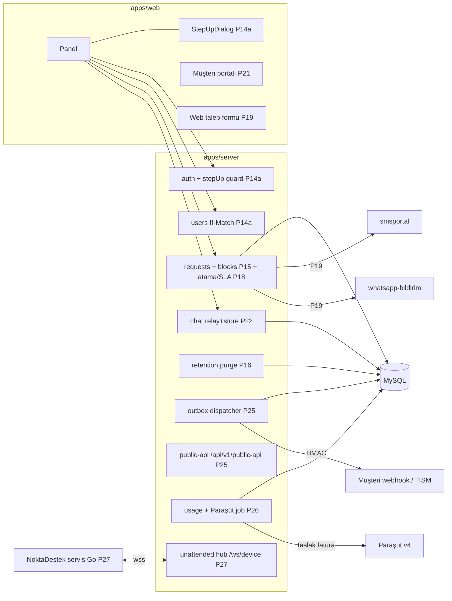

# Mimari — E11 yol haritası (P13c, P14a–P28+)

Tarih: 2026-11-14 · Durum: P13c/P14a/P14b/P16/P17/P18 ayrıntılı (kodlanabilir); P15 orta; P18–P28+ üst düzey.
Girdiler: `docs/gereksinimler-e11.md` (ONAYLANDI, S22–S28), `docs/gereksinimler-kabul-kriterleri-e11.md` (AC-201..244),
`-e11-b.md` (AC-245..297), ADR-0019 m.5, `docs/mimari-p13.md` §7. Ana mimari `docs/mimari.md` (§10.1 paket kuralları aynen geçerli).
Yeni ADR'ler: 0021–0028, 0030 (§9). Ortak AC-285..290 her pakette geçerlidir; ayrıca tekrar yazılmaz.

## 1. Özet ve kısıtlar

- Sıra sabit: **P13b prod → P13c ayrı staging → P14a ‖ P14b → P15 → …** (R29). P13c kurulmadan E11 kodu başlamaz, prod'a çıkmaz.
- Stack değişmez (Fastify + ws + Prisma/MySQL, Next.js 16, Go istemci). Yeni çalışma zamanı bağımlılığı P14a/P14b'de **yok**;
  tek yeni geliştirme bağımlılığı Prettier (ADR-0024). P15+ bağımlılıkları kendi turunda §10.4'e göre gerekçelenir.
- Tek instance, bellek içi oda (ADR-0005) korunur; yeni zamanlanmış işler mevcut `jobs/scheduler.ts`'e eklenir.
- Ortak altyapı (auth, tenant guard, yetki, audit, hata zarfı, logger, `lib/rate.ts`, `lib/netguard.ts`, `lib/crypto.ts`) yeniden
  kullanılır, kopyalanmaz. E11'de eklenen tek ortak parça **step-up 2FA guard**'ıdır (P14a, ADR-0022); P15/P24/P25/P27 onu kullanır.
- Kullanıcı kararlarının mimari sonuçları §8'de ve ADR-0025..0028'de.

## 2. Bileşen görünümü (E11 sonunda)

## 3. P13c — Ayrı staging ortamı (E11'in ön koşulu; devops, ayrıntılı)

Kaynak: ADR-0019 m.5, `mimari-p13.md` §7.2. Ek kararlar ADR-0021.

### 3.1 Hedef yerleşim

| Öğe                                            | Prod (`remote`)                                | Staging (`remote-stg`)                                                                                                              |
| ---------------------------------------------- | ---------------------------------------------- | ----------------------------------------------------------------------------------------------------------------------------------- |
| Dizin / compose proje adı                      | `/opt/remote/deploy` · `remote`                | `/opt/remote-stg/deploy` · `remote-stg`                                                                                             |
| Ad / TLS                                       | `remote.noktabilisim.net` (nginx + LE)         | `stg.remote.noktabilisim.net` (yeni A kaydı, ayrı nginx vhost, LE)                                                                  |
| Caddy bind                                     | 127.0.0.1:4451 HTTP, :4450 tanı                | 127.0.0.1:4461 HTTP, :4460 tanı                                                                                                     |
| `EDGE_SUBNET` / caddy / web IP                 | 172.30.0.0/24, .2, .3                          | 172.30.1.0/24, .2, .3                                                                                                               |
| `TRUSTED_PROXY_CIDR` / Caddy `trusted_proxies` | 172.30.0.2/31 · 172.30.0.128/32                | 172.30.1.2/31 · 172.30.1.128/32                                                                                                     |
| Volume'lar                                     | `remote_*`                                     | `remote-stg_*` (otomatik ön ek; elle ad yok)                                                                                        |
| Sırlar                                         | prod kasası                                    | **ayrı üretilir**, prod ile ortak sır yok (`APP_ENCRYPTION_KEYS`, `SESSION_REF_KEY`, `TURN_SECRET` dahil)                           |
| `DEPLOY_ENV`                                   | production                                     | staging                                                                                                                             |
| TURN                                           | prod coturn (3478/5349 + relay)                | **yalnız prod coturn STUN** (`TURN_URLS=stun:remote.noktabilisim.net:3478`, kimliksiz); relay testleri prod "Nokta Test" firmasında |
| Yedek                                          | `/var/backups/remote`, prod age anahtarı, 14 g | `/var/backups/remote-stg`, **ayrı age çifti**, 3 g; haftalık geri yükleme provası staging'de                                        |
| İzleme                                         | `remote-watch`                                 | ikinci örnek `remote-watch@stg` (`WATCH_DEPLOY_DIR=/opt/remote-stg/deploy`, `WATCH_PUBLIC_HOST=stg…`); alarm adında `stg`           |
| Arama motoru                                   | —                                              | Caddy `X-Robots-Tag: noindex, nofollow`; `robots.txt` Disallow                                                                      |

### 3.2 Parametreleştirme (genişleme noktası ADR-0019 m.5'in gerçeklenmesi)

- `deploy/docker-compose.yml`: `EDGE_SUBNET`, `EDGE_CADDY_IP`, `EDGE_WEB_IP`, `CADDY_HTTP_PORT` (4451), `CADDY_TLS_PORT` (4450) env ile;
  **varsayılanlar bugünkü prod değerleri** → prod `.env` değişmeden aynı yığını üretir (`docker compose config` farkı 0 = kabul ölçütü).
- `deploy/Caddyfile`: `trusted_proxies {$CADDY_TRUSTED_PROXIES}` (varsayılan prod değeri).
- Betikler (`backup.sh`, `restore.sh`, coturn log cron'u hariç): konteyner adı `remote-mysql-1` yerine `${COMPOSE_PROJECT_NAME}-mysql-1`;
  `RESTORE_EXPECT_PROJECT` ve `DEPLOY_ENV` manifest karşılaştırması korunur (staging yedeği prod'a geri yüklenemez, tersi de).
- Server env'ine yeni değişken **girmez** (`env.ts` değişmez). Yeni anahtarlar yalnız `deploy/.env.example` + runbook.

### 3.3 Staging istemci ve veri kuralları

- Windows istemci: staging için CI `agent-win.yml` `workflow_dispatch` girdisi `server_url` (varsayılan prod) ile **Release'e
  yayımlanmayan** artifact üretir (ad `NoktaDestek-stg-<sürüm>.exe`, attestation yine üretilir). Prod Release akışı değişmez.
- Staging'de gerçek müşteri verisi yok; tenant SMTP yalnız test kutusuna; WhatsApp/SMS servis ayarı boş (test düğmesi test numarasına).
- Kaynak kontrolü (P13c kabul ölçütü): kurulum öncesi `free -m`, `df` ölçümü runbook'a yazılır; iki yığın birlikteyken disk < %80,
  RAM boşluğu ≥ 1 GB; aşılırsa staging MySQL `innodb_buffer_pool_size=256M` ile sınırlanır.

### 3.4 P13c görevleri

| #   | Ajan           | İş                                                                                         | Dosya                                                                  | Kabul ölçütü                                                                                    |
| --- | -------------- | ------------------------------------------------------------------------------------------ | ---------------------------------------------------------------------- | ----------------------------------------------------------------------------------------------- |
| C1  | devops         | Compose/Caddy parametreleştirme                                                            | `deploy/docker-compose.yml`, `deploy/Caddyfile`, `deploy/.env.example` | Prod `.env` ile `docker compose config` çıktısı öncekiyle aynı (diff 0); shellcheck temiz       |
| C2  | devops         | Betiklerde proje adı                                                                       | `deploy/backup/*.sh`, `deploy/ops/*`                                   | `--target staging` yedeği prod'da reddedilir (test)                                             |
| C3  | devops         | Kurulum: DNS, nginx vhost, LE, `/opt/remote-stg`, sırlar, `remote-watch@stg`, backup timer | runbook §21 (yeni)                                                     | `https://stg.remote.noktabilisim.net/ready` 200; prod `/ready` kesintisiz; AC-88 staging ölçümü |
| C4  | devops         | Staging istemci artifact                                                                   | `.github/workflows/agent-win.yml`                                      | stg artifact stg sunucusuna bağlanır, Release'de görünmez                                       |
| C5  | test-operatoru | Duman testi                                                                                | `docs/test-raporu.md`                                                  | login, oturum, tarayıcı modu STUN ile aynı ağda görüntü; konsol hatası 0                        |
| C6  | kullanıcı      | Proje `CLAUDE.md` staging satırının güncellenmesi                                          | `CLAUDE.md`                                                            | `stg.remote…` yazılı                                                                            |

Bağımlılık: P13b prod açılışı imzalı. C1 ‖ C4; C2 → C3 → C5. dba/backend/frontend işi yok.
P13c'den sonra §10.1 akışındaki "staging yayını" adımı = `remote-stg`; prod'a terfi = imzalı Release + `docs/runbook.md` §20 düzeltme yolu.

## 4. P14a — G1 güvenlik/kalite (AC-201..219; ayrıntılı)

### 4.1 Veri modeli değişiklikleri (tek migration `2026111x_p14a_security`)

| Değişiklik                                                                                                                                                                                                                              | Tip / kural                                                                                                                                                                                                                                             | AC  |
| --------------------------------------------------------------------------------------------------------------------------------------------------------------------------------------------------------------------------------------- | ------------------------------------------------------------------------------------------------------------------------------------------------------------------------------------------------------------------------------------------------------- | --- |
| 6 CHECK yeniden: `customers_file_label_chk`, `customers_phone_fmt_chk`, `support_requests_phone_fmt_chk`, `support_requests_client_version_fmt_chk`, `device_bindings_client_version_fmt_chk`, `tenant_request_settings_file_label_chk` | `REGEXP_LIKE(col, '^…\\z', 'c')` (ADR-0014 ikili karşılaştırma korunur); `$` kalmaz                                                                                                                                                                     | 201 |
| Ön kontrol                                                                                                                                                                                                                              | migration başında her CHECK için `SELECT COUNT(*) … WHERE NOT REGEXP_LIKE(col,'…\\z','c')`; > 0 ise `SIGNAL 45000 'P14A_PRECHECK <tablo>=<n>'` → migration durur, sayı loglanır. dba `docs/db-notlari.md`'ye düzeltme SQL'i (sondaki `\n` kırpma) yazar | 201 |
| `users.version INT UNSIGNED NOT NULL DEFAULT 0`                                                                                                                                                                                         | If-Match için (ADR-0023)                                                                                                                                                                                                                                | 206 |
| `auth_sessions.step_up_at DATETIME(3) NULL`                                                                                                                                                                                             | son başarılı step-up anı (ADR-0022)                                                                                                                                                                                                                     | 215 |
| `down.sql`                                                                                                                                                                                                                              | eski 6 CHECK (`$`) geri, iki sütun DROP                                                                                                                                                                                                                 | 201 |

`grants.sql`: yeni tablo yok; `app` için mevcut UPDATE yetkileri yeterli (`check-app-grants.sh` değişmez).

> backend-dev notu (A3, 2026-11-15): §4.2 AC-211 `valueJson.requireTls` P11 `system_settings_mysql_chk` JSON şemasında (`additionalProperties:false`) yazılamıyordu; §4.1 bunu kapsamıyordu. Ayrı küçük migration `20261116010000_p14a_mysql_tls` (+ `down.sql`) eklendi: şemaya yalnız isteğe bağlı `requireTls: boolean`. Yeni tablo/yetki yok.

> dba notu (A1, 2026-11-15): migration adı `20261116000000_p14a_security`. Ön kontrol SIGNAL'i saklı program gerektirdiği için geçici yordamla (`p14a_precheck`) yapılıyor; sayılar tablo bazında. ICU `$` sondaki herhangi bir tek satır sonlandırıcıyı (CR, CRLF, NEL, U+2028 …) da kabul ediyor; düzeltme SQL'i hepsini kırpıyor. `check-app-grants.sh`'ye 6 negatif eklendi (yetki kümesi değişmedi). Kapsam dışı aynı açık: 4 e-posta CHECK'i (`docs/db-notlari.md` "P14a"). B1: `tenants(name)` indeksi gerekmedi.

### 4.2 API ve davranış sözleşmesi

| Uç / bileşen                                                                                     | Değişiklik                                                                                                                                                                                                                                                                                                                                                              | Hata kodları                                                                                                                                                                                                                                                                                                                                                                                                                                                                                                                                                                                                                                                                                                                                                                                                                                                                                                                                                                      | AC            |
| ------------------------------------------------------------------------------------------------ | ----------------------------------------------------------------------------------------------------------------------------------------------------------------------------------------------------------------------------------------------------------------------------------------------------------------------------------------------------------------------- | --------------------------------------------------------------------------------------------------------------------------------------------------------------------------------------------------------------------------------------------------------------------------------------------------------------------------------------------------------------------------------------------------------------------------------------------------------------------------------------------------------------------------------------------------------------------------------------------------------------------------------------------------------------------------------------------------------------------------------------------------------------------------------------------------------------------------------------------------------------------------------------------------------------------------------------------------------------------------------- | ------------- |
| `users/service.ts` tüm yazma TX'leri (create/patch/deactivate/reactivate/reset-mfa/avatar hariç) | TX başında `SELECT id FROM users WHERE id IN (actor, target) ORDER BY id FOR UPDATE`; aktörün `role/status/permissions`'ı TX içinde yeniden okunur; `assertGrantable`/`canManage` bu okumayla çalışır. Test kancası: servis fonksiyonları `deps.afterLock?: () => Promise<void>` alır (yalnız testler verir; env bayrağı yok)                                           | 403 `FORBIDDEN`                                                                                                                                                                                                                                                                                                                                                                                                                                                                                                                                                                                                                                                                                                                                                                                                                                                                                                                                                                   | 202           |
| `/users*` ve `/admin/*` yazma uçları                                                             | `lib/rate.ts` `FixedWindowCounter`, anahtar `userId`: 30/dk; `POST /users` ayrıca 10/dk. Aşımda 429 `RATE_LIMITED` + `Retry-After` (sn). 409 `EMAIL_TAKEN` audit `result:"fail"`                                                                                                                                                                                        | 429, 409                                                                                                                                                                                                                                                                                                                                                                                                                                                                                                                                                                                                                                                                                                                                                                                                                                                                                                                                                                          | 203           |
| 403 audit                                                                                        | `assertGrantable`, `canManage`, kendi hesabı reddi → `writeAudit({action:"user.update", result:"fail", newValue:{denied:[keys]}})`; e-posta/ad yazılmaz                                                                                                                                                                                                                 | —                                                                                                                                                                                                                                                                                                                                                                                                                                                                                                                                                                                                                                                                                                                                                                                                                                                                                                                                                                                 | 204           |
| `tenants/service.ts deactivate`                                                                  | talep iptali (`support_requests` PENDING→CANCELLED `TENANT_INACTIVE`) ve kayıt geçersizleştirme (`device_bindings` `TENANT_INACTIVE`) **aynı TX**'te; hub/WS bildirimleri commit sonrası. Reaktivasyon yalnız yeni kayıtları açar                                                                                                                                       | —                                                                                                                                                                                                                                                                                                                                                                                                                                                                                                                                                                                                                                                                                                                                                                                                                                                                                                                                                                                 | 205           |
| `GET /users/:id`                                                                                 | yanıt `version` alanı + `ETag: "v<version>"`                                                                                                                                                                                                                                                                                                                            | —                                                                                                                                                                                                                                                                                                                                                                                                                                                                                                                                                                                                                                                                                                                                                                                                                                                                                                                                                                                 | 206           |
| `PATCH /users/:id`                                                                               | `If-Match: "v<n>"` zorunlu; yoksa 428 `PRECONDITION_REQUIRED`; uyuşmazsa 409 `STALE_WRITE` (mesaj "Kayıt başkası tarafından değiştirildi, yeniden yükleyin"); koşullu `UPDATE … WHERE id=? AND version=?` + `version=version+1`; yetki değişimi de version artırır. deactivate/reactivate/reset-mfa version artırır; `reset-superadmin` CLI artırmaz (form alanı değil) | 409, 428                                                                                                                                                                                                                                                                                                                                                                                                                                                                                                                                                                                                                                                                                                                                                                                                                                                                                                                                                                          | 206           |
| `users-p9` entegrasyon                                                                           | ADMIN + kilitli anahtar + rol değişimi + tam harita → 200, fark yoksa audit satırı yok (diff tabanlı audit)                                                                                                                                                                                                                                                             | —                                                                                                                                                                                                                                                                                                                                                                                                                                                                                                                                                                                                                                                                                                                                                                                                                                                                                                                                                                                 | 207           |
| Kod denemesi kapısı                                                                              | `rs_guest_code_rate_limited_total{scope:"ip"\|"prefix"}`; runbook alarm: 15 dk'da prefix ≥ 20                                                                                                                                                                                                                                                                           | —                                                                                                                                                                                                                                                                                                                                                                                                                                                                                                                                                                                                                                                                                                                                                                                                                                                                                                                                                                                 | 208           |
| `/requests` kapısı (`requests/limits.ts`, `lib/gate.ts`)                                         | Sıra: hazır mı (503 `NOT_READY`) → IP/önek kovası → TX → commit sonrası tenant kovası `hit()`                                                                                                                                                                                                                                                                           | 503                                                                                                                                                                                                                                                                                                                                                                                                                                                                                                                                                                                                                                                                                                                                                                                                                                                                                                                                                                               | 209           |
| `/ws/request` upgrade                                                                            | `isTrustedCidr(ip)` ise `wsUpgrade` kovası atlanır; diğer kovalar (ref, tenant) aynen                                                                                                                                                                                                                                                                                   | 429                                                                                                                                                                                                                                                                                                                                                                                                                                                                                                                                                                                                                                                                                                                                                                                                                                                                                                                                                                               | 210           |
| `system_settings.mysql`                                                                          | `valueJson.requireTls: boolean` (varsayılan false). Test/bağlantı: `requireTls` → `ssl:{rejectUnauthorized:true}`, TLS yoksa sınıf `tls`. `allowPublicKeyRetrieval` yalnız `netguard.classify(host) ∈ {loopback, private}` veya tek etiketli compose servis adında (`/^[a-z0-9-]+$/`)                                                                                   | 400 alan, sınıf `tls`                                                                                                                                                                                                                                                                                                                                                                                                                                                                                                                                                                                                                                                                                                                                                                                                                                                                                                                                                             | 211           |
| MySQL test metriği                                                                               | `rs_mysql_test_failed_total{class}` (class: connect\|auth\|tls\|timeout\|other); runbook alarm 1 sa'te ≥ 10                                                                                                                                                                                                                                                             | —                                                                                                                                                                                                                                                                                                                                                                                                                                                                                                                                                                                                                                                                                                                                                                                                                                                                                                                                                                                 | 212           |
| SMTP testleri                                                                                    | yerel sahte SMTP (P10 test kalıbı; yoksa `smtp-server` MIT devDependency, gerekçe implementation.md): yanlış CN → `tls`, ileti 0; STARTTLS ilan etmeyen → gönderim yok                                                                                                                                                                                                  | —                                                                                                                                                                                                                                                                                                                                                                                                                                                                                                                                                                                                                                                                                                                                                                                                                                                                                                                                                                                 | 213           |
| `POST /auth/mfa/setup`                                                                           | koşullu `UPDATE users SET totp_secret_enc=? WHERE id=? AND totp_enabled=0 AND version=?` (version kullanımı) — etkilenen 0 → 409 `CONFLICT`; `afterLock` kancalı test 20/20                                                                                                                                                                                             | 409                                                                                                                                                                                                                                                                                                                                                                                                                                                                                                                                                                                                                                                                                                                                                                                                                                                                                                                                                                               | 214           |
| **Step-up** `POST /auth/step-up` `{method: "TOTP"                                                | "RECOVERY", code}`                                                                                                                                                                                                                                                                                                                                                      | TOTP: 6 hane, `totp_last_step` tekrar koruması. RECOVERY: mevcut kurtarma kodu doğrulaması; kod **aynı TX'te tüketilir** (P10 login yolu ile aynı fonksiyon, kopya yok). Başarıda `auth_sessions.step_up_at=now`. 5 hatalı → mevcut MFA kilit sayacı (iki yöntem ortak sayaç). Telafi: kurtarma koduyla step-up'ta audit `auth.step_up` `newValue:{method:"RECOVERY", remaining:n}` (kod yazılmaz), kullanıcıya e-posta bildirimi ("Kurtarma kodunuz kullanıldı", SMTP yapılandırılmışsa), yanıtta `recoveryCodesLeft`; kalan ≤ 3 ise diyalogda ve hesap sayfasında "Kurtarma kodlarınız azaldı, yenileyin" uyarısı (AC-231 yoluna bağlantı). Yanıt `{ stepUpUntil, method, recoveryCodesLeft? }`. Guard `requireStepUp()` (5 dk): `PUT/DELETE /admin/settings/{whatsapp,turn,mysql}`; P24 SSO ve P25 API anahtarı uçları aynı guard'ı kullanır. Eksikse 401 `MFA_STEP_UP_REQUIRED`; TOTP'si olmayan kullanıcıda 403 `MFA_SETUP_REQUIRED`. Audit `auth.step_up` (ok/fail, method) | 401, 403, 429 | 215 |
| `/ws/panel`                                                                                      | Tarayıcı WS el sıkışma başlığını okuyamaz → aşımda upgrade **kabul edilip** hemen `close(4429, "retry=<sn>")`; istemci `retry` kadar bekler (± %20 jitter), konsola yazmaz. Bağlantı `(panel)/layout` sağlayıcısında tek örnek; istemci içi gezintide yeniden açılmaz. Kova: kimlik oturumu başına 30/dk (IP kovası değişmez)                                           | 4429                                                                                                                                                                                                                                                                                                                                                                                                                                                                                                                                                                                                                                                                                                                                                                                                                                                                                                                                                                              | 216           |

### 4.3 AC-217 kalite borcu (backend-dev + frontend-dev)

`SYSTEM_AUDIT` JSDoc ↔ kod eşitliği + `_` önekli eylemler entegrasyon testi; web `canonicalWaUrl` → `packages/contracts`; kullanılmayan global retention fonksiyonları silinir; mysql/turn "değişmeyen PUT → audit yok" testi; `RETENTION_DEFAULT_DAYS` contracts'a; `startup-check.ts` birim testi; `globals.css` koyu token kopyaları eşitlik testi (P14b ile ortak dosya: testi frontend-dev yazar). CI shellcheck devops'ta.

### 4.4 AC-218/219

- ADR-0024: Prettier (TS/JS/JSON/MD/CSS), Go `gofmt` (zaten). **Tek seferlik biçimlendirme commit'i** P13c sonrası, P14a/P14b kodundan **önce**, açık dal yokken (aksi hâlde her dal çakışır); SHA `.git-blame-ignore-revs`'e. CI `pnpm format:check`.
- Kararlılık: `scripts/repeat-tests.sh <n>` (vitest entegrasyon + Playwright `--repeat-each`); CI `stability.yml` (`workflow_dispatch` + haftalık), 20 koşu; çıktı qa raporuna. Kararsız test bulunursa kök neden düzeltilir (retry ile gizlemek yasak); `docs/implementation.md` "Kararsız testler" listesi boş olmalı.

### 4.5 Dosya planı (P14a)

Değişir: `apps/server/prisma/schema.prisma`, `prisma/migrations/2026111x_p14a_security/{migration.sql,down.sql}`, `src/users/{service,routes,repo}.ts`,
`src/tenants/service.ts`, `src/auth/{routes,guards,mfa,service}.ts`, `src/settings/{system,mysql-probe}.ts`, `src/requests/{limits,public-routes,panel,ws}.ts`,
`src/lib/gate.ts`, `src/ops/metrics.ts`, `src/tenants/smtp-routes.ts` (yalnız test), `packages/contracts/src/{errors,audit,api/*}.ts`,
`apps/web/lib/api.ts` (step-up yakalama, 428/409), `components/account/step-up-dialog.tsx` (yeni), `app/(panel)/users/[id]/user-editor.tsx`,
`app/(panel)/admin/settings/*` (MySQL TLS kutusu), panel WS sağlayıcısı; `.github/workflows/{ci,stability}.yml`, `package.json`, `.prettierrc`,
`.prettierignore`, `.git-blame-ignore-revs`, `scripts/repeat-tests.sh`, `docs/runbook.md` (alarm satırları), `docs/db-notlari.md`, `docs/implementation.md`.

### 4.6 Görev paketleri (P14a)

| #   | Ajan         | İş                                                                                                                                                                                                                                                                                                                                                                               | Bağımlı                                          | Kabul ölçütü                                                                          |
| --- | ------------ | -------------------------------------------------------------------------------------------------------------------------------------------------------------------------------------------------------------------------------------------------------------------------------------------------------------------------------------------------------------------------------- | ------------------------------------------------ | ------------------------------------------------------------------------------------- |
| A0  | devops       | Prettier kurulumu + tek seferlik biçimlendirme + `format:check`                                                                                                                                                                                                                                                                                                                  | P13c                                             | `pnpm format:check` 0 fark; P14b ile aynı anda değil, ondan önce                      |
| A1  | dba          | Migration §4.1 + ön kontrol + down + db-notlari                                                                                                                                                                                                                                                                                                                                  | A0                                               | `\n` sonlu INSERT → 3819 (6 CHECK); down/up döngüsü temiz; ön kontrol sayısı loglanır |
| A2  | backend-dev  | §4.2 AC-202..207, 214, 215 (users, tenants, auth, step-up guard)                                                                                                                                                                                                                                                                                                                 | A1                                               | AC adlı entegrasyon testleri yeşil; gecikme kancalı testler 20/20                     |
| A3  | backend-dev  | §4.2 AC-208..213, 216 sunucu; §4.3 sunucu maddeleri                                                                                                                                                                                                                                                                                                                              | A1 (A2 ile aynı ajan, sıralı ya da ikinci örnek) | metrikler `/metrics`'te; 4429 kapanışı testli                                         |
| A4  | frontend-dev | Step-up diyaloğu (odak tuzağı, TOTP 6 hane / "Kurtarma kodu kullan" geçişi, kalan ≤ 3 uyarısı, `aria-live` hata), api istemcisi 401 `MFA_STEP_UP_REQUIRED` → diyalog → tek tekrar; 409/428 mesajı + "Yeniden yükle"; rol geri alınınca kayıtlı ezmelerin geri gelmesi (kayıtlı harita state'te ayrı tutulur); MySQL "TLS gerekli"; panel WS 4429 + tek örnek; §4.3 web maddeleri | A2 sözleşmesi (`contracts`)                      | AC-206/215/216 e2e; 12 sayfa/dk gezintide konsol hatası 0                             |
| A5  | devops       | CI shellcheck, `stability.yml`, runbook alarm eşikleri (208, 212)                                                                                                                                                                                                                                                                                                                | A0                                               | 20 koşu raporu; shellcheck tüm `deploy/**/*.sh`                                       |

Paralel: A2 ‖ A3 (dosya ayrık: users/tenants/auth ↔ requests/settings/ops) ‖ A5; A4, A2'nin `contracts` değişikliği birleşince.
**Kabul (paket):** AC-201..219 testleri yeşil (adında AC no), qa GEÇTİ, güvenlik Kritik/Yüksek 0, stg'de duman testi.

## 5. P14b — G2 UI/a11y (AC-220..230; ayrıntılı; P14a ile paralel)

### 5.1 Kararlar

| AC  | Kök neden / karar                                                                                                                                                                                                                                                                                                                                                                                                                                                                                                                                                                                                                                                                                   | Bileşen                             |
| --- | --------------------------------------------------------------------------------------------------------------------------------------------------------------------------------------------------------------------------------------------------------------------------------------------------------------------------------------------------------------------------------------------------------------------------------------------------------------------------------------------------------------------------------------------------------------------------------------------------------------------------------------------------------------------------------------------------- | ----------------------------------- |
| 220 | `(panel)/loading.tsx` ve `[id]/loading.tsx` Suspense sınırı yanıtı akışla 200 başlatıyor; `notFound()` geç kalıyor (Next 16 `generateMetadata` de akışlı). **Karar:** `(panel)/loading.tsx` kaldırılır, iskeletler liste sayfalarının kendi `loading.tsx`'ine taşınır; `users/[id]` ve `customers/[id]` için `loading.tsx` silinir, varlık kontrolü `[id]/layout.tsx` (sunucu, `serverGet`) içinde Suspense'ten önce yapılır, ağır bölümler sayfa içi `<Suspense>` + skeleton. 404 sayfası `users/not-found.tsx` / `customers/not-found.tsx`: tek h1 "Kullanıcı bulunamadı" / "Müşteri bulunamadı". frontend-dev kök nedeni ilk adımda `curl -I` ile doğrular; farklıysa implementation.md'ye yazar | web                                 |
| 221 | Yeni token `--switch-track-off`, `--switch-track-locked` (açık/koyu), `globals.css` + DESIGN.md; birim testi token çiftlerinden kontrast oranını hesaplar (≥ 3:1, zemin `--surface`, `--surface-2`)                                                                                                                                                                                                                                                                                                                                                                                                                                                                                                 | `components/ui/switch.tsx`          |
| 222 | Mobil menü açılışında `activeEl.scrollIntoView({block:"nearest"})` (animasyonsuz); kaydırılabilir kapsayıcıda alt/üst kenar `mask-image` ipucu + `aria-hidden`; e2e 375/390 px `toBeInViewport`                                                                                                                                                                                                                                                                                                                                                                                                                                                                                                     | `side-nav.tsx`                      |
| 223 | `status=all` boş durumu varsayılan `EmptyState` ile aynı bileşen; "Müşteriye nasıl gönderilir?" diyaloğu sayfa düzeyinde tek örnek, tetikleyiciler ref'le açar                                                                                                                                                                                                                                                                                                                                                                                                                                                                                                                                      | `customers/*`                       |
| 224 | Ayarlar > Genel'e: kod geçerliliği `sessionTtlMin` (15–30 dk), en uzun oturum `maxActiveHours` (1–8 sa), açık oturum sınırı `maxOpenSessions` (1–10), dosya sınırı `maxFileMb` (1–2048). Sunucu `PUT /settings/tenant` sınırları değişmez; istemci şeması `contracts`'tan; 400 alan hataları forma; audit eski→yeni (mevcut değilse backend ekler)                                                                                                                                                                                                                                                                                                                                                  | `settings/tenant-settings-page.tsx` |
| 225 | Teknisyen seçenekleri tam liste: **yeni** `GET /users/options` → `{items:[{id, fullName, status}]}` (tenant kapsamı, `fullName` sırası, üst sınır 1.000; USER ve `historyScope=own` → yalnız kendisi; yetki `session_history.view` \| `support_requests.view` \| `users.view`). Müşteri: mevcut `/customers/options?q=` aranabilir combobox (≤ 20 + `q`). Firma: §226                                                                                                                                                                                                                                                                                                                               | `history/*`, `requests/*`           |
| 226 | **Yeni** `GET /admin/tenants/options?q=&limit=20` (SUPER_ADMIN; `name` LIKE önek + içerir, harf duyarsız, aktif önce). İndeks: `tenants(name)` yoksa dba ekler. Firma seçici `components/ui/combobox.tsx` (WAI-ARIA combobox; ↑↓ Enter Esc), 250 ms debounce; ölçüm: sunucu p95 ≤ 500 ms (250 firma fixture)                                                                                                                                                                                                                                                                                                                                                                                        | `tenant-switcher.tsx`               |
| 227 | `contracts/dc.ts` `CHAT_SEND_PER_SEC = 5` tek sabit; gönderen token bucket; aşımda giriş altında `role=status` "Çok hızlı yazıyorsunuz", mesaj gönderilmez (kuyruğa alınmaz); alıcı sınırı ≥ gönderen sınırı (test eşitsizliği doğrular)                                                                                                                                                                                                                                                                                                                                                                                                                                                            | `lib/dc/use-collab.ts`              |
| 228 | Mevcut `lib/use-leave-guard.ts` genişler: kirli durumda `history.pushState` nöbetçi kaydı; `popstate`'te onay diyaloğu ("Kaydedilmemiş değişiklikler var"); vazgeçte nöbetçi yeniden itilir; `beforeunload` korunur                                                                                                                                                                                                                                                                                                                                                                                                                                                                                 | oturum notu                         |
| 229 | `file.type===""` ise uzantı (`.png .jpg .jpeg .webp`) ile ön kabul; karar sunucuda magic bytes (değişiklik yok)                                                                                                                                                                                                                                                                                                                                                                                                                                                                                                                                                                                     | logo/avatar yükleme                 |
| 230 | 256 MB uyarısı saf fonksiyona çıkarılır (`shouldWarnLargeWrite(bytes)`), eşik altı/üstü bileşen testi                                                                                                                                                                                                                                                                                                                                                                                                                                                                                                                                                                                               | dosya alma                          |

### 5.2 Görev paketleri (P14b)

| #   | Ajan         | İş                                                                       | Bağımlı                                                                                            | Kabul ölçütü                                                       |
| --- | ------------ | ------------------------------------------------------------------------ | -------------------------------------------------------------------------------------------------- | ------------------------------------------------------------------ |
| B1  | dba          | `tenants(name)` indeksi gerekiyorsa (EXPLAIN ile)                        | A0                                                                                                 | migration + down; gerek yoksa db-notlari'ne "gerek yok"            |
| B2  | backend-dev  | `GET /users/options`, `GET /admin/tenants/options`, AC-224 audit eksikse | A0 (P14a A2/A3'ten sonra aynı ajan; dosya: `users/routes.ts` A2 ile ortak → A2 birleştikten sonra) | rol kapsamı + tenant izolasyonu entegrasyon testi; 150/250 fixture |
| B3  | frontend-dev | §5.1 tümü                                                                | B2 sözleşmesi (220–224, 227–230 B2'ye bağlı değil, hemen başlar)                                   | AC-220..230 testleri; iki temada axe 0; 390 px taşma yok           |

Paralel: B3 (225/226 hariç) P14a ile tam paralel. **Çakışma:** `apps/web/lib/api.ts` ve `users/[id]/*` A4 ile ortak → aynı frontend-dev sırayla (önce A4, sonra B3 220) ya da tek dalda.
**Kabul (paket):** AC-220..230 + AC-287 yeşil; DESIGN.md token eklendi; qa GEÇTİ.

## 6. P15 — G3 küçük özellikler (AC-231..239; orta ayrıntı)

| AC  | Veri modeli                                                                                                                                                                                                                              | API                                                                     | Not / risk                                                                                                                      |
| --- | ---------------------------------------------------------------------------------------------------------------------------------------------------------------------------------------------------------------------------------------- | ----------------------------------------------------------------------- | ------------------------------------------------------------------------------------------------------------------------------- |
| 231 | — (recovery_codes yeniden üretilir)                                                                                                                                                                                                      | `POST /auth/mfa/recovery-codes` `{code}` → `{codes:[10]}`               | TOTP + 5 hata kilit; eski kodlar aynı TX'te silinir; audit `mfa.recovery_regenerated`                                           |
| 232 | —                                                                                                                                                                                                                                        | `POST /admin/superadmins/:id/reset-password` → `{temporaryPassword}`    | step-up (§4.2); P13b `auth/superadmin-reset.ts` servisi yeniden kullanılır (kopya yok); kendi id'si 403                         |
| 233 | `system_settings.system_logo` değeri NULL (V31: **boş değer** — `app`'e DELETE verilmez, TURN/WhatsApp kalıbı)                                                                                                                           | `DELETE /admin/settings/system-logo`                                    | dosya commit sonrası silinir; login/PDF varsayılan; `check-app-grants.sh` DELETE olmadığını doğrular                            |
| 234 | —                                                                                                                                                                                                                                        | WS: `share.state {reason, method}` konsola iletilir                     | etiketler `contracts/labels.ts`; bilinmeyen ham; istemci kısmı P17                                                              |
| 235 | **`request_blocks`** (`id, tenant_id, kind IP\|DEVICE, ip_from VARBINARY(16), ip_to VARBINARY(16), device_key_hash CHAR(64), expires_at NULL, note, created_by, created_at`; IX(tenant_id, kind, expires_at); tenant ≤ 1.000 uygulamada) | `GET/POST/DELETE /request-blocks` (`support_requests.block` yeni yetki) | kapıda tenant başına bellek önbelleği, yazmada geçersiz kılma; ret yanıtı mevcut tek tip; IPv4 /32–/24, IPv6 /128–/48           |
| 236 | —                                                                                                                                                                                                                                        | `GET /public/sessions/:token/tech-avatar?exp=&sig=`                     | HMAC-SHA256 (`lib/crypto.ts` HKDF etiketi `avatar-url`), ≤ 10 dk, oturum ACTIVE değilse 403; `Cache-Control: private, no-store` |
| 237 | `permissions`: `users.delete`                                                                                                                                                                                                            | (uç P16)                                                                | toggle otomatik (AC-285)                                                                                                        |
| 238 | `session_files.reported_by ENUM('TECH','CUSTOMER')` + `match_key`                                                                                                                                                                        | geçmiş/CSV "doğrulanmış/Müşteri bildirimi"                              | eski satırlar `TECH` varsayılan                                                                                                 |
| 239 | `tenant_request_settings.require_accept_code BOOL DEFAULT 0`                                                                                                                                                                             | kabul akışı admitCode kurallarıyla (AC-112)                             | kapalıyken akış değişmez (regresyon testi)                                                                                      |

Ekip: dba (request_blocks, session_files, tenant_request_settings) → backend ‖ frontend. Riskler: engel önbelleği ile çok tenant tutarlılığı (tek instance, yeterli); imzalı URL anahtarının ayrık türetilmesi.

## 7. P16 — G4 kalıcı silme (AC-240..244; ayrıntılı; ADR-0030 r2 — K27'yi kapatır)

Kararlar ve gerekçeler ADR-0030'dadır. r2, güvenlik tasarım turu bulgularını (S16-1..11) işler. Bu bölüm o kararların
uygulanacak sözleşmesidir.

Şemadan doğrulanan iki gerçek:

- FK döngüsü `device_bindings.first/last_session_id` (NOT NULL) → `support_sessions.request_id` →
  `support_requests.binding_id` biçimindedir.
- `audit_logs.tenant_id` FK'dir; P16'da kaldırılır.

**Kullanıcı onayı bekleyen varsayım (S16-4):** firma silme 24 saat `SCHEDULED` bekler ve iptal edilebilir (ADR-0030 m.5).

### 7.1 Veri modeli (tek migration `2026111x_p16_hard_delete`, P15 migration'ından sonra)

| Değişiklik                                                          | Tip / kural                                                                                                                                                                                                                                                                                                                                                                                                                                                                                                                                                                                                                                                                                                                                                                                                                                                                     | AC / bulgu |
| ------------------------------------------------------------------- | ------------------------------------------------------------------------------------------------------------------------------------------------------------------------------------------------------------------------------------------------------------------------------------------------------------------------------------------------------------------------------------------------------------------------------------------------------------------------------------------------------------------------------------------------------------------------------------------------------------------------------------------------------------------------------------------------------------------------------------------------------------------------------------------------------------------------------------------------------------------------------- | ---------- |
| `ALTER TABLE audit_logs DROP FOREIGN KEY audit_logs_tenant_id_fkey` | İndeksler kalır; Prisma ilişkileri çıkar; `migrate diff --exit-code` 0                                                                                                                                                                                                                                                                                                                                                                                                                                                                                                                                                                                                                                                                                                                                                                                                          | 242        |
| `tenants.passive_at DATETIME(3) NULL`                               | Geri doldurma: PASSIVE satırlarda `updated_at`. CHECK `tenants_passive_chk`: `(CAST(status AS BINARY) = 'PASSIVE') = (passive_at IS NOT NULL)`                                                                                                                                                                                                                                                                                                                                                                                                                                                                                                                                                                                                                                                                                                                                  | 242        |
| `users_status_chk` += `DELETED`; `users_deleted_chk`                | ADR-0030 m.4                                                                                                                                                                                                                                                                                                                                                                                                                                                                                                                                                                                                                                                                                                                                                                                                                                                                    | 241        |
| Ön kontrol                                                          | `deleted_at` dolu ama DELETED olmayan kullanıcı → `SIGNAL 45000 'P16_PRECHECK users=<n>'`                                                                                                                                                                                                                                                                                                                                                                                                                                                                                                                                                                                                                                                                                                                                                                                       | 241        |
| **`users.delete` sıfırlama** (ana oturum kararı)                    | `DELETE FROM user_permissions WHERE perm_key = 'users.delete'`. Bu anahtar P16'ya kadar hiçbir ucu korumuyordu ama toggle'ı vardı; önceden açılmış bir USER satırı kalıcı silme yetkisine dönüşürdü. Silme sonrası herkes rol varsayılanına döner (ADMIN açık, USER kapalı). Migration öncesi ve sonrası sayım `SELECT COUNT(*) … granted = 1` migration çıktısına yazılır; SQL db-notlari "P15"te. `down.sql` bunu geri getirmez (bilinçli)                                                                                                                                                                                                                                                                                                                                                                                                                                    | 237, 241   |
| **`tenant_purge_jobs`**                                             | `id` CHAR(26) PK · `tenant_id` CHAR(26), **FK değil**, CHECK `REGEXP_LIKE(tenant_id, '^[0-9A-HJKMNP-TV-Z]{26}\\z', 'c')` (S16-2) · `state` VARCHAR(20) `SCHEDULED\|RUNNING\|DONE\|FAILED\|CANCELLED` · `step` VARCHAR(30) · `scheduled_for` DATETIME(3) · `counts` JSON ≤ 4 KB · `attempts` INT UNSIGNED · `last_error` VARCHAR(60) (`^[a-z_]{1,60}\z`) · `preview_hash` CHAR(64) **UQ** (S16-6) · `started_by` → `users` · `cancelled_by` NULL → `users` · `cancelled_at`, `started_at`, `heartbeat_at`, `tenant_row_deleted_at`, `finished_at` NULL · `created_at`, `updated_at`. CHECK'ler: `state`/`step` ikili; `DONE ⇔ finished_at`; `CANCELLED ⇔ cancelled_at`. Fonksiyonel UQ `tenant_purge_jobs_one_open_uq` `((IF(state IN ('SCHEDULED','RUNNING','FAILED'), tenant_id, NULL)))`. IX(`state`, `scheduled_for`), IX(`tenant_id`), IX(`started_by`), IX(`cancelled_by`) | 242        |
| **19 tetikleyici** (toplam 22)                                      | ADR-0030 m.3 tablosu: 11 BEFORE DELETE, 6 BEFORE UPDATE (`users`, `tenants`, `support_sessions`, `support_requests`, `device_bindings`, `tenant_purge_jobs`), 2 BEFORE INSERT (`tenants`, `tenant_purge_jobs`). `anonymized_at`/`revoked_at` bir kez yazılır ve `[UTC − 1 g, UTC + 1 dk]` aralığında olur (S16-3). İş geçişleri ve 24 saat DB'de zorlanır (S16-4). İş satırı yalnız DONE/CANCELLED + 730 g sonra silinir (S16-10)                                                                                                                                                                                                                                                                                                                                                                                                                                               | 240, 242   |
| `grants.sql`                                                        | DELETE eklenir: `support_sessions`, `support_requests`, `session_consents`, `device_bindings`, `customers`, `request_refs`, `consent_texts`, `tenant_request_settings`. `tenant_purge_jobs`: SELECT/INSERT/UPDATE/DELETE                                                                                                                                                                                                                                                                                                                                                                                                                                                                                                                                                                                                                                                        | 240, 242   |
| Beklenen sayı / özet                                                | `audit-continuity.sql` sabiti; `check-app-grants.sh` tetikleyici sayısı 22; `deploy/backup/backup.sh` `BACKUP_EXPECTED_TRIGGERS` varsayılanı **22** + `backup.env.example`; restore-verify 22 (S16-11)                                                                                                                                                                                                                                                                                                                                                                                                                                                                                                                                                                                                                                                                          | —          |
| `check-app-grants.sh` yeni negatifler                               | Şunlar SIGNAL vermeli ya da zorlanmalı: taze anonim oturum DELETE; aktif firma `customers` DELETE; Super Admin `users` DELETE; `passive_at` geri tarihleme (zorlanan değer); mezar taşı UPDATE; açık işte firma yeniden etkinleştirme; `anonymized_at = '2000-01-01'`; dolu `revoked_at` değişimi; `state = 'RUNNING'` INSERT; `scheduled_for` dolmadan RUNNING; `tenant_id = 'system'` INSERT (CHECK); RUNNING iş satırı DELETE                                                                                                                                                                                                                                                                                                                                                                                                                                                | 240–242    |
| `down.sql`                                                          | DELETED kullanıcı ya da iş satırı varsa `p16_down_guard_chk` (3819) ile durur; dangling `audit_logs.tenant_id` > 0 ise FK eklenmeden durur                                                                                                                                                                                                                                                                                                                                                                                                                                                                                                                                                                                                                                                                                                                                      | —          |

P15 notu: `request_blocks`, §7.3'teki 8. adımla silinir. P15'in DELETE yetkisi yeterlidir.

### 7.2 Gece silme işi (`purgeAnonymized`, AC-240)

- **Yer:** `jobs/retention.ts` `tenantSteps` içinde, anonimleştirmeden sonra. Veri erişimi `retention-repo.ts`
  (`purgeBindingsBatch`, `purgeSessionsBatch`, `purgeOrphanRequestsBatch`).
- **Kesme anı DB saatiyle (S16-8):** sorgu içinde `UTC_TIMESTAMP(3) − INTERVAL 30 DAY − INTERVAL 1 HOUR`. Parti 500,
  tek TX; sıra ADR-0030 m.2.
- **Hata:** partide SIGNAL alınırsa `class = db_signal`, `rs_retention_failures_total{class}` artar ve alarm üretilir.
  Sıradaki firmaya geçilir.
- **Mod:** `RETENTION_PURGE_MODE=on` siler; `dry` aynı sorguları `COUNT` ile çalıştırır.
- **Sayaçlar:** `purgedSessions`, `purgedConsents`, `purgedRequests`, `purgedBindings` (dry'da `purgeCandidates.*`)
  `retention.run` audit'ine ve `rs_retention_rows_total{kind="purged_*"}` metriğine yazılır. İkinci koşu 0 siler.
- **Çakışma:** açık işi (`SCHEDULED|RUNNING|FAILED`) olan firma atlanır.
- **Global adım:** `tenant_purge_jobs` DONE/CANCELLED satırlarının 730 gün sonra silinmesi.
- **İndeks:** mevcut indeksler; dba EXPLAIN ile doğrular, gerekirse `device_bindings(tenant_id, revoked_at)` ekler.
- **Testler:** `anonymized_at` aralık tetikleyicisi yüzünden geçmiş tarihli fikstürler `testFixtureDb()` (migrator) ile
  kurulur.

### 7.3 Firma silme işi (AC-242)

Durumlar `SCHEDULED → RUNNING → DONE | FAILED`, ayrıca `SCHEDULED → CANCELLED` ve `FAILED → RUNNING`. Adımlar ADR-0030
m.2'dedir: `FENCE … TENANT_ROW → FILES → DONE`.

**Zamanlama ve bildirim (S16-4):**

- POST, DB saatiyle +24 saatlik bir `SCHEDULED` iş açar.
- Bildirimler:
  - audit `tenant.purge_scheduled`;
  - **bütün Super Admin'lerin panelinde** kapatılamayan uyarı bandı ("<firma> <tarih> tarihinde kalıcı silinecek —
    İptal et"), kaynağı `GET /admin/purge-jobs?open=1`;
  - `rs_tenant_purge_jobs{state="SCHEDULED"}` > 0 → `remote-watch` operatör alarmı.
- E-posta, sistem SMTP'si gelince eklenir (Sonra).
- İptal `DELETE /admin/tenants/:id/purge` ile yapılır (step-up); audit `tenant.purge_cancelled`.

**Yürütücü (`jobs/tenant-purge.ts`, `TenantPurgeRunner`):**

- 60 sn tur, tek iş, iş satırı `FOR UPDATE`.
- `scheduled_for` geçmiş `SCHEDULED` iş `RUNNING` olur.
- **Her turun başında uygunluk yeniden doğrulanır** (DB saati; S16-2):
  - `step < TENANT_ROW` iken firma PASSIVE ve `passive_at <= UTC − 30 g` olmalı.
  - `step ≥ TENANT_ROW` iken firma satırı yok ve `tenant_row_deleted_at` dolu olmalı.
  - Aksi hâlde iş `FAILED` (`invalid_job`) olur ve alarm üretilir.
- Parti: `DELETE … WHERE tenant_id = ? LIMIT 500` → `counts`/`heartbeat_at` → commit. 0 satırda adım ilerler.
  `TENANT_ROW` adımı `tenant_row_deleted_at`'ı aynı TX'te yazar.
- **`FILES`:** id yalnız `TENANT_PREFIX_RE` ile doğrulanır (`isPrefix` değil). Yol yeni `UploadStore.absDir(prefix)`
  ile (`resolve` + kök altı) kurulur. `rm -r` sembolik bağlantıyı izlemez; bağlantıysa yalnız bağlantı silinir (test).
- **`DONE`:** audit `tenant.purged` + imha defterine `{type: "tenant", id, jobId, at}` (ADR-0030 m.9).
- **Test kancası:** `deps.afterBatch?: (step) => Promise<void>` (yalnız testler).
- **Hata:** sınıflar `db_fk`, `db_signal`, `fs`, `invalid_job`, `other`. 3 üstel deneme, sonra `FAILED` + audit
  `tenant.purge_failed` + alarm. `heartbeat_at` > 30 dk ise iş yeniden alınır.
- **Metrik:** `rs_tenant_purge_rows_total{table}`, `rs_tenant_purge_jobs{state}`, `rs_tenant_purge_last_heartbeat_seconds`.

### 7.4 Kullanıcı mezar taşı ve audit maskesi (AC-241)

- **Servis:** `users/service.ts` `purgeUser`. Alan değerleri ADR-0030 m.4'tedir. Tek TX, aktör ve hedef `FOR UPDATE`;
  koşullu `WHERE id = ? AND version = ? AND status = 'PASSIVE'`.
- **Commit sonrası:** avatar silinir ve imha defterine `{type: "user", id, at}` yazılır.
- **Liste görünürlüğü:** mezar taşı `GET /users` listelerinde görünmez. `GET /users/options?includeDeleted=1`
  "Silinmiş kullanıcı #XXXXXX" etiketiyle döner. `GET /users/:id` 404.
- **Giriş (S16-7):** `findUserByLogin` ve parola sıfırlama `status <> 'DELETED'` ile süzer; mezar taşı "olmayan hesap"
  yoluna düşer.
- **Audit maskesi — fail-closed (S16-1):** `audit/read.ts` + `audit/view.ts`, tek görünüm fonksiyonu (liste, CSV,
  oturum zaman çizelgesi).
  - Sayfadaki `user_id`, `entity = AUDIT_ENTITY.USERS` (kodda `"users"`) olan `entity_id` ve `tenant_id` değerleri iki
    `IN` sorgusuyla okunur.
  - Maskelenir: kullanıcı satırı **yok** ya da DELETED; firma satırı **yok**.
  - `username` → `maskIdentity()`. JSON içinde `AUDIT_IDENTITY_KEYS` (iç içe dahil) maskelenir.
  - Etiketler: `actorLabel`, `tenantLabel`.

### 7.5 API sözleşmesi

| Uç                                                | Yetki                                                                                              | Girdi                                                                                                                                                                                               | Çıktı                                                                                                                                              | Hata kodları                                                                                                                                                                                                                                                                                                                  | AC       |
| ------------------------------------------------- | -------------------------------------------------------------------------------------------------- | --------------------------------------------------------------------------------------------------------------------------------------------------------------------------------------------------- | -------------------------------------------------------------------------------------------------------------------------------------------------- | ----------------------------------------------------------------------------------------------------------------------------------------------------------------------------------------------------------------------------------------------------------------------------------------------------------------------------- | -------- |
| `DELETE /users/:id`                               | `users.delete` + `canManage` + tenant kapsamı; **step-up**; `If-Match: "v<n>"`; hız `/users` 30/dk | `{confirmName: string 1..100}`: hedefin `fullName`'ine eşit (trim + NFC, harf duyarlı)                                                                                                              | 204                                                                                                                                                | 400 `VALIDATION` (`confirmName`) · 401 `MFA_STEP_UP_REQUIRED` · 403 `FORBIDDEN` (anahtar yok, kendi hesabı, SUPER_ADMIN hedef, `canManage`; audit fail) · 403 `MFA_SETUP_REQUIRED` · 404 (yok, başka tenant, DELETED) · 409 `CONFLICT` (aktif kullanıcı, açık oturum) · 409 `STALE_WRITE` · 428 `PRECONDITION_REQUIRED` · 429 | 237, 241 |
| `POST /admin/tenants/:id/purge` `{dryRun: true}`  | SUPER_ADMIN; hız `/admin` 30/dk; step-up yok (salt okuma)                                          | `{dryRun: true}`                                                                                                                                                                                    | 200 `{previewId, expiresAt, tenant: {id, name}, passiveSince, eligibleAt, counts, files: {count, bytes}, auditRetained}`                           | 403 · 404 · 409 `PURGE_NOT_ELIGIBLE` (`details: {eligibleAt \| reason}`) · 409 `CONFLICT` (açık iş; `details.job`)                                                                                                                                                                                                            | 242      |
| `POST /admin/tenants/:id/purge` `{dryRun: false}` | SUPER_ADMIN + **step-up**                                                                          | `{dryRun: false, previewId, confirmName}`. `previewId` HMAC'i: tenant, aktör, `authSessionId`, `passive_at`, açık işin `id:updated_at` (ya da `none`), ≤ 15 dk; tek kullanımlık (`preview_hash` UQ) | 202 `{jobId, state: "SCHEDULED", scheduledFor}`. FAILED iş varsa 202 `{state: "RUNNING"}` ile sürdürülür (bekleme yok; karar 24 saat önce verildi) | 400 · 401 · 403 · 404 · 409 `PURGE_NOT_ELIGIBLE` · 409 `CONFLICT` · 428 `PREVIEW_REQUIRED` (yok, süresi geçmiş, başka oturum/durum, kullanılmış)                                                                                                                                                                              | 242      |
| `DELETE /admin/tenants/:id/purge` (iptal)         | SUPER_ADMIN + **step-up**                                                                          | —                                                                                                                                                                                                   | 200 `{jobId, state: "CANCELLED"}`                                                                                                                  | 401 · 403 · 404 (iş yok) · 409 `CONFLICT` (iş SCHEDULED değil)                                                                                                                                                                                                                                                                | 242      |
| `GET /admin/tenants/:id/purge`                    | SUPER_ADMIN                                                                                        | —                                                                                                                                                                                                   | 200 `{jobId, state, step, stepIndex, stepCount, scheduledFor, counts, attempts, lastError, startedAt, heartbeatAt, finishedAt, cancelledAt}`       | 403 · 404                                                                                                                                                                                                                                                                                                                     | 242      |
| `GET /admin/purge-jobs?open=1`                    | SUPER_ADMIN                                                                                        | `open` boolean                                                                                                                                                                                      | 200 `{items: [{jobId, tenantId, tenantName \| null, state, scheduledFor}]}` (≤ 100)                                                                | 403                                                                                                                                                                                                                                                                                                                           | 242      |
| `POST /admin/tenants/:id/reactivate` (mevcut)     | değişmez                                                                                           | —                                                                                                                                                                                                   | —                                                                                                                                                  | **yeni** 409 `CONFLICT`: SCHEDULED → "Önce silme işini iptal edin"; RUNNING/FAILED → "Firma kısmen silindi; silmeyi tamamlayın"                                                                                                                                                                                               | 242      |
| `GET /admin/tenants` (mevcut)                     | değişmez                                                                                           | —                                                                                                                                                                                                   | satıra `purge: {state, scheduledFor, step} \| null`, `passiveSince` eklenir                                                                        | —                                                                                                                                                                                                                                                                                                                             | 242      |
| `GET /audit`, `GET /audit/export.csv` (mevcut)    | değişmez                                                                                           | —                                                                                                                                                                                                   | `actorLabel`, `tenantLabel`; maske fail-closed (§7.4)                                                                                              | —                                                                                                                                                                                                                                                                                                                             | 241      |

Contracts değişiklikleri:

- `errors.ts`: `PURGE_NOT_ELIGIBLE: 409`, `PREVIEW_REQUIRED: 428`.
- `audit.ts`:
  - yeni eylemler `user.deleted`, `tenant.purge_previewed`, `tenant.purge_scheduled`, `tenant.purge_cancelled`,
    `tenant.purge_started`, `tenant.purge_failed`, `tenant.purged`, `uploads.orphan_scan`;
  - `AUDIT_IDENTITY_KEYS`;
  - `AUDIT_ENTITY.USERS`.
- `user.deleted` PII içermez. `previewId` audit'e ve loglara yazılmaz.
- `permissions.ts` `users.delete` metni: "Pasif kullanıcıyı kalıcı siler (geri alınamaz)".

### 7.6 Yetim dosya taraması (AC-243)

- Yer: `jobs/orphan-scan.ts`, pazar 04:30 Europe/Istanbul.
- Referanslar `uploads/references.ts` `UPLOAD_REFERENCE_SOURCES` listesinden okunur. Meta-test, bütün `*_path`
  sütunlarının bu listede olduğunu doğrular (S16-9).
- `UploadStore`'a eklenecek yöntemler: `list()` (`lstat`, sembolik bağlantı izlenmez), `readOrphans()`/`writeOrphans()`
  (atomik), `absDir()`.
- **Devre kesici:** referans kümesi boşken diskte dosya varsa ya da `found / toplam > %20` ise o tur silme yapılmaz.
  Audit `fail{reason: "circuit_open"}` yazılır ve alarm üretilir.
- Gözlem: `rs_orphan_files_total{action}`, `rs_orphan_scan_last_success_timestamp_seconds` (alarm: > 8 g).

### 7.7 Operasyon

- **Yeni env:** `RETENTION_PURGE_MODE` (`dry|on`, varsayılan `dry`). Eklenecek yerler: `.env.example` (boş), `env.ts`,
  compose `server`, runbook.
- **Yeni volume:** `remote_ledger` → server `/var/lib/remote` (imha defteri `erasure-ledger.jsonl`, 0600). Env yok,
  yol sabit.
- **`backup.sh`:**
  - Defteri ayrı dosya olarak yedek setine ve site dışına ekler; DB dökümüne girmez.
  - `BACKUP_EXPECTED_TRIGGERS` varsayılanı 22.
- **Runbook §23 (yeni):**
  - önizleme → zamanlama → iptal penceresi → ilerleme;
  - FAILED işi sürdürme;
  - alarmlar: SCHEDULED iş, FAILED/`invalid_job`, heartbeat > 30 dk, tarama devre kesici, tarama > 8 g, defter
    yazım hatası;
  - **yedekten düşme ≤ 14 g** (yerel + site dışı yaşam döngüsü kontrol maddesi);
  - **silinen firmanın verisinin scratch'ten dışa aktarımı** (kayıt + iki kişinin onayı + ağsız + scratch silme
    doğrulaması);
  - **restore sonrası zorunlu `cli erasure:replay` + `erasure:verify`** (S16-5).
- **Restore-verify:** tetikleyici 22 + defter yeniden oynatıldı mı.
- **Kılavuz:** kalıcı silme, 24 saat iptal penceresi, "yedeklerden en geç 14 günde düşer" (AC-244).
- **Geri alma:** imaj + `down.sql` (koruma koşullu). Silinmiş veri geri gelmez (R26).

### 7.8 Web

- **`users/[id]`, "Kalıcı sil"** (lucide `Trash2`):
  - Yalnız `users.delete` ile görünür. ACTIVE hedefte pasif + "Önce pasife alın".
  - Ad yazma diyaloğu → step-up → 204 → liste + Sonner toast. 409/428/404 diyalogda `aria-live`.
- **`admin/tenants/[id]`, "Kalıcı sil":**
  - Uygun değilse pasif + "Silinebilir: <tarih>".
  - Önizleme diyaloğu (sayılar, dosya, "audit 730 gün saklanır", "24 saat sonra başlar, bu sürede iptal edilebilir") →
    ad yazma → step-up.
  - Durum kartı: SCHEDULED'de geri sayım + "İptal et" (step-up); RUNNING'de adım çubuğu (3 sn yoklama); FAILED'de
    "Sürdür".
- **Panel düzeni (yalnız SUPER_ADMIN):** açık iş varsa kapatılamayan uyarı bandı (`role="alert"`, warning token) +
  iptal bağlantısı. Kaynak `GET /admin/purge-jobs?open=1`, 60 sn yoklama.
- **Firma listesi:** "Silinecek: <tarih>" ve "Siliniyor" rozetleri.
- **Audit ekranı/CSV:** `actorLabel`/`tenantLabel`; mezar taşı avatarı "#".
- 5 durum; iki temada axe 0; 390 px.

### 7.9 Dosya planı (P16)

Değişir ya da yeni:

- `apps/server/prisma/schema.prisma`
- `prisma/migrations/2026111x_p16_hard_delete/{migration.sql,down.sql}`
- `prisma/sql/grants.sql`
- `deploy/mysql/{check-app-grants.sh,audit-continuity.sql}`
- `deploy/backup/{backup.sh,backup.env.example,lib-restore.sh}`
- `deploy/docker-compose.yml` (volume, env)
- `apps/server/src/jobs/{retention.ts,retention-repo.ts,scheduler.ts,tenant-purge.ts (yeni),tenant-purge-repo.ts (yeni),orphan-scan.ts (yeni)}`
- `src/ops/erasure-ledger.ts` (yeni)
- `src/cli/erasure.ts` (yeni: `replay`, `verify`)
- `src/users/{service,routes,repo}.ts`, `src/tenants/{service,routes,repo}.ts`
- `src/audit/{read,view,mask}.ts`
- `src/uploads/{store.ts,references.ts (yeni)}`
- `src/auth/{service,repo,account}.ts` (DELETED süzme)
- `src/env.ts`, `src/app.ts`
- `packages/contracts/src/{errors,audit,permissions}.ts`, `api/{users,tenants,audit}.ts`
- `apps/web/app/(panel)/users/[id]/*`, `app/(panel)/admin/tenants/*`, `app/(panel)/audit/*`, `app/(panel)/layout.tsx`
  (bant)
- `components/ui/confirm-name-dialog.tsx` (yeni)
- `.env.example`
- `docs/{runbook,db-notlari,implementation,KULLANIM_KILAVUZU}.md`

### 7.10 Görev paketleri (P16)

| #   | Ajan         | İş                                                                                                                                                                                                                                          | Bağımlı                 | Kabul ölçütü                                                                                                                                                                                                                                                                                                                                                                                                                                                                                                                                                                                                                                                                                          |
| --- | ------------ | ------------------------------------------------------------------------------------------------------------------------------------------------------------------------------------------------------------------------------------------- | ----------------------- | ----------------------------------------------------------------------------------------------------------------------------------------------------------------------------------------------------------------------------------------------------------------------------------------------------------------------------------------------------------------------------------------------------------------------------------------------------------------------------------------------------------------------------------------------------------------------------------------------------------------------------------------------------------------------------------------------------- |
| G0  | mimar        | ADR-0030 r2 + bu bölüm                                                                                                                                                                                                                      | —                       | (bitti; S16-4 kullanıcı onayı bekliyor)                                                                                                                                                                                                                                                                                                                                                                                                                                                                                                                                                                                                                                                               |
| G1  | dba          | §7.1 tamamı: migration, ön kontrol, `users.delete` sıfırlama, 19 tetikleyici, CHECK/UQ, grants, `down.sql`, check-app-grants, continuity sabiti, `backup.sh`/`backup.env.example` beklenen sayı, db-notlari                                 | P15 migration birleşmiş | Temiz up, drift 0; down/up temiz. §7.1'deki bütün negatifler PASS. Tetikleyici 22, continuity `ok=true`. 29 g anonim oturum DELETE → SIGNAL, 31 g → OK (migrator fikstürü). `users.delete` öncesi/sonrası sayım çıktıda; sonrası 0. **dba, db-notlari'ndeki P14a düzeltme SQL'ini `prisma db execute`'ta 1267 vermeyecek biçimde düzeltir** (satır içi desen + `COLLATE utf8mb4_bin`; P15 notu) ve bunu sınar. Aday sorgularının EXPLAIN'i db-notlari'nda                                                                                                                                                                                                                                             |
| G2  | backend-dev  | §7.2 + `RETENTION_PURGE_MODE` + global iş satırı saklaması                                                                                                                                                                                  | G1                      | AC-240: DB saatiyle 30 g ± 1 sa sınırı; uygulama saati +2 sa ileride iken parti takılmaz; kayda bağlı oturum kalır; ikinci koşu 0; `dry` 0 silme; `db_signal` metriği                                                                                                                                                                                                                                                                                                                                                                                                                                                                                                                                 |
| G3  | backend-dev  | §7.3 yürütücü, §7.5 firma uçları (zamanlama, iptal, `purge-jobs`, reactivate 409), imha defteri + `cli erasure:replay/verify`, meta-testler (FK kümesi = adım ∪ istisna; korunan tablolara FK `DELETE_RULE = RESTRICT`; `users` FK listesi) | G1                      | AC-242: önizleme sayısı = silinen sayı. 24 saat dolmadan RUNNING yok (sahte saat yerine DB zorlaması testi). İptal sonrası hiçbir satır silinmez. `previewId` ikinci kullanımda, başka oturumda ve durum değişince 428. `afterBatch` ile her adımdan sonra çökme + yeniden başlatma → aynı sonuç. Elle eklenen `tenant_id = 'system'` / aktif firma işi `FAILED invalid_job` olur, dosya silinmez. Sembolik bağlantı hedefi korunur. Bitince firma satırı 0, klasör yok; audit satır sayısı ve continuity `h` değişmez. **Silme sonrası `GET /audit` ve CSV gövdesinde firmanın kullanıcı e-posta ve adları 0 kez geçer (S16-1).** Defter satırı yazılır; replay geri yüklenmiş firmayı yeniden siler |
| G4  | backend-dev  | §7.4 mezar taşı, `DELETE /users/:id`, fail-closed audit maskesi, DELETED giriş/sıfırlama süzmesi                                                                                                                                            | G1                      | AC-237/241: anahtarsız 403; ACTIVE 409; ad eşleşmezse 400; alanlar ADR-0030 m.4 değerlerinde, avatar dosyası yok. Liste, CSV ve zaman çizelgesi yanıt gövdelerinde eski e-posta/ad 0 kez geçer. Kullanıcı satırı hiç olmayan (fikstür) audit satırında da maske uygulanır. Mezar taşı e-postasıyla 6 deneme → 401/423, `auth_fail_counter_fallback` logu yok, posta yok                                                                                                                                                                                                                                                                                                                               |
| G5  | backend-dev  | §7.6                                                                                                                                                                                                                                        | G1                      | AC-243: 0/6/8 gün senaryoları; sonradan bağlanan dosya silinmez; devre kesici (boş küme, %21) silmez ve `fail` audit'i yazar; `.tmp` > 24 sa silinir; meta-test                                                                                                                                                                                                                                                                                                                                                                                                                                                                                                                                       |
| G6  | frontend-dev | §7.8                                                                                                                                                                                                                                        | G3/G4 `contracts`       | e2e: kullanıcı silme; firma önizleme → SCHEDULED geri sayım → iptal; RUNNING → DONE (sahte API); Super Admin bandı; maskeli audit satırı; iki temada axe 0; 390 px                                                                                                                                                                                                                                                                                                                                                                                                                                                                                                                                    |
| G7  | devops       | §7.7: env, volume, `backup.sh` defter kopyası + beklenen tetikleyici 22, runbook §23 (replay, scratch iki onay, ≤ 14 g), alarmlar, restore-verify                                                                                           | G1                      | Migration sonrası ilk gece yedeği PASS (tetikleyici 22). Staging restore provasında `erasure:replay` + `verify` PASS. Runbook'ta AC-244 iki maddesi. `remote-watch` testleri yeni alarmları kapsar                                                                                                                                                                                                                                                                                                                                                                                                                                                                                                    |
| G8  | teknik-yazar | Kılavuz (24 saat pencere, 14 gün), CHANGELOG, PDF                                                                                                                                                                                           | G6, G7                  | AC-244 cümlesi; PDF yeniden üretildi                                                                                                                                                                                                                                                                                                                                                                                                                                                                                                                                                                                                                                                                  |

- **Paralel:** G2 ‖ G4 ‖ G5 ‖ G7 (G1 sonrası). G3, G2'den sonra birleşir (`retention.ts` teması). G6, G3/G4
  `contracts` birleşince başlar.
- **Kabul (paket):** AC-240..244 testleri yeşil (adında AC no); S16-1..11 kapanış kanıtları implementation.md'de; qa
  GEÇTİ; güvenlik Kritik/Yüksek 0; staging'de bir test firmasının uçtan uca silinmesi (24 saat beklemeli) + yedek
  geri yükleme ve replay provası.
- **Riskler:** R26 → dryRun, tek kullanımlık `previewId`, ad onayı, step-up, 24 saat iptal penceresi, bant + alarm,
  30 gün DB zorlaması. Tetikleyici çokluğu → negatif testler. Super Admin e-posta bildirimi yok → Sonra.

### 7.11 Sonra (P16 dışı)

- Sistem düzeyi SMTP ve silme zamanlamasında bütün Super Admin'lere e-posta.
- Firma silmede dört göz (ikinci Super Admin onayı; tek Super Admin'li kurulumda kilitlenmesin diye ertelendi).
- İmha defterinin site dışına günlük ayrı itilmesi (`remote-watch`); bugün yedek setiyle gider.

## 8. P17 — G5 istemci 0.11.0 + AC-234 istemci kısmı (ayrıntılı; 2026-11-15)

- **Kapsam:** `apps/agent-win` (Go). Sunucu ve şema **değişmez**.
  - AC-234'ün sunucu ve konsol kısmı P15'tedir: `share.state` şemasına `reason`/`method` eklenir, etiketler
    `contracts/labels.ts`'te.
  - P17 yalnız gönderen tarafı yazar.
- **Sürüm:** `0.11.0`. ldflags `cfg.Version`; `agent-win.yml` etiketi `v0.11.0` (AC-94 korumalı `v*`; runbook §24).
- **P15'e sözleşme geri bildirimi (S17-2):** `share.state.reason` `z.string().regex(/^[A-Z_]{1,32}$/)`; konsol etiket tablosunda yoksa "Bilinmeyen neden (KOD)" düz metin; `method` enum; nesne `strictObject` kalır; sunucu oturum başına `share.state` için ≥ 1 sn aralık uygular, fazlası düşer. P15 bunu karşılamıyorsa P15 düzeltme turunda eklenir.
- **Yayın sırası (bağlayıcı):**
  - P15 prod'da olmadan 0.11.0 Release'i yayımlanmaz. Sunucu `share.state`'i `strictObject` ile doğrular; eski sunucu yeni
    alanları reddeder ve mesaj düşer. Bu, `agent-win.yml` Release adımında elle kontrol maddesidir (S17-2).
  - 0.10.x istemci yeni sunucuyla çalışmaya devam eder: alanlar isteğe bağlıdır (AC-234 "0.10.x ile hatasız").

### 8.1 Bileşen kararları

| AC  | Paket / dosya                                                                                       | Karar                                                                                                                                                                                                                                                                                                                                                                                                                                                                                                                                                                                                                                                                                                                                                                                                                                                                                                                                                                                                                                                                                                                                                                                                                                                                                                        | Test                                                                                                                                                                                                                                                                                                              |
| --- | --------------------------------------------------------------------------------------------------- | ------------------------------------------------------------------------------------------------------------------------------------------------------------------------------------------------------------------------------------------------------------------------------------------------------------------------------------------------------------------------------------------------------------------------------------------------------------------------------------------------------------------------------------------------------------------------------------------------------------------------------------------------------------------------------------------------------------------------------------------------------------------------------------------------------------------------------------------------------------------------------------------------------------------------------------------------------------------------------------------------------------------------------------------------------------------------------------------------------------------------------------------------------------------------------------------------------------------------------------------------------------------------------------------------------------ | ----------------------------------------------------------------------------------------------------------------------------------------------------------------------------------------------------------------------------------------------------------------------------------------------------------------- |
| 234 | `internal/signal/messages.go` (`ShareState`), `internal/flow/flow.go`, `internal/capture/reason.go` | Paylaşım başlatılamazsa ya da yayında kalıcı hata olursa `share.state` gönderilir: `{state: "stopped", reason: <capture.Reason>, method: "DXGI"\|"GDI"\|"WGC"}`. `reason` sunucuda `z.string().regex(/^[A-Z_]{1,32}$/)` (enum değil; S17-2), istemcide mevcut sabit kümedir (`DXGI_UNSUPPORTED` … `OTHER`), kişisel veri içermez; `method` son denenen yakalama yoludur. **Alan adları ve enum'lar P15 `contracts/ws.ts` ile birebir aynıdır**; P15 farklı ad seçtiyse P15 geçerlidir. Hata anından ≤ 1 sn içinde gönderilir (AC'nin 2 sn bütçesi). Aynı neden tekrar ederse 5 sn'de en çok 1 kez (sunucu ayrıca oturum başına ≥ 1 sn aralık uygular, P15)                                                                                                                                                                                                                                                                                                                                                                                                                                                                                                                                                                                                                                                   | Birim: her `Reason` → JSON alanları; sahte sinyal sunucusu ile zamanlama. Ortak: P15 sunucu testi 0.11 yükünü kabul eder                                                                                                                                                                                          |
| 239 | `internal/signal/messages.go` (`RequestAccepted.AdmitCode`), `internal/ui/*`                        | P15 QA Tur 1 (2026-11-15): sunucu `admitCode`'u yalnız `clientVersion ≥ 0.11.0` talebe üretir; istemci alanı `DecodeStrict` şemasına ekler, kabul ekranında kodu büyük ve okunur gösterir (60 sn); kodsuz mesaj eski akışla sürer                                                                                                                                                                                                                                                                                                                                                                                                                                                                                                                                                                                                                                                                                                                                                                                                                                                                                                                                                                                                                                                                            |
| 245 | `internal/capture/mf_windows.go`, `select.go` (+ yeni `encoder.go` arayüzü)                         | Kodlayıcı arayüzü `Encoder{Encode(frame) error}`; seçici donanım MFT'yi önce dener. Yayında `ENCODE_FAILED` ya da 3 sn kare yoksa yazılım MFT (`CLSID_MSH264EncoderMFT`) açılır, aynı çözünürlük ve profil. Track/codec değişmez, ICE yeniden pazarlık yok; geçişte zorunlu IDR. Neden yerel diag loguna (`encoder_fallback reason=…`). Oturumda tek yönlü (yazılımdan donanıma dönüş yok)                                                                                                                                                                                                                                                                                                                                                                                                                                                                                                                                                                                                                                                                                                                                                                                                                                                                                                                   | Hata enjeksiyonlu birim testi (`fakeEncoder` N. karede hata / sessizlik): ≤ 5 sn'de kare akışı; Windows elle testi (sürücü devre dışı) test raporunda                                                                                                                                                             |
| 246 | `internal/capture/dxgi_windows.go`, `nv12.go`                                                       | `AcquireNextFrame` zaman aşımı/`AccumulatedFrames == 0` → kare atlanır (kodlayıcıya gönderilmez). `GetFrameDirtyRects` + `GetFrameMoveRects` alınır; yalnız kirli dikdörtgenler BGRA→NV12 ile önceki NV12 tamponuna yazılır (16 px hizalı genişletme). Move-rect varsa ya da dikdörtgen sayısı > 64 ise tam dönüşüm. İmleç katmanı değişmez. Kodlayıcı yine tam kare kodlar                                                                                                                                                                                                                                                                                                                                                                                                                                                                                                                                                                                                                                                                                                                                                                                                                                                                                                                                  | Birim: `nv12` kısmi dönüşümün tam dönüşümle bayt eşitliği (rastgele dikdörtgenler, kenar hizası). Ölçüm: 1080p durağan masaüstü 60 sn CPU, 0.10.x'e göre ≥ %40 düşüş (D12 tabanı), sonuç test raporunda                                                                                                           |
| 247 | `internal/ui/*_windows.go`, yeni `internal/ui/theme.go`                                             | `HKCU\Software\Microsoft\Windows\CurrentVersion\Themes\Personalize\AppsUseLightTheme` okunur (yoksa açık); `WM_SETTINGCHANGE` "ImmersiveColorSet"te yeniden okunur. Pencere başlığı `DwmSetWindowAttribute(DWMWA_USE_IMMERSIVE_DARK_MODE=20)` (eski sürümde 19 denenir, hata yok sayılır). Renkler tek tabloda `theme.go` (açık/koyu çift); kontroller bu tablodan boyanır                                                                                                                                                                                                                                                                                                                                                                                                                                                                                                                                                                                                                                                                                                                                                                                                                                                                                                                                   | Birim: tablodaki her metin/zemin çifti ≥ 4.5:1 (WCAG hesap fonksiyonu); açık tablo 0.10.x değerleriyle aynı (regresyon)                                                                                                                                                                                           |
| 248 | yeni `internal/capture/wgc_windows.go`, `internal/ui/screens_windows.go`, `internal/input`          | **İlk 2 gün prototip (D-WGC):** `Windows.Graphics.Capture` Go'dan WinRT (`RoActivateInstance`, `IGraphicsCaptureItemInterop::CreateForWindow`, `Direct3D11CaptureFramePool`). Başarılıysa paylaşım ekranında "Tüm ekran / Yalnız bir pencere" seçimi. Pencere listesi `EnumWindows` (görünür, araç penceresi değil, kendi pencerelerimiz hariç). Simge durumunda siyah kare + "Pencere simge durumunda" kaplaması. **Girdi kapsamı (S17-1, bağlayıcı):** fare olayında `WindowFromPoint(pt)` → `GetAncestor(GA_ROOT)` hedef `hwnd` ya da hedefin sahip olduğu (`GetWindow(GW_OWNER)` zinciri, aynı süreç kimliği) menü/diyalog değilse olay **düşürülür**; koordinat ayrıca pencere dikdörtgenine kırpılır. Klavye olayı yalnız `GetAncestor(GetForegroundWindow(), GA_ROOT)` hedef penceredeyse gönderilir, değilse düşürülür (kuyruklanmaz). Pencere modunda Win tuşu ve kabuk kısayolları iletilmez (S-P17-1). Erişilebilirlik (Yapışkan/Fare Tuşları) açıkken kısayol üretebilecek tuşlar pencere modunda düşer (S-P17-7). Pencere simge durumunda/kapalıysa bütün girdi düşürülür. Düşürmeler 5 sn'de en çok 1 kez `input.dropped{reason}` diag satırı (içerik yok) `share.state.method = "WGC"` + konsolda mod (P15 etiketi). Prototip başarısızsa K-E11-3: AC-248 P20'ye kayar, P17 kalanıyla kapanır | Prototip raporu `docs/implementation.md`. Birim (sahte `winapi` arayüzü): koordinat kırpma; **örtüşen başka pencere üstteyken tıklama düşer**; **odak başka uygulamadayken tuş düşer**; sahipli diyalog kabul; simge durumunda tümü düşer. Windows elle testi: aynı iki senaryo + pencere taşıma/küçültme/kapatma |
| 249 | `internal/remember/remember.go`, `internal/diag/diag.go`, `diag/reparse_windows.go`                 | Açma `CreateFile(… FILE_FLAG_OPEN_REPARSE_POINT \| FILE_FLAG_BACKUP_SEMANTICS)`, sonra `GetFileInformationByHandleEx(FileAttributeTagInfo)`: reparse ise kapat, reddet, logla. Klasör zinciri (`%LOCALAPPDATA%\NoktaDestek`) aynı denetimden geçer. Silme handle üzerinden `SetFileInformationByHandle(FileDispositionInfoEx, POSIX_SEMANTICS)`; yol ile `os.Remove` kalmaz. Mevcut `isReparse` (mod biti) yalnız Windows dışı derlemede kalır                                                                                                                                                                                                                                                                                                                                                                                                                                                                                                                                                                                                                                                                                                                                                                                                                                                               | Windows birim: junction ve sembolik bağlantı hedefli dosyada yazma/silme reddi, hedef dosya değişmez (SHA eşit). `go vet` + `staticcheck`                                                                                                                                                                         |
| 250 | `internal/flow/flow.go`                                                                             | Soket kopuşu (`signal` kapanış olayı) `bindingPending = false` yapar; yeni teklif yeni istek doğurur                                                                                                                                                                                                                                                                                                                                                                                                                                                                                                                                                                                                                                                                                                                                                                                                                                                                                                                                                                                                                                                                                                                                                                                                         | Birim: istek → kopuş → yeni teklif → tam 1 istek                                                                                                                                                                                                                                                                  |
| 251 | `internal/remember/origin.go`, `internal/ui/home.go`                                                | Kayıt değişimi karşılaştırması `(origin, tenantId)` çiftiyle; görünen ad yalnız metin için                                                                                                                                                                                                                                                                                                                                                                                                                                                                                                                                                                                                                                                                                                                                                                                                                                                                                                                                                                                                                                                                                                                                                                                                                   | Birim: aynı ad + farklı tenant id → bilgi gösterilir; aynı tenant + ad değişimi → gösterilmez                                                                                                                                                                                                                     |
| 252 | `.github/workflows/agent-win.yml` (devops)                                                          | SignPath hesabı varsa imzalama adımı (SHA sabitli action), `signtool verify /pa` CI'da; SHA256SUMS ve attestation imzalı ikiliden üretilir. Hesap yoksa adım atlanır ve AC "uygulanamaz" kapanır                                                                                                                                                                                                                                                                                                                                                                                                                                                                                                                                                                                                                                                                                                                                                                                                                                                                                                                                                                                                                                                                                                             | CI çıktısı; Release'de imza doğrulaması                                                                                                                                                                                                                                                                           |

> **I4 uygulama notu (backend-dev, 2026-11-15; AC-248 / S17-1):** Ayrıntı ve gerekçe `docs/implementation.md` "P17 I4".
> (1) Basılı tutulan tuş/düğmenin **bırakılması** ve `k.release_all` kapsam dışında da uygulanır (düğme konumsuz);
> S7-13 gerekçesi: takılı Ctrl/sol tık yerel kullanıcıya kalmasın. (2) Sahip zincirine ek olarak, hedefle **aynı iş
> parçacığına** ait açılır menü (`#32768`, sahipsiz) kabul edilir. (3) Klavye kuralı mimari metniyle birebir: ön plan kökü
> hedef değilse düşer — hedefin sahipli diyaloğu öndeyken de (I6'da gözlenecek; genişletme mimar kararı). (4) Pencere
> modunda işaretleme katmanı gösterilmez, `monitor.request` yok sayılır, `share.state` `sharing` mesajında `method: "WGC"`
> gider ve monitör listesi gitmez. (5) Yeni neden kodları: `WGC_UNSUPPORTED`, `WINDOW_CLOSED`, `WINDOW_UNAVAILABLE`
> (contracts `SHARE_FAIL_REASON_LABELS`'a etiket eklenmeli; eklenene dek konsol "Bilinmeyen neden (KOD)" gösterir).

### 8.2 Dosya planı (P17)

- `apps/agent-win/internal/capture/{reason.go,select.go,mf_windows.go,encoder.go (yeni),dxgi_windows.go,nv12.go,wgc_windows.go (yeni, koşullu)}`
- `internal/signal/messages.go`, `internal/flow/flow.go`
- `internal/ui/{theme.go (yeni),*_windows.go,home.go,screens_windows.go}`
- `internal/remember/{remember.go,origin.go}`, `internal/diag/{diag.go,reparse_windows.go}`, `internal/input/*`
  (kırpma)
- `.github/workflows/agent-win.yml`
- `docs/{implementation,test-raporu,KULLANIM_KILAVUZU}.md`, `CHANGELOG.md`

Yeni Go bağımlılığı yok. WinRT çağrıları `golang.org/x/sys/windows` + elle vtable ile yapılır. Bir WinRT kütüphanesi
gerekirse `docs/implementation.md`'de §10.4 gerekçesi yazılır; lisans MIT/BSD/Apache olmalı.

### 8.3 Görev paketleri (P17)

| #   | Ajan             | İş                                                                                                                 | Bağımlı                    | Kabul ölçütü                                                                                                                   |
| --- | ---------------- | ------------------------------------------------------------------------------------------------------------------ | -------------------------- | ------------------------------------------------------------------------------------------------------------------------------ |
| I0  | backend-dev (Go) | D-WGC prototipi (2 gün, zaman kutulu)                                                                              | P15 birleşmiş              | Pencere karesi alınır ya da başarısızlık nedeni yazılır → K-E11-3 kararı implementation.md'de                                  |
| I1  | backend-dev (Go) | 234 + 239 (istemci: `request.accepted.admitCode` alanını kabul et ve müşteriye göster; sürüm ≥ 0.11.0) + 250 + 251 | P15 `contracts`            | Birim testleri yeşil; sahte sunucuyla ≤ 1 sn gönderim                                                                          |
| I2  | backend-dev (Go) | 245 + 246                                                                                                          | —                          | Hata enjeksiyonu testi; NV12 kısmi = tam eşitliği; ölçüm raporu (≥ %40)                                                        |
| I3  | backend-dev (Go) | 247 + 249                                                                                                          | —                          | Kontrast tablo testi; junction testleri (Windows runner)                                                                       |
| I4  | backend-dev (Go) | 248 (I0 başarılıysa), S17-1 girdi kapsamı dahil                                                                    | I0, I2 (`select.go` ortak) | Örtüşen pencere ve odak-başka-uygulama birim testleri yeşil; elle test senaryoları test raporunda; güvenlik turu S17-1 kapandı |
| I5  | devops           | 252 + 0.11.0 Release hattı + staging artifact                                                                      | I1–I4                      | `signtool verify` (varsa); SHA256SUMS/attestation; stg artifact staging'e bağlanır                                             |
| I6  | test-operatoru   | Windows 10/11 elle tur (açık/koyu tema, donanım MFT kapatma, pencere modu, 0.10.x ile karışık sürüm)               | I5                         | Test raporu; konsolda Türkçe neden etiketi ≤ 2 sn                                                                              |

- **Paralel:** I1 ‖ I2 ‖ I3 (dosyalar ayrık: `flow/signal/remember` ↔ `capture` ↔ `ui/diag`). I0, I2 ile `select.go`'da
  temas eder; I4 ikisinden sonra gelir.
- **Kabul (paket):** AC-234 (istemci), 245–252 yeşil ya da gerekçeli "uygulanamaz/P20'ye kaydı" (252, K-E11-3), qa GEÇTİ,
  güvenlik Kritik/Yüksek 0, staging artifact ile duman testi.
- **Riskler:**
  - WGC'nin Go'dan çağrılması → I0 zaman kutusu.
  - Dirty-rect kazancının GPU/sürücüye göre değişmesi → ölçüm D12 makinesinde, sapma raporda.
  - Yazılım MFT'nin düşük uç CPU'da kare hızını düşürmesi → mevcut `ratectl` hedef bit hızını düşürür.

## 8b. P18 — G6-a talep iletişimi: kabul öncesi mesajlaşma, atama, öncelik, SLA, mesai (AC-255..258; ayrıntılı; 2026-11-15)

- **Kapsam:** `apps/server`, `apps/web`, `packages/contracts`, şema. Go istemci **değişmez** (chat istemci tarafı P20, 0.12.0).
- **Müşteri tarafı netleştirmesi (gereksinimden):** bugün talep yalnız Windows istemciden açılır (`/ws/request`); web talep
  formu P19'da, istemci WS chat'i P20'de gelir (gereksinimler-e11 §10: P22 ← "P18 talep mesajları, P20 istemci WS chat").
  Bu yüzden P18; sunucu aktarımı + saklama + protokol + **teknisyen paneli**dir. Müşteri arayüzü P19 (tarayıcı bekleme
  sayfası) ve P20'de (Go) aynı protokolü kullanır. P18'de müşteri ucu, sözleşme testleri ve sahte `/ws/request` istemcisiyle
  (entegrasyon + Playwright fikstürü) doğrulanır. **K-P18-1** (§8b.12).
- **ADR:** yeni ADR yok. ADR-0025'in (m.1–m.3) talep mesajları kısmı burada gerçeklenir; oturum sohbeti (session_id dolu
  satırlar, `sessions.view_chat`) P22'dedir. Tablo P22 yeniden migration gerektirmesin diye iki bağla birlikte açılır.
- **Geriye uyum (bağlayıcı):** ≤ 0.11.0 istemci `/ws/request` mesajlarını `DecodeStrict` ile ayrıştırır ve bilinmeyen `t`'de
  1008 ile kapatır (`internal/request/ws.go` `ParseServer`). Kapanış, kopma yolu üzerinden talebi iptal ettirir. Bu yüzden
  yeni sunucu → müşteri mesajları **yalnız yetenek bildiren** soketlere gider (§8b.4). `request.state` / `request.accepted`
  şekli değişmez. HTTP yanıtlarına alan eklemek güvenlidir, çünkü Go `json.Unmarshal` gevşek okur.

### 8b.1 Veri modeli (tek migration `2026111x_p18_request_comms`, P16'dan sonra)

| Değişiklik                                                            | Tip / kural                                                                                                                                                                                                                                                                                                                                                                                                                                                                                                                                                                                                                                                                                                                                                                                                                                                                                                                                                                                                                                                                                                                                                                                                     | AC              |
| --------------------------------------------------------------------- | --------------------------------------------------------------------------------------------------------------------------------------------------------------------------------------------------------------------------------------------------------------------------------------------------------------------------------------------------------------------------------------------------------------------------------------------------------------------------------------------------------------------------------------------------------------------------------------------------------------------------------------------------------------------------------------------------------------------------------------------------------------------------------------------------------------------------------------------------------------------------------------------------------------------------------------------------------------------------------------------------------------------------------------------------------------------------------------------------------------------------------------------------------------------------------------------------------------- | --------------- |
| **`session_messages`** (yeni)                                         | `id` CHAR(26) PK · `tenant_id` CHAR(26) → `tenants` · `request_id` CHAR(26) NULL · `session_id` CHAR(26) NULL · `sender` VARCHAR(20) `TECH\|CUSTOMER` (ikili CHECK, ADR-0014) · `sender_user_id` CHAR(26) NULL → `users` (tekil FK: Super Admin firma bağlamında yazabildiği için `tenant_id`'si NULL; aynı tenant / Super Admin kuralı serviste + test, S-P18-T5) (CHECK `(sender='TECH') = (sender_user_id IS NOT NULL)`) · `client_msg_id` VARCHAR(36) NULL (`^[A-Za-z0-9_-]{1,36}\z`) · `body_enc` VARBINARY(4200) (1.000 kod noktası × 4 bayt + GCM ek yükü) · `body_chars` SMALLINT UNSIGNED 1..1000 · `created_at` DATETIME(3). **`updated_at` yok** (append-only). CHECK `request_id IS NOT NULL OR session_id IS NOT NULL`. Bileşik FK: (`request_id`,`tenant_id`) → `support_requests(id, tenant_id)`, (`session_id`,`tenant_id`) → `support_sessions(id, tenant_id)`; RESTRICT. UQ(`request_id`, `sender`, `client_msg_id`) (bu UQ'nun önekiyle gönderici başına tavan sayımı da yapılır, S-P18-T4) (yeniden gönderimde çift kayıt yok; NULL'lar çakışmaz). IX(`request_id`,`tenant_id`,`created_at`), IX(`session_id`,`tenant_id`,`created_at`), IX(`tenant_id`,`created_at`), IX(`sender_user_id`) | 255             |
| `support_requests` +=                                                 | `priority` VARCHAR(20) NOT NULL DEFAULT `'NORMAL'` (`LOW\|NORMAL\|HIGH`, ikili CHECK) · `assigned_to` CHAR(26) NULL → **bileşik FK (`assigned_to`,`tenant_id`) → `users(id, tenant_id)`** (S-P18-T5; **H1 etkisi:** `users`'a UQ(`id`,`tenant_id`) `users_id_tenant_id_key` eklenir; NULL'da FK denetlenmez; Super Admin atanamaz) · `assigned_at` DATETIME(3) NULL (CHECK `(assigned_to IS NULL) = (assigned_at IS NULL)`) · `sla_minutes` SMALLINT UNSIGNED NULL (5..1440; oluşturma anındaki kopya) · `sla_due_at` DATETIME(3) NULL (CHECK `(sla_minutes IS NULL) >= (sla_due_at IS NULL)`: dakika varken takvim kapalıysa NULL olabilir) · `after_hours` BOOL NOT NULL DEFAULT 0. `ALGORITHM=INSTANT`. IX(`tenant_id`,`assigned_to`,`status`) ("Bana atananlar" + FK). Eski satırlar: NORMAL, SLA NULL                                                                                                                                                                                                                                                                                                                                                                                                      | 256, 257, 258   |
| `customers` +=                                                        | `default_priority` VARCHAR(20) NULL (NULL = firma varsayılanı) · `sla_minutes` SMALLINT UNSIGNED NULL (5..1440; NULL = firma varsayılanı)                                                                                                                                                                                                                                                                                                                                                                                                                                                                                                                                                                                                                                                                                                                                                                                                                                                                                                                                                                                                                                                                       | 257             |
| `tenant_request_settings` +=                                          | `default_priority` VARCHAR(20) NOT NULL DEFAULT `'NORMAL'` · `default_sla_minutes` SMALLINT UNSIGNED NULL · `time_zone` VARCHAR(40) NOT NULL DEFAULT `'Europe/Istanbul'` (CHECK `^[A-Za-z_]+(/[A-Za-z0-9_+-]+){0,2}\z`; geçerlilik zod'da `Intl.supportedValuesOf('timeZone')`) · `hours_enabled` BOOL NOT NULL DEFAULT 0 · `business_hours` JSON NULL (CHECK `JSON_SCHEMA_VALID`: 7 elemanlı dizi, Pazartesi=0; her gün `[]` ya da ≤ 2 aralık `{"from":"HH:MM","to":"HH:MM"}`, `from < to`, aynı günde örtüşme yok, gece yarısını aşan aralık yok) · `after_hours_mode` VARCHAR(20) NOT NULL DEFAULT `'ACCEPT'` (`ACCEPT\|REJECT`). CHECK `hours_enabled = 0 OR business_hours IS NOT NULL`                                                                                                                                                                                                                                                                                                                                                                                                                                                                                                                    | 257, 258        |
| **`business_holidays`** (yeni)                                        | `id` CHAR(26) PK · `tenant_id` → `tenants` · `day` DATE (tenant saat diliminde yerel gün) · `name` VARCHAR(100) (metin kuralı) · `open_until` TIME NULL (NULL = tam gün kapalı; dolu = o gün bu saate kadar açık, ör. arife 13:00) · `created_by` CHAR(26) → `users` · `created_at`. **UPDATE yok** (değişiklik = DELETE + INSERT, `request_blocks` kalıbı). UQ(`tenant_id`,`day`), IX(`created_by`). Tenant başına ≤ 200 (uygulama)                                                                                                                                                                                                                                                                                                                                                                                                                                                                                                                                                                                                                                                                                                                                                                            | 258             |
| **Tetikleyici `session_messages_delete_guard`** (yeni; toplam **23**) | BEFORE DELETE; P16 ortak gövdesi (migrator/root muaf, UTC_SYSDATE, COALESCE fail-closed, `p18:` önekli mesaj). İzin (r2, S-P18-T11; **H1 etkisi**): **dolu her üst bağ anonim** — `(request_id IS NULL OR talep.anonymized_at IS NOT NULL) AND (session_id IS NULL OR oturum.anonymized_at IS NOT NULL)` — **ya da** firmanın RUNNING silme işi (P16 PURGING koşulu, satır içi). En az bir üst bağ zorunlu olduğundan iki NULL durumu CHECK ile zaten yoktur. P22 bu tetikleyiciyi değiştirmez. Böylece mesaj yalnız retention ya da firma silme ile silinir (ADR-0025 m.3)                                                                                                                                                                                                                                                                                                                                                                                                                                                                                                                                                                                                                                     | 255, 264        |
| **Firma silme adımı `MESSAGES`**                                      | `TENANT_PURGE_STEPS`'e `SESSION_CONSENTS` ile `REQUEST_UNLINK` arasına eklenir (oturum ve talep satırlarından önce silinmeli). Migration: `tenant_purge_jobs_step_chk` DROP/ADD, `tenant_purge_jobs_update_guard` DROP/CREATE (üç `FIELD()` listesi yeni sırayla; tetikleyici sayısı değişmez). `business_holidays` mevcut `SETTINGS` adımına parça olarak eklenir (`USERS` adımından önce; `created_by` FK). Meta-test (P16 G3: "tenants'a FK veren tablolar ⊆ adımlar ∪ istisna", "users'a FK veren tablolar listesi") iki tabloyu kendiliğinden ister                                                                                                                                                                                                                                                                                                                                                                                                                                                                                                                                                                                                                                                        | 242 (regresyon) |
| Ön kontrol                                                            | `P18_PRECHECK purge_jobs_open=<n>`: RUNNING/FAILED firma silme işi varsa migration durur. Adım sırası değiştiği için yarım iş yeni adımı atlayabilir. SCHEDULED işler sorun değildir                                                                                                                                                                                                                                                                                                                                                                                                                                                                                                                                                                                                                                                                                                                                                                                                                                                                                                                                                                                                                            | —               |
| `grants.sql`                                                          | `session_messages`: SELECT, INSERT, DELETE (UPDATE yok; DDL/TRIGGER REVOKE). **H1 etkisi (S-P18-T2):** `app`'e UPDATE **verilmez**; yeniden şifreleme yalnız `migrator` ile `cli crypto:rewrap` (§8b.13); grants.sql'e yeni yetki satırı eklenmez, yalnız ADR-0025 istisna yorumu yazılır. `business_holidays`: SELECT, INSERT, DELETE (UPDATE yok). Diğer tablolar mevcut yetkiyle yetinir                                                                                                                                                                                                                                                                                                                                                                                                                                                                                                                                                                                                                                                                                                                                                                                                                     | —               |
| Beklenen sayılar                                                      | `check-app-grants.sh` tetikleyici **23** + yeni negatifler; `audit-continuity.sql` sabiti; `backup.sh` `BACKUP_EXPECTED_TRIGGERS` **23** + `backup.env.example`; restore-verify 23                                                                                                                                                                                                                                                                                                                                                                                                                                                                                                                                                                                                                                                                                                                                                                                                                                                                                                                                                                                                                              | —               |
| `check-app-grants.sh` yeni negatifler                                 | Anonim olmayan talebin mesajı DELETE → SIGNAL; `session_messages` UPDATE → 1142; `business_holidays` UPDATE → 1142; `sender='TECH'` ve `sender_user_id` NULL INSERT → 3819; `priority='URGENT'` → 3819; `business_hours` 8 günlük dizi → 3819                                                                                                                                                                                                                                                                                                                                                                                                                                                                                                                                                                                                                                                                                                                                                                                                                                                                                                                                                                   | —               |
| `down.sql`                                                            | `session_messages` ya da `business_holidays` satırı varsa `p18_down_guard_chk` (3819) ile durur. Sütunlar DROP; adım listesi/tetikleyici P16 hâline döner (açık iş varsa durur)                                                                                                                                                                                                                                                                                                                                                                                                                                                                                                                                                                                                                                                                                                                                                                                                                                                                                                                                                                                                                                 | —               |

**Retention (ADR-0025 m.3, AC-255 → AC-264 kuralı):**

- `requests/jobs.ts` `anonymizeRequestsOf` partisi, talebi anonimleştirdiği **aynı TX'te**
  `DELETE FROM session_messages WHERE tenant_id = ? AND request_id IN (<partideki id'ler>)` çalıştırır. Tetikleyici,
  `anonymized_at` aynı TX'te yazıldığı için izin verir.
- Sayaç `purgedMessages`, `retention.run` audit'ine ve `rs_retention_rows_total{kind="request_messages"}` metriğine eklenir.
- Tutarlılık testi: anonim talepte mesaj satırı 0 (sahte saat). Saklama süresi talep saklama süresiyle aynıdır
  (`tenant_settings.retention_days`, 90–730).
- `purgeAnonymized` (P16 gece işi) değişmez. Talep silinirken mesaj zaten yoktur; varsa FK RESTRICT `db_fk` üretir ve alarm
  çalar.

**İmha defteri / replay:** `cli erasure:replay` firma silmeyi `TenantPurgeRunner` adımlarıyla tekrarlar, yeni adım
kendiliğinden dahil olur. `erasure:verify` tablo listesini `DATA_STEPS`'ten türetir; sabit liste varsa iki tablo eklenir.
Yetim dosya taraması (§7.6) etkilenmez, çünkü yeni tabloların dosya sütunu yoktur.

### 8b.2 Mesai takvimi ve SLA hesabı (AC-257, 258)

- **Tek modül:** `apps/server/src/requests/calendar.ts` (saf fonksiyonlar, saat enjeksiyonlu). Yeni bağımlılık yok.
  Saat dilimi dönüşümü `Intl.DateTimeFormat(…, {timeZone, timeZoneName: "longOffset"})` ile yapılır (Node 22 tam ICU).
  - `type Calendar = {enabled, timeZone, week: Interval[][7], holidays: Map<"YYYY-MM-DD", {openUntil: "HH:MM" | null}>}`.
    Takvim, `tenant_request_settings` ve `business_holidays` kayıtlarından kurulur. Tenant başına bellek önbelleğinde 60 sn
    tutulur; ayar/tatil yazımında geçersiz kılınır (P15 engel önbelleği kalıbı).
  - `isOpen(cal, at): boolean`.
  - `nextOpening(cal, at): Date | null`: en çok 366 yerel gün tarar; açık an yoksa `null`.
  - `addBusinessMinutes(cal, start, minutes): Date | null`: `enabled = false` ise duvar saati (`start + minutes`). Açıksa yalnız
    açık aralıklardaki dakikalar sayılır. Tatil günü kapalıdır; `openUntil` doluysa o günün aralıkları o saatte kesilir.
  - Yerel gün → UTC dönüşümü her gün için ayrı ofsetle yapılır (DST güvenli). Var olmayan yerel saat (ileri atlama) bir
    sonraki geçerli dakikaya kayar; iki kez yaşanan saatte ilk geçiş alınır.
- **Talep oluşturma (TX içinde, kilitli ayar satırıyla):**
  1. `priority` = müşteri `default_priority` ?? firma `default_priority` (Genel ref'te firma varsayılanı).
  2. `sla_minutes` = müşteri `sla_minutes` ?? firma `default_sla_minutes`. NULL ise SLA yoktur.
  3. Mesai açık ve şu an kapalıysa:
     - `after_hours_mode = REJECT` → talep **açılmaz** (§8b.3 `OUTSIDE_HOURS`);
     - `ACCEPT` → `after_hours = 1` olur ve SLA saati `nextOpening`'den başlar.
  4. `sla_due_at = addBusinessMinutes(cal, max(created_at, nextOpening), sla_minutes)`. Takvimde açık an yoksa NULL olur.
  5. Değerler **dondurulur**. Müşteri/ayar/öncelik değişimi mevcut talebin SLA'sını değiştirmez (tahmin edilebilirlik; audit
     tutarlılığı).
- **SLA ölçütü = ilk yanıt süresi (kabul).** Bitiş anı `end = status = PENDING ? now : (accepted_at ?? closed_at)`.
  `slaBreached = sla_due_at != null && end > sla_due_at`. Kalıcı sütun yoktur; değer okumada türetilir
  (`contracts/api/requests.ts` `slaBreachedAt(item, now)`, sunucu ve web aynı fonksiyonu kullanır).
  - Kabul öncesi teknisyen mesajı SLA'yı durdurmaz (AC "aşan talep" kabul odaklıdır). **K-P18-5.**
- **CSV:** AC-257'deki "geçmiş CSV'si" mevcut `GET /sessions/export.csv`'dir (talep CSV'si yoktur). Bu dosyaya "SLA aşıldı"
  sütunu eklenir: `Evet` / `Hayır` / boş (talepsiz oturum ya da SLA'sız talep). Değer `request_id` birleşimiyle aynı
  fonksiyondan gelir; ek IN sorgusu kullanılır, N+1 yoktur. Formül kaçışı mevcut `lib/csv.ts` ile yapılır. **K-P18-6**: ayrı
  talep CSV'si istenirse genişleme noktası `GET /support-requests/export.csv` olur (aynı `history` sorgusu).
- **Tatil verisi:** dış API yoktur. `contracts/holidays-tr.ts` içinde yıllık sabit liste tutulur (2026, 2027; sabit + dini
  bayramlar, arifeler `openUntil: "13:00"`). Liste "Resmî tatilleri ekle (yıl)" düğmesiyle eklenir; zaten olan günler atlanır.
  Liste her yıl kod güncellemesiyle uzatılır; runbook'a yıllık kontrol maddesi yazılır.

### 8b.3 Kuyruk sıralaması ve hub etkisi (AC-257)

- **Tek karşılaştırıcı** `contracts/api/requests.ts` `compareQueue(a, b)`: `PRIORITY_RANK[HIGH=3, NORMAL=2, LOW=1]` azalan →
  `createdAt` artan → `id` artan. Sözlükbilimsel sıra seçildi; ağırlıklı puan kullanılmadı. **K-P18-4.**
  - Açlık riski sınırlıdır, çünkü bekleyen talep en çok `wait_minutes` (≤ 120) yaşar.
  - Bekleme süresi aynı öncelik içinde sırayı belirler.
- Sıralama **uygulamada** yapılır (kuyruk ≤ 50, sorgu ≤ 200 satır). Prisma `orderBy` CASE ifade edemez; yeni indeks gerekmez.
  Mevcut IX(`tenant_id`,`status`,`created_at`) kullanılır. Kullanıcılar:
  - `repo.pendingQueue` → `service.statesOf` (`request.state.position`);
  - `repo.listPending` → `GET /support-requests?tab=pending`;
  - web `request-queue.tsx` (WS olaylarından sonra yeniden sıralama).
- **Hub:**
  - Öncelik değişimi ve atama `hub.queueChanged(tenantId)` çağırır. Mevcut ≤ 1/sn birleştirme ve 10 sn yenileme aynen kalır.
  - `position` artık **artabilir** (yüksek öncelikli talep öne geçer). 0.9–0.11 istemci yalnız gösterir, ek kuralı yoktur
    (ParseServer `position ≥ 1`). Sözleşme testi: pozisyon artışı istemci fikstüründe geçerlidir.
  - `RequestConn` += `caps: { chat: boolean }`; yeni `sendChat(requestId, msg)` yalnız `caps.chat` soketine gönderir, aksi
    hâlde `false` döner. `sendToRequest` yeni tipleri **taşımaz**: tip düzeyinde ayrılır (`RequestChatOutbound`), böylece
    derleyici eski soketlere yanlış gönderimi engeller.
  - Panel yayını: `request.updated` (tenant geneli) ve `request.activity` (tenant geneli, gövdesiz).
  - Ölçek: mesaj başına 1 DB INSERT + en çok 1 soket gönderimi + tenant panel yayını. Tek instance varsayımı (ADR-0005) yeterlidir.
    Çok instance genişlemesi `publish/sendChat` arkasına Redis pub/sub koymaktır (dosya başlığındaki not).

### 8b.4 WS protokolü (`contracts/ws-request.ts`; `docs/mimari-protokol.md` §5'e ek)

**Yetenek bildirimi:** istemci `Sec-WebSocket-Protocol: rs.v1, rs.req.<sır>, rs.cap.chat1` gönderir. Sunucu yanıtı yine
yalnız `rs.v1`'dir. Caddy bu başlığı zaten loglamaz (G-10). Sabit `WS_REQUEST_CAP_CHAT = "rs.cap.chat1"`. Sürüm numarasına
bakılmaz, çünkü P19 tarayıcısının `clientVersion`'ı yoktur. Yetenek bildirmeyen soket `caps.chat = false` olur.

| Yön              | Mesaj (strictObject)                                                                               | Kural                                                                                                                                                                                                                                                                                                                                                                                                                                                                                                                                                                                                                                                                                                                                                                                                                                                                                            |
| ---------------- | -------------------------------------------------------------------------------------------------- | ------------------------------------------------------------------------------------------------------------------------------------------------------------------------------------------------------------------------------------------------------------------------------------------------------------------------------------------------------------------------------------------------------------------------------------------------------------------------------------------------------------------------------------------------------------------------------------------------------------------------------------------------------------------------------------------------------------------------------------------------------------------------------------------------------------------------------------------------------------------------------------------------ |
| istemci → sunucu | `{t:"request.message", body, clientMsgId}`                                                         | Yalnız `caps.chat` + talep PENDING. `body`: NFC + trim, 1..1000 kod noktası, Cc/Cf yok (`\n` serbest, en çok 20 satır). `clientMsgId` `^[A-Za-z0-9_-]{1,36}$`. Talep başına **1 msg/sn** (AC-255); aşımda `error RATE_LIMITED`, soket kapanmaz. Genel 5 msg/sn sınırı ayrıca geçerlidir. `caps.chat` yokken ya da şema dışıyken mevcut kural uygulanır: 1008. **İşleyici sözleşmesi (S-P18-T1, bağlayıcı):** (a) şema sokete göre seçilir: `caps.chat ? requestInboundChatSchema : requestInboundSchema` (yeteneksiz sokette `request.message` şema dışı → 1008, satır 0); (b) `switch (msg.t)`: yalnız `request.cancel`/`request.decline` iptal yoluna, `request.message` mesaj servisine; `default` exhaustive `never`; (c) sıra: genel kova (5/sn; aşım 1008) → JSON → şema → chat kovaları (talep 1/sn, firma müşteri kovası, gönderici tavanı; aşım `error RATE_LIMITED`, soket açık kalır) |
| sunucu → istemci | `{t:"request.message", id, sender:"TECH"\|"CUSTOMER", senderName?, body, createdAt, clientMsgId?}` | `senderName` yalnız TECH'te gelir (teknisyen `fullName`, `Display` süzgeçli, ≤ 100). Kendi mesajının yankısı `clientMsgId` ile döner (onay)                                                                                                                                                                                                                                                                                                                                                                                                                                                                                                                                                                                                                                                                                                                                                      |
| sunucu → istemci | `{t:"request.messages", items: [request.message gövdesi][≤ 50]}`                                   | Bağlantı (ve yeniden bağlantı) sonrası son 50 mesaj                                                                                                                                                                                                                                                                                                                                                                                                                                                                                                                                                                                                                                                                                                                                                                                                                                              |
| sunucu → istemci | `{t:"request.chat", enabled:boolean}`                                                              | Talep PENDING dışına çıkınca `false` gönderilir; sonrasında `request.closed`/`accepted` mevcut akışla gelir                                                                                                                                                                                                                                                                                                                                                                                                                                                                                                                                                                                                                                                                                                                                                                                      |
| sunucu → panel   | `{t:"request.activity", id, kind:"message", sender, at}`                                           | **Gövde taşımaz.** İlgili panel ekranı gövdeyi REST'ten çeker (§8b.5). Tenant'ın bütün panel soketlerine gider (mevcut `support_requests.view` ön koşulu)                                                                                                                                                                                                                                                                                                                                                                                                                                                                                                                                                                                                                                                                                                                                        |
| sunucu → panel   | `{t:"request.updated", id, priority, assignedTo:{id,name}\|null, slaDueAt:iso\|null}`              | Atama/öncelik değişiminde gider. Web, `assignedTo.id === me` ise toast + ses çalar (AC-256 bildirimi)                                                                                                                                                                                                                                                                                                                                                                                                                                                                                                                                                                                                                                                                                                                                                                                            |
| sunucu → panel   | `request.new` += `priority`, `slaDueAt`, `afterHours`, `customerChat: "SUPPORTED"\|"UNSUPPORTED"`  | Web ile aynı yayında gelir. Yayından önce açık kalmış eski sekme `parsePanelMessage` → null döndürür ve olayı sessizce düşürür; kuyruk 60 sn yoklama/yeniden yüklemede düzelir (kabul edilen kısa bozulma)                                                                                                                                                                                                                                                                                                                                                                                                                                                                                                                                                                                                                                                                                       |

- **Saklama önce, iletim sonra (ADR-0025 m.1):** sırayla zod → hız → PENDING kontrolü (`SELECT … FOR UPDATE` yok; koşullu
  INSERT … SELECT `WHERE status='PENDING'`) → şifrele → INSERT → commit → yankı/iletim. INSERT başarısızsa iletim yoktur
  (`error INTERNAL`).
- **Talep başına üst sınır gönderici başına (S-P18-T4):** CUSTOMER 200, TECH 200; müşteri teknisyenin kanalını kilitleyemez. Aşımda `error RATE_LIMITED` / HTTP 429; audit'e bir kez yazılır.
- **Firma başına müşteri mesajı kovası (S-P18-T4):** 300/dk/tenant (yalnız CUSTOMER). Aşımda `error RATE_LIMITED` + panellere mevcut `queue.alert {kind:"rate_limited", until}` kalıbı.
- **`request.activity` birleştirme (S-P18-T4):** talep başına ≤ 1/sn (hub `dirty` kalıbı; birleşen olayda son `sender`/`at`).
- Go ve tarayıcı için fikstürler: `fixtures/ws-request.json` `valid.request.message*` / `invalid.*`. P20 Go istemcisi aynı
  fikstürü kullanır.

### 8b.5 API sözleşmesi

Bütün panel uçları mevcut zinciri kullanır: `requireAuth` (yazmada CSRF) → `requirePerm` → `tenantScope` → zod → servis.
Kimlik `idParam` ile alınır; yanlış tenant ya da yok → 404 (IDOR). Yanıtlar `Cache-Control: no-store` taşır.

| Uç                                                 | Yetki / hız                                                                                                                                          | Girdi                                                                                 | Çıktı                                                                                                                                                             | Hatalar                                                                                                                                                                                                                                                                                                                                                                                                                                                                                                              | AC       |
| -------------------------------------------------- | ---------------------------------------------------------------------------------------------------------------------------------------------------- | ------------------------------------------------------------------------------------- | ----------------------------------------------------------------------------------------------------------------------------------------------------------------- | -------------------------------------------------------------------------------------------------------------------------------------------------------------------------------------------------------------------------------------------------------------------------------------------------------------------------------------------------------------------------------------------------------------------------------------------------------------------------------------------------------------------- | -------- |
| `GET /support-requests/:id/messages?after=<ulid>`  | `support_requests.view`; 120/dk/kullanıcı                                                                                                            | `after` ULID opsiyonel                                                                | 200 `{items:[{id, sender, senderName\|null, body, createdAt}] (≤ 100, artan), customerChat:"SUPPORTED"\|"UNSUPPORTED"\|"OFFLINE"}`                                | 404 · 409 `REQUEST_CLOSED` (PENDING değil; kapalı talep yazışması P22'de `sessions.view_chat` + audit ile açılır, **K-P18-2**)                                                                                                                                                                                                                                                                                                                                                                                       | 255      |
| `POST /support-requests/:id/messages`              | `support_requests.view` + **`support_requests.message`** (yeni; S-P18-T3, K-P18-2b); talep başına 1/sn, kullanıcı başına 60/dk, tenant başına 600/dk | `{body, clientMsgId}` (WS ile aynı şema, `requestMessageBodySchema`)                  | 201 `{id, createdAt}`                                                                                                                                             | 400 `VALIDATION` · 404 · 409 `REQUEST_CLOSED` · 409 `CHAT_UNSUPPORTED` (müşteri soketi bağlı ve `caps.chat=false`; bağlı soket yoksa mesaj saklanır ve yeniden bağlantıda gider) · 429                                                                                                                                                                                                                                                                                                                               | 255      |
| `POST /support-requests/:id/assign`                | `support_requests.view` + **`support_requests.assign`** (yeni); 30/dk                                                                                | `{userId: ulid \| null}`                                                              | 200 `SupportRequestItem`                                                                                                                                          | 400 `VALIDATION` (`userId`: aynı tenant'ta ACTIVE, `support_requests.view`+`accept` etkin yetkisi olan kullanıcı değil — varlık sızdırmamak için 404 değil 400) · 404 · 409 `REQUEST_CLOSED`                                                                                                                                                                                                                                                                                                                         | 256      |
| `POST /support-requests/:id/priority`              | `support_requests.view` + `support_requests.assign`; 30/dk                                                                                           | `{priority: "LOW"\|"NORMAL"\|"HIGH"}`                                                 | 200 `SupportRequestItem`                                                                                                                                          | 400 · 404 · 409 `REQUEST_CLOSED`                                                                                                                                                                                                                                                                                                                                                                                                                                                                                     | 257      |
| `GET /support-requests` (mevcut)                   | değişmez                                                                                                                                             | += `assigned: "me"\|"none"` filtresi (pending sekmesi)                                | Öğeye `priority`, `assignedTo:{id,name}\|null`, `slaDueAt`, `slaBreached`, `afterHours` eklenir (okunmamış sayısını istemci tutar); pending sırası `compareQueue` | —                                                                                                                                                                                                                                                                                                                                                                                                                                                                                                                    | 256, 257 |
| `GET /users/options` (mevcut, P14b)                | değişmez                                                                                                                                             | += `assignable=1`                                                                     | Yalnız atanabilir kullanıcılar                                                                                                                                    | —                                                                                                                                                                                                                                                                                                                                                                                                                                                                                                                    | 256      |
| `POST /support-requests/:id/accept` (mevcut)       | değişmez                                                                                                                                             | —                                                                                     | —                                                                                                                                                                 | Başkasına atanmış talep **kabul edilebilir** (engel yok); web onay ister: "Bu talep <ad>'a atandı. Yine de kabul et?" **K-P18-3**                                                                                                                                                                                                                                                                                                                                                                                    | 256      |
| `GET/PUT /settings/support-requests` (mevcut)      | `settings.edit`                                                                                                                                      | += `defaultPriority`, `defaultSlaMinutes: 5..1440 \| null`                            | aynı alanlar                                                                                                                                                      | 400                                                                                                                                                                                                                                                                                                                                                                                                                                                                                                                  | 257      |
| `GET/PUT /settings/business-hours` (yeni)          | `settings.view` / `settings.edit`; 30/dk                                                                                                             | `{enabled, timeZone, afterHoursMode, week: [{from,to}[] ×7]}` (`businessHoursSchema`) | 200 aynı + `openNow`, `nextOpeningAt`                                                                                                                             | 400 (`week[i][j].to` vb.)                                                                                                                                                                                                                                                                                                                                                                                                                                                                                            | 258      |
| `GET /settings/holidays?year=` (yeni)              | `settings.view`                                                                                                                                      | `year` 2000..2100                                                                     | `{items:[{id, day, name, openUntil}]}`                                                                                                                            | 400                                                                                                                                                                                                                                                                                                                                                                                                                                                                                                                  | 258      |
| `POST /settings/holidays` (yeni)                   | `settings.edit`; 60/dk                                                                                                                               | `{day:"YYYY-MM-DD", name, openUntil: "HH:MM"\|null}`                                  | 201 öğe                                                                                                                                                           | 400 · 409 `CONFLICT` (aynı gün) · 409 `CONFLICT` (≤ 200 aşıldı)                                                                                                                                                                                                                                                                                                                                                                                                                                                      | 258      |
| `DELETE /settings/holidays/:id` (yeni)             | `settings.edit`                                                                                                                                      | —                                                                                     | 204                                                                                                                                                               | 404                                                                                                                                                                                                                                                                                                                                                                                                                                                                                                                  | 258      |
| `POST /settings/holidays/import-tr` (yeni)         | `settings.edit`; 10/dk                                                                                                                               | `{year: 2026\|2027…}` (listede olan yıllar)                                           | 200 `{added, skipped}`                                                                                                                                            | 400                                                                                                                                                                                                                                                                                                                                                                                                                                                                                                                  | 258      |
| `PATCH /customers/:id`, `POST /customers` (mevcut) | `customers.edit/create`                                                                                                                              | += `defaultPriority: enum \| null`, `slaMinutes: 5..1440 \| null`                     | aynı                                                                                                                                                              | 400                                                                                                                                                                                                                                                                                                                                                                                                                                                                                                                  | 257      |
| `POST /public/requests` (mevcut)                   | değişmez                                                                                                                                             | —                                                                                     | —                                                                                                                                                                 | **yeni** 409 `OUTSIDE_HOURS` `fields.nextOpeningAt` (ISO ya da yok), mesaj `"Mesai dışındayız. Sonraki açılış: <gg.aa.yyyy SS:dd> (<tz kısaltması>)"`. **Eski istemci uyumu (K-P18-7):** `clientVersion < 0.12.0` ise aynı mesaj **429 `QUEUE_FULL`** koduyla döner, çünkü 0.9–0.11 istemci yalnız `RATE_LIMITED/QUEUE_FULL`'da sunucu mesajını gösterir, bilinmeyen kodda genel hata gösterir (`run.go`). Audit gerçek nedeni yazar. Kontrol sırası: zod → sürüm → ref → **mesai** → tenant kovası; kova tüketilmez | 258      |
| `GET /public/requests/tenant` (mevcut)             | değişmez                                                                                                                                             | —                                                                                     | += `businessHours: {openNow, nextOpeningAt\|null, afterHoursMode}` (gevşek JSON; eski istemci yok sayar)                                                          | —                                                                                                                                                                                                                                                                                                                                                                                                                                                                                                                    | 258      |
| `GET /sessions/export.csv` (mevcut)                | değişmez                                                                                                                                             | —                                                                                     | += sütun "SLA aşıldı"                                                                                                                                             | —                                                                                                                                                                                                                                                                                                                                                                                                                                                                                                                    | 257      |

Contracts:

- `errors.ts`: `OUTSIDE_HOURS: 409`, `CHAT_UNSUPPORTED: 409`.
- `permissions.ts`: `support_requests` actions += `"assign"`, `"message"` (S-P18-T3; `message` açıklaması "Bekleyen talepte müşteriye mesaj yazar."; ADMIN açık, USER kapalı; Admin sahip olmadığı yetkiyi veremez kuralı iki eylemde test edilir; **H1 etkisi: yok** — `perm_key` CHECK'i yok, varsayılanlar koddan). Açıklama: "Talebi teknisyene atar ve önceliğini değiştirir."
  Toggle otomatik çıkar (AC-285). Rol varsayılanı ADMIN açık, USER kapalı.
- `api/requests.ts`: `REQUEST_PRIORITIES`, `PRIORITY_RANK`, `compareQueue`, `slaBreachedAt`, `requestMessageBodySchema`,
  `assignRequestInputSchema`, `priorityInputSchema`, `businessHoursSchema`, `holidayInputSchema`, `CHAT_MIN_CLIENT_VERSION =
"0.12.0"` (yalnız eski kod eşlemesi için).
- `labels.ts`: öncelik etiketleri (Düşük/Normal/Yüksek), "Mesai dışı", "SLA aşıldı".
- `holidays-tr.ts` (yeni).

### 8b.6 Güvenlik

- **Tenant guard / IDOR:**
  - Panel uçlarında talep `(tenant_id, id)` ile okunur. Atanacak kullanıcı aynı tenant'ta aranır.
  - Müşteri WS'te talep kimliği yalnız sırdan (`secret_hash`) türetilir; mesajda id alanı **yoktur**.
  - `session_messages` her sorguda `tenant_id` + `request_id` taşır. Testlerde başka tenant'ın talep id'si → 404.
- **Gövde:**
  - Düz metin olarak saklanır; web'de React metin düğümüyle gösterilir. `dangerouslySetInnerHTML` ve otomatik bağlantı yoktur
    (oltalama). `white-space: pre-wrap` kullanılır.
  - Logger `*.body` redakte eder; audit'e gövde değil uzunluk yazılır.
  - Teknisyen adı müşteriye `Display` süzgeciyle gider.
- **Şifreleme:** `lib/crypto.ts` `aadFor.sessionMessage(tenantId, requestId ?? sessionId, id)` = `session_messages.body:<tenant>|<parent>|<id>`.
  Bu tek yer olarak eklenir. Okuma hatası (yanlış anahtar/AAD) → öğe `body: null` ile döner (`"Mesaj okunamadı"`) ve
  `rs_crypto_decrypt_failures_total` artar. Anahtar rotasyonu mevcut anahtar halkası runbook'una tabidir.
- **Hız / boyut:** §8b.4/8b.5 sınırları. Mevcut WS `maxPayload` aynen kalır (1.000 kod noktası × 4 bayt sığar). Talep başına
  200 mesaj tavanı vardır.
- **Kötüye kullanım:** müşteri mesajı panelde yalnız `support_requests.view` sahiplerine görünür. Bildirim (toast) gövde
  içermez. WhatsApp/e-posta bildirimine mesaj gövdesi **girmez**.
- **Mesai reddi oracle'ı:** `OUTSIDE_HOURS` yalnız geçerli ref sonrası döner. Geçersiz ref mevcut tek tip 404'tür.
- **Tehdit modeli eki (guvenlik turu):** sohbet artık sunucuda okunabilir (R27/R37). P18 kapsamı kabul öncesi metinle
  sınırlıdır; aydınlatma metni/onay satırı P22'dedir. **K-P18-8:** P22 yayımlanmadan P18 mesajlaşması prod'da **açılmaz mı?**
  Varsayılan: P18 prod'a çıkabilir, çünkü müşteri tarafı P19/P20 gelene kadar müşteri mesaj göremez/yazamaz. P19 tarayıcı
  bekleme sayfası, AC-292 satırını içermeden prod'a çıkmaz (P19 kabul ölçütü).

### 8b.7 Audit olayları (`contracts/audit.ts`)

| Eylem                                                                                | entity / entity_id         | new_value (PII/gövde yok)                                                         |
| ------------------------------------------------------------------------------------ | -------------------------- | --------------------------------------------------------------------------------- |
| `request.message_sent`                                                               | `support_requests` / talep | `{sender, chars}` (müşteri mesajında user_id NULL, IP maskeli mevcut kurala göre) |
| `request.message_rejected`                                                           | aynı                       | `{reason: "rate"\|"cap"\|"closed"\|"unsupported"}` (pencere başına 1)             |
| `request.assigned`                                                                   | aynı                       | `old/new: {assignedTo}` (kullanıcı id; ekranda `actorLabel` maskesi P16)          |
| `request.priority_changed`                                                           | aynı                       | `old/new: {priority}`                                                             |
| `request.created` `fail`                                                             | aynı                       | `{reason: "outside_hours"}`                                                       |
| `settings.business_hours_updated`                                                    | `tenant_request_settings`  | eski → yeni (hafta, mod, tz)                                                      |
| `settings.holiday_added` / `settings.holiday_removed` / `settings.holidays_imported` | `business_holidays`        | `{day, name}` / `{year, added}`                                                   |
| `customer.updated` (mevcut)                                                          | `customers`                | += `defaultPriority`, `slaMinutes`                                                |
| `settings.updated` (mevcut talep ayarı)                                              | —                          | += `defaultPriority`, `defaultSlaMinutes`                                         |

Metrikler: `rs_request_messages_total{sender}`, `rs_request_messages_rejected_total{reason}`,
`rs_requests_outside_hours_total{mode}`, `rs_request_sla_breached_total` (kapanışta bir kez).

### 8b.8 Web (`apps/web`; DESIGN.md token'ları, lucide-react)

- **Kuyruk (`requests/request-queue.tsx`, `request-card.tsx`):**
  - Sıra `compareQueue`.
  - Öncelik rozeti: `ChevronsUp` Yüksek (warning token), `Minus` Normal, `ChevronsDown` Düşük.
  - SLA: `Timer` + kalan süre; aşınca `AlarmClock` + danger token "SLA aşıldı". Sayaç sunucu saati ofsetiyle çalışır.
  - "Mesai dışı" rozeti: `MoonStar`.
  - "Atandı: <ad>" çipi: `UserCheck`. "Bana atananlar" filtresi.
  - Menü: "Ata…" `UserPlus` (combobox `GET /users/options?assignable=1`), "Bana ata", "Atamayı kaldır" `UserMinus`,
    "Öncelik" `Flag`. Menü öğeleri yalnız `support_requests.assign` ile görünür.
  - Başkasına atanmış talepte "Kabul et" onay diyaloğu açılır (K-P18-3).
- **Mesaj paneli (`requests/request-thread.tsx`, yeni):**
  - Kart üzerinde `MessageSquare` + okunmamış sayısı. Masaüstünde sağ panel, mobilde Vaul alt panel.
  - 5 durum: yükleniyor (iskelet), boş ("Henüz mesaj yok"), hata (yeniden dene), dolu,
    `customerChat=UNSUPPORTED` ("Müşterinin programı mesajlaşmayı desteklemiyor; güncellemesi gerekir. Telefonla
    ulaşabilirsiniz" + gönder pasif).
  - Talep kapanınca panel salt okunur bant gösterir ve kapanır.
  - Gönderim iyimser yapılır: `clientMsgId` ile yankı eşlenir; 429'da "Çok hızlı" `aria-live` mesajı gösterilir.
  - Sayaç 1.000'de durur. `Enter` gönderir, `Shift+Enter` satır ekler.
  - `request.activity` gelince açık panel `after=` ile çeker; kapalıysa sayaç artar.
- **Atama bildirimi:** `request.updated` ile `assignedTo.id === me` → Sonner toast "Size bir talep atandı — <kod>" + mevcut
  ses tercihi. Panel açık değilse bildirim yoktur (**K-P18-9**; e-posta/WA bildirimi Sonra, P19 bildirim altyapısıyla).
- **Ayarlar:**
  - `/settings/business-hours` (yeni; yan menü `CalendarClock` "Mesai saatleri"): gün satırları (≤ 2 aralık), saat dilimi
    combobox (varsayılan Europe/Istanbul), mesai dışı modu (radyo: "Talebi al" / "Reddet ve sonraki açılışı göster"),
    önizleme "Şu an: Açık/Kapalı — sonraki açılış".
  - Tatiller sekmesi (`CalendarOff`): liste, ekle, sil (onaylı), "Resmî tatilleri ekle (yıl)" `CalendarPlus`.
  - Talep ayarları: varsayılan öncelik + SLA dakikası.
- **Müşteri formu:** varsayılan öncelik ("Firma varsayılanı" seçeneği) + SLA dakikası (boş = firma varsayılanı).
- **Geçmiş:** talep detayında SLA hedefi/aşım satırı ("SLA hedefi: <tarih saat> — aşıldı / aşılmadı"; SLA yoksa satır yok).
  Detay API'si `slaDueAt` + `slaBreached` taşır (backend), ekran satırı + e2e (frontend). **Kapsamda kalır** (QA P18 Tur 1
  Düzeltilmeli 1; CSV hücresi tek başına karşılamaz) — ertelenmez.
- Her ekran iki temada axe 0, 390 px, `prefers-reduced-motion`.

### 8b.9 Dosya planı (P18)

- `apps/server/prisma/schema.prisma`; `prisma/migrations/2026111x_p18_request_comms/{migration.sql,down.sql}`;
  `prisma/sql/grants.sql`
- `deploy/mysql/{check-app-grants.sh,audit-continuity.sql}`, `deploy/backup/{backup.sh,backup.env.example,lib-restore.sh}` (23)
- `apps/server/src/requests/{calendar.ts (yeni),messages.ts (yeni: servis + repo),hours-routes.ts (yeni: business-hours +
holidays),hub.ts,ws.ts,service.ts,repo.ts,panel.ts,routes.ts,jobs.ts}`
- `src/jobs/{tenant-purge-repo.ts (MESSAGES adımı, SETTINGS += business_holidays),retention.ts (sayaç)}`,
  `src/cli/erasure.ts` (gerekirse)
- `src/customers/{service,repo}.ts`, `src/sessions/history.ts` (CSV sütunu), `src/users/repo.ts` (`assignable`)
- `src/lib/crypto.ts` (`aadFor.sessionMessage`), `src/lib/logger.ts` (redakte `*.body`), `src/ops/metrics.ts`, `src/app.ts`
  (rota kaydı)
- `packages/contracts/src/{ws-request.ts,errors.ts,permissions.ts,audit.ts,labels.ts,holidays-tr.ts (yeni)}`,
  `api/{requests,customers,tenants}.ts`, `fixtures/ws-request.json`
- `apps/web/app/(panel)/requests/{request-queue,request-card,request-thread (yeni),assign-menu (yeni),page}.tsx`,
  `app/(panel)/settings/business-hours/*` (yeni), `app/(panel)/customers/*` (form), `side-nav.tsx`,
  `lib/requests/contract.ts`
- `docs/{mimari-protokol.md (§5 eki — **yapıldı** 2026-11-15: §5.4 "P18 WS eki", koddan doğrulandı),db-notlari,runbook,KULLANIM_KILAVUZU,api}.md`,
  `CHANGELOG.md`

### 8b.10 Görev paketleri (P18)

| #   | Ajan                  | İş                                                                                                                                                                                                                                                                                        | Bağımlı                                                         | Kabul ölçütü (testler adında AC no taşır)                                                                                                                                                                                                                                                                                                                                                                                                                                                                                                                                                                                                                                              |
| --- | --------------------- | ----------------------------------------------------------------------------------------------------------------------------------------------------------------------------------------------------------------------------------------------------------------------------------------- | --------------------------------------------------------------- | -------------------------------------------------------------------------------------------------------------------------------------------------------------------------------------------------------------------------------------------------------------------------------------------------------------------------------------------------------------------------------------------------------------------------------------------------------------------------------------------------------------------------------------------------------------------------------------------------------------------------------------------------------------------------------------- |
| H0  | mimar                 | Bu bölüm + tasarım kontrol maddeleri                                                                                                                                                                                                                                                      | —                                                               | (bitti; K-P18-1..9 kullanıcı onayı bekler)                                                                                                                                                                                                                                                                                                                                                                                                                                                                                                                                                                                                                                             |
| H1  | dba                   | §8b.1 tamamı: migration, ön kontrol, CHECK/JSON şeması, tetikleyici, `MESSAGES` adımı (CHECK + update_guard yeniden), grants, `down.sql`, check-app-grants (23 + negatifler), continuity sabiti, backup beklenen sayı, db-notlari "P18"                                                   | P16 birleşmiş                                                   | Temiz up, drift 0, down/up temiz. Negatiflerin hepsi PASS. Anonim olmayan talebin mesajı DELETE → SIGNAL, anonim → OK. RUNNING silme işinde DELETE OK. Tetikleyici 23, continuity `ok=true`. Kuyruk sorgusu EXPLAIN'i db-notlari'nda                                                                                                                                                                                                                                                                                                                                                                                                                                                   |
| H2  | backend-dev           | Takvim/SLA/öncelik/atama: `calendar.ts`, oluşturma TX'i (öncelik, SLA, `after_hours`, `OUTSIDE_HOURS` + eski kod eşlemesi), `compareQueue` her üç kullanımda, `assign`/`priority` uçları, ayar + tatil uçları, müşteri alanları, CSV sütunu, `support_requests.assign`, audit + metrikler | H1                                                              | **AC-256:** yetkisiz 403; başka tenant kullanıcısı 400; atanan kullanıcının panel soketine `request.updated`; audit eski→yeni. **AC-257:** HIGH sonra gelse de position 1; aynı öncelikte FIFO; müşteri varsayılanı > firma varsayılanı; SLA dondurulur; `slaBreached` sınır testleri (tam due anı aşım değil, +1 ms aşım); CSV "SLA aşıldı" Evet/Hayır/boş. **AC-258:** Europe/Istanbul ve America/New_York (DST) `addBusinessMinutes`/`nextOpening` tablo testleri; tatil + arife `openUntil`; REJECT'te 0.12.0 → 409 `OUTSIDE_HOURS` + `nextOpeningAt`, 0.11.0 → 429 `QUEUE_FULL` aynı mesaj; ACCEPT'te `after_hours=1`, SLA açılıştan başlar; açık an yoksa due NULL               |
| H3  | backend-dev           | Mesajlaşma: `messages.ts`, WS yetenek + `request.message(s)`/`request.chat`, `sendChat` tip ayrımı, REST uçları, şifreleme + AAD, retention aynı TX silme, purge `MESSAGES` + `SETTINGS` parçası, erasure verify, logger redakte                                                          | H1; H2 ile `hub.ts`/`service.ts` teması → H2'den sonra birleşir | **AC-255:** yetenekli sahte istemci ↔ panel çift yönlü; 1.001 karakter 400/`VALIDATION`; aynı talepte 2 mesaj < 1 sn → ikincisi `RATE_LIMITED`; view yetkisiz 403; başka tenant 404; PENDING dışı 409; DB'deki `body_enc` düz metni içermez, AAD başka satıra taşınınca çözülmez. **Geriye uyum:** yeteneksiz (0.11.0 fikstürü) sokete yeni tipte 0 çerçeve gönderilir; teknisyen POST → 409 `CHAT_UNSUPPORTED`; mevcut Go `ParseServer` fikstür testleri yeşil. **Saklama:** INSERT hatası enjekte → iletim yok. **Retention:** anonimleştirme sonrası mesaj satırı 0 (sahte saat). **Purge:** önizleme sayısı = silinen; meta-testler yeşil; firma silme sonrası iki tabloda satır 0 |
| H4  | frontend-dev          | §8b.8                                                                                                                                                                                                                                                                                     | H2/H3 `contracts` birleşince                                    | e2e (sahte API + sahte WS): kuyruk sırası öncelikle değişir; ata → çip + diğer kullanıcıda "Atandı: <ad>"; atanana toast; SLA rozeti due anında kırmızı (sahte saat); mesaj paneli 5 durumu + UNSUPPORTED; mesai ayarı kaydet/önizleme; tatil ekle/sil/içe aktar; müşteri formu alanları; iki temada axe 0; 390 px; ikonlar §8b.8                                                                                                                                                                                                                                                                                                                                                      |
| H5  | devops                | `backup.sh`/`backup.env.example`/restore-verify 23; runbook "P18": migration ön kontrolü (açık silme işi), tatil listesinin yıllık güncellenmesi, yeni metrikler/alarmlar (`rs_crypto_decrypt_failures_total` > 0)                                                                        | H1                                                              | İlk gece yedeği PASS (23); staging restore provası PASS                                                                                                                                                                                                                                                                                                                                                                                                                                                                                                                                                                                                                                |
| H6  | qa-denetci ‖ guvenlik | AC-255..258 + ortak 285–290; tehdit eki (§8b.6): IDOR, gövde XSS, hız, şifreleme, eski istemci kopması                                                                                                                                                                                    | H2–H5                                                           | qa GEÇTİ; güvenlik Kritik/Yüksek 0                                                                                                                                                                                                                                                                                                                                                                                                                                                                                                                                                                                                                                                     |
| H7  | test-operatoru        | Staging: 0.11.0 istemciyle talep (chat yok, kopma yok), mesai REJECT/ACCEPT, atama iki tarayıcıda, SLA aşımı                                                                                                                                                                              | H6                                                              | Test raporu                                                                                                                                                                                                                                                                                                                                                                                                                                                                                                                                                                                                                                                                            |
| H8  | teknik-yazar          | Kılavuz (mesai, tatil, atama, öncelik/SLA, kabul öncesi mesaj — "sohbete şifre yazmayın"), api.md, CHANGELOG, PDF                                                                                                                                                                         | H4, H5                                                          | PDF yeniden üretildi                                                                                                                                                                                                                                                                                                                                                                                                                                                                                                                                                                                                                                                                   |

- **Güvenlik turu dağılımı (§8b.13):** H1 ← T5 (UQ + bileşik FK + IX), T11 (AND'li tetikleyici), T2 (grants yorumu); H2 ← T5 yaşam döngüsü, T6, T7, T12; H3 ← T1, T2 (`cli crypto:rewrap`/`check-retire`), T4, T8, T9, T10 metriği, T3 yetki kontrolü; H4 ← T3 (gönder alanı yetkiye bağlı), T8 e2e; H5 ← T2 runbook + alarm. Her bulgunun testi adında `S-P18-Tn` taşır.
- **Paralel:** H1 sonrası H2 ‖ H5. H3, H2 ile `hub.ts`/`service.ts`/`ws-request.ts` dosyalarını paylaşır: ya sıralı birleşir
  (H2 → H3), ya da H3 yalnız `messages.ts` + `ws.ts` üzerinde başlayıp H2 birleşince bağlanır. H4, H2'nin contracts
  değişikliği birleşince başlar (mesaj paneli H3 contracts'ından sonra).
- **Kabul (paket):** AC-255 (sunucu + panel; müşteri arayüzü P19/P20 — K-P18-1), 256, 257, 258 testleri yeşil. 0.11.0
  istemciyle karışık sürüm duman testinde talep iptal oranı değişmez.
- **Riskler:**
  - Eski istemcinin 1008 ile düşmesi → yetenek bayrağı + tip düzeyinde ayrım + fikstür testi.
  - Saat dilimi/DST → saf fonksiyon + tablo testleri.
  - Adım listesi değişimi → açık iş ön kontrolü.
  - R27 → alan şifreleme, gövdesiz bildirim, saklama bağı.

### 8b.11 Sonra (P18 dışı; genişleme noktaları)

- **P22 notu (S-P18-T11):** oturum anonimleştirmesi aynı TX'te `session_id` mesajlarını siler (yoksa P16 `purgeAnonymized` FK RESTRICT ile durur). İki bağlı (talep + oturum) satırda tetikleyici **her iki** üst anonimse izin verir; bu kural P18 tetikleyicisinde baştan vardır (§8b.1), P22'de tetikleyici değişmez.
- Kapalı talep yazışmasını görüntüleme (`sessions.view_chat` + audit) → P22, `GET /support-requests/:id/messages` aynı uç
  ve durum kuralı gevşetilir.
- Müşteri tarayıcı arayüzü → P19 bekleme sayfası (`rs.cap.chat1`); Go → P20.
- Atama için e-posta/WhatsApp bildirimi → P19 bildirim altyapısı (`notify/*`).
- Ayrı talep CSV'si → `GET /support-requests/export.csv` (K-P18-6).
- SLA'nın ilk teknisyen mesajıyla durması, yeniden atama SLA'sı, otomatik atama (round-robin) → gerekirse yeni AC.

### 8b.12 Kararlar (mimar kararı, kullanıcı onayı bekler)

| #       | Konu                                         | Karar (varsayılan)                                                                                                                                                                                                                                                                               |
| ------- | -------------------------------------------- | ------------------------------------------------------------------------------------------------------------------------------------------------------------------------------------------------------------------------------------------------------------------------------------------------ |
| K-P18-1 | AC-255 müşteri tarafı                        | P18 = sunucu + protokol + teknisyen paneli. Müşteri arayüzü P19 (tarayıcı) ve P20 (Go 0.12.0). AC-255 P18'de sahte istemciyle kapanır, uçtan uca P19/P20'de                                                                                                                                      |
| K-P18-2 | Mesaj okuma/yazma yetkisi (r2: S-P18-T3/T10) | (a) Okuma `support_requests.view`; **PENDING okuma audit'siz** (≤ 120 dk), yerine `rs_request_messages_read_total`. (b) **Yazma ek olarak `support_requests.message`** (Admin açık, User kapalı); AC-255 yalnız "view" dediği için kullanıcı onayı gerekir, güvenli taraf seçildi. Önceki metin: | PENDING iken `support_requests.view` (AC-255), okuma audit'i yok (katılım). Kapalı talep yazışması P22'de `sessions.view_chat` + audit |
| K-P18-3 | Atanmış talebi başkası kabul edebilir mi     | Evet (sunucu engellemez), web onay ister. Gerekçe: atanan çevrimdışıysa müşteri beklemesin                                                                                                                                                                                                       |
| K-P18-4 | Kuyruk sırası                                | Öncelik (Yüksek > Normal > Düşük) sonra bekleme süresi (FIFO); ağırlıklı puan yok                                                                                                                                                                                                                |
| K-P18-5 | SLA ölçütü                                   | İlk yanıt = kabul (ya da kapanış). Mesai açıksa iş dakikası, kapalıysa duvar saati. Oluşturmada dondurulur                                                                                                                                                                                       |
| K-P18-6 | "Geçmiş CSV'si"                              | Oturum geçmişi CSV'sine "SLA aşıldı" sütunu. Ayrı talep CSV'si yok                                                                                                                                                                                                                               |
| K-P18-7 | Mesai reddinde eski istemci                  | `clientVersion < 0.12.0` → 429 `QUEUE_FULL` + aynı Türkçe mesaj (`LEGACY_CANCEL_REASONS` kalıbı); yeni istemci 409 `OUTSIDE_HOURS`                                                                                                                                                               |
| K-P18-8 | P22 öncesi prod                              | P18 prod'a çıkabilir (müşteri tarafı yok). P19 tarayıcı chat'i AC-292 onay satırı olmadan prod'a çıkmaz                                                                                                                                                                                          |
| K-P18-9 | Atama bildirimi                              | Yalnız panel (WS toast + ses). E-posta/WA Sonra                                                                                                                                                                                                                                                  |

### 8b.13 Güvenlik tasarım turu (S-P18-T1..T12) — işleme ve H1 etkileri (r2, 2026-11-15)

Kaynak: `docs/guvenlik-raporu.md` "P18 tasarım turu" (Orta 4, Düşük 8). Orta bulgular yukarıdaki satırlara işlendi; burada
toplu sözleşme, kalan Düşükler ve şemaya dokunan kararlar yer alıyor.

| Bulgu | Karar (bağlayıcı)                                                                                                                                                                                                                                                                                                                                                                                                                                                                                                                                                                                                                                                                                                                                                                                                                                                                     | Nerede                                                      | H1 etkisi                                                                                                                                                                                                                                                                                                                                                                                                  |
| ----- | ------------------------------------------------------------------------------------------------------------------------------------------------------------------------------------------------------------------------------------------------------------------------------------------------------------------------------------------------------------------------------------------------------------------------------------------------------------------------------------------------------------------------------------------------------------------------------------------------------------------------------------------------------------------------------------------------------------------------------------------------------------------------------------------------------------------------------------------------------------------------------------- | ----------------------------------------------------------- | ---------------------------------------------------------------------------------------------------------------------------------------------------------------------------------------------------------------------------------------------------------------------------------------------------------------------------------------------------------------------------------------------------------- |
| T1    | Şema soket yeteneğine göre seçilir; `switch (msg.t)` dağıtımı; kova sırası: genel → JSON → şema → chat kovaları. Testler: "yetenekli sokette `request.message` sonrası talep PENDING kalır", "yeteneksiz sokette `request.message` → 1008, `session_messages` satırı 0", "1/sn aşımı RATE_LIMITED, soket açık"                                                                                                                                                                                                                                                                                                                                                                                                                                                                                                                                                                        | §8b.4                                                       | yok                                                                                                                                                                                                                                                                                                                                                                                                        |
| T2    | (a) **Anahtar emekliliği ön koşulu** (runbook, H5): `SELECT COUNT(*) FROM session_messages WHERE ASCII(body_enc) = <ver>` = 0 olmadan anahtar sürümü halkadan çıkarılmaz; aynı sorgu `cli crypto:check-retire <ver>` olarak sunulur. (b) **Sızıntı yolu:** `cli crypto:rewrap session_messages --from <ver>` yalnız `MIGRATE_DATABASE_URL` (migrator) ile çalışır. 500'lük partilerle `SELECT … FOR UPDATE` → çöz → en yüksek sürümle yeniden şifrele (aynı AAD) → `UPDATE body_enc` yapar. Tetikleyici migrator'ı zaten muaf tutar. Kuru koşu (`--dry`) desteklenir; sonunda audit `crypto.rewrap {table, fromVer, rows}` yazar (aktör `system:cli`). Bu, **ADR-0025 append-only kuralının tek istisnasıdır** (K-P18-10); ADR-0025'e "Sonuçlar" eki olarak not düşülür. (c) **Alarm:** `rs_crypto_decrypt_failures_total{table="session_messages"}` > 0 → `remote-watch` alarmı (H5) | §8b.6, runbook (H5), `src/cli/crypto.ts` (yeni, H3)         | `app`'e UPDATE yok, grants.sql değişmez; yorum satırı. Migrator yetkisi yeterli                                                                                                                                                                                                                                                                                                                            |
| T3    | Yazma için yeni `support_requests.message` (ADMIN açık, USER kapalı); okuma `view`. Panel UI'da gönder alanı yalnız bu yetkiyle görünür; yetkisiz kullanıcı salt okuma görür                                                                                                                                                                                                                                                                                                                                                                                                                                                                                                                                                                                                                                                                                                          | §8b.5, K-P18-2                                              | yok (`perm_key` CHECK'i yok)                                                                                                                                                                                                                                                                                                                                                                               |
| T4    | Gönderici başına tavan (CUSTOMER 200 / TECH 200); firma başına müşteri kovası 300/dk + `queue.alert`; `request.activity` talep başına ≤ 1/sn birleştirilir. **Müşteri mesajı audit'i her mesajda kalır** (ortak standart "dışarı gönderim/kayıt" iz ister; tenant kovası audit hacmini ≤ 300/dk ile sınırlar) — K-P18-11                                                                                                                                                                                                                                                                                                                                                                                                                                                                                                                                                              | §8b.4                                                       | yok (sayım UQ öneki)                                                                                                                                                                                                                                                                                                                                                                                       |
| T5    | (a) **Yaşam döngüsü:** kullanıcı PASSIVE'e alma, `purgeUser` (zaten PASSIVE ister), `support_requests.view`/`accept` yetkisinin kaldırılması ve firma pasife alma **aynı TX'te** o kullanıcıya atanmış PENDING taleplerde `assigned_to = NULL, assigned_at = NULL` yazar; audit `request.assigned {reason:"user_inactive"}`, commit sonrası `request.updated` yayını. Mezar taşı adı yayılmaz. (b) **DB düzeyi aynı tenant:** bileşik FK (`assigned_to`,`tenant_id`) → `users(id, tenant_id)`. (c) `sender_user_id` tekil FK kalır (Super Admin); servis kuralı "TECH göndereni ya aynı tenant'ın kullanıcısı ya da firma bağlamındaki Super Admin" + test                                                                                                                                                                                                                            | §8b.1, §8b.5; `users/service.ts`, `tenants/service.ts` (H2) | **Var:** `users` UQ(`id`,`tenant_id`) (`users_id_tenant_id_key`) + `support_requests_assigned_to_tenant_id_fkey` bileşik FK (RESTRICT/RESTRICT). Prisma: `User @@unique([id, tenantId])`, `SupportRequest.assignee` ilişkisi `fields: [assignedTo, tenantId]`. FK indeksi: mevcut IX(`tenant_id`,`assigned_to`,`status`) sütun sırası nedeniyle FK'yı karşılamaz → dba IX(`assigned_to`,`tenant_id`) ekler |
| T6    | Eski istemciye 429 `QUEUE_FULL` eşlemesinde **`Retry-After` yok**; hız sınırı sayaç/alarmlarına girmez, yalnız `rs_requests_outside_hours_total{mode, legacy}` artar. Mesai kontrolü ref **ve** `bindingKey` yollarında, güvenilen CIDR dahil aynı sırada yapılır                                                                                                                                                                                                                                                                                                                                                                                                                                                                                                                                                                                                                     | §8b.5                                                       | yok                                                                                                                                                                                                                                                                                                                                                                                                        |
| T7    | `request.created fail {reason:"outside_hours"}` audit'i tenant başına 1 dk pencerede 1 satır (`{count}` ile); her deneme metrikte                                                                                                                                                                                                                                                                                                                                                                                                                                                                                                                                                                                                                                                                                                                                                     | §8b.7                                                       | yok                                                                                                                                                                                                                                                                                                                                                                                                        |
| T8    | Gövde: `isWellFormed()` şartı; U+2028/U+2029 reddedilir; satır sınırı `\r\n\|\n` sayımıyla ≤ 20; Cf yasağının ZWJ (U+200D) ve VS16 (U+FE0F) istisnası (emoji) — diğer Cf (bidi U+202A–202E, U+2066–2069) reddedilir. Web: yalnız metin düğümü + `pre-wrap`; e2e: `` gövdesi metin olarak görünür                                                                                                                                                                                                                                                                                                                                                                                                                                                                                                                                                                 | §8b.4, §8b.8                                                | yok (DB'de `body_chars` 1..1000 CHECK aynen)                                                                                                                                                                                                                                                                                                                                                               |
| T9    | Logger redakte yolları `body`, `*.body`, `*.*.body`; mesaj servisi hata loguna gövdeli nesne vermez (yalnız `requestId`, `chars`); log testi: hata yolunda gövde 0 kez                                                                                                                                                                                                                                                                                                                                                                                                                                                                                                                                                                                                                                                                                                                | `lib/logger.ts`, H3                                         | yok                                                                                                                                                                                                                                                                                                                                                                                                        |
| T10   | PENDING okuma audit'siz (K-P18-2a), `rs_request_messages_read_total`                                                                                                                                                                                                                                                                                                                                                                                                                                                                                                                                                                                                                                                                                                                                                                                                                  | K-P18-2                                                     | yok                                                                                                                                                                                                                                                                                                                                                                                                        |
| T11   | Tetikleyici "dolu her üst bağ anonim" kuralıyla baştan kurulur; P22 oturum retention'ı `session_id` mesajlarını aynı TX'te siler (§8b.11)                                                                                                                                                                                                                                                                                                                                                                                                                                                                                                                                                                                                                                                                                                                                             | §8b.1, §8b.11                                               | **Var:** `session_messages_delete_guard` koşulu AND'li (§8b.1)                                                                                                                                                                                                                                                                                                                                             |
| T12   | Takvim kurulamazsa (`RangeError`, bilinmeyen dilim) `Europe/Istanbul`'a düşülür, `rs_calendar_fallback_total{tenant}` artar + log; mesai "kapalı" sayılmaz, SLA NULL. `addBusinessMinutes` ≤ 366 yerel gün tarar, aşarsa NULL. Tatil ≤ 200 sınırı `tenant_request_settings` satırı `FOR UPDATE` altında sayılır                                                                                                                                                                                                                                                                                                                                                                                                                                                                                                                                                                       | §8b.2, `hours-routes.ts`                                    | yok                                                                                                                                                                                                                                                                                                                                                                                                        |

**H1'e (dba) özet — şemaya dokunan kararlar:**

1. `users`: UQ(`id`,`tenant_id`) `users_id_tenant_id_key` (T5).
2. `support_requests.assigned_to`: bileşik FK (`assigned_to`,`tenant_id`) → `users(id, tenant_id)` + IX(`assigned_to`,`tenant_id`) (T5).
   Tekil FK **yazılmaz**.
3. `session_messages_delete_guard`: "dolu her üst bağ anonim **ya da** RUNNING silme" (AND'li) (T11).
4. `grants.sql`: `session_messages` için UPDATE **yok**; yalnız yorum "yeniden şifreleme = migrator + `cli crypto:rewrap`,
   ADR-0025 istisnası" (T2).
5. Yeni tablo veya permission tablosu değişikliği **yok** (T3). Tetikleyici sayısı 23 olarak kalır.
6. `check-app-grants.sh` ek negatifleri:
   - başka tenant kullanıcısına `assigned_to` UPDATE → 1452;
   - talep anonim ama oturum anonim değilken iki bağlı satır DELETE → SIGNAL (fikstür migrator ile).

**H1 uygulama sapmaları (dba, 2026-11-15; ayrıntı `docs/db-notlari.md` "P18"):**

- IX(`assigned_to`,`tenant_id`,`status`) — madde 2'deki IX(`assigned_to`,`tenant_id`) ile aynı önek (FK'yi karşılar), durum
  süzgeci aynı indekste. §8b.1'deki IX(`tenant_id`,`assigned_to`,`status`) kullanılmadı (MySQL FK sütunlarının indeks
  başında olmasını ister).
- `support_requests_sla_due_chk`: §8b.1'deki `(sla_minutes IS NULL) >= (sla_due_at IS NULL)` niyetin tersini yapıyordu;
  `<=` yazıldı (dakika NULL ⇒ due NULL) + `sla_due_at > created_at`.
- `business_hours`: `to` için `"24:00"` (gün sonu) kabul edilir; `from` 00:00..23:59. İki aralığın sırası serbest, örtüşme yok.
- `MESSAGES` adımı DB ile aynı anda uygulamaya da eklendi (`TENANT_PURGE_STEPS`, `DATA_STEPS`, `business_holidays` →
  `SETTINGS`, web etiketi), çünkü update_guard yeni sırayı zorlar ve eski uygulama listesi P16 firma silme testlerini
  kırardı. `isP16Signal` `p18:` önekini de `db_signal` sayar. H3 bu parçayı yeniden yapmaz.

**Yeni kararlar (mimar kararı, kullanıcı onayı bekler):**

| #        | Konu                         | Karar                                                                                                    |
| -------- | ---------------------------- | -------------------------------------------------------------------------------------------------------- |
| K-P18-10 | Append-only istisnası        | Yalnız `migrator` + `cli crypto:rewrap` ile yeniden şifreleme (anahtar sızıntısı); `app`'e UPDATE yok    |
| K-P18-11 | Müşteri mesajı audit'i       | Her mesaj audit'e yazılır (gövdesiz); hacim tenant müşteri kovasıyla (300/dk) sınırlı. Özetleme yapılmaz |
| K-P18-12 | Müşteri mesajı tenant kovası | 300/dk/tenant; aşımda RATE_LIMITED + panel `queue.alert`                                                 |

## 8c. P19 — G6-b web talep formu, bağlantı gönderimi (SMS/WA), durum bildirimi, müşteri CSV (AC-259, 260, 261, 263; ayrıntılı; 2026-11-15)

- **Kapsam:** `apps/server`, `apps/web`, `packages/contracts`, şema, `deploy/` (Caddy log süzgeci, env). Go istemci **değişmez**.
  AC-262 (portal) P21'dir; AC-292'nin yalnız **web talep formu** satırı burada gelir (K-P18-8 kabul ölçütü), aydınlatma metni
  sürümü ve istemci satırı P22'dedir.
- **ADR:** yeni ADR yok. SMS ayarı ortak standart §2.3, WhatsApp §2.2 (mevcut `notify/whatsapp.ts` + Super Admin
  `system_settings.whatsapp`), e-posta mevcut tenant SMTP. Dış çağrı yardımcısı (`lib/outbound.ts`) P25 webhook'unun
  **genişleme noktası**dır (ADR-0026 orada yazılır; P19 yalnız tek POST + netguard sabitleme kurar).
- **Mevcut koddan doğrulananlar (2026-11-15):** ref'ler 16 karakter `[a-z2-7]` (80 bit, `tenant_request_settings.request_ref`
  Genel + `customers.request_ref`) — `/r/<ref>` bunları kullanır, yeni ref türü yok. `/ws/request` bugün yalnız AGENT kabul
  eder (`publicClientAllowed(…, "AGENT")`); kabulde `rooms.preAdmitGuest` misafiri AGENT olarak ön-kabul eder
  (`signaling/admit.ts`). Tarayıcı modu `/session/[token]` `GuestSession`'ı `cred={{ticket}}` ile açar → bekleme sayfası aynı
  bileşeni `request.accepted.wsTicket` ile açabilir. `POST /sessions/:id/email` (20/sa/teknisyen, bağlantı `token_hash` ile
  doğrulanır) AC-260'ın kalıbıdır. WhatsApp adresi **sistem düzeyindedir** (Super Admin, P12b); tenant'ta yalnız personel
  bildirimi alıcıları vardır. SMS altyapısı **yoktur**. `lib/csv.ts` yalnız üretir (ayrıştırıcı yok). `customers` yetkisinde
  `export`/`import` eylemi yoktur.

### 8c.1 Veri modeli (tek migration `20261120000000_p19_web_requests`, P18'den sonra)

| Değişiklik                                               | Tip / kural                                                                                                                                                                                                                                                                                                                                                                                                                                                                                                                                                                                                                                                                                                                                                                                                                                                                                                                                                                                                                                                                                                                                                                                                                                                                                                                                                                                                                                                                                                                                                                                                                                                                                                                                                                                                                                                                                                                                                                                                                                                                           | AC              |
| -------------------------------------------------------- | ------------------------------------------------------------------------------------------------------------------------------------------------------------------------------------------------------------------------------------------------------------------------------------------------------------------------------------------------------------------------------------------------------------------------------------------------------------------------------------------------------------------------------------------------------------------------------------------------------------------------------------------------------------------------------------------------------------------------------------------------------------------------------------------------------------------------------------------------------------------------------------------------------------------------------------------------------------------------------------------------------------------------------------------------------------------------------------------------------------------------------------------------------------------------------------------------------------------------------------------------------------------------------------------------------------------------------------------------------------------------------------------------------------------------------------------------------------------------------------------------------------------------------------------------------------------------------------------------------------------------------------------------------------------------------------------------------------------------------------------------------------------------------------------------------------------------------------------------------------------------------------------------------------------------------------------------------------------------------------------------------------------------------------------------------------------------------------- | --------------- |
| `support_requests` += (INSTANT)                          | `source` VARCHAR(20) NOT NULL DEFAULT `'AGENT'` (`AGENT\|WEB`, ikili CHECK ADR-0014) · `notify_sms` / `notify_whatsapp` / `notify_email` BOOL NOT NULL DEFAULT 0 (müşterinin formda seçtiği kanallar; kişisel veri değil, anonimleştirmede kalır)                                                                                                                                                                                                                                                                                                                                                                                                                                                                                                                                                                                                                                                                                                                                                                                                                                                                                                                                                                                                                                                                                                                                                                                                                                                                                                                                                                                                                                                                                                                                                                                                                                                                                                                                                                                                                                     | 259, 261        |
| `support_requests.client_version` (INPLACE, ayrı ALTER)  | NOT NULL → **NULL**. CHECK `support_requests_source_version_chk`: `(source = 'WEB') = (client_version IS NULL)`. Mevcut biçim CHECK'i NULL'da geçer. `client_instance` NOT NULL kalır (tarayıcı 22 karakter üretir, AC-143 örnek sınırı)                                                                                                                                                                                                                                                                                                                                                                                                                                                                                                                                                                                                                                                                                                                                                                                                                                                                                                                                                                                                                                                                                                                                                                                                                                                                                                                                                                                                                                                                                                                                                                                                                                                                                                                                                                                                                                              | 259             |
| `tenant_request_settings` += (INSTANT)                   | `web_form_enabled` BOOL NOT NULL DEFAULT 0 · `notify_sms_enabled` / `notify_whatsapp_enabled` / `notify_email_enabled` BOOL NOT NULL DEFAULT 0 (firmanın müşteriye sunduğu durum bildirimi kanalları)                                                                                                                                                                                                                                                                                                                                                                                                                                                                                                                                                                                                                                                                                                                                                                                                                                                                                                                                                                                                                                                                                                                                                                                                                                                                                                                                                                                                                                                                                                                                                                                                                                                                                                                                                                                                                                                                                 | 259, 261        |
| `tenant_settings` += (INSTANT; SMTP sütunlarının yanına) | `sms_url` VARCHAR(255) NULL (NULL = sistem varsayılanı `SMSPORTAL_URL`; CHECK `tenant_settings_sms_url_chk`: `sms_url REGEXP '^https?://[^\s/?#@]{1,253}(/[^\s?#@]*)?\z'` — yalnız köken + yol; userinfo (`@`), sorgu (`?`) ve parça (`#`) **reddedilir**, S-P19-T5) · `sms_api_key_enc` VARBINARY(512) NULL (AES-256-GCM, AAD `tenant_settings.sms_api_key:<tenantId>\|<etkin URL kökeni>`) · `sms_header` VARCHAR(11) NULL (NetGSM başlığı; CHECK `^[A-Za-z0-9 .-]{1,11}\z`)                                                                                                                                                                                                                                                                                                                                                                                                                                                                                                                                                                                                                                                                                                                                                                                                                                                                                                                                                                                                                                                                                                                                                                                                                                                                                                                                                                                                                                                                                                                                                                                                        | 260             |
| **`notification_outbox`** (yeni)                         | `id` CHAR(26) PK · `tenant_id` → `tenants` · `request_id` CHAR(26) NOT NULL · `kind` VARCHAR(20) `REQ_ACCEPTED\|REQ_REJECTED\|REQ_EXPIRED` (CHECK; genişleme: `ASSIGNED` K-P18-9 için **eklenmez**, yeni AC ile CHECK genişler) · `channel` VARCHAR(20) `SMS\|WHATSAPP\|EMAIL` (CHECK) · `recipient_enc` VARBINARY(600) NULL (son durumda NULL'lanır) · `recipient_mask` VARCHAR(64) NOT NULL (`maskPhone`/`maskEmail`) · **`recipient_hash` CHAR(64) NOT NULL** (S-P19-12: küçük harf hex HMAC-SHA256; anahtar `lib/crypto.ts` HKDF `remote-support/notify-recipient/v1` — **sabit anahtar sürümünden** (`NOTIFY_RECIPIENT_KEY_VERSION`, `lib/crypto.ts` sabiti; güncel sürüm değil, rotasyonda sayımlar sıfırlanmaz; bu sürüm emekliye ayrılacaksa sabit yeni sürüme taşınır ve tek seferlik 24 sa sayım sıfırlanması kabul edilir, `check-retire` bunu uyarır — S-P19-T13), girdi normalize alıcı: telefon E.164 `+905…`, e-posta `NFC + trim + toLowerCase` + **yerel kısımdaki `+…` eki atılır** (`ad+1@x` ≡ `ad@x`; yalnız tavan/özet anahtarında, gönderim adresi değişmez — S-P19-T11); düz SHA-256 **değil** — telefon uzayı küçük; CHECK `^[0-9a-f]{64}\z`; son durumda NULL'lanmaz, 7 gün temizlik ve anonimleştirme silmesiyle gider — kişisel veri sayılır) · `state` VARCHAR(20) `PENDING\|SENDING\|SENT\|FAILED` (CHECK) · `attempts` TINYINT UNSIGNED 0..3 · `next_at` DATETIME(3) · `last_reason` VARCHAR(30) NULL (sınıflandırılmış neden; ham hata yok) · `sent_at` DATETIME(3) NULL · `created_at`, `updated_at`. CHECK `state IN ('SENT','FAILED') = (recipient_enc IS NULL)`. Bileşik FK (`request_id`,`tenant_id`) → `support_requests(id, tenant_id)` RESTRICT. UQ(`request_id`,`kind`,`channel`) (idempotent: talep/tür/kanal başına tek satır). IX(`state`,`next_at`) (işçi), **IX(`recipient_hash`,`created_at`)** (alıcı tavanı sayımı, S-P19-12), **IX(`tenant_id`,`channel`,`created_at`)** (tenant FK öneki + firma/kanal saatlik tavan sayımı + hacim alarmı; P19 ilk taslağındaki IX(`tenant_id`,`created_at`) bunun yerine), FK önekini UQ karşılar | 261             |
| Firma silme                                              | **Yeni adım yok.** `notification_outbox` mevcut `MESSAGES` adımına parça eklenir (`DATA_STEPS.MESSAGES = [session_messages, notification_outbox]`; P18 `business_holidays` → `SETTINGS` kalıbı). Adım listesi/CHECK/`tenant_purge_jobs_update_guard` **değişmez** → ön kontrol gerekmez. Meta-test (tenants'a FK veren tablolar ⊆ adımlar) tabloyu kendiliğinden ister                                                                                                                                                                                                                                                                                                                                                                                                                                                                                                                                                                                                                                                                                                                                                                                                                                                                                                                                                                                                                                                                                                                                                                                                                                                                                                                                                                                                                                                                                                                                                                                                                                                                                                                | 242 (regresyon) |
| Retention                                                | `anonymizeRequestsOf` partisi aynı TX'te `DELETE FROM notification_outbox WHERE tenant_id=? AND request_id IN (…)` (P18 mesaj silme satırının yanına). Ayrıca günlük `outboxCleanup`: `state IN (SENT, FAILED) AND updated_at < now - 7 gün` silinir (≤ 1000/parti). `purgeAnonymized` değişmez (satır kalmışsa FK RESTRICT → mevcut `db_fk` alarmı)                                                                                                                                                                                                                                                                                                                                                                                                                                                                                                                                                                                                                                                                                                                                                                                                                                                                                                                                                                                                                                                                                                                                                                                                                                                                                                                                                                                                                                                                                                                                                                                                                                                                                                                                  | 240 (regresyon) |
| Tetikleyici                                              | **Yok → toplam 23 kalır.** `deploy/backup/lib.sh` `REMOTE_EXPECTED_TRIGGERS=23` **değişmez**; `backup.sh`/restore-verify değişmez                                                                                                                                                                                                                                                                                                                                                                                                                                                                                                                                                                                                                                                                                                                                                                                                                                                                                                                                                                                                                                                                                                                                                                                                                                                                                                                                                                                                                                                                                                                                                                                                                                                                                                                                                                                                                                                                                                                                                     | —               |
| `grants.sql`                                             | `notification_outbox`: SELECT, INSERT, UPDATE, DELETE (DDL/TRIGGER REVOKE mevcut kalıp). Diğer tablolar mevcut yetkiyle                                                                                                                                                                                                                                                                                                                                                                                                                                                                                                                                                                                                                                                                                                                                                                                                                                                                                                                                                                                                                                                                                                                                                                                                                                                                                                                                                                                                                                                                                                                                                                                                                                                                                                                                                                                                                                                                                                                                                               | —               |
| `check-app-grants.sh` negatifleri                        | `source='KIOSK'` → 3819; `source='WEB'` + `client_version='0.12.0'` → 3819; `source='AGENT'` + `client_version NULL` → 3819; outbox `channel='FAX'` → 3819; outbox `state='SENT'` + `recipient_enc` dolu → 3819; outbox `recipient_hash='abc'` → 3819; outbox `recipient_hash` NULL → 1048; başka tenant talebine outbox satırı → 1452; `sms_header` 12 karakter → 3819; `sms_url='https://u:p@sms.example.com'` → 3819; `sms_url='https://sms.example.com/x?apikey=1'` → 3819; `sms_url='https://sms.example.com/#k'` → 3819 (S-P19-T5)                                                                                                                                                                                                                                                                                                                                                                                                                                                                                                                                                                                                                                                                                                                                                                                                                                                                                                                                                                                                                                                                                                                                                                                                                                                                                                                                                                                                                                                                                                                                              | —               |
| `down.sql`                                               | `source='WEB'` talep ya da outbox satırı varsa `p19_down_guard_chk` (3819) ile durur; aksi hâlde sütunlar DROP, `client_version` NOT NULL'a döner                                                                                                                                                                                                                                                                                                                                                                                                                                                                                                                                                                                                                                                                                                                                                                                                                                                                                                                                                                                                                                                                                                                                                                                                                                                                                                                                                                                                                                                                                                                                                                                                                                                                                                                                                                                                                                                                                                                                     | —               |

`docs/db-notlari.md` "P19": `client_version` NULL'a çevirme INPLACE (tablo yeniden yazılır; talep tablosu küçük — staging
süresi ölçülüp yazılır), worker sorgusu EXPLAIN'i (`state, next_at`).

**dba sapma notu (J1, 2026-11-15; db-notlari "P19"):** UQ(`request_id`,`tenant_id`,`kind`,`channel`) — UQ(`request_id`,`kind`,
`channel`) bileşik FK'yi karşılamaz (tekillik anlamı aynı). `client_version` NULL'a çevirme, CHECK'lerle tek COPY ALTER'da
(8.4'te CHECK eklemek yalnız COPY; ayrı INPLACE ikinci yeniden yazım olurdu). Ek CHECK'ler: SENT ⇔ `sent_at`, FAILED ⇒
`last_reason`, `last_reason` kod biçimi, `attempts ≤ 3`. `sms_header` 12 karakter CHECK'ten önce 1406 ile reddedilir.

### 8c.2 Web talep formu ve bekleme sayfası (AC-259, AC-143/144, AC-292 form satırı)

**Akış:** `GET /r/<ref>` (Next, panel düzeni dışında) → `GET /api/v1/public/web-requests/form?ref=` → form → `POST
/api/v1/public/web-requests` → yanıt `requestSecret` **yalnız `sessionStorage`'a** (`rs.wr.<ref>`; sekme kapsamı, F5'te
devam) → aynı sayfada bekleme görünümü `/ws/request` (`Sec-WebSocket-Protocol: rs.v1, rs.req.<sır>, rs.cap.chat1`) →
`request.accepted` → "Teknisyen <ad> bağlanmak istiyor — doğrulama kodu ####" (+ `admitCode` varsa) → **"Ekranımı paylaş"**
(AC-154; her kabulde) / "Vazgeç" → `GuestSession cred={{ticket: wsTicket}}` (tarayıcı modu, mevcut bileşen). İkincil bağlantı:
"Uzaktan kontrol gerekiyorsa Windows programını indirin" → mevcut `GET /api/v1/public/request-download?ref=<aynı ref>`
(program kendi talebini açar; teknisyen ikisini aynı müşteride görür) — **K-P19-1**.

**Sunucu kuralları (`requests/web-routes.ts` yeni + `service.ts` ortak oluşturma çekirdeği):**

1. **İstemci türü:** form POST ve iptal `checkPublicClient(req, "BROWSER")` (Origin `ALLOWED_ORIGINS`'te olmalı; çerez
   kullanılmaz → CSRF yüzeyi yok; CORS başlığı **verilmez**, aynı köken). `/ws/request` el sıkışması: Origin varsa BROWSER
   (izinli köken şart), yoksa mevcut AGENT kuralı; satır bulunduktan sonra `row.source === (BROWSER ? "WEB" : "AGENT")`
   değilse 403 `client_kind` (ajan sırrı tarayıcıdan, web sırrı ajandan kullanılamaz).
   **Sürüm kuralı `source`'a bağlıdır, NULL'a değil (S-P19-T2, S-P19-13):** `compareVersions`, `isOutdated`, `legacy` ve
   OUTSIDE_HOURS → `QUEUE_FULL` eşlemesi **yalnız `source === "AGENT"` dalında** çağrılır; WEB satırı hiçbir sürüm kapısından
   geçmez (426 almaz). Tip: `client_version` → `string | null` (`repo.ts`, `service.ts`, `signaling/rooms.ts` `clientVersion`),
   AGENT dalında daraltılır; `lib/version.ts` `isOutdated(version: string, min)` imzası `undefined` kabul etmeyecek biçimde
   daraltılır (TS strict NULL'ı derlemede yakalar). **`clientVersion ?? "0.0.0"` kalıbı bu alan için yasaktır** (mevcut
   `service.ts:145` AGENT dalına taşınır).
2. **Kontrol sırası (POST):** bodyLimit 8 KB → Origin → zod → **bot kapısı** → ref (geçersiz/pasif → mevcut tek tip 404 +
   `refInvalid` kovası 10/dk/IP) → `web_form_enabled` (kapalı → **aynı 404**, oracle yok) → mesai (P18 sırası; WEB
   eski-istemci eşlemesi yok, hep 409 `OUTSIDE_HOURS`) → AC-143/144 kovaları ve bekleyen sınırları (**aynı** `limits.ts`,
   güvenilen CIDR muafiyeti aynen; 40 sonrası "bilinen kaynak" = ağ öneki/güvenilen CIDR, cihaz yok) → TX (P18 öncelik/SLA,
   `source='WEB'`, `client_version=NULL`, onay kaydı) → commit sonrası mevcut yayın (`request.new` += `source`).
   - **Firma kovaları kaynağa göre ayrı (S-P19-T9, S-P19-15, K-P19-8):** `limits.ts` += `tenantWebAll: HourCounter`
     (`TENANT_WEB_PER_HOUR = 60`); WEB talebi yalnız bunu ve IP/önek/net48 kovalarını tüketir, AGENT `tenantAll`/`tenantKnown`'a
     dokunmaz (ve tersi). Bekleyen tavanı toplam **50 aynı kalır** (AC-144), WEB için alt tavan `WEB_PENDING_MAX = 30`
     (aşımda 429 `QUEUE_FULL`); böylece form spam'i altında AGENT'a en az 20 bekleyen yer kalır. Sayım aynı TX'te mevcut
     bekleyen sayımıyla (`tenant_id, status='PENDING'` + `source` filtresi; IX(`tenant_id`,`status`,`created_at`), ≤ 50 satır).
   - **Aynı numarayla ikinci bildirim yok (S-P19-T1 m.4, S-P19-12):** TX içinde aynı tenant'ta `status='PENDING' AND
source='WEB' AND customer_phone = <yeni E.164>` satırı varsa yeni talep **oluşturulur** ama `notify_sms`/`notify_whatsapp`
     **0** yazılır; `notify_email` için aynı kural `customer_email` (küçük harf) eşitliğiyle. Yanıt bunu **belirtmez** (başka
     kişinin bekleyen talebi hakkında oracle olmasın); `request.created` audit'i `notifySuppressed: true` taşır, metrik
     `rs_notify_suppressed_total{reason="pending_duplicate"}`. Reddetmek (409) seçilmedi: saldırgan kurbanın numarasıyla önce
     talep açıp kurbanın kendi talebini engelleyebilirdi.
     **T10 (kabul edilen risk, Tur 2):** saldırgan kurbanın numarasıyla PENDING talep tutarak kurbanın kendi talebinin
     bildirimini susturabilir; P19'da kabul edilir (kurban bekleme sayfasını açık tutar, bildirim kolaylıktır, saldırgan talebi
     en çok bekleme süresi kadar yaşar). Kaynak bazlı bastırma (yalnız aynı `client_instance` / ağ önekinden ikinci talep)
     `docs/gereksinimler.md` §9 Sonra'dadır. E-posta eşitliği T11 normalizasyonuyla (aşağıda §8c.1) uygulamada karşılaştırılır
     (tenant'taki ≤ 30 PENDING WEB satırının e-postası okunur).
3. **Bot kapısı (AC-259):**
   - `formToken` = base64url(`v1` ‖ issuedAtMs ‖ nonce 16B ‖ HMAC-SHA256(k, `wf1|ref|issuedAt|nonce`)); `k` =
     `lib/crypto.ts` anahtar halkasından HKDF türetmesi (`purpose="web-form-token"`), **yeni env yok**.
   - **Süreç kimliği (S-P19-T4):** HMAC girdisi `wf1|bootId|ref|issuedAt|nonce`; `bootId` = süreç açılışında `randomBytes(16)`
     (bellekte, token'a yazılmaz, log'a yazılmaz). Yeniden başlatma sonrası önceki sürecin bütün token'ları HMAC'te düşer
     (400 `FORM_TOKEN_INVALID`, web formu yeniler) → nonce kümesinin boşalması yeniden kullanım açığı doğurmaz.
   - Kabul sırası: decode + HMAC + ref eşleşmesi → yaş (`< 2 000 ms` → 429, **token tüketilmez**, aynı token 2 sn sonra
     geçer; `> 30 dk` → 400) → **tüketim**: `OneTimeStore.consume(nonce, expiresAt): boolean` — varlık denetimi ve ekleme
     **aynı senkron adımda, ilk `await`'ten önce** (Map `has` + `set`; araya `await` girmez). Tüketim zod + bot kapısından
     sonra, ref/mesai/kova/TX'ten **önce** yapılır: sonraki adımda red (404/409/429) alan token da harcanmıştır, web her 4xx/429
     yanıtında `GET …/form` ile yeni token alır ve 2 sn sayacını yeniden kurar.
   - Küme: 30 dk TTL, ≤ 100 000 girdi (ADR-0005 tek instance). Dolunca önce süresi geçenler temizlenir; hâlâ doluysa
     **fail-closed** 400 `FORM_TOKEN_INVALID` + `rs_web_form_rejected_total{reason="token_store_full"}` + warn log (ipKey yok).
   - `< 2 sn` → 429 `RATE_LIMITED` `retryAfterSec: 2` "Lütfen birkaç saniye sonra tekrar deneyin." (insan yeniden dener).
   - Bozuk/süresi dolmuş/kullanılmış token → 400 `FORM_TOKEN_INVALID` "Formun süresi doldu, sayfayı yenileyin."
   - Gizli alan `website` (zod `z.string().max(200)`) **dolu** → 400 `VALIDATION` (alan adı verilmez, genel mesaj).
   - Her red `rs_web_form_rejected_total{reason: fast|token|honeypot|token_store_full}`; audit `request.web_form_rejected` ipKey başına
     dakikada 1 (AC-144 audit kalıbı). Token kontrolü ref doğrulamasından **önce** yapılır (geçersiz ref denemesi de
     token ister → ref tarama maliyeti artar).
4. **İptal:** mevcut `POST /public/requests/cancel` her iki türü kabul eder; tür ↔ `source` uyuşmazlığında sessizce 204
   (sır oracle'ı yok, mevcut sözleşme).
5. **Kabul:** `panel.ts accept` WEB satırında `preAdmitGuest(…, {kind: "BROWSER", clientVersion: null, acceptCode})`; `admit.ts`
   sabit `"AGENT"` yerine çağıranın türünü kullanır (AGENT yolu değişmez). Oturum `mode=BROWSER` olur → `input` kanalı
   yok (mevcut protokol kuralı, dc.ts).
   **Kabul kodu (AC-239, S-P19-T2, S-P19-13):** `source === "WEB"` talebi kabul kodunu **destekler sayılır**. `panel.ts:166`
   `compareVersions(head.clientVersion, ACCEPT_CODE_MIN_CLIENT_VERSION) < 0 → 409 client_unsupported` denetimi yalnız
   `source === "AGENT"` dalında çalışır; WEB'de `requireAcceptCode` açıksa `acceptCode` `preAdmitGuest`'e **aynen** geçer,
   `request.accepted.admitCode` bekleme sayfasında gösterilir ve misafir kodu girmeden `/ws/guest` kabulü reddedilir (mevcut
   P15 doğrulaması). WEB talebi hiçbir koşulda `client_unsupported` almaz (Admin'i "kabul kodunu kapatın" metnine yönlendiren
   hata WEB'de üretilemez).
6. **`request.new.customerChat` (P18 notu):** `source === "WEB" ? "SUPPORTED" : (sürüm ≥ 0.12.0 ? "SUPPORTED" :
"UNSUPPORTED")`. Kesin durum P18'deki gibi `GET …/messages` (`hub.chatState`, soket yeteneği) — tarayıcı her zaman
   `rs.cap.chat1` bildirir.
7. **IDOR / tahmin:** public uçlar talep/müşteri id'si almaz; yalnız ref (80 bit) + talep sırrı (43 karakter, DB'de
   SHA-256). Form yanıtı müşteri adını **döndürmez** (sızan ref'ten müşteri kimliği öğrenilmez); yalnız firma adı + logo.
8. **Log/iz:** Caddy log süzgecine `request>uri regexp "/r/[^/?]+" "/r/***"` (iki log bloğu; G-10); logger `*.ref`,
   `*.requestSecret`, `*.formToken`, `*.website` redakte. Sayfa `apps/web/proxy.ts` kapsamındadır (matcher `/r/*`'yi
   içerir) ve **koddaki sıkı CSP aynen** uygulanır (B1; doküman koda uyduruldu, kod gevşetilmez): `default-src 'self'`,
   `script-src 'self' 'nonce-<n>' 'strict-dynamic'`, `style-src 'self' 'nonce-<n>'`, `img-src 'self' data: blob:`,
   **`connect-src 'self' wss://<host>`** (yalnız geliştirmede ek `ws://<host>`; çıplak `wss:` **yok**), `worker-src 'self'`,
   `manifest-src 'self'`, `frame-ancestors 'none'` ("Ekranımı paylaş" düğmesine clickjacking yok), `base-uri 'none'`,
   `form-action 'self'`, `object-src 'none'`, HTTPS arkasında `upgrade-insecure-requests`; ayrıca `Referrer-Policy:
no-referrer`, `Permissions-Policy … display-capture=(self)`, `Cache-Control: no-store`. **J5:** `PUBLIC_PATHS` += `"/r/"`
   (aksi hâlde çerezsiz ziyaretçi `/login`'e yönlenir); e2e `/r/<ref>` yanıt başlığında `frame-ancestors 'none'` ve
   `connect-src` içinde `wss://<host>` (çıplak `wss:` değil) doğrular.
9. **KVKK (AC-259 + AC-292 form satırı, K-P18-8):** form güncel aydınlatma metnini (AC-135 kaydı: `consentTextId`,
   sha256) gösterir, onay kutusu zorunlu. Gönder düğmesinin **hemen üstünde** "Sohbet mesajları kayıt altına alınır ve
   <N> gün saklanır" satırı (N = `tenant_settings.retention_days`, form yanıtında `chatRetentionDays`); satır render
   edilmeden düğme `disabled` (bileşen tek kaynak: `ChatRetentionNotice` + `data-testid`). Bekleme sayfası sohbet başlığında
   aynı satır tekrar. **Bu satır olmadan P19 prod'a çıkmaz** (paket kabul ölçütü, e2e). Aydınlatma metnindeki "uçtan uca
   değil" cümlesi P22 (AC-291) — **K-P19-2**: P19 prod'a P22'den önce çıkarsa Admin aydınlatma metnini elle güncellemekle
   uyarılır (kılavuz + ayar ekranında bilgi bandı).
   **B2 (KVKK notu):** durum bildirimi kutusu açık rıza değil **hizmet bildirimi tercihidir** (ticari ileti değil, İYS gerekmez);
   kılavuz böyle anlatır. `notification_outbox.recipient_hash` HMAC'li olsa da kişisel veridir; 7 gün temizlik ve
   anonimleştirme silmesi kapsamındadır (§8c.1).
10. **Spam altında ne yapılır (S-P19-T9):** kill switch `web_form_enabled=false` (form hemen tek tip 404) ve ref yenileme
    (`customers/routes.ts` müşteri ref'i, `requests/routes.ts` Genel ref; eski `/r/<ref>` 404 olur). Yeni uç/kod yok; J9
    kılavuza "Form spam'i altında ne yapılır" başlığıyla, J6 runbook'a alarm → eylem satırı olarak yazar.

**Bekleme sayfası durumları:** sıra (`request.state.position`, kalan süre sunucu saati ofsetiyle), sohbet (P18 §8b.4
protokolü; 1.000 kod noktası, 1 msg/sn, iyimser gönderim `clientMsgId`, yalnız metin düğümü + `pre-wrap`), "Talebi iptal
et", kabul ekranı, kapanış (`REJECTED` → sabit metin + teknisyen ret mesajı AC-157 kuralıyla, `EXPIRED`, `CANCELLED`,
`CONNECT_FAILED` → "Yeni talep oluştur"), bağlantı koptu (üstel yeniden bağlanma 1→30 sn; 4xx'te durur), 429/`QUEUE_FULL`
("Şu an çok yoğunuz…" AC-143 metni), `OUTSIDE_HOURS` ("Sonraki açılış …").

### 8c.3 Dış gönderimler: SMS, WhatsApp, e-posta (AC-260, 261)

**Bileşenler:**

| Modül                                                            | Sorumluluk                                                                                                                                                                                                                                                                                                                                                                                                                                                                                                                                                                                                                                                                                                                                                                                                                                                                                                                                                                                                                                                                                                                                                                                                                                                  |
| ---------------------------------------------------------------- | ----------------------------------------------------------------------------------------------------------------------------------------------------------------------------------------------------------------------------------------------------------------------------------------------------------------------------------------------------------------------------------------------------------------------------------------------------------------------------------------------------------------------------------------------------------------------------------------------------------------------------------------------------------------------------------------------------------------------------------------------------------------------------------------------------------------------------------------------------------------------------------------------------------------------------------------------------------------------------------------------------------------------------------------------------------------------------------------------------------------------------------------------------------------------------------------------------------------------------------------------------------- |
| `lib/outbound.ts` (yeni)                                         | `postJson(url, body, {headers, timeoutMs, guard: NetGuard \| null})`: `node:http`/`node:https` ile (yeni bağımlılık yok). `guard` verilirse ad `NetGuard.resolve` ile çözülür ve bağlantı `lookup` seçeneğiyle **o IP'ye sabitlenir** (SNI/Host = ad; ikinci çözüm yok, rebinding yok). Yönlendirme izlenmez (3xx → `redirect`), yanıt gövdesi ≤ 4 KB okunup atılır, zaman aşımı → `timeout`, ağ → `unreachable`, 401/403 → `unauthorized`, diğer → `http_error`. Dönüş sınıflandırılmış neden; ham hata/yanıt asla. **Dışa dönük (API yanıtı/audit) sınıflar birleşir (S-P19-T7):** `timeout` ve `unreachable` → tek `unreachable` ("ulaşılamadı"); ayrım yalnız metrik etiketinde (`rs_sms_send_total{result}`, `rs_link_send_total`) kalır → dış hostta kör port taraması sinyali yok **P25 webhook teslimi bu yardımcıyı kullanır** (genişleme noktası; HMAC başlığı orada eklenir)                                                                                                                                                                                                                                                                                                                                                                     |
| `notify/service-url.ts` (yeni; `notify/whatsapp.ts`'ten taşınır) | `isParsableServiceUrl`, `isInsecureServiceUrl`, `keyOverPlainHttp`, `isInsecureServiceTarget` — WA ve SMS ortak. WA davranışı değişmez (yalnız import yolu)                                                                                                                                                                                                                                                                                                                                                                                                                                                                                                                                                                                                                                                                                                                                                                                                                                                                                                                                                                                                                                                                                                 |
| `notify/sms.ts` (yeni)                                           | `SmsClient.send(tenantId, phoneE164, message): Promise<Outcome>`: etkin hedef = tenant `sms_url` ?? env `SMSPORTAL_URL`. **Tenant URL'si netguard'dan geçer** (`guard` = mevcut `createNetGuard({denyHosts:[PUBLIC_BASE_URL host]})`; özel/loopback/link-local/metadata reddi); env varsayılanı devops'un güvenilen adresidir, guard'sız (WA sistem adresi kalıbı). Production'da `http://` + özel olmayan host + anahtar → güvensiz, kanal kapalı (`isInsecureServiceTarget`). **Production'da tenant URL'si yalnız 443** (açık port yok ya da `:443`; aksi kayıtta 400 `VALIDATION` `fields.url`, gönderimde `host_not_allowed`; S-P19-T7, K-P19-10); env varsayılanı muaf (devops). **Anahtar çözülemezse** (AAD köken uyuşmazlığı — ör. `SMSPORTAL_URL` değişti — ya da sürüm emekli): `unconfigured` (kalıcı, yeniden deneme yok), 500/stack yok, warn log tenant başına saatte 1 (anahtar/URL yazılmaz), `rs_sms_key_unreadable_total` (S-P19-T6). GCM hatası AAD/kurcalama ayırt etmez; bu sayaç P18 çözme hatası alarmına **dahil edilmez**, ayrı uyarı eşiği (§8c.11 J6) İstek `POST {url}/api/external/send-sms`, başlık `x-api-key`, gövde `{phone:"5xxxxxxxxx", message, header?}`; 8 sn zaman aşımı; **tek deneme** (yeniden deneme çağıranda) |
| `notify/whatsapp.ts` +=                                          | `sendCustomer(phoneE164, message): Promise<PostOutcome>` — tek deneme, mevcut `post()` (8 sn, yönlendirme yok), müşteri kovası `WA_CUSTOMER_LIMITS = {globalPerHour: 600, tenantPerHour: 60, recipientPerHour: 3}` (S-P19-T1 m.3, S-P19-12; personel `WA_LIMITS` kovasından **ayrı**; bellek, alıcı anahtarı `recipient_hash`). Sistem tavanı ayrı kalır, firma payı 60 → tek firma 600'ü tüketemez (en az 10 firma gerekir). Kova reddi → `rate_limited` (kalıcı, yeniden deneme yok). Personel yolu değişmez                                                                                                                                                                                                                                                                                                                                                                                                                                                                                                                                                                                                                                                                                                                                              |
| `notify/templates.ts` (yeni)                                     | Sabit Türkçe şablonlar (müşteri metni/teknisyen serbest metni **girmez**; firma adı `firmLabel` ≤ 30): bağlantı `"<Firma> destek bağlantınız: <link> — Teknisyen: <ad>. Bağlantıyı kimseyle paylaşmayın."`; kabul `"<Firma>: <kod> numaralı destek talebiniz kabul edildi, teknisyen bağlanıyor."`; ret `"<Firma>: <kod> numaralı destek talebiniz şu an karşılanamadı."`; süre dolumu `"<Firma>: <kod> numaralı destek talebinizin bekleme süresi doldu. Yeniden talep oluşturabilirsiniz."`. E-posta: aynı metin + mevcut `mail/templates.ts` çerçevesi (firma logosu). SMS ≤ 2 bölüm (UCS-2 134 karakter) birim testi. **Ad süzgeci `sanitizeTemplateName` (S-P19-T8; tüm kanallar, e-posta dahil):** NFKC → Cc/Cf/Zl/Zp ve bidi (U+202A–202E, U+2066–2069, U+200B–200F) atılır → `[a-z][a-z0-9+.-]*://` ve `://` atılır → `www.` (harf duyarsız) atılır → `\.(?=[a-z]{2,}\b)` (TLD benzeri nokta) boşluğa çevrilir → boşluklar tekleşir, kırpılır. Firma adı sonra ≤ 30 karakter, boş kalırsa `"Destek"`. Teknisyen adı **"Ad S."** biçimi (ilk sözcük + son sözcüğün baş harfi + `.`, ≤ 20; tek sözcükse yalnız o). Örnek: `"Ziraat destek www.x.tld"` → `"Ziraat destek x tld"`; `"Mehmet Ali Yılmaz"` → `"Mehmet Y."`                                |
| `notify/outbox.ts` (yeni)                                        | Durum bildirimi kuyruğu (aşağıda)                                                                                                                                                                                                                                                                                                                                                                                                                                                                                                                                                                                                                                                                                                                                                                                                                                                                                                                                                                                                                                                                                                                                                                                                                           |

**E.164 ve kanal kuralları:** girdi mevcut `phoneSchema` (`normalizePhone` → E.164). SMS yalnız `+905\d{9}` (NetGSM yurt içi
cep) → servis biçimi `5xxxxxxxxx`; aksi 400 `VALIDATION` `fields.phone` "SMS yalnız Türkiye cep numaralarına gönderilir".
WhatsApp her E.164 (`+` atılarak). Numara log'a yazılmaz; audit `maskPhone`.

**Bağlantı gönderimi (AC-260) — doğrudan (outbox değil):** teknisyen sonucu ekranda bekler; tek deneme, ≤ 10 sn.

- `POST /sessions/:id/send-link` `{channel: "SMS"|"WHATSAPP", phone, link}`; `sessions/send-link.ts` (yeni) **`sessions/email.ts`
  kalıbı birebir**: yalnız oturumun kendi teknisyeni, PENDING ve süresi dolmamış (aksi 404/409); `link`
  `${PUBLIC_BASE_URL}/session/<token>` ve SHA-256(token) = oturumun `token_hash`'i (başka adres gönderilemez → oltalama aracı
  olmaz).
- **20/sa/kullanıcı** (SMS + WA **toplam**; e-postanın kendi 20/sa'sı ayrı): TX + `users FOR UPDATE` + son 1 saatteki
  `session.link_sent` audit sayımı (yeniden başlatmaya dayanıklı). E-posta kalıbı: sayılan satır gönderimden **önce** aynı
  TX'te yazılır (rezervasyon, `result:"success"` değil `{phase:"reserved"}`), sonuç ayrı `session.link_sent` satırında
  (`phase:"result"`); sayım yalnız `reserved` satırlarını sayar. 21. → 429 `RATE_LIMITED` `retryAfterSec`.
- Ek kovalar (bellek): alıcı başına 5/sa (taciz), tenant başına 200/sa (maliyet) → 429.
- Kanal kullanılamaz (SMS: anahtar/URL yok ya da güvensiz; WA: sistem adresi yok/güvensiz) → 409 `CHANNEL_UNAVAILABLE`.
- Servis hatası → 502 `UPSTREAM` sabit mesaj ("SMS gönderilemedi. Ayarları kontrol edin ya da daha sonra deneyin."; neden
  `fields.reason` ∈ `unreachable|unauthorized|http_error|redirect|host_not_allowed` — `timeout` dışa `unreachable` olarak döner, S-P19-T7). Başarı 200 `{sent: true}`.

**Durum bildirimi (AC-261) — kalıcı outbox:**

- **Kuyruğa alma:** talebin durum değiştiren **aynı TX'inde** (kabul `panel.ts accept`, ret, süre dolumu süpürücüsü):
  `kind`'a göre, `talep.notify_<k> AND tenant.notify_<k>_enabled` olan her kanal için `INSERT IGNORE` (UQ idempotent),
  alıcı `customer_phone`/`customer_email` şifreli (AAD `notification_outbox.recipient:<tenant>|<id>`). Müşteri iptali,
  `CONNECT_FAILED` bildirim üretmez. Kanal o an yapılandırılmamış olsa da satır yazılır; işçi `unconfigured` ile hemen
  FAILED yapar (başarısızlık audit'e düşer — AC).
- **Tavanlar — kuyruğa almada, aynı TX, DB sayımı (yeniden başlatmaya dayanıklı; S-P19-T1 m.2, S-P19-12, K-P19-7):**
  `NOTIFY_LIMITS` (`contracts/api/notify.ts`, tek kaynak):

  | Tavan                        | Değer                                              | Sayım (`last_reason IS NULL OR last_reason <> 'rate_limited'`)              | İndeks                                 |
  | ---------------------------- | -------------------------------------------------- | --------------------------------------------------------------------------- | -------------------------------------- |
  | Alıcı × kanal, firma içi     | **3 / 24 sa**                                      | `tenant_id=? AND recipient_hash=? AND channel=? AND created_at > now−24 sa` | IX(`recipient_hash`,`created_at`)      |
  | Alıcı × kanal, sistem geneli | **5 / 24 sa**                                      | `recipient_hash=? AND channel=? AND created_at > now−24 sa` (tüm firmalar)  | aynı                                   |
  | Firma × kanal                | **SMS 100 / sa, WHATSAPP 60 / sa, EMAIL 100 / sa** | `tenant_id=? AND channel=? AND created_at > now−1 sa`                       | IX(`tenant_id`,`channel`,`created_at`) |

  Kanal başına sayılır (bir talep kanal başına en çok 1 satır üretir: UQ + `kind`'lar birbirini dışlar → meşru müşteri
  günde 3 talebe kadar bildirim alır). Eşzamanlılık: sayımdan önce `tenant_request_settings` satırı `FOR UPDATE` (firma içi
  sayım kesin; süpürücü de aynı kilidi tenant başına bir kez alır). **Kilit sırası (S-P19-T12):** talep oluşturma, kabul, ret ve
  süre dolumu TX'lerinin hepsinde `repo.lockSettings(tx, tenantId)` **ilk ifadedir** (G-E9-10; sonra tenants → teknisyen/müşteri →
  talep); süpürücü tenant başına ayrı TX açar ve aynı sırayı izler; entegrasyon testi: aynı firmada eşzamanlı 20 oluşturma + 5
  kabul + süpürücü turu → 1213 yok, 500 yok. Sistem geneli 5/24 sa sayımı firmalar arası kilitsizdir:
  eşzamanlı farklı firmalarda en çok firma sayısı kadar aşım — kabul (P18 K6 notu). **T11 (kabul edilen risk):** A firmasının
  formuyla kurbanın 5/24 sa sistem kotası doldurulursa B firmasının meşru bildirimi 24 sa gitmez; P19'da kabul edilir (firma × kanal
  tavanı üst sınır), sistem tavanının yalnız WEB kaynaklı satırları sayması §9 Sonra'dadır. **Aşımda** satır yine yazılır ama
  `state='FAILED'`, `recipient_enc=NULL`, `attempts=0`, `last_reason='rate_limited'` (gönderilmez; CHECK sağlanır) + audit
  `request.customer_notify` `{…, result:"fail", reason:"rate_limited", scope:"recipient_tenant|recipient_global|tenant_channel"}`
  - `rs_notify_rate_limited_total{scope,channel}`. Audit hacmi talep oluşturma kovalarıyla (AC-143/144) sınırlıdır.
    WA'da bellek kovası (`WA_CUSTOMER_LIMITS`) ikinci hattır (scope `wa_bucket`, işçide).

- **İşçi** (`jobs/scheduler.ts`'e 2 sn aralıklı kayıt): `SELECT … WHERE state='PENDING' AND next_at <= NOW(3) ORDER BY next_at
LIMIT 20 FOR UPDATE SKIP LOCKED` → `SENDING` (commit) → gönder (SMS `SmsClient`, WA `sendCustomer`, e-posta `MailService`
  tenant SMTP) → `SENT` ya da yeniden deneme. Gecikmeler **0, 10 sn, 30 sn** (3 deneme; zaman aşımı SMS/WA 8 sn, e-posta 12 sn)
  → son deneme oluşturmadan ≤ ~50 sn içinde biter → **≤ 60 sn** (AC). Kalıcı nedenler (`unconfigured`, `unauthorized`,
  `host_not_allowed`, SMS'te yurt dışı numara) yeniden denenmez. Son durumda `recipient_enc = NULL`.
- **Çökme kurtarma:** açılışta ve her turda `SENDING AND updated_at < now − 60 sn` → `PENDING` (en az bir kez teslim; nadir
  çift mesaj kabul edilen risk, **K-P19-4**).
- **Audit:** her son durumda `request.customer_notify` `{kind, channel, recipient: mask, result, attempts, reason?}`
  (başarı da yazılır — ortak standart "dışarı gönderim"). Metrik `rs_notify_outbox_total{channel,result}`,
  `rs_notify_outbox_latency_seconds` (oluşturma → son durum), `rs_notify_outbox_oldest_pending_seconds` (gauge).
  Alarm: en eski PENDING > 60 sn ya da 15 dk'da FAILED oranı > %50.
  **Firma başı hacim (S-P19-T1 m.5):** outbox işçisi 5 dk'da bir `SELECT channel, MAX(n) FROM (SELECT tenant_id, channel,
COUNT(*) n … created_at > now−1 sa GROUP BY tenant_id, channel)` (IX(`tenant_id`,`channel`,`created_at`)) → gauge
  `rs_notify_tenant_max_hourly{channel}` (**tenant etiketi yok**, kardinalite/kimlik sızıntısı yok); eşik (firma × kanal
  tavanının %80'i) aşılınca warn log `notify.tenant_volume {tenantId, channel, count}` (alıcı yok). Alarm (`deploy/ops/
remote-watch.sh`): `rs_notify_tenant_max_hourly` ≥ tavanın %80'i 10 dk boyunca **ya da** 15 dk'da
  `rs_notify_rate_limited_total` artışı ≥ 20 → bildirim (runbook: log'dan tenant'ı bul, Admin'e haber ver, gerekirse
  `web_form_enabled=false` / ref yenile).
- **K-P18-9 (atama bildirimi):** bağlanmaz; P18 kararı (yalnız panel) sürer. Genişleme noktası: `kind='ASSIGNED'` +
  alıcı kullanıcı e-postası; yeni AC + CHECK genişlemesi gerekir (§8c.10).

**Neden outbox, neden yalnız bildirimde:** durum bildirimi bir durum geçişine bağlıdır ve yeniden başlatmada kaybolmamalıdır
(mevcut WA personel bildirimi süreç içi zamanlayıcıdır, kayıp kabul edilmişti; müşteri bildirimi için kabul edilmez). Bağlantı
gönderimi etkileşimlidir; kalıcı kuyruk teknisyene geç ve belirsiz sonuç verirdi. P25 `outbox_events` (webhook) ayrı tablo kalır:
farklı anlamsal (5 deneme / saatler, HMAC, uç başına teslim); ortak olan yalnız `lib/outbound.ts`.

### 8c.4 SMS ayarları (tenant; ortak standart §2.3)

- `GET /settings/sms` (`settings.view`) → `{url: string|null, defaultUrl: boolean (env var mı; adres tenant'a gösterilmez),
header: string|null, apiKeySet: boolean, keyUnreadable: boolean, insecure: boolean, usable: boolean, updatedAt}`. API anahtarı **asla** dönmez.
  `keyUnreadable` (S-P19-T6): kayıtlı anahtar mevcut AAD ile çözülemiyor → `usable:false`; web bandı "Kayıtlı API anahtarı
  okunamıyor (servis adresi değişmiş olabilir). Anahtarı yeniden girin."
- `PUT /settings/sms` (`settings.edit`; 30/dk) `{url: string|null, header: string|null, apiKey?: string|null}`: WA kalıbı
  (S-P13b-3): `apiKey` yok/`""` → korunur (yalnız URL kökeni değişmediyse; köken değişirse 400 `fields.apiKey` "Adres
  değişti; API anahtarını yeniden girin" — anahtar yeni adrese taşınmaz), `null` → silinir, dolu → şifrelenir. Tenant `url`
  verildiyse **kayıtta da** `NetGuard.resolve` (400 `HOST_NOT_ALLOWED`); production'da `https` zorunlu ve port yalnız 443 (400
  `VALIDATION` `fields.url`, K-P19-10). **URL biçimi (S-P19-T5):** zod `serviceUrlSchema` (contracts, WA ve SMS ortak):
  `new URL()` ayrışır, `username === "" && password === ""`, ham metinde `@`, `?`, `#` **yok** (boş `?` de reddedilir),
  protokol `http|https`, ≤ 255 → aksi 400 `VALIDATION` `fields.url` "Adres kullanıcı adı, şifre veya sorgu içeremez; API
  anahtarını ayrı alana yazın." DB CHECK aynı kuralı ikinci hat olarak uygular (§8c.1). **WhatsApp sistem URL'si** (P12b
  `system_settings.whatsapp`) aynı `serviceUrlSchema`'dan geçer; kayıtlı eski değer kurala uymuyorsa kanal
  kullanılamaz sayılır (`isParsableServiceUrl` false) ve Super Admin ekranında "Adresi yeniden kaydedin" bandı çıkar (veri
  migration'ı yok; audit/GET bu durumda URL'yi `***` ile maskeler). Değişmeyen
  kayıt → yazım/audit yok. Audit `settings.sms_updated` eski→yeni `{url, header, apiKeySet, apiKey:"***"|null, apiKeyChanged}`
  tek TX.
- `POST /settings/sms/test` (`settings.edit`; 5/dk/kullanıcı + 20/dk/tenant + **alıcı başına 3/sa** (S-P19-T7; bellek, anahtar
  tenant + `recipient_hash`; 4. → 429 `RATE_LIMITED` `retryAfterSec`)) `{phone}` → sabit metin "Nokta Destek test
  SMS'i" ile tek deneme → 200 `{ok, message}` (sabit Türkçe mesajlar `SMS_TEST_MESSAGES[reason]`; servis yanıtı yansıtılmaz; `reason` ∈ `unreachable|unauthorized|http_error|redirect|host_not_allowed|unconfigured` — `timeout` dışa `unreachable`).
  Audit `settings.sms_test {recipient: mask, result, reason?}`.
- Env: `SMSPORTAL_URL` (boş = sistem varsayılanı yok). `.env.example` (boş) + `env.ts` (URL biçimi; `serviceUrlSchema`) + compose `server` +
  runbook (CLAUDE.md değişmez kuralı). **`SMSPORTAL_URL` değişimi (S-P19-T6):** varsayılanı kullanan firmaların anahtarı
  AAD kökene bağlı olduğundan çözülemez hâle gelir (tasarım gereği; anahtar yeni adrese taşınmaz). Runbook adımı: önce
  etkilenen firma sayısı (`SELECT COUNT(*) FROM tenant_settings WHERE sms_url IS NULL AND sms_api_key_enc IS NOT NULL`),
  Admin'lere duyuru, değişim, Admin'ler anahtarı yeniden girer; arada SMS `unconfigured` (outbox FAILED + audit).
- **Anahtar emekliliği (S-P19-T6):** `cli crypto:check-retire <ver>` kapsamı `session_messages.body_enc` +
  **`tenant_settings.sms_api_key_enc`** + **`notification_outbox.recipient_enc`** (her biri ayrı satır sayısı; toplam > 0 → çıkış 1).
  `crypto:rewrap` += `tenant_settings.sms_api_key` (aynı AAD: `tenant_settings.sms_api_key:<tenantId>|<etkin köken>`; migrator ile,
  P18 K2 audit kalıbı). Outbox için rewrap yok: `recipient_enc` yalnız PENDING/SENDING'de doludur, dakikalar içinde NULL'lanır
  (runbook: sayım 0 olana dek bekle).

### 8c.5 Müşteri CSV dışa/içe aktarma (AC-263)

**Ortak sütunlar (sıra sabit, `contracts/api/customers.ts` `CUSTOMER_CSV_COLUMNS`):** `Ad; Yetkili kişi; Telefon; E-posta;
Not; Dosya etiketi; Varsayılan öncelik; SLA (dk); Durum`. **Ref dışa aktarılmaz** (talep bağlantısı yetkisidir; CSV e-postayla
dolaşır) — **K-P19-5**. Durum içe aktarmada yok sayılır (yeni kayıt ACTIVE; pasif müşteri içe aktarmayla aktifleşmez).

- **Dışa:** `GET /customers/export.csv?status=` (`customers.view` + **`customers.export`** yeni; 10/dk/kullanıcı). `lib/csv.ts`
  (`;`, BOM, CRLF, formül kaçışı mevcut). Anonimleşmiş müşterinin PII hücreleri boş. Akışla yazılır (500'lük sayfalar, imleç
  `id`), ≤ 50 000 satır. Audit `customer.exported {count, status}`. `Content-Disposition: attachment; filename="musteriler-<YYYYMMDD>.csv"`, `no-store`.
- **Yetki bileşimi (S-P19-T3, S-P19-14):** önizleme **`customers.import` + `customers.create` + `customers.view`** (çakışma
  sınıfı firmadaki ad varlığını, pasifler dahil, döndürdüğü için `view` şart); uygulama **`customers.import` +
  `customers.create`** (+ `onConflict:"update"` ise `customers.edit`). Eksik biri → mevcut 403 (`requirePerm` hata zarfı aynen). Yeni yardımcı yok:
  mevcut kalıp `preHandler: [requirePerm("customers.import"), requirePerm("customers.create"), requirePerm("customers.view")]`
  (`customers/routes.ts:109` örneği); `update` modunda `customers.edit` uygulama gövdesi okunduktan sonra serviste denetlenir. Web: "İçe aktar" düğmesi üç yetki birlikte yoksa gösterilmez; kullanıcı
  düzenleme ekranında `customers.import` toggle'ının açıklaması "Ekle ve Görüntüle yetkisiyle birlikte çalışır". Toggle
  kaydında bağımlılık **zorlanmaz** (uçta zorlanır; tek doğru yer).
- **İçe — önizleme:** `POST /customers/import/preview` (yetki yukarıda; multipart tek dosya ≤ 2 MB, 10/sa/kullanıcı).
  - `lib/csv.ts` += `parseCsv(text, {maxRows: 5000})`: RFC 4180 (tırnak, `""`, çok satırlı hücre), BOM atılır, ayraç `;`
    (başlık satırında `;` yoksa `,`), UTF-8 `TextDecoder({fatal:true})` (değilse 400 "Dosya UTF-8 değil. Excel'de 'CSV UTF-8'
    olarak kaydedin."). Başlık eşleme `foldKey` ile (büyük/küçük harf, Türkçe karakter duyarsız); `Ad` zorunlu, bilinmeyen
    sütun yok sayılır ve uyarı olarak döner. > 5 000 veri satırı → 413 `PAYLOAD_TOO_LARGE` "En çok 5.000 satır".
  - **Formül kaçışı tersi:** hücre `'` + formül başlatıcıyla başlıyorsa baştaki tek `'` atılır (dışa ↔ içe gidiş-dönüş);
    sonra **mevcut müşteri zod şemaları** (ad, kişi, telefon `normalizePhone`, e-posta, not, etiket, öncelik, SLA) aynen —
    tek kaynak. Ad Cc/Cf kuralı nedeniyle `=`/`+` ile başlayan ad zaten metin olarak kalır; web'de metin düğümü.
  - Satır sınıfları: `create` (ad yok), `conflict` (aynı `name_key` tenant'ta var, pasifler dahil), `error` (`{line, column,
message}`; satır no dosyadaki fiziksel satır), `duplicate` (dosyada aynı ad ikinci kez → error).
  - Yanıt 200 `{previewId, total, counts: {create, conflict, error}, rows: [ilk 50], errors: [≤ 500], warnings}`. Ayrıştırılmış
    sonuç **bellekte** (kullanıcı başına 1, 15 dk TTL, `previewId` = 128 bit rastgele, kullanıcı + tenant'a bağlı). Hata raporu
    web'de CSV olarak indirilir (istemci tarafı, `csvCell` kaçışıyla — contracts'a taşınır).
- **İçe — uygula:** `POST /customers/import/commit` `{previewId, onConflict: "skip"|"update"}` (`customers.import` +
  `customers.create` + `update` seçiliyse `customers.edit`; yoksa 403). `previewId` yok/süresi dolmuş/başka kullanıcı → 428 `PREVIEW_REQUIRED`.
  Tenant başına tek içe aktarma (bellek kilidi) → 409 `CONFLICT` "Başka bir içe aktarma sürüyor".
  - 500'lük partiler, parti başına TX: yeni müşteri `ulid` + **yeni ref** (mevcut `createCustomer` ref üretici: CSPRNG 80 bit,
    `request_refs` INSERT, çakışmada mevcut `withTxRetry`), `createMany` (customers → request_refs → audit sırası, FK);
    `update` modunda yalnız alan güncellemesi (ref değişmez, durum değişmez, anonim müşteri atlanır). Parti içinde DB
    çakışması (yarış: arada eklenen ad) → o satır `skipped`, parti geri alınmaz (satır bazlı INSERT IGNORE + sayım).
  - **≤ 5 000 satır ≤ 30 sn** (staging ölçümü H2 kabul ölçütü; mevcut ad anahtarları tek sorguyla önceden yüklenir, N+1 yok).
  - Audit: satır başına `customer.created` / `customer.updated` `{source:"import"}` (aynı parti TX'inde `createMany`) + tek
    özet `customer.imported {total, created, updated, skipped, failed}`. Yanıt 200 aynı özet.
  - Önizleme ile uygulama arası veri değişebilir; uygulama çakışmayı yeniden hesaplar (önizleme sayıları "tahmin").

### 8c.6 API sözleşmesi (özet; zod `packages/contracts` tek kaynak)

Panel uçları mevcut zincir: `requireAuth` (yazmada CSRF) → `requirePerm` → `tenantScope` → zod → servis; yanlış tenant → 404;
`Cache-Control: no-store`. Public uçlar çerezsiz.

| Uç                                                 | Yetki / hız                                                                                              | Girdi                                                                                                                                                                                                                                                                                   | Çıktı                                                                                                                                                                                                                                            | Hatalar                                                                                                                                                                                                                                           | AC                 |
| -------------------------------------------------- | -------------------------------------------------------------------------------------------------------- | --------------------------------------------------------------------------------------------------------------------------------------------------------------------------------------------------------------------------------------------------------------------------------------- | ------------------------------------------------------------------------------------------------------------------------------------------------------------------------------------------------------------------------------------------------ | ------------------------------------------------------------------------------------------------------------------------------------------------------------------------------------------------------------------------------------------------- | ------------------ |
| `GET /public/web-requests/form?ref=`               | public; `refInvalid` 10/dk/IP + 60/dk/IP genel                                                           | `ref`                                                                                                                                                                                                                                                                                   | `{tenant:{name, logoUrl}, consentText:{id, version, body, sha256}, chatRetentionDays, channels:{sms, whatsapp, email} (tenant açık **ve** kullanılabilir), businessHours:{openNow, nextOpeningAt, afterHoursMode}, formToken, minDelayMs: 2000}` | 404 `REQUEST_REF_INVALID` (geçersiz, pasif, form kapalı — tek tip) · 429                                                                                                                                                                          | 259                |
| `POST /public/web-requests`                        | BROWSER Origin; bodyLimit 8 KB; AC-143/144                                                               | `webRequestInputSchema`: `{ref, formToken, website: ""\|…, clientInstanceId, customerName, phone, email?, description, consentTextId, consentAccepted: true, notify:{sms, whatsapp, email} (varsayılan false)}`; `notify.email` ⇒ `email` zorunlu; tenant'ın kapalı kanalı `true` → 400 | 201 `CreateRequestResponse` (mevcut; bildirim bastırması **belirtilmez**, §8c.2 m.2)                                                                                                                                                             | 400 `VALIDATION` / `FORM_TOKEN_INVALID` (bozuk, süresi dolmuş, kullanılmış, önceki süreç, küme dolu) · 403 `CSRF_INVALID` · 404 · 409 `OUTSIDE_HOURS` · 429 `RATE_LIMITED` (< 2 sn, IP/önek/`tenantWebAll`)/`QUEUE_FULL` (toplam 50 ya da WEB 30) | 259, 261, 143, 144 |
| `POST /public/requests/cancel` (mevcut)            | AGENT **veya** BROWSER                                                                                   | değişmez                                                                                                                                                                                                                                                                                | 204                                                                                                                                                                                                                                              | —                                                                                                                                                                                                                                                 | 259                |
| `/ws/request` (mevcut)                             | §8c.2 m.1                                                                                                | değişmez                                                                                                                                                                                                                                                                                | `request.new` += `source` (panel)                                                                                                                                                                                                                | 403 `client_kind`                                                                                                                                                                                                                                 | 259                |
| `POST /sessions/:id/send-link`                     | `sessions.create` + **`sessions.send_link`** (yeni); 20/sa/kullanıcı (SMS+WA), 5/sa/alıcı, 200/sa/tenant | `{channel, phone, link}`                                                                                                                                                                                                                                                                | 200 `{sent: true}`                                                                                                                                                                                                                               | 400 · 404 · 409 `SESSION_*`/`CHANNEL_UNAVAILABLE` · 429 · 502 `UPSTREAM`                                                                                                                                                                          | 260                |
| `GET /sessions/:id/send-link/options`              | `sessions.send_link`                                                                                     | —                                                                                                                                                                                                                                                                                       | `{sms: boolean, whatsapp: boolean, suggestedPhone: string\|null}` (talepten doğan oturumda talebin telefonu, yalnız kendi teknisyenine)                                                                                                          | 404                                                                                                                                                                                                                                               | 260                |
| `GET/PUT /settings/sms`, `POST /settings/sms/test` | §8c.4 (test += 3/sa/alıcı)                                                                               | §8c.4                                                                                                                                                                                                                                                                                   | §8c.4 (+ `keyUnreadable`)                                                                                                                                                                                                                        | 400 `VALIDATION` (userinfo/sorgu/parça, prod port ≠ 443)/`HOST_NOT_ALLOWED` · 429                                                                                                                                                                 | 260                |
| `GET/PUT /settings/support-requests` (mevcut)      | `settings.edit`                                                                                          | += `webFormEnabled`, `notifySmsEnabled`, `notifyWhatsappEnabled`, `notifyEmailEnabled` (kanal kullanılamıyorsa açılabilir ama yanıtta `channelWarnings` döner)                                                                                                                          | += aynı + `webFormUrl` (`${PUBLIC_BASE_URL}/r/<Genel ref>`)                                                                                                                                                                                      | 400                                                                                                                                                                                                                                               | 259, 261           |
| `GET /customers/:id` (mevcut)                      | değişmez                                                                                                 | —                                                                                                                                                                                                                                                                                       | += `webFormUrl` (form açıksa; ref ile)                                                                                                                                                                                                           | —                                                                                                                                                                                                                                                 | 259                |
| `GET /customers/export.csv`                        | `customers.view` + **`customers.export`**; 10/dk                                                         | `status?`                                                                                                                                                                                                                                                                               | CSV                                                                                                                                                                                                                                              | 403 · 429                                                                                                                                                                                                                                         | 263                |
| `POST /customers/import/preview`                   | **`customers.import` + `customers.create` + `customers.view`**; 10/sa; ≤ 2 MB                            | multipart `file`                                                                                                                                                                                                                                                                        | §8c.5                                                                                                                                                                                                                                            | 400 · 413 · 429                                                                                                                                                                                                                                   | 263                |
| `POST /customers/import/commit`                    | `customers.import` + `customers.create` (+ `customers.edit` update'te)                                   | `{previewId, onConflict}`                                                                                                                                                                                                                                                               | `{total, created, updated, skipped, failed}`                                                                                                                                                                                                     | 403 · 409 `CONFLICT` · 428 `PREVIEW_REQUIRED`                                                                                                                                                                                                     | 263                |
| `GET /support-requests` (mevcut)                   | değişmez                                                                                                 | += `source` filtresi (history)                                                                                                                                                                                                                                                          | öğe += `source`                                                                                                                                                                                                                                  | —                                                                                                                                                                                                                                                 | 259                |

**Contracts:**

- `errors.ts`: `FORM_TOKEN_INVALID: 400`, `CHANNEL_UNAVAILABLE: 409`.
- `permissions.ts`: `sessions` += `"send_link"` ("Oturum bağlantısını müşteriye SMS/WhatsApp ile gönderir."), `customers` +=
  `"export"` ("Müşteri listesini CSV olarak indirir."), `"import"` ("CSV'den müşteri ekler/günceller."). ADMIN açık, USER
  kapalı; toggle tek tanımdan otomatik (AC-285); "Admin sahip olmadığını veremez" testi üç eylemde. Şema etkisi yok
  (`perm_key` CHECK'i yok).
- `api/requests.ts`: `REQUEST_SOURCES = ["AGENT","WEB"]`, `webRequestInputSchema`, `WebFormInfo`, `honeypotSchema`,
  `WEB_FORM_MIN_DELAY_MS = 2000`, `WEB_FORM_TOKEN_TTL_MS`, ayar alanları.
- `api/notify.ts` (yeni): `NOTIFY_CHANNELS`, `NOTIFY_KINDS`, `NOTIFY_LIMITS` (S-P19-12 tavanları), `WA_CUSTOMER_LIMITS`,
  `serviceUrlSchema` (S-P19-T5), `sendLinkInputSchema`, `smsSettingsInputSchema`, `SMS_TEST_MESSAGES`,
  `SEND_FAILED_MESSAGES`, `PUBLIC_SEND_REASONS` (`timeout` yok), `toSmsPhone(e164)`.
- `api/customers.ts`: `CUSTOMER_CSV_COLUMNS`, `importCommitInputSchema`, `ImportPreview`, `ImportResult`.
- `audit.ts`: §8c.7 eylemleri. `labels.ts`: "Web", "İstemci" kaynak etiketleri, kanal etiketleri.
- `ws-request.ts`: panel `request.new` += `source`; müşteri tipleri **değişmez** (tarayıcı P18 sözleşmesini kullanır).
  Fikstür `fixtures/ws-request.json` += `valid.panel.request.new.web`.

### 8c.7 Audit ve metrikler

| Eylem                                            | entity                      | new_value (PII maskeli; gövde/numara açık yok)                                                                                                                              |
| ------------------------------------------------ | --------------------------- | --------------------------------------------------------------------------------------------------------------------------------------------------------------------------- |
| `request.created` (mevcut)                       | `support_requests`          | += `source`, `notify: {sms, whatsapp, email}`, `notifySuppressed?: true` (aynı numarayla bekleyen WEB talebi)                                                               |
| `request.web_form_rejected`                      | `support_requests` / —      | `{reason: fast\|token\|honeypot}` (ipKey başına 1/dk)                                                                                                                       |
| `session.link_sent`                              | `support_sessions` / oturum | `{channel, recipient: maskPhone, result, reason?}`                                                                                                                          |
| `request.customer_notify`                        | `support_requests` / talep  | `{kind, channel, recipient: mask, result, attempts, reason?, scope?}` (`reason:"rate_limited"` → `scope` ∈ `recipient_tenant\|recipient_global\|tenant_channel\|wa_bucket`) |
| `settings.sms_updated` / `settings.sms_test`     | `tenant_settings`           | §8c.4                                                                                                                                                                       |
| `settings.updated` (talep ayarı, mevcut)         | —                           | += `webFormEnabled`, `notify*Enabled`                                                                                                                                       |
| `customer.exported` / `customer.imported`        | `customers`                 | `{count, status}` / özet sayılar                                                                                                                                            |
| `customer.created` / `customer.updated` (mevcut) | `customers`                 | += `source: "import"`                                                                                                                                                       |

Metrikler: `rs_web_requests_total{result}`, `rs_web_form_rejected_total{reason}`, `rs_link_send_total{channel,result}`,
`rs_sms_send_total{result}`, `rs_notify_outbox_*` (§8c.3), `rs_notify_rate_limited_total{scope,channel}`,
`rs_notify_suppressed_total{reason}`, `rs_notify_tenant_max_hourly{channel}` (gauge, tenant etiketi yok), `rs_sms_key_unreadable_total`,
`rs_customer_import_rows_total{result}`, `rs_customer_import_duration_seconds`.

### 8c.8 Web (`apps/web`; DESIGN.md token'ları, lucide-react, iki tema, 390 px, axe 0, `prefers-reduced-motion`)

| Ekran                                                                                                       | İçerik                                                                                                                                                                                                                                                                                                                                                                                                                                                                                                                              | İkonlar                                                                                                      | 5 durum                                                                                                                                                                                             |
| ----------------------------------------------------------------------------------------------------------- | ----------------------------------------------------------------------------------------------------------------------------------------------------------------------------------------------------------------------------------------------------------------------------------------------------------------------------------------------------------------------------------------------------------------------------------------------------------------------------------------------------------------------------------- | ------------------------------------------------------------------------------------------------------------ | --------------------------------------------------------------------------------------------------------------------------------------------------------------------------------------------------- |
| `app/r/[ref]/page.tsx` (yeni, public düzen; `web-request-form.tsx`, `waiting-room.tsx`, `request-chat.tsx`) | Firma logosu (yoksa sistem logosu, koyu temada açık zemin), form: ad, telefon, e-posta (ops.), açıklama, aydınlatma metni + onay, bildirim kutucukları (yalnız açık kanallar, **varsayılan işaretsiz**; e-posta seçilince e-posta zorunlu), gizli `website` (ekran dışı, `tabIndex=-1`, `autoComplete="off"`, `aria-hidden`), `ChatRetentionNotice` düğmenin hemen üstünde, gönder. Bekleme: sıra/kalan süre, sohbet, iptal. Kabul: teknisyen adı + doğrulama kodu, "Ekranımı paylaş"/"Vazgeç", indirme bağlantısı → `GuestSession` | `Send`, `Clock`, `MessageSquare`, `XCircle`, `MonitorUp`, `ShieldCheck`, `Download`, `MoonStar` (mesai dışı) | yükleniyor (iskelet), geçersiz ref/form kapalı (not-found, tek tip), hata (yeniden dene; 429/QUEUE_FULL metni), boş (sohbette "Henüz mesaj yok"), dolu; ek: kapanış durumları, bağlantı koptu bandı |
| Oturum paylaş menüsü (`sessions/*` mevcut e-posta düğmesinin yanında; `send-link-dialog.tsx` yeni)          | Kanal seçimi (yalnız `options` true olanlar), telefon (öneri dolu gelir), E.164 önizlemesi, sonuç Sonner toast; 429'da kalan süre                                                                                                                                                                                                                                                                                                                                                                                                   | `Smartphone` (SMS), `MessageCircle` (WhatsApp)                                                               | gönderiliyor, kanal yok ("SMS ayarı yapılmamış — yöneticinize başvurun"), hata (UPSTREAM metni), başarı                                                                                             |
| `/settings/sms` (yeni sekme `settings-tabs.tsx`)                                                            | URL (boş = "Sistem varsayılanı"), API anahtarı (maskeli, "Kayıtlı — değiştirmek için yazın", "Anahtarı sil"), başlık, Kaydet, "Test SMS Gönder" (telefon diyaloğu, sonuç ekranda), güvensiz/kullanılamaz bandı                                                                                                                                                                                                                                                                                                                      | `MessageSquareText`, `KeyRound`, `FlaskConical` (test)                                                       | yükleniyor, hata, yapılandırılmamış, kayıtlı, test sonucu                                                                                                                                           |
| `/settings/support-requests` +=                                                                             | "Web talep formu" anahtarı + Genel form bağlantısı (kopyala, QR — mevcut `qrcode` bağımlılığı sunucuda değil; web'de yalnız kopyala) · "Müşteriye durum bildirimi" kanal anahtarları + kullanılamayan kanal uyarısı (ayar sayfasına bağlantı)                                                                                                                                                                                                                                                                                       | `Globe`, `Copy`, `BellRing`                                                                                  | mevcut                                                                                                                                                                                              |
| Müşteri listesi araç çubuğu + `customers/import/page.tsx` (yeni)                                            | "Dışa aktar" (yetkiyle), "İçe aktar" → 3 adım: dosya seç (sürükle-bırak, ≤ 2 MB), önizleme (özet sayılar, ilk 50 satır tablosu, hata listesi + "Hata raporunu indir", çakışma radyosu "Atla"/"Güncelle" — Güncelle `customers.edit` yoksa pasif), sonuç özeti                                                                                                                                                                                                                                                                       | `FileDown`, `FileUp`, `FileWarning`, `CheckCircle2`                                                          | yükleniyor, boş dosya, hata (UTF-8/boyut/satır), önizleme, sonuç                                                                                                                                    |
| Müşteri detayı                                                                                              | "Web talep formu bağlantısı" (form açıksa; kopyala)                                                                                                                                                                                                                                                                                                                                                                                                                                                                                 | `Link`                                                                                                       | mevcut                                                                                                                                                                                              |
| Talep kuyruğu kartı / geçmiş                                                                                | Kaynak rozeti "Web"                                                                                                                                                                                                                                                                                                                                                                                                                                                                                                                 | `Globe`                                                                                                      | mevcut                                                                                                                                                                                              |

Yan menüye yeni öğe eklenmez (ayarlar sekmesi). `docs/rotalar.txt` += `/r/<ref>`, `/settings/sms`, `/customers/import`.

### 8c.9 Güvenlik (tehdit modeli eki; güvenlik tasarım turu S-P19-n numaralarını bu listeden verir)

| #            | Tehdit                                                                                                                                                       | Kontrol (bağlayıcı)                                                                                                                                                                                                                                                                                                                                                                                                                                                                          | Test                                                                                                                                                                                                                                                                                                                                                                                                                                                                                                                                                             |
| ------------ | ------------------------------------------------------------------------------------------------------------------------------------------------------------ | -------------------------------------------------------------------------------------------------------------------------------------------------------------------------------------------------------------------------------------------------------------------------------------------------------------------------------------------------------------------------------------------------------------------------------------------------------------------------------------------- | ---------------------------------------------------------------------------------------------------------------------------------------------------------------------------------------------------------------------------------------------------------------------------------------------------------------------------------------------------------------------------------------------------------------------------------------------------------------------------------------------------------------------------------------------------------------- |
| S-P19-1      | Bot/spam talep (public form)                                                                                                                                 | ≥ 2 sn imzalı tek kullanımlık token (`bootId`'li HMAC, senkron tüketim, küme dolu → fail-closed; S-P19-T4) + gizli alan + AC-143/144 kovaları + tenant bekleyen tavanı; token ref'e bağlı                                                                                                                                                                                                                                                                                                    | 1,9 sn → 429 ve aynı token 2 sn sonra 201; token yeniden kullanım → 400; **aynı token 10 paralel → tam 1 × 201, 9 × 400**; yeniden başlatma (yeni `bootId`) sonrası eski token → 400; küme dolu (test sınırı 3) → 400 `token_store_full`; başka ref'in token'ı → 400; `website` dolu → 400; 60 paralel → tam 50                                                                                                                                                                                                                                                  |
| S-P19-2      | Ref taraması / oracle                                                                                                                                        | geçersiz ref, pasif müşteri, form kapalı → aynı 404 gövdesi ve süresi; `refInvalid` 10/dk/IP; yanıt müşteri adı içermez                                                                                                                                                                                                                                                                                                                                                                      | üç durumun yanıt gövdesi bayt eşit                                                                                                                                                                                                                                                                                                                                                                                                                                                                                                                               |
| S-P19-3      | CSRF / çapraz köken WS                                                                                                                                       | POST ve WS'te BROWSER yolunda Origin izin listesi; çerez yok; CORS başlığı yok; sır `Sec-WebSocket-Protocol`'de                                                                                                                                                                                                                                                                                                                                                                              | yabancı Origin → 403; Origin'siz + WEB sırrı → 403 `client_kind`; AGENT sırrı + Origin → 403                                                                                                                                                                                                                                                                                                                                                                                                                                                                     |
| S-P19-4      | IDOR                                                                                                                                                         | public uçta id yok; panel uçlarında `(tenant_id, id)`; send-link yalnız oturumun teknisyeni; import `previewId` kullanıcı+tenant'a bağlı                                                                                                                                                                                                                                                                                                                                                     | başka tenant oturumu → 404; başka kullanıcının previewId'si → 428                                                                                                                                                                                                                                                                                                                                                                                                                                                                                                |
| S-P19-5      | SSRF (tenant SMS URL)                                                                                                                                        | kayıtta ve her gönderimde `NetGuard.resolve` + IP sabitleme, yönlendirme yok, gövde ≤ 4 KB atılır, kendi genel IP'miz yasak; production'da yalnız 443 (S-P19-T7); dışa `timeout`/`unreachable` birleşik                                                                                                                                                                                                                                                                                      | 127.0.0.1, 169.254.169.254, 10.x, `[::ffff:127.0.0.1]`, DNS rebinding (ilk genel, ikinci özel) → 400/`host_not_allowed`; 302 izlenmez; prod `https://h:8443` → 400; zaman aşımı ve bağlantı reddi yanıtta aynı `unreachable`                                                                                                                                                                                                                                                                                                                                     |
| S-P19-6      | API anahtarı sızıntısı                                                                                                                                       | şifreli, AAD kökene bağlı; köken değişince yeniden giriş; prod'da http+anahtar → kanal kapalı; log/audit `***`; URL'de userinfo/sorgu/parça reddi (zod + CHECK, WA dahil; S-P19-T5); çözülemeyen anahtar → `unconfigured` + `keyUnreadable` (S-P19-T6); check-retire + rewrap kapsamı                                                                                                                                                                                                        | URL kökeni değiştir + anahtar boş → 400; `https://u:p@h`, `https://h/?apikey=1`, `https://h/#x` → 400 (ve DB 3819); `SMSPORTAL_URL` değişimi sonrası gönderim → FAILED `unconfigured`, 500 yok, GET `keyUnreadable:true`; check-retire SMS anahtarı/outbox satırını sayar; audit/log taramasında anahtar 0                                                                                                                                                                                                                                                       |
| S-P19-7      | Oltalama aracı olarak SMS/WA                                                                                                                                 | yalnız oturumun kendi bağlantısı (token_hash eşleşmesi); şablon sabit, serbest metin yok; 20/sa/kullanıcı, 5/sa/alıcı, 200/sa/tenant; SMS testinde 3/sa/alıcı (S-P19-T7)                                                                                                                                                                                                                                                                                                                     | farklı link → 400; 21. → 429; aynı numaraya 4. test SMS → 429                                                                                                                                                                                                                                                                                                                                                                                                                                                                                                    |
| S-P19-8      | CSV formül enjeksiyonu / ayrıştırıcı DoS                                                                                                                     | dışa kaçış (mevcut); içe ≤ 2 MB, ≤ 5 000 satır, hücre ≤ alan sınırı, satır uzunluğu ≤ 8 KB, kapanmamış tırnak → hata; bellek önizlemesi kullanıcı başına 1                                                                                                                                                                                                                                                                                                                                   | `=HYPERLINK(...)` gidiş-dönüş metin; 5 001 satır → 413; kapanmamış tırnak → satır hatası                                                                                                                                                                                                                                                                                                                                                                                                                                                                         |
| S-P19-9      | XSS (form/sohbet/CSV önizleme)                                                                                                                               | yalnız metin düğümü + `pre-wrap`; `dangerouslySetInnerHTML` yok                                                                                                                                                                                                                                                                                                                                                                                                                              | `` adı/açıklaması/sohbeti metin görünür                                                                                                                                                                                                                                                                                                                                                                                                                                                                                                             |
| S-P19-10     | KVKK                                                                                                                                                         | onay kaydı (AC-135), sohbet saklama satırı (AC-292 form), bildirim kutuları varsayılan işaretsiz, outbox alıcısı şifreli + son durumda NULL + 7 gün silme + anonimleştirmede silme; Caddy `/r/***`; sessionStorage (localStorage değil)                                                                                                                                                                                                                                                      | e2e satır yoksa düğme pasif; anonimleştirme sonrası outbox 0; Caddy log testi                                                                                                                                                                                                                                                                                                                                                                                                                                                                                    |
| S-P19-11     | Bildirim ile kişisel veri sızıntısı / içerik enjeksiyonu                                                                                                     | şablonlar talep açıklaması/ret metni/teknisyen serbest metni içermez; yalnız firma adı + talep kodu (+ teknisyen adı bağlantıda); ad süzgeci `sanitizeTemplateName` + teknisyen "Ad S." (S-P19-T8)                                                                                                                                                                                                                                                                                           | şablon birim testi; `"Ziraat destek www.x.tld"` → alan adı yok; `https://a.b`, tam genişlik nokta (`ｘ．tld`), bidi U+202E, sıfır genişlik boşluk → atılır; "Mehmet Ali Yılmaz" → "Mehmet Y."                                                                                                                                                                                                                                                                                                                                                                    |
| **S-P19-12** | **Durum bildirimi istismarı** (doğrulanmamış alıcıya SMS/WA/e-posta bombası, firma kontörü, sistem WA numarasının kapatılması, firmalar arası DoS; S-P19-T1) | `notification_outbox.recipient_hash` (HMAC, HKDF `notify-recipient`) + iki indeks; kuyruğa almada aynı TX'te DB sayımı: alıcı × kanal firma içi 3/24 sa, sistem 5/24 sa; firma × kanal SMS 100/sa, WA 60/sa, EMAIL 100/sa; aşımda FAILED `rate_limited` + audit; WA müşteri kovası sistem 600/sa + firma 60/sa + alıcı 3/sa; aynı tenant'ta aynı numara/e-postayla PENDING WEB talebi varsa yeni talebin bildirim bayrakları 0 (yanıtta belirtilmez); firma başı hacim gauge + alarm (§8c.3) | **aynı numara 4. talep (süre dolumu) → bildirim satırı FAILED `rate_limited`, sahte SMS sunucusu 3 istek**; 2 firmada aynı numara: toplam 5 / 24 sa; firma SMS 101. → `rate_limited`; WA tek firma 61. → `wa_bucket`/`tenant_channel`, başka firma etkilenmez; bekleyen WEB talebiyle aynı numara → yeni talep 201 + `notify_*=0` + yanıt gövdesi ilk talep yanıtıyla aynı alanlar; yeniden başlatma sonrası sayım sürer (DB); `recipient_hash` 64 hex, düz SHA-256(E.164) ile **eşit değil**; anonimleştirme sonrası hash satırı 0; gauge'de tenant etiketi yok |
| S-P19-13     | Kabul kodu atlatma / yanlış sürüm kapısı (WEB `client_version` NULL; S-P19-T2)                                                                               | sürüm kapıları yalnız `source='AGENT'` dalında; WEB kabul kodunu destekler sayılır, `acceptCode` aynen `preAdmitGuest`'e; `clientVersion: string \| null`, `?? "0.0.0"` yasak                                                                                                                                                                                                                                                                                                                | kabul kodu açık + WEB → 200 + `admitCode` + kodsuz admit reddi; kabul kodu açık + AGENT 0.10.x → 409 `client_unsupported` (regresyon); WEB soketi 426 almaz; WEB mesai dışı → 409 `OUTSIDE_HOURS` (`QUEUE_FULL` eşlemesi yok)                                                                                                                                                                                                                                                                                                                                    |
| S-P19-14     | CSV içe aktarmayla yetki atlatma / ad numaralandırma (S-P19-T3)                                                                                              | önizleme import+create+view, uygulama import+create (+edit)                                                                                                                                                                                                                                                                                                                                                                                                                                  | import açık + create kapalı → önizleme ve uygulama 403; import+create açık + view kapalı → önizleme 403; update + edit kapalı → 403; "Admin sahip olmadığını veremez" üç eylemde                                                                                                                                                                                                                                                                                                                                                                                 |
| S-P19-15     | Form spam'iyle meşru Windows taleplerinin kilitlenmesi (S-P19-T9)                                                                                            | WEB/AGENT firma kovaları ayrı (`tenantWebAll` 60/sa); WEB bekleyen alt tavanı 30 (toplam 50 aynı); kill switch + ref yenileme kılavuzda                                                                                                                                                                                                                                                                                                                                                      | 61 WEB talebi sonrası AGENT talebi 201; 30 WEB bekleyen → 31. WEB 429 `QUEUE_FULL`, AGENT talebi 201 (toplam ≤ 50); `web_form_enabled=false` → form 404                                                                                                                                                                                                                                                                                                                                                                                                          |

### 8c.10 Dosya planı (P19)

- `apps/server/prisma/schema.prisma`; `prisma/migrations/20261120000000_p19_web_requests/{migration.sql,down.sql}`; `prisma/sql/grants.sql`
- `deploy/mysql/check-app-grants.sh` (negatifler; tetikleyici 23 **aynı**), `deploy/mysql/audit-continuity.sql` (değişmez, doğrulanır),
  `deploy/Caddyfile` (iki log süzgecine `/r/***`), `deploy/docker-compose.yml` + `.env.example` (`SMSPORTAL_URL`);
  `deploy/backup/*` **değişmez** (tetikleyici 23)
- `apps/server/src/lib/{outbound.ts (yeni),csv.ts (parseCsv),crypto.ts (aadFor.smsApiKey, aadFor.outboxRecipient, deriveKey web-form-token),logger.ts (redakte)}`
- `src/notify/{service-url.ts (yeni, taşıma),sms.ts (yeni),templates.ts (yeni),outbox.ts (yeni),whatsapp.ts (sendCustomer)}`
- `src/requests/{web-routes.ts (yeni),form-token.ts (yeni),service.ts (ortak oluşturma çekirdeği, source),ws.ts (BROWSER yolu),panel.ts (preAdmit türü, outbox kabul/ret),jobs.ts (süre dolumu outbox, anonimleştirme silme),repo.ts}`, `src/signaling/admit.ts` (tür parametresi)
- P19 güvenlik turu ekleri: `src/lib/version.ts` (`isOutdated` imzası daralır, S-P19-13), `src/requests/limits.ts` (`tenantWebAll`,
  `WEB_PENDING_MAX`; S-P19-15), `src/requests/form-token.ts` (`bootId`, `OneTimeStore`; S-P19-T4), `src/signaling/rooms.ts`
  (`clientVersion: string | null`), `src/cli/crypto.ts` (check-retire + rewrap `tenant_settings.sms_api_key`; S-P19-T6),
  `src/notify/templates.ts` (`sanitizeTemplateName`; S-P19-T8), `apps/web/proxy.ts` (`PUBLIC_PATHS += "/r/"`; CSP **değişmez**, B1),
  `deploy/ops/remote-watch.sh` (+ `test-watch.sh`; S-P19-12 hacim alarmı)
- `src/sessions/{send-link.ts (yeni),routes.ts}`; `src/tenants/{sms-routes.ts (yeni),service.ts}`; `src/customers/{csv-export.ts (yeni),csv-import.ts (yeni),routes.ts,service.ts}`
- `src/jobs/{scheduler.ts (outbox işçisi, temizlik),tenant-purge-repo.ts (MESSAGES += notification_outbox)}`, `src/ops/metrics.ts`, `src/env.ts`, `src/app.ts`
- `packages/contracts/src/{errors.ts,permissions.ts,audit.ts,labels.ts,ws-request.ts}`, `api/{requests,customers,notify (yeni),tenants}.ts`, `fixtures/ws-request.json`
- `apps/web/app/r/[ref]/*` (yeni), `app/(panel)/sessions/*` (send-link-dialog), `app/(panel)/settings/sms/*` (yeni), `settings/settings-tabs.tsx`,
  `settings/support-requests/*`, `app/(panel)/customers/{(list)/*,import/* (yeni),[id]/*}`, `requests/request-card.tsx`, `lib/requests/contract.ts`
- `docs/{mimari-protokol.md (§5.5 "Tarayıcı talep soketi": Origin/source kuralı, BROWSER ön-kabul),db-notlari,runbook,KULLANIM_KILAVUZU,api}.md`, `docs/rotalar.txt`, `CHANGELOG.md`

### 8c.11 Görev paketleri (P19)

| #   | Ajan                  | İş                                                                                                                                                                                                                                                                                                                                                                                                                                                                                                                                                                                                                                                                                                            | Bağımlı                                                        | Kabul ölçütü (testler adında AC / S-P19 no taşır)                                                                                                                                                                                                                                                                                                                                                                                                                                                                                                                                                                                                                                                                                                                                             |
| --- | --------------------- | ------------------------------------------------------------------------------------------------------------------------------------------------------------------------------------------------------------------------------------------------------------------------------------------------------------------------------------------------------------------------------------------------------------------------------------------------------------------------------------------------------------------------------------------------------------------------------------------------------------------------------------------------------------------------------------------------------------- | -------------------------------------------------------------- | --------------------------------------------------------------------------------------------------------------------------------------------------------------------------------------------------------------------------------------------------------------------------------------------------------------------------------------------------------------------------------------------------------------------------------------------------------------------------------------------------------------------------------------------------------------------------------------------------------------------------------------------------------------------------------------------------------------------------------------------------------------------------------------------- |
| J0  | mimar                 | Bu bölüm + tasarım kontrol tablosu + güvenlik tasarım turu (S-P19-T1..T9, B1, B2) işlemesi (§8c.14)                                                                                                                                                                                                                                                                                                                                                                                                                                                                                                                                                                                                           | —                                                              | (bitti; K-P19-1..10 kullanıcı onayı bekler)                                                                                                                                                                                                                                                                                                                                                                                                                                                                                                                                                                                                                                                                                                                                                   |
| J1  | dba                   | §8c.1 tamamı: migration (INSTANT + INPLACE ayrı), CHECK'ler, `notification_outbox`, grants, `down.sql`, check-app-grants negatifleri, db-notlari "P19" (INPLACE süresi, EXPLAIN)                                                                                                                                                                                                                                                                                                                                                                                                                                                                                                                              | P18 birleşmiş                                                  | Temiz up, drift 0, down/up temiz; negatiflerin hepsi PASS (S-P19-T5 `sms_url` userinfo/sorgu/parça, `recipient_hash` biçim/NULL dahil); `recipient_hash` + iki indeks (S-P19-12) ve EXPLAIN (alıcı sayımı `recipient_hash` indeksini, firma/kanal sayımı `tenant_id,channel,created_at` indeksini kullanır) db-notlari'nda; tetikleyici **23** (değişmedi); continuity `ok=true`                                                                                                                                                                                                                                                                                                                                                                                                              |
| J2  | backend-dev           | Web formu + WS BROWSER yolu + form token + kabulde BROWSER ön-kabul + `customerChat` + contracts (requests, errors, permissions, audit)                                                                                                                                                                                                                                                                                                                                                                                                                                                                                                                                                                       | J1                                                             | **AC-259:** form→kuyruk `source=WEB`; kabul → `request.accepted` → `/ws/guest` BROWSER (entegrasyon); form kapalı/geçersiz/pasif → aynı 404; AC-143/144 sınırları web'de (60 paralel → 50; IP 5/sa; sahte XFF etkisiz); mesai REJECT → 409. **S-P19-1 (T4: bootId, senkron tüketim, 10 paralel → 1), 2, 3, 4 (public), 9 (sunucu), 13 (T2: kabul kodu WEB, `source` kuralı, `string \| null`), 15 (T9: ayrı firma kovası, WEB bekleyen 30), 12'nin talep tarafı (aynı numarayla bekleyen WEB → `notify_*=0`, yanıtta iz yok)**                                                                                                                                                                                                                                                                |
| J3  | backend-dev           | Dış gönderim: `lib/outbound.ts`, `service-url.ts` taşıma, `sms.ts`, `whatsapp.sendCustomer`, şablonlar, SMS ayar uçları + test, `send-link`, outbox (kuyruğa alma 3 geçişte, işçi, kurtarma, temizlik, anonimleştirme silme, purge parçası), env                                                                                                                                                                                                                                                                                                                                                                                                                                                              | J1; J2 ile `panel.ts`/`jobs.ts` teması → J2'den sonra birleşir | **AC-260:** sahte smsportal/WA sunucusu: gövde `{phone:"5…", message, header}` + `x-api-key`; E.164 tablo testi (`0532…`, `+90 532…`, `90532…`); yurt dışı SMS → 400; 21. → 429 (yeniden başlatma sonrası da); audit maskeli; ayar ekranı alanları + test. **AC-261:** kabul/ret/süre dolumu → seçili kanallar ≤ 60 sn (sahte saat), seçilmemiş kanal 0 mesaj; servis 500 → 3 deneme → FAILED + audit fail ≤ 60 sn; `unconfigured` → hemen FAILED; çökme kurtarma. **S-P19-5 (T7: prod 443, birleşik `unreachable`), 6 (T5 URL kuralı WA dahil, T6 `keyUnreadable` + check-retire/rewrap), 7 (T7 test 3/sa/alıcı), 10 (outbox), 11 (T8 ad süzgeci), 12 (T1: `recipient_hash`, `NOTIFY_LIMITS` DB sayımı + kilit, `WA_CUSTOMER_LIMITS`, `rate_limited` audit, `rs_notify_tenant_max_hourly`)** |
| J4  | backend-dev           | CSV dışa/içe (`parseCsv`, export, preview, commit, kilit, audit) + `customers.export/import`                                                                                                                                                                                                                                                                                                                                                                                                                                                                                                                                                                                                                  | J1 (J2/J3 ile paralel; yalnız `customers/*`, `lib/csv.ts`)     | **AC-263:** `;` + BOM + formül kaçışı; gidiş-dönüş eşit; önizleme sayıları; satır hata raporu (satır no doğru); atla/güncelle; her yeni müşteriye benzersiz yeni ref (`request_refs` satırı); 5 000 satır ≤ 30 sn (staging ölçümü implementation.md'ye); audit satır + özet. **S-P19-4 (preview), 8, 14 (T3: önizleme import+create+view, uygulama import+create (+edit))**                                                                                                                                                                                                                                                                                                                                                                                                                   |
| J5  | frontend-dev          | §8c.8                                                                                                                                                                                                                                                                                                                                                                                                                                                                                                                                                                                                                                                                                                         | J2/J3/J4 contracts birleşince (ekran bazında paralel)          | e2e (sahte API + sahte WS): form 5 durum + 2 sn kuralı (hızlı gönderimde mesaj), kutucuklar varsayılan işaretsiz, **AC-292 satırı yoksa düğme pasif**, bekleme → sohbet → kabul → `GuestSession`; send-link diyaloğu; SMS ayar + test; talep ayarı anahtarları; içe aktarma 3 adım + hata raporu indirme (düğme import+create+view birlikte yoksa gizli; S-P19-14); `FORM_TOKEN_INVALID`/4xx/429 sonrası token yenileme ve 2 sn sayacını yeniden kurma (S-P19-T4); `keyUnreadable` ve WA "adresi yeniden kaydedin" bantları; `proxy.ts` `PUBLIC_PATHS += "/r/"` + `/r/<ref>` CSP başlık e2e'si (`frame-ancestors 'none'`, `connect-src … wss://<host>`, çıplak `wss:` yok; B1); iki tema axe 0; 390 px; ikonlar §8c.8                                                                         |
| J6  | devops                | Caddy `/r/***` süzgeci (iki blok) + log testi; `SMSPORTAL_URL` compose/env/runbook; outbox alarmları (en eski PENDING > 60 sn, FAILED oranı) + **firma başı hacim alarmı** (`rs_notify_tenant_max_hourly` ≥ tavanın %80'i 10 dk ya da 15 dk'da `rs_notify_rate_limited_total` +20; S-P19-12) + `rs_sms_key_unreadable_total` uyarısı (P18 çözme alarmından ayrı; S-P19-T6); runbook "P19": smsportal tek nokta (R31) arıza yolu, SMS anahtarı rotasyonu, **`SMSPORTAL_URL` değişimi** adımı (etkilenen firma sayımı + duyuru), **anahtar emekliliğine** `sms_api_key_enc` + `recipient_enc` sayımı, **form spam'i / bildirim istismarı** alarm → eylem (log'dan tenant, `web_form_enabled=false`, ref yenile) | J1 (J2–J4 ile paralel; metrik adları J3 contracts'tan)         | Staging: Caddy logunda ref 0; alarm kuralları yüklü ve `test-watch.sh` yeni eşiklerle PASS; ilk gece yedeği PASS (23)                                                                                                                                                                                                                                                                                                                                                                                                                                                                                                                                                                                                                                                                         |
| J7  | qa-denetci ‖ guvenlik | AC-259, 260, 261, 263 + ortak 285–290; §8c.9 S-P19-1..15 (§8c.14 eşlemesi)                                                                                                                                                                                                                                                                                                                                                                                                                                                                                                                                                                                                                                    | J2–J6                                                          | qa GEÇTİ; güvenlik Kritik/Yüksek 0                                                                                                                                                                                                                                                                                                                                                                                                                                                                                                                                                                                                                                                                                                                                                            |
| J8  | test-operatoru        | Staging: iki tarayıcı (müşteri `/r/<ref>` ↔ teknisyen paneli) sohbet + kabul + ekran paylaşımı; gerçek smsportal/WA'ya test numarası; mesai REJECT; 5 000 satırlık CSV                                                                                                                                                                                                                                                                                                                                                                                                                                                                                                                                        | J7                                                             | Test raporu                                                                                                                                                                                                                                                                                                                                                                                                                                                                                                                                                                                                                                                                                                                                                                                   |
| J9  | teknik-yazar          | Kılavuz (web formu, form bağlantısını paylaşma, **"Form spam'i altında ne yapılır"** (kill switch + ref yenileme; S-P19-T9), SMS ayarı + test (URL'ye anahtar yazılmaz, anahtar okunamıyor bandı), durum bildirimleri (**hizmet bildirimi tercihi, açık rıza/ticari ileti değil — İYS gerekmez**, B2; alıcı başı tavanlar), CSV içe/dışa (gereken üç yetki), "sohbete şifre yazmayın"), api.md, mimari-protokol §5.5, CHANGELOG, README env, DATASHEET, PDF                                                                                                                                                                                                                                                   | J5, J6                                                         | PDF yeniden üretildi                                                                                                                                                                                                                                                                                                                                                                                                                                                                                                                                                                                                                                                                                                                                                                          |

- **Paralel:** J1 sonrası J2 ‖ J4 ‖ J6; J3, J2'nin `service.ts`/`panel.ts`/`jobs.ts` değişikliği birleşince bağlanır (ya da önce
  `notify/*` + `lib/outbound.ts` + ayar uçları üzerinde başlar). J5 ekran bazında ilgili contracts birleşince başlar.
- **Prod kapısı:** AC-292 form satırı e2e'si yeşil olmadan (K-P18-8) ve P10 2FA kuralı gereği P19 prod'a çıkmaz.
- **Riskler:** smsportal tek nokta (R31) → outbox kalıcı + FAILED audit + alarm; bot/spam → §8c.9; `client_version` NULL'a
  geçiş tip etkisi (`string | null`) → TS strict derleme hatalarıyla yakalanır, AGENT yolu regresyon testleri; tarayıcı
  sekmesi kapanırsa talep kopma yoluyla iptal olur (mevcut davranış, kılavuzda belirtilir).

### 8c.12 Sonra (P19 dışı; genişleme noktaları)

- Atama bildirimi e-posta/WA (K-P18-9): `notification_outbox.kind='ASSIGNED'` + CHECK genişlemesi + yeni AC.
- Go istemci formunda bildirim kutucukları (P20, `createRequestInputSchema.notify` alanı opsiyonel eklenir).
- Webhook teslimi `lib/outbound.ts` üzerinden (P25). Çok instance: form token nonce kümesi ve içe aktarma kilidi Redis'e (ADR-0005 notu).
- CAPTCHA (yalnız bot kapısı yetmezse; dış hizmet bağımlılığı ve KVKK değerlendirmesiyle).

### 8c.13 Kararlar (mimar kararı, kullanıcı onayı bekler)

| #        | Konu                                      | Karar (varsayılan)                                                                                                                                                                                                                                                                                                                                                                       |
| -------- | ----------------------------------------- | ---------------------------------------------------------------------------------------------------------------------------------------------------------------------------------------------------------------------------------------------------------------------------------------------------------------------------------------------------------------------------------------- |
| K-P19-1  | Kabulden sonra web müşterisi              | Tarayıcı modu (BROWSER ön-kabul, görüntü + sohbet, kontrol yok); "programı indir" ikincil bağlantı, program kendi talebini açar (protokol değişmez)                                                                                                                                                                                                                                      |
| K-P19-2  | P22'den önce prod                         | Form satırı (AC-292) P19'da; aydınlatma metnindeki "uçtan uca değil" cümlesi P22; arada Admin'e bilgi bandı + kılavuz                                                                                                                                                                                                                                                                    |
| K-P19-3  | SMS ayarı düzeyi                          | Tenant (§2.3): URL (boş = sistem `SMSPORTAL_URL`), anahtar, başlık. Tenant URL'si netguard + prod'da https; anahtar kökene bağlı. WhatsApp adresi sistem düzeyinde kalır (P12b), tenant yalnız müşteri bildirimi anahtarını açar                                                                                                                                                         |
| K-P19-4  | Durum bildirimi teslimi                   | DB outbox, 3 deneme (0/10/30 sn), en az bir kez (nadir çift mesaj kabul); bağlantı gönderimi doğrudan, tek deneme                                                                                                                                                                                                                                                                        |
| K-P19-5  | CSV'de ref                                | Dışa aktarılmaz; içe aktarmada her müşteriye yeni ref (AC). Pasif müşteri içe aktarmayla aktifleşmez                                                                                                                                                                                                                                                                                     |
| K-P19-6  | Yetkiler                                  | Yeni `sessions.send_link`, `customers.export`, `customers.import` (AC'ler yalnız "teknisyen"/"dışa aktarılır" diyor; ortak standart alt yetki ister; güvenli taraf). 20/sa SMS + WA toplamıdır, e-posta ayrı                                                                                                                                                                             |
| K-P19-7  | Durum bildirimi tavanları (S-P19-12)      | Alıcı × kanal firma içi 3/24 sa, sistem 5/24 sa; firma × kanal SMS 100/sa, WA 60/sa, EMAIL 100/sa; WA müşteri kovası 600/60/3 sa; aşımda FAILED `rate_limited` + audit. Aynı numara/e-postayla PENDING WEB talebi varsa yeni talep açılır ama **bildirimsiz** (409 değil; yanıtta belirtilmez). En güvenli seçenek; meşru etki: aynı kişiye günde 3'ten fazla talep bildirimi gitmez     |
| K-P19-8  | WEB/AGENT firma kovası (S-P19-15)         | Firma kovaları kaynağa göre ayrı (WEB 60/sa + AGENT mevcut 60/120); toplam bekleyen 50 aynı, WEB alt tavanı 30. Sonuç: AC-144'ün firma saatlik tavanı fiilen kaynak başına uygulanır (toplam bilinmeyen kaynak 60 → 120/sa) — AC-144 metninin bu yorumu kullanıcı onayı bekler; onaylanmazsa geri dönüş tek sabit (`tenantWebAll` → `tenantAll` paylaşımı), WEB alt tavanı 30 yine kalır |
| K-P19-9  | CSV içe aktarma yetki bileşimi (S-P19-14) | Önizleme `import + create + view`, uygulama `import + create` (+ `edit`); toggle kaydında bağımlılık zorlanmaz, uçta zorlanır                                                                                                                                                                                                                                                            |
| K-P19-10 | Tenant SMS URL portu (S-P19-T7)           | Production'da yalnız 443 (açık izin listesi yok). 443 dışı porta ihtiyaç olan firma için genişleme noktası: `SMS_ALLOWED_PORTS` env (eklenmez; talep gelirse yeni karar)                                                                                                                                                                                                                 |

### 8c.14 Güvenlik tasarım turu eşlemesi (`docs/guvenlik-raporu.md` "P19 tasarım turu", 2026-11-15)

| Bulgu                                             | Önem   | Karar (özet)                                                                                                                                                                                                                                                                                                                      | Tasarımda yeri                        | Paket                                                                                                  |
| ------------------------------------------------- | ------ | --------------------------------------------------------------------------------------------------------------------------------------------------------------------------------------------------------------------------------------------------------------------------------------------------------------------------------- | ------------------------------------- | ------------------------------------------------------------------------------------------------------ |
| S-P19-T1 bildirim istismarı                       | Yüksek | `recipient_hash` (HMAC, HKDF `notify-recipient`) + IX(`recipient_hash`,`created_at`) + IX(`tenant_id`,`channel`,`created_at`); kuyruğa almada DB sayımlı alıcı/firma/kanal tavanları; WA firma payı + alıcı 3/sa; bekleyen WEB talebiyle aynı alıcıya ikinci bildirim yok; firma başı hacim gauge + alarm → **S-P19-12**, K-P19-7 | §8c.1, §8c.2 m.2, §8c.3, §8c.7, §8c.9 | J1 (sütun, indeks, negatif), J2 (bastırma), J3 (tavan, WA kova, audit, gauge), J6 (alarm, runbook), J9 |
| S-P19-T2 `client_version` NULL                    | Orta   | Kural `source`'a bağlı; WEB kabul kodunu destekler, sürüm kapıları yalnız AGENT dalında, `string \| null`, `?? "0.0.0"` yasak → S-P19-13                                                                                                                                                                                          | §8c.2 m.1, m.5                        | J2                                                                                                     |
| S-P19-T3 CSV yetkisi                              | Orta   | Önizleme import+create+view, uygulama import+create (+edit) → S-P19-14, K-P19-9                                                                                                                                                                                                                                                   | §8c.5, §8c.6                          | J4, J5                                                                                                 |
| S-P19-T4 form token tüketimi                      | Düşük  | `bootId`'li HMAC, senkron `OneTimeStore.consume`, < 2 sn'de tüketim yok, küme dolu fail-closed                                                                                                                                                                                                                                    | §8c.2 m.3, S-P19-1                    | J2, J5 (token yenileme)                                                                                |
| S-P19-T5 URL'de sır                               | Düşük  | zod `serviceUrlSchema` + DB CHECK: userinfo/`?`/`#` red; WA sistem URL'si dahil                                                                                                                                                                                                                                                   | §8c.1, §8c.4, S-P19-6                 | J1 (CHECK + negatif), J3 (zod, WA)                                                                     |
| S-P19-T6 AAD / anahtar emekliliği                 | Düşük  | Çözülemeyen anahtar → `unconfigured` + `keyUnreadable`; check-retire + rewrap kapsamı; runbook `SMSPORTAL_URL` değişimi                                                                                                                                                                                                           | §8c.3, §8c.4, S-P19-6                 | J3, J5 (bant), J6 (runbook, uyarı)                                                                     |
| S-P19-T7 SMS testi / port                         | Düşük  | Test 3/sa/alıcı; prod tenant URL yalnız 443; dışa `timeout`+`unreachable` birleşik → K-P19-10                                                                                                                                                                                                                                     | §8c.3, §8c.4, S-P19-5, 7              | J3                                                                                                     |
| S-P19-T8 şablon ad enjeksiyonu                    | Düşük  | `sanitizeTemplateName` (NFKC, kontrol/bidi, şema, `www.`, TLD noktası) + teknisyen "Ad S."                                                                                                                                                                                                                                        | §8c.3 şablonlar, S-P19-11             | J3                                                                                                     |
| S-P19-T9 form spam'i kilidi                       | Düşük  | WEB/AGENT firma kovası ayrı, WEB bekleyen 30; kill switch + ref yenileme kılavuzda → S-P19-15, K-P19-8                                                                                                                                                                                                                            | §8c.2 m.2, m.10                       | J2, J6 (runbook), J9                                                                                   |
| B1 CSP metni                                      | Bilgi  | Doküman koddaki sıkı CSP'ye uyduruldu (`connect-src 'self' wss://<host>`); kod değişmez; `PUBLIC_PATHS += "/r/"`                                                                                                                                                                                                                  | §8c.2 m.8                             | J5                                                                                                     |
| B2 KVKK                                           | Bilgi  | Bildirim kutusu hizmet bildirimi tercihi (İYS yok); `recipient_hash` kişisel veri, silme yollarına dahil                                                                                                                                                                                                                          | §8c.2 m.9, §8c.1                      | J1, J9                                                                                                 |
| S-P19-T10 bastırma ile susturma (Tur 2)           | Düşük  | P19'da kabul edilen risk; kaynak bazlı bastırma Sonra (gereksinimler §9)                                                                                                                                                                                                                                                          | §8c.2 m.2                             | J2                                                                                                     |
| S-P19-T11 sistem kotası / e-posta `+` eki (Tur 2) | Düşük  | E-posta özet/tavan anahtarında `+…` eki atılır; sistem kotası tükenmesi kabul edilen risk, yalnız WEB sayımı Sonra                                                                                                                                                                                                                | §8c.1, §8c.3                          | J3 (normalizasyon), J2 (bastırma karşılaştırması)                                                      |
| S-P19-T12 kilit sırası (Tur 2)                    | Düşük  | Oluşturma/kabul/ret/süre dolumunda `lockSettings` ilk ifade; 20 oluşturma + 5 kabul eşzamanlılık testi → 1213 yok                                                                                                                                                                                                                 | §8c.3                                 | J2, J3                                                                                                 |
| S-P19-T13 `recipient_hash` anahtar sürümü (Tur 2) | Düşük  | Sabit sürüm `NOTIFY_RECIPIENT_KEY_VERSION`; rotasyon sayımı sıfırlamaz                                                                                                                                                                                                                                                            | §8c.1                                 | J3                                                                                                     |

Açık karar yok: K-P19-1..10 mimar kararı olarak uygulanır, kullanıcı onayı bekler (onaylanmazsa geri dönüş satırlarda yazılı).

## 9. ADR listesi (E11)

| ADR  | Konu                                                                                       | Durum                                           |
| ---- | ------------------------------------------------------------------------------------------ | ----------------------------------------------- |
| 0021 | P13c ayrı staging: parametreleştirme, STUN-only, staging istemci artifact                  | Kabul                                           |
| 0022 | Step-up 2FA: oturum başına `step_up_at`, 5 dk, TOTP veya tüketilen kurtarma kodu (K-E11-1) | Kabul                                           |
| 0023 | Kullanıcı düzenlemede iyimser kilit: `users.version` + If-Match + satır kilidi             | Kabul                                           |
| 0024 | Tek biçimlendirici: Prettier + gofmt                                                       | Kabul                                           |
| 0025 | Chat her zaman saklanır (S25): sunucu aktarımlı chat + alan şifreleme + retention bağı     | Kabul (çerçeve; ayrıntı P22)                    |
| 0026 | Dış entegrasyon yalnız genel webhook + public API (S22): outbox, HMAC                      | Kabul (çerçeve; ayrıntı P25)                    |
| 0027 | Oturum başına faturalama + Paraşüt taslak fatura (S23)                                     | Kabul (çerçeve; ayrıntı P26)                    |
| 0028 | Gözetimsiz erişim: onaysız tam erişim + bağlayıcı telafi kontrolleri (S24)                 | Kabul (çerçeve; P27 tehdit modeli turu zorunlu) |
| 0030 | Kalıcı silme: FK döngüsü, tetikleyiciyle koşullu DELETE, mezar taşı, firma silme işi (K27) | Kabul (P16)                                     |

P20 (ADR-0004 eki: tepsi/otomatik başlatma), P21 (portal kimliği), P23 (i18n kütüphanesi), P24 (SSO/LDAP)
ADR'leri kendi tasarım turlarında yazılır (numara o gün sıradaki).

## 10. Kullanıcı kararlarının mimari sonuçları

### 10.1 S24 — Gözetimsiz erişim, onaysız tam erişim (ADR-0028; AC-273..275, 293..297; R32)

Karar değişmez; aşağıdaki kontroller **bağlayıcıdır** ve her biri bir sunucu ya da cihaz bileşenine bağlanır. Hiçbiri yalnız arayüzde değildir.

| Kontrol                                                                                                                                                                        | Nerede uygulanır                                                                                                                                                                                | Başarısızlıkta                                                                                        | AC       |
| ------------------------------------------------------------------------------------------------------------------------------------------------------------------------------ | ----------------------------------------------------------------------------------------------------------------------------------------------------------------------------------------------- | ----------------------------------------------------------------------------------------------------- | -------- |
| `unattended.connect` yetkisi + cihaz başına grant (`unattended_device_grants`, varsayılan boş)                                                                                 | sunucu, bağlantı ucu; listede de süzülür                                                                                                                                                        | 404 (varlık sızmaz)                                                                                   | 273, 293 |
| Step-up 2FA her bağlantıda (ADR-0022 guard; TOTP veya tüketilen kurtarma kodu, K-E11-1; pencere 5 dk, ayrıca bağlantı başına tek kullanım: `step_up_at` bağlantıyla tüketilir) | sunucu                                                                                                                                                                                          | 401 `MFA_STEP_UP_REQUIRED`                                                                            | 273      |
| Müşteri firmasında ≥ 1 bildirim adresi (`customer_notify_contacts`, ≤ 5 e-posta)                                                                                               | sunucu, bağlantı öncesi                                                                                                                                                                         | bağlantı açılmaz                                                                                      | 296      |
| Bildirim ≤ 60 sn (e-posta; tenant'ta açıksa SMS/WA — P19 altyapısı)                                                                                                            | sunucu outbox (P25)                                                                                                                                                                             | audit `fail`; bağlantı sürer (bildirim kuyruğu yeniden dener)                                         | 296      |
| Kapatılamayan gösterge, tüm monitörler + kilit ekranı                                                                                                                          | cihaz yardımcı süreci; `indicator.ready` gelmeden görüntü/kontrol kanalları açılmaz                                                                                                             | bağlantı açılmaz (fail-closed)                                                                        | 294      |
| Yerel kapatma anahtarı (HKLM, ACL: kapatma Interactive kullanıcıya adlandırılmış boru ile, açma yerel yönetici)                                                                | cihaz servis; protokolde anahtarı değiştiren mesaj **yok**                                                                                                                                      | kapalıyken servis bağlantı isteğini reddeder, açık bağlantıyı ≤ 2 sn keser, durum sunucuya bildirilir | 295      |
| İptal ≤ 10 sn, grant geri alma ≤ 5 sn                                                                                                                                          | sunucu `/ws/device` + oda `applyPermChange` kalıbı                                                                                                                                              | —                                                                                                     | 275, 293 |
| Prod'da imza şartı                                                                                                                                                             | sunucu: `NODE_ENV=production` iken cihaz kaydı/bağlantısı, cihazın bildirdiği ikili SHA-256'sı yayımlanan imzalı Release listesinde (`SIGNED_AGENT_SHA256`, attestation'dan) değilse reddedilir | panel mesajı                                                                                          | 297      |
| Audit + Windows olay günlüğü (kaynak `NoktaDestek`)                                                                                                                            | sunucu + cihaz                                                                                                                                                                                  | —                                                                                                     | 273      |

Bileşenler: ayrı Go ikilisi `NoktaDestekServis.exe` (LocalSystem servis) + oturum içi yardımcı (`CreateProcessAsUser`, Winlogon masaüstü için Secure Desktop),
kalıcı `wss /ws/device` (cihaz Ed25519 anahtarıyla imzalı meydan okuma; anahtar DPAPI makine kapsamı), tek kullanımlık kayıt kodu.
Veri: `unattended_devices`, `unattended_device_grants`, `unattended_registration_codes`, `customer_notify_contacts`. Gözetimsiz bağlantı = `support_sessions` satırı `mode=UNATTENDED` (P26 sayımına girer, V38).
**Kalan risk:** imza listesi kontrolü cihazın kendi beyanına dayanır (değiştirilmiş istemci sahte hash gönderebilir); amaç prod kullanılabilirlik kapısı ve AV/EDR uyumu, kimlik doğrulama değil. P27 güvenlik tasarım turunda tehdit modeli eki zorunlu (AC-290).

### 10.2 S23 — Oturum başına lisans + Paraşüt taslak fatura (ADR-0027; AC-271, 272; R33)

- **Sayım kaynağı ayrık ve kişisel verisiz:** `billable_sessions(session_id PK, tenant_id, month CHAR(7), activated_at)` — oturum **ilk kez** ACTIVE olduğunda aynı TX'te `INSERT IGNORE` (idempotent). Retention/anonimleştirme/kalıcı silme bu tabloya dokunmaz (P16 FK planına not: `session_id` FK **değil**).
- **Dondurma:** her ayın 1'i 00:10 (Europe/Istanbul) `usage_monthly(tenant_id, month, count, frozen_at, invoice_state, parasut_invoice_id, attempts, last_error)` yazılır; dondurulmuş satır değişmez (tetikleyici). Ekran/CSV `usage_monthly` + açık ay için canlı sayım.
- **Fiyat:** `tenant_billing(tenant_id PK, price_per_session DECIMAL(12,2), currency CHAR(3) DEFAULT 'TRY', parasut_contact_id, parasut_product_id, updated_by)`; float yok.
- **Fatura işi:** 1'i 03:00; durum makinesi `PENDING → CREATING → CREATED | FAILED`; çift fatura önlemi: `CREATING`'de çöken iş, yeniden denemeden önce Paraşüt'te açıklama/sipariş no `RS-<tenantId>-<YYYY-MM>` ile arar. 0 oturum → `SKIPPED`. Başarısızlık 3 kez üstel deneme, sonra Super Admin'e e-posta + panel uyarısı.
- **Paraşüt ayarı sistem düzeyindedir** (Nokta, tenant'ları faturalar): `system_settings.parasut` (company_id, e-posta, şifreli şifre, şifreli access/refresh token). Client ID/Secret `deploy/.env` (`PARASUT_CLIENT_ID`, `PARASUT_CLIENT_SECRET`; değer `.secrets/parasut.env`'den, repoya girmez; `.env.example` boş). "Bağlantıyı Test Et": token + firma bilgisi. Her yazma audit.
- Bağımlı: P25 dış çağrı altyapısı (zaman aşımı, yeniden deneme, netguard). Saklama: 10 yıl (VUK, K-E11-5 kararı).

### 10.3 S22 — ITSM yalnız webhook (ADR-0026; AC-268..270)

- ITSM'ye özgü kod, tablo, ayar yok. `session.ended` yükü AC-270 alanlarıyla sabit sürümlü (`"v":1`); ekran/sohbet içeriği taşımaz.
- **Outbox:** alan olayı aynı TX'te `outbox_events(id, tenant_id, type, payload_json, created_at)`; dağıtıcı iş `webhook_deliveries(id, event_id, endpoint_id, attempt, next_at, state, http_status, last_error)`; 5 deneme üstel (1, 5, 30 dk, 2, 6 sa); teslim edilen/başarısız 30 g sonra silinir.
- İmza `X-Remote-Signature: t=<unix>,v1=<hex HMAC-SHA256(secret, t + "." + body)>`; alıcı ±5 dk; sır şifreli, bir kez gösterilir; netguard (özel/loopback/link-local reddi, DNS sabitleme), 10 sn zaman aşımı, yönlendirme izlenmez.
- `docs/api.md`'de Nokta ITSM eşleme örneği (teknik-yazar). Public API aynı pakette (`api_keys` özet saklama, kapsam, 60/dk, OpenAPI zod'dan).

### 10.4 S25 — Chat her zaman saklanır (ADR-0025; AC-255, 264, 291, 292; R27)

- **Mimari kırılım:** chat bugün DataChannel'da uçtan uca (sunucu görmez). Saklama için chat **sinyalizasyon WS'i üzerinden sunucu aktarımlı** olur; sunucu kaydeder, sonra iletir (iki taraf da kaydı atlayamaz). DC `chat` mesajı yeni istemcilerde kullanılmaz.
- Eski Windows istemci (DC chat) ile oturumda chat **devre dışı** + "Sohbet için istemciyi güncelleyin" (saklanmayan chat S25'e aykırı). Tarayıcı modu aynı sürümde geçer.
- Tablo `session_messages(id, tenant_id, session_id NULL, request_id NULL, sender ENUM(TECH,CUSTOMER), body_enc VARBINARY, created_at)`; `lib/crypto.ts` AES-256-GCM, AAD = `tenant_id|session_id|id`. IX(session_id), IX(request_id).
- Retention: oturum anonimleştirme işinde aynı TX'te `DELETE session_messages WHERE session_id IN …` (`app`'e koşullu DELETE). Görüntüleme `sessions.view_chat` + audit `session.chat_viewed`.
- Aydınlatma metni yeni sürümü (seed) + onay ekranı satırı (web + Go istemci); satır yoksa düğme pasif.

## 11. Yol haritası — P18–P28+ (üst düzey)

| Paket | Kapsam                                                                                                                                                         | Bağımlı                                | Gereken ADR (kendi turunda)                                            | Büyük riskler                                                 |
| ----- | -------------------------------------------------------------------------------------------------------------------------------------------------------------- | -------------------------------------- | ---------------------------------------------------------------------- | ------------------------------------------------------------- |
| P18   | **Ayrıntı §8b.** Kabul öncesi mesajlaşma (WS, `session_messages.request_id`), atama (`assigned_to`), öncelik, SLA (müşteri varsayılanı), mesai + tatil tablosu | P15 (+ ADR-0025 tablosu P18'de açılır) | — (ADR-0025 yeterli)                                                   | Kuyruk sıralamasının mevcut hub'a etkisi; mesai saat dilimi   |
| P19   | **Ayrıntı §8c.** Web talep formu `/r/<ref>`, SMS/WA link, durum bildirimi (outbox), müşteri CSV içe/dışa                                                       | P18                                    | SMS ayarı (tenant, smsportal) — ADR gerekmez, §2.3 standardı           | Bot/spam (AC-143/144 + gizli alan); smsportal tek nokta (R31) |
| P20   | İstemci 0.12.0: tepsi + `HKCU\Run`, çoklu firma kaydı (≤ 5), WS chat (ADR-0025)                                                                                | P17, SignPath sonucu                   | ADR-0004 eki                                                           | AV yanlış pozitif (R30); kayıt dosyası göçü                   |
| P21   | Müşteri portalı (ayrı kimlik alanı `portal_users`, ayrı çerez adı, IDOR)                                                                                       | P19                                    | Portal kimliği ve oturum ayrımı                                        | Yeni kişisel veri; panel oturumuyla karışma                   |
| P22   | Chat saklama + KVKK metni + onay satırı                                                                                                                        | P18, P20 (istemci)                     | — (ADR-0025)                                                           | Eski istemcilerde chat kapanması; R27                         |
| P23   | TR/EN (web anahtar tabanlı, mevcut `messages/tr.json` + `lib/i18n.ts` genişler; Go istemci kaynak tablosu)                                                     | P14b                                   | i18n kütüphanesi (mevcut çözüm mü next-intl mi)                        | Anahtar borcu; e-posta/PDF şablonları                         |
| P24   | OIDC (Entra ID önce) + LDAPS, acil durum hesabı                                                                                                                | P15 (step-up)                          | SSO/LDAP kimlik eşlemesi                                               | Hesap ele geçirme (R28); sağlayıcı test ortamı                |
| P25   | Public API + webhook + outbox (ITSM örneği)                                                                                                                    | P15                                    | — (ADR-0026) + OpenAPI üretim kütüphanesi seçimi                       | SSRF; anahtar sızıntısı                                       |
| P26   | Kullanım sayımı + Paraşüt taslak fatura                                                                                                                        | P25                                    | — (ADR-0027)                                                           | Çift fatura; Paraşüt API değişikliği; sayım ihtilafı (R33)    |
| P27   | Gözetimsiz erişim                                                                                                                                              | P17, P20, P26, SignPath (prod)         | ADR-0028 + tehdit modeli eki (zorunlu güvenlik turu)                   | R25, R30, R32; Session 0 / Secure Desktop karmaşıklığı        |
| P28+  | macOS, Linux, Android/iOS, oturum kaydı, çoklu teknisyen, ses, pano, yazdırma, sunucuda dosya + ClamAV                                                         | P27'ye kadar                           | her biri ayrı ADR; ClamAV ayrı konteyner (GPL, bağlanmaz, `clamd` TCP) | Kapsam; lisans; depolama/KVKK (kayıt, dosya)                  |

## 12. Paralel çalışmayla çakışma (P13b şu an `deploy/`, `apps/server`, `docs/db-notlari.md`, `docs/implementation.md`)

Bu tasarım kod/dosya değiştirmez. P14a/P14b P13c'den sonra başladığı için **eşzamanlı yazım yok**; yine de sıralı çakışma noktaları:

- `apps/server/src/auth/*`: P13b `superadmin-reset.ts` ekliyor; P14a `routes/guards/mfa/service.ts` değiştirir, P15 AC-232 servisi yeniden kullanır.
- `apps/server/src/app.ts`: P13b değiştiriyor; P14a yalnız yeni rota kaydı gerekirse dokunur (step-up `auth/routes.ts` içinde → büyük olasılıkla dokunmaz).
- `prisma/schema.prisma` + migrations: P13b migration eklerse P14a migration zaman damgası ondan sonra olmalı.
- `deploy/docker-compose.yml`, `Caddyfile`, `deploy/backup/*`: P13b (şimdi) ve P13c C1/C2 (sonra) — P13c yalnız P13b birleştikten sonra.
- `docs/db-notlari.md`, `docs/implementation.md`, `docs/runbook.md`: ekleme yapılır; P14a/P13c kendi başlığı altında.
- **Prettier (A0)** tüm depoya dokunur: P13b ve P13c birleşip açık dal kalmadığında çalışır.

## 13. AC eşlemesi (E11)

| AC                      | Bileşen / uç                                                                                    | Paket                        |
| ----------------------- | ----------------------------------------------------------------------------------------------- | ---------------------------- |
| 201                     | migration CHECK `\z` + ön kontrol                                                               | P14a A1                      |
| 202, 203, 204, 206, 207 | `users/service.ts` kilit, `lib/rate.ts`, audit fail, `users.version` + If-Match, users-p9 testi | P14a A2/A4                   |
| 205                     | `tenants/service.ts` tek TX                                                                     | P14a A2                      |
| 208, 209, 210           | `requests/limits.ts`, `lib/gate.ts`, `ops/metrics.ts`, runbook                                  | P14a A3/A5                   |
| 211, 212                | `settings/system.ts`, `mysql-probe.ts`, metrik, web TLS kutusu                                  | P14a A3/A4                   |
| 213                     | SMTP test kalıbı                                                                                | P14a A3                      |
| 214, 215                | `auth/mfa.ts` koşullu UPDATE; `POST /auth/step-up` + `requireStepUp`; StepUpDialog              | P14a A2/A4                   |
| 216                     | `/ws/panel` 4429 + tek bağlantı                                                                 | P14a A3/A4                   |
| 217                     | §4.3                                                                                            | P14a A3/A4/A5                |
| 218, 219                | ADR-0024, CI `format:check`, `stability.yml`                                                    | P14a A0/A5                   |
| 220–224, 227–230        | §5.1 web                                                                                        | P14b B3                      |
| 225, 226                | `GET /users/options`, `GET /admin/tenants/options`, combobox                                    | P14b B2/B3                   |
| 231–239                 | §6                                                                                              | P15 (234 ve 239 istemci P17) |
| 240                     | `purgeAnonymized` (§7.2), tetikleyiciler + grants (§7.1)                                        | P16 G1/G2                    |
| 241                     | `DELETE /users/:id`, mezar taşı, audit maskesi (§7.4–7.5)                                       | P16 G1/G4/G6                 |
| 242                     | `tenant_purge_jobs` + `POST/DELETE/GET /admin/tenants/:id/purge`, imha defteri (§7.3, §7.5)     | P16 G1/G3/G6/G7              |
| 243                     | `jobs/orphan-scan.ts` (§7.6)                                                                    | P16 G5                       |
| 244                     | runbook §23 + kılavuz (§7.7)                                                                    | P16 G7/G8                    |
| 245–252, 234            | §8                                                                                              | P17                          |
| 253, 254                | §11 P20                                                                                         | P20                          |
| 255–258                 | §8b (mesaj, atama, öncelik/SLA, mesai/tatil)                                                    | P18 H1–H4                    |
| 259–261, 263            | §8c (web formu, send-link, SMS ayarı, outbox, CSV)                                              | P19 J1–J5                    |
| 262                     | §11 P21                                                                                         | P21                          |
| 264, 291, 292           | §10.4                                                                                           | P22 (255 mesajları P18)      |
| 265                     | §11 P23                                                                                         | P23                          |
| 266, 267                | §11 P24                                                                                         | P24                          |
| 268, 269, 270           | §10.3                                                                                           | P25                          |
| 271, 272                | §10.2                                                                                           | P26                          |
| 273–275, 293–297        | §10.1                                                                                           | P27                          |
| 276–284                 | §11 P28+                                                                                        | P28+                         |
| 285–290                 | ortak; her paketin DoD'u                                                                        | tümü                         |

## 14. Kararlar (K-E11-1..6; K-E11-1, 4, 5, 6 kullanıcı kararıyla kapandı 2026-11-14)

| #       | Konu                                           | Varsayılan                                                                                                                                     | Sahibi            |
| ------- | ---------------------------------------------- | ---------------------------------------------------------------------------------------------------------------------------------------------- | ----------------- |
| K-E11-1 | Step-up'ta kurtarma kodu                       | **Karar (kullanıcı, 2026-11-14): kabul edilir**; kod tüketilir, audit'e yöntemle yazılır; telafi: e-posta bildirimi + kalan ≤ 3 uyarısı (§4.2) | —                 |
| K-E11-2 | Staging yedek saklama                          | 3 gün, ayrı age                                                                                                                                | devops            |
| K-E11-3 | AC-248 WGC prototipi başarısız olursa          | AC-248 P17'den P20'ye kayar (kapsam daraltılmaz)                                                                                               | mimar + kullanıcı |
| K-E11-4 | Kullanıcı silmede audit `username` eski değeri | **Karar (kullanıcı, 2026-11-14):** 730 gün (audit saklaması) kalır; ekranda maskeli gösterilir                                                 | —                 |
| K-E11-5 | `billable_sessions` / `usage_monthly` saklama  | **Karar (kullanıcı, 2026-11-14):** 10 yıl (VUK); retention işi bu tablolara dokunmaz, 10 yıl sonrası silme P26'da                              | —                 |
| K-E11-6 | Eski istemcide chat kapatma (ADR-0025)         | **Karar (kullanıcı, 2026-11-14):** kapatılır + "güncelleyin" uyarısı                                                                           | —                 |
