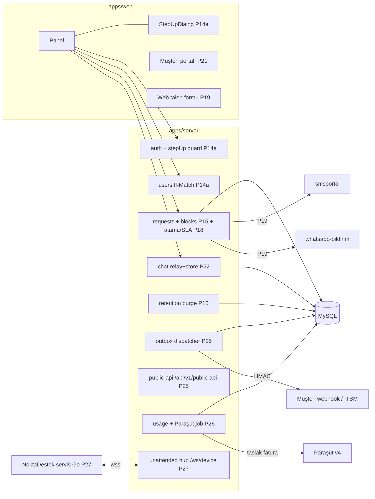

# Mimari — E11 yol haritası (P13c, P14a–P28+)

Tarih: 2026-11-14 · Durum: P13c/P14a/P14b ayrıntılı (kodlanabilir); P15–P17 orta; P18–P28+ üst düzey.
Girdiler: `docs/gereksinimler-e11.md` (ONAYLANDI, S22–S28), `docs/gereksinimler-kabul-kriterleri-e11.md` (AC-201..244),
`-e11-b.md` (AC-245..297), ADR-0019 m.5, `docs/mimari-p13.md` §7. Ana mimari `docs/mimari.md` (§10.1 paket kuralları aynen geçerli).
Yeni ADR'ler: 0021–0028 (§9). Ortak AC-285..290 her pakette geçerlidir; ayrıca tekrar yazılmaz.

## 1. Özet ve kısıtlar

- Sıra sabit: **P13b prod → P13c ayrı staging → P14a ‖ P14b → P15 → …** (R29). P13c kurulmadan E11 kodu başlamaz, prod'a çıkmaz.
- Stack değişmez (Fastify + ws + Prisma/MySQL, Next.js 16, Go istemci). Yeni çalışma zamanı bağımlılığı P14a/P14b'de **yok**;
  tek yeni geliştirme bağımlılığı Prettier (ADR-0024). P15+ bağımlılıkları kendi turunda §10.4'e göre gerekçelenir.
- Tek instance, bellek içi oda (ADR-0005) korunur; yeni zamanlanmış işler mevcut `jobs/scheduler.ts`'e eklenir.
- Ortak altyapı (auth, tenant guard, yetki, audit, hata zarfı, logger, `lib/rate.ts`, `lib/netguard.ts`, `lib/crypto.ts`) yeniden
  kullanılır, kopyalanmaz. E11'de eklenen tek ortak parça **step-up 2FA guard**'ıdır (P14a, ADR-0022); P15/P24/P25/P27 onu kullanır.
- Kullanıcı kararlarının mimari sonuçları §8'de ve ADR-0025..0028'de.

## 2. Bileşen görünümü (E11 sonunda)

## 3. P13c — Ayrı staging ortamı (E11'in ön koşulu; devops, ayrıntılı)

Kaynak: ADR-0019 m.5, `mimari-p13.md` §7.2. Ek kararlar ADR-0021.

### 3.1 Hedef yerleşim

| Öğe                                            | Prod (`remote`)                                | Staging (`remote-stg`)                                                                                                              |
| ---------------------------------------------- | ---------------------------------------------- | ----------------------------------------------------------------------------------------------------------------------------------- |
| Dizin / compose proje adı                      | `/opt/remote/deploy` · `remote`                | `/opt/remote-stg/deploy` · `remote-stg`                                                                                             |
| Ad / TLS                                       | `remote.noktabilisim.net` (nginx + LE)         | `stg.remote.noktabilisim.net` (yeni A kaydı, ayrı nginx vhost, LE)                                                                  |
| Caddy bind                                     | 127.0.0.1:4451 HTTP, :4450 tanı                | 127.0.0.1:4461 HTTP, :4460 tanı                                                                                                     |
| `EDGE_SUBNET` / caddy / web IP                 | 172.30.0.0/24, .2, .3                          | 172.30.1.0/24, .2, .3                                                                                                               |
| `TRUSTED_PROXY_CIDR` / Caddy `trusted_proxies` | 172.30.0.2/31 · 172.30.0.128/32                | 172.30.1.2/31 · 172.30.1.128/32                                                                                                     |
| Volume'lar                                     | `remote_*`                                     | `remote-stg_*` (otomatik ön ek; elle ad yok)                                                                                        |
| Sırlar                                         | prod kasası                                    | **ayrı üretilir**, prod ile ortak sır yok (`APP_ENCRYPTION_KEYS`, `SESSION_REF_KEY`, `TURN_SECRET` dahil)                           |
| `DEPLOY_ENV`                                   | production                                     | staging                                                                                                                             |
| TURN                                           | prod coturn (3478/5349 + relay)                | **yalnız prod coturn STUN** (`TURN_URLS=stun:remote.noktabilisim.net:3478`, kimliksiz); relay testleri prod "Nokta Test" firmasında |
| Yedek                                          | `/var/backups/remote`, prod age anahtarı, 14 g | `/var/backups/remote-stg`, **ayrı age çifti**, 3 g; haftalık geri yükleme provası staging'de                                        |
| İzleme                                         | `remote-watch`                                 | ikinci örnek `remote-watch@stg` (`WATCH_DEPLOY_DIR=/opt/remote-stg/deploy`, `WATCH_PUBLIC_HOST=stg…`); alarm adında `stg`           |
| Arama motoru                                   | —                                              | Caddy `X-Robots-Tag: noindex, nofollow`; `robots.txt` Disallow                                                                      |

### 3.2 Parametreleştirme (genişleme noktası ADR-0019 m.5'in gerçeklenmesi)

- `deploy/docker-compose.yml`: `EDGE_SUBNET`, `EDGE_CADDY_IP`, `EDGE_WEB_IP`, `CADDY_HTTP_PORT` (4451), `CADDY_TLS_PORT` (4450) env ile;
  **varsayılanlar bugünkü prod değerleri** → prod `.env` değişmeden aynı yığını üretir (`docker compose config` farkı 0 = kabul ölçütü).
- `deploy/Caddyfile`: `trusted_proxies {$CADDY_TRUSTED_PROXIES}` (varsayılan prod değeri).
- Betikler (`backup.sh`, `restore.sh`, coturn log cron'u hariç): konteyner adı `remote-mysql-1` yerine `${COMPOSE_PROJECT_NAME}-mysql-1`;
  `RESTORE_EXPECT_PROJECT` ve `DEPLOY_ENV` manifest karşılaştırması korunur (staging yedeği prod'a geri yüklenemez, tersi de).
- Server env'ine yeni değişken **girmez** (`env.ts` değişmez). Yeni anahtarlar yalnız `deploy/.env.example` + runbook.

### 3.3 Staging istemci ve veri kuralları

- Windows istemci: staging için CI `agent-win.yml` `workflow_dispatch` girdisi `server_url` (varsayılan prod) ile **Release'e
  yayımlanmayan** artifact üretir (ad `NoktaDestek-stg-<sürüm>.exe`, attestation yine üretilir). Prod Release akışı değişmez.
- Staging'de gerçek müşteri verisi yok; tenant SMTP yalnız test kutusuna; WhatsApp/SMS servis ayarı boş (test düğmesi test numarasına).
- Kaynak kontrolü (P13c kabul ölçütü): kurulum öncesi `free -m`, `df` ölçümü runbook'a yazılır; iki yığın birlikteyken disk < %80,
  RAM boşluğu ≥ 1 GB; aşılırsa staging MySQL `innodb_buffer_pool_size=256M` ile sınırlanır.

### 3.4 P13c görevleri

| #   | Ajan           | İş                                                                                         | Dosya                                                                  | Kabul ölçütü                                                                                    |
| --- | -------------- | ------------------------------------------------------------------------------------------ | ---------------------------------------------------------------------- | ----------------------------------------------------------------------------------------------- |
| C1  | devops         | Compose/Caddy parametreleştirme                                                            | `deploy/docker-compose.yml`, `deploy/Caddyfile`, `deploy/.env.example` | Prod `.env` ile `docker compose config` çıktısı öncekiyle aynı (diff 0); shellcheck temiz       |
| C2  | devops         | Betiklerde proje adı                                                                       | `deploy/backup/*.sh`, `deploy/ops/*`                                   | `--target staging` yedeği prod'da reddedilir (test)                                             |
| C3  | devops         | Kurulum: DNS, nginx vhost, LE, `/opt/remote-stg`, sırlar, `remote-watch@stg`, backup timer | runbook §21 (yeni)                                                     | `https://stg.remote.noktabilisim.net/ready` 200; prod `/ready` kesintisiz; AC-88 staging ölçümü |
| C4  | devops         | Staging istemci artifact                                                                   | `.github/workflows/agent-win.yml`                                      | stg artifact stg sunucusuna bağlanır, Release'de görünmez                                       |
| C5  | test-operatoru | Duman testi                                                                                | `docs/test-raporu.md`                                                  | login, oturum, tarayıcı modu STUN ile aynı ağda görüntü; konsol hatası 0                        |
| C6  | kullanıcı      | Proje `CLAUDE.md` staging satırının güncellenmesi                                          | `CLAUDE.md`                                                            | `stg.remote…` yazılı                                                                            |

Bağımlılık: P13b prod açılışı imzalı. C1 ‖ C4; C2 → C3 → C5. dba/backend/frontend işi yok.
P13c'den sonra §10.1 akışındaki "staging yayını" adımı = `remote-stg`; prod'a terfi = imzalı Release + `docs/runbook.md` §20 düzeltme yolu.

## 4. P14a — G1 güvenlik/kalite (AC-201..219; ayrıntılı)

### 4.1 Veri modeli değişiklikleri (tek migration `2026111x_p14a_security`)

| Değişiklik                                                                                                                                                                                                                              | Tip / kural                                                                                                                                                                                                                                             | AC  |
| --------------------------------------------------------------------------------------------------------------------------------------------------------------------------------------------------------------------------------------- | ------------------------------------------------------------------------------------------------------------------------------------------------------------------------------------------------------------------------------------------------------- | --- |
| 6 CHECK yeniden: `customers_file_label_chk`, `customers_phone_fmt_chk`, `support_requests_phone_fmt_chk`, `support_requests_client_version_fmt_chk`, `device_bindings_client_version_fmt_chk`, `tenant_request_settings_file_label_chk` | `REGEXP_LIKE(col, '^…\\z', 'c')` (ADR-0014 ikili karşılaştırma korunur); `$` kalmaz                                                                                                                                                                     | 201 |
| Ön kontrol                                                                                                                                                                                                                              | migration başında her CHECK için `SELECT COUNT(*) … WHERE NOT REGEXP_LIKE(col,'…\\z','c')`; > 0 ise `SIGNAL 45000 'P14A_PRECHECK <tablo>=<n>'` → migration durur, sayı loglanır. dba `docs/db-notlari.md`'ye düzeltme SQL'i (sondaki `\n` kırpma) yazar | 201 |
| `users.version INT UNSIGNED NOT NULL DEFAULT 0`                                                                                                                                                                                         | If-Match için (ADR-0023)                                                                                                                                                                                                                                | 206 |
| `auth_sessions.step_up_at DATETIME(3) NULL`                                                                                                                                                                                             | son başarılı step-up anı (ADR-0022)                                                                                                                                                                                                                     | 215 |
| `down.sql`                                                                                                                                                                                                                              | eski 6 CHECK (`$`) geri, iki sütun DROP                                                                                                                                                                                                                 | 201 |

`grants.sql`: yeni tablo yok; `app` için mevcut UPDATE yetkileri yeterli (`check-app-grants.sh` değişmez).

> backend-dev notu (A3, 2026-11-15): §4.2 AC-211 `valueJson.requireTls` P11 `system_settings_mysql_chk` JSON şemasında (`additionalProperties:false`) yazılamıyordu; §4.1 bunu kapsamıyordu. Ayrı küçük migration `20261116010000_p14a_mysql_tls` (+ `down.sql`) eklendi: şemaya yalnız isteğe bağlı `requireTls: boolean`. Yeni tablo/yetki yok.

> dba notu (A1, 2026-11-15): migration adı `20261116000000_p14a_security`. Ön kontrol SIGNAL'i saklı program gerektirdiği için geçici yordamla (`p14a_precheck`) yapılıyor; sayılar tablo bazında. ICU `$` sondaki herhangi bir tek satır sonlandırıcıyı (CR, CRLF, NEL, U+2028 …) da kabul ediyor; düzeltme SQL'i hepsini kırpıyor. `check-app-grants.sh`'ye 6 negatif eklendi (yetki kümesi değişmedi). Kapsam dışı aynı açık: 4 e-posta CHECK'i (`docs/db-notlari.md` "P14a"). B1: `tenants(name)` indeksi gerekmedi.

### 4.2 API ve davranış sözleşmesi

| Uç / bileşen                                                                                     | Değişiklik                                                                                                                                                                                                                                                                                                                                                              | Hata kodları                                                                                                                                                                                                                                                                                                                                                                                                                                                                                                                                                                                                                                                                                                                                                                                                                                                                                                                                                                      | AC            |
| ------------------------------------------------------------------------------------------------ | ----------------------------------------------------------------------------------------------------------------------------------------------------------------------------------------------------------------------------------------------------------------------------------------------------------------------------------------------------------------------- | --------------------------------------------------------------------------------------------------------------------------------------------------------------------------------------------------------------------------------------------------------------------------------------------------------------------------------------------------------------------------------------------------------------------------------------------------------------------------------------------------------------------------------------------------------------------------------------------------------------------------------------------------------------------------------------------------------------------------------------------------------------------------------------------------------------------------------------------------------------------------------------------------------------------------------------------------------------------------------- | ------------- |
| `users/service.ts` tüm yazma TX'leri (create/patch/deactivate/reactivate/reset-mfa/avatar hariç) | TX başında `SELECT id FROM users WHERE id IN (actor, target) ORDER BY id FOR UPDATE`; aktörün `role/status/permissions`'ı TX içinde yeniden okunur; `assertGrantable`/`canManage` bu okumayla çalışır. Test kancası: servis fonksiyonları `deps.afterLock?: () => Promise<void>` alır (yalnız testler verir; env bayrağı yok)                                           | 403 `FORBIDDEN`                                                                                                                                                                                                                                                                                                                                                                                                                                                                                                                                                                                                                                                                                                                                                                                                                                                                                                                                                                   | 202           |
| `/users*` ve `/admin/*` yazma uçları                                                             | `lib/rate.ts` `FixedWindowCounter`, anahtar `userId`: 30/dk; `POST /users` ayrıca 10/dk. Aşımda 429 `RATE_LIMITED` + `Retry-After` (sn). 409 `EMAIL_TAKEN` audit `result:"fail"`                                                                                                                                                                                        | 429, 409                                                                                                                                                                                                                                                                                                                                                                                                                                                                                                                                                                                                                                                                                                                                                                                                                                                                                                                                                                          | 203           |
| 403 audit                                                                                        | `assertGrantable`, `canManage`, kendi hesabı reddi → `writeAudit({action:"user.update", result:"fail", newValue:{denied:[keys]}})`; e-posta/ad yazılmaz                                                                                                                                                                                                                 | —                                                                                                                                                                                                                                                                                                                                                                                                                                                                                                                                                                                                                                                                                                                                                                                                                                                                                                                                                                                 | 204           |
| `tenants/service.ts deactivate`                                                                  | talep iptali (`support_requests` PENDING→CANCELLED `TENANT_INACTIVE`) ve kayıt geçersizleştirme (`device_bindings` `TENANT_INACTIVE`) **aynı TX**'te; hub/WS bildirimleri commit sonrası. Reaktivasyon yalnız yeni kayıtları açar                                                                                                                                       | —                                                                                                                                                                                                                                                                                                                                                                                                                                                                                                                                                                                                                                                                                                                                                                                                                                                                                                                                                                                 | 205           |
| `GET /users/:id`                                                                                 | yanıt `version` alanı + `ETag: "v<version>"`                                                                                                                                                                                                                                                                                                                            | —                                                                                                                                                                                                                                                                                                                                                                                                                                                                                                                                                                                                                                                                                                                                                                                                                                                                                                                                                                                 | 206           |
| `PATCH /users/:id`                                                                               | `If-Match: "v<n>"` zorunlu; yoksa 428 `PRECONDITION_REQUIRED`; uyuşmazsa 409 `STALE_WRITE` (mesaj "Kayıt başkası tarafından değiştirildi, yeniden yükleyin"); koşullu `UPDATE … WHERE id=? AND version=?` + `version=version+1`; yetki değişimi de version artırır. deactivate/reactivate/reset-mfa version artırır; `reset-superadmin` CLI artırmaz (form alanı değil) | 409, 428                                                                                                                                                                                                                                                                                                                                                                                                                                                                                                                                                                                                                                                                                                                                                                                                                                                                                                                                                                          | 206           |
| `users-p9` entegrasyon                                                                           | ADMIN + kilitli anahtar + rol değişimi + tam harita → 200, fark yoksa audit satırı yok (diff tabanlı audit)                                                                                                                                                                                                                                                             | —                                                                                                                                                                                                                                                                                                                                                                                                                                                                                                                                                                                                                                                                                                                                                                                                                                                                                                                                                                                 | 207           |
| Kod denemesi kapısı                                                                              | `rs_guest_code_rate_limited_total{scope:"ip"\|"prefix"}`; runbook alarm: 15 dk'da prefix ≥ 20                                                                                                                                                                                                                                                                           | —                                                                                                                                                                                                                                                                                                                                                                                                                                                                                                                                                                                                                                                                                                                                                                                                                                                                                                                                                                                 | 208           |
| `/requests` kapısı (`requests/limits.ts`, `lib/gate.ts`)                                         | Sıra: hazır mı (503 `NOT_READY`) → IP/önek kovası → TX → commit sonrası tenant kovası `hit()`                                                                                                                                                                                                                                                                           | 503                                                                                                                                                                                                                                                                                                                                                                                                                                                                                                                                                                                                                                                                                                                                                                                                                                                                                                                                                                               | 209           |
| `/ws/request` upgrade                                                                            | `isTrustedCidr(ip)` ise `wsUpgrade` kovası atlanır; diğer kovalar (ref, tenant) aynen                                                                                                                                                                                                                                                                                   | 429                                                                                                                                                                                                                                                                                                                                                                                                                                                                                                                                                                                                                                                                                                                                                                                                                                                                                                                                                                               | 210           |
| `system_settings.mysql`                                                                          | `valueJson.requireTls: boolean` (varsayılan false). Test/bağlantı: `requireTls` → `ssl:{rejectUnauthorized:true}`, TLS yoksa sınıf `tls`. `allowPublicKeyRetrieval` yalnız `netguard.classify(host) ∈ {loopback, private}` veya tek etiketli compose servis adında (`/^[a-z0-9-]+$/`)                                                                                   | 400 alan, sınıf `tls`                                                                                                                                                                                                                                                                                                                                                                                                                                                                                                                                                                                                                                                                                                                                                                                                                                                                                                                                                             | 211           |
| MySQL test metriği                                                                               | `rs_mysql_test_failed_total{class}` (class: connect\|auth\|tls\|timeout\|other); runbook alarm 1 sa'te ≥ 10                                                                                                                                                                                                                                                             | —                                                                                                                                                                                                                                                                                                                                                                                                                                                                                                                                                                                                                                                                                                                                                                                                                                                                                                                                                                                 | 212           |
| SMTP testleri                                                                                    | yerel sahte SMTP (P10 test kalıbı; yoksa `smtp-server` MIT devDependency, gerekçe implementation.md): yanlış CN → `tls`, ileti 0; STARTTLS ilan etmeyen → gönderim yok                                                                                                                                                                                                  | —                                                                                                                                                                                                                                                                                                                                                                                                                                                                                                                                                                                                                                                                                                                                                                                                                                                                                                                                                                                 | 213           |
| `POST /auth/mfa/setup`                                                                           | koşullu `UPDATE users SET totp_secret_enc=? WHERE id=? AND totp_enabled=0 AND version=?` (version kullanımı) — etkilenen 0 → 409 `CONFLICT`; `afterLock` kancalı test 20/20                                                                                                                                                                                             | 409                                                                                                                                                                                                                                                                                                                                                                                                                                                                                                                                                                                                                                                                                                                                                                                                                                                                                                                                                                               | 214           |
| **Step-up** `POST /auth/step-up` `{method: "TOTP"                                                | "RECOVERY", code}`                                                                                                                                                                                                                                                                                                                                                      | TOTP: 6 hane, `totp_last_step` tekrar koruması. RECOVERY: mevcut kurtarma kodu doğrulaması; kod **aynı TX'te tüketilir** (P10 login yolu ile aynı fonksiyon, kopya yok). Başarıda `auth_sessions.step_up_at=now`. 5 hatalı → mevcut MFA kilit sayacı (iki yöntem ortak sayaç). Telafi: kurtarma koduyla step-up'ta audit `auth.step_up` `newValue:{method:"RECOVERY", remaining:n}` (kod yazılmaz), kullanıcıya e-posta bildirimi ("Kurtarma kodunuz kullanıldı", SMTP yapılandırılmışsa), yanıtta `recoveryCodesLeft`; kalan ≤ 3 ise diyalogda ve hesap sayfasında "Kurtarma kodlarınız azaldı, yenileyin" uyarısı (AC-231 yoluna bağlantı). Yanıt `{ stepUpUntil, method, recoveryCodesLeft? }`. Guard `requireStepUp()` (5 dk): `PUT/DELETE /admin/settings/{whatsapp,turn,mysql}`; P24 SSO ve P25 API anahtarı uçları aynı guard'ı kullanır. Eksikse 401 `MFA_STEP_UP_REQUIRED`; TOTP'si olmayan kullanıcıda 403 `MFA_SETUP_REQUIRED`. Audit `auth.step_up` (ok/fail, method) | 401, 403, 429 | 215 |
| `/ws/panel`                                                                                      | Tarayıcı WS el sıkışma başlığını okuyamaz → aşımda upgrade **kabul edilip** hemen `close(4429, "retry=<sn>")`; istemci `retry` kadar bekler (± %20 jitter), konsola yazmaz. Bağlantı `(panel)/layout` sağlayıcısında tek örnek; istemci içi gezintide yeniden açılmaz. Kova: kimlik oturumu başına 30/dk (IP kovası değişmez)                                           | 4429                                                                                                                                                                                                                                                                                                                                                                                                                                                                                                                                                                                                                                                                                                                                                                                                                                                                                                                                                                              | 216           |

### 4.3 AC-217 kalite borcu (backend-dev + frontend-dev)

`SYSTEM_AUDIT` JSDoc ↔ kod eşitliği + `_` önekli eylemler entegrasyon testi; web `canonicalWaUrl` → `packages/contracts`; kullanılmayan global retention fonksiyonları silinir; mysql/turn "değişmeyen PUT → audit yok" testi; `RETENTION_DEFAULT_DAYS` contracts'a; `startup-check.ts` birim testi; `globals.css` koyu token kopyaları eşitlik testi (P14b ile ortak dosya: testi frontend-dev yazar). CI shellcheck devops'ta.

### 4.4 AC-218/219

- ADR-0024: Prettier (TS/JS/JSON/MD/CSS), Go `gofmt` (zaten). **Tek seferlik biçimlendirme commit'i** P13c sonrası, P14a/P14b kodundan **önce**, açık dal yokken (aksi hâlde her dal çakışır); SHA `.git-blame-ignore-revs`'e. CI `pnpm format:check`.
- Kararlılık: `scripts/repeat-tests.sh <n>` (vitest entegrasyon + Playwright `--repeat-each`); CI `stability.yml` (`workflow_dispatch` + haftalık), 20 koşu; çıktı qa raporuna. Kararsız test bulunursa kök neden düzeltilir (retry ile gizlemek yasak); `docs/implementation.md` "Kararsız testler" listesi boş olmalı.

### 4.5 Dosya planı (P14a)

Değişir: `apps/server/prisma/schema.prisma`, `prisma/migrations/2026111x_p14a_security/{migration.sql,down.sql}`, `src/users/{service,routes,repo}.ts`,
`src/tenants/service.ts`, `src/auth/{routes,guards,mfa,service}.ts`, `src/settings/{system,mysql-probe}.ts`, `src/requests/{limits,public-routes,panel,ws}.ts`,
`src/lib/gate.ts`, `src/ops/metrics.ts`, `src/tenants/smtp-routes.ts` (yalnız test), `packages/contracts/src/{errors,audit,api/*}.ts`,
`apps/web/lib/api.ts` (step-up yakalama, 428/409), `components/account/step-up-dialog.tsx` (yeni), `app/(panel)/users/[id]/user-editor.tsx`,
`app/(panel)/admin/settings/*` (MySQL TLS kutusu), panel WS sağlayıcısı; `.github/workflows/{ci,stability}.yml`, `package.json`, `.prettierrc`,
`.prettierignore`, `.git-blame-ignore-revs`, `scripts/repeat-tests.sh`, `docs/runbook.md` (alarm satırları), `docs/db-notlari.md`, `docs/implementation.md`.

### 4.6 Görev paketleri (P14a)

| #   | Ajan         | İş                                                                                                                                                                                                                                                                                                                                                                               | Bağımlı                                          | Kabul ölçütü                                                                          |
| --- | ------------ | -------------------------------------------------------------------------------------------------------------------------------------------------------------------------------------------------------------------------------------------------------------------------------------------------------------------------------------------------------------------------------- | ------------------------------------------------ | ------------------------------------------------------------------------------------- |
| A0  | devops       | Prettier kurulumu + tek seferlik biçimlendirme + `format:check`                                                                                                                                                                                                                                                                                                                  | P13c                                             | `pnpm format:check` 0 fark; P14b ile aynı anda değil, ondan önce                      |
| A1  | dba          | Migration §4.1 + ön kontrol + down + db-notlari                                                                                                                                                                                                                                                                                                                                  | A0                                               | `\n` sonlu INSERT → 3819 (6 CHECK); down/up döngüsü temiz; ön kontrol sayısı loglanır |
| A2  | backend-dev  | §4.2 AC-202..207, 214, 215 (users, tenants, auth, step-up guard)                                                                                                                                                                                                                                                                                                                 | A1                                               | AC adlı entegrasyon testleri yeşil; gecikme kancalı testler 20/20                     |
| A3  | backend-dev  | §4.2 AC-208..213, 216 sunucu; §4.3 sunucu maddeleri                                                                                                                                                                                                                                                                                                                              | A1 (A2 ile aynı ajan, sıralı ya da ikinci örnek) | metrikler `/metrics`'te; 4429 kapanışı testli                                         |
| A4  | frontend-dev | Step-up diyaloğu (odak tuzağı, TOTP 6 hane / "Kurtarma kodu kullan" geçişi, kalan ≤ 3 uyarısı, `aria-live` hata), api istemcisi 401 `MFA_STEP_UP_REQUIRED` → diyalog → tek tekrar; 409/428 mesajı + "Yeniden yükle"; rol geri alınınca kayıtlı ezmelerin geri gelmesi (kayıtlı harita state'te ayrı tutulur); MySQL "TLS gerekli"; panel WS 4429 + tek örnek; §4.3 web maddeleri | A2 sözleşmesi (`contracts`)                      | AC-206/215/216 e2e; 12 sayfa/dk gezintide konsol hatası 0                             |
| A5  | devops       | CI shellcheck, `stability.yml`, runbook alarm eşikleri (208, 212)                                                                                                                                                                                                                                                                                                                | A0                                               | 20 koşu raporu; shellcheck tüm `deploy/**/*.sh`                                       |

Paralel: A2 ‖ A3 (dosya ayrık: users/tenants/auth ↔ requests/settings/ops) ‖ A5; A4, A2'nin `contracts` değişikliği birleşince.
**Kabul (paket):** AC-201..219 testleri yeşil (adında AC no), qa GEÇTİ, güvenlik Kritik/Yüksek 0, stg'de duman testi.

## 5. P14b — G2 UI/a11y (AC-220..230; ayrıntılı; P14a ile paralel)

### 5.1 Kararlar

| AC  | Kök neden / karar                                                                                                                                                                                                                                                                                                                                                                                                                                                                                                                                                                                                                                                                                   | Bileşen                             |
| --- | --------------------------------------------------------------------------------------------------------------------------------------------------------------------------------------------------------------------------------------------------------------------------------------------------------------------------------------------------------------------------------------------------------------------------------------------------------------------------------------------------------------------------------------------------------------------------------------------------------------------------------------------------------------------------------------------------- | ----------------------------------- |
| 220 | `(panel)/loading.tsx` ve `[id]/loading.tsx` Suspense sınırı yanıtı akışla 200 başlatıyor; `notFound()` geç kalıyor (Next 16 `generateMetadata` de akışlı). **Karar:** `(panel)/loading.tsx` kaldırılır, iskeletler liste sayfalarının kendi `loading.tsx`'ine taşınır; `users/[id]` ve `customers/[id]` için `loading.tsx` silinir, varlık kontrolü `[id]/layout.tsx` (sunucu, `serverGet`) içinde Suspense'ten önce yapılır, ağır bölümler sayfa içi `<Suspense>` + skeleton. 404 sayfası `users/not-found.tsx` / `customers/not-found.tsx`: tek h1 "Kullanıcı bulunamadı" / "Müşteri bulunamadı". frontend-dev kök nedeni ilk adımda `curl -I` ile doğrular; farklıysa implementation.md'ye yazar | web                                 |
| 221 | Yeni token `--switch-track-off`, `--switch-track-locked` (açık/koyu), `globals.css` + DESIGN.md; birim testi token çiftlerinden kontrast oranını hesaplar (≥ 3:1, zemin `--surface`, `--surface-2`)                                                                                                                                                                                                                                                                                                                                                                                                                                                                                                 | `components/ui/switch.tsx`          |
| 222 | Mobil menü açılışında `activeEl.scrollIntoView({block:"nearest"})` (animasyonsuz); kaydırılabilir kapsayıcıda alt/üst kenar `mask-image` ipucu + `aria-hidden`; e2e 375/390 px `toBeInViewport`                                                                                                                                                                                                                                                                                                                                                                                                                                                                                                     | `side-nav.tsx`                      |
| 223 | `status=all` boş durumu varsayılan `EmptyState` ile aynı bileşen; "Müşteriye nasıl gönderilir?" diyaloğu sayfa düzeyinde tek örnek, tetikleyiciler ref'le açar                                                                                                                                                                                                                                                                                                                                                                                                                                                                                                                                      | `customers/*`                       |
| 224 | Ayarlar > Genel'e: kod geçerliliği `sessionTtlMin` (15–30 dk), en uzun oturum `maxActiveHours` (1–8 sa), açık oturum sınırı `maxOpenSessions` (1–10), dosya sınırı `maxFileMb` (1–2048). Sunucu `PUT /settings/tenant` sınırları değişmez; istemci şeması `contracts`'tan; 400 alan hataları forma; audit eski→yeni (mevcut değilse backend ekler)                                                                                                                                                                                                                                                                                                                                                  | `settings/tenant-settings-page.tsx` |
| 225 | Teknisyen seçenekleri tam liste: **yeni** `GET /users/options` → `{items:[{id, fullName, status}]}` (tenant kapsamı, `fullName` sırası, üst sınır 1.000; USER ve `historyScope=own` → yalnız kendisi; yetki `session_history.view` \| `support_requests.view` \| `users.view`). Müşteri: mevcut `/customers/options?q=` aranabilir combobox (≤ 20 + `q`). Firma: §226                                                                                                                                                                                                                                                                                                                               | `history/*`, `requests/*`           |
| 226 | **Yeni** `GET /admin/tenants/options?q=&limit=20` (SUPER_ADMIN; `name` LIKE önek + içerir, harf duyarsız, aktif önce). İndeks: `tenants(name)` yoksa dba ekler. Firma seçici `components/ui/combobox.tsx` (WAI-ARIA combobox; ↑↓ Enter Esc), 250 ms debounce; ölçüm: sunucu p95 ≤ 500 ms (250 firma fixture)                                                                                                                                                                                                                                                                                                                                                                                        | `tenant-switcher.tsx`               |
| 227 | `contracts/dc.ts` `CHAT_SEND_PER_SEC = 5` tek sabit; gönderen token bucket; aşımda giriş altında `role=status` "Çok hızlı yazıyorsunuz", mesaj gönderilmez (kuyruğa alınmaz); alıcı sınırı ≥ gönderen sınırı (test eşitsizliği doğrular)                                                                                                                                                                                                                                                                                                                                                                                                                                                            | `lib/dc/use-collab.ts`              |
| 228 | Mevcut `lib/use-leave-guard.ts` genişler: kirli durumda `history.pushState` nöbetçi kaydı; `popstate`'te onay diyaloğu ("Kaydedilmemiş değişiklikler var"); vazgeçte nöbetçi yeniden itilir; `beforeunload` korunur                                                                                                                                                                                                                                                                                                                                                                                                                                                                                 | oturum notu                         |
| 229 | `file.type===""` ise uzantı (`.png .jpg .jpeg .webp`) ile ön kabul; karar sunucuda magic bytes (değişiklik yok)                                                                                                                                                                                                                                                                                                                                                                                                                                                                                                                                                                                     | logo/avatar yükleme                 |
| 230 | 256 MB uyarısı saf fonksiyona çıkarılır (`shouldWarnLargeWrite(bytes)`), eşik altı/üstü bileşen testi                                                                                                                                                                                                                                                                                                                                                                                                                                                                                                                                                                                               | dosya alma                          |

### 5.2 Görev paketleri (P14b)

| #   | Ajan         | İş                                                                       | Bağımlı                                                                                            | Kabul ölçütü                                                       |
| --- | ------------ | ------------------------------------------------------------------------ | -------------------------------------------------------------------------------------------------- | ------------------------------------------------------------------ |
| B1  | dba          | `tenants(name)` indeksi gerekiyorsa (EXPLAIN ile)                        | A0                                                                                                 | migration + down; gerek yoksa db-notlari'ne "gerek yok"            |
| B2  | backend-dev  | `GET /users/options`, `GET /admin/tenants/options`, AC-224 audit eksikse | A0 (P14a A2/A3'ten sonra aynı ajan; dosya: `users/routes.ts` A2 ile ortak → A2 birleştikten sonra) | rol kapsamı + tenant izolasyonu entegrasyon testi; 150/250 fixture |
| B3  | frontend-dev | §5.1 tümü                                                                | B2 sözleşmesi (220–224, 227–230 B2'ye bağlı değil, hemen başlar)                                   | AC-220..230 testleri; iki temada axe 0; 390 px taşma yok           |

Paralel: B3 (225/226 hariç) P14a ile tam paralel. **Çakışma:** `apps/web/lib/api.ts` ve `users/[id]/*` A4 ile ortak → aynı frontend-dev sırayla (önce A4, sonra B3 220) ya da tek dalda.
**Kabul (paket):** AC-220..230 + AC-287 yeşil; DESIGN.md token eklendi; qa GEÇTİ.

## 6. P15 — G3 küçük özellikler (AC-231..239; orta ayrıntı)

| AC  | Veri modeli                                                                                                                                                                                                                              | API                                                                     | Not / risk                                                                                                                      |
| --- | ---------------------------------------------------------------------------------------------------------------------------------------------------------------------------------------------------------------------------------------- | ----------------------------------------------------------------------- | ------------------------------------------------------------------------------------------------------------------------------- |
| 231 | — (recovery_codes yeniden üretilir)                                                                                                                                                                                                      | `POST /auth/mfa/recovery-codes` `{code}` → `{codes:[10]}`               | TOTP + 5 hata kilit; eski kodlar aynı TX'te silinir; audit `mfa.recovery_regenerated`                                           |
| 232 | —                                                                                                                                                                                                                                        | `POST /admin/superadmins/:id/reset-password` → `{temporaryPassword}`    | step-up (§4.2); P13b `auth/superadmin-reset.ts` servisi yeniden kullanılır (kopya yok); kendi id'si 403                         |
| 233 | `system_settings.system_logo` değeri NULL (V31: **boş değer** — `app`'e DELETE verilmez, TURN/WhatsApp kalıbı)                                                                                                                           | `DELETE /admin/settings/system-logo`                                    | dosya commit sonrası silinir; login/PDF varsayılan; `check-app-grants.sh` DELETE olmadığını doğrular                            |
| 234 | —                                                                                                                                                                                                                                        | WS: `share.state {reason, method}` konsola iletilir                     | etiketler `contracts/labels.ts`; bilinmeyen ham; istemci kısmı P17                                                              |
| 235 | **`request_blocks`** (`id, tenant_id, kind IP\|DEVICE, ip_from VARBINARY(16), ip_to VARBINARY(16), device_key_hash CHAR(64), expires_at NULL, note, created_by, created_at`; IX(tenant_id, kind, expires_at); tenant ≤ 1.000 uygulamada) | `GET/POST/DELETE /request-blocks` (`support_requests.block` yeni yetki) | kapıda tenant başına bellek önbelleği, yazmada geçersiz kılma; ret yanıtı mevcut tek tip; IPv4 /32–/24, IPv6 /128–/48           |
| 236 | —                                                                                                                                                                                                                                        | `GET /public/sessions/:token/tech-avatar?exp=&sig=`                     | HMAC-SHA256 (`lib/crypto.ts` HKDF etiketi `avatar-url`), ≤ 10 dk, oturum ACTIVE değilse 403; `Cache-Control: private, no-store` |
| 237 | `permissions`: `users.delete`                                                                                                                                                                                                            | (uç P16)                                                                | toggle otomatik (AC-285)                                                                                                        |
| 238 | `session_files.reported_by ENUM('TECH','CUSTOMER')` + `match_key`                                                                                                                                                                        | geçmiş/CSV "doğrulanmış/Müşteri bildirimi"                              | eski satırlar `TECH` varsayılan                                                                                                 |
| 239 | `tenant_request_settings.require_accept_code BOOL DEFAULT 0`                                                                                                                                                                             | kabul akışı admitCode kurallarıyla (AC-112)                             | kapalıyken akış değişmez (regresyon testi)                                                                                      |

Ekip: dba (request_blocks, session_files, tenant_request_settings) → backend ‖ frontend. Riskler: engel önbelleği ile çok tenant tutarlılığı (tek instance, yeterli); imzalı URL anahtarının ayrık türetilmesi.

## 7. P16 — G4 kalıcı silme (AC-240..244; orta ayrıntı; ADR'si P16 tasarım turunda — K27'yi kapatır)

- **FK planı (mimar, P16 turunda kesinleşir):** döngü `device_bindings.active_session_id ↔ support_sessions ↔ support_requests` aynı TX'te önce FK sütunlarını `NULL` yapıp sonra çocuk→ebeveyn sırasıyla siler: `session_files → session_consents → (bindings/requests FK null) → support_sessions → support_requests → device_bindings → request_refs`. Parti 500 satır; `purgeAnonymized()` (`jobs/retention.ts` genişleme noktası). `app`'e bu tablolarda **yalnız `anonymized_at < now()-30g` koşullu** DELETE (tetikleyiciyle zorlama, audit tetikleyici kalıbı).
- **Kullanıcı silme:** satır **mezar taşı** olarak kalır (FK'ler: sessions.technician_id vb.): e-posta `deleted+<id>@invalid`, ad "Silinmiş kullanıcı #<6>", hash/TOTP/avatar silinir, `status=DELETED`. Audit satırları değiştirilemez (ADR-0013/P11 tetikleyici); `audit_logs.username` eski değeri audit saklamasına (730 g) kadar kalır; ekranda (audit listesi, CSV dahil) kullanıcı DELETED ise maskeli mezar taşı etiketi gösterilir (K-E11-4 kullanıcı kararı). Uç `DELETE /users/:id` (`users.delete`, pasif şartı, gövde `{confirmName}`).
- **Firma silme:** yeni `tenant_purge_jobs(id, tenant_id UQ, state, step, cursor, started_by, started_at, finished_at, error)`; adım makinesi kaldığı yerden devam; uç `POST /admin/tenants/:id/purge` (SUPER_ADMIN + step-up + ≥ 30 g pasif + `{confirmName}`), `GET …/purge` ilerleme. Son adım `uploads/{tenantId}/` silme. Audit satırları kalır (`tenant_id` FK değil olmalı — dba doğrular; FK ise P16 ADR'si ayrıştırma kararı verir).
- **Yetim tarama:** haftalık iş, `uploads/` ↔ DB yolları; ilk görüşte işaret (`.orphan-<ts>` listesi `uploads/.orphans.json`), 7 gün sonra silme; `rs_orphan_files_total{action}`.
- Yedekten düşme ≤ 14 g (mevcut saklama) + silinen firmanın geri yüklenmesi runbook'ta (scratch'e restore → tenant dışa aktarım; prod'a seçici geri yükleme yok, risk R26).
- Ekip: mimar (FK ADR) → dba → backend ‖ frontend ‖ devops (runbook). Risk: geri dönüşsüz yanlış silme (R26) → kuru çalıştırma modu (`dryRun` sayım raporu) zorunlu.

## 8. P17 — G5 istemci 0.11.0 + AC-234 istemci (orta ayrıntı)

| AC  | Bileşen (Go)                                                                                                                                                                                                                              | Not / risk                                                                                   |
| --- | ----------------------------------------------------------------------------------------------------------------------------------------------------------------------------------------------------------------------------------------- | -------------------------------------------------------------------------------------------- |
| 245 | `internal/encode` MFT seçici: donanım MFT hata/3 sn kare yok → yazılım MFT; ICE yeniden pazarlık gerekmez (aynı codec)                                                                                                                    | hata enjeksiyonu arayüzü ile birim testi                                                     |
| 246 | DXGI Desktop Duplication `GetFrameDirtyRects`: değişim yoksa kare atlanır, yalnız kirli bölgeler BGRA→NV12 dönüştürülür                                                                                                                   | ölçüm D12 tabanına göre; H.264 tam kare kodlama sürer, kazanç dönüşüm + boşta kare atlamadan |
| 247 | `DwmSetWindowAttribute(DWMWA_USE_IMMERSIVE_DARK_MODE)` + `AppsUseLightTheme` okuma; renk tablosu iki tema                                                                                                                                 | kontrast testi renk tablosundan                                                              |
| 248 | Pencere modu: Windows.Graphics.Capture (Win10 1903+) — Go'dan WinRT çağrısı **yüksek risk**; P17 başında 2 günlük prototip; olmazsa DXGI kırpma + "üstteki pencereler de görünebilir" uyarısı **değil**, AC kapsamı daraltılmaz → K-E11-3 | kontrol sınırı: SendInput koordinatı pencere dikdörtgenine kırpılır                          |
| 249 | `FILE_FLAG_OPEN_REPARSE_POINT` + `GetFileInformationByHandle` doğrulaması; `SetFileInformationByHandle(FileDispositionInfo)` ile silme                                                                                                    | junction testi                                                                               |
| 250 | `bindingPending` soket kopuşunda sıfırlanır                                                                                                                                                                                               | birim testi                                                                                  |
| 251 | kayıt değişiminde köken + tenant id karşılaştırması (ad değil)                                                                                                                                                                            | —                                                                                            |
| 252 | SignPath varsa imzalı Release; yoksa "uygulanamaz"                                                                                                                                                                                        | attestation hattı aynen                                                                      |
| 234 | `share.state.reason/method` gönderimi                                                                                                                                                                                                     | 0.10.x ile sunucu uyumlu                                                                     |

Bağımlı: P15, D1–D3 sonuçları. Risk: WGC prototipi; dirty-rect kazancının donanıma göre değişmesi.

## 9. ADR listesi (E11)

| ADR  | Konu                                                                                       | Durum                                           |
| ---- | ------------------------------------------------------------------------------------------ | ----------------------------------------------- |
| 0021 | P13c ayrı staging: parametreleştirme, STUN-only, staging istemci artifact                  | Kabul                                           |
| 0022 | Step-up 2FA: oturum başına `step_up_at`, 5 dk, TOTP veya tüketilen kurtarma kodu (K-E11-1) | Kabul                                           |
| 0023 | Kullanıcı düzenlemede iyimser kilit: `users.version` + If-Match + satır kilidi             | Kabul                                           |
| 0024 | Tek biçimlendirici: Prettier + gofmt                                                       | Kabul                                           |
| 0025 | Chat her zaman saklanır (S25): sunucu aktarımlı chat + alan şifreleme + retention bağı     | Kabul (çerçeve; ayrıntı P22)                    |
| 0026 | Dış entegrasyon yalnız genel webhook + public API (S22): outbox, HMAC                      | Kabul (çerçeve; ayrıntı P25)                    |
| 0027 | Oturum başına faturalama + Paraşüt taslak fatura (S23)                                     | Kabul (çerçeve; ayrıntı P26)                    |
| 0028 | Gözetimsiz erişim: onaysız tam erişim + bağlayıcı telafi kontrolleri (S24)                 | Kabul (çerçeve; P27 tehdit modeli turu zorunlu) |

P16 (hard delete FK planı), P20 (ADR-0004 eki: tepsi/otomatik başlatma), P21 (portal kimliği), P23 (i18n kütüphanesi), P24 (SSO/LDAP)
ADR'leri kendi tasarım turlarında yazılır (numara o gün sıradaki).

## 10. Kullanıcı kararlarının mimari sonuçları

### 10.1 S24 — Gözetimsiz erişim, onaysız tam erişim (ADR-0028; AC-273..275, 293..297; R32)

Karar değişmez; aşağıdaki kontroller **bağlayıcıdır** ve her biri bir sunucu ya da cihaz bileşenine bağlanır. Hiçbiri yalnız arayüzde değildir.

| Kontrol                                                                                                                                                                        | Nerede uygulanır                                                                                                                                                                                | Başarısızlıkta                                                                                        | AC       |
| ------------------------------------------------------------------------------------------------------------------------------------------------------------------------------ | ----------------------------------------------------------------------------------------------------------------------------------------------------------------------------------------------- | ----------------------------------------------------------------------------------------------------- | -------- |
| `unattended.connect` yetkisi + cihaz başına grant (`unattended_device_grants`, varsayılan boş)                                                                                 | sunucu, bağlantı ucu; listede de süzülür                                                                                                                                                        | 404 (varlık sızmaz)                                                                                   | 273, 293 |
| Step-up 2FA her bağlantıda (ADR-0022 guard; TOTP veya tüketilen kurtarma kodu, K-E11-1; pencere 5 dk, ayrıca bağlantı başına tek kullanım: `step_up_at` bağlantıyla tüketilir) | sunucu                                                                                                                                                                                          | 401 `MFA_STEP_UP_REQUIRED`                                                                            | 273      |
| Müşteri firmasında ≥ 1 bildirim adresi (`customer_notify_contacts`, ≤ 5 e-posta)                                                                                               | sunucu, bağlantı öncesi                                                                                                                                                                         | bağlantı açılmaz                                                                                      | 296      |
| Bildirim ≤ 60 sn (e-posta; tenant'ta açıksa SMS/WA — P19 altyapısı)                                                                                                            | sunucu outbox (P25)                                                                                                                                                                             | audit `fail`; bağlantı sürer (bildirim kuyruğu yeniden dener)                                         | 296      |
| Kapatılamayan gösterge, tüm monitörler + kilit ekranı                                                                                                                          | cihaz yardımcı süreci; `indicator.ready` gelmeden görüntü/kontrol kanalları açılmaz                                                                                                             | bağlantı açılmaz (fail-closed)                                                                        | 294      |
| Yerel kapatma anahtarı (HKLM, ACL: kapatma Interactive kullanıcıya adlandırılmış boru ile, açma yerel yönetici)                                                                | cihaz servis; protokolde anahtarı değiştiren mesaj **yok**                                                                                                                                      | kapalıyken servis bağlantı isteğini reddeder, açık bağlantıyı ≤ 2 sn keser, durum sunucuya bildirilir | 295      |
| İptal ≤ 10 sn, grant geri alma ≤ 5 sn                                                                                                                                          | sunucu `/ws/device` + oda `applyPermChange` kalıbı                                                                                                                                              | —                                                                                                     | 275, 293 |
| Prod'da imza şartı                                                                                                                                                             | sunucu: `NODE_ENV=production` iken cihaz kaydı/bağlantısı, cihazın bildirdiği ikili SHA-256'sı yayımlanan imzalı Release listesinde (`SIGNED_AGENT_SHA256`, attestation'dan) değilse reddedilir | panel mesajı                                                                                          | 297      |
| Audit + Windows olay günlüğü (kaynak `NoktaDestek`)                                                                                                                            | sunucu + cihaz                                                                                                                                                                                  | —                                                                                                     | 273      |

Bileşenler: ayrı Go ikilisi `NoktaDestekServis.exe` (LocalSystem servis) + oturum içi yardımcı (`CreateProcessAsUser`, Winlogon masaüstü için Secure Desktop),
kalıcı `wss /ws/device` (cihaz Ed25519 anahtarıyla imzalı meydan okuma; anahtar DPAPI makine kapsamı), tek kullanımlık kayıt kodu.
Veri: `unattended_devices`, `unattended_device_grants`, `unattended_registration_codes`, `customer_notify_contacts`. Gözetimsiz bağlantı = `support_sessions` satırı `mode=UNATTENDED` (P26 sayımına girer, V38).
**Kalan risk:** imza listesi kontrolü cihazın kendi beyanına dayanır (değiştirilmiş istemci sahte hash gönderebilir); amaç prod kullanılabilirlik kapısı ve AV/EDR uyumu, kimlik doğrulama değil. P27 güvenlik tasarım turunda tehdit modeli eki zorunlu (AC-290).

### 10.2 S23 — Oturum başına lisans + Paraşüt taslak fatura (ADR-0027; AC-271, 272; R33)

- **Sayım kaynağı ayrık ve kişisel verisiz:** `billable_sessions(session_id PK, tenant_id, month CHAR(7), activated_at)` — oturum **ilk kez** ACTIVE olduğunda aynı TX'te `INSERT IGNORE` (idempotent). Retention/anonimleştirme/kalıcı silme bu tabloya dokunmaz (P16 FK planına not: `session_id` FK **değil**).
- **Dondurma:** her ayın 1'i 00:10 (Europe/Istanbul) `usage_monthly(tenant_id, month, count, frozen_at, invoice_state, parasut_invoice_id, attempts, last_error)` yazılır; dondurulmuş satır değişmez (tetikleyici). Ekran/CSV `usage_monthly` + açık ay için canlı sayım.
- **Fiyat:** `tenant_billing(tenant_id PK, price_per_session DECIMAL(12,2), currency CHAR(3) DEFAULT 'TRY', parasut_contact_id, parasut_product_id, updated_by)`; float yok.
- **Fatura işi:** 1'i 03:00; durum makinesi `PENDING → CREATING → CREATED | FAILED`; çift fatura önlemi: `CREATING`'de çöken iş, yeniden denemeden önce Paraşüt'te açıklama/sipariş no `RS-<tenantId>-<YYYY-MM>` ile arar. 0 oturum → `SKIPPED`. Başarısızlık 3 kez üstel deneme, sonra Super Admin'e e-posta + panel uyarısı.
- **Paraşüt ayarı sistem düzeyindedir** (Nokta, tenant'ları faturalar): `system_settings.parasut` (company_id, e-posta, şifreli şifre, şifreli access/refresh token). Client ID/Secret `deploy/.env` (`PARASUT_CLIENT_ID`, `PARASUT_CLIENT_SECRET`; değer `.secrets/parasut.env`'den, repoya girmez; `.env.example` boş). "Bağlantıyı Test Et": token + firma bilgisi. Her yazma audit.
- Bağımlı: P25 dış çağrı altyapısı (zaman aşımı, yeniden deneme, netguard). Saklama: 10 yıl (VUK, K-E11-5 kararı).

### 10.3 S22 — ITSM yalnız webhook (ADR-0026; AC-268..270)

- ITSM'ye özgü kod, tablo, ayar yok. `session.ended` yükü AC-270 alanlarıyla sabit sürümlü (`"v":1`); ekran/sohbet içeriği taşımaz.
- **Outbox:** alan olayı aynı TX'te `outbox_events(id, tenant_id, type, payload_json, created_at)`; dağıtıcı iş `webhook_deliveries(id, event_id, endpoint_id, attempt, next_at, state, http_status, last_error)`; 5 deneme üstel (1, 5, 30 dk, 2, 6 sa); teslim edilen/başarısız 30 g sonra silinir.
- İmza `X-Remote-Signature: t=<unix>,v1=<hex HMAC-SHA256(secret, t + "." + body)>`; alıcı ±5 dk; sır şifreli, bir kez gösterilir; netguard (özel/loopback/link-local reddi, DNS sabitleme), 10 sn zaman aşımı, yönlendirme izlenmez.
- `docs/api.md`'de Nokta ITSM eşleme örneği (teknik-yazar). Public API aynı pakette (`api_keys` özet saklama, kapsam, 60/dk, OpenAPI zod'dan).

### 10.4 S25 — Chat her zaman saklanır (ADR-0025; AC-255, 264, 291, 292; R27)

- **Mimari kırılım:** chat bugün DataChannel'da uçtan uca (sunucu görmez). Saklama için chat **sinyalizasyon WS'i üzerinden sunucu aktarımlı** olur; sunucu kaydeder, sonra iletir (iki taraf da kaydı atlayamaz). DC `chat` mesajı yeni istemcilerde kullanılmaz.
- Eski Windows istemci (DC chat) ile oturumda chat **devre dışı** + "Sohbet için istemciyi güncelleyin" (saklanmayan chat S25'e aykırı). Tarayıcı modu aynı sürümde geçer.
- Tablo `session_messages(id, tenant_id, session_id NULL, request_id NULL, sender ENUM(TECH,CUSTOMER), body_enc VARBINARY, created_at)`; `lib/crypto.ts` AES-256-GCM, AAD = `tenant_id|session_id|id`. IX(session_id), IX(request_id).
- Retention: oturum anonimleştirme işinde aynı TX'te `DELETE session_messages WHERE session_id IN …` (`app`'e koşullu DELETE). Görüntüleme `sessions.view_chat` + audit `session.chat_viewed`.
- Aydınlatma metni yeni sürümü (seed) + onay ekranı satırı (web + Go istemci); satır yoksa düğme pasif.

## 11. Yol haritası — P18–P28+ (üst düzey)

| Paket | Kapsam                                                                                                                                        | Bağımlı                                | Gereken ADR (kendi turunda)                                            | Büyük riskler                                                 |
| ----- | --------------------------------------------------------------------------------------------------------------------------------------------- | -------------------------------------- | ---------------------------------------------------------------------- | ------------------------------------------------------------- |
| P18   | Kabul öncesi mesajlaşma (WS, `session_messages.request_id`), atama (`assigned_to`), öncelik, SLA (müşteri varsayılanı), mesai + tatil tablosu | P15 (+ ADR-0025 tablosu P18'de açılır) | — (ADR-0025 yeterli)                                                   | Kuyruk sıralamasının mevcut hub'a etkisi; mesai saat dilimi   |
| P19   | Web talep formu `/r/<ref>`, SMS/WA link, durum bildirimi, müşteri CSV içe/dışa                                                                | P18                                    | SMS ayarı (tenant, smsportal) — ADR gerekmez, §2.3 standardı           | Bot/spam (AC-143/144 + gizli alan); smsportal tek nokta (R31) |
| P20   | İstemci 0.12.0: tepsi + `HKCU\Run`, çoklu firma kaydı (≤ 5), WS chat (ADR-0025)                                                               | P17, SignPath sonucu                   | ADR-0004 eki                                                           | AV yanlış pozitif (R30); kayıt dosyası göçü                   |
| P21   | Müşteri portalı (ayrı kimlik alanı `portal_users`, ayrı çerez adı, IDOR)                                                                      | P19                                    | Portal kimliği ve oturum ayrımı                                        | Yeni kişisel veri; panel oturumuyla karışma                   |
| P22   | Chat saklama + KVKK metni + onay satırı                                                                                                       | P18, P20 (istemci)                     | — (ADR-0025)                                                           | Eski istemcilerde chat kapanması; R27                         |
| P23   | TR/EN (web anahtar tabanlı, mevcut `messages/tr.json` + `lib/i18n.ts` genişler; Go istemci kaynak tablosu)                                    | P14b                                   | i18n kütüphanesi (mevcut çözüm mü next-intl mi)                        | Anahtar borcu; e-posta/PDF şablonları                         |
| P24   | OIDC (Entra ID önce) + LDAPS, acil durum hesabı                                                                                               | P15 (step-up)                          | SSO/LDAP kimlik eşlemesi                                               | Hesap ele geçirme (R28); sağlayıcı test ortamı                |
| P25   | Public API + webhook + outbox (ITSM örneği)                                                                                                   | P15                                    | — (ADR-0026) + OpenAPI üretim kütüphanesi seçimi                       | SSRF; anahtar sızıntısı                                       |
| P26   | Kullanım sayımı + Paraşüt taslak fatura                                                                                                       | P25                                    | — (ADR-0027)                                                           | Çift fatura; Paraşüt API değişikliği; sayım ihtilafı (R33)    |
| P27   | Gözetimsiz erişim                                                                                                                             | P17, P20, P26, SignPath (prod)         | ADR-0028 + tehdit modeli eki (zorunlu güvenlik turu)                   | R25, R30, R32; Session 0 / Secure Desktop karmaşıklığı        |
| P28+  | macOS, Linux, Android/iOS, oturum kaydı, çoklu teknisyen, ses, pano, yazdırma, sunucuda dosya + ClamAV                                        | P27'ye kadar                           | her biri ayrı ADR; ClamAV ayrı konteyner (GPL, bağlanmaz, `clamd` TCP) | Kapsam; lisans; depolama/KVKK (kayıt, dosya)                  |

## 12. Paralel çalışmayla çakışma (P13b şu an `deploy/`, `apps/server`, `docs/db-notlari.md`, `docs/implementation.md`)

Bu tasarım kod/dosya değiştirmez. P14a/P14b P13c'den sonra başladığı için **eşzamanlı yazım yok**; yine de sıralı çakışma noktaları:

- `apps/server/src/auth/*`: P13b `superadmin-reset.ts` ekliyor; P14a `routes/guards/mfa/service.ts` değiştirir, P15 AC-232 servisi yeniden kullanır.
- `apps/server/src/app.ts`: P13b değiştiriyor; P14a yalnız yeni rota kaydı gerekirse dokunur (step-up `auth/routes.ts` içinde → büyük olasılıkla dokunmaz).
- `prisma/schema.prisma` + migrations: P13b migration eklerse P14a migration zaman damgası ondan sonra olmalı.
- `deploy/docker-compose.yml`, `Caddyfile`, `deploy/backup/*`: P13b (şimdi) ve P13c C1/C2 (sonra) — P13c yalnız P13b birleştikten sonra.
- `docs/db-notlari.md`, `docs/implementation.md`, `docs/runbook.md`: ekleme yapılır; P14a/P13c kendi başlığı altında.
- **Prettier (A0)** tüm depoya dokunur: P13b ve P13c birleşip açık dal kalmadığında çalışır.

## 13. AC eşlemesi (E11)

| AC                      | Bileşen / uç                                                                                    | Paket                   |
| ----------------------- | ----------------------------------------------------------------------------------------------- | ----------------------- |
| 201                     | migration CHECK `\z` + ön kontrol                                                               | P14a A1                 |
| 202, 203, 204, 206, 207 | `users/service.ts` kilit, `lib/rate.ts`, audit fail, `users.version` + If-Match, users-p9 testi | P14a A2/A4              |
| 205                     | `tenants/service.ts` tek TX                                                                     | P14a A2                 |
| 208, 209, 210           | `requests/limits.ts`, `lib/gate.ts`, `ops/metrics.ts`, runbook                                  | P14a A3/A5              |
| 211, 212                | `settings/system.ts`, `mysql-probe.ts`, metrik, web TLS kutusu                                  | P14a A3/A4              |
| 213                     | SMTP test kalıbı                                                                                | P14a A3                 |
| 214, 215                | `auth/mfa.ts` koşullu UPDATE; `POST /auth/step-up` + `requireStepUp`; StepUpDialog              | P14a A2/A4              |
| 216                     | `/ws/panel` 4429 + tek bağlantı                                                                 | P14a A3/A4              |
| 217                     | §4.3                                                                                            | P14a A3/A4/A5           |
| 218, 219                | ADR-0024, CI `format:check`, `stability.yml`                                                    | P14a A0/A5              |
| 220–224, 227–230        | §5.1 web                                                                                        | P14b B3                 |
| 225, 226                | `GET /users/options`, `GET /admin/tenants/options`, combobox                                    | P14b B2/B3              |
| 231–239                 | §6                                                                                              | P15 (234 istemci P17)   |
| 240–244                 | §7                                                                                              | P16                     |
| 245–252, 234            | §8                                                                                              | P17                     |
| 253, 254                | §11 P20                                                                                         | P20                     |
| 255–258                 | §11 P18                                                                                         | P18                     |
| 259–261, 263            | §11 P19                                                                                         | P19                     |
| 262                     | §11 P21                                                                                         | P21                     |
| 264, 291, 292           | §10.4                                                                                           | P22 (255 mesajları P18) |
| 265                     | §11 P23                                                                                         | P23                     |
| 266, 267                | §11 P24                                                                                         | P24                     |
| 268, 269, 270           | §10.3                                                                                           | P25                     |
| 271, 272                | §10.2                                                                                           | P26                     |
| 273–275, 293–297        | §10.1                                                                                           | P27                     |
| 276–284                 | §11 P28+                                                                                        | P28+                    |
| 285–290                 | ortak; her paketin DoD'u                                                                        | tümü                    |

## 14. Kararlar (K-E11-1..6; K-E11-1, 4, 5, 6 kullanıcı kararıyla kapandı 2026-11-14)

| #       | Konu                                           | Varsayılan                                                                                                                                     | Sahibi            |
| ------- | ---------------------------------------------- | ---------------------------------------------------------------------------------------------------------------------------------------------- | ----------------- |
| K-E11-1 | Step-up'ta kurtarma kodu                       | **Karar (kullanıcı, 2026-11-14): kabul edilir**; kod tüketilir, audit'e yöntemle yazılır; telafi: e-posta bildirimi + kalan ≤ 3 uyarısı (§4.2) | —                 |
| K-E11-2 | Staging yedek saklama                          | 3 gün, ayrı age                                                                                                                                | devops            |
| K-E11-3 | AC-248 WGC prototipi başarısız olursa          | AC-248 P17'den P20'ye kayar (kapsam daraltılmaz)                                                                                               | mimar + kullanıcı |
| K-E11-4 | Kullanıcı silmede audit `username` eski değeri | **Karar (kullanıcı, 2026-11-14):** 730 gün (audit saklaması) kalır; ekranda maskeli gösterilir                                                 | —                 |
| K-E11-5 | `billable_sessions` / `usage_monthly` saklama  | **Karar (kullanıcı, 2026-11-14):** 10 yıl (VUK); retention işi bu tablolara dokunmaz, 10 yıl sonrası silme P26'da                              | —                 |
| K-E11-6 | Eski istemcide chat kapatma (ADR-0025)         | **Karar (kullanıcı, 2026-11-14):** kapatılır + "güncelleyin" uyarısı                                                                           | —                 |
