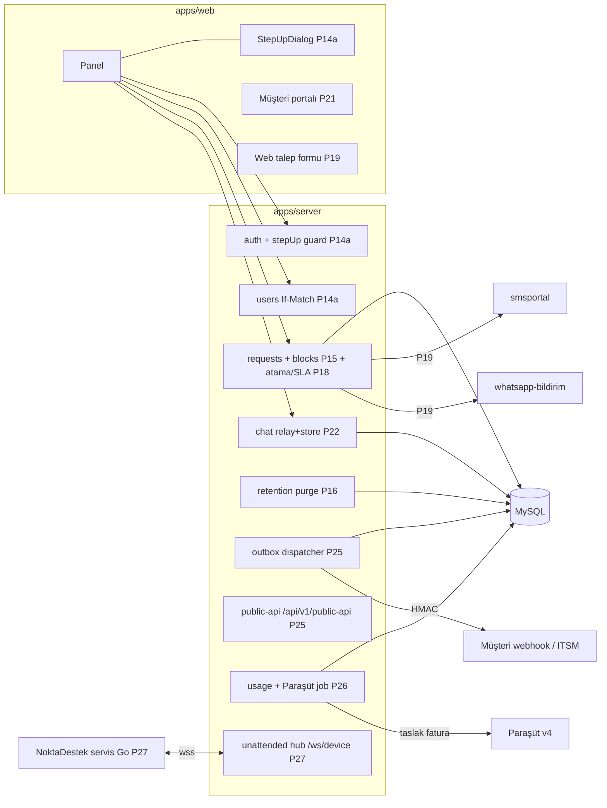

# Mimari — E11 yol haritası (P13c, P14a–P28+)

Tarih: 2026-11-14 · Durum: P13c/P14a/P14b/P16/P17 ayrıntılı (kodlanabilir); P15 orta; P18–P28+ üst düzey.
Girdiler: `docs/gereksinimler-e11.md` (ONAYLANDI, S22–S28), `docs/gereksinimler-kabul-kriterleri-e11.md` (AC-201..244),
`-e11-b.md` (AC-245..297), ADR-0019 m.5, `docs/mimari-p13.md` §7. Ana mimari `docs/mimari.md` (§10.1 paket kuralları aynen geçerli).
Yeni ADR'ler: 0021–0028, 0030 (§9). Ortak AC-285..290 her pakette geçerlidir; ayrıca tekrar yazılmaz.

## 1. Özet ve kısıtlar

- Sıra sabit: **P13b prod → P13c ayrı staging → P14a ‖ P14b → P15 → …** (R29). P13c kurulmadan E11 kodu başlamaz, prod'a çıkmaz.
- Stack değişmez (Fastify + ws + Prisma/MySQL, Next.js 16, Go istemci). Yeni çalışma zamanı bağımlılığı P14a/P14b'de **yok**;
  tek yeni geliştirme bağımlılığı Prettier (ADR-0024). P15+ bağımlılıkları kendi turunda §10.4'e göre gerekçelenir.
- Tek instance, bellek içi oda (ADR-0005) korunur; yeni zamanlanmış işler mevcut `jobs/scheduler.ts`'e eklenir.
- Ortak altyapı (auth, tenant guard, yetki, audit, hata zarfı, logger, `lib/rate.ts`, `lib/netguard.ts`, `lib/crypto.ts`) yeniden
  kullanılır, kopyalanmaz. E11'de eklenen tek ortak parça **step-up 2FA guard**'ıdır (P14a, ADR-0022); P15/P24/P25/P27 onu kullanır.
- Kullanıcı kararlarının mimari sonuçları §8'de ve ADR-0025..0028'de.

## 2. Bileşen görünümü (E11 sonunda)

## 3. P13c — Ayrı staging ortamı (E11'in ön koşulu; devops, ayrıntılı)

Kaynak: ADR-0019 m.5, `mimari-p13.md` §7.2. Ek kararlar ADR-0021.

### 3.1 Hedef yerleşim

| Öğe                                            | Prod (`remote`)                                | Staging (`remote-stg`)                                                                                                              |
| ---------------------------------------------- | ---------------------------------------------- | ----------------------------------------------------------------------------------------------------------------------------------- |
| Dizin / compose proje adı                      | `/opt/remote/deploy` · `remote`                | `/opt/remote-stg/deploy` · `remote-stg`                                                                                             |
| Ad / TLS                                       | `remote.noktabilisim.net` (nginx + LE)         | `stg.remote.noktabilisim.net` (yeni A kaydı, ayrı nginx vhost, LE)                                                                  |
| Caddy bind                                     | 127.0.0.1:4451 HTTP, :4450 tanı                | 127.0.0.1:4461 HTTP, :4460 tanı                                                                                                     |
| `EDGE_SUBNET` / caddy / web IP                 | 172.30.0.0/24, .2, .3                          | 172.30.1.0/24, .2, .3                                                                                                               |
| `TRUSTED_PROXY_CIDR` / Caddy `trusted_proxies` | 172.30.0.2/31 · 172.30.0.128/32                | 172.30.1.2/31 · 172.30.1.128/32                                                                                                     |
| Volume'lar                                     | `remote_*`                                     | `remote-stg_*` (otomatik ön ek; elle ad yok)                                                                                        |
| Sırlar                                         | prod kasası                                    | **ayrı üretilir**, prod ile ortak sır yok (`APP_ENCRYPTION_KEYS`, `SESSION_REF_KEY`, `TURN_SECRET` dahil)                           |
| `DEPLOY_ENV`                                   | production                                     | staging                                                                                                                             |
| TURN                                           | prod coturn (3478/5349 + relay)                | **yalnız prod coturn STUN** (`TURN_URLS=stun:remote.noktabilisim.net:3478`, kimliksiz); relay testleri prod "Nokta Test" firmasında |
| Yedek                                          | `/var/backups/remote`, prod age anahtarı, 14 g | `/var/backups/remote-stg`, **ayrı age çifti**, 3 g; haftalık geri yükleme provası staging'de                                        |
| İzleme                                         | `remote-watch`                                 | ikinci örnek `remote-watch@stg` (`WATCH_DEPLOY_DIR=/opt/remote-stg/deploy`, `WATCH_PUBLIC_HOST=stg…`); alarm adında `stg`           |
| Arama motoru                                   | —                                              | Caddy `X-Robots-Tag: noindex, nofollow`; `robots.txt` Disallow                                                                      |

### 3.2 Parametreleştirme (genişleme noktası ADR-0019 m.5'in gerçeklenmesi)

- `deploy/docker-compose.yml`: `EDGE_SUBNET`, `EDGE_CADDY_IP`, `EDGE_WEB_IP`, `CADDY_HTTP_PORT` (4451), `CADDY_TLS_PORT` (4450) env ile;
  **varsayılanlar bugünkü prod değerleri** → prod `.env` değişmeden aynı yığını üretir (`docker compose config` farkı 0 = kabul ölçütü).
- `deploy/Caddyfile`: `trusted_proxies {$CADDY_TRUSTED_PROXIES}` (varsayılan prod değeri).
- Betikler (`backup.sh`, `restore.sh`, coturn log cron'u hariç): konteyner adı `remote-mysql-1` yerine `${COMPOSE_PROJECT_NAME}-mysql-1`;
  `RESTORE_EXPECT_PROJECT` ve `DEPLOY_ENV` manifest karşılaştırması korunur (staging yedeği prod'a geri yüklenemez, tersi de).
- Server env'ine yeni değişken **girmez** (`env.ts` değişmez). Yeni anahtarlar yalnız `deploy/.env.example` + runbook.

### 3.3 Staging istemci ve veri kuralları

- Windows istemci: staging için CI `agent-win.yml` `workflow_dispatch` girdisi `server_url` (varsayılan prod) ile **Release'e
  yayımlanmayan** artifact üretir (ad `NoktaDestek-stg-<sürüm>.exe`, attestation yine üretilir). Prod Release akışı değişmez.
- Staging'de gerçek müşteri verisi yok; tenant SMTP yalnız test kutusuna; WhatsApp/SMS servis ayarı boş (test düğmesi test numarasına).
- Kaynak kontrolü (P13c kabul ölçütü): kurulum öncesi `free -m`, `df` ölçümü runbook'a yazılır; iki yığın birlikteyken disk < %80,
  RAM boşluğu ≥ 1 GB; aşılırsa staging MySQL `innodb_buffer_pool_size=256M` ile sınırlanır.

### 3.4 P13c görevleri

| #   | Ajan           | İş                                                                                         | Dosya                                                                  | Kabul ölçütü                                                                                    |
| --- | -------------- | ------------------------------------------------------------------------------------------ | ---------------------------------------------------------------------- | ----------------------------------------------------------------------------------------------- |
| C1  | devops         | Compose/Caddy parametreleştirme                                                            | `deploy/docker-compose.yml`, `deploy/Caddyfile`, `deploy/.env.example` | Prod `.env` ile `docker compose config` çıktısı öncekiyle aynı (diff 0); shellcheck temiz       |
| C2  | devops         | Betiklerde proje adı                                                                       | `deploy/backup/*.sh`, `deploy/ops/*`                                   | `--target staging` yedeği prod'da reddedilir (test)                                             |
| C3  | devops         | Kurulum: DNS, nginx vhost, LE, `/opt/remote-stg`, sırlar, `remote-watch@stg`, backup timer | runbook §21 (yeni)                                                     | `https://stg.remote.noktabilisim.net/ready` 200; prod `/ready` kesintisiz; AC-88 staging ölçümü |
| C4  | devops         | Staging istemci artifact                                                                   | `.github/workflows/agent-win.yml`                                      | stg artifact stg sunucusuna bağlanır, Release'de görünmez                                       |
| C5  | test-operatoru | Duman testi                                                                                | `docs/test-raporu.md`                                                  | login, oturum, tarayıcı modu STUN ile aynı ağda görüntü; konsol hatası 0                        |
| C6  | kullanıcı      | Proje `CLAUDE.md` staging satırının güncellenmesi                                          | `CLAUDE.md`                                                            | `stg.remote…` yazılı                                                                            |

Bağımlılık: P13b prod açılışı imzalı. C1 ‖ C4; C2 → C3 → C5. dba/backend/frontend işi yok.
P13c'den sonra §10.1 akışındaki "staging yayını" adımı = `remote-stg`; prod'a terfi = imzalı Release + `docs/runbook.md` §20 düzeltme yolu.

## 4. P14a — G1 güvenlik/kalite (AC-201..219; ayrıntılı)

### 4.1 Veri modeli değişiklikleri (tek migration `2026111x_p14a_security`)

| Değişiklik                                                                                                                                                                                                                              | Tip / kural                                                                                                                                                                                                                                             | AC  |
| --------------------------------------------------------------------------------------------------------------------------------------------------------------------------------------------------------------------------------------- | ------------------------------------------------------------------------------------------------------------------------------------------------------------------------------------------------------------------------------------------------------- | --- |
| 6 CHECK yeniden: `customers_file_label_chk`, `customers_phone_fmt_chk`, `support_requests_phone_fmt_chk`, `support_requests_client_version_fmt_chk`, `device_bindings_client_version_fmt_chk`, `tenant_request_settings_file_label_chk` | `REGEXP_LIKE(col, '^…\\z', 'c')` (ADR-0014 ikili karşılaştırma korunur); `$` kalmaz                                                                                                                                                                     | 201 |
| Ön kontrol                                                                                                                                                                                                                              | migration başında her CHECK için `SELECT COUNT(*) … WHERE NOT REGEXP_LIKE(col,'…\\z','c')`; > 0 ise `SIGNAL 45000 'P14A_PRECHECK <tablo>=<n>'` → migration durur, sayı loglanır. dba `docs/db-notlari.md`'ye düzeltme SQL'i (sondaki `\n` kırpma) yazar | 201 |
| `users.version INT UNSIGNED NOT NULL DEFAULT 0`                                                                                                                                                                                         | If-Match için (ADR-0023)                                                                                                                                                                                                                                | 206 |
| `auth_sessions.step_up_at DATETIME(3) NULL`                                                                                                                                                                                             | son başarılı step-up anı (ADR-0022)                                                                                                                                                                                                                     | 215 |
| `down.sql`                                                                                                                                                                                                                              | eski 6 CHECK (`$`) geri, iki sütun DROP                                                                                                                                                                                                                 | 201 |

`grants.sql`: yeni tablo yok; `app` için mevcut UPDATE yetkileri yeterli (`check-app-grants.sh` değişmez).

> backend-dev notu (A3, 2026-11-15): §4.2 AC-211 `valueJson.requireTls` P11 `system_settings_mysql_chk` JSON şemasında (`additionalProperties:false`) yazılamıyordu; §4.1 bunu kapsamıyordu. Ayrı küçük migration `20261116010000_p14a_mysql_tls` (+ `down.sql`) eklendi: şemaya yalnız isteğe bağlı `requireTls: boolean`. Yeni tablo/yetki yok.

> dba notu (A1, 2026-11-15): migration adı `20261116000000_p14a_security`. Ön kontrol SIGNAL'i saklı program gerektirdiği için geçici yordamla (`p14a_precheck`) yapılıyor; sayılar tablo bazında. ICU `$` sondaki herhangi bir tek satır sonlandırıcıyı (CR, CRLF, NEL, U+2028 …) da kabul ediyor; düzeltme SQL'i hepsini kırpıyor. `check-app-grants.sh`'ye 6 negatif eklendi (yetki kümesi değişmedi). Kapsam dışı aynı açık: 4 e-posta CHECK'i (`docs/db-notlari.md` "P14a"). B1: `tenants(name)` indeksi gerekmedi.

### 4.2 API ve davranış sözleşmesi

| Uç / bileşen                                                                                     | Değişiklik                                                                                                                                                                                                                                                                                                                                                              | Hata kodları                                                                                                                                                                                                                                                                                                                                                                                                                                                                                                                                                                                                                                                                                                                                                                                                                                                                                                                                                                      | AC            |
| ------------------------------------------------------------------------------------------------ | ----------------------------------------------------------------------------------------------------------------------------------------------------------------------------------------------------------------------------------------------------------------------------------------------------------------------------------------------------------------------- | --------------------------------------------------------------------------------------------------------------------------------------------------------------------------------------------------------------------------------------------------------------------------------------------------------------------------------------------------------------------------------------------------------------------------------------------------------------------------------------------------------------------------------------------------------------------------------------------------------------------------------------------------------------------------------------------------------------------------------------------------------------------------------------------------------------------------------------------------------------------------------------------------------------------------------------------------------------------------------- | ------------- |
| `users/service.ts` tüm yazma TX'leri (create/patch/deactivate/reactivate/reset-mfa/avatar hariç) | TX başında `SELECT id FROM users WHERE id IN (actor, target) ORDER BY id FOR UPDATE`; aktörün `role/status/permissions`'ı TX içinde yeniden okunur; `assertGrantable`/`canManage` bu okumayla çalışır. Test kancası: servis fonksiyonları `deps.afterLock?: () => Promise<void>` alır (yalnız testler verir; env bayrağı yok)                                           | 403 `FORBIDDEN`                                                                                                                                                                                                                                                                                                                                                                                                                                                                                                                                                                                                                                                                                                                                                                                                                                                                                                                                                                   | 202           |
| `/users*` ve `/admin/*` yazma uçları                                                             | `lib/rate.ts` `FixedWindowCounter`, anahtar `userId`: 30/dk; `POST /users` ayrıca 10/dk. Aşımda 429 `RATE_LIMITED` + `Retry-After` (sn). 409 `EMAIL_TAKEN` audit `result:"fail"`                                                                                                                                                                                        | 429, 409                                                                                                                                                                                                                                                                                                                                                                                                                                                                                                                                                                                                                                                                                                                                                                                                                                                                                                                                                                          | 203           |
| 403 audit                                                                                        | `assertGrantable`, `canManage`, kendi hesabı reddi → `writeAudit({action:"user.update", result:"fail", newValue:{denied:[keys]}})`; e-posta/ad yazılmaz                                                                                                                                                                                                                 | —                                                                                                                                                                                                                                                                                                                                                                                                                                                                                                                                                                                                                                                                                                                                                                                                                                                                                                                                                                                 | 204           |
| `tenants/service.ts deactivate`                                                                  | talep iptali (`support_requests` PENDING→CANCELLED `TENANT_INACTIVE`) ve kayıt geçersizleştirme (`device_bindings` `TENANT_INACTIVE`) **aynı TX**'te; hub/WS bildirimleri commit sonrası. Reaktivasyon yalnız yeni kayıtları açar                                                                                                                                       | —                                                                                                                                                                                                                                                                                                                                                                                                                                                                                                                                                                                                                                                                                                                                                                                                                                                                                                                                                                                 | 205           |
| `GET /users/:id`                                                                                 | yanıt `version` alanı + `ETag: "v<version>"`                                                                                                                                                                                                                                                                                                                            | —                                                                                                                                                                                                                                                                                                                                                                                                                                                                                                                                                                                                                                                                                                                                                                                                                                                                                                                                                                                 | 206           |
| `PATCH /users/:id`                                                                               | `If-Match: "v<n>"` zorunlu; yoksa 428 `PRECONDITION_REQUIRED`; uyuşmazsa 409 `STALE_WRITE` (mesaj "Kayıt başkası tarafından değiştirildi, yeniden yükleyin"); koşullu `UPDATE … WHERE id=? AND version=?` + `version=version+1`; yetki değişimi de version artırır. deactivate/reactivate/reset-mfa version artırır; `reset-superadmin` CLI artırmaz (form alanı değil) | 409, 428                                                                                                                                                                                                                                                                                                                                                                                                                                                                                                                                                                                                                                                                                                                                                                                                                                                                                                                                                                          | 206           |
| `users-p9` entegrasyon                                                                           | ADMIN + kilitli anahtar + rol değişimi + tam harita → 200, fark yoksa audit satırı yok (diff tabanlı audit)                                                                                                                                                                                                                                                             | —                                                                                                                                                                                                                                                                                                                                                                                                                                                                                                                                                                                                                                                                                                                                                                                                                                                                                                                                                                                 | 207           |
| Kod denemesi kapısı                                                                              | `rs_guest_code_rate_limited_total{scope:"ip"\|"prefix"}`; runbook alarm: 15 dk'da prefix ≥ 20                                                                                                                                                                                                                                                                           | —                                                                                                                                                                                                                                                                                                                                                                                                                                                                                                                                                                                                                                                                                                                                                                                                                                                                                                                                                                                 | 208           |
| `/requests` kapısı (`requests/limits.ts`, `lib/gate.ts`)                                         | Sıra: hazır mı (503 `NOT_READY`) → IP/önek kovası → TX → commit sonrası tenant kovası `hit()`                                                                                                                                                                                                                                                                           | 503                                                                                                                                                                                                                                                                                                                                                                                                                                                                                                                                                                                                                                                                                                                                                                                                                                                                                                                                                                               | 209           |
| `/ws/request` upgrade                                                                            | `isTrustedCidr(ip)` ise `wsUpgrade` kovası atlanır; diğer kovalar (ref, tenant) aynen                                                                                                                                                                                                                                                                                   | 429                                                                                                                                                                                                                                                                                                                                                                                                                                                                                                                                                                                                                                                                                                                                                                                                                                                                                                                                                                               | 210           |
| `system_settings.mysql`                                                                          | `valueJson.requireTls: boolean` (varsayılan false). Test/bağlantı: `requireTls` → `ssl:{rejectUnauthorized:true}`, TLS yoksa sınıf `tls`. `allowPublicKeyRetrieval` yalnız `netguard.classify(host) ∈ {loopback, private}` veya tek etiketli compose servis adında (`/^[a-z0-9-]+$/`)                                                                                   | 400 alan, sınıf `tls`                                                                                                                                                                                                                                                                                                                                                                                                                                                                                                                                                                                                                                                                                                                                                                                                                                                                                                                                                             | 211           |
| MySQL test metriği                                                                               | `rs_mysql_test_failed_total{class}` (class: connect\|auth\|tls\|timeout\|other); runbook alarm 1 sa'te ≥ 10                                                                                                                                                                                                                                                             | —                                                                                                                                                                                                                                                                                                                                                                                                                                                                                                                                                                                                                                                                                                                                                                                                                                                                                                                                                                                 | 212           |
| SMTP testleri                                                                                    | yerel sahte SMTP (P10 test kalıbı; yoksa `smtp-server` MIT devDependency, gerekçe implementation.md): yanlış CN → `tls`, ileti 0; STARTTLS ilan etmeyen → gönderim yok                                                                                                                                                                                                  | —                                                                                                                                                                                                                                                                                                                                                                                                                                                                                                                                                                                                                                                                                                                                                                                                                                                                                                                                                                                 | 213           |
| `POST /auth/mfa/setup`                                                                           | koşullu `UPDATE users SET totp_secret_enc=? WHERE id=? AND totp_enabled=0 AND version=?` (version kullanımı) — etkilenen 0 → 409 `CONFLICT`; `afterLock` kancalı test 20/20                                                                                                                                                                                             | 409                                                                                                                                                                                                                                                                                                                                                                                                                                                                                                                                                                                                                                                                                                                                                                                                                                                                                                                                                                               | 214           |
| **Step-up** `POST /auth/step-up` `{method: "TOTP"                                                | "RECOVERY", code}`                                                                                                                                                                                                                                                                                                                                                      | TOTP: 6 hane, `totp_last_step` tekrar koruması. RECOVERY: mevcut kurtarma kodu doğrulaması; kod **aynı TX'te tüketilir** (P10 login yolu ile aynı fonksiyon, kopya yok). Başarıda `auth_sessions.step_up_at=now`. 5 hatalı → mevcut MFA kilit sayacı (iki yöntem ortak sayaç). Telafi: kurtarma koduyla step-up'ta audit `auth.step_up` `newValue:{method:"RECOVERY", remaining:n}` (kod yazılmaz), kullanıcıya e-posta bildirimi ("Kurtarma kodunuz kullanıldı", SMTP yapılandırılmışsa), yanıtta `recoveryCodesLeft`; kalan ≤ 3 ise diyalogda ve hesap sayfasında "Kurtarma kodlarınız azaldı, yenileyin" uyarısı (AC-231 yoluna bağlantı). Yanıt `{ stepUpUntil, method, recoveryCodesLeft? }`. Guard `requireStepUp()` (5 dk): `PUT/DELETE /admin/settings/{whatsapp,turn,mysql}`; P24 SSO ve P25 API anahtarı uçları aynı guard'ı kullanır. Eksikse 401 `MFA_STEP_UP_REQUIRED`; TOTP'si olmayan kullanıcıda 403 `MFA_SETUP_REQUIRED`. Audit `auth.step_up` (ok/fail, method) | 401, 403, 429 | 215 |
| `/ws/panel`                                                                                      | Tarayıcı WS el sıkışma başlığını okuyamaz → aşımda upgrade **kabul edilip** hemen `close(4429, "retry=<sn>")`; istemci `retry` kadar bekler (± %20 jitter), konsola yazmaz. Bağlantı `(panel)/layout` sağlayıcısında tek örnek; istemci içi gezintide yeniden açılmaz. Kova: kimlik oturumu başına 30/dk (IP kovası değişmez)                                           | 4429                                                                                                                                                                                                                                                                                                                                                                                                                                                                                                                                                                                                                                                                                                                                                                                                                                                                                                                                                                              | 216           |

### 4.3 AC-217 kalite borcu (backend-dev + frontend-dev)

`SYSTEM_AUDIT` JSDoc ↔ kod eşitliği + `_` önekli eylemler entegrasyon testi; web `canonicalWaUrl` → `packages/contracts`; kullanılmayan global retention fonksiyonları silinir; mysql/turn "değişmeyen PUT → audit yok" testi; `RETENTION_DEFAULT_DAYS` contracts'a; `startup-check.ts` birim testi; `globals.css` koyu token kopyaları eşitlik testi (P14b ile ortak dosya: testi frontend-dev yazar). CI shellcheck devops'ta.

### 4.4 AC-218/219

- ADR-0024: Prettier (TS/JS/JSON/MD/CSS), Go `gofmt` (zaten). **Tek seferlik biçimlendirme commit'i** P13c sonrası, P14a/P14b kodundan **önce**, açık dal yokken (aksi hâlde her dal çakışır); SHA `.git-blame-ignore-revs`'e. CI `pnpm format:check`.
- Kararlılık: `scripts/repeat-tests.sh <n>` (vitest entegrasyon + Playwright `--repeat-each`); CI `stability.yml` (`workflow_dispatch` + haftalık), 20 koşu; çıktı qa raporuna. Kararsız test bulunursa kök neden düzeltilir (retry ile gizlemek yasak); `docs/implementation.md` "Kararsız testler" listesi boş olmalı.

### 4.5 Dosya planı (P14a)

Değişir: `apps/server/prisma/schema.prisma`, `prisma/migrations/2026111x_p14a_security/{migration.sql,down.sql}`, `src/users/{service,routes,repo}.ts`,
`src/tenants/service.ts`, `src/auth/{routes,guards,mfa,service}.ts`, `src/settings/{system,mysql-probe}.ts`, `src/requests/{limits,public-routes,panel,ws}.ts`,
`src/lib/gate.ts`, `src/ops/metrics.ts`, `src/tenants/smtp-routes.ts` (yalnız test), `packages/contracts/src/{errors,audit,api/*}.ts`,
`apps/web/lib/api.ts` (step-up yakalama, 428/409), `components/account/step-up-dialog.tsx` (yeni), `app/(panel)/users/[id]/user-editor.tsx`,
`app/(panel)/admin/settings/*` (MySQL TLS kutusu), panel WS sağlayıcısı; `.github/workflows/{ci,stability}.yml`, `package.json`, `.prettierrc`,
`.prettierignore`, `.git-blame-ignore-revs`, `scripts/repeat-tests.sh`, `docs/runbook.md` (alarm satırları), `docs/db-notlari.md`, `docs/implementation.md`.

### 4.6 Görev paketleri (P14a)

| #   | Ajan         | İş                                                                                                                                                                                                                                                                                                                                                                               | Bağımlı                                          | Kabul ölçütü                                                                          |
| --- | ------------ | -------------------------------------------------------------------------------------------------------------------------------------------------------------------------------------------------------------------------------------------------------------------------------------------------------------------------------------------------------------------------------- | ------------------------------------------------ | ------------------------------------------------------------------------------------- |
| A0  | devops       | Prettier kurulumu + tek seferlik biçimlendirme + `format:check`                                                                                                                                                                                                                                                                                                                  | P13c                                             | `pnpm format:check` 0 fark; P14b ile aynı anda değil, ondan önce                      |
| A1  | dba          | Migration §4.1 + ön kontrol + down + db-notlari                                                                                                                                                                                                                                                                                                                                  | A0                                               | `\n` sonlu INSERT → 3819 (6 CHECK); down/up döngüsü temiz; ön kontrol sayısı loglanır |
| A2  | backend-dev  | §4.2 AC-202..207, 214, 215 (users, tenants, auth, step-up guard)                                                                                                                                                                                                                                                                                                                 | A1                                               | AC adlı entegrasyon testleri yeşil; gecikme kancalı testler 20/20                     |
| A3  | backend-dev  | §4.2 AC-208..213, 216 sunucu; §4.3 sunucu maddeleri                                                                                                                                                                                                                                                                                                                              | A1 (A2 ile aynı ajan, sıralı ya da ikinci örnek) | metrikler `/metrics`'te; 4429 kapanışı testli                                         |
| A4  | frontend-dev | Step-up diyaloğu (odak tuzağı, TOTP 6 hane / "Kurtarma kodu kullan" geçişi, kalan ≤ 3 uyarısı, `aria-live` hata), api istemcisi 401 `MFA_STEP_UP_REQUIRED` → diyalog → tek tekrar; 409/428 mesajı + "Yeniden yükle"; rol geri alınınca kayıtlı ezmelerin geri gelmesi (kayıtlı harita state'te ayrı tutulur); MySQL "TLS gerekli"; panel WS 4429 + tek örnek; §4.3 web maddeleri | A2 sözleşmesi (`contracts`)                      | AC-206/215/216 e2e; 12 sayfa/dk gezintide konsol hatası 0                             |
| A5  | devops       | CI shellcheck, `stability.yml`, runbook alarm eşikleri (208, 212)                                                                                                                                                                                                                                                                                                                | A0                                               | 20 koşu raporu; shellcheck tüm `deploy/**/*.sh`                                       |

Paralel: A2 ‖ A3 (dosya ayrık: users/tenants/auth ↔ requests/settings/ops) ‖ A5; A4, A2'nin `contracts` değişikliği birleşince.
**Kabul (paket):** AC-201..219 testleri yeşil (adında AC no), qa GEÇTİ, güvenlik Kritik/Yüksek 0, stg'de duman testi.

## 5. P14b — G2 UI/a11y (AC-220..230; ayrıntılı; P14a ile paralel)

### 5.1 Kararlar

| AC  | Kök neden / karar                                                                                                                                                                                                                                                                                                                                                                                                                                                                                                                                                                                                                                                                                   | Bileşen                             |
| --- | --------------------------------------------------------------------------------------------------------------------------------------------------------------------------------------------------------------------------------------------------------------------------------------------------------------------------------------------------------------------------------------------------------------------------------------------------------------------------------------------------------------------------------------------------------------------------------------------------------------------------------------------------------------------------------------------------- | ----------------------------------- |
| 220 | `(panel)/loading.tsx` ve `[id]/loading.tsx` Suspense sınırı yanıtı akışla 200 başlatıyor; `notFound()` geç kalıyor (Next 16 `generateMetadata` de akışlı). **Karar:** `(panel)/loading.tsx` kaldırılır, iskeletler liste sayfalarının kendi `loading.tsx`'ine taşınır; `users/[id]` ve `customers/[id]` için `loading.tsx` silinir, varlık kontrolü `[id]/layout.tsx` (sunucu, `serverGet`) içinde Suspense'ten önce yapılır, ağır bölümler sayfa içi `<Suspense>` + skeleton. 404 sayfası `users/not-found.tsx` / `customers/not-found.tsx`: tek h1 "Kullanıcı bulunamadı" / "Müşteri bulunamadı". frontend-dev kök nedeni ilk adımda `curl -I` ile doğrular; farklıysa implementation.md'ye yazar | web                                 |
| 221 | Yeni token `--switch-track-off`, `--switch-track-locked` (açık/koyu), `globals.css` + DESIGN.md; birim testi token çiftlerinden kontrast oranını hesaplar (≥ 3:1, zemin `--surface`, `--surface-2`)                                                                                                                                                                                                                                                                                                                                                                                                                                                                                                 | `components/ui/switch.tsx`          |
| 222 | Mobil menü açılışında `activeEl.scrollIntoView({block:"nearest"})` (animasyonsuz); kaydırılabilir kapsayıcıda alt/üst kenar `mask-image` ipucu + `aria-hidden`; e2e 375/390 px `toBeInViewport`                                                                                                                                                                                                                                                                                                                                                                                                                                                                                                     | `side-nav.tsx`                      |
| 223 | `status=all` boş durumu varsayılan `EmptyState` ile aynı bileşen; "Müşteriye nasıl gönderilir?" diyaloğu sayfa düzeyinde tek örnek, tetikleyiciler ref'le açar                                                                                                                                                                                                                                                                                                                                                                                                                                                                                                                                      | `customers/*`                       |
| 224 | Ayarlar > Genel'e: kod geçerliliği `sessionTtlMin` (15–30 dk), en uzun oturum `maxActiveHours` (1–8 sa), açık oturum sınırı `maxOpenSessions` (1–10), dosya sınırı `maxFileMb` (1–2048). Sunucu `PUT /settings/tenant` sınırları değişmez; istemci şeması `contracts`'tan; 400 alan hataları forma; audit eski→yeni (mevcut değilse backend ekler)                                                                                                                                                                                                                                                                                                                                                  | `settings/tenant-settings-page.tsx` |
| 225 | Teknisyen seçenekleri tam liste: **yeni** `GET /users/options` → `{items:[{id, fullName, status}]}` (tenant kapsamı, `fullName` sırası, üst sınır 1.000; USER ve `historyScope=own` → yalnız kendisi; yetki `session_history.view` \| `support_requests.view` \| `users.view`). Müşteri: mevcut `/customers/options?q=` aranabilir combobox (≤ 20 + `q`). Firma: §226                                                                                                                                                                                                                                                                                                                               | `history/*`, `requests/*`           |
| 226 | **Yeni** `GET /admin/tenants/options?q=&limit=20` (SUPER_ADMIN; `name` LIKE önek + içerir, harf duyarsız, aktif önce). İndeks: `tenants(name)` yoksa dba ekler. Firma seçici `components/ui/combobox.tsx` (WAI-ARIA combobox; ↑↓ Enter Esc), 250 ms debounce; ölçüm: sunucu p95 ≤ 500 ms (250 firma fixture)                                                                                                                                                                                                                                                                                                                                                                                        | `tenant-switcher.tsx`               |
| 227 | `contracts/dc.ts` `CHAT_SEND_PER_SEC = 5` tek sabit; gönderen token bucket; aşımda giriş altında `role=status` "Çok hızlı yazıyorsunuz", mesaj gönderilmez (kuyruğa alınmaz); alıcı sınırı ≥ gönderen sınırı (test eşitsizliği doğrular)                                                                                                                                                                                                                                                                                                                                                                                                                                                            | `lib/dc/use-collab.ts`              |
| 228 | Mevcut `lib/use-leave-guard.ts` genişler: kirli durumda `history.pushState` nöbetçi kaydı; `popstate`'te onay diyaloğu ("Kaydedilmemiş değişiklikler var"); vazgeçte nöbetçi yeniden itilir; `beforeunload` korunur                                                                                                                                                                                                                                                                                                                                                                                                                                                                                 | oturum notu                         |
| 229 | `file.type===""` ise uzantı (`.png .jpg .jpeg .webp`) ile ön kabul; karar sunucuda magic bytes (değişiklik yok)                                                                                                                                                                                                                                                                                                                                                                                                                                                                                                                                                                                     | logo/avatar yükleme                 |
| 230 | 256 MB uyarısı saf fonksiyona çıkarılır (`shouldWarnLargeWrite(bytes)`), eşik altı/üstü bileşen testi                                                                                                                                                                                                                                                                                                                                                                                                                                                                                                                                                                                               | dosya alma                          |

### 5.2 Görev paketleri (P14b)

| #   | Ajan         | İş                                                                       | Bağımlı                                                                                            | Kabul ölçütü                                                       |
| --- | ------------ | ------------------------------------------------------------------------ | -------------------------------------------------------------------------------------------------- | ------------------------------------------------------------------ |
| B1  | dba          | `tenants(name)` indeksi gerekiyorsa (EXPLAIN ile)                        | A0                                                                                                 | migration + down; gerek yoksa db-notlari'ne "gerek yok"            |
| B2  | backend-dev  | `GET /users/options`, `GET /admin/tenants/options`, AC-224 audit eksikse | A0 (P14a A2/A3'ten sonra aynı ajan; dosya: `users/routes.ts` A2 ile ortak → A2 birleştikten sonra) | rol kapsamı + tenant izolasyonu entegrasyon testi; 150/250 fixture |
| B3  | frontend-dev | §5.1 tümü                                                                | B2 sözleşmesi (220–224, 227–230 B2'ye bağlı değil, hemen başlar)                                   | AC-220..230 testleri; iki temada axe 0; 390 px taşma yok           |

Paralel: B3 (225/226 hariç) P14a ile tam paralel. **Çakışma:** `apps/web/lib/api.ts` ve `users/[id]/*` A4 ile ortak → aynı frontend-dev sırayla (önce A4, sonra B3 220) ya da tek dalda.
**Kabul (paket):** AC-220..230 + AC-287 yeşil; DESIGN.md token eklendi; qa GEÇTİ.

## 6. P15 — G3 küçük özellikler (AC-231..239; orta ayrıntı)

| AC  | Veri modeli                                                                                                                                                                                                                              | API                                                                     | Not / risk                                                                                                                      |
| --- | ---------------------------------------------------------------------------------------------------------------------------------------------------------------------------------------------------------------------------------------- | ----------------------------------------------------------------------- | ------------------------------------------------------------------------------------------------------------------------------- |
| 231 | — (recovery_codes yeniden üretilir)                                                                                                                                                                                                      | `POST /auth/mfa/recovery-codes` `{code}` → `{codes:[10]}`               | TOTP + 5 hata kilit; eski kodlar aynı TX'te silinir; audit `mfa.recovery_regenerated`                                           |
| 232 | —                                                                                                                                                                                                                                        | `POST /admin/superadmins/:id/reset-password` → `{temporaryPassword}`    | step-up (§4.2); P13b `auth/superadmin-reset.ts` servisi yeniden kullanılır (kopya yok); kendi id'si 403                         |
| 233 | `system_settings.system_logo` değeri NULL (V31: **boş değer** — `app`'e DELETE verilmez, TURN/WhatsApp kalıbı)                                                                                                                           | `DELETE /admin/settings/system-logo`                                    | dosya commit sonrası silinir; login/PDF varsayılan; `check-app-grants.sh` DELETE olmadığını doğrular                            |
| 234 | —                                                                                                                                                                                                                                        | WS: `share.state {reason, method}` konsola iletilir                     | etiketler `contracts/labels.ts`; bilinmeyen ham; istemci kısmı P17                                                              |
| 235 | **`request_blocks`** (`id, tenant_id, kind IP\|DEVICE, ip_from VARBINARY(16), ip_to VARBINARY(16), device_key_hash CHAR(64), expires_at NULL, note, created_by, created_at`; IX(tenant_id, kind, expires_at); tenant ≤ 1.000 uygulamada) | `GET/POST/DELETE /request-blocks` (`support_requests.block` yeni yetki) | kapıda tenant başına bellek önbelleği, yazmada geçersiz kılma; ret yanıtı mevcut tek tip; IPv4 /32–/24, IPv6 /128–/48           |
| 236 | —                                                                                                                                                                                                                                        | `GET /public/sessions/:token/tech-avatar?exp=&sig=`                     | HMAC-SHA256 (`lib/crypto.ts` HKDF etiketi `avatar-url`), ≤ 10 dk, oturum ACTIVE değilse 403; `Cache-Control: private, no-store` |
| 237 | `permissions`: `users.delete`                                                                                                                                                                                                            | (uç P16)                                                                | toggle otomatik (AC-285)                                                                                                        |
| 238 | `session_files.reported_by ENUM('TECH','CUSTOMER')` + `match_key`                                                                                                                                                                        | geçmiş/CSV "doğrulanmış/Müşteri bildirimi"                              | eski satırlar `TECH` varsayılan                                                                                                 |
| 239 | `tenant_request_settings.require_accept_code BOOL DEFAULT 0`                                                                                                                                                                             | kabul akışı admitCode kurallarıyla (AC-112)                             | kapalıyken akış değişmez (regresyon testi)                                                                                      |

Ekip: dba (request_blocks, session_files, tenant_request_settings) → backend ‖ frontend. Riskler: engel önbelleği ile çok tenant tutarlılığı (tek instance, yeterli); imzalı URL anahtarının ayrık türetilmesi.

## 7. P16 — G4 kalıcı silme (AC-240..244; ayrıntılı; ADR-0030 r2 — K27'yi kapatır)

Kararlar ve gerekçeler ADR-0030'dadır. r2, güvenlik tasarım turu bulgularını (S16-1..11) işler. Bu bölüm o kararların
uygulanacak sözleşmesidir.

Şemadan doğrulanan iki gerçek:

- FK döngüsü `device_bindings.first/last_session_id` (NOT NULL) → `support_sessions.request_id` →
  `support_requests.binding_id` biçimindedir.
- `audit_logs.tenant_id` FK'dir; P16'da kaldırılır.

**Kullanıcı onayı bekleyen varsayım (S16-4):** firma silme 24 saat `SCHEDULED` bekler ve iptal edilebilir (ADR-0030 m.5).

### 7.1 Veri modeli (tek migration `2026111x_p16_hard_delete`, P15 migration'ından sonra)

| Değişiklik                                                          | Tip / kural                                                                                                                                                                                                                                                                                                                                                                                                                                                                                                                                                                                                                                                                                                                                                                                                                                                                     | AC / bulgu |
| ------------------------------------------------------------------- | ------------------------------------------------------------------------------------------------------------------------------------------------------------------------------------------------------------------------------------------------------------------------------------------------------------------------------------------------------------------------------------------------------------------------------------------------------------------------------------------------------------------------------------------------------------------------------------------------------------------------------------------------------------------------------------------------------------------------------------------------------------------------------------------------------------------------------------------------------------------------------- | ---------- |
| `ALTER TABLE audit_logs DROP FOREIGN KEY audit_logs_tenant_id_fkey` | İndeksler kalır; Prisma ilişkileri çıkar; `migrate diff --exit-code` 0                                                                                                                                                                                                                                                                                                                                                                                                                                                                                                                                                                                                                                                                                                                                                                                                          | 242        |
| `tenants.passive_at DATETIME(3) NULL`                               | Geri doldurma: PASSIVE satırlarda `updated_at`. CHECK `tenants_passive_chk`: `(CAST(status AS BINARY) = 'PASSIVE') = (passive_at IS NOT NULL)`                                                                                                                                                                                                                                                                                                                                                                                                                                                                                                                                                                                                                                                                                                                                  | 242        |
| `users_status_chk` += `DELETED`; `users_deleted_chk`                | ADR-0030 m.4                                                                                                                                                                                                                                                                                                                                                                                                                                                                                                                                                                                                                                                                                                                                                                                                                                                                    | 241        |
| Ön kontrol                                                          | `deleted_at` dolu ama DELETED olmayan kullanıcı → `SIGNAL 45000 'P16_PRECHECK users=<n>'`                                                                                                                                                                                                                                                                                                                                                                                                                                                                                                                                                                                                                                                                                                                                                                                       | 241        |
| **`users.delete` sıfırlama** (ana oturum kararı)                    | `DELETE FROM user_permissions WHERE perm_key = 'users.delete'`. Bu anahtar P16'ya kadar hiçbir ucu korumuyordu ama toggle'ı vardı; önceden açılmış bir USER satırı kalıcı silme yetkisine dönüşürdü. Silme sonrası herkes rol varsayılanına döner (ADMIN açık, USER kapalı). Migration öncesi ve sonrası sayım `SELECT COUNT(*) … granted = 1` migration çıktısına yazılır; SQL db-notlari "P15"te. `down.sql` bunu geri getirmez (bilinçli)                                                                                                                                                                                                                                                                                                                                                                                                                                    | 237, 241   |
| **`tenant_purge_jobs`**                                             | `id` CHAR(26) PK · `tenant_id` CHAR(26), **FK değil**, CHECK `REGEXP_LIKE(tenant_id, '^[0-9A-HJKMNP-TV-Z]{26}\\z', 'c')` (S16-2) · `state` VARCHAR(20) `SCHEDULED\|RUNNING\|DONE\|FAILED\|CANCELLED` · `step` VARCHAR(30) · `scheduled_for` DATETIME(3) · `counts` JSON ≤ 4 KB · `attempts` INT UNSIGNED · `last_error` VARCHAR(60) (`^[a-z_]{1,60}\z`) · `preview_hash` CHAR(64) **UQ** (S16-6) · `started_by` → `users` · `cancelled_by` NULL → `users` · `cancelled_at`, `started_at`, `heartbeat_at`, `tenant_row_deleted_at`, `finished_at` NULL · `created_at`, `updated_at`. CHECK'ler: `state`/`step` ikili; `DONE ⇔ finished_at`; `CANCELLED ⇔ cancelled_at`. Fonksiyonel UQ `tenant_purge_jobs_one_open_uq` `((IF(state IN ('SCHEDULED','RUNNING','FAILED'), tenant_id, NULL)))`. IX(`state`, `scheduled_for`), IX(`tenant_id`), IX(`started_by`), IX(`cancelled_by`) | 242        |
| **19 tetikleyici** (toplam 22)                                      | ADR-0030 m.3 tablosu: 11 BEFORE DELETE, 6 BEFORE UPDATE (`users`, `tenants`, `support_sessions`, `support_requests`, `device_bindings`, `tenant_purge_jobs`), 2 BEFORE INSERT (`tenants`, `tenant_purge_jobs`). `anonymized_at`/`revoked_at` bir kez yazılır ve `[UTC − 1 g, UTC + 1 dk]` aralığında olur (S16-3). İş geçişleri ve 24 saat DB'de zorlanır (S16-4). İş satırı yalnız DONE/CANCELLED + 730 g sonra silinir (S16-10)                                                                                                                                                                                                                                                                                                                                                                                                                                               | 240, 242   |
| `grants.sql`                                                        | DELETE eklenir: `support_sessions`, `support_requests`, `session_consents`, `device_bindings`, `customers`, `request_refs`, `consent_texts`, `tenant_request_settings`. `tenant_purge_jobs`: SELECT/INSERT/UPDATE/DELETE                                                                                                                                                                                                                                                                                                                                                                                                                                                                                                                                                                                                                                                        | 240, 242   |
| Beklenen sayı / özet                                                | `audit-continuity.sql` sabiti; `check-app-grants.sh` tetikleyici sayısı 22; `deploy/backup/backup.sh` `BACKUP_EXPECTED_TRIGGERS` varsayılanı **22** + `backup.env.example`; restore-verify 22 (S16-11)                                                                                                                                                                                                                                                                                                                                                                                                                                                                                                                                                                                                                                                                          | —          |
| `check-app-grants.sh` yeni negatifler                               | Şunlar SIGNAL vermeli ya da zorlanmalı: taze anonim oturum DELETE; aktif firma `customers` DELETE; Super Admin `users` DELETE; `passive_at` geri tarihleme (zorlanan değer); mezar taşı UPDATE; açık işte firma yeniden etkinleştirme; `anonymized_at = '2000-01-01'`; dolu `revoked_at` değişimi; `state = 'RUNNING'` INSERT; `scheduled_for` dolmadan RUNNING; `tenant_id = 'system'` INSERT (CHECK); RUNNING iş satırı DELETE                                                                                                                                                                                                                                                                                                                                                                                                                                                | 240–242    |
| `down.sql`                                                          | DELETED kullanıcı ya da iş satırı varsa `p16_down_guard_chk` (3819) ile durur; dangling `audit_logs.tenant_id` > 0 ise FK eklenmeden durur                                                                                                                                                                                                                                                                                                                                                                                                                                                                                                                                                                                                                                                                                                                                      | —          |

P15 notu: `request_blocks`, §7.3'teki 8. adımla silinir. P15'in DELETE yetkisi yeterlidir.

### 7.2 Gece silme işi (`purgeAnonymized`, AC-240)

- **Yer:** `jobs/retention.ts` `tenantSteps` içinde, anonimleştirmeden sonra. Veri erişimi `retention-repo.ts`
  (`purgeBindingsBatch`, `purgeSessionsBatch`, `purgeOrphanRequestsBatch`).
- **Kesme anı DB saatiyle (S16-8):** sorgu içinde `UTC_TIMESTAMP(3) − INTERVAL 30 DAY − INTERVAL 1 HOUR`. Parti 500,
  tek TX; sıra ADR-0030 m.2.
- **Hata:** partide SIGNAL alınırsa `class = db_signal`, `rs_retention_failures_total{class}` artar ve alarm üretilir.
  Sıradaki firmaya geçilir.
- **Mod:** `RETENTION_PURGE_MODE=on` siler; `dry` aynı sorguları `COUNT` ile çalıştırır.
- **Sayaçlar:** `purgedSessions`, `purgedConsents`, `purgedRequests`, `purgedBindings` (dry'da `purgeCandidates.*`)
  `retention.run` audit'ine ve `rs_retention_rows_total{kind="purged_*"}` metriğine yazılır. İkinci koşu 0 siler.
- **Çakışma:** açık işi (`SCHEDULED|RUNNING|FAILED`) olan firma atlanır.
- **Global adım:** `tenant_purge_jobs` DONE/CANCELLED satırlarının 730 gün sonra silinmesi.
- **İndeks:** mevcut indeksler; dba EXPLAIN ile doğrular, gerekirse `device_bindings(tenant_id, revoked_at)` ekler.
- **Testler:** `anonymized_at` aralık tetikleyicisi yüzünden geçmiş tarihli fikstürler `testFixtureDb()` (migrator) ile
  kurulur.

### 7.3 Firma silme işi (AC-242)

Durumlar `SCHEDULED → RUNNING → DONE | FAILED`, ayrıca `SCHEDULED → CANCELLED` ve `FAILED → RUNNING`. Adımlar ADR-0030
m.2'dedir: `FENCE … TENANT_ROW → FILES → DONE`.

**Zamanlama ve bildirim (S16-4):**

- POST, DB saatiyle +24 saatlik bir `SCHEDULED` iş açar.
- Bildirimler:
  - audit `tenant.purge_scheduled`;
  - **bütün Super Admin'lerin panelinde** kapatılamayan uyarı bandı ("<firma> <tarih> tarihinde kalıcı silinecek —
    İptal et"), kaynağı `GET /admin/purge-jobs?open=1`;
  - `rs_tenant_purge_jobs{state="SCHEDULED"}` > 0 → `remote-watch` operatör alarmı.
- E-posta, sistem SMTP'si gelince eklenir (Sonra).
- İptal `DELETE /admin/tenants/:id/purge` ile yapılır (step-up); audit `tenant.purge_cancelled`.

**Yürütücü (`jobs/tenant-purge.ts`, `TenantPurgeRunner`):**

- 60 sn tur, tek iş, iş satırı `FOR UPDATE`.
- `scheduled_for` geçmiş `SCHEDULED` iş `RUNNING` olur.
- **Her turun başında uygunluk yeniden doğrulanır** (DB saati; S16-2):
  - `step < TENANT_ROW` iken firma PASSIVE ve `passive_at <= UTC − 30 g` olmalı.
  - `step ≥ TENANT_ROW` iken firma satırı yok ve `tenant_row_deleted_at` dolu olmalı.
  - Aksi hâlde iş `FAILED` (`invalid_job`) olur ve alarm üretilir.
- Parti: `DELETE … WHERE tenant_id = ? LIMIT 500` → `counts`/`heartbeat_at` → commit. 0 satırda adım ilerler.
  `TENANT_ROW` adımı `tenant_row_deleted_at`'ı aynı TX'te yazar.
- **`FILES`:** id yalnız `TENANT_PREFIX_RE` ile doğrulanır (`isPrefix` değil). Yol yeni `UploadStore.absDir(prefix)`
  ile (`resolve` + kök altı) kurulur. `rm -r` sembolik bağlantıyı izlemez; bağlantıysa yalnız bağlantı silinir (test).
- **`DONE`:** audit `tenant.purged` + imha defterine `{type: "tenant", id, jobId, at}` (ADR-0030 m.9).
- **Test kancası:** `deps.afterBatch?: (step) => Promise<void>` (yalnız testler).
- **Hata:** sınıflar `db_fk`, `db_signal`, `fs`, `invalid_job`, `other`. 3 üstel deneme, sonra `FAILED` + audit
  `tenant.purge_failed` + alarm. `heartbeat_at` > 30 dk ise iş yeniden alınır.
- **Metrik:** `rs_tenant_purge_rows_total{table}`, `rs_tenant_purge_jobs{state}`, `rs_tenant_purge_last_heartbeat_seconds`.

### 7.4 Kullanıcı mezar taşı ve audit maskesi (AC-241)

- **Servis:** `users/service.ts` `purgeUser`. Alan değerleri ADR-0030 m.4'tedir. Tek TX, aktör ve hedef `FOR UPDATE`;
  koşullu `WHERE id = ? AND version = ? AND status = 'PASSIVE'`.
- **Commit sonrası:** avatar silinir ve imha defterine `{type: "user", id, at}` yazılır.
- **Liste görünürlüğü:** mezar taşı `GET /users` listelerinde görünmez. `GET /users/options?includeDeleted=1`
  "Silinmiş kullanıcı #XXXXXX" etiketiyle döner. `GET /users/:id` 404.
- **Giriş (S16-7):** `findUserByLogin` ve parola sıfırlama `status <> 'DELETED'` ile süzer; mezar taşı "olmayan hesap"
  yoluna düşer.
- **Audit maskesi — fail-closed (S16-1):** `audit/read.ts` + `audit/view.ts`, tek görünüm fonksiyonu (liste, CSV,
  oturum zaman çizelgesi).
  - Sayfadaki `user_id`, `entity = AUDIT_ENTITY.USERS` (kodda `"users"`) olan `entity_id` ve `tenant_id` değerleri iki
    `IN` sorgusuyla okunur.
  - Maskelenir: kullanıcı satırı **yok** ya da DELETED; firma satırı **yok**.
  - `username` → `maskIdentity()`. JSON içinde `AUDIT_IDENTITY_KEYS` (iç içe dahil) maskelenir.
  - Etiketler: `actorLabel`, `tenantLabel`.

### 7.5 API sözleşmesi

| Uç                                                | Yetki                                                                                              | Girdi                                                                                                                                                                                               | Çıktı                                                                                                                                              | Hata kodları                                                                                                                                                                                                                                                                                                                  | AC       |
| ------------------------------------------------- | -------------------------------------------------------------------------------------------------- | --------------------------------------------------------------------------------------------------------------------------------------------------------------------------------------------------- | -------------------------------------------------------------------------------------------------------------------------------------------------- | ----------------------------------------------------------------------------------------------------------------------------------------------------------------------------------------------------------------------------------------------------------------------------------------------------------------------------- | -------- |
| `DELETE /users/:id`                               | `users.delete` + `canManage` + tenant kapsamı; **step-up**; `If-Match: "v<n>"`; hız `/users` 30/dk | `{confirmName: string 1..100}`: hedefin `fullName`'ine eşit (trim + NFC, harf duyarlı)                                                                                                              | 204                                                                                                                                                | 400 `VALIDATION` (`confirmName`) · 401 `MFA_STEP_UP_REQUIRED` · 403 `FORBIDDEN` (anahtar yok, kendi hesabı, SUPER_ADMIN hedef, `canManage`; audit fail) · 403 `MFA_SETUP_REQUIRED` · 404 (yok, başka tenant, DELETED) · 409 `CONFLICT` (aktif kullanıcı, açık oturum) · 409 `STALE_WRITE` · 428 `PRECONDITION_REQUIRED` · 429 | 237, 241 |
| `POST /admin/tenants/:id/purge` `{dryRun: true}`  | SUPER_ADMIN; hız `/admin` 30/dk; step-up yok (salt okuma)                                          | `{dryRun: true}`                                                                                                                                                                                    | 200 `{previewId, expiresAt, tenant: {id, name}, passiveSince, eligibleAt, counts, files: {count, bytes}, auditRetained}`                           | 403 · 404 · 409 `PURGE_NOT_ELIGIBLE` (`details: {eligibleAt \| reason}`) · 409 `CONFLICT` (açık iş; `details.job`)                                                                                                                                                                                                            | 242      |
| `POST /admin/tenants/:id/purge` `{dryRun: false}` | SUPER_ADMIN + **step-up**                                                                          | `{dryRun: false, previewId, confirmName}`. `previewId` HMAC'i: tenant, aktör, `authSessionId`, `passive_at`, açık işin `id:updated_at` (ya da `none`), ≤ 15 dk; tek kullanımlık (`preview_hash` UQ) | 202 `{jobId, state: "SCHEDULED", scheduledFor}`. FAILED iş varsa 202 `{state: "RUNNING"}` ile sürdürülür (bekleme yok; karar 24 saat önce verildi) | 400 · 401 · 403 · 404 · 409 `PURGE_NOT_ELIGIBLE` · 409 `CONFLICT` · 428 `PREVIEW_REQUIRED` (yok, süresi geçmiş, başka oturum/durum, kullanılmış)                                                                                                                                                                              | 242      |
| `DELETE /admin/tenants/:id/purge` (iptal)         | SUPER_ADMIN + **step-up**                                                                          | —                                                                                                                                                                                                   | 200 `{jobId, state: "CANCELLED"}`                                                                                                                  | 401 · 403 · 404 (iş yok) · 409 `CONFLICT` (iş SCHEDULED değil)                                                                                                                                                                                                                                                                | 242      |
| `GET /admin/tenants/:id/purge`                    | SUPER_ADMIN                                                                                        | —                                                                                                                                                                                                   | 200 `{jobId, state, step, stepIndex, stepCount, scheduledFor, counts, attempts, lastError, startedAt, heartbeatAt, finishedAt, cancelledAt}`       | 403 · 404                                                                                                                                                                                                                                                                                                                     | 242      |
| `GET /admin/purge-jobs?open=1`                    | SUPER_ADMIN                                                                                        | `open` boolean                                                                                                                                                                                      | 200 `{items: [{jobId, tenantId, tenantName \| null, state, scheduledFor}]}` (≤ 100)                                                                | 403                                                                                                                                                                                                                                                                                                                           | 242      |
| `POST /admin/tenants/:id/reactivate` (mevcut)     | değişmez                                                                                           | —                                                                                                                                                                                                   | —                                                                                                                                                  | **yeni** 409 `CONFLICT`: SCHEDULED → "Önce silme işini iptal edin"; RUNNING/FAILED → "Firma kısmen silindi; silmeyi tamamlayın"                                                                                                                                                                                               | 242      |
| `GET /admin/tenants` (mevcut)                     | değişmez                                                                                           | —                                                                                                                                                                                                   | satıra `purge: {state, scheduledFor, step} \| null`, `passiveSince` eklenir                                                                        | —                                                                                                                                                                                                                                                                                                                             | 242      |
| `GET /audit`, `GET /audit/export.csv` (mevcut)    | değişmez                                                                                           | —                                                                                                                                                                                                   | `actorLabel`, `tenantLabel`; maske fail-closed (§7.4)                                                                                              | —                                                                                                                                                                                                                                                                                                                             | 241      |

Contracts değişiklikleri:

- `errors.ts`: `PURGE_NOT_ELIGIBLE: 409`, `PREVIEW_REQUIRED: 428`.
- `audit.ts`:
  - yeni eylemler `user.deleted`, `tenant.purge_previewed`, `tenant.purge_scheduled`, `tenant.purge_cancelled`,
    `tenant.purge_started`, `tenant.purge_failed`, `tenant.purged`, `uploads.orphan_scan`;
  - `AUDIT_IDENTITY_KEYS`;
  - `AUDIT_ENTITY.USERS`.
- `user.deleted` PII içermez. `previewId` audit'e ve loglara yazılmaz.
- `permissions.ts` `users.delete` metni: "Pasif kullanıcıyı kalıcı siler (geri alınamaz)".

### 7.6 Yetim dosya taraması (AC-243)

- Yer: `jobs/orphan-scan.ts`, pazar 04:30 Europe/Istanbul.
- Referanslar `uploads/references.ts` `UPLOAD_REFERENCE_SOURCES` listesinden okunur. Meta-test, bütün `*_path`
  sütunlarının bu listede olduğunu doğrular (S16-9).
- `UploadStore`'a eklenecek yöntemler: `list()` (`lstat`, sembolik bağlantı izlenmez), `readOrphans()`/`writeOrphans()`
  (atomik), `absDir()`.
- **Devre kesici:** referans kümesi boşken diskte dosya varsa ya da `found / toplam > %20` ise o tur silme yapılmaz.
  Audit `fail{reason: "circuit_open"}` yazılır ve alarm üretilir.
- Gözlem: `rs_orphan_files_total{action}`, `rs_orphan_scan_last_success_timestamp_seconds` (alarm: > 8 g).

### 7.7 Operasyon

- **Yeni env:** `RETENTION_PURGE_MODE` (`dry|on`, varsayılan `dry`). Eklenecek yerler: `.env.example` (boş), `env.ts`,
  compose `server`, runbook.
- **Yeni volume:** `remote_ledger` → server `/var/lib/remote` (imha defteri `erasure-ledger.jsonl`, 0600). Env yok,
  yol sabit.
- **`backup.sh`:**
  - Defteri ayrı dosya olarak yedek setine ve site dışına ekler; DB dökümüne girmez.
  - `BACKUP_EXPECTED_TRIGGERS` varsayılanı 22.
- **Runbook §23 (yeni):**
  - önizleme → zamanlama → iptal penceresi → ilerleme;
  - FAILED işi sürdürme;
  - alarmlar: SCHEDULED iş, FAILED/`invalid_job`, heartbeat > 30 dk, tarama devre kesici, tarama > 8 g, defter
    yazım hatası;
  - **yedekten düşme ≤ 14 g** (yerel + site dışı yaşam döngüsü kontrol maddesi);
  - **silinen firmanın verisinin scratch'ten dışa aktarımı** (kayıt + iki kişinin onayı + ağsız + scratch silme
    doğrulaması);
  - **restore sonrası zorunlu `cli erasure:replay` + `erasure:verify`** (S16-5).
- **Restore-verify:** tetikleyici 22 + defter yeniden oynatıldı mı.
- **Kılavuz:** kalıcı silme, 24 saat iptal penceresi, "yedeklerden en geç 14 günde düşer" (AC-244).
- **Geri alma:** imaj + `down.sql` (koruma koşullu). Silinmiş veri geri gelmez (R26).

### 7.8 Web

- **`users/[id]`, "Kalıcı sil"** (lucide `Trash2`):
  - Yalnız `users.delete` ile görünür. ACTIVE hedefte pasif + "Önce pasife alın".
  - Ad yazma diyaloğu → step-up → 204 → liste + Sonner toast. 409/428/404 diyalogda `aria-live`.
- **`admin/tenants/[id]`, "Kalıcı sil":**
  - Uygun değilse pasif + "Silinebilir: <tarih>".
  - Önizleme diyaloğu (sayılar, dosya, "audit 730 gün saklanır", "24 saat sonra başlar, bu sürede iptal edilebilir") →
    ad yazma → step-up.
  - Durum kartı: SCHEDULED'de geri sayım + "İptal et" (step-up); RUNNING'de adım çubuğu (3 sn yoklama); FAILED'de
    "Sürdür".
- **Panel düzeni (yalnız SUPER_ADMIN):** açık iş varsa kapatılamayan uyarı bandı (`role="alert"`, warning token) +
  iptal bağlantısı. Kaynak `GET /admin/purge-jobs?open=1`, 60 sn yoklama.
- **Firma listesi:** "Silinecek: <tarih>" ve "Siliniyor" rozetleri.
- **Audit ekranı/CSV:** `actorLabel`/`tenantLabel`; mezar taşı avatarı "#".
- 5 durum; iki temada axe 0; 390 px.

### 7.9 Dosya planı (P16)

Değişir ya da yeni:

- `apps/server/prisma/schema.prisma`
- `prisma/migrations/2026111x_p16_hard_delete/{migration.sql,down.sql}`
- `prisma/sql/grants.sql`
- `deploy/mysql/{check-app-grants.sh,audit-continuity.sql}`
- `deploy/backup/{backup.sh,backup.env.example,lib-restore.sh}`
- `deploy/docker-compose.yml` (volume, env)
- `apps/server/src/jobs/{retention.ts,retention-repo.ts,scheduler.ts,tenant-purge.ts (yeni),tenant-purge-repo.ts (yeni),orphan-scan.ts (yeni)}`
- `src/ops/erasure-ledger.ts` (yeni)
- `src/cli/erasure.ts` (yeni: `replay`, `verify`)
- `src/users/{service,routes,repo}.ts`, `src/tenants/{service,routes,repo}.ts`
- `src/audit/{read,view,mask}.ts`
- `src/uploads/{store.ts,references.ts (yeni)}`
- `src/auth/{service,repo,account}.ts` (DELETED süzme)
- `src/env.ts`, `src/app.ts`
- `packages/contracts/src/{errors,audit,permissions}.ts`, `api/{users,tenants,audit}.ts`
- `apps/web/app/(panel)/users/[id]/*`, `app/(panel)/admin/tenants/*`, `app/(panel)/audit/*`, `app/(panel)/layout.tsx`
  (bant)
- `components/ui/confirm-name-dialog.tsx` (yeni)
- `.env.example`
- `docs/{runbook,db-notlari,implementation,KULLANIM_KILAVUZU}.md`

### 7.10 Görev paketleri (P16)

| #   | Ajan         | İş                                                                                                                                                                                                                                          | Bağımlı                 | Kabul ölçütü                                                                                                                                                                                                                                                                                                                                                                                                                                                                                                                                                                                                                                                                                          |
| --- | ------------ | ------------------------------------------------------------------------------------------------------------------------------------------------------------------------------------------------------------------------------------------- | ----------------------- | ----------------------------------------------------------------------------------------------------------------------------------------------------------------------------------------------------------------------------------------------------------------------------------------------------------------------------------------------------------------------------------------------------------------------------------------------------------------------------------------------------------------------------------------------------------------------------------------------------------------------------------------------------------------------------------------------------- |
| G0  | mimar        | ADR-0030 r2 + bu bölüm                                                                                                                                                                                                                      | —                       | (bitti; S16-4 kullanıcı onayı bekliyor)                                                                                                                                                                                                                                                                                                                                                                                                                                                                                                                                                                                                                                                               |
| G1  | dba          | §7.1 tamamı: migration, ön kontrol, `users.delete` sıfırlama, 19 tetikleyici, CHECK/UQ, grants, `down.sql`, check-app-grants, continuity sabiti, `backup.sh`/`backup.env.example` beklenen sayı, db-notlari                                 | P15 migration birleşmiş | Temiz up, drift 0; down/up temiz. §7.1'deki bütün negatifler PASS. Tetikleyici 22, continuity `ok=true`. 29 g anonim oturum DELETE → SIGNAL, 31 g → OK (migrator fikstürü). `users.delete` öncesi/sonrası sayım çıktıda; sonrası 0. **dba, db-notlari'ndeki P14a düzeltme SQL'ini `prisma db execute`'ta 1267 vermeyecek biçimde düzeltir** (satır içi desen + `COLLATE utf8mb4_bin`; P15 notu) ve bunu sınar. Aday sorgularının EXPLAIN'i db-notlari'nda                                                                                                                                                                                                                                             |
| G2  | backend-dev  | §7.2 + `RETENTION_PURGE_MODE` + global iş satırı saklaması                                                                                                                                                                                  | G1                      | AC-240: DB saatiyle 30 g ± 1 sa sınırı; uygulama saati +2 sa ileride iken parti takılmaz; kayda bağlı oturum kalır; ikinci koşu 0; `dry` 0 silme; `db_signal` metriği                                                                                                                                                                                                                                                                                                                                                                                                                                                                                                                                 |
| G3  | backend-dev  | §7.3 yürütücü, §7.5 firma uçları (zamanlama, iptal, `purge-jobs`, reactivate 409), imha defteri + `cli erasure:replay/verify`, meta-testler (FK kümesi = adım ∪ istisna; korunan tablolara FK `DELETE_RULE = RESTRICT`; `users` FK listesi) | G1                      | AC-242: önizleme sayısı = silinen sayı. 24 saat dolmadan RUNNING yok (sahte saat yerine DB zorlaması testi). İptal sonrası hiçbir satır silinmez. `previewId` ikinci kullanımda, başka oturumda ve durum değişince 428. `afterBatch` ile her adımdan sonra çökme + yeniden başlatma → aynı sonuç. Elle eklenen `tenant_id = 'system'` / aktif firma işi `FAILED invalid_job` olur, dosya silinmez. Sembolik bağlantı hedefi korunur. Bitince firma satırı 0, klasör yok; audit satır sayısı ve continuity `h` değişmez. **Silme sonrası `GET /audit` ve CSV gövdesinde firmanın kullanıcı e-posta ve adları 0 kez geçer (S16-1).** Defter satırı yazılır; replay geri yüklenmiş firmayı yeniden siler |
| G4  | backend-dev  | §7.4 mezar taşı, `DELETE /users/:id`, fail-closed audit maskesi, DELETED giriş/sıfırlama süzmesi                                                                                                                                            | G1                      | AC-237/241: anahtarsız 403; ACTIVE 409; ad eşleşmezse 400; alanlar ADR-0030 m.4 değerlerinde, avatar dosyası yok. Liste, CSV ve zaman çizelgesi yanıt gövdelerinde eski e-posta/ad 0 kez geçer. Kullanıcı satırı hiç olmayan (fikstür) audit satırında da maske uygulanır. Mezar taşı e-postasıyla 6 deneme → 401/423, `auth_fail_counter_fallback` logu yok, posta yok                                                                                                                                                                                                                                                                                                                               |
| G5  | backend-dev  | §7.6                                                                                                                                                                                                                                        | G1                      | AC-243: 0/6/8 gün senaryoları; sonradan bağlanan dosya silinmez; devre kesici (boş küme, %21) silmez ve `fail` audit'i yazar; `.tmp` > 24 sa silinir; meta-test                                                                                                                                                                                                                                                                                                                                                                                                                                                                                                                                       |
| G6  | frontend-dev | §7.8                                                                                                                                                                                                                                        | G3/G4 `contracts`       | e2e: kullanıcı silme; firma önizleme → SCHEDULED geri sayım → iptal; RUNNING → DONE (sahte API); Super Admin bandı; maskeli audit satırı; iki temada axe 0; 390 px                                                                                                                                                                                                                                                                                                                                                                                                                                                                                                                                    |
| G7  | devops       | §7.7: env, volume, `backup.sh` defter kopyası + beklenen tetikleyici 22, runbook §23 (replay, scratch iki onay, ≤ 14 g), alarmlar, restore-verify                                                                                           | G1                      | Migration sonrası ilk gece yedeği PASS (tetikleyici 22). Staging restore provasında `erasure:replay` + `verify` PASS. Runbook'ta AC-244 iki maddesi. `remote-watch` testleri yeni alarmları kapsar                                                                                                                                                                                                                                                                                                                                                                                                                                                                                                    |
| G8  | teknik-yazar | Kılavuz (24 saat pencere, 14 gün), CHANGELOG, PDF                                                                                                                                                                                           | G6, G7                  | AC-244 cümlesi; PDF yeniden üretildi                                                                                                                                                                                                                                                                                                                                                                                                                                                                                                                                                                                                                                                                  |

- **Paralel:** G2 ‖ G4 ‖ G5 ‖ G7 (G1 sonrası). G3, G2'den sonra birleşir (`retention.ts` teması). G6, G3/G4
  `contracts` birleşince başlar.
- **Kabul (paket):** AC-240..244 testleri yeşil (adında AC no); S16-1..11 kapanış kanıtları implementation.md'de; qa
  GEÇTİ; güvenlik Kritik/Yüksek 0; staging'de bir test firmasının uçtan uca silinmesi (24 saat beklemeli) + yedek
  geri yükleme ve replay provası.
- **Riskler:** R26 → dryRun, tek kullanımlık `previewId`, ad onayı, step-up, 24 saat iptal penceresi, bant + alarm,
  30 gün DB zorlaması. Tetikleyici çokluğu → negatif testler. Super Admin e-posta bildirimi yok → Sonra.

### 7.11 Sonra (P16 dışı)

- Sistem düzeyi SMTP ve silme zamanlamasında bütün Super Admin'lere e-posta.
- Firma silmede dört göz (ikinci Super Admin onayı; tek Super Admin'li kurulumda kilitlenmesin diye ertelendi).
- İmha defterinin site dışına günlük ayrı itilmesi (`remote-watch`); bugün yedek setiyle gider.

## 8. P17 — G5 istemci 0.11.0 + AC-234 istemci kısmı (ayrıntılı; 2026-11-15)

- **Kapsam:** `apps/agent-win` (Go). Sunucu ve şema **değişmez**.
  - AC-234'ün sunucu ve konsol kısmı P15'tedir: `share.state` şemasına `reason`/`method` eklenir, etiketler
    `contracts/labels.ts`'te.
  - P17 yalnız gönderen tarafı yazar.
- **Sürüm:** `0.11.0`. ldflags `cfg.Version`; `agent-win.yml` etiketi `agent-v0.11.0`.
- **P15'e sözleşme geri bildirimi (S17-2):** `share.state.reason` `z.string().regex(/^[A-Z_]{1,32}$/)`; konsol etiket tablosunda yoksa "Bilinmeyen neden (KOD)" düz metin; `method` enum; nesne `strictObject` kalır; sunucu oturum başına `share.state` için ≥ 1 sn aralık uygular, fazlası düşer. P15 bunu karşılamıyorsa P15 düzeltme turunda eklenir.
- **Yayın sırası (bağlayıcı):**
  - P15 prod'da olmadan 0.11.0 Release'i yayımlanmaz. Sunucu `share.state`'i `strictObject` ile doğrular; eski sunucu yeni
    alanları reddeder ve mesaj düşer. Bu, `agent-win.yml` Release adımında elle kontrol maddesidir (S17-2).
  - 0.10.x istemci yeni sunucuyla çalışmaya devam eder: alanlar isteğe bağlıdır (AC-234 "0.10.x ile hatasız").

### 8.1 Bileşen kararları

| AC  | Paket / dosya                                                                                       | Karar                                                                                                                                                                                                                                                                                                                                                                                                                                                                                                                                                                                                                                                                                                                                                                                                                                                                                                                                                                                                                                                                                                                        | Test                                                                                                                                                                                                                                                                                                              |
| --- | --------------------------------------------------------------------------------------------------- | ---------------------------------------------------------------------------------------------------------------------------------------------------------------------------------------------------------------------------------------------------------------------------------------------------------------------------------------------------------------------------------------------------------------------------------------------------------------------------------------------------------------------------------------------------------------------------------------------------------------------------------------------------------------------------------------------------------------------------------------------------------------------------------------------------------------------------------------------------------------------------------------------------------------------------------------------------------------------------------------------------------------------------------------------------------------------------------------------------------------------------- | ----------------------------------------------------------------------------------------------------------------------------------------------------------------------------------------------------------------------------------------------------------------------------------------------------------------- |
| 234 | `internal/signal/messages.go` (`ShareState`), `internal/flow/flow.go`, `internal/capture/reason.go` | Paylaşım başlatılamazsa ya da yayında kalıcı hata olursa `share.state` gönderilir: `{state: "stopped", reason: <capture.Reason>, method: "DXGI"\|"GDI"\|"WGC"}`. `reason` sunucuda `z.string().regex(/^[A-Z_]{1,32}$/)` (enum değil; S17-2), istemcide mevcut sabit kümedir (`DXGI_UNSUPPORTED` … `OTHER`), kişisel veri içermez; `method` son denenen yakalama yoludur. **Alan adları ve enum'lar P15 `contracts/ws.ts` ile birebir aynıdır**; P15 farklı ad seçtiyse P15 geçerlidir. Hata anından ≤ 1 sn içinde gönderilir (AC'nin 2 sn bütçesi). Aynı neden tekrar ederse 5 sn'de en çok 1 kez (sunucu ayrıca oturum başına ≥ 1 sn aralık uygular, P15)                                                                                                                                                                                                                                                                                                                                                                                                                                                                   | Birim: her `Reason` → JSON alanları; sahte sinyal sunucusu ile zamanlama. Ortak: P15 sunucu testi 0.11 yükünü kabul eder                                                                                                                                                                                          |
| 239 | `internal/signal/messages.go` (`RequestAccepted.AdmitCode`), `internal/ui/*`                        | P15 QA Tur 1 (2026-11-15): sunucu `admitCode`'u yalnız `clientVersion ≥ 0.11.0` talebe üretir; istemci alanı `DecodeStrict` şemasına ekler, kabul ekranında kodu büyük ve okunur gösterir (60 sn); kodsuz mesaj eski akışla sürer                                                                                                                                                                                                                                                                                                                                                                                                                                                                                                                                                                                                                                                                                                                                                                                                                                                                                            |
| 245 | `internal/capture/mf_windows.go`, `select.go` (+ yeni `encoder.go` arayüzü)                         | Kodlayıcı arayüzü `Encoder{Encode(frame) error}`; seçici donanım MFT'yi önce dener. Yayında `ENCODE_FAILED` ya da 3 sn kare yoksa yazılım MFT (`CLSID_MSH264EncoderMFT`) açılır, aynı çözünürlük ve profil. Track/codec değişmez, ICE yeniden pazarlık yok; geçişte zorunlu IDR. Neden yerel diag loguna (`encoder_fallback reason=…`). Oturumda tek yönlü (yazılımdan donanıma dönüş yok)                                                                                                                                                                                                                                                                                                                                                                                                                                                                                                                                                                                                                                                                                                                                   | Hata enjeksiyonlu birim testi (`fakeEncoder` N. karede hata / sessizlik): ≤ 5 sn'de kare akışı; Windows elle testi (sürücü devre dışı) test raporunda                                                                                                                                                             |
| 246 | `internal/capture/dxgi_windows.go`, `nv12.go`                                                       | `AcquireNextFrame` zaman aşımı/`AccumulatedFrames == 0` → kare atlanır (kodlayıcıya gönderilmez). `GetFrameDirtyRects` + `GetFrameMoveRects` alınır; yalnız kirli dikdörtgenler BGRA→NV12 ile önceki NV12 tamponuna yazılır (16 px hizalı genişletme). Move-rect varsa ya da dikdörtgen sayısı > 64 ise tam dönüşüm. İmleç katmanı değişmez. Kodlayıcı yine tam kare kodlar                                                                                                                                                                                                                                                                                                                                                                                                                                                                                                                                                                                                                                                                                                                                                  | Birim: `nv12` kısmi dönüşümün tam dönüşümle bayt eşitliği (rastgele dikdörtgenler, kenar hizası). Ölçüm: 1080p durağan masaüstü 60 sn CPU, 0.10.x'e göre ≥ %40 düşüş (D12 tabanı), sonuç test raporunda                                                                                                           |
| 247 | `internal/ui/*_windows.go`, yeni `internal/ui/theme.go`                                             | `HKCU\Software\Microsoft\Windows\CurrentVersion\Themes\Personalize\AppsUseLightTheme` okunur (yoksa açık); `WM_SETTINGCHANGE` "ImmersiveColorSet"te yeniden okunur. Pencere başlığı `DwmSetWindowAttribute(DWMWA_USE_IMMERSIVE_DARK_MODE=20)` (eski sürümde 19 denenir, hata yok sayılır). Renkler tek tabloda `theme.go` (açık/koyu çift); kontroller bu tablodan boyanır                                                                                                                                                                                                                                                                                                                                                                                                                                                                                                                                                                                                                                                                                                                                                   | Birim: tablodaki her metin/zemin çifti ≥ 4.5:1 (WCAG hesap fonksiyonu); açık tablo 0.10.x değerleriyle aynı (regresyon)                                                                                                                                                                                           |
| 248 | yeni `internal/capture/wgc_windows.go`, `internal/ui/screens_windows.go`, `internal/input`          | **İlk 2 gün prototip (D-WGC):** `Windows.Graphics.Capture` Go'dan WinRT (`RoActivateInstance`, `IGraphicsCaptureItemInterop::CreateForWindow`, `Direct3D11CaptureFramePool`). Başarılıysa paylaşım ekranında "Tüm ekran / Yalnız bir pencere" seçimi. Pencere listesi `EnumWindows` (görünür, araç penceresi değil, kendi pencerelerimiz hariç). Simge durumunda siyah kare + "Pencere simge durumunda" kaplaması. **Girdi kapsamı (S17-1, bağlayıcı):** fare olayında `WindowFromPoint(pt)` → `GetAncestor(GA_ROOT)` hedef `hwnd` ya da hedefin sahip olduğu (`GetWindow(GW_OWNER)` zinciri, aynı süreç kimliği) menü/diyalog değilse olay **düşürülür**; koordinat ayrıca pencere dikdörtgenine kırpılır. Klavye olayı yalnız `GetAncestor(GetForegroundWindow(), GA_ROOT)` hedef penceredeyse gönderilir, değilse düşürülür (kuyruklanmaz). Pencere simge durumunda/kapalıysa bütün girdi düşürülür. Düşürmeler 5 sn'de en çok 1 kez `input.dropped{reason}` diag satırı (içerik yok) `share.state.method = "WGC"` + konsolda mod (P15 etiketi). Prototip başarısızsa K-E11-3: AC-248 P20'ye kayar, P17 kalanıyla kapanır | Prototip raporu `docs/implementation.md`. Birim (sahte `winapi` arayüzü): koordinat kırpma; **örtüşen başka pencere üstteyken tıklama düşer**; **odak başka uygulamadayken tuş düşer**; sahipli diyalog kabul; simge durumunda tümü düşer. Windows elle testi: aynı iki senaryo + pencere taşıma/küçültme/kapatma |
| 249 | `internal/remember/remember.go`, `internal/diag/diag.go`, `diag/reparse_windows.go`                 | Açma `CreateFile(… FILE_FLAG_OPEN_REPARSE_POINT \| FILE_FLAG_BACKUP_SEMANTICS)`, sonra `GetFileInformationByHandleEx(FileAttributeTagInfo)`: reparse ise kapat, reddet, logla. Klasör zinciri (`%LOCALAPPDATA%\NoktaDestek`) aynı denetimden geçer. Silme handle üzerinden `SetFileInformationByHandle(FileDispositionInfoEx, POSIX_SEMANTICS)`; yol ile `os.Remove` kalmaz. Mevcut `isReparse` (mod biti) yalnız Windows dışı derlemede kalır                                                                                                                                                                                                                                                                                                                                                                                                                                                                                                                                                                                                                                                                               | Windows birim: junction ve sembolik bağlantı hedefli dosyada yazma/silme reddi, hedef dosya değişmez (SHA eşit). `go vet` + `staticcheck`                                                                                                                                                                         |
| 250 | `internal/flow/flow.go`                                                                             | Soket kopuşu (`signal` kapanış olayı) `bindingPending = false` yapar; yeni teklif yeni istek doğurur                                                                                                                                                                                                                                                                                                                                                                                                                                                                                                                                                                                                                                                                                                                                                                                                                                                                                                                                                                                                                         | Birim: istek → kopuş → yeni teklif → tam 1 istek                                                                                                                                                                                                                                                                  |
| 251 | `internal/remember/origin.go`, `internal/ui/home.go`                                                | Kayıt değişimi karşılaştırması `(origin, tenantId)` çiftiyle; görünen ad yalnız metin için                                                                                                                                                                                                                                                                                                                                                                                                                                                                                                                                                                                                                                                                                                                                                                                                                                                                                                                                                                                                                                   | Birim: aynı ad + farklı tenant id → bilgi gösterilir; aynı tenant + ad değişimi → gösterilmez                                                                                                                                                                                                                     |
| 252 | `.github/workflows/agent-win.yml` (devops)                                                          | SignPath hesabı varsa imzalama adımı (SHA sabitli action), `signtool verify /pa` CI'da; SHA256SUMS ve attestation imzalı ikiliden üretilir. Hesap yoksa adım atlanır ve AC "uygulanamaz" kapanır                                                                                                                                                                                                                                                                                                                                                                                                                                                                                                                                                                                                                                                                                                                                                                                                                                                                                                                             | CI çıktısı; Release'de imza doğrulaması                                                                                                                                                                                                                                                                           |

### 8.2 Dosya planı (P17)

- `apps/agent-win/internal/capture/{reason.go,select.go,mf_windows.go,encoder.go (yeni),dxgi_windows.go,nv12.go,wgc_windows.go (yeni, koşullu)}`
- `internal/signal/messages.go`, `internal/flow/flow.go`
- `internal/ui/{theme.go (yeni),*_windows.go,home.go,screens_windows.go}`
- `internal/remember/{remember.go,origin.go}`, `internal/diag/{diag.go,reparse_windows.go}`, `internal/input/*`
  (kırpma)
- `.github/workflows/agent-win.yml`
- `docs/{implementation,test-raporu,KULLANIM_KILAVUZU}.md`, `CHANGELOG.md`

Yeni Go bağımlılığı yok. WinRT çağrıları `golang.org/x/sys/windows` + elle vtable ile yapılır. Bir WinRT kütüphanesi
gerekirse `docs/implementation.md`'de §10.4 gerekçesi yazılır; lisans MIT/BSD/Apache olmalı.

### 8.3 Görev paketleri (P17)

| #   | Ajan             | İş                                                                                                                 | Bağımlı                    | Kabul ölçütü                                                                                                                   |
| --- | ---------------- | ------------------------------------------------------------------------------------------------------------------ | -------------------------- | ------------------------------------------------------------------------------------------------------------------------------ |
| I0  | backend-dev (Go) | D-WGC prototipi (2 gün, zaman kutulu)                                                                              | P15 birleşmiş              | Pencere karesi alınır ya da başarısızlık nedeni yazılır → K-E11-3 kararı implementation.md'de                                  |
| I1  | backend-dev (Go) | 234 + 239 (istemci: `request.accepted.admitCode` alanını kabul et ve müşteriye göster; sürüm ≥ 0.11.0) + 250 + 251 | P15 `contracts`            | Birim testleri yeşil; sahte sunucuyla ≤ 1 sn gönderim                                                                          |
| I2  | backend-dev (Go) | 245 + 246                                                                                                          | —                          | Hata enjeksiyonu testi; NV12 kısmi = tam eşitliği; ölçüm raporu (≥ %40)                                                        |
| I3  | backend-dev (Go) | 247 + 249                                                                                                          | —                          | Kontrast tablo testi; junction testleri (Windows runner)                                                                       |
| I4  | backend-dev (Go) | 248 (I0 başarılıysa), S17-1 girdi kapsamı dahil                                                                    | I0, I2 (`select.go` ortak) | Örtüşen pencere ve odak-başka-uygulama birim testleri yeşil; elle test senaryoları test raporunda; güvenlik turu S17-1 kapandı |
| I5  | devops           | 252 + 0.11.0 Release hattı + staging artifact                                                                      | I1–I4                      | `signtool verify` (varsa); SHA256SUMS/attestation; stg artifact staging'e bağlanır                                             |
| I6  | test-operatoru   | Windows 10/11 elle tur (açık/koyu tema, donanım MFT kapatma, pencere modu, 0.10.x ile karışık sürüm)               | I5                         | Test raporu; konsolda Türkçe neden etiketi ≤ 2 sn                                                                              |

- **Paralel:** I1 ‖ I2 ‖ I3 (dosyalar ayrık: `flow/signal/remember` ↔ `capture` ↔ `ui/diag`). I0, I2 ile `select.go`'da
  temas eder; I4 ikisinden sonra gelir.
- **Kabul (paket):** AC-234 (istemci), 245–252 yeşil ya da gerekçeli "uygulanamaz/P20'ye kaydı" (252, K-E11-3), qa GEÇTİ,
  güvenlik Kritik/Yüksek 0, staging artifact ile duman testi.
- **Riskler:**
  - WGC'nin Go'dan çağrılması → I0 zaman kutusu.
  - Dirty-rect kazancının GPU/sürücüye göre değişmesi → ölçüm D12 makinesinde, sapma raporda.
  - Yazılım MFT'nin düşük uç CPU'da kare hızını düşürmesi → mevcut `ratectl` hedef bit hızını düşürür.

## 9. ADR listesi (E11)

| ADR  | Konu                                                                                       | Durum                                           |
| ---- | ------------------------------------------------------------------------------------------ | ----------------------------------------------- |
| 0021 | P13c ayrı staging: parametreleştirme, STUN-only, staging istemci artifact                  | Kabul                                           |
| 0022 | Step-up 2FA: oturum başına `step_up_at`, 5 dk, TOTP veya tüketilen kurtarma kodu (K-E11-1) | Kabul                                           |
| 0023 | Kullanıcı düzenlemede iyimser kilit: `users.version` + If-Match + satır kilidi             | Kabul                                           |
| 0024 | Tek biçimlendirici: Prettier + gofmt                                                       | Kabul                                           |
| 0025 | Chat her zaman saklanır (S25): sunucu aktarımlı chat + alan şifreleme + retention bağı     | Kabul (çerçeve; ayrıntı P22)                    |
| 0026 | Dış entegrasyon yalnız genel webhook + public API (S22): outbox, HMAC                      | Kabul (çerçeve; ayrıntı P25)                    |
| 0027 | Oturum başına faturalama + Paraşüt taslak fatura (S23)                                     | Kabul (çerçeve; ayrıntı P26)                    |
| 0028 | Gözetimsiz erişim: onaysız tam erişim + bağlayıcı telafi kontrolleri (S24)                 | Kabul (çerçeve; P27 tehdit modeli turu zorunlu) |
| 0030 | Kalıcı silme: FK döngüsü, tetikleyiciyle koşullu DELETE, mezar taşı, firma silme işi (K27) | Kabul (P16)                                     |

P20 (ADR-0004 eki: tepsi/otomatik başlatma), P21 (portal kimliği), P23 (i18n kütüphanesi), P24 (SSO/LDAP)
ADR'leri kendi tasarım turlarında yazılır (numara o gün sıradaki).

## 10. Kullanıcı kararlarının mimari sonuçları

### 10.1 S24 — Gözetimsiz erişim, onaysız tam erişim (ADR-0028; AC-273..275, 293..297; R32)

Karar değişmez; aşağıdaki kontroller **bağlayıcıdır** ve her biri bir sunucu ya da cihaz bileşenine bağlanır. Hiçbiri yalnız arayüzde değildir.

| Kontrol                                                                                                                                                                        | Nerede uygulanır                                                                                                                                                                                | Başarısızlıkta                                                                                        | AC       |
| ------------------------------------------------------------------------------------------------------------------------------------------------------------------------------ | ----------------------------------------------------------------------------------------------------------------------------------------------------------------------------------------------- | ----------------------------------------------------------------------------------------------------- | -------- |
| `unattended.connect` yetkisi + cihaz başına grant (`unattended_device_grants`, varsayılan boş)                                                                                 | sunucu, bağlantı ucu; listede de süzülür                                                                                                                                                        | 404 (varlık sızmaz)                                                                                   | 273, 293 |
| Step-up 2FA her bağlantıda (ADR-0022 guard; TOTP veya tüketilen kurtarma kodu, K-E11-1; pencere 5 dk, ayrıca bağlantı başına tek kullanım: `step_up_at` bağlantıyla tüketilir) | sunucu                                                                                                                                                                                          | 401 `MFA_STEP_UP_REQUIRED`                                                                            | 273      |
| Müşteri firmasında ≥ 1 bildirim adresi (`customer_notify_contacts`, ≤ 5 e-posta)                                                                                               | sunucu, bağlantı öncesi                                                                                                                                                                         | bağlantı açılmaz                                                                                      | 296      |
| Bildirim ≤ 60 sn (e-posta; tenant'ta açıksa SMS/WA — P19 altyapısı)                                                                                                            | sunucu outbox (P25)                                                                                                                                                                             | audit `fail`; bağlantı sürer (bildirim kuyruğu yeniden dener)                                         | 296      |
| Kapatılamayan gösterge, tüm monitörler + kilit ekranı                                                                                                                          | cihaz yardımcı süreci; `indicator.ready` gelmeden görüntü/kontrol kanalları açılmaz                                                                                                             | bağlantı açılmaz (fail-closed)                                                                        | 294      |
| Yerel kapatma anahtarı (HKLM, ACL: kapatma Interactive kullanıcıya adlandırılmış boru ile, açma yerel yönetici)                                                                | cihaz servis; protokolde anahtarı değiştiren mesaj **yok**                                                                                                                                      | kapalıyken servis bağlantı isteğini reddeder, açık bağlantıyı ≤ 2 sn keser, durum sunucuya bildirilir | 295      |
| İptal ≤ 10 sn, grant geri alma ≤ 5 sn                                                                                                                                          | sunucu `/ws/device` + oda `applyPermChange` kalıbı                                                                                                                                              | —                                                                                                     | 275, 293 |
| Prod'da imza şartı                                                                                                                                                             | sunucu: `NODE_ENV=production` iken cihaz kaydı/bağlantısı, cihazın bildirdiği ikili SHA-256'sı yayımlanan imzalı Release listesinde (`SIGNED_AGENT_SHA256`, attestation'dan) değilse reddedilir | panel mesajı                                                                                          | 297      |
| Audit + Windows olay günlüğü (kaynak `NoktaDestek`)                                                                                                                            | sunucu + cihaz                                                                                                                                                                                  | —                                                                                                     | 273      |

Bileşenler: ayrı Go ikilisi `NoktaDestekServis.exe` (LocalSystem servis) + oturum içi yardımcı (`CreateProcessAsUser`, Winlogon masaüstü için Secure Desktop),
kalıcı `wss /ws/device` (cihaz Ed25519 anahtarıyla imzalı meydan okuma; anahtar DPAPI makine kapsamı), tek kullanımlık kayıt kodu.
Veri: `unattended_devices`, `unattended_device_grants`, `unattended_registration_codes`, `customer_notify_contacts`. Gözetimsiz bağlantı = `support_sessions` satırı `mode=UNATTENDED` (P26 sayımına girer, V38).
**Kalan risk:** imza listesi kontrolü cihazın kendi beyanına dayanır (değiştirilmiş istemci sahte hash gönderebilir); amaç prod kullanılabilirlik kapısı ve AV/EDR uyumu, kimlik doğrulama değil. P27 güvenlik tasarım turunda tehdit modeli eki zorunlu (AC-290).

### 10.2 S23 — Oturum başına lisans + Paraşüt taslak fatura (ADR-0027; AC-271, 272; R33)

- **Sayım kaynağı ayrık ve kişisel verisiz:** `billable_sessions(session_id PK, tenant_id, month CHAR(7), activated_at)` — oturum **ilk kez** ACTIVE olduğunda aynı TX'te `INSERT IGNORE` (idempotent). Retention/anonimleştirme/kalıcı silme bu tabloya dokunmaz (P16 FK planına not: `session_id` FK **değil**).
- **Dondurma:** her ayın 1'i 00:10 (Europe/Istanbul) `usage_monthly(tenant_id, month, count, frozen_at, invoice_state, parasut_invoice_id, attempts, last_error)` yazılır; dondurulmuş satır değişmez (tetikleyici). Ekran/CSV `usage_monthly` + açık ay için canlı sayım.
- **Fiyat:** `tenant_billing(tenant_id PK, price_per_session DECIMAL(12,2), currency CHAR(3) DEFAULT 'TRY', parasut_contact_id, parasut_product_id, updated_by)`; float yok.
- **Fatura işi:** 1'i 03:00; durum makinesi `PENDING → CREATING → CREATED | FAILED`; çift fatura önlemi: `CREATING`'de çöken iş, yeniden denemeden önce Paraşüt'te açıklama/sipariş no `RS-<tenantId>-<YYYY-MM>` ile arar. 0 oturum → `SKIPPED`. Başarısızlık 3 kez üstel deneme, sonra Super Admin'e e-posta + panel uyarısı.
- **Paraşüt ayarı sistem düzeyindedir** (Nokta, tenant'ları faturalar): `system_settings.parasut` (company_id, e-posta, şifreli şifre, şifreli access/refresh token). Client ID/Secret `deploy/.env` (`PARASUT_CLIENT_ID`, `PARASUT_CLIENT_SECRET`; değer `.secrets/parasut.env`'den, repoya girmez; `.env.example` boş). "Bağlantıyı Test Et": token + firma bilgisi. Her yazma audit.
- Bağımlı: P25 dış çağrı altyapısı (zaman aşımı, yeniden deneme, netguard). Saklama: 10 yıl (VUK, K-E11-5 kararı).

### 10.3 S22 — ITSM yalnız webhook (ADR-0026; AC-268..270)

- ITSM'ye özgü kod, tablo, ayar yok. `session.ended` yükü AC-270 alanlarıyla sabit sürümlü (`"v":1`); ekran/sohbet içeriği taşımaz.
- **Outbox:** alan olayı aynı TX'te `outbox_events(id, tenant_id, type, payload_json, created_at)`; dağıtıcı iş `webhook_deliveries(id, event_id, endpoint_id, attempt, next_at, state, http_status, last_error)`; 5 deneme üstel (1, 5, 30 dk, 2, 6 sa); teslim edilen/başarısız 30 g sonra silinir.
- İmza `X-Remote-Signature: t=<unix>,v1=<hex HMAC-SHA256(secret, t + "." + body)>`; alıcı ±5 dk; sır şifreli, bir kez gösterilir; netguard (özel/loopback/link-local reddi, DNS sabitleme), 10 sn zaman aşımı, yönlendirme izlenmez.
- `docs/api.md`'de Nokta ITSM eşleme örneği (teknik-yazar). Public API aynı pakette (`api_keys` özet saklama, kapsam, 60/dk, OpenAPI zod'dan).

### 10.4 S25 — Chat her zaman saklanır (ADR-0025; AC-255, 264, 291, 292; R27)

- **Mimari kırılım:** chat bugün DataChannel'da uçtan uca (sunucu görmez). Saklama için chat **sinyalizasyon WS'i üzerinden sunucu aktarımlı** olur; sunucu kaydeder, sonra iletir (iki taraf da kaydı atlayamaz). DC `chat` mesajı yeni istemcilerde kullanılmaz.
- Eski Windows istemci (DC chat) ile oturumda chat **devre dışı** + "Sohbet için istemciyi güncelleyin" (saklanmayan chat S25'e aykırı). Tarayıcı modu aynı sürümde geçer.
- Tablo `session_messages(id, tenant_id, session_id NULL, request_id NULL, sender ENUM(TECH,CUSTOMER), body_enc VARBINARY, created_at)`; `lib/crypto.ts` AES-256-GCM, AAD = `tenant_id|session_id|id`. IX(session_id), IX(request_id).
- Retention: oturum anonimleştirme işinde aynı TX'te `DELETE session_messages WHERE session_id IN …` (`app`'e koşullu DELETE). Görüntüleme `sessions.view_chat` + audit `session.chat_viewed`.
- Aydınlatma metni yeni sürümü (seed) + onay ekranı satırı (web + Go istemci); satır yoksa düğme pasif.

## 11. Yol haritası — P18–P28+ (üst düzey)

| Paket | Kapsam                                                                                                                                        | Bağımlı                                | Gereken ADR (kendi turunda)                                            | Büyük riskler                                                 |
| ----- | --------------------------------------------------------------------------------------------------------------------------------------------- | -------------------------------------- | ---------------------------------------------------------------------- | ------------------------------------------------------------- |
| P18   | Kabul öncesi mesajlaşma (WS, `session_messages.request_id`), atama (`assigned_to`), öncelik, SLA (müşteri varsayılanı), mesai + tatil tablosu | P15 (+ ADR-0025 tablosu P18'de açılır) | — (ADR-0025 yeterli)                                                   | Kuyruk sıralamasının mevcut hub'a etkisi; mesai saat dilimi   |
| P19   | Web talep formu `/r/<ref>`, SMS/WA link, durum bildirimi, müşteri CSV içe/dışa                                                                | P18                                    | SMS ayarı (tenant, smsportal) — ADR gerekmez, §2.3 standardı           | Bot/spam (AC-143/144 + gizli alan); smsportal tek nokta (R31) |
| P20   | İstemci 0.12.0: tepsi + `HKCU\Run`, çoklu firma kaydı (≤ 5), WS chat (ADR-0025)                                                               | P17, SignPath sonucu                   | ADR-0004 eki                                                           | AV yanlış pozitif (R30); kayıt dosyası göçü                   |
| P21   | Müşteri portalı (ayrı kimlik alanı `portal_users`, ayrı çerez adı, IDOR)                                                                      | P19                                    | Portal kimliği ve oturum ayrımı                                        | Yeni kişisel veri; panel oturumuyla karışma                   |
| P22   | Chat saklama + KVKK metni + onay satırı                                                                                                       | P18, P20 (istemci)                     | — (ADR-0025)                                                           | Eski istemcilerde chat kapanması; R27                         |
| P23   | TR/EN (web anahtar tabanlı, mevcut `messages/tr.json` + `lib/i18n.ts` genişler; Go istemci kaynak tablosu)                                    | P14b                                   | i18n kütüphanesi (mevcut çözüm mü next-intl mi)                        | Anahtar borcu; e-posta/PDF şablonları                         |
| P24   | OIDC (Entra ID önce) + LDAPS, acil durum hesabı                                                                                               | P15 (step-up)                          | SSO/LDAP kimlik eşlemesi                                               | Hesap ele geçirme (R28); sağlayıcı test ortamı                |
| P25   | Public API + webhook + outbox (ITSM örneği)                                                                                                   | P15                                    | — (ADR-0026) + OpenAPI üretim kütüphanesi seçimi                       | SSRF; anahtar sızıntısı                                       |
| P26   | Kullanım sayımı + Paraşüt taslak fatura                                                                                                       | P25                                    | — (ADR-0027)                                                           | Çift fatura; Paraşüt API değişikliği; sayım ihtilafı (R33)    |
| P27   | Gözetimsiz erişim                                                                                                                             | P17, P20, P26, SignPath (prod)         | ADR-0028 + tehdit modeli eki (zorunlu güvenlik turu)                   | R25, R30, R32; Session 0 / Secure Desktop karmaşıklığı        |
| P28+  | macOS, Linux, Android/iOS, oturum kaydı, çoklu teknisyen, ses, pano, yazdırma, sunucuda dosya + ClamAV                                        | P27'ye kadar                           | her biri ayrı ADR; ClamAV ayrı konteyner (GPL, bağlanmaz, `clamd` TCP) | Kapsam; lisans; depolama/KVKK (kayıt, dosya)                  |

## 12. Paralel çalışmayla çakışma (P13b şu an `deploy/`, `apps/server`, `docs/db-notlari.md`, `docs/implementation.md`)

Bu tasarım kod/dosya değiştirmez. P14a/P14b P13c'den sonra başladığı için **eşzamanlı yazım yok**; yine de sıralı çakışma noktaları:

- `apps/server/src/auth/*`: P13b `superadmin-reset.ts` ekliyor; P14a `routes/guards/mfa/service.ts` değiştirir, P15 AC-232 servisi yeniden kullanır.
- `apps/server/src/app.ts`: P13b değiştiriyor; P14a yalnız yeni rota kaydı gerekirse dokunur (step-up `auth/routes.ts` içinde → büyük olasılıkla dokunmaz).
- `prisma/schema.prisma` + migrations: P13b migration eklerse P14a migration zaman damgası ondan sonra olmalı.
- `deploy/docker-compose.yml`, `Caddyfile`, `deploy/backup/*`: P13b (şimdi) ve P13c C1/C2 (sonra) — P13c yalnız P13b birleştikten sonra.
- `docs/db-notlari.md`, `docs/implementation.md`, `docs/runbook.md`: ekleme yapılır; P14a/P13c kendi başlığı altında.
- **Prettier (A0)** tüm depoya dokunur: P13b ve P13c birleşip açık dal kalmadığında çalışır.

## 13. AC eşlemesi (E11)

| AC                      | Bileşen / uç                                                                                    | Paket                        |
| ----------------------- | ----------------------------------------------------------------------------------------------- | ---------------------------- |
| 201                     | migration CHECK `\z` + ön kontrol                                                               | P14a A1                      |
| 202, 203, 204, 206, 207 | `users/service.ts` kilit, `lib/rate.ts`, audit fail, `users.version` + If-Match, users-p9 testi | P14a A2/A4                   |
| 205                     | `tenants/service.ts` tek TX                                                                     | P14a A2                      |
| 208, 209, 210           | `requests/limits.ts`, `lib/gate.ts`, `ops/metrics.ts`, runbook                                  | P14a A3/A5                   |
| 211, 212                | `settings/system.ts`, `mysql-probe.ts`, metrik, web TLS kutusu                                  | P14a A3/A4                   |
| 213                     | SMTP test kalıbı                                                                                | P14a A3                      |
| 214, 215                | `auth/mfa.ts` koşullu UPDATE; `POST /auth/step-up` + `requireStepUp`; StepUpDialog              | P14a A2/A4                   |
| 216                     | `/ws/panel` 4429 + tek bağlantı                                                                 | P14a A3/A4                   |
| 217                     | §4.3                                                                                            | P14a A3/A4/A5                |
| 218, 219                | ADR-0024, CI `format:check`, `stability.yml`                                                    | P14a A0/A5                   |
| 220–224, 227–230        | §5.1 web                                                                                        | P14b B3                      |
| 225, 226                | `GET /users/options`, `GET /admin/tenants/options`, combobox                                    | P14b B2/B3                   |
| 231–239                 | §6                                                                                              | P15 (234 ve 239 istemci P17) |
| 240                     | `purgeAnonymized` (§7.2), tetikleyiciler + grants (§7.1)                                        | P16 G1/G2                    |
| 241                     | `DELETE /users/:id`, mezar taşı, audit maskesi (§7.4–7.5)                                       | P16 G1/G4/G6                 |
| 242                     | `tenant_purge_jobs` + `POST/DELETE/GET /admin/tenants/:id/purge`, imha defteri (§7.3, §7.5)     | P16 G1/G3/G6/G7              |
| 243                     | `jobs/orphan-scan.ts` (§7.6)                                                                    | P16 G5                       |
| 244                     | runbook §23 + kılavuz (§7.7)                                                                    | P16 G7/G8                    |
| 245–252, 234            | §8                                                                                              | P17                          |
| 253, 254                | §11 P20                                                                                         | P20                          |
| 255–258                 | §11 P18                                                                                         | P18                          |
| 259–261, 263            | §11 P19                                                                                         | P19                          |
| 262                     | §11 P21                                                                                         | P21                          |
| 264, 291, 292           | §10.4                                                                                           | P22 (255 mesajları P18)      |
| 265                     | §11 P23                                                                                         | P23                          |
| 266, 267                | §11 P24                                                                                         | P24                          |
| 268, 269, 270           | §10.3                                                                                           | P25                          |
| 271, 272                | §10.2                                                                                           | P26                          |
| 273–275, 293–297        | §10.1                                                                                           | P27                          |
| 276–284                 | §11 P28+                                                                                        | P28+                         |
| 285–290                 | ortak; her paketin DoD'u                                                                        | tümü                         |

## 14. Kararlar (K-E11-1..6; K-E11-1, 4, 5, 6 kullanıcı kararıyla kapandı 2026-11-14)

| #       | Konu                                           | Varsayılan                                                                                                                                     | Sahibi            |
| ------- | ---------------------------------------------- | ---------------------------------------------------------------------------------------------------------------------------------------------- | ----------------- |
| K-E11-1 | Step-up'ta kurtarma kodu                       | **Karar (kullanıcı, 2026-11-14): kabul edilir**; kod tüketilir, audit'e yöntemle yazılır; telafi: e-posta bildirimi + kalan ≤ 3 uyarısı (§4.2) | —                 |
| K-E11-2 | Staging yedek saklama                          | 3 gün, ayrı age                                                                                                                                | devops            |
| K-E11-3 | AC-248 WGC prototipi başarısız olursa          | AC-248 P17'den P20'ye kayar (kapsam daraltılmaz)                                                                                               | mimar + kullanıcı |
| K-E11-4 | Kullanıcı silmede audit `username` eski değeri | **Karar (kullanıcı, 2026-11-14):** 730 gün (audit saklaması) kalır; ekranda maskeli gösterilir                                                 | —                 |
| K-E11-5 | `billable_sessions` / `usage_monthly` saklama  | **Karar (kullanıcı, 2026-11-14):** 10 yıl (VUK); retention işi bu tablolara dokunmaz, 10 yıl sonrası silme P26'da                              | —                 |
| K-E11-6 | Eski istemcide chat kapatma (ADR-0025)         | **Karar (kullanıcı, 2026-11-14):** kapatılır + "güncelleyin" uyarısı                                                                           | —                 |
