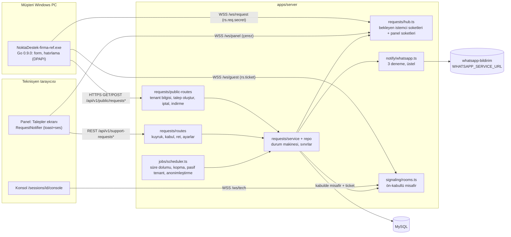

# Mimari — E9 Müşteri destek talebi (P8b)
Tarih: 2026-11-12 · Durum: TASLAK **r2** (r2: güvenlik tasarım turu E9 G-E9-1..14 işlendi — bağlayıcı ayrıntı **§13**; §13 önceki bölümlerle çelişirse §13 geçerlidir) · Ana belge: `docs/mimari.md` (bu dosya onun ayrılmaz ekidir; §-numaraları ana belgeyle aynı anlamdadır).
Girdi: `docs/gereksinimler-e9.md`, `docs/gereksinimler-kabul-kriterleri-e9.md` (AC-129..AC-164). Sözleşme ayrıntısı: `docs/mimari-api.md` "Destek talepleri (P8b)", `docs/mimari-protokol.md` §5. ADR: **ADR-0016** (yeni), ADR-0004 r3, ADR-0006 r4 (revizyon bölümleri).
Açık sorular S12–S17 gereksinimdeki varsayılanlarla kapatıldı (§12).

## 1. Özet ve kısıtlar
Müşteri, firmaya özel adı taşıyan **aynı jenerik ikiliyi** (`NoktaDestek-<firma>-<tenantRef>.exe`) açar, formu doldurur. Talep tenant kuyruğuna düşer. Teknisyen kabul edince sunucu bir destek oturumu oluşturur ve bekleyen istemciye tek kullanımlık `wsTicket` iter. İstemci `/ws/guest`'e bağlanır, **lobi atlanarak** otomatik kabul edilir. Kontrol izni akışı (P7) değişmez.

| Kısıt / karar | Değer | Kaynak |
|---|---|---|
| Stack | Değişmez: Fastify + ws + Prisma/MySQL, Next.js, Go istemci. Yeni bağımlılık **yok** (WhatsApp çağrısı Node `fetch`; DPAPI `x/sys/windows`; ses WebAudio) | ADR-0002..0005 |
| Ölçek | Tenant başına ≤ 50 bekleyen talep; sistem geneli hedef ≤ 500 bekleyen talep WS'i + ≤ 100 panel WS'i — tek süreçte ihmal edilebilir | V19, ADR-0005 |
| Bekleme kanalı (müşteri) | Yeni WS ucu **`/ws/request`** (talep sırrı subprotocol'de) — uzun yoklama değil | ADR-0016 §2 |
| Panel anlık bildirimi | Yeni WS ucu **`/ws/panel`** (çerez + Origin) — SSE değil | ADR-0016 §4 |
| Kabul → bağlantı | Kabul TX'i: talep `ACCEPTED` + `support_sessions` (PENDING, `request_id`, kodsuz, 60 sn) → istemciye `request.accepted{wsTicket}` → **müşteri tek tık "Ekranımı paylaş" onayı (r2, §13.3)** → `/ws/guest` bağlantısında §3.2 atomik tüketim (lobi/admitCode yok, V16; yerine gösterim amaçlı `requestCode` + bilinen kaynak bayrağı, §13.1) | ADR-0016 §3 |
| tenantRef | 16 karakter base32 küçük harf (`[a-z2-7]{16}`, 80 bit), yalnız dosya adında; düz metin saklanır (gizli değil), UQ; yenilenebilir | AC-129..131, ADR-0006 r4 |
| Hatırlama dosyası | `%LOCALAPPDATA%\NoktaDestek\hatirla.bin`, DPAPI CurrentUser + sabit entropi; tek istisna; **kutucuk varsayılan işaretsiz** (r2, kullanıcı kararı) | AC-136..138, ADR-0004 r3 |
| WhatsApp | `WHATSAPP_SERVICE_URL` (sistem env, vars. `http://89.252.189.211:3000`), tenant yalnız açık/kapalı + ≤ 5 alıcı; **mesajda kişisel veri ve müşteri serbest metni yok** (r2, §13.5); tenant 30/sa üst sınır + özet; prod'da düz HTTP/özel olmayan adres → kanal kapalı | V18, AC-150, 152 |
| E-posta | Kanal ve alıcı alanları P8b-1'de **şemada** var, UI'da pasif ("Önce SMTP ayarlarını yapın"); gönderim + test P10 | S17, AC-151 |
| PUBLIC_BASE_URL | Staging `https://remote.noktabilisim.net` (host nginx → Caddy; devops ayrı işte taşıyor). Panel bağlantısı, indirme bağlantısı ve WhatsApp mesajındaki link bundan üretilir | Çağıran notu |

**Basitlik ilkeleri:** kuyruk = DB tablosu + bellek içi bildirim merkezi (Redis/BullMQ yok); WhatsApp denemeleri süreç içi zamanlayıcı (yeniden başlatmada bekleyen deneme kaybolur → kabul edilen sınır, audit'te sonuç yazılmaz, panel bildirimi birincil). Genişleme noktaları §7.

## 2. Bileşenler ve sorumluluklar

| Bileşen | Dosya | Sorumluluk | Sorumlu olmadığı |
|---|---|---|---|
| Public talep uçları | `apps/server/src/requests/public-routes.ts` | Ref çözümleme, talep oluşturma, REST iptal, firma dosyası indirme (302) | Bekleme durumu (WS) |
| Panel uçları | `apps/server/src/requests/routes.ts` | Kuyruk/geçmiş listesi, detay, kabul, ret, ayarlar, ref yenileme, WhatsApp testi | Oturum konsolu |
| Servis + repo | `requests/service.ts`, `requests/repo.ts`, `requests/limits.ts` | Durum makinesi (§3.3), atomik geçişler, hız ve bekleyen sınırları, audit | Soket yönetimi |
| Bildirim merkezi | `requests/hub.ts` | `/ws/request` soketleri (talep başına 1), 120 sn kopma zamanlayıcısı, sıra yayını; `/ws/panel` soketleri (tenant → kullanıcı soketleri), olay yayını | DB yazımı (servisi çağırır) |
| WhatsApp istemcisi | `apps/server/src/notify/whatsapp.ts` | `POST {URL}/send-message` ve `/test-send`, 8 sn zaman aşımı, 3 deneme | Alıcı seçimi (servis verir) |
| Oda genişletmesi | `signaling/rooms.ts`, `signaling/admit.ts` | `preAdmitGuest()` — kabulde Guest kaydı (state `TICKETED`, `requestId`), ticket; `/ws/guest` bağlantısında lobi atlanır, §3.2 UPDATE `AND request_id=:rid` ile; oda yoksa misafir bağlantısı oluşturur | Talep durumu (servise geri çağırır) |
| Zamanlayıcı | `jobs/scheduler.ts` (+ `jobs/request-sweep.ts`, `jobs/request-retention.ts`) | 30 sn: süresi dolan talep → `EXPIRED`; kabul edilmiş ama 60 sn'de bağlanmamış → `CONNECT_FAILED`; pasif tenant talepleri → `CANCELLED(TENANT_PASSIVE)`; açılışta sahipsiz bekleyenler (120 sn ödemeden sonra) → `CANCELLED(DISCONNECTED)`. Günlük 03:30: talep anonimleştirme | — |
| Panel UI | `apps/web/app/(panel)/requests/*`, `components/request-notifier.tsx`, `app/(panel)/settings/support-requests/*` | Liste (5 durum), kabul/ret diyaloğu, toast + ses + sekme başlığı, ayar ekranı (indirme bağlantısı, yenile, kanallar, test) | — |
| Go istemci | `apps/agent-win/internal/{pairing,request,remember,ui}` | Dosya adından ref, firma penceresi, form + doğrulama, KVKK, hatırlama, bekleme ekranı, otomatik bağlanma | Sunucu tarafı sınırlar |

### 2.1 Bekleme kanalı kararı (müşteri): `/ws/request`
| Ölçüt | WS `/ws/request` (seçilen) | Uzun yoklama / kısa yoklama |
|---|---|---|
| Kabulden bağlantıya p95 ≤ 3 sn (AC-154) | Anında itme | Uzun yoklamada sağlanır, kısa yoklamada ≤ 2 sn aralık gerekir |
| Pencere kapandı → 5 sn'de İPTAL (AC-141) | `request.cancel` + close 1000 → anında | Ayrı REST çağrısı; süreç sonlanırken güvenilmez |
| 120 sn kopma → İPTAL (AC-141, R18) | Soket kapanınca zamanlayıcı; ping 30 sn (proxy/NAT boşta zaman aşımının altında) | "Son görülme" tarama alanı + DB yazımı gerekir |
| Mevcut kod | `signaling/ws.ts` upgrade, subprotocol kimliği, ping, token-bucket hazır; Go'da `coder/websocket` hazır | Yeni durum alanları |
Uzun yoklama reddedildi: kopma tespiti ve iptal için ek durum, her 25 sn'de yeni HTTP isteği; WS altyapısı zaten var. Kurumsal proxy WS'i engelliyorsa istemci zaten `/ws/guest` kullanamaz; ek kazanç yok.

### 2.2 Panel bildirim kanalı kararı: `/ws/panel`
SSE yerine WS: kimlik doğrulama (çerez + Origin + 60 sn `auth_sessions` yeniden doğrulaması), ping, IP başına bağlantı sınırı ve metrikler `signaling/ws.ts`'te mevcut; SSE için Caddy tamponlama ayarı ve ikinci bir kimlik yolu gerekirdi. Kanal **tek yönlüdür** (sunucu → panel); istemciden gelen her mesaj 1008. Kabul/ret REST'tir (CSRF + audit tek yerde).

### 2.3 Akış (özet; sequence `docs/mimari-akislar.md` A6 olarak eklenir — teknik-yazar/backend P8b-1)
1. İstemci açılır → ad `^NoktaDestek-[A-Za-z0-9]{1,20}-([a-z2-7]{16})(?: ?\(\d+\))?\.exe$` (büyük/küçük harf duyarsız önek; ref küçük harfe indirilir). Eşleşmezse 8 haneli kod yolu (AC-97) — değişmez.
2. `GET /public/requests/tenant?ref=` → firma adı, logo, güncel aydınlatma metni, bekleme süresi, `abuseEmail`. 404 → "Bu dosya artık geçerli değil; firmanızdan yenisini isteyin" + yalnız "Teknisyenden kod aldım".
3. Form → `POST /public/requests` (Origin yok, AGENT) → 201 `{requestId, requestSecret, expiresAt, position}`.
4. İstemci `/ws/request` (`rs.v1, rs.req.<secret>`) → `request.state` (sıra, bekleme); kuyrukta her değişimde yeniden gönderilir (≤ 1/sn/soket birleştirilir) + 10 sn'de bir yenileme (AC-139).
5. Panel: talep oluşturma commit'inden sonra `hub.publish(tenantId, request.new)` → `/ws/panel` → toast + ses (AC-149). WhatsApp kuyruğa alınır (AC-150).
6. Teknisyen "Kabul et" → `POST /support-requests/:id/accept` → TX (§3.3) → commit → `rooms.preAdmitGuest()` → ticket → `hub.sendToRequest(request.accepted{wsTicket, technicianName, techVerifyCode})` → panel(ler)e `request.removed`. Yanıt `{sessionId}`; panel konsola yönlenir. İstemci "Ekranımı paylaş / Vazgeç" ekranını gösterir (r2, §13.3).
7. Müşteri "Ekranımı paylaş"a basınca istemci `/ws/guest` (`rs.ticket.<t>`) → sunucu §3.2 UPDATE (`... AND request_id=:rid`) → caps **DB'deki etkin yetkilerden** (§13.2) → `session_consents(VIEW, GRANTED, UI, consent_text_id=talebin, ip/ua=bu bağlantının, request_id)` + audit `guest.admitted{via:"request", requestId, acceptedBy}` (actor customer) → misafire `hello`; teknisyen bağlıysa `peer.joined`, değilse teknisyen-yok zamanlayıcısı (§13.2). İstemci `/ws/request`'i 1000 ile kapatır. "Vazgeç" → `request.decline` (§13.3).
8. 60 sn içinde 7 olmazsa: oturum `CANCELLED(end_reason=connect_timeout)`, talep `CONNECT_FAILED`, kabul eden teknisyene `/ws/panel` `request.connect_failed` (AC-155).

## 3. Veri modeli (dba, P8b-1 migration `20261112000000_p8b_support_requests`)
Ortak kurallar ana belge §3 ile aynı: ULID `CHAR(26)`, `DATETIME(3)` UTC, FK `RESTRICT`, enum = `VARCHAR(20)` + **ikili CHECK** (`CAST(col AS BINARY) IN (…)`, ADR-0014), metin biçimleri `REGEXP_LIKE(…, 'c')`. Yeni tablolar `prisma/sql/grants.sql`'e: `app` → SELECT/INSERT/UPDATE (DELETE P13 retention ile).

### 3.1 `tenant_request_settings` (1-1 tenants; tembel oluşturulur)
| Alan | Tip | Kural |
|---|---|---|
| tenant_id | CHAR(26) PK/FK tenants | |
| request_ref | CHAR(16) **UQ** | `REGEXP_LIKE(request_ref,'^[a-z2-7]{16}$','c')`; `lib/ids.ts` `newTenantRef()` = `randomBytes(10)` → RFC 4648 base32 küçük harf (80 bit ≥ 64, AC-129) |
| ref_rotated_at | DATETIME(3)? | Son yenileme |
| file_label | VARCHAR(20) | Firma kısa adı (AC-130): `tenants.name` → NFKD, birleşik işaretler silinir, `ı→i İ→I ş→s ğ→g ç→c ö→o ü→u`, `[^A-Za-z0-9]` silinir, ilk 20; boşsa `Firma`. CHECK `REGEXP_LIKE(file_label,'^[A-Za-z0-9]{1,20}$','c')`. Ref üretiminde/yenilemede yeniden hesaplanır (firma adı değişirse yenile ile güncellenir) |
| wait_minutes | INT, vars. 30 | CHECK 10..120 (AC-142) |
| wa_enabled | BOOL, vars. false | |
| wa_recipients | JSON, vars. `[]` | Dizi, ≤ 5, her öğe E.164 `^\+[1-9][0-9]{7,14}$` (zod; DB'de `JSON_LENGTH ≤ 5` CHECK) |
| email_enabled | BOOL, vars. false | P10'a kadar sunucu `true` yazımını 400 ile reddeder (SMTP yok) |
| email_recipients | JSON, vars. `[]` | ≤ 5 e-posta (P10'da kullanılır; alan şimdi açılır ki P10 migration'sız olsun) |
| created_at, updated_at | DATETIME(3) | |
Tembel oluşturma: `GET /settings/support-requests` ve tenant'ın ilk ihtiyacında `INSERT … ON DUPLICATE KEY UPDATE tenant_id=tenant_id` (ref çakışmasında yeni ref, 5 deneme). Böylece P9 tenant oluşturma kodu değişmez ve migration'da rastgele üretim gerekmez. Ayarı olmayan tenant'ın ref'i yoktur → indirme/talep 404 (yalnız Admin ekranı açtığında bağlantı oluşur — kabul; kılavuzda).

### 3.2 `support_requests`
| Alan | Tip | Kural |
|---|---|---|
| id | CHAR(26) PK | `requestId` (gizli değil) |
| tenant_id | CHAR(26) FK | |
| status | VARCHAR(20) | `PENDING\|ACCEPTED\|CANCELLED\|EXPIRED\|REJECTED\|CONNECT_FAILED` (ikili CHECK). Arayüz: BEKLİYOR, KABUL_EDİLDİ, İPTAL, SÜRESİ_DOLDU, REDDEDİLDİ, BAĞLANAMADI (`labels.ts`) |
| cancel_reason | VARCHAR(20)? | `CUSTOMER\|DISCONNECTED\|TENANT_PASSIVE` (ikili CHECK); CHECK: `(status='CANCELLED') = (cancel_reason IS NOT NULL)` |
| secret_hash | CHAR(64) **UQ** | SHA-256(talep sırrı); düz sır yalnız 201 yanıtında (AC-154). Sır = `randomBytes(32)` base64url (43) |
| client_instance | CHAR(22) | İstemci süreç başına `randomBytes(16)` base64url; AC-143 "örnek başına 1 bekleyen" |
| client_version | VARCHAR(20) | `^\d{1,3}\.\d{1,3}\.\d{1,3}$` |
| customer_name | VARCHAR(80)? | AC-134; anonimleştirmede NULL |
| customer_phone | VARCHAR(16)? | Normalize E.164 (`+905xxxxxxxxx`); CHECK `REGEXP_LIKE(…,'^\\+[1-9][0-9]{7,14}$','c')` |
| customer_email | VARCHAR(254)? | |
| description | VARCHAR(500)? | 10..500 (zod); audit'e yazılmaz |
| consent_text_id | CHAR(26) FK consent_texts | AC-135 onay kaydı: sürüm |
| consent_sha256 | CHAR(64) | |
| consented_at | DATETIME(3) | = talep anı |
| ip | VARCHAR(45)? | Onay kaydı IP'si; anonimleştirmede NULL |
| ip_key | VARCHAR(64)? | `ipKey()` (AC-143 IP başına 3 bekleyen sayımı); anonimleştirmede NULL |
| expires_at | DATETIME(3) | created_at + wait_minutes |
| accepted_by | CHAR(26)? FK users | ACCEPTED/CONNECT_FAILED'da dolu (CHECK) |
| accepted_at | DATETIME(3)? | Bekleme süresi = accepted_at − created_at (AC-158) |
| rejected_by | CHAR(26)? FK users | |
| reject_message | VARCHAR(200)? | CHECK `(status='REJECTED') = (reject_message IS NOT NULL)`; `CHAR_LENGTH` 5..200 |
| closed_at | DATETIME(3)? | CHECK `(status='PENDING') = (closed_at IS NULL)` |
| anonymized_at | DATETIME(3)? | CHECK `anonymized_at IS NOT NULL OR (customer_name IS NOT NULL AND customer_phone IS NOT NULL AND description IS NOT NULL)` (P5 notundaki CHECK–anonimleştirme çelişkisi baştan çözülür) |
| created_at, updated_at | DATETIME(3) | |
İndeksler: `IX(tenant_id, status, created_at)` (kuyruk asc + geçmiş sekmesi + sıra hesabı), `IX(status, expires_at)` (süpürücü), `IX(tenant_id, ip_key, status)` (IP başına bekleyen), `IX(tenant_id, client_instance, status)`, `IX(created_at)` (retention), `UQ(secret_hash)`.
Sıra (AC-139): `SELECT COUNT(*) FROM support_requests WHERE tenant_id=? AND status='PENDING' AND (created_at, id) < (?, ?)` + 1 — en çok 50 satır, indeks üzerinden.

### 3.3 `support_sessions` değişiklikleri (expand)
| Değişiklik | Kural |
|---|---|
| `request_id CHAR(26)? UQ FK support_requests` | Talepten doğan oturum (AC-158). Kaynak türetilir: `request_id IS NULL` → TECH, değilse REQUEST (ayrı `source` sütunu yok) |
| P2 CHECK `PENDING ⇔ active_code dolu` | → `request_id IS NOT NULL AND active_code IS NULL` **veya** `request_id IS NULL AND (status='PENDING') = (active_code IS NOT NULL)` — talep oturumunun 8 haneli kodu yoktur (kod/link yolu kapalı) |
| P2 CHECK TTL 15..30 dk | → `request_id IS NULL AND <mevcut>` **veya** `request_id IS NOT NULL AND TIMESTAMPDIFF(SECOND, created_at, expires_at) BETWEEN 55 AND 65` (60 sn bağlanma penceresi, AC-155) |
| `token_hash` | Talep oturumunda da rastgele üretilir, **hiç döndürülmez** (NOT NULL/UQ korunur); resolve token yolu talep oturumunu bulursa 404 |
| `end_reason` (CHECK'siz) | Yeni değer `connect_timeout` (contracts `SESSION_END_REASONS`'a; UI etiketi "Müşteri bağlanamadı") |

### 3.4 Talep durum makinesi (AC-140; tek kaynak `packages/contracts/src/api/requests.ts` `REQUEST_TRANSITIONS`, sunucu `requests/service.ts`)
| Kaynak → Hedef | Tetik | SQL koşulu (tek koşullu UPDATE, `count=1` kazanır) |
|---|---|---|
| PENDING → ACCEPTED | Teknisyen kabul | `WHERE id AND tenant_id AND status='PENDING' AND expires_at > now` (+ aynı TX'te oturum INSERT) |
| PENDING → REJECTED | Teknisyen ret | aynı koşul |
| PENDING → CANCELLED(CUSTOMER) | `request.cancel` / close 1000 / REST iptal | `WHERE secret_hash AND status='PENDING'` |
| PENDING → CANCELLED(DISCONNECTED) | 120 sn kopma | `WHERE id AND status='PENDING'` |
| PENDING → CANCELLED(TENANT_PASSIVE) | Tenant pasif (P9 servis çağrısı + 30 sn süpürücü) | `WHERE tenant_id AND status='PENDING'` |
| PENDING → EXPIRED | Süpürücü | `WHERE status='PENDING' AND expires_at <= now` |
| ACCEPTED → CONNECT_FAILED | 60 sn zamanlayıcı / süpürücü | `WHERE id AND status='ACCEPTED'` + oturum `WHERE request_id AND status='PENDING'` → CANCELLED(`connect_timeout`), tek TX |
Diğer her geçiş: servis `CONFLICT` (409) döner; `ACCEPTED` iken misafir admit edilince talep **ACCEPTED kalır** (son durum; oturum durumu ayrı izlenir). Birim testi tüm (kaynak, hedef) çiftlerini gezer (AC-140). Eşzamanlı kabul (AC-153): iki teknisyen aynı satırda yarışır, InnoDB satır kilidi tek kazanan verir; kaybeden `count=0` → talebi yeniden okur: ACCEPTED → 409 `REQUEST_TAKEN`, diğer kapalı → 409 `REQUEST_CLOSED`.

**Kabul TX'i (sıra bağlayıcı):** (1) `users WHERE id=:tech FOR UPDATE` (P2 açık oturum sayımı kalıbı) → açık oturum ≥ `max_open_sessions` ise ROLLBACK + 409 `OPEN_SESSION_LIMIT`, talep PENDING kalır; (2) talep koşullu UPDATE → ACCEPTED; (3) `support_sessions` INSERT (`request_id`, `technician_id`, `status=PENDING`, `active_code=NULL`, `tech_verify_code` yeni, `expires_at=now+60 sn`, `customer_name/email` talepten); (4) audit `request.accepted`; commit. Commit **sonrası** bellek: `rooms.preAdmitGuest`, ticket, `hub` bildirimleri. Commit sonrası adım başarısız olursa (süreç çökmesi) 60 sn süpürücüsü CONNECT_FAILED yapar.

### 3.5 Bellek içi durum (ADR-0005)
| Yapı | Alanlar | Ömür |
|---|---|---|
| `hub.requestSockets` | requestId → { peer, tenantId, disconnectTimer? (120 sn), lastStateSentAt } | Talep PENDING/ACCEPTED süresince; talep başına tek soket (yeni bağlantı eskisini 4409 ile kapatır — aynı sırrın tek sahibi) |
| `hub.panelSockets` | tenantId → Set<{ peer, userId, authToken, perms }> | Panel sekmesi açık kaldıkça; kullanıcı başına ≤ 5 soket (6. → 4429) |
| `Guest` (genişler) | `requestId?` — doluysa ön-kabullü: `/ws/guest` bağlantısında lobi/`admitCode` atlanır | 60 sn ticket |
| `notify.pending` | WhatsApp deneme zamanlayıcıları | En çok 60 sn; yeniden başlatmada kaybolur |
Açılışta: PENDING talepler için 120 sn tolerans zamanlayıcısı **başlatılır** (istemciler yeniden bağlanabilir); ACCEPTED talepler süpürücüye kalır.

### 3.6 Saklama ve anonimleştirme (AC-159; P8b-1'de talepler için kurulur, P13 oturumları aynı işe ekler)
| Veri | Süre | İşlem |
|---|---|---|
| support_requests (tüm durumlar) | tenant `retention_days` (90–730), `created_at`'ten | Günlük 03:30 Europe/Istanbul: `customer_name, customer_phone, customer_email, description, ip, ip_key → NULL`, `anonymized_at=now`; 1000'lik partiler, `IX(created_at)`. Hard delete P13 (oturum satırı `request_id` FK'si nedeniyle önce oturum, sonra talep) |
| Talepten doğan oturum | Mevcut §3.4 (P13) | Değişmez |
| Audit | 730 gün | Açıklama hiç yazılmaz; ad/telefon audit'e **yazılmaz**, yalnız talep kimliği (AC-160) |
| Hatırlama dosyası | Müşteri bilgisayarında, süresiz; müşteri siler | "Bilgilerimi unut" / kutucuk boş gönderim (AC-137) |
Aydınlatma seed metni (P8b-1 seed, yeni sürüm — `is_current` değişir): yerel saklama (ne, nerede, nasıl silinir) ve talep verisinin tenant saklama süresi kadar tutulup anonimleştirildiği eklenir. Not: seed yeni sürüm eklediğinde P4 join `consentTextId` kontrolü (AC-127) eski sürümle açık karşılama sayfalarını 400'e düşürür — staging'de kabul, runbook yayın notu.

## 4. API ve protokol özeti
Bağlayıcı sözleşme: `docs/mimari-api.md` "Destek talepleri (P8b)" ve `docs/mimari-protokol.md` §5. Zod şemaları: `packages/contracts/src/api/requests.ts` (REST), `packages/contracts/src/ws-request.ts` (`/ws/request` ve `/ws/panel` mesajları), fixtures `packages/contracts/fixtures/ws-request.json` + `request-form.json` (Go ile ortak doğrulama örnekleri: telefon normalizasyonu, ad/açıklama sınırları, dosya adı → ref).
| Uç / kanal | Kimlik | Yetki |
|---|---|---|
| GET `/public/requests/tenant?ref=` | Yok | Ref hız kovası |
| POST `/public/requests` | Yok; `checkPublicClient(req,"AGENT")` (Origin yok, Sec-Fetch yok) | Hız + bekleyen sınırları |
| POST `/public/requests/cancel` | Talep sırrı (gövdede) | — |
| GET `/public/agent/request-download?ref=` | Yok | Hız kovası |
| WS `/ws/request` | `Sec-WebSocket-Protocol: rs.v1, rs.req.<sır>`; Origin yok | Talep PENDING/ACCEPTED |
| GET `/support-requests`, `/support-requests/:id`, `/support-requests/count` | Çerez | `support_requests.view` + `tenantScope` |
| POST `/support-requests/:id/accept`, `/reject` | Çerez + CSRF | `support_requests.accept` + `tenantScope` (+ `sessions.create` **gerekmez**: kabul yetkisi oturum açmayı kapsar; açık oturum sınırı yine uygulanır) |
| GET/PUT `/settings/support-requests`, POST `…/rotate-ref`, `…/whatsapp/test`, (`…/email/test` P10) | Çerez (+ CSRF) | `settings.edit` |
| WS `/ws/panel` | Çerez + Origin | `support_requests.view` (yoksa 403 upgrade) |
| GET `/sessions?source=` + geçmiş detayında `request` | Mevcut | Mevcut `historyScope` |
Super Admin: talep ve ayar uçları **firma seçimi zorunlu** (`tenantScope`; `historyScope`'un `all` istisnası yoktur, AC-148). Firma seçmemiş Super Admin'in `/ws/panel`'i açılmaz (403); seçince açılır.

## 5. Güvenlik tasarımı (E9 eki; ana belge §5 geçerli)
### 5.1 Kimlik zinciri (müşteri)
`tenantRef` (gizli değil, tahmin edilemez, 80 bit) → talep oluşturma → **talep sırrı** (256 bit, yalnız o istemci sürecinin belleğinde; diske/hatırlama dosyasına yazılmaz, loglanmaz, URL'de taşınmaz) → `/ws/request` → kabulde `wsTicket` (60 sn, tek kullanımlık, `kind=AGENT`, `requestId`'ye bağlı) → `/ws/guest` → `reconnectToken` (mevcut). Sır hash'le saklanır, `timingSafeEqual`. Lobi `admitCode`'u yerine talep sırrı bağlar (V16): kabul eden teknisyen, talebi açan istemciye bağlanır; ticket'ı yalnız sır sahibinin soketi alır (AC-154 "sırrı olmayan istemci katılamaz").

### 5.2 Tehditler (STRIDE; ana belge T1–T27'ye ek)
| # | Tehdit | STRIDE | Önlem | AC |
|---|---|---|---|---|
| T28 | Ref tahmini / numaralandırma (firma adına talep, firma adı/logosu sızıntısı) | I/S | 80 bit; geçersiz ref `ipKey` 10/dk (15 dk blok) tüm ref'li uçlarda ortak kova; geçersiz, yenilenmiş, pasif ve ayarı olmayan tenant **aynı** 404 (gövde + süre farkı yok: aynı kod yolu); global geçersiz ref sayacı yalnız alarm (`rs_request_ref_invalid_total` > 100/dk) | 129, 132, 144 |
| T29 | Firma dosyası/bağlantısı sızar → spam talep, bildirim yorgunluğu, sahte "müşteri" makinesine bağlanma (R11) | S/D | AC-143/144 sınırları; "Bağlantıyı yenile"; audit'te IP; kılavuzda "tanımadığınız talebi telefonla doğrulayın" (V16); teknisyen ekranı paylaşılmaz (yalnız müşteri ekranı akar); müşteriden dosya uyarısı (AC-36/117). Genişleme: talepte kabul kodu (S12) — `Guest.requestId` yolunda `admitCode` üretimi tenant ayarıyla açılır, protokolde `lobby.wait` zaten var | 131, 143, 144 |
| T30 | Kimliksiz uçla DB doldurma / DoS (R15) | D | IP 5/sa, önek 20/sa, tenant 60/sa; bekleyen: örnek 1, IP 3, tenant 50 (DB sayımı, **`tenant_request_settings` satırı `FOR UPDATE`** ile seri hale getirilir → yarışla aşılmaz); alan uzunlukları; gövde ≤ 8 KB (`bodyLimit`); anonimleştirme. `/ws/request` ipKey başına eşzamanlı ≤ 5 soket (**yeni**, r2 G-E9-9; mevcut kod yalnız dakikada 31 upgrade sayar); IPv6 /48 kovası ve önek başına bekleyen sınırı (§13.6) | 143, 144 |
| T31 | Talep sırrının sızması (log, proxy) → başkasının kabul edilen oturuma bağlanması | I/S | Sır yalnız 201 gövdesinde ve subprotocol'de; pino `REDACT_PATHS`'e **`*.requestSecret`, `*.wsTicket` eklenir** (r2, G-E9-9 — yollar tam anahtar adıyla eşleşir), `sec-websocket-protocol` (mevcut); Caddy logunda subprotocol silinir (mevcut G-10 filtresi, `rs.req.*` de kapsanır); audit mask `secret` anahtarı (mevcut) | 154 |
| T32 | Değiştirilmiş "NoktaDestek-firma" dosyası dağıtımı (R12) | S/T | Firma dosyası **aynı ikili** — hash tüm tenant'larda eşit (AC-130 testi); attestation + `agent-watch` (mevcut T13) firma yolunu da kapsar: gözcü bir firma dosya adıyla da indirir; istemci Hakkında satırı (AC-128) | 130 |
| T33 | WhatsApp servisi üzerinden SSRF / iç ağ taraması | E/I | URL yalnız sistem düzeyi, tenant göremez/değiştiremez (AC-152); **r3 (P12b):** kaynak Super Admin panel kaydı (`system_settings.whatsapp`), yoksa `WHATSAPP_SERVICE_URL`; yazma yalnız SUPER_ADMIN; URL kuralı (http/https, userinfo/sorgu/parça yok, ≤ 200) + yönlendirme izlenmez (S8b-1); prod'da güvensiz adres → kanal kapalı (K13 değişmez). İç ağ adresi bilerek serbest (servis özel ağda olabilir; Super Admin güvenilir aktör — MySQL ayarıyla aynı risk kabulü); alıcı yalnız E.164; mesaj gövdesi sunucuda şablondan | 150, 152, 196 |
| T34 | WhatsApp kanalında kişisel veri sızıntısı / yurt dışı aktarım; kimliksiz servis üzerinden sahte bildirim | I/S | **r2 (G-E9-5/6):** mesajda kişisel veri ve müşteri serbest metni yok (§13.5) → kişisel veri yurt dışına aktarılmaz; prod'da `http://` veya özel olmayan adres → kanal kapalı başlar (fail-closed); K13 genişledi; kılavuz: "WhatsApp mesajındaki bağlantıya değil, paneli yer imlerinizden açın" | 150 |
| T35 | Panel bildirimiyle tenant arası sızıntı | I | `hub` anahtarı soket bağlamındaki `tenantId` (Super Admin için `actingTenantId`); mesajda tenant parametresi alınmaz; 60 sn yeniden doğrulamada yetki/tenant değişimi → 4401; bildirim içeriği: ad + açıklama önizlemesi (yalnız `view` yetkililere) | 147, 148, 149 |
| T36 | Hatırlama dosyasının başka kullanıcı/zararlı tarafından okunması (R14) | I | DPAPI CurrentUser (başka Windows kullanıcısı çözemez); aynı kullanıcıdaki zararlıya karşı koruma yok — kabul (T17 kapsam sınırı); sır ve açıklama dosyada yok; kutucuk + "Bilgilerimi unut" | 136, 137 |
| T37 | XSS (müşteri adı/açıklama panelde, WhatsApp mesajında) | T | React metin bağlama; toast metni düz metin; Cc/Cf/bidi reddi (AC-134, P4 `UNSAFE_NAME_CHARS` kalıbı); açıklamada `\n` serbest, diğer Cc yasak | 134 |
| T38 | Ret mesajı ile müşteriye kimlik avı metni gönderme (ele geçirilmiş teknisyen) | S | 5..200, düz metin, Cc/bidi yok; müşteri penceresi "Firmanızın mesajı:" başlığıyla gösterir, bağlantı tıklanamaz (Win32 statik metin); audit'te mesaj (AC-157) | 157 |

### 5.3 Hassas veri (ana belge §5.3'e ek)
| Veri | Sınıf | Depolama |
|---|---|---|
| Talep ad/telefon/e-posta/açıklama, IP | Kişisel (KVKK) | DB, retention + anonimleştirme; audit'e girmez |
| Talep sırrı | Gizli | Yalnız SHA-256 |
| tenantRef | Gizli değil, tahmin edilemez | Düz (UQ); audit'te ilk 4 karakter (AC-131); Caddy log filtresinde dosya yolu maskeli |
| WhatsApp alıcı numaraları | Kişisel (teknisyen) | Düz JSON (gizli değil); audit'te `+90*******3106` biçiminde son 4 hane (`lib/mask.ts` `maskPhone`) |
| Hatırlama dosyası | Kişisel | Müşteri PC, DPAPI |

### 5.4 Hız sınırları (tek tablo; `lib/rate.ts` kovaları, aşımda **o anahtar** 15 dk 429 + `Retry-After`)
| Kova | Anahtar | Sınır | Uç |
|---|---|---|---|
| `req.ref_invalid` | ipKey | 10/dk (geçersiz ref sayılır) | tenant bilgisi, talep oluşturma, indirme |
| `req.create.ip` / `req.create.prefix` / `req.create.tenant` | ipKey / prefixKey / tenantId | 5/sa / 20/sa / 60/sa | POST `/public/requests` (başarılı + başarısız sayılır; zod 400 de sayılır) |
| `req.download` | ipKey | 30/sa | indirme (AC-132) |
| `req.info` | ipKey | 60/dk | GET tenant bilgisi (geçerli ref'lerde) |
| `req.cancel` | ipKey | 30/dk | REST iptal |
| `req.wa_test` | tenantId | 5/dk | WhatsApp testi (AC-152) |
| `req.accept` | userId | 30/dk | kabul/ret (çift tık koruması değil — yarış SQL'de) |
| Bekleyen (DB) | instance / ipKey / tenant | 1 / 3 / 50 | POST `/public/requests` → 409 `REQUEST_PENDING` / 429 `RATE_LIMITED` / 429 `QUEUE_FULL` |
**r2:** tenant kovası aşımında tenant kilitlenmez; yalnız bilinmeyen kaynaklar reddedilir (§13.6). Aşım audit'i `request.rate_limited` (kova + anahtar türü, IP) kaynak başına dakikada en çok 1 (AC-144).

## 6. Bildirimler
| Kanal | Tetik | Alıcı | İçerik | Hata davranışı |
|---|---|---|---|---|
| Panel (birincil) | Talep commit'i; kabul/ret/iptal/süre dolumu/bağlanamadı | Tenant'ın `/ws/panel` soketleri (yalnız `support_requests.view`) | `request.new{id, customerName, preview(100), createdAt}`, `request.removed{id, status}`, `queue.count{pending}`, `request.connect_failed{id}` (yalnız kabul edene) | Soket yoksa kayıp yok (liste REST'ten). Web: Sonner toast "Görüntüle" → `/requests?id=`; ses WebAudio kısa ton (dosya yok); sekme gizliyse `document.title = "(n) Talepler — …"`; ses tercihi `localStorage` `rs.requestSound` (cihaz bazlı — AC-149 "saklanır"); tarayıcı engellerse yalnız görsel |
| WhatsApp | Talep commit'i, `wa_enabled` | `wa_recipients` (≤ 5, ayrı ayrı) | **r2 şablonu (§13.5):** `Yeni destek talebi – <firma> – panelde görüntüleyin. Talep kodu: <requestCode>` + ayrı satırda sabit `<PUBLIC_BASE_URL>/requests`. Ad, telefon, e-posta, açıklama, talep kimliği **yok** | Asenkron; deneme 1 hemen, 2 +5 sn, 3 +20 sn; her çağrı 8 sn zaman aşımı (≤ 60 sn, AC-150); tenant 30/sa + alıcı 10/sa + global 300/sa, aşımda özet (§13.5); son sonuç alıcı başına audit `request.notify{channel, recipient(maske), result, attempts}` |
| E-posta | P10 | `email_recipients` | Aynı içerik | P10 (AC-151); P8b-1'de alan/anahtar var, UI pasif |
| Müşteri | — | — | Kapsam dışı (gereksinim §3 madde 7) | — |
WhatsApp testi: `POST {URL}/test-send {phoneNumber}` (ortak standart 2.2), tek deneme, 8 sn; yanıt `{ok, message}` genel metin ("Servise ulaşılamadı" / "Servis hata döndürdü"); ayrıntı log. `phoneNumber` servis biçimi: `+` olmadan (`905…`).

## 7. Performans ve genişleme
| Konu | Karar | Genişleme noktası |
|---|---|---|
| Kuyruk listesi (AC-146) | Bekleyenler ≤ 50 (sayfasız, `IX(tenant_id,status,created_at)`); geçmiş sekmesi 30 gün, sayfalı (25/100); 1.000 kayıt ölçümü P8b-1 bitti kanıtı | — |
| Sıra yayını | Kuyruk değişince tenant'ın bekleyen soketlerine `request.state` (soket başına ≤ 1/sn birleştirme) + 10 sn yenileme; sıra sayımı tek sorgu ile tüm bekleyenler (`ROW_NUMBER` yerine sıralı id listesi, ≤ 50) | — |
| Çok instance | Yok (ADR-0005) | `requests/hub.ts` dışa yalnız `publish/sendToRequest` açar; Redis pub/sub bu dosyanın arkasına |
| Bildirim kuyruğu | Süreç içi zamanlayıcı | `notify/` → BullMQ (`jobs/`) |
| Atama/SLA/mesai, web formu, kabul öncesi mesaj | Kapsam dışı | Atama: `support_requests.assigned_to` sütunu + `/accept` kapsamı; web formu: `checkPublicClient(req,"BROWSER")` aynı servis; mesaj: `/ws/request` + `/ws/panel` iki yönlü tip |

## 8. Operasyon
| Değişken (yeni) | Açıklama |
|---|---|
| `WHATSAPP_SERVICE_URL` | Opsiyonel, vars. `http://89.252.189.211:3000` (`env.ts` default; `.env.example` boş; compose `server` servisine; runbook). Boş/geçersiz → WhatsApp kanalı ve testi 502 `UPSTREAM` "Servis yapılandırılmamış" |
| `PUBLIC_BASE_URL` | Değişmez anahtar; staging değeri `https://remote.noktabilisim.net` (devops'un taşıma işi). İndirme bağlantısı: `${PUBLIC_BASE_URL}/api/v1/public/agent/request-download?ref=<ref>` |
Caddy (devops P8b-1; host nginx önündeki taşıma işiyle çakışmayacak şekilde, yalnız `@agentExe` matcher'ı ve log filtresi): (1) `@agentExe` yol eşleşmesine `^/downloads/NoktaDestek-[A-Za-z0-9]{1,20}-[a-z2-7]{16}\.exe$` eklenir, aynı volume ikilisi, `forward_auth /internal/agent-ready` aynen; (2) log filtresi `request>uri regexp "/downloads/NoktaDestek-[^/?]+" "/downloads/NoktaDestek-***"` ve `/downloads/Destek-***` (mevcut). Sorgu dizesi zaten silinir. `/ws/request` ve `/ws/panel` mevcut `/ws*` yönlendirmesiyle server'a gider (nginx katmanında WS upgrade başlıkları devops'un işinde doğrulanır).
Metrikler: `rs_requests_pending`, `rs_requests_created_total`, `rs_request_ref_invalid_total`, `rs_request_rate_limited_total{bucket}`, `rs_request_notify_total{channel,result}`, `rs_ws_connections{role="request"|"panel"}`. Alarm: ref_invalid > 100/dk; whatsapp başarısız oranı > %50 / 15 dk.
Migration: expand-only; `down.sql` yeni tabloları ve `request_id`'yi düşürür, eski CHECK'leri geri yazar (yalnız `request_id` dolu satır yokken başarılı — runbook notu). Seed: aydınlatma metni yeni sürüm (§3.6).
Yedek: mevcut günlük dump yeni tabloları kapsar.

## 9. Test stratejisi (AC → seviye)
| AC | Seviye | Not |
|---|---|---|
| 129, 131, 132, 147, 148, 152, 157, 158, 160 | Entegrasyon (server, gerçek MySQL) | 147/148: AC-69 aracına 9 talep ucu × {USER yetkili/yetkisiz, ADMIN, başka tenant, Super Admin seçili/seçilmemiş} |
| 130 | Entegrasyon + CI | İki tenant indirmesi → aynı volume dosyası; dosya adı `file_label` birim testi (Türkçe karakter, 20 sınırı, boş ad) |
| 134 | Birim (contracts) + Go birim (ortak fixture) + entegrasyon (istemci atlatılmış 400) | |
| 135 | Entegrasyon | eski `consentTextId` → 400 `fields.consentTextId`; onay alanları dolu |
| 139–145 | Entegrasyon (sahte `/ws/request` istemcisi, sahte saat) | 141: close 1000 → ≤ 5 sn İPTAL; soket düşür → 120 sn sonra DISCONNECTED; 143: yarış `Promise.all` 60 talep → tam 50 kabul; 144: sahte XFF |
| 140 | Birim | `REQUEST_TRANSITIONS` tüm çiftler |
| 146, 149 | Entegrasyon + Playwright | 149 staging ölçümü p95 (test-raporu); ses engelli tarayıcı → toast |
| 150 | Entegrasyon (sahte HTTP sunucusu) | 500 → 3 deneme, zamanlama, audit fail |
| 153, 155 | Entegrasyon | 50 tekrar çift kabul → tek kazanan; açık oturum sınırı 409 + talep PENDING; 60 sn sonra CONNECT_FAILED + panel olayı |
| 154, 156 | Entegrasyon (sahte istemci: ticket'sız `/ws/guest` 403, başka talebin sırrıyla bağlantı) + Windows elle ölçüm | 156: P7 kontrol regresyonu talep oturumunda |
| 136–138, 162, 163 | Go birim (remember: yaz/oku/sil, bozuk dosya) + Windows elle (`trace-check.ps1 -Remember on|off`) | |
| 133, 164 | Windows elle + Go birim (klavye sırası tablosu); panel axe iki tema | |
| 159 | Entegrasyon (sahte saat, retention işi) | |
| 161 | CI | AC-1..128 testleri değiştirilmeden yeşil |
| 151 | P10 | |
Komutlar: ana belge §9 (`pnpm -r run test`, `pnpm --filter @remote/web e2e`, `go test ./...`, `pwsh test/trace-check.ps1`).

## 10. Paketler
Ana belge §10.2 satırları P8b-1 ve P8b-2 (bağlayıcı). Özet:
| Paket | Ajan sırası | Paralel | Bağımlı |
|---|---|---|---|
| P8b-1 Sunucu + panel | dba (migration, CHECK'ler, grants, seed aydınlatma) → (backend ‖ frontend ‖ devops) → (qa ‖ güvenlik) → test-operatoru | backend ‖ frontend (sözleşme bu belge + contracts; frontend sahte uçlarla başlamaz, contracts şemaları önce backend tarafından **ilk gün** eklenir) ‖ devops (env, compose, Caddy matcher/log, metrik, runbook) | P8 |
| P8b-2 Go istemci 0.9.0 | backend-dev (Go) → (qa ‖ güvenlik) → test-operatoru (Windows) | Yok (tek ajan); devops yalnız yayın (`v0.9.0` etiketi, attestation) | P8b-1 GEÇTİ (sunucu uçları staging'de) |
P9'a ek giriş şartı: tenant pasife alma servisi `requests.cancelAllForTenant(tenantId)` çağırır (AC-145, süpürücü yedek yol); toggle ekranında `support_requests.*` kendiliğinden görünür (AC-72 testi).

## 11. AC eşlemesi (AC-129..AC-164)
| AC | Bileşen / uç / mesaj | Paket |
|---|---|---|
| 129 | `tenant_request_settings.request_ref`, `newTenantRef()`, GET `/settings/support-requests` (`settings.edit`) | P8b-1 |
| 130 | `file_label`, `request-download` 302, Caddy `@agentExe` matcher, aynı ikili | P8b-1 |
| 131 | POST `/settings/support-requests/rotate-ref`, audit `settings.support_requests.ref_rotated{old,new: 4 kar.}`, `REQUEST_REF_INVALID` | P8b-1 (istemci mesajı P8b-2) |
| 132 | `req.download` + `req.ref_invalid` kovaları, tek 404 yolu | P8b-1 |
| 133 | `internal/pairing` ref regex, `internal/ui` firma penceresi, GET `/public/requests/tenant` | P8b-2 (uç P8b-1) |
| 134 | contracts `requestFormSchema` + Go eşi, fixture | P8b-1 (sunucu), P8b-2 (istemci) |
| 135 | `support_requests.consent_*`, seed aydınlatma, `consentTextId` kontrolü | P8b-1 (+ istemci formu P8b-2) |
| 136–138 | `internal/remember` (DPAPI), ADR-0004 r3, `trace-check.ps1` | P8b-2 |
| 139 | POST `/public/requests` 201, `/ws/request` `request.state{position,waitingSince}` | P8b-1 (+ istemci ekranı P8b-2) |
| 140 | `REQUEST_TRANSITIONS`, §3.4 koşullu UPDATE'ler | P8b-1 |
| 141 | `request.cancel`, close 1000, REST iptal, `hub` 120 sn zamanlayıcı, `/ws/panel` `request.removed` | P8b-1 (sunucu), P8b-2 (istemci) |
| 142 | `wait_minutes` (10–120), süpürücü EXPIRED, `request.closed{EXPIRED}` | P8b-1 (+ "Yeniden talep oluştur" P8b-2) |
| 143, 144 | `requests/limits.ts`, §5.4 | P8b-1 |
| 145 | süpürücü TENANT_PASSIVE + `cancelAllForTenant` (P9 çağırır) | P8b-1 (P9 servis çağrısı) |
| 146 | `web/app/(panel)/requests`, side-nav "Talepler" (lucide `Inbox`) + rozet, GET `/support-requests` | P8b-1 |
| 147 | `permissions.ts` `support_requests: [view, accept]`, `requirePerm` | P8b-1 (toggle ekranı P9) |
| 148 | `tenantScope` tüm talep uçlarında, `/ws/panel` tenant bağlamı | P8b-1 |
| 149 | `/ws/panel`, `RequestNotifier` | P8b-1 |
| 150 | `notify/whatsapp.ts`, `request.notify` audit | P8b-1 |
| 151 | e-posta kanalı | **P10** |
| 152 | PUT `/settings/support-requests`, `whatsapp/test`, audit eski→yeni | P8b-1 (e-posta testi P10) |
| 153 | Kabul TX'i §3.4, `REQUEST_TAKEN`/`REQUEST_CLOSED`/`OPEN_SESSION_LIMIT` | P8b-1 |
| 154 | `request.accepted{wsTicket,technicianName,techVerifyCode}`, onay ekranı (§13.3), `request.decline`, `rooms.preAdmitGuest`, §3.2 UPDATE `request_id`, caps DB'den (§13.2) | P8b-1 (sunucu), P8b-2 (istemci) |
| 155 | 60 sn zamanlayıcı + süpürücü, `connect_timeout`, `request.connect_failed` | P8b-1 |
| 156 | P7 akışı değişmez (regresyon testi talep oturumunda) | P8b-1 (sunucu), P8b-2 (istemci) |
| 157 | POST `/support-requests/:id/reject`, `request.closed{REJECTED,message}` | P8b-1 (+ istemci gösterimi P8b-2) |
| 158 | `support_sessions.request_id`, `source` filtresi, detay `request`, CSV "Kaynak; Bekleme" | P8b-1 |
| 159 | `jobs/request-retention.ts` | P8b-1 |
| 160 | §6/§12 audit eylem listesi | P8b-1 |
| 161 | CI tam regresyon | P8b-1, P8b-2 |
| 162 | "Teknisyenden kod aldım" → mevcut 8 hane akışı, karşılamada firma | P8b-2 |
| 163 | Kurulumsuz; pencere kapanınca süreç sonu | P8b-2 |
| 164 | İstemci klavye; panel axe | P8b-2 (istemci), P8b-1 (panel) |
| 196 | Super Admin WhatsApp servisi ayarı + test (`/admin/settings/whatsapp`, mimari-api Yönetim) — 2026-11-13 | P12b |
Karşılığı olmayan AC: **yok**.

## 12. Audit olayları, hata kodları ve açık kararlar
**Audit (entity `support_requests`, `entity_id` = talep kimliği; ad/telefon/açıklama YAZILMAZ):** `request.created{ip, clientVersion}` (actor `username='customer'`), `request.cancelled{reason}`, `request.expired`, `request.accepted{sessionId, waitSec}`, `request.rejected{message}`, `request.connect_failed{sessionId}`, `request.notify{channel, recipient(maske), result, attempts}`, `request.rate_limited{bucket, keyType}` (`entity_id` NULL). Entity `tenant_request_settings`: `settings.support_requests.updated{old,new}` (waitMinutes, waEnabled, waRecipients maskeli, emailEnabled, emailRecipients), `settings.support_requests.ref_rotated{oldRefPrefix, newRefPrefix}`, `settings.whatsapp.test{recipient(maske), result}`. Oturum: `guest.admitted{via:"request", requestId}`. Zaman çizelgesi izin listesine (P8) `guest.admitted` zaten var; `request.*` olayları geçmiş detayının "Destek talebi" bölümünde değil, P11 audit ekranında görünür. Audit mask izinli listesine `reason`, `channel`, `bucket`, `keyType` (mevcut `reason`); `refPrefix` anahtarı `key` kalıbına takılmaz (`ref` maskelenmez) — test.

**Yeni hata kodları** (`packages/contracts/src/errors.ts`): `REQUEST_REF_INVALID` 404, `REQUEST_PENDING` 409, `REQUEST_TAKEN` 409, `REQUEST_CLOSED` 409, `QUEUE_FULL` 429. Mevcut: `VALIDATION`, `FORBIDDEN`, `NOT_FOUND`, `CSRF_INVALID`, `OPEN_SESSION_LIMIT`, `RATE_LIMITED`, `UPSTREAM`.

| # | Konu | Karar | Sahibi |
|---|---|---|---|
| K12 | S12–S17 | Gereksinim varsayılanları kabul: kabul kodu yok (genişleme T29); hatırla kutucuğu **işaretsiz** (r2, kullanıcı kararı 2026-11-12); mesai saati yok; WhatsApp ≤ 5 bireysel numara; dosya adında ASCII firma adı ≤ 20; SMTP P10'da | Kullanıcı (değişirse ADR-0016 revizyonu) |
| K13 | WhatsApp servisi kimliksiz ve internete açık (T34, G-E9-6) | Mesajda kişisel veri yok (r2). **Prod ön koşulu:** servis TLS veya özel ağ arkasında, güvenlik duvarında yalnız Remote sunucusuna açık; servis API anahtarı desteklenince eklenir (Sonra). Prod'da `http://` + özel olmayan adres → kanal kapalı (kod). P13 prod listesine eklenir | Kullanıcı + devops |
| K14 | Ref, Admin ayar ekranını açana kadar yoktur (tembel oluşturma) | Kabul; P9 tenant oluşturmada isteğe bağlı erken oluşturma eklenebilir | mimar |
| K15 | Tenant hız kovası / bekleyen sınırıyla tenant'ın kapatılması | **r2 (G-E9-7):** tenant kilitlenmez; bilinmeyen kaynak reddi, önek başına bekleyen sınırı, güvenilen CIDR muafiyeti (§13.6). Kalan risk: bilinen önekten spam — ref yenileme | guvenlik |

## 13. Revizyon r2 — güvenlik tasarım turu E9 (G-E9-1..14) — bağlayıcı
Kaynak: `docs/guvenlik-raporu.md` "Tasarım turu — E9 (P8b)"; koordinatör kararları 2026-11-12. Her madde P8b-1/P8b-2 kapsamındadır ("Sonra"ya bırakılan yok).

### 13.1 G-E9-1 [Yüksek] Talep kodu ve bilinen kaynak bayrağı
**Talep kodu (`requestCode`)** — gösterim amaçlı, **kapı değil** (S12 kararı değişmez):
- 6 hane, `crypto.randomInt(0, 10⁶)`, sıfır dolgulu; tenant'ın **bekleyen** talepleri arasında tekil (INSERT TX'inde kontrol, çakışmada yeniden üret, 5 deneme). Sütun `support_requests.request_code CHAR(6)`, CHECK `REGEXP_LIKE(request_code,'^[0-9]{6}$','c')`, indeks gerekmez (≤ 50 bekleyen). Anonimleştirmede korunur (kişisel veri değil).
- Akış: 201 yanıtında `requestCode`; istemci bekleme ekranında büyük puntoyla `123 456` ("Teknisyen sizi aradığında bu kodu söyleyin"); panel kartında ve detayda; WhatsApp mesajında (koordinatör kararı — mesajı alan zaten teknisyendir). **Audit'e yazılmaz** (gereksiz; 730 gün saklamada anlamı yok).
- Panel ipucu (talep kartı ve kabul butonu yanında, kalıcı metin): "Müşteriyi **firmanın kayıtlı numarasından** arayın (talepteki numaradan değil) ve ekrandaki talep kodunu sorun." Kılavuz aynı metin.

**Bilinen kaynak bayrağı (`knownSource`)** — bilgi amaçlı; kararı teknisyen verir:
| Sinyal | Tanım | Veri |
|---|---|---|
| `network` | Talebin ağ öneki (IPv4 /24, IPv6 /48 — `netKey()`, yeni `lib/ip.ts` yardımcısı) bu tenant'ta **son 90 günde ACTIVE'e geçmiş** (admit edilmiş) bir oturumun misafir ağ önekiyle aynı **veya** tenant'ın güvenilen CIDR listesinde (§13.6) | Yeni `support_sessions.guest_net_key VARCHAR(64)?` (admit UPDATE'inde yazılır, hem kod hem talep oturumu); IX(tenant_id, guest_net_key, consumed_at); retention'da NULL. `support_requests.net_key VARCHAR(64)?` (anonimleştirmede NULL) |
| `device` | İstemci hatırlama dosyasında saklanan 128 bit `deviceKey` (yalnız müşteri "hatırla"yı seçtiyse üretilir; ADR-0004 r3 ek) talepte gönderilir; sunucu `device_hash = SHA-256(tenant_id ‖ deviceKey)` saklar. Bu tenant'ta aynı `device_hash`'li **daha önce oturuma bağlanmış** (`ACCEPTED` + oturum `consumed_at` dolu) talep varsa `true` | `support_requests.device_hash CHAR(64)?`, IX(tenant_id, device_hash); anonimleştirmede NULL. `deviceKey` düz saklanmaz, loglanmaz (`REDACT_PATHS` `*.deviceKey`) |
| `firstSeen` | İkisi de false | — |
- Hesap: talep oluşturmada bir kez hesaplanır ve `support_requests.known_network BOOL`, `known_device BOOL` olarak yazılır (liste sorgusunda join yok). 
- UI: `network` → "Bu ağdan daha önce oturum yapıldı"; `device` → "Bu bilgisayar daha önce destek aldı"; ikisi de yok → uyarı rozeti "İlk kez görülen kaynak — firmanın kayıtlı numarasından arayıp talep kodunu doğrulayın" (warning token, lucide `ShieldAlert`). Bayrak doğrulama değildir: kılavuz bunu açıkça söyler (IP öneki paylaşılabilir, `deviceKey` hatırlama dosyasıyla taşınabilir).
- Sonra (öne alındı, gereksinim Sonra listesinin başı): S12 tenant ayarı "talepte kabul kodu zorunlu" (genişleme noktası `Guest.requestId` yolunda `lobby.wait` + admitCode).

### 13.2 G-E9-2 [Orta] Caps kaynağı ve teknisyen-yok zamanlayıcısı
- Ön-kabul admit TX'inde caps, **`support_sessions.technician_id` kullanıcısının DB'deki etkin yetkilerinden** hesaplanır (`users.status='ACTIVE'`, `role`, `user_permissions` → `effectivePermissions`); `TechConn` aranmaz. Kullanıcı pasif/silinmiş veya tenant pasif → UPDATE yapılmaz, oturum `CANCELLED(end_reason=auth_revoked)`, talep `CONNECT_FAILED`, misafire `session.ended{auth_revoked}`. Teknisyen sonradan bağlanınca mevcut 60 sn yeniden doğrulama ve `applyPermChange` caps'i yalnız daraltır (K5-c).
- **Teknisyen-yok zamanlayıcısı:** admit anında teknisyen soketi yoksa odanın mevcut teknisyen kopma zamanlayıcısı (`disconnectTimer`, 120 sn) **hemen başlatılır**; dolarsa mevcut teknisyen-kopma sonlanma yolu (aynı `end_reason`) işler ve müşteri istemcisi AC-107'ye göre kapanır. Teknisyen bağlanınca iptal edilir. Bu süre boyunca müşteriye "Teknisyen bağlanıyor…" gösterilir; görüntü teknisyen offer'ı gelmeden akmaz (offer'ı teknisyen başlatır, protokol §3).
- Test (P8b-1): `remote_control.use`/`file_transfer.use` yetkisi olmayan kabulcüde `hello.caps = []`; teknisyen hiç bağlanmazsa 120 sn'de oturum biter.
- Toggle ekranı (P9) açıklaması: "Talep kabul et — kabul edilen talep için oturum açar (Oturum oluşturma yetkisi gerekmez; açık oturum sınırı geçerlidir)." `permissions.ts`'e alt yetki açıklama alanı P9'da eklenir.

### 13.3 G-E9-3 [Orta] Onay tazeliği: her kabulde tek tık "Ekranımı paylaş"
**Karar: onay ekranı her kabulde gösterilir ve tıklama zorunludur** (bekleme süresinden bağımsız; 2 dk eşiği konmaz). Gerekçe: (1) tek yol — eşikli/eşiksiz iki davranışın testi ve kılavuzu yok; (2) KVKK ve P7 ilkesi: ekran paylaşımı müşterinin **o anki** etkin eylemiyle başlar, otomatik geri sayım müşteri masada değilken paylaşımı başlatırdı; (3) maliyeti tek tık, müşteri zaten teknisyeni bekliyor; (4) teknisyen adı + doğrulama kodu + talep kodu aynı ekranda görüldüğü için müşteri kime bağlandığını onaylar. AC-154 metni buna göre değişti.
- Ekran: firma logosu, "**<Teknisyen adı>** bağlanmak istiyor", teknisyen doğrulama kodu, talep kodu, iki buton "Ekranımı paylaş" / "Vazgeç". P7 diyalog kuralları (`ui/consent_dialog.go`): odak **Vazgeç**, Enter/Space "Ekranımı paylaş"ı tetiklemez, butonlar 1,5 sn sonra etkin, otomatik onay/geri sayım **yok**; pencere öne getirilir + görev çubuğu yanıp söner (`FlashWindowEx`).
- Süre: 60 sn bağlanma penceresi (AC-155) onayı da kapsar; yanıt gelmezse CONNECT_FAILED. Kalan süre ekranda gösterilir.
- "Ekranımı paylaş" → `/ws/guest` (§2.3 adım 7). `session_consents` satırı bu bağlantının IP/UA'sı ve admit zamanıyla yazılır (karışık kaynak yok); yeni sütun **`session_consents.request_id CHAR(26)? FK`** (talepteki form onayına bağ; kod yolunda NULL). Talep formundaki onay `support_requests.consent_*`'ta kalır.
- "Vazgeç" veya pencere kapatma (ACCEPTED iken) → `/ws/request` `request.decline` (kopuksa REST `POST /public/requests/cancel`, aynı etki) → tek TX: talep `ACCEPTED → CANCELLED(CUSTOMER)`, oturum `PENDING → CANCELLED(end_reason=customer_declined)`; kabul edene `/ws/panel` `request.declined{id}` + toast "Müşteri bağlantıyı kabul etmedi"; audit `request.cancelled{reason:"CUSTOMER", phase:"accepted"}`. Durum makinesine (§3.4) **ACCEPTED → CANCELLED** geçişi eklenir (koşul: `status='ACCEPTED'` ve oturum hâlâ PENDING; oturum ACTIVE olmuşsa geçiş yok, müşteri oturumu `session.end` ile bitirir).
- **İptal–kabul yarışı:** istemci "İptal"e basınca/pencere kapanırken yerel durum `CANCELLING`'e geçer; bu durumda gelen `request.accepted` **yok sayılır**, `/ws/guest`'e bağlanılmaz, `request.decline` gönderilir (sunucu sırası ne olursa olsun tek sonuç: talep CANCELLED). Sunucu: `request.cancel` kabul commit'inden önce işlenirse kabul 409 `REQUEST_CLOSED`; sonra işlenirse yukarıdaki decline yolu (`request.cancel` ACCEPTED iken artık **yok sayılmaz**, decline gibi işlenir). Close 1000 ACCEPTED iken de decline sayılır.
- Yeni `end_reason` değerleri: `customer_declined`, `connect_timeout` (contracts, UI etiketi "Müşteri vazgeçti" / "Müşteri bağlanamadı").

### 13.4 G-E9-4 [Orta] Asgari istemci sürümü
- Env `MIN_AGENT_VERSION` (opsiyonel, `^\d+\.\d+\.\d+$`; boş = kontrol yok). `env.ts` + `.env.example` + compose `server` + runbook ("güvenlik yamasında `MIN_AGENT_VERSION`'ı yamalı sürüme yükselt; firma dosyaları yeni ikiliyi aynı bağlantıdan alır").
- Kontrol (semver karşılaştırması, `lib/version.ts`), yalnız AGENT: POST `/public/requests` (`clientVersion`), POST `/public/sessions/resolve` (`clientKind=AGENT` iken gövdeye **opsiyonel** `clientVersion` eklenir; yoksa `0.0.0` sayılır — 0.8.x istemcileri MIN tanımlanınca güncellemeye zorlanır, bilinçli), join ve `/ws/guest` (sürüm nonce/ticket kaydından taşınır, yeniden beyan alınmaz). Daha düşükse **426 `CLIENT_OUTDATED`** (`fields.minVersion`) — WS upgrade'de 426 HTTP yanıtı.
- GET `/public/requests/tenant` yanıtına `minAgentVersion: string|null`; istemci açılışta karşılaştırır, form göstermeden uyarır.
- İstemci: "Bu Hızlı Destek dosyası eski. Güvenliğiniz için yeni sürümü indirin." + "Yeni sürümü indir" → talep modunda `${serverURL}/api/v1/public/agent/request-download?ref=<ref>`'i varsayılan tarayıcıda açar (`ShellExecuteW`, yalnız bu sabit biçimli URL); kod modunda "Teknisyeninizden yeni bağlantı isteyin".
- Not: sürüm istemci beyanıdır; zararlı istemciye karşı değil, dürüst kullanıcıyı eski ikiliden korumaya yöneliktir.

### 13.5 G-E9-5/6 [Orta] WhatsApp içeriği, servis güvenliği, serbest metin
- **Şablon (tek, tenant seçeneği yok):** satır 1 `Yeni destek talebi – <firma> – panelde görüntüleyin. Talep kodu: <123456>`; satır 2 `<PUBLIC_BASE_URL>/requests`. `<firma>` = `tenants.name` tek satıra indirilir (`\s+`→boşluk), WhatsApp biçim karakterleri `* _ ~ \`` silinir, ≤ 60 karakter. **Ad, telefon, e-posta, açıklama, talep kimliği yok** → kişisel veri yurt dışına aktarılmaz; aydınlatma metnine WhatsApp maddesi gerekmez. AC-150 metni değişti.
- Gövde `z.strictObject({ phoneNumber, message })`; `attachments` **hiç** gönderilmez.
- **Fail-closed:** `NODE_ENV=production` ve `WHATSAPP_SERVICE_URL` `http://` şemalı **ve** host özel/loopback değilse (`lib/netguard.ts` sınıflandırması tersine kullanılır) kanal kapalı başlar: gönderim yapılmaz, test 502 `UPSTREAM` "Servis güvenli yapılandırılmamış", açılışta `alarm:"whatsapp_insecure"` logu, ayar ekranında uyarı. Staging (`NODE_ENV!=='production'`) mevcut adresle çalışır. K13 prod ön koşulu §12.
- **Gönderim sınırları:** tenant başına saatte **30** mesaj (alıcı başına sayılır), alıcı başına saatte **10**, sistem geneli saatte **300**. Aşımda mesaj gönderilmez, sayaç tutulur; pencere sonunda (sabit saatlik pencere, `rate.ts` dışında `notify/whatsapp.ts` içinde küçük sayaç) bastırılan her alıcıya **tek özet**: `Son 1 saatte <n> yeni destek talebi daha – <firma> – panelde görüntüleyin.` + satır 2. Özet de sınıra dahildir (pencere başına alıcıya en çok 1). Bastırma audit'i `request.notify{result:"suppressed"}` pencere başına tenant için 1 kez; global aşım `alarm:"whatsapp_global_cap"`.
- **Serbest metin:** `descriptionSchema` tek satır: CR/LF/TAB → boşluk, `\s+` → tek boşluk (normalize sonra 10..500). Panelde açıklama, ad ve ret mesajı **otomatik bağlantıya çevrilmez** (düz metin; linkify kütüphanesi yok — ESLint kuralı gerekmez, React metin bağlama). İstemcide ret mesajı statik metin, `SS_NOPREFIX` (§13.8).

### 13.6 G-E9-7 [Orta] Önekler, tenant kovası, bekleyen dengesi, güvenilen CIDR
| Kural | Değer |
|---|---|
| Yeni kova `req.create.net48` | IPv6 /48 başına saatte 40 (IPv4'te uygulanmaz; IPv4 /24 zaten `prefixKey`) |
| Bekleyen (DB) | örnek 1; ipKey 3; **ağ öneki (`net_key`: IPv4 /24, IPv6 /48) 10**; tenant 50 |
| Yeni kaynak eşiği | Tenant bekleyen sayısı ≥ **40** iken yalnız `known_network` veya `known_device` true olan talepler kabul edilir; diğerleri 429 `QUEUE_FULL` (müşteri metni aynı). Bilinen kaynaklar 50'ye kadar dolabilir |
| Tenant kovası 60/sa aşımı | Tenant **kilitlenmez**: pencere süresince bilinmeyen kaynaklar 429 `RATE_LIMITED` (15 dk), bilinen kaynaklar geçer (bilinen kaynaklar için ayrı tenant tavanı 120/sa). Tenant'ın `/ws/panel` soketlerine `queue.alert{kind:"rate_limited"}` → panelde kalıcı uyarı bandı "Olağan dışı talep yoğunluğu — bağlantıyı yenilemeyi düşünün"; tenant etiketli alarm `rs_request_rate_limited_total{bucket="tenant"}` |
| Güvenilen IP/CIDR (opsiyonel, Admin) | `tenant_request_settings.trusted_cidrs JSON` (≤ 10; IPv4 önek ≥ /16, IPv6 ≥ /32 — daha geniş 400; özel/loopback aralıkları 400 — sunucu bunları zaten görmez). Eşleşen kaynak: ipKey/önek/net48 saatlik kovalarından ve ipKey/net_key bekleyen sınırlarından **muaf**; `known_network=true`. Muaf **olmadığı**: örnek 1, tenant 50, tenant kovası (bilinen tavan 120/sa), geçersiz ref kovası. Değişiklik audit eski→yeni |
Gerekçe: kurumsal NAT ofisi (US-29) kendi kurallarına takılmaz; saldırgan bilinmeyen kaynak olarak tenant'ı kapatamaz, en kötü durumda yalnız yeni kaynakları geciktirir.

### 13.7 Düşük bulgular
| ID | Karar | Sahip / paket |
|---|---|---|
| G-E9-8 | Host nginx erişim logu `remote_log_uri` map zincirine `/downloads/NoktaDestek-[^/?]+` → `/downloads/NoktaDestek-***` eklenir (Caddy filtresine ek); runbook §8.3 | devops, P8b-1 |
| G-E9-9 | `REDACT_PATHS` += `*.requestSecret`, `*.wsTicket`, `*.deviceKey`; `/ws/request` ipKey başına eşzamanlı ≤ 5 soket (yeni sayaç, aşımda upgrade 429); T30 metni düzeltildi | backend, P8b-1 |
| G-E9-10 | POST `/public/requests` sırası: Origin → ipKey/önek/net48 kovaları → zod → ref çözümleme (geçersiz → `req.ref_invalid`) → güvenilen CIDR / bilinen kaynak hesabı → tenant kovası → TX (**ilk ifade** `SELECT … FROM tenant_request_settings WHERE tenant_id=? FOR UPDATE`; bekleyen sayımları ondan sonra) → commit → hub/WhatsApp. mimari-api güncellendi | backend, P8b-1 |
| G-E9-11 | `/internal/agent-ready` firma yolu için genişler: Caddy `X-Forwarded-Uri`'den `<label>-<ref>` ayrıştırılır; ref aktif ve label güncel `file_label` ise 204, değilse 404 (ikili kapısı ayrıca 503). Böylece keyfi adlı resmi bağlantı üretilemez. İstemci firma penceresi dosya adındaki label'ı **göstermez**, yalnız sunucudan gelen firma adını; P6 karşılamasıyla aynı "bağlanılan sunucu + sürüm + SHA-256 ilk 8" satırı eklenir (AC-133) | devops + backend (P8b-1), istemci (P8b-2) |
| G-E9-12 | `rejectMessageSchema`: `://`, `www.`, alan adı kalıbı `/[a-z0-9-]+\.[a-z]{2,}/i`, `@` ve 7+ ardışık rakam (boşluk/tire yok sayılarak) reddedilir → 400 `fields.message` "Mesaj bağlantı, e-posta veya telefon içeremez". UI'da hazır seçenekler varsayılan seçili; serbest metin "Diğer" ile açılır. İstemci statik metin `SS_NOPREFIX` | backend/frontend (P8b-1), istemci (P8b-2) |
| G-E9-13 | Kutucuk **varsayılan işaretsiz** (kullanıcı kararı; V15/AC-136 güncellendi). Form hatırlanan bilgilerle açılınca altında ipucu: "Bu bilgiler size ait değilse **Bilgilerimi unut**". `hatirla.bin.tmp` O_EXCL `ERROR_FILE_EXISTS` → tmp silinir, bir kez yeniden denenir | istemci, P8b-2 |
| G-E9-14 | `requests/hub.ts` `closeByUser(userId, code)` ve `closeByAuthToken(tokenHash)`; çağıranlar: POST `/auth/logout` (o token), `/auth/logout-all`, şifre değişimi (eski oturumlar), yetki PATCH (`support_requests.view` kalktıysa), kullanıcı deaktivasyonu, Super Admin `switch-tenant` (eski tenant soketleri) — `rooms.endByTechnician` kalıbı (S-P3-8). 60 sn yeniden doğrulama yedek yol. P8b-1'de mevcut olan çağıranlar (logout, logout-all, şifre değişimi) bağlanır; P9 çağıranları P9 giriş şartıdır | backend, P8b-1 (+P9) |
| Audit notu | `guest.admitted{via:"request"}` actor `username='customer'`, `newValue` `{ requestId, acceptedBy }` | backend, P8b-1 |

### 13.8 Veri modeli ekleri (dba, P8b-1 migration'ına dahil)
`support_requests` += `request_code CHAR(6)`, `net_key VARCHAR(64)?`, `device_hash CHAR(64)?`, `known_network BOOL`, `known_device BOOL`; IX(tenant_id, net_key, status), IX(tenant_id, device_hash). `tenant_request_settings` += `trusted_cidrs JSON` vars. `[]` (`JSON_LENGTH ≤ 10`). `support_sessions` += `guest_net_key VARCHAR(64)?` + IX(tenant_id, guest_net_key, consumed_at). `session_consents` += `request_id CHAR(26)? FK support_requests`. Anonimleştirme (§3.6) `net_key`, `device_hash` → NULL; oturum retention'ı (P13) `guest_net_key` → NULL. Durum makinesine ACCEPTED → CANCELLED (§13.3).

### 13.9 Etkilenen AC'ler (metin değişikliği `gereksinimler-kabul-kriterleri-e9.md`, değişiklik kaydı dizinde)
AC-133 (sunucu/sürüm satırı, eski sürüm uyarısı), AC-134 (açıklama tek satır), AC-136 (kutucuk işaretsiz, ipucu), AC-139 (talep kodu), AC-143 (önek ve yeni kaynak eşiği, güvenilen CIDR), AC-144 (/48, tenant kilitlenmez), AC-146 (kod + bilinen kaynak), AC-150 (kişisel verisiz şablon, sınırlar), AC-152 (güvenilen CIDR ayarı), AC-154 (tek tık onay, vazgeç, iptal yarışı), AC-157 (ret mesajı kısıtları). AC sayısı değişmez (164).
