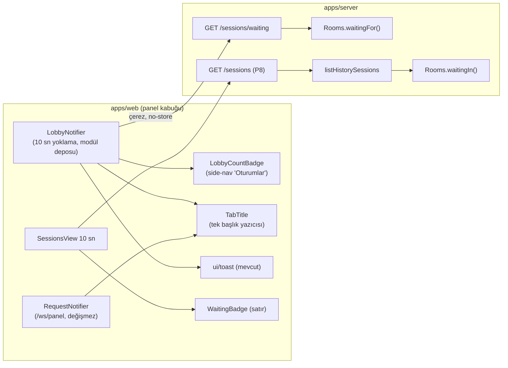

# Mimari — Bekleme odası (lobi) göstergesi (P13b-L)
Tarih: 2026-11-15 · Gereksinim: `docs/gereksinimler-lobi-gostergesi.md` (AC-304..316, V-L1..V-L8, R-L1..R-L5) ·
Karar: ADR-0029 (bellekten okunan REST yoklaması). Ana doküman: `docs/mimari.md` (bu dosya onun ayrılmaz eki).

## 1. Özet ve kısıtlar
- **Taşıma yolu:** (a) Panel geneli için `GET /api/v1/sessions/waiting` kullanılır. Yalnız kendi oturumları sayılır; yanıt
  bellekten gelir, DB'ye gidilmez. Panel kabuğu bu ucu 10 sn'de bir yoklar. (b) Liste rozeti için `GET /sessions`
  öğelerine `waitingGuests` alanı eklenir. `/ws/panel` değişmez. Gerekçe ADR-0029'dadır: `/ws/panel` `support_requests.view`
  ister ve tenant geneline yayın yapar. Ona kullanıcıya özel sayım eklemek yetki kuralını ve hub'ı değiştirir.
  10 sn hedefi (V-L1) yoklamayla karşılanır.
- **DB şeması değişmez.** Migration, grant ya da yeni yetki anahtarı yoktur (V-L5). Yeni env değişkeni de yoktur.
- Tek instance varsayımı geçerlidir (ADR-0005, R-L1).
- Kişisel veri: yanıtlarda yalnız sayılar ve kullanıcının zaten gördüğü kendi oturum kimliği bulunur (§5).
- Toast altyapısı projenin kendi `components/ui/toast.tsx` bileşenidir. AC-307'deki "Sonner" ifadesi yerine bu kullanılır,
  çünkü Sonner CSP nonce ihlali nedeniyle P2'de değiştirilmişti (DESIGN §6.1). Gereksinim §2'deki "mevcut toast
  yeniden kullanılır" kuralına uyar (§12 K-L1).

## 2. Bileşenler ve sorumluluklar

| Bileşen | Sorumluluk |
|---|---|
| `Rooms.waitingIn(sessionId)` | Bir odadaki bekleyen misafir sayısı (0..3) |
| `Rooms.waitingFor(tenantId, technicianId)` | Kullanıcının kendi bekleyen oturumları: `[{ id, waiting, arrivals }]` |
| `GET /sessions/waiting` | Guard, hız sınırı, `no-store`; iş mantığı servis fonksiyonundadır (`sessions/lobby.ts`) |
| `GET /sessions` | Mevcut liste; her öğeye `waitingGuests` eklenir (kapsam `historyScope`, değişmez) |
| `LobbyNotifier` | Yoklama, temel çizgi (baseline), toast kararı, `aria-live` metni, başlık parçası |
| `TabTitle` | Lobi ve talep öneklerini tek yerde birleştirip `document.title`'a yazar (iki yazıcının çakışmasını önler) |

## 3. Veri modeli
**DB değişikliği yok.** Bellekteki durum (`signaling/types.ts` `Room`, mimari §3.5):

| Alan | Tip | Kural |
|---|---|---|
| `Room.lobbyArrivals` (yeni) | `number` | `getOrCreate`'te 0. `attachGuest` her çağrıldığında (misafir `LOBBY` durumuna geçtiğinde) +1. Hiç azalmaz; oda silinince kaybolur |

**Bekleyen misafir** (gereksinim tanımının bellekteki karşılığı) = `room.lobby` içinde `state === "LOBBY"` olan misafir.
Odanın şu koşulları da sağlaması gerekir: `!room.ending`, `!room.admitted`, `room.expiresAt > clock.now()`.
- `TICKETED` misafir sayılmaz. Bu misafir henüz soketini bağlamamıştır ve konsoldaki "Bekleme odası (n)" listesinde de görünmez.
  Sayının konsol listesiyle aynı olması amaçlanır.
- Talepten doğan ön-kabullü misafir (`requestId`) hiç `LOBBY` durumuna geçmez, bu yüzden sayılmaz.
- Çıkış yolları zaten `room.lobby`'den siler veya odayı kapatır: kabul (`admitted`), ret, ayrılma, 5 dk zaman aşımı
  (`leaveLobby`), iptal veya süre dolumu (`RoomNotifier`). Sunucu yeniden başlarsa odalar boşalır ve sayı 0 olur (AC-305, 315).
- **Kendi oturumu:** `room.tenantId === auth.tenantId && room.technicianId === auth.user.id`. Oda yalnız PENDING oturum
  için lobi taşır; `expiresAt` süzgeci süpürücünün henüz kapatmadığı süresi dolmuş odayı dışarıda bırakır.
- `LOBBY_GUEST_MAX = 3` `@remote/contracts/api/sessions`'a taşınır. `signaling/types.ts` `LOBBY_MAX` bu değeri kullanır, böylece tek kaynak kalır.

## 4. API sözleşmesi
### 4.1 `GET /api/v1/sessions/waiting` (yeni)
| | |
|---|---|
| Girdi | Yok. Sorgu dizesi verilirse yok sayılır |
| Guard sırası | `requireAuth` (çerez, 2FA/şifre kapısı) → `requirePerm("sessions.view")` → `tenantScope(req)` (firma seçmemiş Super Admin → 403 "Önce bir firma seçin.", AC-310) → hız sınırı → servis |
| Hız sınırı | `FixedWindowCounter(61, 60_000, 60_000)`, anahtar `user.id`. Dakikada 60 istek serbesttir, 61. istek 429 `RATE_LIMITED` + `Retry-After` döner. Bütçe: 5 sekme × 6/dk = 30/dk, görünür olma anındaki ek yoklamalarla birlikte ≤ 40/dk (AC-314) |
| Çıktı 200 | `{ count: int ≥ 0, sessions: { id: ULID, waiting: 1..3, arrivals: int ≥ waiting }[] }`. `sessions` yalnız `waiting ≥ 1` olan kendi oturumlarını içerir, `id`'ye göre sıralıdır. `count` = Σ `waiting`. Uzunluk ≤ açık oturum sınırı (AC-11) |
| Başlıklar | `Cache-Control: no-store` |
| Hatalar | 401 `UNAUTHENTICATED`; 403 `FORBIDDEN` (yetki yok / firma seçilmemiş); 429 `RATE_LIMITED` |
| Audit | **Yok** (salt okuma, AC-314). Uygulama logunda yalnız standart istek satırı bulunur |
| Rol | USER, ADMIN ve firma seçmiş Super Admin için aynı davranış: yalnız `technician_id = kendisi` (V-L2) |

`arrivals` alanının amacı: misafir kimliği yanıtta yer almaz (AC-311). Bu yüzden istemci "yeni gelen" misafiri yalnız
`waiting` farkından anlayamaz. Aynı 10 sn penceresinde bir misafir çıkıp başka biri girerse `waiting` değişmez. Oda başına
monoton artan sayaç bu durumu da yakalar (§6.3). Değer yalnız bir sayıdır.

Yol `/:id`'den önce kaydedilir (statik yol önceliklidir; ayrıca "waiting" ULID biçimine uymaz).

### 4.2 `GET /api/v1/sessions` (değişiklik — eklemeli)
- Her `SessionListItem` öğesine **`waitingGuests: number`** (0..3) eklenir. `status === "PENDING"` olan satırda değer
  `rooms.waitingIn(id)`'den gelir, diğer bütün satırlarda 0'dır (AC-305). Kapsam `historyScope` ile aynıdır: alan yalnız
  kullanıcının zaten gördüğü satırlarda bulunur (AC-309, 310).
- Geriye uyumluluk: yalnız yeni bir yanıt alanı eklenir, sorgu şeması değişmez. Eski istemciler alanı yok sayar. CSV sütunları değişmez.
- `SessionHistoryDetail` bu alanı **taşımaz** (`extends Omit<SessionListItem, "waitingGuests">`). Geçmiş detayı canlı
  durum göstermez; böylece detay ve PATCH yollarına `rooms` bağımlılığı eklenmez.

### 4.3 Sözleşme (`packages/contracts/src/api/sessions.ts`)
```ts
export const LOBBY_GUEST_MAX = 3;
export const LOBBY_POLL_MS = 10_000;          // web yoklama aralığı (V-L1)
export const SESSIONS_WAITING_PER_MIN = 60;   // sunucu hız sınırı
export const waitingSessionsResponseSchema = z.strictObject({
  count: z.number().int().min(0),
  sessions: z.array(z.strictObject({
    id: z.string().regex(/^[0-9A-HJKMNP-TV-Z]{26}$/),
    waiting: z.number().int().min(1).max(LOBBY_GUEST_MAX),
    arrivals: z.number().int().min(1),
  })),
});
export type WaitingSessionsResponse = z.infer<typeof waitingSessionsResponseSchema>;
// SessionListItem += waitingGuests: number;  SessionHistoryDetail extends Omit<SessionListItem, "waitingGuests">
```
Web, yanıtı `safeParse` ile doğrular. Ayrıştırılamayan yanıt ağ hatası gibi ele alınır: son değer korunur ve sessizce yeniden denenir (AC-315).
Sunucu testleri de aynı şemayla doğrular. `strictObject` kullanıldığı için ad, e-posta ve benzeri ek alanlar şema ihlali sayılır (AC-311).

## 5. Güvenlik tasarımı
| Konu | Karar |
|---|---|
| Yetki | `sessions.view` (yeni anahtar yok, V-L5). `support_requests.view` gerekmez (AC-306) |
| Tenant / sahiplik | Uçta istemciden filtre alınmaz. Tenant ve teknisyen değerleri `auth`'tan türetilir, süzme `Rooms.waitingFor` içinde yapılır. Başka tenant'ın ya da başka teknisyenin oturumu hiçbir koşulda dönmez (AC-309) |
| Firma seçmemiş Super Admin | Panel ucu 403 döner, istemci bu durumda yoklama başlatmaz. Listede `waitingGuests` bilgi olarak görünür, bağlantı yoktur (AC-310) |
| Kişisel veri (AC-311) | Ad, e-posta, IP, misafir türü, kabul kodu ve oturum kodu yanıtta yer almaz. `id`, kullanıcının listede zaten gördüğü kendi oturumunun ULID'idir ve "Konsolu aç" hedefi için gereklidir; kişisel veri değildir (§12 K-L2) |
| Önbellek | `no-store`. Uç GET'tir, CSRF gerekmez (durum değiştirmez) |
| DoS | Kullanıcı başına 60/dk. İşlem O(oda) ve bellek içidir, DB'ye gidilmez (R-L5) |
| Log | Caddy kuralı (G-10) değişmez. Uç sorgu dizesi taşımaz |
| Tehdit özeti | Bilgi sızıntısı (S/I): sahiplik süzmesi entegrasyon testiyle kanıtlanır. Kötüye kullanım (D): hız sınırıyla sınırlanır. Yükseltme (E): ADMIN başka teknisyenin lobisinden kabul yapamaz, rozet yalnız bilgi amaçlıdır (G-04 değişmez) |

## 6. Web tasarımı
### 6.1 Etkinlik ve yerleşim (`app/(panel)/layout.tsx`)
- `lobby = permissions.includes("sessions.view") && (!isSa || Boolean(actingTenant))`. Talep bildirimindeki `notify` kalıbıyla
  aynıdır, ama `support_requests.view` yetkisine bağlı değildir (AC-306, 310).
- `<LobbyNotifier enabled={lobby} scopeKey={`${user.id}:${(actingTenant ?? tenant)?.id ?? ""}`} />` ve `<TabTitle />`,
  `<main>` içinde `RequestNotifier`'ın yanında, sayfa içeriğini sarmadan render edilir (P8b-1 kuralı). `scopeKey` değişirse
  (Super Admin firma değiştirirse) depo sıfırlanır ve temel çizgi yeniden alınır.

### 6.2 Yoklama (`components/lobby-notifier.tsx`)
- Modül deposu (`useSyncExternalStore`) `{ enabled, count, sessions }` tutar. `RequestNotifier` ile aynı desendir, ama ayrı bir depodur.
  Dışa aktarılanlar: `useLobby()`, `LobbyCountBadge`.
- Döngü `setTimeout` zinciriyle kurulur (`LOBBY_POLL_MS`). İstekler üst üste binmez. **Sekme gizliyken de yoklama sürer**
  (AC-308). Sekme görünür olunca beklemeden bir yoklama yapılır.
- Sonuç işleme:
  | Sonuç | Davranış |
  |---|---|
  | 200 + şema geçerli | Depo güncellenir, §6.3 çalışır |
  | 401 | `router.replace(EXPIRED_LOGIN_PATH)` (oturum listesiyle aynı davranış) |
  | 403 | Yoklama durur, `count = 0`. Yetki ya da firma bağlamı değiştiyse sayfa yenilemesiyle yeniden başlar |
  | 429 | Son değer korunur. Sonraki yoklama `max(Retry-After, 10 sn)` sonra yapılır |
  | Ağ hatası, 5xx, şema hatası | Son değer korunur. Toast ve `console.*` çağrısı yoktur, sonraki turda yeniden denenir (AC-315) |

### 6.3 Toast tekilleştirme (AC-307) — misafir kimliği olmadan
İstemci `prev: Map<sessionId, {waiting, arrivals}>` tutar. Bu değer son başarılı yanıttan gelir; yanıtta bulunmayan oturum `{0,0}` sayılır.
1. **Temel çizgi:** Bileşen bağlandıktan (veya `scopeKey` değiştikten) sonraki ilk başarılı yanıt yalnız `prev`'e yazılır,
   toast gösterilmez. Sayfa yüklenirken zaten bekleyen misafirler sayaç ve rozetle görünür (V-L6). App Router'da kabuk
   sayfa geçişlerinde yeniden bağlanmaz; bu yüzden geçişler yeni toast üretmez.
2. Sonraki her yanıtta her oturum için `yeni = arrivals ≥ prev.arrivals ? arrivals − prev.arrivals : arrivals` hesaplanır.
   Küçülme oda yeniden yaratıldı ya da sunucu yeniden başladı demektir. Ardından `gelen = min(yeni, waiting)` alınır
   (gelip giden misafir toast üretmez).
3. Kullanıcı o oturumun konsolundaysa (`pathname === /sessions/{id}/console`) o oturumun `gelen` değeri 0 sayılır.
4. `n = Σ gelen`. `n > 0` ise **tek** toast gösterilir:
   - metin: n = 1 → `s.lobby.toastOne`, n > 1 → `s.lobby.toastMany {n}`;
   - eylem: yanıtta `waiting ≥ 1` olan tek oturum varsa `s.openConsole` → `/sessions/{id}/console`, birden çok varsa
     `s.lobby.toastList` → `/sessions`;
   - `tone: "info"`, `durationMs: 15_000` (≥ 10 sn), kapatma düğmesi mevcut.
5. `prev` yeni yanıtla değiştirilir. Aynı misafir sonraki yoklamalarda `arrivals` artmadığı için yeniden toast üretmez.
- Ses ve OS bildirimi yoktur (Sonra L-S1). Sekmeler arası tekilleştirme yoktur (R-L4, L-S4).

### 6.4 Menü sayacı (AC-306, 312, 313)
- `side-nav.tsx`: `{href === "/sessions" && <LobbyCountBadge />}`. Sayı 0 iken render edilmez.
- Görünüm: `RequestCountBadge` ile aynı hap ölçüsü (`min-w-6`, `tabular-nums`, `text-xs font-semibold`), ama renk
  `bg-warning-surface text-warning` + `border border-warning/30` olur. Talep rozetinden (`primary`) ve "Bekliyor" durum rozetinden
  (`primary-surface`) ayrışır (R-L3). Kontrast açık temada #8a5300/#fff3d6 ≈ 6:1, koyu temada #e9b949/#33260a ≈ 8:1.
- Erişilebilir ad: görünen sayı `aria-hidden`, yanında `sr-only` `s.lobby.navSr {n}` ("{n} müşteri bekleme odasında") bulunur.
  Sayaç "Oturumlar" bağlantısının içindedir: klavyeyle odaklanır, Enter `/sessions`'ı açar. İç içe bağlantı olmaz.
- Mobil: bugünkü panelde menü, kapanmayan yatay şerittir (`side-nav` `overflow-x-auto`). "Oturumlar" ikinci öğe olduğu için
  360 px'te kaydırmadan görünür ve sayaç bu öğenin üzerindedir (e2e `toBeInViewport`). P14b (AC-222) açılır/kapanır mobil
  menü getirirse menü düğmesine `LobbyDot` eklenir (`useLobby().count > 0`; nokta + `sr-only` `s.lobby.navSr`). Bu genişleme
  noktası P14b görev listesine yazılır (§12 K-L3).
- Animasyon: belirirken `transition-[opacity,transform] duration-200 ease-out starting:scale-95 starting:opacity-0`,
  `motion-reduce:starting:scale-100` ile yalnız opacity kalır. Kaybolurken animasyon yoktur. Sayı tek hanedir (1..9; 99+ kuralı
  aynen) ve `tabular-nums` genişliği sabit tutar. Sürekli tekrarlayan animasyon veya nabız yoktur (AC-313).

### 6.5 Satır rozeti (AC-304, 305, 309, 310, 312)
- Yeni bileşen `app/(panel)/sessions/waiting-badge.tsx`: `{ n, href?: string }`. `lucide-react` `BellRing` (`size-4`,
  `aria-hidden`) ve görünür metin `s.lobby.badge {n}` ("Müşteri bekliyor (n)") içerir; stil `rounded-full bg-warning-surface text-warning
  border border-warning/30 px-2 text-xs font-medium min-h-6` (dokunma hedefi olduğunda `min-h-11` kapsayıcı).
  - `href` varsa `<Link>` olur: odaklanabilir, Enter ile konsolu açar, `aria-label` = `s.lobby.badgeOpen {n}`.
  - `href` yoksa `<span>` olur (bilgi amaçlı; ADMIN'de başkasının satırı, firma seçmemiş Super Admin'de tüm satırlar).
- `href` koşulu: `s.status === "PENDING" && s.technician.id === meId && !pickTenant`. "Konsolu aç" düğmesi aynı koşulla zaten var (V-L7).
- Yer: tabloda "Durum" hücresinde `StatusBadge`'in yanında (`flex items-center gap-2 whitespace-nowrap`), kartta başlık
  satırının altında ayrı bir satırda.
- **Yer kayması olmaz:** PENDING satırda rozet yuvası her zaman render edilir. `n = 0` iken `invisible` + `aria-hidden` olur
  (yükseklik ve genişlik korunur). Satır durumu değiştiğinde (ör. ACTIVE) yuva kalkar; bu, durum değişiminin kendisidir.
  Görünürken §6.4'teki opacity/scale geçişi uygulanır.
- Veri: `SessionsView` / `SessionList` öğe tipi `SessionView` yerine `SessionListItem` olur (zaten bu uçtan gelir).
  `SessionList`'e `pickTenant` prop'u eklenir.
- Konsol: `/sessions/:id/console` açılınca "Bekleme odası (n)" bölümü 1280×800'de ilk ekranda görünür olmalıdır (e2e
  `toBeInViewport`). Görünmüyorsa frontend lobi paneline `id="bekleme-odasi"` verir ve rozet/toast bağlantısı `#bekleme-odasi` ile açılır.

### 6.6 Sekme başlığı (AC-308) — `lib/tab-title.ts` + `components/tab-title.tsx`
- Sorun: Mevcut `titleWithCount`, `^\(\d+\) ` önekini siler. Lobi öneki de "(1) …" ile başladığı için iki ayrı yazıcı birbirinin
  önekini siler. Çözüm: başlığa **tek yazıcı** yazar.
- `lib/tab-title.ts` (saf fonksiyonlar ve küçük depo):
  - `setTitlePart("lobby" | "requests", n)`;
  - `stripPrefixes(title)` önce lobi önekini (`^\(\d+\) Müşteri bekliyor — `, i18n kalıbından üretilen ve kaçışlanmış regex), sonra
    talep önekini (`^\(\d+\) `) siler;
  - `composeTitle(base, { lobby, requests })` = `lobby>0 ? "({l}) Müşteri bekliyor — " : ""` + `requests>0 ? "({r}) " : ""` + `base`.
    Sıra AC-308'deki gibi önce lobi, sonra talep.
- `TabTitle` bileşeni: `RequestNotifier`'daki mevcut `MutationObserver` mantığı buraya taşınır. `/console$` yollarında hiçbir
  önek uygulanmaz (konsol kendi sohbet önekini kullanır, DESIGN §8; mevcut kural korunur). Bileşen kaldırılırken önekler silinir.
- `LobbyNotifier`, `document.visibilityState === "hidden" && count > 0` ise `setTitlePart("lobby", count)`, aksi halde 0 yazar
  (`visibilitychange` dinlenir). `RequestNotifier` başlık efektini bırakır, yalnız `setTitlePart("requests", count ?? 0)` çağırır.
  `titleWithCount` testleri geçmeye devam eder; fonksiyon `tab-title.ts` içinde yeniden kullanılabilir.

### 6.7 Ekran okuyucu (AC-312)
`LobbyNotifier`, `sr-only` `<p aria-live="polite" data-testid="lobby-live">` render eder. Başlangıçta boştur, temel çizgide
yazılmaz. Sonraki her yanıtta `count` **değiştiyse** metin değişir: >0 → `s.lobby.navSr {n}`, 0 → `s.lobby.liveNone`. Aynı değerle
yapılan yenileme DOM'u değiştirmez ve tekrar duyurmaz. Toast kendi bölgesinde ayrıca okunur (yeni gelişte iki duyuru olur; bilinçli,
§12 K-L4). `ToastViewport` `<section>`'ına `role="status"` eklenir (`aria-live="polite"` zaten var; AC-307'deki rol şartı, diğer toast'ları değiştirmez).

### 6.8 i18n (`apps/web/messages/tr.json`, `s.lobby.*`)
| Anahtar | Metin |
|---|---|
| `s.lobby.badge` | `Müşteri bekliyor ({n})` |
| `s.lobby.badgeOpen` | `Müşteri bekliyor ({n}) — konsolu aç` |
| `s.lobby.navSr` | `{n} müşteri bekleme odasında` |
| `s.lobby.liveNone` | `Bekleme odasında müşteri kalmadı` |
| `s.lobby.toastOne` | `Bekleme odasında müşteri var` |
| `s.lobby.toastMany` | `Bekleme odasında {n} müşteri var` |
| `s.lobby.toastList` | `Oturumlara git` |
| `s.lobby.titlePrefix` | `({n}) Müşteri bekliyor — ` |
Toast eylemi tek oturumda mevcut `s.openConsole` ("Konsolu aç") anahtarını kullanır. Hiçbir metinde müşteri adı yoktur (AC-311).
DESIGN.md'ye eklenecekler (frontend-dev): ikon `Müşteri bekliyor → BellRing`, bileşen tablosuna `WaitingBadge` ve `LobbyCountBadge` satırları.

## 7. Performans ve ölçek
- `waitingFor`, oda haritası üzerinde tek geçişle çalışır: O(oda + lobi ≤ 3·oda). DB, ağ ya da kilit yoktur. Hedef p95 ≤ 100 ms
  (AC-314). Beklenen değer mikrosaniye düzeyindedir, bu yüzden ek indeks (teknisyen → oda haritası) kurulmaz. Oda sayısı
  binlere çıkarsa `Map<technicianId, Set<sessionId>>` eklenir (genişleme noktası `rooms.ts` `getOrCreate`/oda silme).
- `GET /sessions` maliyetine eklenen yük satır başına O(1) `Map.get`'tir.
- Yük: N açık panel sekmesi × 6 istek/dk. 50 teknisyen × 3 sekme ≈ 15 istek/sn, bellekten okunur.

## 8. Operasyon
- Env, config, migration, grant: **yok**. `docs/runbook.md`'ye tek satır eklenir: "Lobi göstergesi bellekten okunur;
  sunucu yeniden başlarsa 0'a iner (beklenen)". Rollback, önceki imaja dönmektir; şema farkı yoktur.
- Metrik eklenmez (AC'de yok). Gerekirse `rs_lobby_waiting_guests` gauge Sonra'dır (§12).
- Log: standart istek satırı. Uç audit yazmaz.

## 9. Test stratejisi
### 9.1 Sunucu (Vitest; `pnpm --filter @remote/server test`)
| Dosya | Kapsam | AC |
|---|---|---|
| `test/unit/lobby-count-p13bl.test.ts` (yeni) | `Rooms` sahte saatle: `waitingIn`/`waitingFor` 0/1/3; `TICKETED` sayılmaz; kabul, ret, ayrılma, 5 dk zaman aşımı, iptal (`RoomNotifier`), `expiresAt` geçmiş ve `ending` → 0; `arrivals` monoton (çık + gir → waiting aynı, arrivals +1); talep ön-kabullü misafir sayılmaz; yeni `Rooms` örneği (restart) → 0 | 305, 315 |
| `test/integration/sessions-lobby-p13bl.test.ts` (yeni) | 401 çerezsiz; 403 `sessions.view` yok (yalnız `session_history.view` olan kullanıcıda liste 200, uç 403); 403 firma seçmemiş Super Admin; tenant-1 USER-A / USER-B / ADMIN, tenant-2 USER-C: her biri yalnız kendi sayısını görür; ADMIN'in `count`'u B'nin misafirini içermez ama ADMIN listesinde B'nin satırında `waitingGuests` > 0; USER listesinde başkasının satırı yok; tenant-1 ADMIN listesinde tenant-2 oturumu yok; Super Admin firma A'da kendi oturumu sayılır, firma B'ye geçince sayılmaz; liste firma seçmeden tüm tenant'larda `waitingGuests` döner; PENDING dışı satırlar 0; `Cache-Control: no-store`; `audit_logs` sayısı istek öncesi ve sonrası eşit; yanıt `waitingSessionsResponseSchema.parse` ile geçer ve gövde metninde misafir adı ve e-postası geçmez; hız sınırı: 30 istek/dk 200, 60. istek 200, 61. istek 429 `RATE_LIMITED` + `Retry-After`, başka kullanıcı etkilenmez | 304, 305, 309, 310, 311, 314 |
| aynı dosya, `perf` bloğu | 100 oda × 3 `LOBBY` misafir (300) bellekte. Ölçüm kullanıcısının kendi 3 odası var. 1000 ardışık `app.inject` → `onResponse` `elapsedTime` p95 ≤ 100 ms; değer stdout'a yazılır, test-operatoru `docs/test-raporu.md`'ye aktarır. Yeni bağımlılık yok | 314 |
| Mevcut `sessions-history-api-p8.test.ts` | Liste yanıt şekli testleri `waitingGuests` alanıyla güncellenir; regresyon | 305 |

### 9.2 Web birim (Vitest; `pnpm --filter @remote/web test`)
| Dosya | Kapsam | AC |
|---|---|---|
| `lib/lobby/diff.test.ts` | Temel çizgide toast yok; tek geliş → n=1 + konsol hedefi; iki oturuma geliş → n=2 + `/sessions`; aynı misafir (arrivals sabit) → 0; çık + gir (waiting sabit, arrivals +1) → 1; gelip giden (waiting 0) → 0; arrivals küçüldü (restart) → yeni sayılır; açık konsoldaki oturum hariç | 307 |
| `lib/tab-title.test.ts` | hidden + 1 → lobi öneki; visible → yok; lobi + talep → `(1) Müşteri bekliyor — (3) Taban`; iki kez uygulama idempotent; strip her iki öneki temizler; `/console` için önek yok | 308 |

### 9.3 Web e2e (Playwright; `pnpm --filter @remote/web e2e`) — `e2e/p13bl-lobby.spec.ts` (yeni)
Mock: `e2e/mock-sessions.mjs` liste öğelerine `waitingGuests` ekler ve `GET /api/v1/sessions/waiting` uç taklidini sağlar.
Durum çerez başınadır. Kontrol kancası `GET /__e2e/lobby/:sessionId?waiting=n&arrivals=m` (mevcut `/__e2e/*` deseni). Çerez önekleri:
`u-lobbyfail-*` (waiting 500), `u-lobbyrate-*` (429 + `Retry-After`), `u-noreq-*` (`support_requests.view` yok), `u-sa-*`
(firma seçmemiş Super Admin). Bekleme süreleri için `page.clock.install()` + `runFor(10_000)` kullanılır; gerçek 10 sn beklenmez.
Sekme gizliliği `Object.defineProperty(document, "visibilityState", …)` + `visibilitychange` olayıyla taklit edilir.
| Senaryo | AC |
|---|---|
| Liste açıkken misafir gelir → ≤ 10 sn satırda "Müşteri bekliyor (1)" → rozete tık → konsol URL'si, lobi bölümü `toBeInViewport` | 304 |
| waiting 3 → "(3)"; kabul (waiting 0, durum ACTIVE) → ≤ 10 sn rozet yok | 305 |
| `u-noreq` kullanıcı başka bir panel sayfasındayken misafir gelir → ≤ 10 sn "Oturumlar" sayacı "1"; 0'da gizli; 360 px'te sayaç viewport içinde | 306 |
| Tek toast + "Konsolu aç" hedefi; ikinci yoklamada yeni toast yok; reload → toast yok, sayaç var; konsoldayken toast yok; iki oturuma geliş → "2 müşteri" + liste hedefi; toast ≥ 10 sn ekranda kalır | 307 |
| hidden + 1 → başlık öneki; visible → yok; talep sayacı + lobi → sıra doğru | 308 |
| ADMIN: başkasının satırında bağlantısız rozet, sayaç yalnız kendi; `u-sa` → rozet var, bağlantı yok, sayaç yok, waiting ucu çağrılmaz | 309, 310 |
| Misafir adı (mock'taki "Ayşe Yılmaz") rozet, sayaç, toast ve başlık metninde geçmez | 311 |
| axe (iki tema, 360 ve 1280 px) ihlal 0; rozet ve sayaç Tab ile odaklanır, Enter konsolu açar; `aria-live` aynı değerde değişmez | 312 |
| Hesaplanan stil: geçişte yalnız opacity/transform, `reducedMotion: "reduce"` emülasyonunda transform yok; `animation-iteration-count` sonsuz değil | 313 |
| `u-lobbyfail` / `page.route` abort → son değer korunur, toast yok, `pageerror` 0, uygulama `console.error` yok (tarayıcının "Failed to load resource" satırları süzülür); mock "restart" (`/__e2e/lobby` sıfırla) → ≤ 10 sn sayaç 0 | 315 |

### 9.4 Staging (test-operatoru) — AC-316
185.126.217.99:4450'de gerçek Hızlı Destek (Windows) ve tarayıcı misafiriyle olay senaryosu tekrarlanır. Teknisyen
"Talepler" sayfasındadır. Ölçülenler: misafir join → sayaç/toast süresi, kabul → sayaç/rozet kaybolma süresi. Sonuçlar
`docs/test-raporu.md`'ye yazılır. AC-314 p95 değeri de buraya aktarılır.

## 10. Dosya planı ve görev paketleri
Sıra: **(backend ‖ frontend) → (qa ‖ güvenlik) → düzeltme → staging → test-operatoru (AC-316)**. dba ve devops işi yok
(şema ve env değişmez; runbook satırını backend-dev ekler). İki paket aynı dosyaya dokunmaz. Ortak sözleşme dosyası
`packages/contracts/src/api/sessions.ts` **yalnız backend-dev'e** aittir; ilk iş olarak §4.3 aynen yazılır ve frontend o
tiplere göre çalışır (§4.3 bağlayıcı olduğu için beklemeden paralel başlanabilir).

### 10.1 L-B (backend-dev)
| Dosya | İş |
|---|---|
| `packages/contracts/src/api/sessions.ts` | §4.3: sabitler, `waitingSessionsResponseSchema`, `SessionListItem.waitingGuests`, `SessionHistoryDetail` Omit |
| `apps/server/src/signaling/types.ts` | `Room.lobbyArrivals: number`; `LOBBY_MAX = LOBBY_GUEST_MAX` |
| `apps/server/src/signaling/rooms.ts` | `getOrCreate` → `lobbyArrivals: 0`; `attachGuest` → `++`; `waitingIn(id)`, `waitingFor(tenantId, techId)` (§3 koşulları) |
| `apps/server/src/sessions/lobby.ts` (yeni) | `LobbyCounts` dar arayüzü (`waitingIn`, `waitingFor`); `getWaitingSessions(rooms, auth, tenantId)` |
| `apps/server/src/sessions/history.ts` | `listHistorySessions(…, lobby?: Pick<LobbyCounts,"waitingIn">)` → öğeye `waitingGuests` (PENDING değilse 0); detay yolu alanı taşımaz |
| `apps/server/src/sessions/routes.ts` | `GET /waiting` (§4.1 guard sırası, `FixedWindowCounter(61, MIN_MS, MIN_MS)` + `onClose`, `no-store`); liste rotası `app.rooms`'u geçirir |
| `apps/server/test/unit/lobby-count-p13bl.test.ts`, `apps/server/test/integration/sessions-lobby-p13bl.test.ts`, `…/sessions-history-api-p8.test.ts` | §9.1 |
| `docs/mimari-api.md` | Oturum tablosuna `GET /sessions/waiting` satırı + `SessionListItem` notuna `waitingGuests` |
| `docs/runbook.md`, `docs/implementation.md` | §8 satırı; "Backend (P13b-L)" bölümü |
**Bitti:** `pnpm -r run lint && pnpm -r run typecheck && pnpm --filter @remote/server test` yeşil; p95 çıktısı mevcut.

### 10.2 L-F (frontend-dev)
| Dosya | İş |
|---|---|
| `apps/web/components/lobby-notifier.tsx` (yeni) | §6.2, 6.3, 6.7; `LobbyCountBadge`, `useLobby` |
| `apps/web/lib/lobby/diff.ts` (+ `.test.ts`) (yeni) | §6.3 saf hesap |
| `apps/web/lib/tab-title.ts` (+ `.test.ts`), `apps/web/components/tab-title.tsx` (yeni) | §6.6 |
| `apps/web/components/request-notifier.tsx` | Başlık efekti → `setTitlePart("requests", …)` (davranış aynı) |
| `apps/web/components/ui/toast.tsx` | `ToastViewport` `<section role="status">` |
| `apps/web/app/(panel)/layout.tsx` | §6.1 |
| `apps/web/app/(panel)/side-nav.tsx` | `/sessions` → `<LobbyCountBadge />` |
| `apps/web/app/(panel)/sessions/waiting-badge.tsx` (yeni), `session-list.tsx`, `sessions-view.tsx` | §6.5; tip `SessionListItem`, `pickTenant` prop'u |
| Konsol lobi paneli (yalnız gerekirse) | `id="bekleme-odasi"` (§6.5 son madde) |
| `apps/web/messages/tr.json` | §6.8 |
| `apps/web/e2e/mock-sessions.mjs` (+ gerekirse `mock-api.mjs` yönlendirme satırı), `apps/web/e2e/p13bl-lobby.spec.ts` | §9.3 |
| `DESIGN.md`, `docs/implementation.md` (Rotalar / Frontend P13b-L) | §6.8 son satır |
**Bitti:** `pnpm --filter @remote/web lint typecheck test e2e` yeşil; iki tema, 360 ve 1280 px ekran kontrolü yapılmış.

### 10.3 Sonra (teknik-yazar)
`docs/KULLANIM_KILAVUZU.md` "Oturumlar" bölümüne "Müşteri bekliyor" rozeti, menü sayacı ve toast anlatımı eklenir;
`docs/api.md`'ye uç eklenir; `CHANGELOG.md` güncellenir; PDF'ler yeniden üretilir.

## 11. Kabul kriterleri eşlemesi
| AC | Bileşen / uç | Test |
|---|---|---|
| 304 | `WaitingBadge` (bağlantılı), `GET /sessions.waitingGuests`, konsol lobi paneli | e2e |
| 305 | `Rooms.waitingIn`, `listHistorySessions`, 10 sn liste yenilemesi | unit + entegrasyon + e2e |
| 306 | `GET /sessions/waiting`, `LobbyNotifier`, `LobbyCountBadge`, layout `lobby` koşulu (yalnız `sessions.view`) | entegrasyon + e2e |
| 307 | `lib/lobby/diff.ts` (`arrivals` farkı), `ui/toast` | unit + e2e |
| 308 | `lib/tab-title.ts`, `TabTitle`, gizli sekmede yoklama | unit + e2e |
| 309 | `Rooms.waitingFor` sahiplik süzmesi, `historyScope`, `WaitingBadge` `href` koşulu | entegrasyon + e2e |
| 310 | `tenantScope` 403, layout `lobby` koşulu, `pickTenant` → bağlantısız rozet | entegrasyon + e2e |
| 311 | `waitingSessionsResponseSchema` (strict, yalnız sayı + kendi oturum id), i18n metinleri | entegrasyon + e2e |
| 312 | `WaitingBadge` (metin + `BellRing`), `navSr`, `lobby-live`, warning token'ları | e2e + axe |
| 313 | §6.4 geçiş sınıfları, `motion-reduce` | e2e |
| 314 | Guard sırası, 60/dk sayaç, `no-store`, audit yok, bellek okuması + p95 | entegrasyon (+ perf) |
| 315 | §6.2 hata tablosu, `Rooms` bellek içi (restart → 0) | unit + e2e |
| 316 | Uçtan uca | staging (test-operatoru) |
Karşılığı olmayan AC: **yok**.

## 12. Açık kararlar, riskler, Sonra
| # | Konu | Karar / öneri | Sahibi |
|---|---|---|---|
| K-L1 | AC-307 "Sonner ile" | Projede Sonner yok (CSP, DESIGN §6.1). Mevcut `ui/toast` kullanılır. AC metninin "uygulamanın toast bileşeniyle" olarak düzeltilmesi önerilir | proje-yoneticisi |
| K-L2 | AC-311 "yalnız sayı" | Uç kendi oturumunun `id`'sini döner ("Konsolu aç" hedefi için gerekir; listede zaten görünür, kişisel veri değildir). AC metnine "ve kullanıcının kendi oturum kimliği" eklenmesi önerilir | proje-yoneticisi |
| K-L3 | AC-306 "menü düğmesi işareti" | Bugün mobilde kapanan menü yoktur (yatay şerit); sayaç "Oturumlar" öğesinde ve 360 px'te görünürdür. P14b mobil menüsü gelince `LobbyDot` menü düğmesine eklenir (P14b görev listesine yazılır) | frontend-dev (P14b) |
| K-L4 | Yeni gelişte çift duyuru | Toast ve `aria-live` sayaç metni ayrı ayrı okunur. Kabul edildi; a11y denetiminde sorun çıkarsa toast varken canlı bölge güncellemesi bir tur ertelenir | frontend-dev |
| R-L1 | Tek instance | ADR-0005; çok instance öncesi paylaşımlı lobi durumu ön koşul | mimar |
| R-L2 | ≤ 10 sn gecikme | Kabul (V-L1); genişleme noktası ADR-0029 | — |
| R-L4 | Her sekmede ayrı toast | Kabul; Sonra L-S4 (BroadcastChannel) | — |
| R-L6 (yeni) | Arka planda > 5 dk gizli sekmede Chromium zamanlayıcıları dakikada bire düşürebilir | Sekme başlığı en geç ~60 sn içinde güncellenir; görünür olunca hemen yoklama yapılır. Sayaç ve toast görünür sekmede ≤ 10 sn'dir. AC-308 süre şartı taşımaz | — |
| R-L7 (yeni) | Teknisyen konsoldayken başka oturuma gelen misafir için sekme başlığı öneki yok (`/console` önek kuralı) | Toast ve sayaç çalışır. Kabul edildi, AC-308'de konsol istisnası belirtilmesi önerilir | proje-yoneticisi |
| S-L1 | `rs_lobby_waiting_guests` metriği | Sonra (AC yok) | devops |
