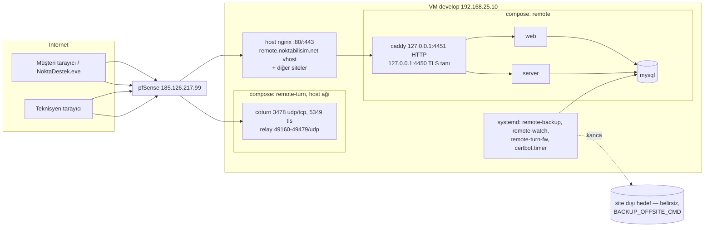

# Mimari — P13a / P13b (operasyon, saklama, yedek, dokümantasyon)

Ana belge: `docs/mimari.md` (§3.4, §8.3, §10.2, §10.3, §10.5, §11, §12). Tarih: 2026-11-14. Kullanıcı kararı (2026-11-13):
P13 ikiye bölündü. **P13a** şimdi ve yalnız staging'de yapılır. **P13b** prod açılışıdır. **2026-11-14:** K1 (`remote.noktabilisim.net`) ve K3 (aynı sunucu, ayrı IP yok) kapandı → tasarım **§7** (ADR-0018, ADR-0019, ADR-0020).

## 1. Kapsam

| Paket | AC                                                                                             | Ortam                                                        |
| ----- | ---------------------------------------------------------------------------------------------- | ------------------------------------------------------------ |
| P13a  | 88 (doğrulama, staging/temiz kurulum), 91, 92 (rev.), 93, **197–200** (yeni), veri saklama NFR | staging (185.126.217.99:4450 / remote.noktabilisim.net)      |
| P13b  | 23 (5349'a revize, ADR-0018), 88 + 91/200 prod tekrarı, §6'daki prod maddeleri — **§7**        | prod (`remote.noktabilisim.net`, staging'in yerinde terfisi) |

## 2. Saklama (retention) — P13a kararları (AC-197..199)

Kaynaklar: gereksinimler NFR "Veri saklama", AC-159, AC-195, mimari §3.4, mimari-e9 §3.6, mimari-e10 §3.8. Süreler gereksinimlerde
zaten tanımlı. Yeni süre uydurulmadı; yalnız "hard delete" kararı değişti (aşağıda K-P13-1).

| Veri                                                 | Süre (başlangıç)                                          | P13a işlemi                                                                                      | Durum                                                                                       |
| ---------------------------------------------------- | --------------------------------------------------------- | ------------------------------------------------------------------------------------------------ | ------------------------------------------------------------------------------------------- |
| `support_sessions` (bitmiş: ENDED/EXPIRED/CANCELLED) | tenant `retention_days` (90–730, vars. 365), `created_at` | `customer_name, customer_email, note, guest_net_key, guest_ip_key → NULL`, `anonymized_at = now` | **yeni**                                                                                    |
| `session_consents` (o oturumların)                   | aynı                                                      | `ip, user_agent → NULL` (karar, seviye, kaynak, metin sürümü/özeti **kalır**: KVKK onay kanıtı)  | **yeni**                                                                                    |
| `session_files` (o oturumların)                      | aynı                                                      | **satır silinir** (anonimleştirme anında)                                                        | **yeni**. P5 CHECK çelişkisinin çözümü, K-P13-2                                             |
| `support_requests`                                   | aynı                                                      | anonimleştirme (P8b-1'de var, AC-159)                                                            | değişmez                                                                                    |
| `customers` (pasif)                                  | `passive_at` + `retention_days`                           | anonimleştirme (P8c-1'de var, AC-195)                                                            | değişmez                                                                                    |
| `device_bindings`                                    | `last_used_at` + `retention_days`                         | `EXPIRED` + `key_hash NULL` (P8c-1'de var)                                                       | değişmez                                                                                    |
| `audit_logs`                                         | 730 gün (sabit, tenant değiştiremez)                      | hard delete (tetikleyici 730 günden yeniyi reddeder)                                             | **yeni**                                                                                    |
| `auth_sessions`                                      | `max(expires_at, revoked_at)` + 7 gün                     | hard delete                                                                                      | **yeni**                                                                                    |
| `password_reset_tokens`                              | `expires_at` + 7 gün                                      | hard delete                                                                                      | **yeni**                                                                                    |
| Yedek dosyaları                                      | 14 gün (AC-91)                                            | `backup.sh` rotasyonu                                                                            | **yeni**. Anonimleştirilen veri yedeklerde en çok 14 gün daha kalır (runbook notu, B-P12-3) |
| coturn logları                                       | runbook §9.8.1                                            | değişmez                                                                                         | —                                                                                           |

**K-P13-1 (hard delete ertelendi):** mimari §3.4'teki "anonimleştirmeden 30 gün sonra hard delete" (oturum, onay, talep, kayıt) P13a'dan
**çıkarıldı**. Gerekçe: `device_bindings.first/last_session_id → support_sessions`, `support_requests.binding_id → device_bindings`,
`support_sessions.request_id → support_requests` ve `session_consents.request_id` birlikte RESTRICT FK döngüsü kurar. Silme sırası,
etkin kayda bağlı oturumların atlanması ve yarışlar kod yüzeyini büyütür. Öte yandan anonimleştirilmiş satır KVKK açısından artık
kişisel veri değildir; anonim hale getirme, Silme/Yok Etme/Anonimleştirme Yönetmeliği'nde tanınan bir imha yöntemidir. Bu gerekçe
ancak audit üzerinden yeniden tanımlama yoksa geçerlidir: **audit'te müşteri adı ve tam IP yoktur** (K-P13-3, S-P13a-1 kararı).
P13a öncesi staging'de oluşmuş ad/IP içeren audit kayıtları 730 günde silinir; prod'da bu kayıtlar hiç oluşmaz (prod açılışı P13b). Bu nedenle
`app` kullanıcısına `support_sessions`, `session_consents`, `support_requests` ve `device_bindings` için DELETE yetkisi **verilmez**
(en az yetki). **Genişleme noktası:** `jobs/retention.ts` içinde `purgeAnonymized()` adımı tanımlanır (P13a'da yazılmaz). Sıra:
`session_consents` → kayda bağlı olmayan oturumlar → oturumu ve kaydı olmayan talepler → `revoked_at + retention_days` geçmiş
kayıtlar. Grant'lar o pakette `grants.sql`'e eklenir. Tetikleyici olay: depolama ihtiyacı ya da hukuki talep.

**K-P13-2 (dosya adı):** `session_files.file_name` CHECK'i `*` karakterine izin vermez (db-notlari P5), bu yüzden `***` yazılamaz.
Yer tutucu yazmak ya da CHECK'i gevşetmek yerine satır anonimleştirme anında silinir. `sha256` da dosyayı tanımlayabilen bir değer
olduğu için satırın silinmesi daha temiz çözümdür. `app` → `session_files` DELETE (UPDATE yok).

**K-P13-3 (audit'teki kişisel veri) — r1, güvenlik S-P13a-1 kararı, seçenek (a), 2026-11-14 (bağlayıcı):** İlk tasarımda audit
kayıtları (`guest.pending` vb.) müşteri adı ve tam IP taşıyordu. Bu kayıtlar 730 gün append-only kaldığı için anonimleştirilmiş oturum
audit üzerinden yeniden tanımlanabiliyordu (S-P13a-1, Orta). **Karar:** yeni audit kayıtlarına müşteri (misafir) adı **yazılmaz**.
`ip_address` alanına ve audit `new_value`'daki misafir IP'lerine tam IP yerine **ağ öneki** yazılır (IPv4 /24, IPv6 /48; `lib/ip.ts`
`netKey()` biçimi). Uygulayan: backend-dev (audit yazım noktaları, `audit/mask.ts`). Teknisyen/yönetici kullanıcıların audit'teki
kimliği (`user_id`/`username`) değişmez; bu kişiler çalışandır ve denetim amacıyla gereklidir. P13a öncesi kayıtlar UPDATE edilemez
(tetikleyici) ve 730 günde silinir; yalnız staging'de oluşmuşlardır, prod'da oluşmaz. **Ekran kuralı (değişmez):** anonimleştirilmiş
oturumun detayında zaman çizelgesi `details.name` alanını ve CUSTOMER `actorName` değerini `null` döndürür (eski kayıtlar için).
Aydınlatma metni ve kılavuz audit süresini (730 gün) ve önekle kayıt yapıldığını belirtir (teknik-yazar).

**K-P13-4 (created_at zorlama, I-P11-3):** `audit_logs` DELETE yetkisiyle **aynı migration'da** `BEFORE INSERT` tetikleyicisi kurulur:
`audit_logs_force_created_at`. **Muaf liste (fail-closed):** çağıranın `USER()` öneki (ikili karşılaştırma) `migrator` veya `root`
değilse `NEW.created_at = CONVERT_TZ(SYSDATE(3), @@session.time_zone, '+00:00')`. Yani `app` ve ileride eklenecek her hesap DB
saatine zorlanır. Böylece `app` geriye tarihli satır ekleyip hemen silemez. `migrator` test fikstürü yazar, `root` geri yükleme yapar
(döküm özgün `created_at` ile döner). `CURRENT_USER()` tetikleyicide DEFINER'ı döndürdüğü için `USER()` kullanılır.
**Tetikleyici gövde kuralı:** yeni tetikleyiciler bileşik gövdeyle (`BEGIN…END` / `IF…END IF`) yazılır. P13a migration'ı P11'in
tek ifadelik `audit_logs_no_update` gövdesini `BEGIN…END` ile yeniden kurar; aksi halde Prisma'nın sondaki `;`'si gövdeye girer ve
döküm `mysql` ile yüklenemez. Ayrıntı ve kanıt: `docs/db-notlari.md` P13a.

**İş tanımı (`apps/server/src/jobs/retention.ts`):** Mevcut 03:30 Europe/Istanbul zamanlayıcısı (`requests/jobs.ts dailyRetention`)
**genişletilir**, ikinci bir zamanlayıcı kurulmaz. Sıra:

1. Talep, müşteri ve kayıt adımları (mevcut).
2. Oturumlar: tenant döngüsü, 1000'lik partiler, parti başına tek TX. TX içinde aday id'ler (`status IN (ENDED,EXPIRED,CANCELLED)
AND anonymized_at IS NULL AND created_at < cutoff`) seçilir, ardından `DELETE session_files` → `UPDATE session_consents` →
   `UPDATE support_sessions … WHERE id IN (…) AND anonymized_at IS NULL`.
3. Global adımlar: `audit_logs` (`created_at < now − 730 g`, 5000'lik partiler), `auth_sessions`, `password_reset_tokens`.

Kurallar: tenant'ta hata olursa loglanır, sonraki tenant'a geçilir (fail-soft). Tur üst üste binmez. İş idempotenttir: ikinci
çalıştırma 0 satır değiştirir. Kaçırılan gün telafi edilmez; bir sonraki tur aynı kesme noktasıyla işi tamamlar.

**Gözlemlenebilirlik (AC-199):**

- Değişiklik olan her tenant için tek audit kaydı yazılır: `action=retention.run`, `entity=retention`, `user_id NULL`,
  `username=system`, `new_value={sessions, consents, files, requests, customers, bindings}` (yalnız sayılar).
- Global adımlar `tenant_id NULL` olan bir `retention.run` kaydıyla yazılır: `{audit, authSessions, resetTokens}`.
- Metrikler:
  - `rs_retention_last_success_timestamp_seconds` (gauge)
  - `rs_retention_rows_total{kind}` (counter)
  - `rs_retention_failures_total` (counter)
- Alarm (runbook): `time() − last_success > 26 sa` ve süreç çalışma süresi > 26 sa; ya da `increase(failures[1d]) > 0`.

## 3. API / sözleşme değişiklikleri (P13a)

| Yer                                                           | Değişiklik                                                                                                                                                                                                                                                                                                                                                                                                                                               | Hata / yetki                |
| ------------------------------------------------------------- | -------------------------------------------------------------------------------------------------------------------------------------------------------------------------------------------------------------------------------------------------------------------------------------------------------------------------------------------------------------------------------------------------------------------------------------------------------- | --------------------------- |
| `SessionListItem`, `SessionHistoryDetail` (mimari-api P8)     | `+ anonymized: boolean` (`anonymized_at IS NOT NULL`). Anonimse `customerName`, `customerEmail`, `note` null; `files` boş; zaman çizelgesinde ad yok (K-P13-3)                                                                                                                                                                                                                                                                                           | kırılmaz ek alan            |
| PATCH `/sessions/:id`                                         | Anonimleştirilmiş oturumda **409 `SESSION_ANONYMIZED`** (kişisel veri yeniden yazılamaz). `contracts/errors.ts` += kod, TR mesaj "Bu oturum saklama süresi dolduğu için anonimleştirildi; düzenlenemez."                                                                                                                                                                                                                                                 | session_history.edit        |
| CSV export                                                    | Şema değişmez; anonim satırda müşteri hücreleri boştur                                                                                                                                                                                                                                                                                                                                                                                                   | —                           |
| PUT/DELETE `/admin/settings/{mysql,turn,whatsapp}` (B-P12b-5) | Kullanıcı başına **10/dk** (`lib/rate.ts`), aşımda 429 `RATE_LIMITED` + `Retry-After`. Değer değişmediyse 200 döner, audit yazılmaz                                                                                                                                                                                                                                                                                                                      | SUPER_ADMIN                 |
| `/admin/settings/whatsapp` (B-P12b-4, sayfa testi)            | Adres **WHATWG kanonik** biçimde saklanır (`new URL()`; şema/host küçük harf, ondalık/onaltılı IPv4 noktalı biçime, IDN punycode'a çevrilir; kök yolda sondaki `/` atılır). `\p{Cc}\p{Cf}\p{Zl}\p{Zp}` reddedilir. Büyük harfli şema reddedilmez, kanonikleşir. Yanıt `source: "panel" \| "env" \| "default"` döner (küçük harf, mevcut sözleşmeyle aynı: `contracts/src/api/system-settings.ts`; env açıkça verilmemişse `default`, rozet "Varsayılan") | 400 `VALIDATION fields.url` |
| K13 sınıflaması (T33)                                         | `169.254.0.0/16` ve `fe80::/10` "özel ağ" **sayılmaz**: canlı ortamda `http://` + link-local adres girilirse kanal kapalı kalır ve uyarı gösterilir. `[::1]` ve `127.0.0.0/8` loopback olarak özel sayılır (bugünkü davranış). SMTP/MySQL netguard'ı değişmez (link-local orada zaten yasak)                                                                                                                                                             | —                           |
| Audit etiketleri                                              | `retention.run` → "Saklama süresi işi". Dış gönderim `reason` kodlarının Türkçe etiketleri (`unreachable`, `timeout`, `http_error`, `invalid_response`, `other` …) tek tabloda: `contracts/src/labels.ts`                                                                                                                                                                                                                                                | —                           |

**Uygulama notu (backend-dev, 2026-11-14):** `source` mevcut sözleşmeye uygun küçük harfle (`"panel" | "env" | "default"`) uygulandı. CSV'de sütun kümesi değişmedi; anonim satırda "Müşteri" hücresine `Anonimleştirildi` yazılır (AC-197), "Not" boş kalır. Hata olan tenant için de `retention.run` yazılır (`result: fail`). Gerekçeler `docs/implementation.md` "P13a — Backend" bölümünde.

## 4. Yedek ve geri yükleme (AC-91, AC-200)

- **Araç:** host'ta systemd timer (`remote-backup.timer`, 02:00 Europe/Istanbul) → `deploy/backup/backup.sh`. Uygulama
  konteynerine eklenen bir şey yoktur.
- **Kullanıcı:** `'backup'@'localhost'` (yalnız mysql konteyneri içinden, soketle; TCP ile 1045). Yetkiler yalnız
  `MYSQL_DATABASE.*` üzerinde `SELECT, SHOW VIEW, TRIGGER`; global yetki yok. **PROCESS verilmez:** `--no-tablespaces` ile
  gereksizdir ve diğer oturumların SQL metnini açar. LOCK TABLES/RELOAD de verilmez (`--single-transaction`, FTWRL yok).
  TRIGGER'ın yan etkisi (CREATE/DROP TRIGGER) `localhost` kısıtı ve tetikleyici sayımıyla izlenir. Tanım: `deploy/mysql/init/01-users.sh`
  (yeni kurulum) ve `deploy/mysql/backup-user.sql` (mevcut kurulum, root ile, idempotent). Gerekçe: `docs/db-notlari.md` P13a D3.
- **Parola:** `MYSQL_BACKUP_PASSWORD` (≥ 16 karakter) `deploy/.env`'de durur ve yalnız compose `mysql` servisine verilir
  (`.env.example`'da anahtar boş). `backup.sh` dökümü `docker exec` ile konteyner içinde alır; parola argümana/loga girmez.
  Değişken boşsa kullanıcı oluşturulmaz ve yedek hata verir. Server okumadığı için `env.ts`'te yoktur.
- **Döküm:** `mysqldump --single-transaction --no-tablespaces --triggers --set-gtid-purged=OFF`. `uploads` volume'u aynı çalıştırmada
  tar'lanır (runbook §16.3 komutu). Her çalıştırma bir `manifest.json` üretir: UTC zaman, son migration, tablo başına satır sayısı,
  dosya SHA-256'ları.
- **Şifreleme:** `age -r <BACKUP_AGE_RECIPIENT>` (yalnız açık anahtar). **Özel anahtar sunucuda bulunmaz**; yalnız geri yükleme
  provasında geçici olarak getirilir. Dosyalar `umask 077`, mod 600, dizin `BACKUP_DIR` (staging `/var/backups/remote`).
- **Rotasyon:** `BACKUP_KEEP_DAYS=14`; daha eski çalıştırma dizinleri silinir.
- **Disk kontrolü:** başlamadan `BACKUP_DIR` diskinde `BACKUP_MIN_FREE_MB` (vars. 1024) boş alan yoksa hata verir.
- **Hata:** betik `set -euo pipefail` ile çalışır. Boş/bozuk çıktı (`gzip -t`, boyut > 0) çıkış kodunu ≠ 0 yapar. Systemd birimi
  `failed` olur, `OnFailure` journal'a `remote-backup: FAILED` yazar ve tanımlıysa `BACKUP_ALERT_CMD`'yi çalıştırır.
- **Yapılandırma:** `deploy/backup/backup.env` (git-ignore, root 600; `source` edilmez, yalnız bilinen anahtarlar okunur). Anahtar
  adları `backup.env.example`'da: `BACKUP_DIR`, `BACKUP_AGE_RECIPIENT`, `BACKUP_KEEP_DAYS`, `BACKUP_MIN_FREE_MB`, `BACKUP_ALERT_CMD`, `BACKUP_EXPECTED_TRIGGERS`
  (vars. 3). DB'deki tetikleyici sayısı bundan farklıysa yedek FAILED olur, çünkü audit koruması düşürülmüş olabilir (S-P13a-4).
  Yeni tetikleyici ekleyen migration bu değeri günceller. `backup.env` root'a ait ve 600 değilse betik çalışmaz (S-P13a-7).
  Bu değişkenler server'a girmez, dolayısıyla `env.ts`'e de girmez (proje CLAUDE.md "yeni env" kuralının gerekçeli istisnası;
  runbook §18'e yazılır).
- **Host araçları:** `age`, `jq` (manifest üretimi/karşılaştırması), `docker`. `jq` mimari §10.4'te onaylıdır.
- **Geri yükleme:** `deploy/backup/restore.sh --identity <age-key> --target scratch|staging [--confirm <db>@<host>] [--no-pre-backup] [--keep] [--work-dir <dizin>] <run-dir>`.
  - **Ortam kilidi (S-P13a-6):**
    - `--target staging`, canlı veritabanını silip yeniden yüklediği için `--confirm <veritabanı>@<hostname -s>` olmadan çalışmaz. Staging örneği: `--confirm remote@develop`.
    - Compose projesi `RESTORE_EXPECT_PROJECT` (vars. `remote`) değilse betik durur.
    - Yüklemeden önce güncel durumun yedeği alınır; bu adım `--no-pre-backup` ile atlanabilir.
  - **`production` hedefi reddedilir:** `--target production|prod` P13b'de ayrı bayrak ve ayrı onayla eklenecek.
  - **Çözülmüş veri (S-P13a-3):**
    - Çözülen dosyalar yalnız RAM'de (`/dev/shm`) tutulur.
    - `/dev/shm` yoksa ya da yer yetmezse operatör `--work-dir <dizin>` ile açıkça bir dizin verir (ör. şifreli disk; macOS iş istasyonunda zorunlu).
    - Gereken yer: iki düz dosya + %10.
  - Beklenen tetikleyici sayısı `RESTORE_EXPECTED_TRIGGERS` ile verilir (vars. 3).
  - `scratch`: geçici `mysql:8.4.13` konteynerine (`--log-bin-trust-function-creators=1`) yükler. Ardından doğrular: tetikleyici
    sayısı = **3** (no_update, retention_only_delete, P13a force_created_at; üçü de bileşik gövdeli), son migration = manifest, tablo satır sayıları =
    manifest, uploads SHA-256 listesi = manifest. Sonucu tek satır `restore-verify: OK|FAIL` olarak yazar.
  - `staging`: runbook adımıyla server durdurulur, root ile yüklenir, `/ready` 200 beklenir.
- **Hedefler:** RPO ≤ 24 sa. RTO ≤ 60 dk (staging provasında ölçülüp runbook'a yazılır). Ayda bir prova `scratch` hedefiyle elle
  yapılır, kayıt runbook "Prova kaydı" tablosuna girer.
- **Ayrı disk / site dışı kopya:** staging'de yalnız yerel dizin vardır. Ayrı disk + site dışı + append-only audit kopyası (I-P11-1)
  **P13b**'dedir.

## 5. AC-88 doğrulaması (P13a)

- **Yorum (K26, §12):** ADR-0007 gereği coturn ayrı compose'dadır (`deploy/turn`). AC-88'in "coturn" kısmı, aynı temiz makinede
  `deploy/turn` içinde `docker compose up -d` ile karşılanır. Prod'da coturn ayrı VM'dedir (P13b).
- **Ölçüm:** imaj önbelleği ve volume'u olmayan temiz bir Ubuntu 24.04 VM (yoksa `docker:dind` kabı) kullanılır.
  `deploy/.env` runbook §2'ye göre doldurulur. `docker compose up -d` başlangıcından `/ready` 200'e kadar geçen süre ölçülür
  (≤ 120 sn; imaj çekme/derleme süresi hariç, imajlar önceden `load` edilir). coturn için `turnutils_uclient` ile HMAC credential
  denenir. Sonuç (süre, sürüm, komut çıktısı) `docs/runbook.md` §2 "Temiz kurulum kaydı"na yazılır.

## 6. "Sonra" maddelerinin sınıflandırılması (`docs/gereksinimler-sonra-acik.md`'de Ne zaman = P13 / "en geç P13" / "P13 öncesi" / "P12/P13")

| Madde (kaynak tablo)                                                                     | Karar                                                                                                              | Gerekçe                                                                                                                                                    |
| ---------------------------------------------------------------------------------------- | ------------------------------------------------------------------------------------------------------------------ | ---------------------------------------------------------------------------------------------------------------------------------------------------------- |
| B-P12b-4 WhatsApp URL kanonik + `\p{Cf}` (P12b)                                          | **P13a** (backend + dba)                                                                                           | Küçük; dba P13a migration'ı zaten açıyor                                                                                                                   |
| B-P12b-5 kalan: sistem ayarı PUT/DELETE hız sınırı (P12b)                                | **P13a** (backend)                                                                                                 | `rate.ts` var; birkaç satır                                                                                                                                |
| T33: link-local "genel" (P12b)                                                           | **P13a** (backend)                                                                                                 | Tek sınıflama değişikliği                                                                                                                                  |
| T33: bildirim hedefi değişiminde step-up 2FA                                             | **Sonra**                                                                                                          | Yeni yeniden doğrulama akışı (uç + UI + AC) gerekir; tek kullanıcı Super Admin ve zaten 2FA'lı. Genişleme noktası `auth/mfa.ts` `requireFreshMfa()`        |
| T-P12b: audit `reason` Türkçe etiketleri (P12b)                                          | **P13a** (frontend)                                                                                                | Etiket tablosu                                                                                                                                             |
| Sayfa testi: büyük harfli şema, kaynak rozeti, IDN/`[::1]` (P12b)                        | **P13a** (backend + frontend)                                                                                      | Kanonikleştirme ile birlikte çözülür (§3)                                                                                                                  |
| Test yarışı `bindings-p8c` ↔ `settings-p11` (P12b)                                       | **P13a** (backend)                                                                                                 | "Ayrı proje, en sona" kalıbı; CI kararlılığı                                                                                                               |
| B-P12-3: silinen kullanıcı/firma dosyaları (P12)                                         | **Kısmen P13a**: yalnız runbook notu (yedekten düşme süresi 14 gün, devops). **Sonra**: dosya silme + yetim tarama | Kalıcı kullanıcı/firma silme yok (yalnız pasife alma), yani tetikleyici olay yok. Kalıcı silme kapsamına alındığında `uploads/` temizliği o akışa bağlanır |
| I-P11-1 audit'in harici append-only kopyası (P11)                                        | **P13b**                                                                                                           | Harici hedef (WORM/log toplayıcı/site dışı) prod altyapı kararına bağlı                                                                                    |
| I-P11-3 `created_at` zorlama (P11)                                                       | **P13a** (dba)                                                                                                     | DELETE yetkisiyle aynı migration'da olmak zorunda (K-P13-4)                                                                                                |
| govulncheck çağrılmayan kayıtlar + x/net v0.62 (P6/P7, "en geç P13")                     | **P13a** (backend-dev Go)                                                                                          | Yalnız `go get` + `go test` + govulncheck; istemci sürümü yayımlanmaz, bir sonraki sürüm taşır                                                             |
| TEST-NAT-1 genel CA'lı TURN-TLS sertifikası                                              | **P13b**                                                                                                           | Alan adı (K1) gerekir                                                                                                                                      |
| Donanım MFT yedeği ("en geç P13")                                                        | **Sonra** (Windows elle test bulgusuna bağlı)                                                                      | Sahada hata gözlenmedi; Go + MF kod yüzeyi büyük; istemci yayını + attestation gerekir                                                                     |
| Koyu tema (Windows istemci)                                                              | **Sonra** (bir sonraki istemci sürümü)                                                                             | Win32 ortak denetimlerinde resmi koyu tema API'si yok; kod yüzeyi büyük, önemi düşük; istemci yayını gerekir                                               |
| S-P5-T2-4 `reporter` kolonu (risk kabulü, "P12/P13")                                     | **Sonra**                                                                                                          | Risk kabulü geçerli (etki yalnız meta kaydı); protokol + dba + backend değişikliği gerekir                                                                 |
| S-P5-T2-1 kalanı: kayıt diyaloğu öncesi uyarı metni ("P13 öncesi")                       | **P13a** (frontend); gerçek tarayıcı doğrulaması test-operatoru                                                    | Tek metin                                                                                                                                                  |
| QA-P4-10: AC-23 443 doğrulaması                                                          | **P13b**                                                                                                           | 443 ayrı IP (K3)                                                                                                                                           |
| S-P3-3 prod IPv6                                                                         | **P13b**                                                                                                           | Prod ağı                                                                                                                                                   |
| S-P13a-2 yedek bütünlüğü (manifest imzası, `--system-command=OFF`, migrator ile yükleme) | **P13b ön koşulu** (site dışı yedekten önce)                                                                       | Bugün yedek dizinine yazmak root gerektirir; risk site dışı hedefle doğar                                                                                  |
| (Prod öncesi) Super Admin şifre kurtarma CLI (P10)                                       | **P13b**                                                                                                           | "Prod açılışından önce"                                                                                                                                    |
| (Prod öncesi) staging'de denenmeyen SMTP/oturum akışları (P10)                           | **P13b** (test-operatoru)                                                                                          | Prod açılış kontrol listesi                                                                                                                                |
| K13 WhatsApp prod ön koşulu (mimari-e9 §12)                                              | **P13b**                                                                                                           | Prod listesi                                                                                                                                               |
| Hard delete (anonim oturum/talep/kayıt)                                                  | **Sonra** (yeni, K-P13-1)                                                                                          | FK döngüsü; KVKK anonimleştirmeyle karşılanıyor                                                                                                            |
| Çok süreç WhatsApp yayılımı                                                              | Değişmez ("Ölçekleme kararıyla")                                                                                   | —                                                                                                                                                          |

**P13b kapsamı (özet; tarihsel — bağlayıcı tasarım §7, 2026-11-14):**

- **ön koşul (güvenlik S-P13a-2), site dışı yedekten önce:** manifest imzası (`ssh-keygen -Y sign` / minisign; doğrulama anahtarı yönetici tarafında, `restore.sh` imzasız yedeği çözmez), yükleme `mysql --system-command=OFF` ile ve root yerine `migrator` ile, yükleme öncesi/sonrası `mysql.user`/`ROUTINES`/`EVENTS` karşılaştırması (devops + dba)
- prod compose ve alan adı, Let's Encrypt, HSTS `includeSubDomains`
- TURN ayrı IP/443 (ADR-0007), genel CA'lı TURN-TLS, AC-23 443 ölçümü
- IPv6 doğrulaması, K13
- ayrı disk + site dışı yedek + I-P11-1
- Super Admin kurtarma CLI
- prod'da AC-88 ve AC-91 tekrarı, prod açılış kontrol listesi
- `PUBLIC_BASE_URL`/`ALLOWED_ORIGINS` prod değerleri ve istemci ldflags sunucu adresi (yeni istemci sürümü)

## 7. P13b tasarımı — prod açılışı (2026-11-14)

Bu bölüm bağlayıcıdır. Kullanıcı kararları (2026-11-14):

- **K1:** prod adresi `https://remote.noktabilisim.net`.
- **K3:** aynı sunucu (185.126.217.99, VM 192.168.25.10, hostname `develop`); ayrı IP yok.
- **Site dışı yedek hedefi:** belli değil. Bu pakette yalnız hedeften bağımsız altyapı kurulur.

ADR'ler: ADR-0018 (TURN 5349, risk kabulü), ADR-0019 (yerinde terfi), ADR-0020 (yedek imzası ve site dışı kanca).
Yukarıdaki "P13b kapsamı (özet)" listesinin yerine bu bölüm geçer.

### 7.1 Kapsam

| Kalem                                                                                      | Kaynak                                  | Karar                                                     |
| ------------------------------------------------------------------------------------------ | --------------------------------------- | --------------------------------------------------------- |
| Prod yerleşimi, IP:4450'nin kapanması, sırların yenilenmesi                                | K1, ADR-0015                            | §7.2, ADR-0019                                            |
| TURN prod (5349, 443 yok), genel CA sertifikası, relay kapasitesi                          | K3, TEST-NAT-1, QA-P4-10                | §7.4, ADR-0018                                            |
| AC-23                                                                                      | QA-P4-10                                | ölçüt 5349'a revize edilir (gereksinim talebi, §7.15)     |
| HSTS `includeSubDomains`                                                                   | G-19                                    | §7.5: eklenir                                             |
| S-P13a-2 kalanı: imza, migrator, CHECKSUM; `--target production` (S-P13a-6)                | güvenlik raporu P13a                    | §7.6, ADR-0020                                            |
| Site dışı kanca + I-P11-1                                                                  | P11, P13a                               | §7.6: kanca + audit süreklilik denetimi; WORM hedef Sonra |
| `reset-superadmin` CLI                                                                     | P10 Sonra                               | §7.7                                                      |
| Prod izleme (alarm kurallarının gerçekten çalışması)                                       | runbook §18.3 "prod izleme P13b"        | §7.8 `remote-watch`                                       |
| Env / config prod değerleri                                                                | —                                       | §7.9                                                      |
| Windows istemci prod sürümü, repo public, attestation                                      | P6 §11.6, sonra-acik "Repo görünürlüğü" | §7.10                                                     |
| K13 WhatsApp, IPv6 (S-P3-3, S-P2-5), S-P13a-8, anonim MySQL hesabı                         | mimari-e9 §12, P3, P13a                 | §7.11                                                     |
| Prod açılış sırası, AC-88 ve AC-91 prod tekrarı                                            | AC-88, AC-91, AC-200                    | §7.12                                                     |
| İmzalı prod açılış kontrol listesi (P10 elle testleri, Windows 0.10.2 elle testleri dahil) | P9, P10 Sonra                           | §7.13                                                     |

**Kapsam dışı (P13b):**

- Ayrı staging ortamı: P13c, ADR-0019 m.5.
- 443 TURN: risk kabulü; ek IP gelirse ADR-0018 m.6.
- Site dışı hedefin seçimi ve kurulumu: hedef belli olunca, kabul şartları ADR-0020 m.4.
- Prometheus/Alertmanager: Sonra. Genişleme noktası `status.prom` dosyaları.
- ICE başarısızlığında kullanıcıya "kurumsal güvenlik duvarı" tanı mesajı: Sonra (E11 G2'ye önerilir).

### 7.2 Prod / staging yerleşimi (ADR-0019)

**Karar:** Staging yığını `/opt/remote` içinde, compose proje adı `remote` korunarak **yerinde prod'a terfi eder**. Terfi temiz
kurulumdur:

- yeni volume'lar,
- yeni sırlar,
- `DEPLOY_ENV=production`,
- `CADDY_BIND=127.0.0.1`.

Staging, prod açılışından sonra **P13c** olarak ayrı compose projesinde kurulur:

- `remote-stg`, `stg.remote.noktabilisim.net`;
- portlar 127.0.0.1:4460/4461, edge 172.30.1.0/24;
- ayrı DB, sır ve yedek;
- TURN olarak yalnız prod coturn STUN'u.

O zamana kadar paket akışındaki staging adımı yerel ortamda yapılır (`scripts/e2e-real.sh`, ayrı compose projesi). E11 özellikleri
P13c'den önce prod'a çıkmaz.

### 7.3 Port / vhost tablosu (prod)

| Dış (185.126.217.99) | İç (VM)        | Proto   | Dinleyen                                                                    | Değişiklik (staging → prod)                                                          |
| -------------------- | -------------- | ------- | --------------------------------------------------------------------------- | ------------------------------------------------------------------------------------ |
| 80, 443              | 80, 443        | TCP     | host nginx (paylaşımlı); vhost `remote.noktabilisim.net` → `127.0.0.1:4451` | yok (vhost aynen)                                                                    |
| 4450                 | —              | TCP     | Caddy `tls internal`, **yalnız 127.0.0.1**                                  | pfSense NAT kaldırılır, UFW `4450/tcp` silinir, `CADDY_BIND=127.0.0.1`               |
| —                    | 127.0.0.1:4451 | TCP     | Caddy düz HTTP (nginx arkası)                                               | yok                                                                                  |
| 3478                 | 3478           | UDP+TCP | coturn STUN/TURN                                                            | yok                                                                                  |
| 5349                 | 5349           | TCP     | coturn TURN-TLS (LE sertifikası)                                            | sertifika özel CA'dan LE'ye geçer                                                    |
| 49160–49479          | aynı (1:1)     | UDP     | coturn relay                                                                | **aralık 49160–49199'dan genişler** (pfSense + UFW + `host-firewall.sh` + base.conf) |
| —                    | 127.0.0.1:9641 | TCP     | coturn Prometheus                                                           | yok                                                                                  |
| 22                   | 22             | TCP     | ssh                                                                         | yok                                                                                  |
| —                    | yayımlanmaz    | TCP     | MySQL 3306                                                                  | yok                                                                                  |

DNS: `remote.noktabilisim.net` A → 185.126.217.99, Cloudflare "DNS only". **AAAA kaydı yoktur** (§7.11). Yeni DNS kaydı açılmaz.

### 7.4 TURN prod (ADR-0018)

- **Yapılandırma (`turnserver.base.conf`):**
  - `min-port=49160`, `max-port=49479`, `total-quota=300`; `user-quota=8` değişmez.
  - `deploy/turn/.env`: `TURN_REALM=remote.noktabilisim.net`, `TURN_EXTERNAL_IP=185.126.217.99/192.168.25.10` (değişmez),
    `TURN_LISTEN_IPS=auto`, `TURN_BPS_CAPACITY=0` (G-P13b-1: rezervasyon 62 allocation'da tıkanır), `TURN_MAX_BPS=1000000`, toplam tavan host'ta `TURN_FW_RELAY_MAX_BPS=62500000`.
  - coturn `max-bps` bayt/sn cinsindendir; AC-21'deki 8 Mbit/s'nin karşılığı 1000000'dir. Bugünkü 8000000 değeri 64 Mbit/s eder.
    devops `turnutils_uclient` ile hız ölçerek doğrular ve doğrularsa `.env.example` yorumunu ve varsayılanı düzeltir.
  - `TURN_SECRET` yenilenir.
- **`TURN_URLS` (deploy/.env):**
  `stun:remote.noktabilisim.net:3478,turn:remote.noktabilisim.net:3478?transport=udp,turn:remote.noktabilisim.net:3478?transport=tcp,turns:remote.noktabilisim.net:5349?transport=tcp`.
  Panel TURN ayarı boş kalır (§15.5).
- **Sertifika akışı:**
  1. İlk alım (root):
     `certbot certonly --webroot -w /var/www/remote-acme -d remote.noktabilisim.net --cert-name remote-turn --non-interactive --deploy-hook /usr/local/sbin/remote-turn-cert-deploy`.
     certbot aynı ad kümesi için onay isterse `--duplicate` eklenir. Ayrı kayıt ayrı anahtar demektir.
  2. Deploy hook'u `deploy/turn/cert-deploy-hook.sh`'tir. `sudo ./cert-deploy-hook.sh install` ile `/usr/local/sbin/remote-turn-cert-deploy`
     olarak kurulur (root:root 0755; kalıp `host-firewall.sh` ile aynı). Girdisi `/etc/default/remote-turn-cert`
     (`TURN_CERT_DIR=/opt/remote/deploy/turn/certs`, `TURN_CONTAINER=remote-turn-coturn-1`, `TURN_TLS_NAME=remote.noktabilisim.net`).
     Hook yalnız `RENEWED_LINEAGE` `remote-turn` ile bitiyorsa çalışır. Adımları:
     - geçici dosyalara kopyalar: `turn.crt` (fullchain, 0444) ve `turn.key` (0400, 65534:65533);
     - `mv -f` ile yerine taşır;
     - `docker kill -s USR2 <konteyner>` gönderir;
     - 10 sn bekler;
     - `openssl s_client -connect 127.0.0.1:5349 -servername …` ile sunulan parmak izini yeni sertifikanınkiyle karşılaştırır.
       Eşit değilse `docker restart <konteyner>` yapar, yine eşit değilse journal'a `err` yazar ve çıkış kodu 1 olur. certbot hatayı
       loglar; `remote-watch` sertifika kontrolü alarm verir.
     - Sır ya da anahtar içeriği loga yazılmaz.
  3. Yenileme sistem `certbot.timer` ile yapılır. Doğrulama: `certbot renew --dry-run --cert-name remote-turn` (dry-run hook çalıştırmaz)
     ve elle `RENEWED_LINEAGE=/etc/letsencrypt/live/remote-turn /usr/local/sbin/remote-turn-cert-deploy`.
  4. coturn 4.18'in SIGUSR2 ile sertifikayı yeniden okuması devops tarafından doğrulanır. Okumuyorsa hook doğrudan `restart` yapar.
     Açık oturumlar ICE restart ile döner; kabul edildi.
  5. Staging CA dosyaları (`certs/ca.crt`, `ca.key`) terfide `shred` edilir. `gen-cert.sh` yalnız yerel ve CI testinde kullanılır.
- **Host güvenlik duvarı:**
  - `host-firewall.sh` relay aralığını base.conf'tan ya da `.env`'den alır. Aralık değişince `install` yeniden çalıştırılır;
    `ip_local_reserved_ports` güncellenir.
  - Önce `ss -lunp` ile 49160–49479'da başka bir sürecin dinlemediği doğrulanır.
  - `test-denied.sh` aralığın son portunu (49479) ve 320 portluk kapasiteyi bilir.
- **AC-23 ölçümü:** Ölçüm makinesi Windows ya da Chrome'dur. Çıkışta UDP tamamen ve 3478/TCP kapatılır; yalnız 443/TCP ve 5349/TCP
  açık kalır. Teknisyen ile müşteri arasında oturum kurulur. Konsolda seçilen aday `relay` + `tls` olmalı ve görüntü gelmelidir.
  Kök sertifika kurulmaz. Kayıt `docs/test-raporu.md`'ye yazılır.

### 7.5 HSTS `includeSubDomains`

**Karar: eklenir, `preload` yok.**

- HSTS yalnız başlığı gönderen ad için ve onun alt alanları için geçerlidir. Yani `remote.noktabilisim.net` ve
  `*.remote.noktabilisim.net`. `noktabilisim.net` altındaki kardeş servislere (ör. `support.noktabilisim.net`) **etkisi yoktur**.
- `*.remote.noktabilisim.net` altında bugün ad yok. P13c'deki `stg.remote…` HTTPS olacak.
- TURN (HTTP değil) ve ACME HTTP-01 (tarayıcı değil) etkilenmez.

**Değişiklikler:**

- `apps/server/src/app.ts` helmet: `includeSubDomains: true`.
- `deploy/Caddyfile`: `?Strict-Transport-Security "max-age=31536000; includeSubDomains"`.
- nginx başlık eklemez (ADR-0015, değişmez).
- Apex `noktabilisim.net`'e HSTS **konmaz** (başka ekibin alanı).

**Test:** AC-126 e2e başlık testi değeri doğrular.

### 7.6 Yedek bütünlüğü ve site dışı kanca (ADR-0020; AC-91, AC-200, S-P13a-2/6, I-P11-1)

**`backup.sh` eklemeleri** (sıra: döküm → manifest → imza → `.partial` adından son adına taşıma → rotasyon → kanca → durum dosyası):

1. **Manifest yeni alanları:**
   - `env` (`deploy/.env` `DEPLOY_ENV`; boşsa FAILED `adım=önkoşul`) ve `host` (`hostname -s`).
   - `signer`: imza anahtarının SHA256 parmak izi.
   - `audit`: `{ maxId, days: { "YYYY-MM-DD": n, … } }`, son 729 tamamlanmış UTC günü. SQL dba'dan gelir (D2); `backup` kullanıcısının
     SELECT yetkisi yeter.
2. **İmza:**
   - Komut: `ssh-keygen -Y sign -f "$BACKUP_SIGNING_KEY" -n remote-backup manifest.json` → `manifest.json.sig` (600).
   - `BACKUP_SIGNING_KEY` varsayılanı `/etc/remote-backup/manifest_ed25519`. Anahtar root sahibi ve 600 değilse ya da yoksa FAILED
     `adım=imza`.
   - Anahtar üretimi runbook adımıdır: `ssh-keygen -t ed25519 -N '' -C remote-backup@$(hostname -s) -f …`.
   - Açık anahtar `allowed_signers` satırı olarak yazılır: `remote-backup@develop namespaces="remote-backup" ssh-ed25519 AAAA…`.
     Bu satır `/etc/remote-backup/allowed_signers` (644) dosyasına ve parola kasasına konur.
3. **Audit süreklilik denetimi:** Önceki başarılı çalıştırmanın manifestiyle karşılaştırılır.
   - FAILED `adım=audit-sureklilik` (Kritik, alarm) verilen durumlar: `maxId` azaldıysa, ya da önceki çalıştırmanın UTC gününden
     **önceki** ve bugün−728'den yeni herhangi bir günün sayısı farklıysa.
   - Önceki manifest yoksa ya da eski biçimdeyse denetim atlanır ve `audit-sureklilik: ilk` yazılır.
   - Retention'ın sildiği en eski gün tolerans dışında bırakılır.
4. **Kanca:** `BACKUP_OFFSITE_CMD` tanımlıysa `timeout "$BACKUP_OFFSITE_TIMEOUT_SEC" sh -c "$BACKUP_OFFSITE_CMD"` çalışır
   (varsayılan süre 1800).
   - Ortam: `REMOTE_BACKUP_RUN_DIR`, `REMOTE_BACKUP_RUN`, `REMOTE_BACKUP_DIR`, `REMOTE_BACKUP_HOST`, `REMOTE_BACKUP_ENV`.
   - Komut metni loga yazılmaz. Yalnız şu satırlar yazılır: `remote-backup: OFFSITE OK run=<r> sure=<n>s` ya da
     `remote-backup: OFFSITE-FAILED run=<r> rc=<n>`. Hata durumunda ayrıca `BACKUP_ALERT_CMD` çağrılır (`REMOTE_BACKUP_MSG` ile).
     Birim yine başarılı biter.
   - Tanımsızsa: `remote-backup: OFFSITE-UNCONFIGURED (uyarı: site dışı kopya yok)`.
5. **Durum dosyası:** `/var/lib/remote-backup/status.prom` (root 644, atomik yazım, sır yok). Metrikler:
   - `remote_backup_last_success_timestamp_seconds`
   - `remote_backup_last_run_ok`
   - `remote_backup_offsite_configured`
   - `remote_backup_offsite_last_success_timestamp_seconds`
   - `remote_backup_offsite_last_rc`
   - `remote_backup_audit_continuity_ok`

   FAILED yolunda da yazılır (`last_run_ok 0`).

**`restore.sh` değişiklikleri:**

1. **Seçenekler:** `--allowed-signers <dosya>` (varsayılan `/etc/remote-backup/allowed_signers`; yoksa ret). Ortamı tanımlamak için
   `--target scratch|staging|production`.
2. **İlk adım imzadır:** `ssh-keygen -Y find-principals -s manifest.json.sig -f <allowed>` → principal → `ssh-keygen -Y verify -n remote-backup`.
   Doğrulama başarısızsa sha256, çözme ve yüklemeye **geçilmez**: `restore-verify: FAIL (imza)`.
3. **Ortam kilidi (S-P13a-6):**
   - `staging` ve `production` hedefleri için `DEPLOY_ENV` hedefe eşit olmalıdır ve `--confirm <db>@<hostname -s>` gerekir.
   - `production` ek olarak şunları ister: TTY'de `PRODUCTION-<hostname -s>` yazılması (TTY yoksa ret), manifest `env=production`
     (başka ortam yedeği reddedilir) ve compose projesi `RESTORE_EXPECT_PROJECT` (`remote`).
4. **Yükleme (D1):**
   - Scratch'te `01-users.sh` ile `app` ve `migrator` kurulur. Döküm **migrator** ile ve `--system-command=OFF` ile yüklenir.
   - Canlıda: `stop web server` → dba yöntemiyle DB boşaltılır (migrator yetkisiyle) → migrator ile yükleme → `up -d`.
   - root yalnız yetki anlık görüntüsünü okumak için kullanılır; yazma yapmaz.
5. **Karşılaştırma (D2):**
   - P13a anlık görüntüsü kalır, `mysql.user WHERE user=''` = 0 eklenir.
   - Bütün uygulama tablolarının `CHECKSUM TABLE`'ı scratch ile canlıda alınır ve tablo tablo eşit olmalıdır. Farkta yalnız tablo
     adı yazılır.
   - Satır sayıları ve tetikleyici sayısı = manifest (P13a).

**dba notu (P13b D1/D2 + G-P13b-5, 2026-11-14):** SQL arayüzü `deploy/mysql/{restore-sec-snapshot,restore-reset-db,checksum-tables,audit-continuity,audit-baseline-reset}.sql`. Ayrıntı `docs/db-notlari.md` "P13b".

- m.1'deki `audit.days` biçimi `{gün: n}` iken `{gün: {n, h}}` oldu (`format: 2`).
- Eklenen alanlar: tetikleyici gövde özeti (`triggers.ok`), `tail`/`prevTail` (son 48 saat), `baseline` (elle ya da geri yükleme sonrası sıfırlama, audit'li) ve `instanceId`.

**Hedefin seçilmesi (Sonra, hedef belli olunca):** ADR-0020 m.4 şartları kabul ölçütüdür. Hedef aracın kimliği yalnız yazabilir;
saklama 14 + 1 gün; yurt içi tercih edilir. Hedef kurulduğunda `remote-watch` "OFFSITE-UNCONFIGURED" hatırlatmasını kendiliğinden
susturur.

### 7.7 `reset-superadmin` CLI (AC önerisi §7.15-b)

- **Dosyalar:**
  - `apps/server/src/cli/reset-superadmin.ts`: argüman ayrıştırma ve TTY kontrolü; ≤ 150 satır.
  - `apps/server/src/auth/superadmin-reset.ts`: servis; tek TX.
- **Çalıştırma (root, sunucuda):** `cd /opt/remote/deploy && docker compose exec server node src/cli/reset-superadmin.ts --email <e-posta> [--reset-mfa] [--dry-run]`.
  `-T` **verilmez**, TTY zorunludur. Server durmuşsa `docker compose run --rm --no-deps server node src/cli/reset-superadmin.ts …` kullanılır.
- **Yetki:** Host root'u ve docker erişimi yeter. DB kullanıcısı `app` (mevcut `DATABASE_URL`). Yeni grant beklenmez; dba D2'de
  doğrular.
- **Davranış (tek TX):**
  1. Kullanıcı login ile aynı e-posta normalizasyonuyla aranır. Şartlar: `role='SUPER_ADMIN'`, `deleted_at IS NULL`,
     `status='ACTIVE'`. Bulunamazsa ya da şart sağlanmazsa çıkış kodu 3 ve "Super Admin bulunamadı" yazılır; başka hesap listelenmez.
  2. 20 karakterlik geçici parola üretilir (`crypto.randomInt`, karışmayan harf ve rakamlar; politika ≥ 12). Mevcut `auth/password.ts`
     ile argon2id hash'i alınır.
  3. `users`: `password_hash`, `must_change_password=1`, `failed_login_count=0`, `failed_window_at=NULL`, `locked_until=NULL`.
  4. Açık `auth_sessions` → `revoked_at=now`. Açık `password_reset_tokens` → `used_at=now`.
  5. `--reset-mfa` verilirse: `totp_enabled=0`, `totp_secret_enc=NULL`, `totp_last_step=NULL`, `recovery_codes` silinir.
     Runbook §14'teki SQL'in yerine geçer.
  6. Audit: `action="auth.superadmin_reset"`, `entity="users"`, `entity_id=<id>`, `user_id=NULL`, `username="cli"`,
     `tenant_id=NULL`, `ip_address=NULL`, `user_agent="reset-superadmin-cli"`, `result="success"`,
     `newValue={ mustChangePassword: true, mfaReset, revokedSessions }`. Parola ve hash **yazılmaz**. Bulunamadığında
     `result="fail"`, `newValue={ reason: "not_found" }`.
  7. Geçici parola **yalnız TTY'ye, bir kez** yazılır. stdout TTY değilse işlem yapılmadan çıkış kodu 4 verilir; parola journal'a ya
     da pipe'a düşmez. Logger parolayı görmez.
- **`--dry-run`:** DB bağlantısı ve kullanıcının varlığı denetlenir. Değişiklik ve audit yoktur; çıkış kodu 0 veya 3.
- **Çıkış kodları:** 0 tamam · 2 kullanım hatası · 3 bulunamadı · 4 TTY yok · 5 DB hatası.
- **Canlı WebSocket:** CLI ayrı süreçtir. HTTP istekleri DB'deki iptal nedeniyle hemen reddedilir. Açık WebSocket bir sonraki yeniden
  doğrulamada kapanır (P7). Kabul edildi; runbook'a not düşülür.
- **Test (entegrasyon, `superadmin-reset-p13b`):**
  - hash değişir, `must_change_password` olur, oturumlar iptal edilir;
  - `--reset-mfa` kod ve sırları siler;
  - ADMIN e-postası → 3, değişiklik yok;
  - audit satırında ve logda parola yok (AC-90 log taraması);
  - TTY yokken 4.

### 7.8 Prod izleme: `remote-watch` (host systemd; yeni bağımlılık yok)

Runbook'taki alarm kuralları bugün Prometheus olmadığı için elle izleniyor. Prod'da kritik olanlar otomatik çalışır.

- **Dosyalar:**
  - `deploy/ops/remote-watch.sh` (root): `load_env_file` kalıbıyla çalışır; `watch.env` root sahibi ve 600 değilse çalışmaz.
  - `deploy/ops/remote-watch.service` + `remote-watch.timer`: 10 dakikada bir.
  - `deploy/ops/watch.env.example`.
  - Durum: `/var/lib/remote-watch/state` ve `status.prom`.
- **Kontroller:**
  - compose `remote` servisleri `healthy`/`running`;
  - `/ready` 200 (`docker compose exec`);
  - nginx yolu `curl --resolve remote.noktabilisim.net:443:127.0.0.1 https://remote.noktabilisim.net/login` → 200;
  - coturn `healthy` ve `turnutils_stunclient 127.0.0.1` OK;
  - `remote-turn-fw.timer` ve `remote-backup.timer` aktif;
  - `remote_backup_last_success_timestamp_seconds` 26 saatten yeni;
  - `audit_continuity_ok=1`;
  - site dışı: yapılandırılmışsa son başarı 26 saatten yeni; yapılandırılmamışsa **7 günde bir** hatırlatma;
  - retention kontrolü (runbook §18.6 mantığı);
  - sertifika kalan süresi ≥ 14 gün: LE `remote.noktabilisim.net`, LE `remote-turn` ve 5349'dan sunulan sertifika;
  - disk < %80: `/`, `/var/lib/docker`, `BACKUP_DIR`;
  - `systemctl --failed` içinde `remote-*` yok.
- **Çıktı ve alarm:**
  - Journal'a `remote-watch: OK` ya da `remote-watch: ALERT check=<ad> …` yazılır (kişisel veri ve sır yok).
  - `WATCH_ALERT_CMD` ilk ALERT'te ve sonra en çok `WATCH_REPEAT_MIN` (varsayılan 360) dakikada bir çağrılır. Düzelince bir kez
    "düzeldi" gönderilir.
  - Alarm komutu WhatsApp servisi ya da Telegram olabilir. `BACKUP_ALERT_CMD` ile aynı anlamdadır ve mesaj yalnız kontrol adını
    taşır.
- **watch.env anahtarları:** `WATCH_ALERT_CMD`, `WATCH_REPEAT_MIN`, `WATCH_DISK_MAX_PCT` (80), `WATCH_CERT_MIN_DAYS` (14),
  `WATCH_DEPLOY_DIR` (`/opt/remote/deploy`), `WATCH_PUBLIC_HOST` (`remote.noktabilisim.net`).
- **Dış gözcü:** GitHub `agent-watch` günlük çalışır ve aynen kalır. Host tamamen düşerse (`remote-watch` de düşer) haberi o verir.

### 7.9 Env / config (prod değerleri; değerler dokümana yazılmaz)

| Değişken                                                                                                              | Dosya                                              | Prod                                                                                       | Not                                                                                                         |
| --------------------------------------------------------------------------------------------------------------------- | -------------------------------------------------- | ------------------------------------------------------------------------------------------ | ----------------------------------------------------------------------------------------------------------- |
| `DEPLOY_ENV` **(yeni)**                                                                                               | `deploy/.env` (+ `.env.example`, compose'a girmez) | `production`                                                                               | Yalnız `backup.sh`/`restore.sh` okur. Server okumadığı için `env.ts`'e girmez (gerekçeli istisna, ADR-0019) |
| `NODE_ENV`                                                                                                            | deploy/.env                                        | `production`                                                                               | —                                                                                                           |
| `PUBLIC_BASE_URL`                                                                                                     | deploy/.env                                        | `https://remote.noktabilisim.net`                                                          | değişmez                                                                                                    |
| `ALLOWED_ORIGINS`                                                                                                     | deploy/.env                                        | `https://remote.noktabilisim.net`                                                          | IP origin'i çıkar                                                                                           |
| `CADDY_BIND`                                                                                                          | deploy/.env                                        | `127.0.0.1`                                                                                | 4450 dışarı kapanır                                                                                         |
| `SITE_HOST`                                                                                                           | deploy/.env                                        | değişmez                                                                                   | 4450 site adı; yalnız loopback tanı                                                                         |
| `TURN_URLS`, `TURN_SECRET` (yeni), `TURN_CRED_TTL_MIN` (20)                                                           | deploy/.env                                        | §7.4                                                                                       | panel TURN boş                                                                                              |
| `MIN_AGENT_VERSION`                                                                                                   | deploy/.env                                        | prod Release sürümü (§7.10)                                                                | eski ve attestation'sız istemciler 426 alır                                                                 |
| `ABUSE_EMAIL`                                                                                                         | deploy/.env                                        | kullanıcı kararı (K10); önerilen: gerçekten okunan bir kutu (ör. `abuse@noktabilisim.net`) | boşsa bağlantı gizlenir                                                                                     |
| `WHATSAPP_SERVICE_URL`                                                                                                | deploy/.env                                        | boş (panel)                                                                                | K13, §7.11                                                                                                  |
| MySQL parolaları, `SESSION_REF_KEY`, `EDGE_PROXY_SECRET`, `APP_ENCRYPTION_KEYS`, `METRICS_TOKEN`, `SEED_SUPERADMIN_*` | deploy/.env                                        | **hepsi yeniden üretilir**                                                                 | parola kasasına; staging değerleri imha edilir                                                              |
| `TURN_REALM`, `TURN_BPS_CAPACITY`, `TURN_MAX_BPS`, `TURN_FW_RELAY_MAX_BPS`                                            | deploy/turn/.env                                   | `remote.noktabilisim.net`, `0`, `1000000`, `62500000` (host hashlimit)                     | §7.4                                                                                                        |
| `BACKUP_SIGNING_KEY` **(yeni)**, `BACKUP_OFFSITE_CMD` **(yeni)**, `BACKUP_OFFSITE_TIMEOUT_SEC` **(yeni)**             | deploy/backup/backup.env                           | anahtar yolu varsayılan; kanca boş; 1800                                                   | `backup.env.example` güncellenir                                                                            |
| `BACKUP_AGE_RECIPIENT`                                                                                                | backup.env                                         | **prod için yeni age çifti** (önerilir; staging anahtarı test verisini açar)               | özel anahtar ve `allowed_signers` kasada                                                                    |
| `WATCH_*` **(yeni)**                                                                                                  | deploy/ops/watch.env                               | §7.8                                                                                       | root 600                                                                                                    |
| `TURN_CERT_DIR`, `TURN_CONTAINER`, `TURN_TLS_NAME` **(yeni)**                                                         | /etc/default/remote-turn-cert (install yazar)      | §7.4                                                                                       | elle düzenlenmez                                                                                            |
| `AGENT_SERVER_URL`                                                                                                    | GitHub repo değişkeni                              | `https://remote.noktabilisim.net` (zaten)                                                  | —                                                                                                           |
| `AGENT_WATCH_URL` / `AGENT_WATCH_CA_PEM`                                                                              | GitHub                                             | `https://remote.noktabilisim.net/downloads/NoktaDestek.exe` / boş                          | —                                                                                                           |

Server'a yeni env eklenmez. `env.ts` ve compose `server` servisi değişmez.

### 7.10 Windows istemci prod sürümü, repo görünürlüğü

1. **Repo public olmadan önce (kullanıcı + güvenlik):**
   - `gitleaks detect --log-opts="--all"` tüm geçmişte 0 bulgu vermeli.
   - Altyapı ayrıntıları gözden geçirilir. Örnek: eski bir mimari sürümünde Proxmox yönetim IP'si geçiyordu; bu revizyonda K3
     satırından çıkarıldı. Geçmişte kalması kabul mü, kullanıcı karar verir.
   - Sonra görünürlük public yapılır. `agent-release` environment onayı ve `v*` etiket ruleset'i etkinleştirilir.
2. **Release:** İlk attestation'lı Release yalnız etiketli `agent-win` hattından çıkar. Önerilen sürüm `v1.0.0`; numarayı kullanıcı
   seçer. `AGENT_SERVER_URL` zaten alan adıdır. Ek ldflags değişikliği yoktur.
3. **Yayın:** `deploy/agent/verify-and-publish.sh --tag vX.Y.Z --ssh root@185.126.217.99` ile yapılır. `--no-attestation` ve
   `ALLOW_UNATTESTED` **kullanılmaz**.
4. **Sürüm zorlaması:** `MIN_AGENT_VERSION=X.Y.Z` → `up -d server`.
5. **Windows elle testleri** (0.10.2 adım 1–7 + AC-95/96/128) bu Release ile yapılır (§7.13).

### 7.11 K13, IPv6, S-P13a-8, anonim hesap

- **K13 (WhatsApp):** Prod açılışı WhatsApp'a **bağlı değildir**. Kod zaten fail-closed çalışır. Kontrol listesinde iki kabul edilebilir
  sonuç vardır:
  - (a) Servis TLS (`https://…`) ya da özel ağ arkasındadır, servis API anahtarı tanımlıdır (`X-API-Key`; servis 2026-11-15'ten beri anahtarsız
    isteğe 401 döner; Remote tarafı S-P13b-3, AC-303: `WHATSAPP_SERVICE_API_KEY` ya da panelde şifreli alan, köken değişirse
    `WA_API_KEY_REENTER`); Super Admin "Test Mesajı Gönder" başarılıdır.
  - (b) Kanal bilinçli olarak **kapalıdır**: ayar ekranında uyarı görülür, log'da `whatsapp_insecure` vardır, karar kaydı tutulur ve
    Admin'ler e-posta bildirimini kullanır.

  Not: whatsapp-bildirim servisini başka projeler ve kullanıcının kendi bildirimleri de kullanıyor. "Yalnız Remote IP'sine aç"
  kısıtı onları keser. Kimlik doğrulama artık API anahtarıyla sağlanır; anahtarın düz HTTP'de açıkta gitmemesi için TLS ters vekil
  önerisi sürer (kullanıcı kararı, §7.16).

- **IPv6 (S-P3-3, S-P2-5):** Prod = aynı VM. Açılışta şunlar kayda geçer:
  - `ip -6 addr show scope global` boş;
  - `dig +short AAAA remote.noktabilisim.net` boş;
  - `test-denied.sh` IPv6 bölümü SKIP + gerekçe ya da 440.

  VM'e global IPv6 eklenirse runbook §9.2.2 adımları (denied listesine /64, `TURN_FW_SELF_IPS`) ve S-P2-5 IPv6 doğrulaması **o
  değişiklikten önce** yapılır. Değişiklik yönetimi kuralı runbook'a girer.

- **S-P13a-8 (Orta, prod öncesi):** `file.transfer` ve `file.transfer.sender_report` audit kayıtlarına `fileName` yerine yalnız
  uzantı yazılır (`ext`, ≤ 10 karakter, küçük harf; yoksa `null`) ve `sizeBytes`. `sha256` audit'ten çıkar. Zaman çizelgesi
  `session_files`'tan okumaya devam eder.
- **Anonim MySQL hesabı (güvenlik bilgi notu):** `check-app-grants.sh`'e `SELECT COUNT(*) FROM mysql.user WHERE user=''` = 0
  kontrolü eklenir. Backup TRIGGER yetkisi (DROP TRIGGER) kabul edilen risk olarak kalır; tetikleyici sayısı ve audit süreklilik
  denetimi bu riski izler.

### 7.12 Prod açılış sırası (runbook §20'de komutlarıyla yazılır — devops)

**Ön koşullar:**

- P13b paketleri staging'de yayında (ADR-0019 sıra A).
- qa GEÇTİ, güvenlik Kritik/Yüksek 0.
- Kullanıcı adımları (§7.16) tamam.
- Ağ yöneticisi relay NAT aralığını 49160–49479'a genişletti. Dinleyeni olmayan port zararsızdır; bu yüzden terfiden **önce**
  yapılabilir.

**Sıra B (terfi):**

1. Duyuru. Staging test kullanıcılarına kapanış bildirilir.
2. **Son staging yedeği:** `systemctl start remote-backup.service` (imzalı, `env=staging`), ardından scratch doğrulaması
   `restore-verify: OK`. Run dizini `/var/backups/remote-staging-final/`'a taşınır ve 14 gün sonra silinir.
3. `cp -p deploy/.env /root/.env.staging-final.<UTC>` (600). Geri dönüş içindir; 14 gün sonra `shred` edilir.
4. `docker compose down`. Yalnız `remote_mysql_data`, `remote_uploads`, `remote_caddy_data`, `remote_caddy_config` ve
   `remote_agent_downloads` adıyla `docker volume rm` edilir.
5. **Yeni `deploy/.env`:** §7.9. Bütün sırlar sunucuda `openssl rand` ile üretilir, ekrana yazılmaz.
   - Eski `.env.bak.*`, `/root/remote-pre-*.sql.gz`, `/root/remote-uploads-pre-*` ve `ACCESS.txt` `shred` edilir.
   - Yeni giriş bilgileri parola kasasına konur, dosyaya konmaz.
6. **TURN:**
   - `deploy/turn/.env` (yeni secret, realm, bps);
   - LE `remote-turn` kaydı + `cert-deploy-hook.sh install`;
   - `host-firewall.sh install`;
   - UFW: `49160:49199/udp` silinir, `49160:49479/udp` ve `4450/tcp delete` uygulanır;
   - `docker compose -p remote-turn up -d --force-recreate`;
   - `test-denied.sh` 0 FAIL; runbook §9.2.3 listesi.
7. **AC-88 prod ölçümü:** İmajlar önceden derlenmiş durumda `t0 → docker compose up -d --no-build → /ready 200` süresi ölçülür
   (≤ 120 sn). Ardından `seed`, `check-app-grants.sh` PASS (sayı dba'dan) ve runbook §2 tablosuna kayıt.
8. **Yedek:**
   - prod age alıcısı ve imza anahtarı üretimi, `allowed_signers` (kasaya da);
   - `backup.env`;
   - `systemctl start remote-backup.service` → OK; `OFFSITE-UNCONFIGURED` uyarısı beklenir;
   - **AC-91 prod provası:** runbook §18.4 yol A (iş istasyonunda, `--allowed-signers` kasadaki kopya) → `restore-verify: OK` + RTO
     kaydı;
   - olumsuz test: manifestte tek bayt değiştir → `FAIL (imza)`.
9. `remote-watch` kurulumu ve ilk koşu: `OK` (yalnız site dışı hatırlatması beklenir).
10. İstemci Release yayını (§7.10) ve `MIN_AGENT_VERSION`.
11. Super Admin ilk girişi: parola değişir, 2FA kurulur, kurtarma kodları kasaya konur.
    `reset-superadmin --dry-run` → 0. "Nokta Test" firması ve test hesapları oluşturulur.
12. §7.13 kontrol listesi (test-operatoru + kullanıcı) ve **imza**. pfSense 4450 NAT'ı kaldırılır. Müşteri yönlendirmesi ancak
    imzadan sonra başlar.

**Geri dönüş** (yalnız 12'den önce): `docker compose down` → prod volume'ları silinir → `/root/.env.staging-final.*` geri konur →
`up -d` → `restore.sh --target staging --confirm remote@develop <staging-final run>`. coturn `.env` ve UFW önceki hâline döner.
Relay aralığı geniş kalabilir.

### 7.13 Prod açılış kontrol listesi (imzalı; runbook §20.3'te tablo: madde · kanıt · sonuç · yapan · tarih; sonda "Onay: ad, tarih")

1. AC-88 kaydı ≤ 120 sn. AC-91/AC-200 prod provası OK ve RTO ≤ 60 dk. İmza olumsuz testi FAIL verir.
2. AC-23: UDP kapalı, yalnız 443 + 5349/TCP açık ağda `relay/tls` adayıyla görüntü geliyor. Kök sertifika kurulmamış (§7.4).
   AC-21 tavanı ölçüldü (§7.4).
3. `test-denied.sh` 0 FAIL (yeni aralık). S-P3-2 relay↔relay echo PASS. §9.2.3 listesi.
4. S-P2-5: dış makineden başarısız girişte audit `ip_address` = istemcinin genel IPv4'ü. IPv6 kaydı (§7.11).
5. Başlıklar: HSTS `max-age=31536000; includeSubDomains`; AC-126 e2e; `rs_theme` çerezi `Secure`.
6. **P10 elle testleri** (gerçek SMTP, "Nokta Test" firması):
   - SSL/465 ve STARTTLS/587 gerçek gönderim;
   - sıfırlama bağlantısının 30 dk sonra geçersizleşmesi;
   - oturum linki e-postasının 20/sa sınırı (21. → 429);
   - hesap kilidi bildirim e-postası;
   - logout-all ve 2FA sıfırlamada canlı destek oturumunun ≤ 5 sn'de kapanması;
   - Super Admin firma seçmeli SMTP ekranı;
   - 8 sa mutlak oturum sınırı (uzun test; ayrı gün kaydı kabul).
7. **Windows elle testleri:** prod Release ile 0.10.2 adım 1–7 + AC-95/96/128 (parmak izi = SHA256SUMS, sunucu adresi
   `https://remote.noktabilisim.net`). Eski staging istemcisi 426 alıyor.
8. K13: §7.11 (a) ya da (b) kaydı.
9. `reset-superadmin`: `--dry-run` 0. Gerçek çalıştırma test için ikinci bir Super Admin üzerinde yapılır; yoksa entegrasyon testi
   kanıtı yeter.
10. `remote-watch` alarm testi: `docker compose stop web` → ≤ 10 dk'da ALERT mesajı geldi → `start` → "düzeldi".
11. Yedek hata testi (AC-200): MySQL durdurulunca `FAILED` + alarm. Audit süreklilik olumsuz testi yerelde yapılmış (T1 kanıtı).
12. Repo public, gitleaks tüm geçmişte 0 bulgu, `verify-and-publish` attestation'la, agent-watch yeşil.
13. Gizli bilgi temizliği: staging sırları ve dökümleri `shred` edildi. ACCESS.txt yok. Yeni sırların kasa kaydı var.
14. "Nokta Test" firması pasif. Dokümanlar (README, kılavuz, DATASHEET ağ gereksinimleri) ve PDF'ler güncel.

### 7.14 AC eşlemesi (P13b)

| AC                           | Karşılık                                                                           | Paket          |
| ---------------------------- | ---------------------------------------------------------------------------------- | -------------- |
| 23 (revize, §7.15)           | coturn 5349 + LE `remote-turn` + `cert-deploy-hook.sh`; ölçüm §7.4                 | T2, R1         |
| 21, 22                       | relay aralığı/kota/bps (§7.4), `test-denied.sh` yeni aralık                        | T2, R1         |
| 88                           | §7.12/7 prod ölçümü                                                                | T6             |
| 90                           | CLI parolası loga ve audit'e düşmez; kanca komut metni loglanmaz                   | B1, T1         |
| 91, 200 (prod)               | imzalı yedek, migrator yükleme, CHECKSUM, `--target production`, prod provası      | D1, D2, T1, T6 |
| 94, 96, 128                  | attestation'lı Release, repo public, `verify-and-publish` (`--no-attestation` yok) | U1, T6, R1     |
| 126                          | HSTS `includeSubDomains` (§7.5)                                                    | B2, T3         |
| 150, 196                     | K13 kayıt (§7.11)                                                                  | R1             |
| 67, 64–66, 68, 10 (P10 elle) | §7.13/6                                                                            | R1             |
| yeni (a) imza                | ADR-0020 m.1–3                                                                     | T1, D1, D2     |
| yeni (b) CLI                 | §7.7                                                                               | B1             |
| yeni (c) site dışı kanca     | §7.6/4–5                                                                           | T1             |
| yeni (d) audit süreklilik    | §7.6/3                                                                             | D2, T1         |
| yeni (e) prod izleme         | §7.8                                                                               | T4             |

### 7.15 Gereksinim tarafına önerilen değişiklikler (proje-yoneticisi işler; mimar `gereksinimler*.md`'ye dokunmadı)

- **AC-23 revize:** "UDP'nin kapalı olduğu ve yalnız 443/TCP ile 5349/TCP çıkışına izin verilen ağda bağlantı TURN-TLS (5349) ile
  kurulur. Müşteri makinesine kök sertifika kurulmaz (prod ölçümü). Yalnız 443/TCP açık ağlar desteklenmez (ADR-0018 risk kabulü)."
- **AC-91:** "staging'de" → "prod'da (P13b; sonraki aylarda aylık prova)".
- **AC-200:** "Staging'deki provanın süresi" → "Prod provasının süresi". İmza ve kanca maddeleri için yeni AC'ler aşağıda.
- **Yeni AC'ler** (numarayı proje-yoneticisi verir; E11 AC-201..290 kullanıyor):
  - (a) Her yedek manifesti imzalanır; `restore.sh` imzası olmayan ya da geçersiz yedeği çözmeden reddeder. Döküm migrator ile ve
    istemci komutları kapalıyken yüklenir. `CREATE USER`/global `GRANT` içeren döküm yüklenemez. Uygulama tablolarının
    `CHECKSUM TABLE` değerleri scratch ve canlıda eşittir. `--target production` ortam etiketi, `--confirm` ve TTY onayı olmadan
    çalışmaz; başka ortamın yedeği prod'a yüklenemez.
  - (b) Super Admin şifre kurtarma CLI'si: yalnız SUPER_ADMIN; geçici parola yalnız TTY'ye bir kez yazılır; ilk girişte değişim
    zorunlu; açık oturumlar iptal; `--reset-mfa` isteğe bağlı; audit `auth.superadmin_reset` (parola yok); TTY yoksa çıkış kodu 4.
  - (c) Site dışı kanca: tanımlıysa yalnız tamamlanmış ve imzalı çalıştırma dizinini alır; hatası yerel yedeği geçersiz kılmaz ama
    alarm komutunu çağırır; tanımsızsa her çalıştırmada uyarı satırı yazılır ve durum dosyasında `offsite_configured 0` görünür.
  - (d) Audit süreklilik: tamamlanmış geçmiş günlerin audit sayısı değişirse ya da en büyük id azalırsa yedek FAILED olur ve alarm
    çalışır (test: TRUNCATE ve tek satır DELETE).
  - (e) Prod izleme: §7.8 kontrollerinden biri bozulunca ≤ 10 dk'da alarm komutu çağrılır; tekrar ≤ 6 saatte bir; düzelince bir kez
    bildirim.
- **gereksinimler.md:**
  - S2 / K1 kapandı: `remote.noktabilisim.net`, yerinde terfi (ADR-0019).
  - S3 / K3 kapandı: aynı sunucu, 5349, 443 yok (ADR-0018).
  - R4 azaltması: risk kabulü + ağ gereksinimleri dokümanı + 3 aylık gözden geçirme.
  - Ortamlar: staging P13c'ye kadar yok.
  - K13 notu: servis `X-API-Key` ister (2026-11-15; S-P13b-3, AC-303); prod kanal kapalı başlayabilir; anahtar düz HTTP'de gitmesin diye TLS ters vekil önerilir.
- **AC-126 (isteğe bağlı):** HSTS `includeSubDomains` başlığı metne eklenir.
- **Sonra / açık tablosu:**
  - P13b'ye alınanlar (S-P13a-2 kalanı, I-P11-1 kısmen, TEST-NAT-1, QA-P4-10 → 5349, S-P3-3, CLI, P10 elle, Windows 0.10.2,
    repo public, K13, bilgi notu anonim hesap, **S-P13a-8 eklendi**) "P13b" olarak işaretlenir.
  - Yeni Sonra maddeleri: P13c ayrı staging (E11 kod paketlerinden önce); site dışı hedef seçimi + WORM (I-P11-1 tamamlanması);
    TURN 443 (ek IP gelirse); Prometheus/Alertmanager; ICE başarısızlığında ağ tanı mesajı; `TURN_MAX_BPS` birim düzeltmesinin AC-21
    kanıtı.
- **gereksinimler-e11 §3 Kapsam dışı m.2:** "AC-23 443" ifadesi "AC-23 (5349'a revize; 443 risk kabulü)" olarak düzeltilir. P13c'nin
  E11 öncesi ön koşul olduğu not edilir.

### 7.16 Görev paketleri ve sahipleri

Sıra:

1. **dba** (D1 ‖ D2)
2. **backend-dev** (B1–B3) ‖ **devops** (T1–T5). T2, T3 ve T4 D'ye bağlı değildir, ilk günden başlar. T1, D1/D2 SQL arayüzüne bağlıdır.
3. staging yayını (sıra A)
4. qa ‖ güvenlik
5. teknik-yazar (W1)
6. **devops T6** prod terfisi
7. **test-operatoru R1** kontrol listesi
8. kullanıcı imzası

Kullanıcı ön koşulları (U) paralel yürür.

| #   | Sahip                                     | İş                                                                                                                                                                                                                                                                                                                                                 | Dosyalar                                                                                                                                                                                                          | Kabul ölçütü                                                                                                                                                                                                                                                                                                                                                                             |
| --- | ----------------------------------------- | -------------------------------------------------------------------------------------------------------------------------------------------------------------------------------------------------------------------------------------------------------------------------------------------------------------------------------------------------- | ----------------------------------------------------------------------------------------------------------------------------------------------------------------------------------------------------------------- | ---------------------------------------------------------------------------------------------------------------------------------------------------------------------------------------------------------------------------------------------------------------------------------------------------------------------------------------------------------------------------------------- |
| D1  | dba                                       | Geri yüklemede migrator: scratch'te `app`/`migrator` kurulumu; canlıda DB'yi migrator yetkisiyle boşaltma yöntemi (DROP/CREATE DATABASE ya da tablo/tetikleyici düşürme; gerekçeli); tetikleyici DEFINER; `force_created_at` muafiyetiyle `created_at` korunması                                                                                   | `deploy/mysql/restore-load.sql` (veya `lib.sh` fonksiyon girdisi), `docs/db-notlari.md` P13b                                                                                                                      | Meşru döküm migrator ile yüklenir, tetikleyici 3, audit `created_at` korunur. Kurcalanmış döküm (`CREATE USER`, `GRANT … ON *.*`, `SET PERSIST`, `INSTALL COMPONENT`, `USE mysql; INSERT`) → yükleme FAIL (1044/1227/1142) ve kalıcı iz bırakmaz                                                                                                                                         |
| D2  | dba                                       | `CHECKSUM TABLE` listesi (uygulama tabloları; `_prisma_migrations` dahil); yetki anlık görüntüsüne anonim hesap; `check-app-grants.sh` += `user=''` = 0; audit süreklilik SQL'i (gün histogramı + maxId; backup kullanıcısıyla); CLI için `app` yetkilerinin yeterliliği (users/auth_sessions/password_reset_tokens UPDATE, recovery_codes DELETE) | `deploy/mysql/check-app-grants.sh`, `docs/db-notlari.md` P13b                                                                                                                                                     | PASS sayısı güncel; histogram sorgusu 730 günlük sahte veride < 2 sn (IX created_at); yeni grant gerekmiyorsa kayıt "değişiklik yok"                                                                                                                                                                                                                                                     |
| B1  | backend-dev                               | `reset-superadmin` CLI (§7.7)                                                                                                                                                                                                                                                                                                                      | `apps/server/src/cli/reset-superadmin.ts`, `src/auth/superadmin-reset.ts`, `test/integration/superadmin-reset-p13b.test.ts`, `contracts/src/labels.ts` (audit etiketi "Super Admin şifresi sunucudan sıfırlandı") | §7.7 test listesi yeşil; lint/typecheck temiz; dosya ≤ 300 satır                                                                                                                                                                                                                                                                                                                         |
| B2  | backend-dev                               | HSTS `includeSubDomains: true`                                                                                                                                                                                                                                                                                                                     | `apps/server/src/app.ts`, ilgili başlık testi                                                                                                                                                                     | AC-126 testinde HSTS değeri                                                                                                                                                                                                                                                                                                                                                              |
| B3  | backend-dev                               | S-P13a-8: `file.transfer*` audit'inde `ext` + `sizeBytes`; `fileName` ve `sha256` yok                                                                                                                                                                                                                                                              | `apps/server/src/signaling/collab.ts`, audit view/etiket (gerekirse), testler                                                                                                                                     | Entegrasyon: audit `new_value`'da ad ve sha256 yok; zaman çizelgesi değişmedi                                                                                                                                                                                                                                                                                                            |
| T1  | devops                                    | `backup.sh` (env/host/signer/audit alanları, imza, süreklilik, kanca, `status.prom`); `restore.sh` (`--allowed-signers`, imza-önce, `DEPLOY_ENV` kilidi, `--target production` + TTY, migrator yükleme D1, CHECKSUM D2); `backup.env.example`; `.env.example` `DEPLOY_ENV`; shellcheck                                                             | `deploy/backup/{backup.sh,restore.sh,lib.sh,backup.env.example}`, `.env.example`, runbook §18                                                                                                                     | Yerel Linux root konteynerinde olumsuz testler: imzasız / bozuk imza / değiştirilmiş manifest → FAIL (çözme yok); yanlış `DEPLOY_ENV`, `production` + TTY yok, `env=staging` yedek → prod hedefi ret; kanca rc≠0 → `OFFSITE-FAILED` + alarm, birim OK; kanca tanımsız → uyarı; TRUNCATE / tek DELETE → `FAILED adım=audit-sureklilik`; meşru akış `restore-verify: OK`; shellcheck temiz |
| T2  | devops                                    | TURN prod: base.conf aralık/kota; `host-firewall.sh` aralık ve reserved ports; `test-denied.sh` 320 port/49479; `cert-deploy-hook.sh` (install/uninstall kalıbı); SIGUSR2 doğrulaması; `TURN_MAX_BPS` birim ölçümü                                                                                                                                 | `deploy/turn/{turnserver.base.conf,host-firewall.sh,test-denied.sh,test-local.sh,cert-deploy-hook.sh,docker-compose.yml(yorum)}`, `.env.example` TURN yorumları, runbook §9                                       | `test-local.sh` 0 FAIL; hook yerelde sahte lineage ile atomik kopya + izinler + parmak izi doğrulaması; uclient ile oturum başına ~8 Mbit/s tavanı ölçüldü                                                                                                                                                                                                                               |
| T3  | devops                                    | Caddyfile HSTS; compose `CADDY_BIND` yorumu; `test-caddy.sh` başlık kontrolü                                                                                                                                                                                                                                                                       | `deploy/Caddyfile`, `deploy/docker-compose.yml` (yorum), `deploy/test-caddy.sh`                                                                                                                                   | `test-caddy.sh` HSTS değeri PASS                                                                                                                                                                                                                                                                                                                                                         |
| T4  | devops                                    | `remote-watch` (§7.8)                                                                                                                                                                                                                                                                                                                              | `deploy/ops/{remote-watch.sh,remote-watch.service,remote-watch.timer,watch.env.example}`, `.gitignore` (`deploy/ops/watch.env`), runbook §20.4                                                                    | Her kontrol için olumsuz test (servis durdur, sahte eski `status.prom`, sertifika süresi taklidi, disk eşiği düşürme) → ALERT + tekrar bastırma + "düzeldi"; `watch.env` 644 → çalışmaz                                                                                                                                                                                                  |
| T5  | devops                                    | Runbook §20 (prod: açılış sırası §7.12, geri dönüş, kontrol listesi şablonu §7.13, pfSense/UFW talepleri, IPv6 değişiklik kuralı); §8 staging bölümü "arşiv" notu; §14 SQL → CLI; §18 imza/kanca/prod hedefi; §19 senaryolarına "site dışı kanca başarısız", "audit süreklilik alarmı"                                                             | `docs/runbook.md`                                                                                                                                                                                                 | Her adımda komut + beklenen çıktı; sır yok                                                                                                                                                                                                                                                                                                                                               |
| T6  | devops                                    | Staging yayını (sıra A), qa/güvenlik GEÇTİ sonrası prod terfisi (§7.12 1–11)                                                                                                                                                                                                                                                                       | sunucu; runbook §8/§20 kayıtları                                                                                                                                                                                  | §7.13 madde 1, 3, 4, 11, 13 kanıtları runbook'ta                                                                                                                                                                                                                                                                                                                                         |
| R1  | test-operatoru (+ kullanıcı: Windows, ağ) | §7.13 kontrol listesi prod'da                                                                                                                                                                                                                                                                                                                      | `docs/test-raporu.md`, runbook §20.3 tablosu                                                                                                                                                                      | 14 madde sonuçlu; kullanıcı imzası                                                                                                                                                                                                                                                                                                                                                       |
| W1  | teknik-yazar                              | README (prod adres, yedek imza/kanca, `reset-superadmin`, `remote-watch`), kılavuz (Super Admin kurtarma: "sunucu yöneticisine başvurun"; Admin için **ağ gereksinimleri/allowlist**: 443, 3478 UDP/TCP, 5349 TCP, 49160–49479 UDP), DATASHEET (aynı ağ gereksinimi, yedek imzası), CHANGELOG, PDF                                                 | `README.md`, `docs/{KULLANIM_KILAVUZU,DATASHEET}.md`, `CHANGELOG.md`, `docs/pdf/*`                                                                                                                                | AC-93; kodda olmayan özellik yok; gitleaks temiz                                                                                                                                                                                                                                                                                                                                         |
| U1  | kullanıcı                                 | Repo public (gitleaks tüm geçmiş + altyapı bilgisi incelemesi), `agent-release` onayı + `v*` ruleset, Release etiketi (öneri `v1.0.0`)                                                                                                                                                                                                             | GitHub                                                                                                                                                                                                            | §7.10                                                                                                                                                                                                                                                                                                                                                                                    |
| U2  | kullanıcı / ağ yöneticisi                 | pfSense: relay NAT 49160–49479 (önce), 4450 NAT kaldırma (imzadan sonra)                                                                                                                                                                                                                                                                           | pfSense                                                                                                                                                                                                           | §7.3                                                                                                                                                                                                                                                                                                                                                                                     |
| U3  | kullanıcı                                 | Prod age çifti ve `allowed_signers` kasada; Super Admin e-postası; `ABUSE_EMAIL`; K13 seçimi (a/b); site dışı hedef (geldiğinde)                                                                                                                                                                                                                   | parola kasası                                                                                                                                                                                                     | §7.9, §7.11                                                                                                                                                                                                                                                                                                                                                                              |

### 7.17 Açık kararlar (P13b)

| #        | Konu                                             | Varsayılan                                                                                | Sahibi            |
| -------- | ------------------------------------------------ | ----------------------------------------------------------------------------------------- | ----------------- |
| K-P13b-1 | Prod Release sürüm numarası                      | `v1.0.0`                                                                                  | kullanıcı         |
| K-P13b-2 | K13 yolu                                         | (b) kanal kapalı açılış; TLS ters vekil kurulunca (a)                                     | kullanıcı         |
| K-P13b-3 | `ABUSE_EMAIL`                                    | okunan bir kutu verilirse doldurulur; yoksa boş (bağlantı gizli)                          | kullanıcı         |
| K-P13b-4 | Site dışı hedef                                  | belirsiz; ADR-0020 m.4 şartlarıyla seçilir                                                | kullanıcı         |
| K-P13b-5 | P13c (ayrı staging) zamanı                       | prod açılışından hemen sonra, E11 kod paketlerinden önce                                  | kullanıcı + mimar |
| K-P13b-6 | Staging istemcilerinin ve test verisinin akıbeti | son staging yedeği 14 gün sonra silinir; eski istemciler `MIN_AGENT_VERSION` ile 426 alır | — (karar verildi) |
