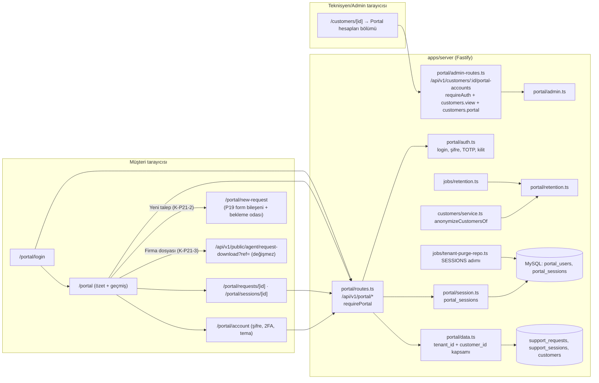

# Mimari — P21 Müşteri portalı (AC-262)

Tarih: 2026-11-17 · Durum: **r2** (güvenlik tasarım turu 1 GEÇTİ — S-P21-1..13 işlendi, §14) · r1.1 (K-P21-2 koordinatör kararıyla değişti: portal oturumlu talep ucu, AC daraltması yok) · Dal: `claude/p21-c5b21a`
Girdiler: `docs/gereksinimler-e11.md` (US-57, G6, P21 satırı), `docs/gereksinimler-kabul-kriterleri-e11-b.md` (AC-262, ortak AC-285..290),
`docs/mimari-e11.md` §11 P21 satırı, `docs/mimari.md` §5.1 / §10.1 / §10.4, `docs/mimari-api.md`, ADR-0008 (opak oturum + CSRF),
ADR-0023 (iyimser kilit), ADR-0030 (kalıcı silme). Yeni ADR: **ADR-0039** "Portal kimliği ve oturum ayrımı".
Kontrol listesi: `docs/tasarim-kontrol.md` "P21".

**Sadelik:** portal **yeni bir talep akışı icat etmez**. Yeni talep, P19 web talep akışının aynısıdır (aynı form bileşeni, aynı oluşturma
çekirdeği `createCore`, aynı bekleme odası); yalnız bot kapısının yerini portal oturumu + CSRF + hız sınırı alır ve firma web formu kapalı olsa da
çalışır (K-P21-2). Firma dosyası, müşteri detayındaki indirme bağlantısının aynısıdır. Yeni env, bağımlılık ve e-posta şablonu yok.

---

## 1. Özet ve kısıtlar

| Kapsamda                                                                                                                                                                                     | Kapsam dışı / Sonra (neden)                                                                                                 |
| -------------------------------------------------------------------------------------------------------------------------------------------------------------------------------------------- | --------------------------------------------------------------------------------------------------------------------------- |
| Ayrı kimlik alanı `portal_users` + `portal_sessions`, ayrı çerez adları (ADR-0039)                                                                                                           | Panel `users` tablosuna "CUSTOMER" rolü eklemek — reddedildi (ADR-0039 alternatif A)                                        |
| E-posta + şifre girişi; isteğe bağlı TOTP (kullanıcı kendisi açar/kapatır)                                                                                                                   | Kurtarma kodları, "bu cihazı hatırla", step-up — Sonra (kayıp cihazda Admin "Şifreyi sıfırla" TOTP'yi de sıfırlar, K-P21-5) |
| İlk girişte zorunlu şifre değişimi (geçici şifre Admin'de bir kez görünür — mevcut `POST /users` kalıbı)                                                                                     | E-posta davet bağlantısı ve self-servis "Şifremi unuttum" — Sonra (K-P21-4; genişleme noktası A-P21-2, §13)                 |
| Kendi firmasının talep ve oturum geçmişi (yalnız meta: tarih, durum, kod, kaynak, teknisyen adı, süre, ticket)                                                                               | Sohbet, talep açıklaması, teknisyen notu, IP, cihaz, dosya listesi, kayıt, kalite özeti — **gösterilmez** (K-P21-7)         |
| Yeni talep: portal içi `/portal/new-request` sayfası (mevcut web form bileşeni) → `POST /api/v1/portal/requests` (mevcut `createCore`, `source=WEB`); firma web formu kapalı olsa da çalışır | `/r/<ref>`'e yönlendirme ve firma dosyası yönergesi — kullanılmaz (K-P21-2); ayrı bir talep tablosu/kaynak değeri — yok     |
| Firma dosyası indirme = mevcut `GET /public/agent/request-download?ref=` bağlantısı                                                                                                          | Portala özel indirme ucu — yok (K-P21-3)                                                                                    |
| Panel: müşteri detayında "Portal hesapları" bölümü (listele, oluştur, pasife al, etkinleştir, şifre sıfırla)                                                                                 | Portal hesabını kalıcı silme düğmesi — yok; pasif hesap saklama işiyle silinir (K-P21-9)                                    |
| Yetki anahtarı `customers.portal` (yalnız ekleme)                                                                                                                                            | Portal kullanıcısının avatarı — yok, baş harf rozeti (K-P21-10); TR/EN (P23 kapsam dışı)                                    |
| Tema tercihi (Açık/Koyu/Sistem) portal kullanıcısının kaydında (Projeler/CLAUDE.md §1.6)                                                                                                     | Bir e-postanın birden çok müşteriye/firma bağlı olması — Sonra (K-P21-6)                                                    |

Kısıtlar: tek instance (ADR-0005) → hız kovaları bellekte, hesap kilidi DB'de (panel kalıbı); MySQL 8, Prisma; repo açık kaynak;
P28g paralel çalışıyor → `apps/agent-win`, `apps/server/src/public/agent*`, `signaling/*`, `apps/web/app/session/*`,
`packages/contracts/src/{api/sessions,ws*}.ts` **değişmez**. Ortak dosyalarda (`permissions.ts`, `audit.ts`, `labels.ts`,
`messages/tr.json`, `package.json` exports, `app-routes.ts`, `proxy.ts`, `implementation.md`) yalnız ekleme.

### 1.1 Kararlar (K-P21-n)

| No       | Karar                                                                                                                                                                                                                                                                                                                                                                                                                                                                                                                                                                                                                                                                                                                                                         | Gerekçe                                                                                                                                                                                                              |
| -------- | ------------------------------------------------------------------------------------------------------------------------------------------------------------------------------------------------------------------------------------------------------------------------------------------------------------------------------------------------------------------------------------------------------------------------------------------------------------------------------------------------------------------------------------------------------------------------------------------------------------------------------------------------------------------------------------------------------------------------------------------------------------- | -------------------------------------------------------------------------------------------------------------------------------------------------------------------------------------------------------------------- |
| K-P21-1  | Portal kimliği panelden **tamamen ayrı**: `portal_users`, `portal_sessions`, çerezler `__Host-rs_portal` / `__Host-rs_portal_csrf`, ayrı guard `requirePortal`. Panel guard'ı portal çerezini, portal guard'ı panel çerezini hiç okumaz; token hash'i farklı tabloda aranır → bir oturum diğer alanda yapısal olarak çözülemez (ADR-0039)                                                                                                                                                                                                                                                                                                                                                                                                                     | mimari-e11 P21 satırı; panel rol/yetki/tenant kodunun (her uç `requirePerm`) yanlışlıkla müşteriye açılmasını yapısal olarak engeller                                                                                |
| K-P21-2  | "Yeni talep aç" = portal içi talep sayfası `/portal/new-request`: P19 form bileşeni (`web-request-flow`) aynen, veri kaynağı adaptörle portal uçlarına bağlanır. Sunucu `POST /portal/requests` → mevcut `RequestService.createCore` (`source: "WEB"`, ref = oturumdaki müşterinin `request_ref`'i, sunucuda çözülür). Bot kapısı (form token, gizli alan, ≥ 2 sn) **yerine** portal oturumu + CSRF + müşteri başına 10 talep/sa ve müşteri başına en çok 3 bekleyen talep (r2, S-P21-4); firma `web_form_enabled` denetimi bu yolda **uygulanmaz**. Engel listesi, mesai (`OUTSIDE_HOURS`), KVKK onay metni/sürümü, kanal seçimi ve bildirim, IP/önek/firma kovaları, bekleyen sınırları (WEB 30), TX ve bekleme odası (talep sırrı, WS, iptal) **aynı kod** | AC-262 daraltılmaz (koordinatör kararı); tek oluşturma çekirdeği, tek form bileşeni — ikinci akış yok; firmanın form tercihi herkese açık `/r/` sayfası içindir, kimliği doğrulanmış portal kullanıcısına uygulanmaz |
| K-P21-3  | "Firma dosyası" = E9/P8c müşteri dosyası `NoktaDestek-<label>-<ref>.exe`; portal müşteri detayındaki `downloadUrl`/`fileName` değerlerinin aynısını verir. P28b `SessionStoredFile` **değildir** (oturum içi geçici aktarım, ≤ 7 gün, teknisyen ↔ müşteri; "firma dosyası" terimi E9'da tanımlı — AC-e9 terimler)                                                                                                                                                                                                                                                                                                                                                                                                                                             | Terim kodda ve gereksinimde tanımlı; en basit doğru yorum; yeni uç yok                                                                                                                                               |
| K-P21-4  | Hesap açılışı panel kullanıcı kalıbıyla: Admin oluşturur → geçici şifre yanıtta **bir kez** görünür (`TempPasswordDialog`) → Admin müşteriye iletir → ilk girişte zorunlu değişim. E-posta daveti/self-servis sıfırlama yok                                                                                                                                                                                                                                                                                                                                                                                                                                                                                                                                   | SMTP bağımlılığı ve yeni token tablosu doğmaz; panelde bilinen tek yol                                                                                                                                               |
| K-P21-5  | TOTP isteğe bağlı, kullanıcı `/portal/account`'ta açar/kapatır; kurtarma kodu yok. Cihaz kaybında Admin "Şifreyi sıfırla" = yeni geçici şifre + TOTP kapatma + tüm portal oturumlarının iptali (tek işlem)                                                                                                                                                                                                                                                                                                                                                                                                                                                                                                                                                    | AC "isteğe bağlı TOTP"; ikinci bir kurtarma yolu yerine tek Admin işlemi                                                                                                                                             |
| K-P21-6  | (r2, S-P21-3) `portal_users.email` **firma (tenant) içinde tekil**: UQ(tenant_id, email). Giriş adresi firmaya bağlıdır: `/portal/login?tenant=<slug>` (panelde "Portal adresi" olarak kopyalanır); slug giriş isteğinde gizli alan `tenantSlug` olarak gider, kullanıcı ek alan görmez. Slug yoksa/geçersizse form yerine "Giriş bağlantısını destek sağlayıcınızdan isteyin" metni. Aynı kişi aynı firmada iki müşteri için ayrı e-posta kullanır                                                                                                                                                                                                                                                                                                           | Firmalar arası e-posta işgali ve varlık sorgusu kapanır; panel girişindeki `tenantSlug` + AC-82 logo kalıbıyla aynı                                                                                                  |
| K-P21-7  | Portal "meta": talep → kod, oluşturma/kapanma, durum, kaynak (Uygulama/Web), öncelik, talep eden kişi adı; oturum → başlangıç/bitiş, süre, durum, mod, teknisyen ad-soyad, ticket no, müşteri kişi adı. Açıklama, not, sohbet, IP, cihaz, dosya, kayıt yok. Anonimleşmiş satırda kişi adı "—". Müşteriye bağlı gözetimsiz cihaz oturumları (`mode=UNATTENDED`, `customer_id` cihazın müşterisi) da listede görünür; izinsiz bağlantı gerekçesi (`silent_reason`) gösterilmez                                                                                                                                                                                                                                                                                  | AC "(meta)"; panel DTO'ları yeniden kullanılmaz (fazla alan sızar), portal DTO'su ayrı ve dar                                                                                                                        |
| K-P21-8  | Yetki: tek anahtar `customers.portal` (+ uçta `customers.view`). Admin varsayılan açık, User kapalı                                                                                                                                                                                                                                                                                                                                                                                                                                                                                                                                                                                                                                                           | AC "Admin oluşturur/pasife alır"; tek toggle yeter                                                                                                                                                                   |
| K-P21-9  | Silme: hesap pasife alınır (`status=PASSIVE`, `passive_at`); pasif hesap tenant `retention_days` sonunda saklama işiyle **kalıcı silinir**; müşteri anonimleştirilince o müşterinin tüm portal hesapları + oturumları aynı TX'te silinir; firma silmede `SESSIONS` adımında silinir                                                                                                                                                                                                                                                                                                                                                                                                                                                                           | KVKK: yeni kişisel veri (gereksinimler-e11 KVKK satırı) süresiz kalmaz; yeni UI yok                                                                                                                                  |
| K-P21-10 | Portal kullanıcısında avatar yüklemesi yok (baş harf rozeti); logo = sağlayıcı firmanın (tenant) logosu                                                                                                                                                                                                                                                                                                                                                                                                                                                                                                                                                                                                                                                       | Dış kişiye dosya yükleme yüzeyi açılmaz; AC kapsamı                                                                                                                                                                  |
| K-P21-11 | Müşteri başına en çok **20** portal hesabı (aşımda 409 `CONFLICT`)                                                                                                                                                                                                                                                                                                                                                                                                                                                                                                                                                                                                                                                                                            | Kötüye kullanım/yanlışlık sınırı; liste sayfalamasız kalır                                                                                                                                                           |
| K-P21-12 | Müşteri PASİF / anonim veya tenant pasif / silinmekte iken portal girişi ve mevcut oturum **her istekte** reddedilir (401, girişte genel "hatalı" mesajı); hesaplar pasife alınmaz (müşteri yeniden etkinleşince erişim döner)                                                                                                                                                                                                                                                                                                                                                                                                                                                                                                                                | Tek kontrol noktası (`resolvePortalSession`), ayrı süpürme işi yok                                                                                                                                                   |
| K-P21-13 | Portal uçlarında iyimser kilit (If-Match) yok; Admin işlemleri koşullu UPDATE (`WHERE id=? AND tenant_id=? AND customer_id=? AND status=?`) ile idempotent                                                                                                                                                                                                                                                                                                                                                                                                                                                                                                                                                                                                    | Tek alanlı durum geçişleri; ADR-0023 düzenleme formları içindi                                                                                                                                                       |
| K-P21-14 | Portal aktörlü **tüm** audit satırlarında (r2, S-P21-2) `user_id` NULL, `entity=portal_users`, `entity_id`=portal kullanıcı id (oturum id'si `new_value.sessionId`); olmayan hesap denemesinde `entity_id` NULL ve maskelenmez (panel `auth.login` ghost satırı gibi); silinmiş portal hesabında kimlik maskesi (§4.5)                                                                                                                                                                                                                                                                                                                                                                                                                                        | Mevcut fail-closed maske portal id'sini silinmiş kullanıcı sayardı; KVKK: silinen hesabın e-postası audit'te açık kalmaz                                                                                             |

## 2. Bileşenler ve sorumluluklar



| Bileşen                               | Sorumluluk                                                                                                                                                                                                                                                                                              |
| ------------------------------------- | ------------------------------------------------------------------------------------------------------------------------------------------------------------------------------------------------------------------------------------------------------------------------------------------------------- |
| `portal/session.ts`                   | `openPortalSession`, `resolvePortalSession(db, token, now)`: hash araması **yalnız** `portal_sessions`; iptal/mutlak 8 sa/boşta 30 dk; kullanıcı ACTIVE, müşteri ACTIVE + anonim değil, tenant ACTIVE + silinmemiş (K-P21-12); `last_seen_at` 60 sn'de bir                                              |
| `portal/guard.ts`                     | `requirePortal` (çerez `PORTAL_SESSION_COOKIE` → bağlam `req.portal`), durum değiştiren metotta `checkOrigin` + double-submit (`PORTAL_CSRF_COOKIE` ↔ `x-csrf-token`), `mustChangePassword` kapısı (`config.allowPasswordChangePending`), `portalScope(req)` → `{ tenantId, customerId, portalUserId }` |
| `portal/auth.ts`                      | Giriş (hız kovaları + DB kilit + TOTP), çıkış, şifre değişimi, TOTP kur/aç/kapat. `auth/password.ts` (argon2id) ve `auth/mfa.ts` (`newTotpSecret`, `matchTotp`, `otpauthUrl`) **yeniden kullanılır**, kopyalanmaz                                                                                       |
| `portal/data.ts` + `portal/repo.ts`   | `me`, tema, talep/oturum listesi ve tekil kayıt; her sorgu `WHERE tenant_id = ? AND customer_id = ?` (tekil kayıtta `AND id = ?`; bulunamazsa 404). Seçim listeleri (`select`) dar ve sabit (K-P21-7)                                                                                                   |
| `portal/admin.ts` + `admin-routes.ts` | Panel tarafı: listele/oluştur/pasife al/etkinleştir/şifre sıfırla; müşteri `(tenantId, customerId)` doğrulaması; hesap `(tenantId, customerId, accountId)` üçlüsüyle aranır                                                                                                                             |
| `portal/retention.ts`                 | `deletePortalOfCustomer(tx, tenantId, customerId)` (anonimleştirme TX'inde), `portalRetention(db, tenant, now)` (süresi dolan oturum + 7 g, pasif hesap + `retention_days`)                                                                                                                             |

## 3. Veri modeli

Migration: **`20261126000000_p21_customer_portal`** (dba; elle CHECK'ler migration.sql'de, ADR-0014 ikili karşılaştırma). Yeni iki tablo;
mevcut tablolarda **kolon değişikliği yok**.

### 3.1 `portal_users`

| Alan                       | Tip                                   | Not                                                                                                                                                  |
| -------------------------- | ------------------------------------- | ---------------------------------------------------------------------------------------------------------------------------------------------------- |
| `id`                       | CHAR(26) PK                           | ULID                                                                                                                                                 |
| `tenant_id`                | CHAR(26) NOT NULL                     | FK → `tenants(id)` RESTRICT                                                                                                                          |
| `customer_id`              | CHAR(26) NOT NULL                     | bileşik FK `(tenant_id, customer_id)` → `customers(tenant_id, id)` RESTRICT                                                                          |
| `email`                    | VARCHAR(254) NOT NULL                 | küçük harfe indirilmiş, kırpılmış; **UQ(tenant_id, email)** (K-P21-6 r2); CHECK `email = LOWER(email)`                                               |
| `full_name`                | VARCHAR(100) NOT NULL                 | 2..100, kontrol karakteri yok (customers adı kuralı)                                                                                                 |
| `password_hash`            | VARCHAR(255) NOT NULL                 | argon2id (mimari §5.1 parametreleri)                                                                                                                 |
| `must_change_password`     | BOOL NOT NULL DEFAULT 1               | oluşturma ve Admin sıfırlamasında 1                                                                                                                  |
| `failed_login_count`       | INT NOT NULL DEFAULT 0                | 1 sa pencere (G-23 kalıbı)                                                                                                                           |
| `failed_window_at`         | DATETIME(3) NULL                      |                                                                                                                                                      |
| `locked_until`             | DATETIME(3) NULL                      | hesap geneli kilit                                                                                                                                   |
| `totp_secret_enc`          | VARBINARY(255) NULL                   | AES-256-GCM (`lib/crypto.ts` SecretBox); kurulumda yazılır                                                                                           |
| `totp_enabled`             | BOOL NOT NULL DEFAULT 0               | CHECK `totp_enabled = 0 OR totp_secret_enc IS NOT NULL`                                                                                              |
| `totp_last_step`           | BIGINT NULL                           | tekrar oynatma koruması (RFC 6238 §5.2)                                                                                                              |
| `theme`                    | VARCHAR(20) NOT NULL DEFAULT 'SYSTEM' | `LIGHT` / `DARK` / `SYSTEM` (ikili CHECK)                                                                                                            |
| `status`                   | VARCHAR(20) NOT NULL DEFAULT 'ACTIVE' | `ACTIVE` / `PASSIVE` (ikili CHECK); CHECK `(status='PASSIVE') = (passive_at IS NOT NULL)`                                                            |
| `passive_at`               | DATETIME(3) NULL                      | saklama sayacı başlangıcı (K-P21-9)                                                                                                                  |
| `last_login_at`            | DATETIME(3) NULL                      | panel listesinde gösterilir                                                                                                                          |
| `temp_password_expires_at` | DATETIME(3) NULL                      | r2 S-P21-5: oluşturma/Admin sıfırlamasında `now + 72 sa`; şifre değişince NULL. CHECK `temp_password_expires_at IS NULL OR must_change_password = 1` |
| `created_by`               | CHAR(26) NULL                         | **FK değil** (`uploaded_by_user_id` kalıbı) — panel kullanıcısı kalıcı silinse de satır kalır                                                        |
| `created_at`, `updated_at` | DATETIME(3)                           | UTC                                                                                                                                                  |

İndeksler: `UQ(tenant_id, email)` (giriş araması + tenant FK öneki), `UQ(id, tenant_id)` (oturum bileşik FK hedefi), `IX(tenant_id, customer_id, status)` (panel listesi, 20 sınırı
sayımı, müşteri FK öneki, anonimleştirmede silme), `IX(status, passive_at)` (saklama işi), `IX(tenant_id)` (tenant FK + firma silme).

### 3.2 `portal_sessions`

| Alan                       | Tip                   | Not                                                                               |
| -------------------------- | --------------------- | --------------------------------------------------------------------------------- |
| `id`                       | CHAR(26) PK           |                                                                                   |
| `portal_user_id`           | CHAR(26) NOT NULL     | bileşik FK `(portal_user_id, tenant_id)` → `portal_users(id, tenant_id)` RESTRICT |
| `tenant_id`                | CHAR(26) NOT NULL     | firma silme ve tutarlılık; `tenants`'a doğrudan FK yok (bileşik FK yeter)         |
| `token_hash`               | CHAR(64) NOT NULL     | SHA-256 hex; **UQ**; düz token DB'de yok                                          |
| `ip`                       | VARCHAR(45) NOT NULL  |                                                                                   |
| `user_agent`               | VARCHAR(300) NOT NULL | yalnız bilgi                                                                      |
| `last_seen_at`             | DATETIME(3) NOT NULL  |                                                                                   |
| `expires_at`               | DATETIME(3) NOT NULL  | `created_at + 8 sa` (CHECK ≤ 8 sa + 1 dk)                                         |
| `revoked_at`               | DATETIME(3) NULL      |                                                                                   |
| `created_at`, `updated_at` | DATETIME(3)           |                                                                                   |

İndeksler: `UQ(token_hash)`, `IX(portal_user_id, tenant_id, revoked_at)` (FK öneki + kullanıcının oturumlarını iptal),
`IX(expires_at)` (saklama), `IX(tenant_id)` (firma silme). TOTP "yarım oturum" kolonu **yok**: TOTP kodu giriş isteğinde gelir (§5.2).

### 3.3 `prisma/sql/grants.sql` eklemeleri (dba)

```sql
GRANT SELECT, INSERT, DELETE ON portal_users TO 'app'@'%';
REVOKE IF EXISTS UPDATE, ALTER, DROP, INDEX, TRIGGER, REFERENCES ON portal_users FROM 'app'@'%';
GRANT UPDATE (full_name, temp_password_expires_at, password_hash, must_change_password, failed_login_count, failed_window_at, locked_until,
    totp_secret_enc, totp_enabled, totp_last_step, theme, status, passive_at, last_login_at, updated_at) ON portal_users TO 'app'@'%';
GRANT SELECT, INSERT, DELETE ON portal_sessions TO 'app'@'%';
REVOKE IF EXISTS UPDATE, ALTER, DROP, INDEX, TRIGGER, REFERENCES ON portal_sessions FROM 'app'@'%';
GRANT UPDATE (last_seen_at, revoked_at, updated_at) ON portal_sessions TO 'app'@'%';
```

`email`, `tenant_id`, `customer_id` güncellenemez (hesap başka müşteriye taşınamaz → IDOR'un DB düzeyi emniyeti). E-posta değişimi
gerekiyorsa Admin pasife alıp yeni hesap açar.

**dba K1 notu (2026-11-18, `docs/db-notlari.md` "P21"):** (1) `portal_users` `IX(tenant_id)` eklenmedi — `UQ(tenant_id, email)` ve
`IX(tenant_id, customer_id, status)` zaten `tenant_id` önekli. (2) `email = LOWER(email)` utf8mb4_unicode_ci'de etkisiz → ikili
karşılaştırma (`CAST(… AS BINARY)`) + `\z` iskelet. (3) Ek CHECK'ler: full_name (customers adı kuralı), `password_hash` yalnız
argon2id PHC, TOTP üçlüsü (users kalıbı), `failed_login_count ≥ 0`, `created_by` ULID, oturum `token_hash` hex + TTL.
(4) Sütun GRANT'ı ayrıca `created_by` ve `created_at`'i de dışarıda bırakır (liste §3.3 ile aynı).

### 3.4 Silme stratejisi (K-P21-9)

| Olay                                            | Etki                                                                                                                                                                                                                                        |
| ----------------------------------------------- | ------------------------------------------------------------------------------------------------------------------------------------------------------------------------------------------------------------------------------------------- |
| Admin pasife alır                               | `status=PASSIVE`, `passive_at=now`, kullanıcının tüm `portal_sessions` satırları `revoked_at=now` (aynı TX)                                                                                                                                 |
| Saklama işi 03:30 (mevcut `jobs/retention.ts`)  | `portal_sessions`: `expires_at < now − 7 g` veya `revoked_at < now − 7 g` → DELETE; `portal_users`: `PASSIVE` ve `passive_at < now − tenant.retention_days` → önce oturumları sonra satırı DELETE + audit `portal.account_deleted` (SYSTEM) |
| Müşteri anonimleştirme (`anonymizeCustomersOf`) | Aynı TX'te `deletePortalOfCustomer` → oturumlar + hesaplar DELETE; audit `customer.anonymized` `newValue.portalAccounts: n`                                                                                                                 |
| Firma silme (P16 `DATA_STEPS.SESSIONS`)         | `byTenant("portal_sessions")`, `byTenant("portal_users")` — `customer_notify_contacts`'tan önce; yeni adım **yok**                                                                                                                          |
| KVKK imha CLI (`erasure`)                       | Değişmez: firma satırları firma silme ile gider; portal kullanıcısı panel kullanıcısı değildir (deftere girmez)                                                                                                                             |

## 4. API sözleşmesi

Sözleşme kaynağı: **`packages/contracts/src/api/portal.ts`** (yeni; `package.json` exports'a `"./api/portal"` eklenir). Hata zarfı,
kodlar ve sayfalama mevcut (`mimari-api.md`). Yeni hata kodu **yok**. Tüm yanıtlar `Cache-Control: no-store`.

### 4.1 Sabitler ve şemalar (`api/portal.ts`)

```ts
export const PORTAL_SESSION_COOKIE = "__Host-rs_portal";      // httpOnly, Secure, SameSite=Strict, Path=/
export const PORTAL_CSRF_COOKIE = "__Host-rs_portal_csrf";    // httpOnly=false, Secure, SameSite=Strict, Path=/
// CSRF başlığı panelle aynı ad: CSRF_HEADER ("x-csrf-token") — karşılaştırıldığı çerez farklı.
export const PORTAL_ACCOUNTS_PER_CUSTOMER_MAX = 20;
export const PORTAL_PAGE_SIZE_MAX = 100;

export const portalLoginInputSchema = z.strictObject({
  email: z.string().trim().toLowerCase().email().max(254),
  tenantSlug: tenantSlugSchema,                  // r2 S-P21-3: ?tenant=<slug>'tan gizli alan (api/tenants.ts)
  password: z.string().min(1).max(PASSWORD_MAX),
  totpCode: totpCodeSchema.optional(),           // auth.ts'ten
});
export const portalThemeInputSchema = z.strictObject({ theme: z.enum(["LIGHT", "DARK", "SYSTEM"]) });
// şifre değişimi: auth.ts passwordChangeInputSchema aynen (min 12)
export const portalTotpEnableInputSchema = z.strictObject({ code: totpCodeSchema });
export const portalTotpDisableInputSchema = z.strictObject({ password: z.string().min(1).max(PASSWORD_MAX), code: totpCodeSchema });
export const portalListQuerySchema = z.strictObject({         // strict: customerId/tenantId vb. → 400 VALIDATION
  page: z.coerce.number().int().min(1).max(10_000).default(1),   // r2 S-P21-11
  pageSize: z.coerce.number().int().min(1).max(PORTAL_PAGE_SIZE_MAX).default(25)   // mimari-api ortak kural,
});
export const portalAccountCreateInputSchema = z.strictObject({
  email: z.string().trim().toLowerCase().email().max(254),
  fullName: z.string().trim().min(2).max(100),               // customers ad kuralı (Cc/Cf/Zl/Zp yok)
});

export interface PortalMe {
  user: { id: string; email: string; fullName: string; theme: Theme; mustChangePassword: boolean; totpEnabled: boolean };
  customer: { name: string };
  provider: { name: string; logoUrl: string };               // tenant adı + logosu (yoksa sistem logosu)
  links: { downloadUrl: string; fileName: string };  // K-P21-3 (yeni talep yolu sabit: /portal/new-request)
}
export interface PortalRequestItem {
  id: string; requestCode: string; status: SupportRequestStatus; source: "AGENT" | "WEB";
  priority: RequestPriority; requesterName: string | null; createdAt: string; closedAt: string | null; sessionId: string | null;
}
export interface PortalSessionItem {
  id: string; status: SessionStatus; mode: "AGENT" | "BROWSER" | "UNATTENDED" | null;
  technicianName: string; customerName: string | null; ticketNo: string | null;
  createdAt: string; startedAt: string | null; endedAt: string | null; durationSec: number | null;
}
export interface PortalPage<T> { items: T[]; page: number; pageSize: number; total: number }
export interface PortalAccountItem {
  id: string; email: string; fullName: string; status: "ACTIVE" | "PASSIVE"; totpEnabled: boolean;
  mustChangePassword: boolean; lastLoginAt: string | null; createdAt: string; passiveAt: string | null;
}
export interface PortalAccountCreateResponse { account: PortalAccountItem; temporaryPassword: string }  // bir kez
export interface PortalPasswordResetResponse { temporaryPassword: string }                            // bir kez
export interface PortalAccountListResponse { items: PortalAccountItem[]; loginUrl: string }

// K-P21-2 — portal talebi: P19 web formu şemasından türetilir (tek tanım); ref/formToken/website (gizli alan) YOK,
// müşteri ve ref oturumdan gelir.
export const portalRequestInputSchema = z.strictObject(portalRequestShape).superRefine(refineNotifyEmail);
// r2 S-P21-6: zod 4'te refine'lı şemada .omit() hata verir → requests.ts `webRequestShape` + `refineNotifyEmail` dışa aktarılır,
// iki şema da `z.strictObject(shape).superRefine(refineNotifyEmail)` ile kurulur; portalRequestShape = webRequestShape − {ref, formToken, website}
export type PortalRequestFormInfo = Omit<WebFormInfo, "formToken" | "minDelayMs">;   // tenant, consentText, chatRetentionDays, channels, businessHours
// yanıt: mevcut CreateRequestResponse (talep sırrı → mevcut bekleme odası / WS / iptal)
export const PORTAL_REQUESTS_PER_CUSTOMER_HOUR = 10;   // r2 S-P21-4: müşterinin tüm portal hesapları toplamı (bellek kovası)
export const PORTAL_PENDING_PER_CUSTOMER_MAX = 3;      // r2 S-P21-4: portal yolunda müşterinin bekleyen talepleri (kaynak fark etmez)
export const PORTAL_TEMP_PASSWORD_TTL_HOURS = 72;     // r2 S-P21-5
```

`SupportRequestStatus`, `RequestPriority`, `SessionStatus`, `Theme` mevcut contracts tiplerinden içe aktarılır (yalnız tip; dosya
değişmez). Durum etiketleri `labels.ts`'teki mevcut eşlemelerle gösterilir.

### 4.2 Portal uçları — `/api/v1/portal/*` (portal oturumu; panel çerezi **anlamsız**)

| Uç                                  | Girdi                          | Çıktı                                                                          | Hatalar                                                                                                                                                                                                          | Not                                                                                                                                                                                                                                                                                                                                                                                                                                                                                                                                                                                                                                                                                                                                                                                                                                                                                                                                                                                                                           |
| ----------------------------------- | ------------------------------ | ------------------------------------------------------------------------------ | ---------------------------------------------------------------------------------------------------------------------------------------------------------------------------------------------------------------- | ----------------------------------------------------------------------------------------------------------------------------------------------------------------------------------------------------------------------------------------------------------------------------------------------------------------------------------------------------------------------------------------------------------------------------------------------------------------------------------------------------------------------------------------------------------------------------------------------------------------------------------------------------------------------------------------------------------------------------------------------------------------------------------------------------------------------------------------------------------------------------------------------------------------------------------------------------------------------------------------------------------------------------- |
| `POST /portal/auth/login`           | `portalLoginInputSchema`       | 200 `PortalMe` + iki çerez                                                     | 400 VALIDATION, 401 UNAUTHENTICATED (genel "E-posta veya şifre hatalı."), 403 `MFA_REQUIRED` (şifre doğru, TOTP açık, kod yok — oturum açılmaz), 403 CSRF_INVALID (Origin), 423 ACCOUNT_LOCKED, 429 RATE_LIMITED | Origin allowlist zorunlu; önceki portal çerezi varsa iptal                                                                                                                                                                                                                                                                                                                                                                                                                                                                                                                                                                                                                                                                                                                                                                                                                                                                                                                                                                    |
| `POST /portal/auth/logout`          | —                              | 204, çerezler silinir                                                          | 401, 403 CSRF_INVALID                                                                                                                                                                                            | şifre kapısından muaf                                                                                                                                                                                                                                                                                                                                                                                                                                                                                                                                                                                                                                                                                                                                                                                                                                                                                                                                                                                                         |
| `GET /portal/me`                    | —                              | `PortalMe`                                                                     | 401                                                                                                                                                                                                              | şifre kapısından muaf (web yönlendirmesi buna bakar)                                                                                                                                                                                                                                                                                                                                                                                                                                                                                                                                                                                                                                                                                                                                                                                                                                                                                                                                                                          |
| `PATCH /portal/me`                  | `portalThemeInputSchema`       | `PortalMe`                                                                     | 400, 401, 403 PASSWORD_CHANGE_REQUIRED                                                                                                                                                                           | + `rs_theme` çerezi (`THEME_COOKIE`, panel kalıbı)                                                                                                                                                                                                                                                                                                                                                                                                                                                                                                                                                                                                                                                                                                                                                                                                                                                                                                                                                                            |
| `POST /portal/account/password`     | `passwordChangeInputSchema`    | 204 + yeni çerezler                                                            | 400 (`fields.current`), 401 (5 hatalı → oturum iptal)                                                                                                                                                            | şifre kapısından muaf; diğer portal oturumları iptal, mutlak bitiş korunur                                                                                                                                                                                                                                                                                                                                                                                                                                                                                                                                                                                                                                                                                                                                                                                                                                                                                                                                                    |
| `POST /portal/account/totp/setup`   | —                              | `{ secret, otpauthUrl, qrDataUrl }` (QR sunucuda, mevcut `qrcode`; r2 S-P21-9) | 401, 403, 409 CONFLICT (zaten açık)                                                                                                                                                                              | sır `totp_secret_enc`'e, `totp_enabled=0`                                                                                                                                                                                                                                                                                                                                                                                                                                                                                                                                                                                                                                                                                                                                                                                                                                                                                                                                                                                     |
| `POST /portal/account/totp/enable`  | `portalTotpEnableInputSchema`  | 204                                                                            | 400 (`fields.code`), 409 (kurulum yok), 429 (5/5 dk)                                                                                                                                                             |                                                                                                                                                                                                                                                                                                                                                                                                                                                                                                                                                                                                                                                                                                                                                                                                                                                                                                                                                                                                                               |
| `POST /portal/account/totp/disable` | `portalTotpDisableInputSchema` | 204                                                                            | 400 (`fields.password`/`fields.code`), 429                                                                                                                                                                       | şifre + kod birlikte                                                                                                                                                                                                                                                                                                                                                                                                                                                                                                                                                                                                                                                                                                                                                                                                                                                                                                                                                                                                          |
| `GET /portal/request-form`          | —                              | `PortalRequestFormInfo`                                                        | 401, 403 PASSWORD_CHANGE_REQUIRED                                                                                                                                                                                | K-P21-2: mevcut `webFormInfoOf` gövdesinden ortak parça (`requestFormInfo(tenantId)`); `web_form_enabled` denetimi yok, form token'ı üretilmez. Talep eden adı/e-postası istemcide `PortalMe`'den önceden doldurulur (düzenlenebilir)                                                                                                                                                                                                                                                                                                                                                                                                                                                                                                                                                                                                                                                                                                                                                                                         |
| `POST /portal/requests`             | `portalRequestInputSchema`     | 201 `CreateRequestResponse`                                                    | 400 VALIDATION (bilinmeyen alan dahil), 401, 403 CSRF_INVALID / PASSWORD_CHANGE_REQUIRED, 409 `OUTSIDE_HOURS` / `QUEUE_FULL` / `CHANNEL_UNAVAILABLE` (mevcut), 429 RATE_LIMITED                                  | K-P21-2: sıra `requirePortal` (oturum + CSRF + şifre kapısı) → bodyLimit 8 KB → zod → müşteri kovası (10/sa, `PORTAL_REQUESTS_PER_CUSTOMER_HOUR`; aşım `rateAudit` + metrik) → **gövde yalnız sunucuda kurulur** (r2, S-P21-1): `body = { ...zodÇıktısı, ref: scope müşterisinin request_ref'i }` — `req.body` `createCore`'a **asla** verilmez → `createCore(ctx, body, …, "WEB", { via: "portal", portalUserId, expectedTenantId, expectedCustomerId })`. `via: "portal"`: (1) `web_form_enabled` denetimini atlar; (2) `resolveSource` sonrası çözülen `tenantId`/`customerId` beklenenle eşit değilse iç hata 500 + alarm logu, talep yazılmaz (fail-closed); (3) TX'te müşterinin PENDING talepleri ≥ `PORTAL_PENDING_PER_CUSTOMER_MAX` → 409 `QUEUE_FULL` (`REQUEST_BUSY_MESSAGE`); (4) create audit'ine `{ via: "portal", portalUserId }` ekler. Müşterinin `request_ref`'i çözülemezse (yenileme yarışı dışında olmamalı) 409 `CONFLICT` "Talep bağlantınız yenilendi, sayfayı yenileyin". Diğer adımlar P19 ile aynı |
| `GET /portal/requests`              | `portalListQuerySchema`        | `PortalPage<PortalRequestItem>`                                                | 400 (bilinmeyen parametre), 401, 403                                                                                                                                                                             | `created_at DESC`; `IX(tenant_id, customer_id, created_at)` mevcut                                                                                                                                                                                                                                                                                                                                                                                                                                                                                                                                                                                                                                                                                                                                                                                                                                                                                                                                                            |
| `GET /portal/requests/:id`          | `:id` ULID                     | `PortalRequestItem`                                                            | 401, 403, **404** (başka müşteri/firma/yok — ayrım yapılmaz)                                                                                                                                                     |                                                                                                                                                                                                                                                                                                                                                                                                                                                                                                                                                                                                                                                                                                                                                                                                                                                                                                                                                                                                                               |
| `GET /portal/sessions`              | `portalListQuerySchema`        | `PortalPage<PortalSessionItem>`                                                | 400, 401, 403                                                                                                                                                                                                    | `created_at DESC`; mevcut `IX(tenant_id, customer_id, created_at)`                                                                                                                                                                                                                                                                                                                                                                                                                                                                                                                                                                                                                                                                                                                                                                                                                                                                                                                                                            |
| `GET /portal/sessions/:id`          | `:id` ULID                     | `PortalSessionItem`                                                            | 401, 403, **404**                                                                                                                                                                                                |                                                                                                                                                                                                                                                                                                                                                                                                                                                                                                                                                                                                                                                                                                                                                                                                                                                                                                                                                                                                                               |

Uç sırası: `bodyLimit 8 KB` → `requirePortal` (çerez → oturum → CSRF → şifre kapısı) → zod → servis (`portalScope`). Giriş ucu
`requirePortal` almaz; `checkOrigin` + kovalar + zod.

Örnek `GET /portal/sessions?page=1`:

```json
{ "items": [{ "id": "01JD…", "status": "ENDED", "mode": "AGENT", "technicianName": "Ayşe Yılmaz", "customerName": "Mehmet K.",
  "ticketNo": "ITSM-1042", "createdAt": "2026-11-20T09:01:12.000Z", "startedAt": "2026-11-20T09:02:40.000Z",
  "endedAt": "2026-11-20T09:31:05.000Z", "durationSec": 1705 }], "page": 1, "pageSize": 25, "total": 1 }
```

Örnek başka müşterinin oturumu: `GET /portal/sessions/01JE…` → `404 {"error":{"code":"NOT_FOUND","message":"Kayıt bulunamadı.","requestId":"…"}}`.

### 4.3 Panel uçları — `/api/v1/customers/:id/portal-accounts` (panel oturumu)

Hepsi `requireAuth` → `requirePerm("customers.view")` → `requirePerm("customers.portal")` → `tenantScope` → zod. Müşteri
`(tenantId, :id)` yoksa **404**; hesap `(tenantId, :id, :accountId)` üçlüsüyle aranır, yoksa **404** (başka müşterinin hesabı dahil).

| Uç                                                 | Girdi                            | Çıktı                                                                                                                                      | Hatalar / kural                                                                                                                                                                                                                                                                                 |
| -------------------------------------------------- | -------------------------------- | ------------------------------------------------------------------------------------------------------------------------------------------ | ----------------------------------------------------------------------------------------------------------------------------------------------------------------------------------------------------------------------------------------------------------------------------------------------- |
| `GET  …/portal-accounts`                           | —                                | `{ items: PortalAccountItem[]; loginUrl: string }` (≤ 20, `created_at` sırası; `loginUrl = PUBLIC_BASE_URL + /portal/login?tenant=<slug>`) | 403, 404                                                                                                                                                                                                                                                                                        |
| `POST …/portal-accounts`                           | `portalAccountCreateInputSchema` | 201 `PortalAccountCreateResponse`                                                                                                          | 409 CONFLICT: müşteri pasif/anonim; 20 sınırı; e-posta kullanılamaz (`fields.email`: "Bu e-posta adresiyle portal hesabı açılamaz." — hangi firmada olduğu söylenmez); 429 (tenant başına 30/sa, `users` oluşturma kovası kalıbı)                                                               |
| `POST …/portal-accounts/:accountId/deactivate`     | `{}`                             | `PortalAccountItem`                                                                                                                        | 404; zaten pasifse 200 aynı satır (idempotent)                                                                                                                                                                                                                                                  |
| `POST …/portal-accounts/:accountId/reactivate`     | `{}`                             | `PortalAccountItem`                                                                                                                        | 404; müşteri pasif/anonim → 409                                                                                                                                                                                                                                                                 |
| `POST …/portal-accounts/:accountId/reset-password` | `{}`                             | `PortalPasswordResetResponse`                                                                                                              | 404; hesap pasif → 409. Etki: yeni geçici şifre (`newTemporaryPassword(TEMPORARY_PASSWORD_LENGTH)` — `POST /users` ile aynı üreteç ve uzunluk), `must_change_password=1`, TOTP sıfır (`totp_enabled=0`, sır ve `totp_last_step` NULL), kilit/sayaç sıfır, tüm portal oturumları iptal (K-P21-5) |

Bu dosya `customers/routes.ts`'e dokunmaz: ayrı eklenti `portal/admin-routes.ts`, `app-routes.ts`'te `{ prefix: "/api/v1/customers" }`
ile kaydedilir (mevcut `/api/v1/sessions` çoklu eklenti kalıbı).

### 4.4 Yetki anahtarı (`permissions.ts` — yalnız ekleme)

`customers` modülünün `actions` dizisinin **sonuna** `"portal"` eklenir → `customers.portal`. `PERMISSION_DESCRIPTIONS`'a:
`"customers.portal": "Müşteri portal hesaplarını listeler, oluşturur, pasife alır, yeniden etkinleştirir ve şifresini sıfırlar."`.
Etiket web sözlüğüne (`tr.json`). Rol varsayılanı mevcut kural (Admin açık / User kapalı). AC-72/AC-285 testi değişmeden yeşil kalmalı.
Portal kullanıcısının **yetki toggle'ı yoktur**: tek rolü vardır, yalnız kendi müşterisinin meta verisini okur (Projeler/CLAUDE.md §1.3
toggle kuralı panel kullanıcıları içindir; portal kullanıcısı tenant kullanıcısı değildir — ADR-0039).

### 4.5 Audit olayları (`packages/contracts/src/audit.ts` — yeni `PORTAL_AUDIT`, yalnız ekleme)

| Eylem                                                       | Aktör (`user_id` / `username`)                    | `entity` / `entity_id`                                                             | `result` / `new_value`                                                                                            |
| ----------------------------------------------------------- | ------------------------------------------------- | ---------------------------------------------------------------------------------- | ----------------------------------------------------------------------------------------------------------------- |
| `portal.login`                                              | portal kullanıcısı (yoksa NULL / girilen e-posta) | `portal_users` / id                                                                | success `{}`; fail `{ reason: invalid_credentials \| locked \| invalid_totp \| replayed_totp \| inactive }`       |
| `portal.locked`                                             | portal kullanıcısı                                | `portal_users`                                                                     | `{ scope: account \| account_ip, minutes: 15 }`                                                                   |
| `portal.logout`                                             | portal kullanıcısı                                | `portal_users` / portal kullanıcı id (r2 S-P21-2; oturum id `new_value.sessionId`) | success                                                                                                           |
| `portal.password_change`                                    | portal kullanıcısı                                | `portal_users`                                                                     | success `{ revokedSessions }`; fail `{ reason }`                                                                  |
| `portal.mfa_enabled` / `portal.mfa_disabled`                | portal kullanıcısı                                | `portal_users`                                                                     | success / fail `{ reason }`                                                                                       |
| `portal.account_created`                                    | Admin                                             | `portal_users` / yeni id                                                           | `{ customerId, email, fullName }` (geçici şifre **asla**)                                                         |
| `portal.account_deactivated` / `portal.account_reactivated` | Admin                                             | `portal_users`                                                                     | `old_value { status }` → `new_value { status, revokedSessions? }`                                                 |
| `portal.account_password_reset`                             | Admin                                             | `portal_users`                                                                     | `{ revokedSessions, secondFactorCleared: boolean }` (r2 S-P21-8: `totp` içeren anahtar `mask.ts`'te maskelenirdi) |
| `portal.account_deleted`                                    | SYSTEM                                            | `portal_users`                                                                     | `{ reason: retention }` (e-posta yazılmaz)                                                                        |

Her portal satırında `tenant_id` dolu. **Aktör kuralı (K-P21-14):** portal kullanıcısının kendi eylemlerinde `user_id = NULL`,
`username = e-posta`, `entity = "portal_users"`, `entity_id = portal kullanıcı id`; `user_id`'ye portal id **yazılmaz** (mevcut
`identityView` `users` haritasında olmayan `user_id`'yi silinmiş sayıp her satırı maskelerdi). Kimlik maskesi (ADR-0030 m.4, fail-closed)
yalnız eklemeyle genişler: `audit/view.ts` `identityView` koşuluna "`entity = portal_users` ve `entity_id` `portal_users`'ta yok"
eklenir; `audit/read.ts` sayfadaki portal `entity_id`'lerinin varlığını tek sorguyla okur. Böylece hesap saklama/anonimleştirme/firma
silmeyle silinince e-posta (`username`) ve `new_value`'daki `email`/`fullName` (zaten `AUDIT_IDENTITY_KEYS`'te) audit ekranında ve
CSV'de maskelenir; satırlar 730 gün append-only kalır. Audit ekranında bu satırlar baş harf rozetiyle görünür (avatar yok). Audit ekranının eylem filtresi ve etiketleri
`labels.ts`'e eklenir. Panel kullanıcısının portal sayfalarını ziyareti ve portal kullanıcısının liste görüntülemesi audit'e yazılmaz
(yalnız meta; mevcut geçmiş görüntüleme kuralıyla aynı).

## 5. Güvenlik tasarımı

### 5.1 Kimlik ve oturum (ADR-0039)

| Konu                                           | Karar                                                                                                                                                                                                                                                                                                                                                                                                                                                                                                                            |
| ---------------------------------------------- | -------------------------------------------------------------------------------------------------------------------------------------------------------------------------------------------------------------------------------------------------------------------------------------------------------------------------------------------------------------------------------------------------------------------------------------------------------------------------------------------------------------------------------- |
| Şifre                                          | argon2id (`auth/password.ts` aynen), min 12 / max 200; geçici şifre `POST /users` üreteciyle; ilk girişte ve Admin sıfırlamasından sonra zorunlu değişim                                                                                                                                                                                                                                                                                                                                                                         |
| Oturum                                         | Opak 32 bayt token (`newSecretToken`) çerezde, DB'de SHA-256 (`portal_sessions.token_hash`); mutlak 8 sa, boşta 30 dk, `last_seen_at` 60 sn'de bir; her istek DB'den doğrulanır (≤ 5 sn iptal yansıması). JWT yok (ADR-0008)                                                                                                                                                                                                                                                                                                     |
| Çerezler                                       | `__Host-rs_portal` (httpOnly) + `__Host-rs_portal_csrf` (JS okur) — `Secure`, `SameSite=Strict`, `Path=/`, `expires = expires_at`. Panel çerezleri (`__Host-rs_session`, `__Host-rs_csrf`) ile ad çakışması yok; iki alan aynı tarayıcıda bağımsız açık kalabilir                                                                                                                                                                                                                                                                |
| Çapraz kabul yok                               | Panel `requireAuth` yalnız `SESSION_COOKIE` + `auth_sessions`; portal `requirePortal` yalnız `PORTAL_SESSION_COOKIE` + `portal_sessions`. Bir alanın token'ı diğer çerez adına kopyalansa bile karşı tabloda hash yok → 401. CSRF de çapraz kabul etmez: portal yazmasında başlık `__Host-rs_portal_csrf` ile, panel yazmasında `__Host-rs_csrf` ile karşılaştırılır                                                                                                                                                             |
| CSRF                                           | Durum değiştiren her portal isteğinde `checkOrigin` (allowlist) + double-submit; giriş ucunda yalnız Origin (login CSRF). `SameSite=Strict` ek katman                                                                                                                                                                                                                                                                                                                                                                            |
| Kilit / hız (G-23 kalıbı, ayrı kova örnekleri) | IP 20 deneme/dk (429); e-posta+IP ikilisi 15 dk'da 5 → 15 dk kilit (bellek, doğrulamadan önce sayılır); hesap geneli 1 sa'de 20 hatalı → `locked_until=+15 dk` (DB atomik UPDATE; DB yazılamazsa bellek yedek kovası, fail-closed); olmayan e-posta için aynı eşik bellekte → yanıtlar hesap varlığını sızdırmaz; kilitli dalda da argon2 çalışır (sabit maliyet). Hatalı TOTP kodu başarısız deneme sayılır. Kilit bildirimi e-postası **yok** (portal kullanıcısına mail kanalı kurulmadı; yalnız audit + metrik)              |
| TOTP                                           | `auth/mfa.ts` (SHA-1, 6 hane, 30 sn, ±1 adım) aynen; sır AES-256-GCM; `totp_last_step` koşullu UPDATE ile tekrar oynatma reddi; kur/aç/kapat 5 deneme/5 dk/kullanıcı. Kapatma şifre + kod ister · r2 S-P21-7: girişte kod geldiğinde (parola doğruysa) ayrı `portalMfaPair` (e-posta+IP 5/5 dk) ve `portalMfaUser` (hesap 15/15 dk) kovaları da sayılır, aşım 429; metrik `result="invalid_totp"` · r2 S-P21-9: sır AAD'si `aadFor.portalTotpSecret(id)` (panel etiketinden ayrı); setup yanıtı `qrDataUrl` sunucuda, `no-store` |
| Şifre değişimi                                 | Oturum başına 5 hatalı mevcut şifre → oturum iptal + 401; başarıda kullanıcının tüm portal oturumları iptal, mevcut oturum yeni token ile yenilenir (mutlak bitiş korunur)                                                                                                                                                                                                                                                                                                                                                       |
| Hesap/müşteri/tenant durumu                    | Her istekte (K-P21-12): kullanıcı `ACTIVE`, müşteri `ACTIVE` ve `anonymized_at IS NULL`, tenant `ACTIVE` ve `deleted_at IS NULL`; değilse 401 ve oturum çerezi temizlenir                                                                                                                                                                                                                                                                                                                                                        |
| Super Admin                                    | Portala giriş yapamaz (ayrı kimlik alanı); panelde firma seçince Admin uçlarını `tenantScope` ile kullanır                                                                                                                                                                                                                                                                                                                                                                                                                       |

### 5.2 Giriş akışı (tek istek, yarım oturum yok)

1. Origin → IP kovası → ikili kova (senkron) → slug → tenant (`tenantSlug`; bilinmeyen/pasif slug olmayan hesapla aynı dala gider, ghost kovası anahtarı `slug|e-posta`) → `findPortalUser(tenantId, email)` → argon2 doğrulama (kullanıcı yoksa sahte hash ile).
2. Kilit varsa audit `fail{locked}` → 423.
3. Şifre hatalı / kullanıcı-müşteri-tenant etkin değil → sayaçlar, audit `fail{invalid_credentials|inactive}` → 401 genel mesaj.
4. `totp_enabled` ve `totpCode` yok → 403 `MFA_REQUIRED`, oturum açılmaz; form kod alanını gösterip **aynı isteği** kodla tekrarlar.
   Sayaçlar: IP ve e-posta+IP ikili kovası adım 1'de doğrulamadan önce sayıldığı için kodsuz istek de birer hak **tüketir** (sıfırlanmaz);
   DB hesap sayacı (`failed_login_count`) kodsuz istekte **artmaz**. Kodlu tekrar ikili kovadan bir hak daha tüketir → 5 hakla en çok
   2 tam deneme turu. Yalnız başarılı giriş (adım 5) ikili kovayı ve DB sayacını sıfırlar.
   Kod hatalı/tekrar → başarısız deneme (adım 3 sayaçları) + audit `fail{invalid_totp|replayed_totp}` → 401 "Kod hatalı.".
   4b. (r2 S-P21-5) Parola doğru, `must_change_password=1` ve `temp_password_expires_at <= now` → 401 "Geçici şifrenin süresi doldu (72 saat). Destek sağlayıcınızdan yeniden sıfırlama isteyin." (yalnız şifreyi bilen kişiye özel mesaj — panel G-P13b-10 kalıbı), audit `fail{temp_password_expired}`.
5. TX: güncel satır kilitli yeniden okunur (şifre/durum eşzamanlı değiştiyse reddedilir — D-P27a-K3 kalıbı), sayaçlar sıfır,
   önceki portal çerezinin oturumu iptal, yeni oturum, `last_login_at`, audit success.

Şifreyi bilen saldırgan 403 `MFA_REQUIRED` ile şifrenin doğru olduğunu öğrenir — panelin yarım oturumuyla aynı bilgi; ikili ve hesap
kovaları şifre denemesini zaten sınırlar (kabul edilen risk R-P21-3, §13).

### 5.3 Kapsam (IDOR) kuralı — bağlayıcı

- `portalScope(req)` → `{ tenantId, customerId, portalUserId }` **yalnız oturumdan** türetilir; istekte `tenantId`/`customerId` alanı
  yoktur, sorgu şemaları `strictObject` (bilinmeyen parametre → 400).
- `portal/repo.ts`'teki her fonksiyon ilk parametre olarak bu kapsamı alır (mimari §5.1 `tenantScope` kalıbı); `where` her zaman
  `{ tenantId, customerId, … }` içerir. Tekil kayıt `findFirst({ where: { id, tenantId, customerId } })` → yoksa `NOT_FOUND` (404);
  "var ama başkasının" ile "yok" ayırt edilmez.
- Panel Admin uçlarında hesap aranırken `(tenantId, customerId=:id, id=:accountId)`; başka firmanın veya aynı firmanın başka müşterisinin
  hesabı → 404.
- Otomatik test: iki firma × iki müşteri fikstürü; portal kullanıcısı A1, A2/B1'in talep ve oturum kimlikleriyle tüm `:id` uçlarını
  gezer → 404; listelerde yalnız A1 satırları (§10).

### 5.4 Tehdit modeli (STRIDE özeti; K0g güvenlik turu S-P21-n ekler)

| #   | Tehdit                                                                                                     | STRIDE | Önlem                                                                                                                                                                                                                                                           |
| --- | ---------------------------------------------------------------------------------------------------------- | ------ | --------------------------------------------------------------------------------------------------------------------------------------------------------------------------------------------------------------------------------------------------------------- |
| P1  | Kimlik bilgisi doldurma / kaba kuvvet                                                                      | S/D    | §5.1 kovalar + DB kilit, isteğe bağlı TOTP, genel hata mesajı, metrik `rs_portal_login_total{result}` + alarm (§9)                                                                                                                                              |
| P2  | Portal oturumunun panel ucuna (ya da tersi) kullanılması; çerez karışması                                  | E      | Ayrı tablo + ayrı çerez + ayrı guard (K-P21-1); çapraz test (§10)                                                                                                                                                                                               |
| P3  | IDOR: başka müşterinin/firmanın talep, oturum, hesap kaydı                                                 | I      | §5.3; DB'de `customer_id` güncellenemez (grants)                                                                                                                                                                                                                |
| P4  | Hesap varlığı sızıntısı (giriş, Admin oluşturma; r2: tekillik firma içi → firmalar arası sorgu yok)        | I      | Giriş: genel mesaj + sabit maliyet; oluşturma: "kullanılamaz" mesajı firmayı/müşteriyi söylemez (kalan risk: bir Admin bir e-postanın _bir yerde_ portal hesabı olduğunu öğrenebilir — panel `users.email` ile aynı, R-P21-2 §13)                               |
| P5  | CSRF / login CSRF                                                                                          | T      | Origin allowlist + double-submit + `SameSite=Strict`                                                                                                                                                                                                            |
| P6  | XSS (müşteri adı, kişi adı, teknisyen adı, ticket)                                                         | T      | React metin bağlama, `dangerouslySetInnerHTML` lint yasağı, nonce CSP (mevcut proxy)                                                                                                                                                                            |
| P7  | Fazla veri ifşası (not, sohbet, IP, açıklama)                                                              | I      | Dar DTO + sabit `select` (K-P21-7); birim testi: yanıt anahtarları tam olarak sözleşmedeki küme                                                                                                                                                                 |
| P8  | Pasif müşteri/hesap ile süren erişim                                                                       | E      | Her istek DB kontrolü (K-P21-12); pasife almada oturum iptali aynı TX                                                                                                                                                                                           |
| P9  | Geçici şifrenin sızması                                                                                    | I      | Yanıtta bir kez, loga/audit'e yazılmaz (logger `*.temporaryPassword` redakte — mevcut kural), zorunlu değişim                                                                                                                                                   |
| P10 | Ref'in portal kullanıcısına açılması (web formu/indirme bağlantısı)                                        | I      | Kabul: ref zaten firma dosyasının adında müşteriye verilmiş, tahmin edilemez ve gizli değil (AC-e9 tenantRef tanımı); Admin "Bağlantıyı yenile" ile döndürür                                                                                                    |
| P11 | Cihaz kaybında TOTP'ye kilitlenme                                                                          | D      | Admin "Şifreyi sıfırla" (K-P21-5); audit                                                                                                                                                                                                                        |
| P12 | Portal talep ucuyla kuyruk doldurma / bildirim istismarı (ele geçirilmiş ya da kötü niyetli portal hesabı) | D      | Müşteri başına 10/sa + müşteri başına 3 bekleyen (r2 S-P21-4) + mevcut IP/önek/firma WEB kovaları (60/sa) + WEB bekleyen tavanı 30 + engel listesi + mesai; audit `via:"portal"` ile hesap izlenir, Admin pasife alır. Bot kapısı yok: kimlik doğrulanmış hesap |

### 5.5 Hassas veri ve başlıklar

| Veri                                                      | Sınıf          | Depolama                                                                                                                                                                                                                      |
| --------------------------------------------------------- | -------------- | ----------------------------------------------------------------------------------------------------------------------------------------------------------------------------------------------------------------------------- |
| Portal kullanıcısı e-posta, ad, son giriş, IP/UA (oturum) | Kişisel (KVKK) | DB; §3.4 silme yolları                                                                                                                                                                                                        |
| Şifre, TOTP sırrı                                         | Gizli          | argon2id / AES-256-GCM (`APP_ENCRYPTION_KEYS`; panel `users.totp_secret_enc` ile aynı muamele — `crypto:check-retire` bugün `users`'ı da saymaz; anahtar emekliliği runbook adımına `portal_users` satırı eklenir, devops K7) |
| Oturum token'ı, CSRF                                      | Gizli          | Yalnız SHA-256 / yalnız çerez                                                                                                                                                                                                 |

Başlıklar: mevcut Next proxy CSP/HSTS/COOP/CORP/Referrer-Policy aynen; `/portal` yolları `MIC_DENY_PREFIXES`'e eklenir
(`microphone=()`). CORS kapalı. API yanıtları `no-store`. Caddy log süzgeci değişmez: portal URL'lerinde gizli değer yok
(yalnız ULID); çerezler zaten loglanmıyor (G-10).

KVKK: portal kullanıcısının kişisel verisi (e-posta, ad, giriş zamanı, oturum IP/UA) yalnız hesap işletimi için tutulur ve §3.4
yollarıyla silinir. Hesabı açan Admin'in firması veri sorumlusudur; uygulama içinde ayrı onay kutusu/aydınlatma ekranı **yok**
(hesap sözleşme ilişkisiyle açılır). Kılavuz ve DATASHEET bunu yazar; hukuki teyit açık karar A-P21-1 (§13).

## 6. Web rotaları ve ekranlar (DESIGN.md "Vitrin" tokenları; `lucide-react`)

| Rota                      | İçerik                                                                                                                                                                                                                                                                                                                                                                                                                                                                                                                                                                                                              | 5 durum                                                                                                                  |
| ------------------------- | ------------------------------------------------------------------------------------------------------------------------------------------------------------------------------------------------------------------------------------------------------------------------------------------------------------------------------------------------------------------------------------------------------------------------------------------------------------------------------------------------------------------------------------------------------------------------------------------------------------------- | ------------------------------------------------------------------------------------------------------------------------ |
| `/portal/login`           | `(auth)` kabuğunun aynısı (logo: `?tenant=<slug>` → firma logosu, yoksa sistem logosu — AC-82 kalıbı); başlık "Müşteri portalı"; e-posta, şifre; `MFA_REQUIRED` gelince aynı formda 6 haneli kod alanı belirir; "Şifrenizi mi unuttunuz? Destek sağlayıcınıza başvurun." metni (bağlantı yok)                                                                                                                                                                                                                                                                                                                       | yükleniyor (düğme), hata (alan/form üstü), kilit (423 → kalan süre), oran sınırı (429), başarı → yönlendirme             |
| `/portal/change-password` | Zorunlu şifre değişimi (mevcut `password-fields.tsx` yeniden kullanılır)                                                                                                                                                                                                                                                                                                                                                                                                                                                                                                                                            | aynı                                                                                                                     |
| `/portal`                 | Üst çubuk: sağlayıcı logosu + müşteri adı + tema seçici + kullanıcı menüsü (baş harf rozeti, Hesabım `UserCog`, Çıkış `LogOut`). İki eylem kartı: **Firma dosyasını indir** (`Download`, `fileName` gösterilir) ve **Yeni destek talebi** (`LifeBuoy` → `/portal/new-request`). Altında sekmeler **Talepler** (`Inbox`) / **Oturumlar** (`MonitorSmartphone`), sayfalı tablo (mobilde kart)                                                                                                                                                                                                                         | skeleton; boş ("Henüz talep yok" + yeni talep eylemi); hata + "Tekrar dene"; kısmi (bir sekme hata, diğeri dolu); başarı |
| `/portal/requests/[id]`   | Talep meta (tanım listesi) + bağlı oturum varsa bağlantı                                                                                                                                                                                                                                                                                                                                                                                                                                                                                                                                                            | skeleton, 404 ("Kayıt bulunamadı" + Portala dön), hata                                                                   |
| `/portal/sessions/[id]`   | Oturum meta                                                                                                                                                                                                                                                                                                                                                                                                                                                                                                                                                                                                         | aynı                                                                                                                     |
| `/portal/account`         | Ad/e-posta (salt okunur), şifre değiştir, 2FA aç (QR + kod) / kapat (şifre + kod), tema (Açık/Koyu/Sistem)                                                                                                                                                                                                                                                                                                                                                                                                                                                                                                          | yükleniyor, hata, başarı toast (Sonner)                                                                                  |
| `/portal/new-request`     | P19 web talep formu bileşeni (ad, telefon, e-posta, açıklama, kanal seçimi, KVKK metni + "Sohbet mesajları … N gün saklanır" satırı — AC-292) portal adaptörüyle; ad/e-posta `PortalMe`'den dolu gelir; gönderince aynı bekleme odası (sohbet, iptal, kabulde bağlantı). Mesai dışında mevcut ret ekranı                                                                                                                                                                                                                                                                                                            | mevcut form/bekleme odası durumları (yükleniyor, doğrulama, 409 mesai, 429, ağ hatası, başarı)                           |
| Panel `/customers/[id]`   | Yeni bölüm **Portal hesapları** (`KeyRound`), yalnız `customers.portal` varsa: liste (ad, e-posta, durum rozeti, 2FA rozeti, son giriş, "Geçici şifre süresi doldu" rozeti — r2 S-P21-5), "Hesap oluştur" diyaloğu → `TempPasswordDialog`; satır menüsü: Pasife al (onaylı; diyalog notu "Kişi kötü niyetliyse müşterinin bağlantısını da yenileyin" — r2 S-P21-10), Etkinleştir, Şifreyi sıfırla (onaylı → `TempPasswordDialog`). Bölüm başında **Portal adresi** (`loginUrl`, mevcut `CopyLink` ile kopyala) — Admin geçici şifreyle birlikte müşteriye bu adresi iletir. Müşteri pasifse oluşturma pasif + neden | skeleton, boş ("Portal hesabı yok"), hata, 403 gizli, başarı                                                             |

Web dosyaları ayrı rota grubu: `apps/web/app/portal/` (kendi `layout.tsx`; panel `(panel)` kabuğunu ve `/auth/me`'yi **kullanmaz**).
Sunucu tarafı portal oturum okuması `lib/portal/server.ts` → `GET /api/v1/portal/me` (çerezler iletilir — `server-api.ts` kalıbı);
tarayıcı tarafı `lib/portal/api.ts` (`api.ts` ile aynı hata zarfı; CSRF'i `PORTAL_CSRF_COOKIE`'den okur; 401'de `/portal/login?reason=expired`).
`proxy.ts` (yalnız ekleme): `PUBLIC_PATHS`'e `"/portal"` (panel girişine yönlendirme yapılmaz); `/portal` altında (`/portal/login` hariç)
`PORTAL_SESSION_COOKIE` yoksa `/portal/login?tenant=<slug>`'a yönlendirme — slug, girişte yazılan gizli olmayan `rs_portal_tenant` çerezinden (yalnız `tenantSlugSchema`'ya uyan değer; yoksa `?tenant`'sız → "bağlantıyı isteyin" metni) (r2 S-P21-3); `MIC_DENY_PREFIXES`'e `"/portal"`; `permissionsPolicyFor` `/portal` için ayrıca `display-capture=()` (r2 S-P21-12; `/r` değişmez — bekleme odasının ekran paylaşımı `/session/`'da mı doğrulanmadan dokunulmaz, Sonra).
Tema: `THEME_COOKIE` (`rs_theme`, `api/branding.ts`) paneldekiyle aynı (yanıp sönme yok), kalıcı tercih `portal_users.theme`.
Metinler `messages/tr.json` `portal.*` anahtarları (yalnız ekleme). İkon eşlemesi `lib/module-icons.ts`'e değil portal bileşenine.

## 7. Dosya / klasör planı

| Ajan         | Yeni                                                                                                                                                                                                                                                                                                                                                      | Değişen (yalnız ekleme)                                                                                                                                                                                                                                                                                                                                                                                                                                                                                                                                                                                                                                                                                                                                                                                                                                                                                                                                                                                                                                                                                                                                                                                                                                                                                                                                                                                                                                     |
| ------------ | --------------------------------------------------------------------------------------------------------------------------------------------------------------------------------------------------------------------------------------------------------------------------------------------------------------------------------------------------------- | ----------------------------------------------------------------------------------------------------------------------------------------------------------------------------------------------------------------------------------------------------------------------------------------------------------------------------------------------------------------------------------------------------------------------------------------------------------------------------------------------------------------------------------------------------------------------------------------------------------------------------------------------------------------------------------------------------------------------------------------------------------------------------------------------------------------------------------------------------------------------------------------------------------------------------------------------------------------------------------------------------------------------------------------------------------------------------------------------------------------------------------------------------------------------------------------------------------------------------------------------------------------------------------------------------------------------------------------------------------------------------------------------------------------------------------------------------------- |
| dba          | `apps/server/prisma/migrations/20261126000000_p21_customer_portal/migration.sql`                                                                                                                                                                                                                                                                          | `prisma/schema.prisma` (2 model + `Tenant`/`Customer` ters ilişki alanları), `prisma/sql/grants.sql`, `docs/db-notlari.md` "P21"                                                                                                                                                                                                                                                                                                                                                                                                                                                                                                                                                                                                                                                                                                                                                                                                                                                                                                                                                                                                                                                                                                                                                                                                                                                                                                                            |
| backend-dev  | `packages/contracts/src/api/portal.ts`; `apps/server/src/portal/{session,guard,auth,limits,repo,data,routes,admin,admin-routes,retention}.ts` + testler `apps/server/test/portal-*.test.ts`                                                                                                                                                               | `packages/contracts/package.json` (exports), `permissions.ts` (`"portal"` eylemi + açıklama), `audit.ts` (`PORTAL_AUDIT`), `labels.ts` (eylem etiketleri), `app-routes.ts` (2 kayıt), `customers/service.ts` (`anonymizeCustomersOf` içinde tek çağrı), `jobs/retention.ts` (portal adımı), `jobs/tenant-purge-repo.ts` (`SESSIONS` dizisine 2 parça), `app.ts`/Fastify tip bildirimi (`req.portal`), `lib/logger.ts` (`REDACT_PATHS` +2), `audit/view.ts` + `audit/read.ts` (K-P21-14 maske koşulu), `test/helpers/tenant-matrix.ts` (`ROUTE_CLASSES`: login `public`, portal oturumlu uçlar yeni sınıf `portal`, Admin uçları `tenant` + `CROSS_TENANT_CASES`; AC-69 aracı sınıfsız uca izin vermez), `requests/service.ts` + `requests/create-steps.ts` (K-P21-2: `createCore`'a isteğe bağlı `{ via: "portal", portalUserId }` seçeneği — yalnız `web_form_enabled` denetimini atlar ve audit'e ekler; varsayılan davranış değişmez) + `requests/web-form.ts` (`webFormInfoOf` gövdesinden `requestFormInfo(tenantId)` ortak parçası çıkarılır, `/r/` yanıtı aynı), `docs/mimari-api.md` "Müşteri portalı (P21)" bölümü (§4'ün özeti + bağlantı), `docs/implementation.md` · r2: `packages/contracts/src/api/requests.ts` (yalnız ekleme: `webRequestShape` + `refineNotifyEmail` dışa aktarımı, `webRequestInputSchema` aynı sonuç — S-P21-6), `auth/account.ts` `aadFor.portalTotpSecret` (S-P21-9), `lib/logger.ts` `REDACT_PATHS`'e ayrıca `*.code` |
| frontend-dev | `apps/web/app/portal/{layout,page,not-found}.tsx`, `portal/login/*`, `portal/change-password/*`, `portal/account/*`, `portal/requests/[id]/*`, `portal/sessions/[id]/*`; `apps/web/lib/portal/{api,server}.ts`; `apps/web/app/(panel)/customers/[id]/portal-accounts.tsx`; `apps/web/app/portal/new-request/page.tsx`; e2e `apps/web/e2e/portal*.spec.ts` | `apps/web/proxy.ts` (+ birim testi), `app/r/[ref]/web-request-flow.tsx` + `use-web-request-form.ts` (K-P21-2: bilgi yükleme ve gönderme bir `source` adaptörü prop'u olur — `/r/` varsayılan adaptörü bugünkü public uçları çağırır, portal adaptörü `/portal/request-form` + `/portal/requests`; bekleme odası/WS/iptal aynen), `app/(panel)/customers/[id]/page.tsx` (bölümü yerleştirme), `messages/tr.json`, `docs/rotalar.txt` (portal rotaları), `docs/implementation.md` (Rotalar) · r2: `proxy.ts` `rs_portal_tenant` okuma + `/portal` `display-capture=()` (+ birim testi), giriş sayfasında slugsuz durum metni, panel bölümünde süre doldu rozeti ve pasife alma notu                                                                                                                                                                                                                                                                                                                                                                                                                                                                                                                                                                                                                                                                                                                                                                           |
| devops       | —                                                                                                                                                                                                                                                                                                                                                         | Prometheus alarm kuralı (`rs_portal_login_total{result="fail"}`, `rs_portal_locked_total`), `docs/runbook.md` "P21" (yeni env yok; portal hesabı kilitlenince/TOTP kaybında Admin işlemi; staging doğrulama adımları)                                                                                                                                                                                                                                                                                                                                                                                                                                                                                                                                                                                                                                                                                                                                                                                                                                                                                                                                                                                                                                                                                                                                                                                                                                       |
| teknik-yazar | —                                                                                                                                                                                                                                                                                                                                                         | `docs/KULLANIM_KILAVUZU.md` (Müşteri portalı — "Müşteri için" + "Admin için"), `README.md`, `docs/api.md`, `CHANGELOG.md`, `docs/DATASHEET.md`, PDF'ler (AC-288)                                                                                                                                                                                                                                                                                                                                                                                                                                                                                                                                                                                                                                                                                                                                                                                                                                                                                                                                                                                                                                                                                                                                                                                                                                                                                            |

**Dokunulmayanlar (P28g ile çakışmaz):** `apps/agent-win/**`, `apps/server/src/public/**`, `apps/server/src/signaling/**`,
`apps/server/src/requests/**` (yalnız §7 tablosundaki `createCore` seçeneği ve `requestFormInfo` ortak parçası), `apps/web/app/session/**`,
`apps/web/app/r/**` davranışı (yalnız veri kaynağı adaptörü eklenir, `/r/` aynen çalışır), `packages/contracts/src/api/sessions.ts`, `packages/contracts/src/ws*.ts`.

## 8. Performans ve ölçek

- Hacim: firma başına onlarca portal hesabı, kullanıcı başına günde birkaç istek — ihmal edilebilir. Liste uçları sayfalı (varsayılan 25, ≤ 100 — mimari-api ortak kural);
  sorgular mevcut `IX(tenant_id, customer_id, created_at)` indekslerini kullanır (support_requests, support_sessions); `COUNT` aynı indeksle.
- Teknisyen adı için `support_sessions → users` tek JOIN (`select { technician: { select: { fullName } } }`); N+1 yok.
- Oturum çözümü istek başına 1 sorgu (oturum + kullanıcı + müşteri + tenant tek `findUnique` include), `last_seen_at` 60 sn'de bir.
- Önbellek yok (meta verisi canlı; `no-store`). Kuyruk yok.
- argon2 maliyeti giriş başına ~50 ms; IP kovası (20/dk) CPU tüketimini sınırlar.

## 9. Operasyon

| Konu         | Karar                                                                                                                                                                                                         |
| ------------ | ------------------------------------------------------------------------------------------------------------------------------------------------------------------------------------------------------------- |
| Config / env | **Yeni env yok.** `PUBLIC_BASE_URL` (bağlantılar), `APP_ENCRYPTION_KEYS` (TOTP sırrı), `ALLOWED_ORIGINS` mevcut                                                                                               |
| Log          | `event: "portal_login"` `{ result, reason }` (e-posta/şifre/kod yok); `lib/logger.ts` `REDACT_PATHS`'e `*.totpCode` ve `*.temporaryPassword` eklenir (bugün yoklar; `*.password`/`*.current`/`*.next` mevcut) |
| Metrik       | `rs_portal_login_total{result="success"\|"fail"\|"locked"\|"mfa_required"}`, `rs_portal_locked_total`, `rs_portal_sessions_active` (gauge, retention işinde). Alarm: 10 dk'da fail ≥ 200 (dağıtık doldurma)   |
| Migration    | Yalnız ekleyen (2 tablo); `migrate` servisi `migrator` kullanıcısıyla; geri alma: tabloları DROP eden ters SQL runbook'ta (veri kaybı yalnız portal hesapları)                                                |
| Rollback     | Uygulama geri alınırsa tablolar zararsız kalır (eski kod okumaz); firma silme eski kodda portal satırlarına FK RESTRICT ile takılır → geri almada **önce** ters migration (runbook notu)                      |
| Yedek        | Mevcut gece yedeği tabloları kapsar; geri yükleme testi değişmez                                                                                                                                              |

## 10. Test stratejisi

Komutlar: `pnpm -r run lint` · `pnpm -r run typecheck` · `pnpm -r run test` (Vitest; sunucu entegrasyon testleri gerçek MySQL ile,
mevcut test kalıbı) · `pnpm --filter @remote/web e2e` (Playwright).

| AC-262 parçası / ortak AC                    | Seviye                         | Test (ölçüt)                                                                                                                                                                                                                                                                                                                                                                                                                                                                                                                                                                                                                                                                                                                                                                                                                                                                                                                                                                                                   |
| -------------------------------------------- | ------------------------------ | -------------------------------------------------------------------------------------------------------------------------------------------------------------------------------------------------------------------------------------------------------------------------------------------------------------------------------------------------------------------------------------------------------------------------------------------------------------------------------------------------------------------------------------------------------------------------------------------------------------------------------------------------------------------------------------------------------------------------------------------------------------------------------------------------------------------------------------------------------------------------------------------------------------------------------------------------------------------------------------------------------------- |
| E-posta + şifre ile giriş                    | entegrasyon                    | doğru → 200 + iki `__Host-` çerezi (Secure, SameSite=Strict, HttpOnly yalnız oturumda); yanlış şifre/olmayan e-posta → aynı 401 metni; Origin yok/yabancı → 403; 21. istek/dk → 429; ikili 5 hata → 423; hesap 20/sa → 423 + `locked_until` · r2: aynı e-posta iki firmada ayrı hesap, her biri yalnız kendi `tenantSlug`'ıyla girer; slugsuz/bilinmeyen slug → olmayan hesapla aynı 401; geçici şifre 72 sa sonra doğru şifreyle 401 "süresi doldu" (sahte saat)                                                                                                                                                                                                                                                                                                                                                                                                                                                                                                                                              |
| İlk girişte şifre değişimi                   | entegrasyon + e2e              | `must_change_password=1` iken `GET /portal/requests` → 403 `PASSWORD_CHANGE_REQUIRED`; `me`/`logout`/`password` serbest; değişim sonrası diğer portal oturumları 401                                                                                                                                                                                                                                                                                                                                                                                                                                                                                                                                                                                                                                                                                                                                                                                                                                           |
| İsteğe bağlı TOTP                            | entegrasyon (sahte saat) + e2e | kurulum → enable; girişte kodsuz → 403 `MFA_REQUIRED` ve `portal_sessions` satır sayısı değişmez; doğru kod → 200; aynı adım tekrar → 401; disable şifre+kod ister; Admin sıfırlaması TOTP'yi kapatır · r2: kodlu 16. hatalı deneme/15 dk → 429 (`portalMfaUser`); setup yanıtında `qrDataUrl`, `no-store`; AAD farklı (panel sırrı portal satırına kopyalanınca çözülemez)                                                                                                                                                                                                                                                                                                                                                                                                                                                                                                                                                                                                                                    |
| Yalnız kendi firmasının talep/oturum geçmişi | entegrasyon                    | 2 tenant × 2 müşteri fikstürü: A1 listesi yalnız A1 satırları; `total` doğru; sayfalama                                                                                                                                                                                                                                                                                                                                                                                                                                                                                                                                                                                                                                                                                                                                                                                                                                                                                                                        |
| Meta (fazla alan yok)                        | birim/entegrasyon              | yanıt nesnesinin anahtar kümesi `PortalRequestItem`/`PortalSessionItem` anahtarlarına **eşit** (note, description, ip, guestIpKey, chat, files yok); anonim satırda kişi adı null                                                                                                                                                                                                                                                                                                                                                                                                                                                                                                                                                                                                                                                                                                                                                                                                                              |
| **IDOR → 404**                               | entegrasyon                    | A1 oturumuyla A2/B1/B2'nin her talep ve oturum id'si için `GET /portal/requests/:id`, `/portal/sessions/:id` → 404 ve gövde, var olmayan id ile **aynı**; `?customerId=…`/`?tenantId=…` → 400; Admin(A) ile `B` müşterisinin ve `A2` müşterisinin hesap id'leri `…/portal-accounts/:accountId/*` → 404                                                                                                                                                                                                                                                                                                                                                                                                                                                                                                                                                                                                                                                                                                         |
| Çerez ayrımı                                 | entegrasyon                    | panel token'ı `__Host-rs_portal` adıyla → 401; portal token'ı `__Host-rs_session` adıyla panel `GET /auth/me` → 401; portal CSRF çereziyle panel POST → 403 ve tersi                                                                                                                                                                                                                                                                                                                                                                                                                                                                                                                                                                                                                                                                                                                                                                                                                                           |
| Yeni talep açar                              | entegrasyon + e2e              | `web_form_enabled` **açık ve kapalı** iki firmada: `/portal/new-request` → form → 201 → bekleme odası; panelde talep `source=WEB`, `customer_id`=A1, audit `request.created` `via:"portal"` → portal Talepler listesinde. Oturumsuz → 401, yabancı Origin/CSRF yok → 403, gövdede `ref`/`customerId`/`tenantId` → 400, mesai dışı (REJECT modu) → 409 `OUTSIDE_HOURS`, KVKK onayı yok/eski sürüm → 400, 11. talep/sa/kullanıcı → 429, engelli IP → mevcut ret; `/r/<ref>` form kapalıyken hâlâ 404 (değişmedi) · **r2 S-P21-1 (zorunlu):** gövdeye başka müşterinin/firmanın `ref`'i veya `bindingKey` → 400 ve talep yazılmaz; `createCore` beklenen müşteriyle uyuşmazlıkta talep yazmaz (birim, sahte `resolveSource`); ref yenilemesiyle eşzamanlı talep yine aynı müşteriye · **r2 S-P21-4 (zorunlu):** aynı müşterinin 2 hesabıyla toplam 11. talep/sa → 429, başka müşteri etkilenmez; müşterinin 3 bekleyeni varken 4. → 409 `QUEUE_FULL` · S-P21-6: `notify.email` + e-posta yok → 400 `fields.email` |
| Firma dosyasını indirir                      | entegrasyon + e2e              | `PortalMe.links.downloadUrl/fileName` panel müşteri detayındakiyle aynı; bağlantı 302 `/downloads/NoktaDestek-<label>-<ref>.exe`                                                                                                                                                                                                                                                                                                                                                                                                                                                                                                                                                                                                                                                                                                                                                                                                                                                                               |
| Admin oluşturur / pasife alır                | entegrasyon + e2e              | `customers.portal` yoksa 403; oluşturma 201 + geçici şifre bir kez (ikinci GET'te yok), audit satırında şifre yok; 21. hesap → 409; pasife alma → o hesabın açık portal isteği ≤ 5 sn'de 401; etkinleştirme; müşteri pasif → giriş 401 · r2 S-P21-2: hesap silinince o hesabın login/logout/password_change/mfa satırlarının hepsi audit ekranı ve CSV'de maskeli; olmayan e-posta denemesi maskesiz · S-P21-8: sıfırlama audit'inde `secondFactorCleared` okunur                                                                                                                                                                                                                                                                                                                                                                                                                                                                                                                                              |
| Silme yolları (K-P21-9)                      | entegrasyon (sahte saat)       | pasif hesap `retention_days` sonra silinir; müşteri anonimleştirme TX'inde portal satırları 0; firma silme önizlemesinde `SESSIONS` sayısına portal satırları dahil, yürütmede 0                                                                                                                                                                                                                                                                                                                                                                                                                                                                                                                                                                                                                                                                                                                                                                                                                               |
| AC-285                                       | mevcut AC-72 testi             | `customers.portal` toggle ekranında görünür, test yeşil                                                                                                                                                                                                                                                                                                                                                                                                                                                                                                                                                                                                                                                                                                                                                                                                                                                                                                                                                        |
| AC-287                                       | e2e                            | 7 portal ekranı (yeni talep dahil) + panel bölümü: 5 durum, açık/koyu temada axe 0, 390 px yatay taşma yok, menü/link ikonları                                                                                                                                                                                                                                                                                                                                                                                                                                                                                                                                                                                                                                                                                                                                                                                                                                                                                 |
| AC-290                                       | süreç                          | K0g tasarım turu + paket sonu qa GEÇTİ, güvenlik Kritik/Yüksek 0                                                                                                                                                                                                                                                                                                                                                                                                                                                                                                                                                                                                                                                                                                                                                                                                                                                                                                                                               |

## 11. Görev paketleri ve atama (P21-K0g..K10)

| Paket | Ajan                  | İş                                                                                                                                                                                                                                            | Bağımlı olduğu     | Paralel mi                    | Kabul ölçütü                                                                  |
| ----- | --------------------- | --------------------------------------------------------------------------------------------------------------------------------------------------------------------------------------------------------------------------------------------- | ------------------ | ----------------------------- | ----------------------------------------------------------------------------- |
| K0g   | guvenlik              | Tasarım güvenlik turu (yeni kimlik alanı): §5 tehdit modeli eki, S-P21-n bulguları → mimar r2                                                                                                                                                 | —                  | —                             | `docs/guvenlik-raporu.md` "P21 Tasarım turu"; Kritik/Yüksek kapanmış          |
| K1    | dba                   | Şema, migration (CHECK'ler elle), grants, `db-notlari.md` "P21"                                                                                                                                                                               | K0g                | —                             | `pnpm db:migrate` temiz DB'de ve mevcut staging dökümünde geçer; grants testi |
| K2    | backend-dev           | Contracts: `api/portal.ts`, exports, `permissions.ts`, `audit.ts`, `labels.ts`                                                                                                                                                                | K0g                | K1 ile paralel                | typecheck; AC-72 testi yeşil                                                  |
| K3    | backend-dev           | `portal/session`, `guard`, `auth`, `limits`, `routes` (auth + account uçları)                                                                                                                                                                 | K1, K2             | K5 ile paralel                | §10 giriş/şifre/TOTP/çerez ayrımı testleri                                    |
| K4    | backend-dev           | `portal/repo`, `data` (me, listeler, tekil), `admin`, `admin-routes`, `retention`, portal talep ucu (`request-form`, `requests` POST) + `createCore` `via` seçeneği ve `requestFormInfo` ortak parçası, anonimleştirme/firma silme eklemeleri | K3                 | K5/K6 ile paralel             | §10 IDOR, meta, Admin, silme testleri                                         |
| K5    | frontend-dev          | Portal sayfaları (`/portal/new-request` dahil; P19 form bileşenine kaynak adaptörü — `/r/` e2e'si değişmeden yeşil), `lib/portal/*`, `proxy.ts` eklemeleri, `tr.json`                                                                         | K2 (sözleşme)      | K3/K4 ile paralel (sahte API) | e2e portal + AC-287                                                           |
| K6    | frontend-dev          | Panel müşteri detayı "Portal hesapları" bölümü                                                                                                                                                                                                | K2                 | K5 ile paralel                | e2e Admin akışı                                                               |
| K7    | devops                | Metrik/alarm kuralları, runbook "P21" (ters migration, staging doğrulama)                                                                                                                                                                     | K2 (metrik adları) | K3–K6 ile paralel             | `test-watch.sh` PASS; runbook adımları                                        |
| K8    | qa-denetci ‖ guvenlik | Paket denetimi (AC-262, 285–290)                                                                                                                                                                                                              | K3–K7              | ikisi paralel                 | qa GEÇTİ, güvenlik Kritik/Yüksek 0                                            |
| K9    | test-operatoru        | Staging: iki tarayıcı (portal kullanıcısı ↔ panel Admin), iki müşteri, tüm portal sayfaları + form akışı                                                                                                                                      | K8                 | —                             | `docs/test-raporu.md`                                                         |
| K10   | teknik-yazar          | Kılavuz, README, api.md, CHANGELOG, DATASHEET, PDF'ler                                                                                                                                                                                        | K9                 | —                             | AC-288                                                                        |

Sıra: K0g → (K1 ‖ K2) → (K3 → K4) ‖ K5 ‖ K6 ‖ K7 → K8 → düzeltme → K9 → K10.

## 12. Kabul kriterleri eşlemesi

| AC                             | Bileşen / uç                                                                                                                                             | Paket      |
| ------------------------------ | -------------------------------------------------------------------------------------------------------------------------------------------------------- | ---------- |
| AC-262 giriş (+TOTP)           | `POST /portal/auth/login`, `/portal/account/totp/*`, `portal/auth.ts`, `/portal/login`, `/portal/account`                                                | K1, K3, K5 |
| AC-262 kendi geçmişi (meta)    | `GET /portal/requests[/:id]`, `GET /portal/sessions[/:id]`, `portal/data.ts`, `/portal`, detay sayfaları                                                 | K4, K5     |
| AC-262 yeni talep              | `GET /portal/request-form`, `POST /portal/requests` → `RequestService.createCore` (`via: "portal"`), `/portal/new-request` (P19 form bileşeni) — K-P21-2 | K4, K5     |
| AC-262 firma dosyası           | `PortalMe.links.downloadUrl/fileName` → `GET /public/agent/request-download` (değişmez) — K-P21-3                                                        | K4, K5     |
| AC-262 Admin oluştur/pasife al | `/api/v1/customers/:id/portal-accounts[*]`, `customers.portal`, panel bölümü                                                                             | K2, K4, K6 |
| AC-262 IDOR 404                | `portalScope` + `portal/repo.ts` kapsamı, admin üçlü arama, `strictObject` sorgular; §10 IDOR testi                                                      | K3, K4     |
| AC-285                         | `permissions.ts` `customers.portal`                                                                                                                      | K2         |
| AC-286                         | Uygulanamaz: yeni dış servis yok                                                                                                                         | —          |
| AC-287                         | §6 ekranları                                                                                                                                             | K5, K6     |
| AC-288                         | Dokümantasyon                                                                                                                                            | K10        |
| AC-289                         | Uygulanamaz: istemci değişmez                                                                                                                            | —          |
| AC-290                         | K0g + K8                                                                                                                                                 | K0g, K8    |

## 13. Açık kararlar ve riskler

| No      | Konu                                                                                                                                                                                                                 | Varsayılan / sahibi                                                                                                                                                                                                                                       |
| ------- | -------------------------------------------------------------------------------------------------------------------------------------------------------------------------------------------------------------------- | --------------------------------------------------------------------------------------------------------------------------------------------------------------------------------------------------------------------------------------------------------- |
| A-P21-1 | Portal kullanıcısı için uygulama içi aydınlatma/onay gerekip gerekmediği (KVKK)                                                                                                                                      | Varsayılan: gerekmez, kılavuzda yazılır; proje-yoneticisi/kullanıcı teyidi                                                                                                                                                                                |
| A-P21-2 | E-posta davet / self-servis şifre sıfırlama                                                                                                                                                                          | Sonra. Genişleme noktası: `auth/password-reset.ts` kalıbında `portal_password_reset_tokens` + `/portal/reset-password`; `PortalMe` değişmez                                                                                                               |
| A-P21-3 | Bir kişinin birden çok müşteriye erişimi                                                                                                                                                                             | Sonra (K-P21-6). Genişleme noktası: `portal_user_customers` ara tablosu + `portalScope`'a seçili müşteri; IDOR kuralı aynı                                                                                                                                |
| R-P21-1 | Portal yolu firmanın `web_form_enabled=false` tercihini aşar: kimliği doğrulanmış portal kullanıcısı form kapalıyken de talep açar                                                                                   | Bilinçli (K-P21-2): tercih herkese açık `/r/` formu içindir; portal hesabını yalnız Admin açar. Kılavuz "Admin için" bölümü bunu yazar; kötüye kullanımda Admin hesabı pasife alır. Kalan tüm kurallar (mesai, kovalar, engel, bekleyen sınırı) uygulanır |
| R-P21-2 | (r2, S-P21-3 ile kapandı) E-posta tekilliği firma içinde; Admin yalnız kendi firmasında bir e-postanın portal hesabı olduğunu görür                                                                                  | Kabul (kendi verisi)                                                                                                                                                                                                                                      |
| R-P21-3 | Şifre doğruysa 403 `MFA_REQUIRED` şifre doğruluğunu ele verir                                                                                                                                                        | Kabul (panel yarım oturumuyla eşdeğer), kovalar sınırlar                                                                                                                                                                                                  |
| R-P21-4 | Geçici şifrenin Admin → müşteri iletimi kanal dışı (telefon/e-posta) — zayıf kanal                                                                                                                                   | Zorunlu ilk değişim + kılavuz uyarısı; davet e-postası A-P21-2                                                                                                                                                                                            |
| R-P21-5 | P28g ile ortak dosya çakışması (`app-routes.ts`, `tr.json`, `proxy.ts`, `implementation.md`)                                                                                                                         | Yalnız ekleme; birleştirmede sıra P28g → P21 rebase                                                                                                                                                                                                       |
| R-P21-6 | Geri almada eski kodun firma silmesi portal satırlarına FK RESTRICT ile takılır                                                                                                                                      | Runbook: geri almadan önce ters migration (§9)                                                                                                                                                                                                            |
| R-P21-7 | Güncellenemeyen e-posta + silme düğmesi yok → pasif hesabın adresi `retention_days` boyunca **aynı firmada** yeni hesapta kullanılamaz (r2: firmalar arası işgal yok); KVKK anlık silme talebi panelden karşılanamaz | Kabul: aynı kişi için Etkinleştir; anlık silme runbook "P21" elle SQL adımı. Genişleme noktası: `DELETE …/portal-accounts/:accountId` (yalnız PASSIVE, ad onayı — P16 kalıbı)                                                                             |

## 14. r2 — güvenlik tasarım turu 1 işlemesi (`docs/guvenlik-raporu.md` "P21 — Tasarım turu 1", K0g, 2026-11-17: GEÇTİ, Kritik/Yüksek 0)

| Bulgu          | Karar                                                                                                                                                                                                                                                                     | İşlendiği yer                                   |
| -------------- | ------------------------------------------------------------------------------------------------------------------------------------------------------------------------------------------------------------------------------------------------------------------------- | ----------------------------------------------- |
| S-P21-1 Orta   | Kabul: gövde yalnız sunucuda kurulur; `via:"portal"` beklenen `tenantId`+`customerId` taşır, uyuşmazlıkta fail-closed (500 + alarm logu, talep yok); ref çözülemezse 409                                                                                                  | §4.2 `POST /portal/requests`; §10 zorunlu test  |
| S-P21-2 Orta   | Kabul: tüm portal aktörlü satırlar `entity=portal_users` + portal kullanıcı id (oturum id `new_value.sessionId`); olmayan hesap denemesi maskesiz                                                                                                                         | K-P21-14, §4.5, §10                             |
| S-P21-3 Orta   | Kabul (a): UQ(tenant_id, email); giriş firmaya bağlı (`?tenant=<slug>` → gizli `tenantSlug`; slugsuzsa "bağlantıyı isteyin"); oturum düşünce yönlendirme `rs_portal_tenant` çerezindeki slug ile                                                                          | K-P21-6, §3.1, §4.1, §5.2 adım 1, §6, R-P21-2/7 |
| S-P21-4 Orta   | Kabul: müşteri başına 10 talep/sa (tüm hesaplar) + portal yolunda müşteri başına en çok 3 bekleyen; kullanıcı başı kova kaldırıldı (müşteri kovası kapsar); aşım `rateAudit` + metrik `rs_portal_requests_total{result}` (devops K7 alarm)                                | K-P21-2, §4.1, §4.2, §5.4 P12, §10              |
| S-P21-5 Orta   | Kabul: geçici şifre 72 sa, `temp_password_expires_at` kolonu; süre dolunca özel 401 metni; panelde rozet                                                                                                                                                                  | §3.1, §3.3, §5.2 adım 4b, §6, §10               |
| S-P21-6 Düşük  | Kabul: `webRequestShape` + `refineNotifyEmail` ortak, iki şema `strictObject(...).superRefine`                                                                                                                                                                            | §4.1, §7                                        |
| S-P21-7 Düşük  | Kabul: `portalMfaPair` 5/5 dk, `portalMfaUser` 15/15 dk                                                                                                                                                                                                                   | §5.1 TOTP, §10                                  |
| S-P21-8 Düşük  | Kabul: `secondFactorCleared`                                                                                                                                                                                                                                              | §4.5                                            |
| S-P21-9 Düşük  | Kabul: ayrı AAD etiketi, QR sunucuda                                                                                                                                                                                                                                      | §4.2, §5.1, §7                                  |
| S-P21-10 Düşük | Kabul: pasife alma diyaloğu + kılavuz notu (kod yok)                                                                                                                                                                                                                      | §6, K10                                         |
| S-P21-11 Düşük | Kabul: `page ≤ 10 000`                                                                                                                                                                                                                                                    | §4.1                                            |
| S-P21-12 Düşük | Kabul (yalnız `/portal`): `display-capture=()`; `/r` için Sonra (bekleme odası doğrulaması gerekir)                                                                                                                                                                       | §6, §7                                          |
| S-P21-13 Düşük | Kabul edilen tasarım: ADR-0039 Sonuçlar'a satır; `dangerouslySetInnerHTML` lint yasağının `apps/web/app/portal/**`'u kapsadığı K5'te doğrulanır                                                                                                                           | ADR-0039                                        |
| Ek notlar      | Step-up gerekmez (kabul); `REDACT_PATHS`'e `*.code` eklenir; K8'de doğrulanacak 5 madde (kapsam her istekte `portal_users.customer_id`'den, `totp_last_step` yarışı, pasif hesapta `MFA_REQUIRED` değil 401, ghost 423 eşiği, sabit giriş sonrası hedef) qa'ya devredilir | §7, K8                                          |
