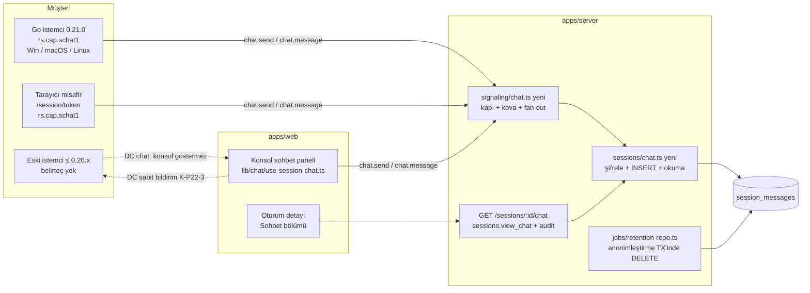

# Mimari — P22: Oturum sohbeti her zaman saklanır + KVKK bilgilendirme (sunucu aktarımlı WS sohbeti)

Tarih: 2026-11-17 · Durum: **r2** (mimar; P22-0 güvenlik tasarım turu S-P22-1..11 işlendi — §15; r1 → r2 özeti aşağıda) · Gereksinim: `docs/gereksinimler-kabul-kriterleri-e11-b.md`
AC-264, AC-291, AC-292 (+ AC-255 talep mesajlarının saklama/görüntüleme kuralı, AC-287..290 ortak) · `docs/gereksinimler-e11.md` S25, R27 ·
Bağlam: `docs/mimari-e11.md` §8b (P18: `session_messages`, tetikleyici, grants, retention, `/ws/request` protokolü), §8b.11 P22 notu,
§10.4, K-P18-2/8/11, K-P19-2, K-P20-1, "P28'in P21–P26'dan önce gelmesinin etkileri"; `docs/mimari-p28c.md` §4.5 (çoklu teknisyen sohbet
yayma — bu paketle sunucuya geçer), `docs/mimari-p28e.md` (onay ekranındaki kayıt rıza kutusu), `docs/mimari-p28d.md` (yetenek belirteci kalıbı) ·
ADR: **yeni ADR yok**; ADR-0025'e **r-P22 eki** (ADR-0040 boşta bırakıldı). Kontrol listesi: `docs/tasarim-kontrol.md` "P22".
Kullanıcı "sormadan ilerle" dedi: belirsizlikler en sade ve güvenli seçenekle **K-P22-n** kararı ya da **Varsayım (V-P22-n)** olarak yazıldı.

### r2 değişiklik özeti (2026-11-17; kaynak `docs/guvenlik-raporu.md` "P22-0", DÜZELTİLMELİ → işlendi)

| Bulgu               | r2 kararı (kısa)                                                                                                                                                                                                                      | Yer         | Paket      |
| ------------------- | ------------------------------------------------------------------------------------------------------------------------------------------------------------------------------------------------------------------------------------- | ----------- | ---------- |
| S-P22-1 (Yüksek)    | `chat.history` bayt bütçesi 48 KiB (`CHAT_HISTORY_MAX_BYTES`), `more:true`; **P18 `request.messages` (50 öğe) aynı açığı taşıyor — koddan doğrulandı**, aynı bütçe P22-B'ye eklendi                                                   | §4.2, §15.1 | C, B, G    |
| S-P22-2 (Orta)      | `/ws/tech` da `rs.cap.schat1` bildirir; bildirmeyen konsol soketi 4426 "Sayfayı yenileyin" ile reddedilir. Eski müşteri istemcisi = kabul edilmiş artık risk (ADR-0025 r2); asgari istemci politikası P22-G + 60 gün (Sonra, tarihli) | §4.1, §15.2 | C, B, F, O |
| S-P22-3 (Orta)      | Retention mesaj silme bütçesi `SESSION_MSG_DELETE_BUDGET = 20.000`: parti küçültülür (en az 1 oturum)                                                                                                                                 | §3.3, §15.3 | B, D       |
| S-P22-4 (Orta)      | `writeChatSummary(tx, sessionId)` DB `COUNT … GROUP BY` ile, oturumu bitiren **her** yolda; `session.chat_legacy` kabul anında                                                                                                        | §7.1, §15.4 | B          |
| S-P22-5 (Orta)      | K-P22-7 koşullu: katılım audit'ine `chatHistory:<n>`; geçmiş yalnız ACTIVE + koltuklu sokete; kılavuz cümlesi                                                                                                                         | §4.2, §15.5 | B, W       |
| S-P22-6 (Orta)      | Eski istemci bildirim metni düzeltildi; AC-291 paragrafındaki koşulsuz "uçtan uca devam eder" cümlesi koşullu yapıldı                                                                                                                 | §3.4, §4.4  | C, F       |
| S-P22-7..11 (Düşük) | `peer.schat`; `seatMay "chat.send": "talker"`; AAD v2 Sonra; yinelenende fan-out yok; detay uç netleştirmeleri; okuma AAD `requestId ?? sessionId`                                                                                    | §15.6       | C, B       |

**Bağlayıcı ilke — sadelik:** tek sohbet yolu. P22 sonrasında oturum sohbeti yalnız sinyalizasyon WS'inden geçer. Açılış yolu ne olursa olsun
(Go istemci, tarayıcı misafir) akış aynıdır: gönderen → sunucu (doğrula → şifrele → kaydet) → herkese ilet. DataChannel `chat` yeni
kodda yoktur. Eski istemcinin tek ayrıcalığı, sohbetin **kapalı** olduğunu söyleyen sabit bir bildirimdir (K-P22-3).

---

## 0. Mevcut durum (koddan doğrulandı, 2026-11-17, `main` 9b1db78)

| Konu                  | Gerçek                                                                                                                                                                                                                                                                   | Kaynak                                                                                                                                                               |
| --------------------- | ------------------------------------------------------------------------------------------------------------------------------------------------------------------------------------------------------------------------------------------------------------------------ | -------------------------------------------------------------------------------------------------------------------------------------------------------------------- |
| Oturum sohbeti        | DC `ctl` kanalında `chat {id, text ≤ 2000 UTF-16, ts, by?}`; sunucu görmez. P28c çoklu teknisyende **Go misafir yayar** (`by: tid`)                                                                                                                                      | `contracts/src/dc.ts` `chatSchema`, `CHAT_MAX_CHARS=2000`, `CHAT_SEND_PER_SEC=5`; Go `flow/peers.go` `onTechChat`/`relayChat`, `flow/session.go:314`, `dc/ctl.go:71` |
| Web sohbeti           | `lib/dc/chat.ts` (reducer), `lib/dc/use-collab.ts` (`sendChat`, `chatReady`), `components/collab/chat-panel.tsx` (konsol + misafir ortak), konsolda izleyiciye `readOnlyNote`                                                                                            | `apps/web`                                                                                                                                                           |
| `session_messages`    | P18'de **iki bağla** açıldı (`request_id` / `session_id` NULL'lanabilir; CHECK en az biri); `body_enc` VARBINARY(4200), `body_chars` 1..1000, `client_msg_id` ≤ 36; UQ yalnız (`request_id`,`sender`,`client_msg_id`); IX(`session_id`,`tenant_id`,`created_at`) **var** | `schema.prisma` `SessionMessage`, migration `20261119000000_p18_request_comms`                                                                                       |
| Silme kalkanı         | `session_messages_delete_guard`: dolu her üst bağ anonim **ya da** firmanın RUNNING silme işi. P22 değiştirmez                                                                                                                                                           | mimari-e11 §8b.1                                                                                                                                                     |
| Grants                | `app`: SELECT, INSERT, DELETE (UPDATE yok; rewrap yalnız migrator)                                                                                                                                                                                                       | `prisma/sql/grants.sql`                                                                                                                                              |
| AAD                   | `aadFor.sessionMessage(tenant, parentId, id)` = `session_messages.body:<tenant>\|<parent>\|<id>`; `cli crypto:rewrap` üst bağı `request_id ?? session_id` ile kurar → oturum satırları **hazır**                                                                         | `lib/crypto.ts:27`, `cli/crypto.ts:137`                                                                                                                              |
| Oturum anonimleştirme | `anonymizeSessionBatch`: çocukları siler/NULL'lar, **en son** `UPDATE support_sessions … anonymized_at` (koşullu). Mesaj silmesi **yok**                                                                                                                                 | `jobs/retention-repo.ts:50-88`                                                                                                                                       |
| Talep anonimleştirme  | UPDATE `anonymized_at` → **sonra** `sessionMessage.deleteMany({requestId})` (tetikleyici aynı TX'i görür)                                                                                                                                                                | `requests/repo-sweep.ts:86-90`                                                                                                                                       |
| Oturum satırı silme   | Yalnız `purgeAnonymized` (anonim + `PURGE_CUT`) ve firma silme (`MESSAGES` adımı). Tekil oturum hard-delete yolu **yok**                                                                                                                                                 | `retention-repo.ts:198`, `tenant-purge-repo.ts`                                                                                                                      |
| Aydınlatma metni      | `defaultConsentBody(tenantName)` sistem metni; seed yalnız **sistem** sürümünü (created_by NULL) günceller, Admin metnine dokunmaz; sürüm geçişi `publishConsentText`; eski sürümle join 400 (AC-127)                                                                    | `public/consent.ts`, `prisma/seed-consent.ts`, `settings/consent.ts`                                                                                                 |
| AC-292 satırı         | Yalnız P19 web talep formunda (`ChatRetentionNotice`, `WebFormInfo.chatRetentionDays`). Tarayıcı karşılama (`/session/<token>` `join-form.tsx`), Go karşılama ve Go talep formunda **yok**                                                                               | `apps/web/app/r/[ref]/chat-retention-notice.tsx`                                                                                                                     |
| Go talep sohbeti      | P20'den beri `/ws/request` `rs.cap.chat1` ile saklanan sohbet; Go talep formunda saklama satırı **yok** (açık; P22-G kapatır, K-P22-9)                                                                                                                                   | `internal/request/chat*.go`, `ui/reqform_windows.go`                                                                                                                 |
| Yetenek kalıbı        | `/ws/guest` `Sec-WebSocket-Protocol` belirteçleri (`rs.cap.clip1/print1/fsrv1/rec1/multi1/voice1`); `guestInboundSchemaFor` bit maskesi (son bit 32 = voice)                                                                                                             | `contracts/src/ws.ts`, `signaling/rooms-features.ts`                                                                                                                 |
| İstemci sürümü        | `main`: 0.19.0 (Windows + macOS). `p28g` dalı: **0.20.0** (Linux; UI paketi `internal/ui/gtk/`, henüz `main`'de değil)                                                                                                                                                   | `git show p28g:docs/mimari-p28g.md`                                                                                                                                  |

**Doküman/kod çelişkisi notu:** mimari-e11 §8b girişindeki "Tablo P22 yeniden migration gerektirmesin" hedefi tam tutmuyor: oturum satırları için
idempotency UQ'su yok (`request_id` NULL → mevcut UQ çakışmaz). P22-D küçük bir **ek indeks** migration'ı açar (§3.1). Tablo, tetikleyici,
grants ve sütunlar değişmez; hedefin özü (yeniden tasarım yok) korunur.

---

## 1. Özet ve kısıtlar

| Kapsamda                                                                                                                        | Kapsam dışı / Sonra (neden)                                                                                  |
| ------------------------------------------------------------------------------------------------------------------------------- | ------------------------------------------------------------------------------------------------------------ |
| Oturum sohbetinin `/ws/tech` + `/ws/guest` üzerinden sunucu aktarımı: önce kaydet, sonra ilet (AC-264, ADR-0025 m.1)            | Gözetimsiz (P27/P28u) odalarda sohbet: bugün de yok (yardımcı headless, `TechChat` boş); P22 açmaz (K-P22-8) |
| Alan şifreleme (mevcut AAD), append-only, oturum anonimleştirme TX'inde silme + sahte saatli entegrasyon testi                  | Sohbet içinde dosya/görsel, düzenleme/silme, okundu bilgisi, yazıyor göstergesi                              |
| Çoklu teknisyen (P28c): sunucu tüm teknisyenlere + misafire yayar; Go misafir yayması kaldırılır                                | Sohbetin CSV/webhook/e-posta ile dışa aktarımı (AC-270: webhook sohbet taşımaz)                              |
| Eski istemci tespiti (yetenek belirteci), iki tarafta "güncelleyin" metni, DC sohbetinin gösterilmemesi                         | Sohbet arama, tam metin indeks (şifreli alan)                                                                |
| Oturum detayında sohbet + bağlı talebin kabul öncesi yazışması: `sessions.view_chat` + `historyScope` + audit (AC-264, K-P18-2) | Oturuma dönüşmemiş kapalı talebin yazışmasını görüntüleme → Sonra (genişleme: aynı uç, §5.3)                 |
| Aydınlatma metni yeni sistem sürümü (seed) + Admin metni için uyarı bandı ve "Standart paragrafı ekle" (AC-291)                 | Sohbet saklamayı kapatma ayarı (S25: kapatılamaz)                                                            |
| Onay satırı: tarayıcı karşılama, Go karşılama (Win/macOS/Linux), Go talep formu (Win); satır yoksa düğme pasif (AC-292)         | Ayrı sohbet saklama süresi (oturum süresine bağlı, S25)                                                      |
| Go istemci 0.21.0 (P22-G): WS oturum sohbeti, DC `chat` kaldırma, onay satırları — **p28g `main`'e girdikten sonra**            | i18n (P23 kapsam dışı; metinler tek tabloda)                                                                 |

**Kısıtlar (değişmez):** görüntü, kontrol, P2P dosya, ses yolu değişmez (uçtan uca kalır). Yeni bağımlılık yok. Yeni env yok. Yeni tablo, sütun,
tetikleyici ve grant yok (yalnız bir UQ indeksi). Sunucu+web (P22-B/C/F) Go istemcisinden **bağımsız yayımlanabilir** (§10.2 geçiş kuralı).

## 2. Bileşenler ve akış



| Bileşen                                                  | Sorumluluk                                                                                                                                                                                                               |
| -------------------------------------------------------- | ------------------------------------------------------------------------------------------------------------------------------------------------------------------------------------------------------------------------ |
| `signaling/chat.ts` (yeni)                               | `chat.send` kapısı (oda ACTIVE, gönderen rolü, yetenek), hız/tavan kovaları, servis çağrısı, commit sonrası fan-out (tüm teknisyen soketleri + `hasSessionChat` misafir), `chat.history` gönderimi, eski istemci bayrağı |
| `sessions/chat.ts` (yeni)                                | Gövde normalizasyonu (contracts), şifreleme (`aadFor.sessionMessage(tenant, sessionId, id)`), koşullu INSERT, idempotent yanıt, okuma (çözme hatası → `body:null`), geçmiş ucu servis fonksiyonu                         |
| `signaling/rooms-features.ts`                            | `hasSessionChat(room, peer)` tek karar noktası                                                                                                                                                                           |
| `jobs/retention-repo.ts`                                 | `anonymizeSessionBatch` sonuna mesaj DELETE'i (§3.3)                                                                                                                                                                     |
| `sessions/history-chat.ts` (yeni) + `sessions/routes.ts` | `GET /sessions/:id/chat`                                                                                                                                                                                                 |
| `public/consent.ts`                                      | Yeni sistem metni paragrafı; resolve yanıtına `chatRetentionDays`                                                                                                                                                        |
| Web konsol / misafir / oturum detayı / aydınlatma ayarı  | §8                                                                                                                                                                                                                       |
| Go `signal`, `flow`, `dc`, `ui/*`                        | §9 (P22-G)                                                                                                                                                                                                               |

---

## 3. Veri modeli

### 3.1 Migration `<damga>_p22_session_chat` (tek değişiklik: UQ indeksi)

Damga: P21 (ADR-0039) P22'den önce uygulanır; P22 migration'ı `main`'deki son migration'dan (P21 dahil) **sonraki** damgayı alır (dba birleşme anında belirler).

| Değişiklik                                                                                               | Tip / kural                                                                                                                                                                                                                                                                                            | AC  |
| -------------------------------------------------------------------------------------------------------- | ------------------------------------------------------------------------------------------------------------------------------------------------------------------------------------------------------------------------------------------------------------------------------------------------------ | --- |
| `session_messages` += UQ `session_messages_session_client_key` (`session_id`, `sender`, `client_msg_id`) | Oturum mesajında yeniden gönderimde çift kayıt yok. `request_id` dolu satırlarda `session_id` NULL → çakışmaz (talep satırları etkilenmez). Oturum satırında `client_msg_id` **protokolde zorunlu** (§4) — DB'de NULL'lanabilir kalır (talep satırları ve geriye uyum). `ALGORITHM=INPLACE, LOCK=NONE` | 264 |
| Mevcut IX(`session_id`,`tenant_id`,`created_at`)                                                         | Değişmez; FK + geçmiş okuma + anonimleştirme DELETE'i bunu kullanır. Yeni UQ'nun öneki (`session_id`) aynı FK'yi de karşılayabilir ama IX kaldırılmaz (sıralı okuma `created_at` ister)                                                                                                                | 264 |
| Ön kontrol                                                                                               | `P22_PRECHECK dup_session_client=<n>`: aynı (`session_id`,`sender`,`client_msg_id`) çifti varsa (P22 öncesi oturum satırı olmadığı için 0 beklenir) migration durur                                                                                                                                    | —   |
| `down.sql`                                                                                               | Yalnız UQ DROP (veri silmez)                                                                                                                                                                                                                                                                           | —   |
| Tablo / sütun / CHECK / tetikleyici / grants                                                             | **Değişmez.** Tetikleyici sayısı aynı (`check-app-grants.sh`, `backup.sh` beklenen sayıları değişmez)                                                                                                                                                                                                  | —   |
| Prisma                                                                                                   | `@@unique([sessionId, sender, clientMsgId], map: "session_messages_session_client_key")`                                                                                                                                                                                                               | —   |

**TECH çakışması (çoklu teknisyen):** UQ `sender_user_id` içermez (CUSTOMER satırında NULL olduğundan UQ'yu bozardı). İki teknisyenin aynı
`clientMsgId`'yi üretmesi pratikte olmaz: istemci kimliği **≥ 16 karakter rastgele** (`clientMsgId` deseni oturum sohbetinde
`^[A-Za-z0-9_-]{16,36}$`, 96+ bit). Kasıtlı çakışma (teknisyen başkasının kimliğini tahmin edemez; kimlik yalnız yankıda sahibine ve
geçmişte görünmez — §4.2 `clientMsgId` yalnız sahibine döner) olsa bile sonuç yalnız saldırganın kendi mesajının `chat.rejected{invalid}`
almasıdır. Kural (`sessions/chat.ts`): UQ ihlali (P2002) → mevcut satırı oku; `sender_user_id` aynıysa idempotent yankı (yalnız gönderene),
farklıysa `chat.rejected{reason:"invalid"}`.

**Oturum satırının biçimi (bağlayıcı):** `session_id` dolu, **`request_id` NULL** (bağlı talep olsa bile). Kabul öncesi talep yazışması
kendi satırlarında (`request_id` dolu, `session_id` NULL) kalır; iki bağlı satır **üretilmez**. Böylece her satır yalnız kendi üst kaydının
anonimleşmesiyle silinir (talep ve oturum saklama sayaçları ayrı başlar).

### 3.2 Alanların oturum sohbetindeki anlamı

| Alan             | Değer                                                                                                     |
| ---------------- | --------------------------------------------------------------------------------------------------------- |
| `id`             | Sunucu ULID'i (ileti kimliği; istemciye `id`)                                                             |
| `tenant_id`      | Odanın tenant'ı (oda kurulurken DB'den; istemci göndermez)                                                |
| `session_id`     | Odanın oturum id'si                                                                                       |
| `sender`         | `TECH` (teknisyen soketi) / `CUSTOMER` (misafir soketi)                                                   |
| `sender_user_id` | TECH'te soketin kullanıcısı (Super Admin firma bağlamında dahil, S-P18-T5 kuralı aynen); CUSTOMER'da NULL |
| `client_msg_id`  | Gönderenin rastgele kimliği (zorunlu, ≥ 16)                                                               |
| `body_enc`       | AES-256-GCM, AAD `session_messages.body:<tenant>\|<session_id>\|<id>`                                     |
| `body_chars`     | 1..1000 kod noktası (normalize sonrası)                                                                   |
| `created_at`     | DB `CURRENT_TIMESTAMP(3)` değil, uygulama saati (mevcut P18 kalıbı; sahte saat testleri)                  |

### 3.3 Retention (ADR-0025 m.3; AC-264 "anonim oturumda sohbet satırı 0")

`anonymizeSessionBatch` TX'inde, mevcut `UPDATE support_sessions … anonymized_at = UTC_TIMESTAMP(3)` ifadesinden **sonra** (tetikleyici aynı
TX'teki `anonymized_at`'i görür; P18 `repo-sweep.ts:86-90` kalıbı):

```sql
DELETE m FROM session_messages m
  JOIN support_sessions s ON s.id = m.session_id AND s.tenant_id = m.tenant_id
 WHERE m.tenant_id = ? AND m.session_id IN (<parti>)
   AND s.anonymized_at IS NOT NULL
   AND m.request_id IS NULL
```

- Join koşulu, eşzamanlı başka tur yüzünden `UPDATE`'in atladığı (anonim olmayan) oturumların mesajına dokunmayı engeller; tetikleyici
  SIGNAL'i bütün partiyi geri almaz.
- `m.request_id IS NULL`: §3.1 gereği oturum satırlarında hep NULL'dır; koşul savunma amaçlıdır (iki bağlı eski satır olursa P18 kuralına bırakılır).
- Dönüş `SessionBatchResult.messages`; `retention.run` audit sayaçlarına `sessionMessages` ve metriğe `rs_retention_rows_total{kind="session_messages"}` eklenir.
- `purgeAnonymized` (P16) değişmez: anonim oturumda mesaj kalmadığından FK RESTRICT tetiklenmez; kalırsa `db_fk` alarmı (mevcut).
- Firma silme: mevcut `MESSAGES` adımı tenant'ın tüm `session_messages` satırlarını siler (değişmez).
- Etkin oturum anonimleşmez (`FINISHED_STATUSES`); sohbet yazımı ACTIVE ister → yarış yok.
- **Entegrasyon testi (sahte saat, `AC-264`):** tenant `retention_days=90`; oturum + 3 TECH + 2 CUSTOMER mesajı; saat +91 gün; `runRetention` →
  `support_sessions.anonymized_at` dolu ve `COUNT(*) FROM session_messages WHERE session_id = ?` = **0**; aynı partide anonimleşmeyen
  (ACTIVE) oturumun mesajları korunur; bağlı talebin mesajları talebin kendi süresine kadar kalır.

### 3.4 Aydınlatma metni yeni sistem sürümü (AC-291; migration değil, seed)

- `defaultConsentBody()` içine, "Ekranınız yalnız…" paragrafından sonra **tek kaynak sabit** `CHAT_CONSENT_PARAGRAPH`
  (`packages/contracts/src/chat.ts`; sunucu ve web aynı sabiti kullanır) eklenir. Metin (bağlayıcı, gün sayısı **gömülmez** — sha sabit kalsın,
  `retention_days` değişince yeni sürüm gerekmesin):

  > "Oturum ve destek talebi sırasında yazdığınız sohbet mesajları sunucularımız üzerinden iletilir ve sunucuda şifrelenerek saklanır. Sohbet
  > uçtan uca şifreli değildir: hizmeti veren sunucu mesaj içeriğini okuyabilir. Canlı ekran görüntüsü ve uzaktan kontrol uçtan uca şifreli
  > iletilir; doğrudan (eşler arası) dosya aktarımı da uçtan uca şifrelidir. Firma sunucu üzerinden dosya aktarımı ya da oturum kaydı
  > kullanıyorsa bu dosya ve kayıtlar sunucuda şifrelenerek saklanır (oturum kaydı yalnız ayrıca onay verirseniz yapılır). Sohbet mesajları firmanın oturum saklama süresi boyunca (süre gün olarak onay
  > ekranında yazılır) saklanır ve oturum kaydı anonimleştirilirken silinir; bu ayar kapatılamaz. Sohbete şifre veya kart bilgisi yazmayınız."

- Seed (`seedConsentTexts`) mevcut kuralıyla sistem metnini kullanan her tenant'a **yeni sürüm** yayımlar (max+1, eski `is_current=0`, audit
  `consent_text.created {source:"seed"}`). Yeni firma (P9) ilk sürümü zaten paragraflı alır.
- **Admin'in yazdığı metin (created_by dolu) — seed dokunmaz (K-P22-5):** `GET /settings/consent-text` yanıtına
  `chatParagraphMissing: boolean` eklenir = güncel gövde (NFC + boşluk tekleştirilmiş) `CHAT_CONSENT_PARAGRAPH`'ın anahtar cümlesini
  (`CHAT_CONSENT_KEY_SENTENCE` = "Sohbet uçtan uca şifreli değildir") içermiyor. Ayar ekranında uyarı bandı + **"Standart sohbet paragrafını ekle"**
  düğmesi (metin alanının sonuna sabiti ekler; kaydetme Admin'in işidir → yeni sürüm). Ayrıca panelde Admin'e (settings.edit) tek seferlik
  bilgi: genel ayar sayfası üstünde aynı bant (kapatılamaz; paragraf eklenince kalkar). Runbook: yayından sonra
  `SELECT tenant_id FROM consent_texts WHERE is_current=1 AND created_by IS NOT NULL` listesindeki firmalara bildirim.
- **AC-127 etkisi:** yeni sürüm yayımlandığı anda eski sürümle açık karşılama sayfaları join'de 400 alır (mevcut davranış; sayfa yeniden yüklenince
  güncel metin gelir). Runbook yayın notu: seed'i düşük trafik anında çalıştır.
- **Doğruluk notu:** mevcut sistem metnindeki "ekran görüntüsü veya video kaydı tutulmaz" cümlesi P28e (kayıt) ve P28b (sunucu dosyası) sonrası
  koşullu doğrudur; P22 bu cümleleri değiştirmez (kapsam dışı), **K-P22-11** ile teknik-yazar + proje-yöneticisine açık madde olarak bırakılır.

---

## 4. WS protokolü (`packages/contracts/src/ws-chat.ts` yeni yaprak modül; `docs/mimari-protokol.md` §5'e "P22 eki")

### 4.1 Yetenek bildirimi ve eski istemci tespiti

- **Belirteç:** `WS_CAP_SCHAT = "rs.cap.schat1"` (oturum sohbeti; `/ws/request`'teki `rs.cap.chat1`'den **ayrı** — o talep sohbetidir).
  `/ws/guest` `Sec-WebSocket-Protocol` listesine eklenir; sunucu yanıtı yine yalnız `rs.v1` (G-10: Caddy loglamaz).
- **Tarayıcı misafir de belirteci açıkça bildirir** (`hasVoice`'taki "BROWSER = destekli" kısayolu burada **kullanılmaz**): yayından önce
  açılmış eski sekme DC ile yazmaya devam eder, onu yeni sanmak saklanmayan sohbete yol açar. Yeni web derlemesi belirteci her zaman gönderir.
- **Tek karar noktası:** `hasSessionChat(room, peer) = !room.unattended && peer?.schat === true` (r2, S-P22-7: `ws-auth` belirteçten `peer.schat` atar, `voiceOf` kalıbı; tarayıcı istisnası yok — K-P22-10).
- **Teknisyene bildirim:** `hello` ve `peer.joined{role:"guest"}` += `guestChat: "on" | "outdated"` (alan yok = kabul edilmiş misafir yok
  ya da gözetimsiz oda → konsol sohbet sekmesini bugünkü gözetimsiz davranışıyla gizler). Kısa kopuklukta son değer odada tutulur
  (`room.chat.guestChat`, `guestVoice` kalıbı).
- **Misafire giden `hello`'ya alan eklenmez** (Go ≤ 0.20 katı ayrıştırıcı reddeder). Yeni misafir sohbeti ancak sunucudan
  `chat.state{enabled:true}` alınca açar; almadıysa (eski sunucu) sohbet bölümü "Sohbet kullanılamıyor" der (K-P22-10).
- **Teknisyen soketi** (`/ws/tech`) belirteç bildirmez: konsol sunucuyla aynı yayından gelir. Eski konsol sekmesi (yayından önce açık)
  yeni `chat.*` tiplerini `parseServer` → null ile düşürür, DC ile yazmaya çalışır; yeni misafir DC `chat`'i göstermez (§9) → kısa bozulma,
  sayfa yenilenince düzelir (P18 `request.new` kalıbı).

### 4.2 Mesajlar (hepsi `z.strictObject`; yalnız ilgili sokette şemada — S-P18-T1 kalıbı)

| Yön                                      | Mesaj                                                                                                 | Kural                                                                                                                                                                                                                                                                                                                                                                                                                                                               |
| ---------------------------------------- | ----------------------------------------------------------------------------------------------------- | ------------------------------------------------------------------------------------------------------------------------------------------------------------------------------------------------------------------------------------------------------------------------------------------------------------------------------------------------------------------------------------------------------------------------------------------------------------------- |
| teknisyen → sunucu                       | `{t:"chat.send", clientMsgId, body}`                                                                  | `/ws/tech` şemasında **her zaman**. Rol kapısı `seatMay` `"chat.send": "talker"` (r2, S-P22-8; meta-test anahtar kümesi) = sahip + izleyici olmayan; observer → `chat.rejected{forbidden}` — genel `roleDenied` `error{FORBIDDEN}` yerine `chat.send` için özel dal, soket açık (bugünkü `readOnlyNote` davranışının sunucu karşılığı). Oda ACTIVE ve gözetimsiz değil                                                                                              |
| misafir → sunucu                         | `{t:"chat.send", clientMsgId, body}`                                                                  | `guestInboundSchemaFor(…, schat=true)` (**bit 64**) yalnız `hasSessionChat` sokette; aksi şema dışı → 1008 (satır 0). Yalnız kabul edilmiş misafir (`room.admitted.peer === peer`), oda ACTIVE                                                                                                                                                                                                                                                                      |
| sunucu → teknisyenler + `schat1` misafir | `{t:"chat.message", id, sender:"TECH"\|"CUSTOMER", tid?, senderName?, body, createdAt, clientMsgId?}` | `tid` + `senderName` yalnız TECH'te (`senderName` = kullanıcı `fullName`, `Display` süzgeci, ≤ 100). CUSTOMER'da ad yok (konsol `guestName`'den çözer). **`clientMsgId` yalnız gönderenin kendi soketine** giden kopyada (yankı = onay); diğerlerinde yok                                                                                                                                                                                                           |
| sunucu → aynı                            | `{t:"chat.history", items:[chat.message gövdesi (clientMsgId'siz)][≤ 100], more:boolean}`             | Soket `hello` sonrası (ilk bağlanma, yeniden bağlanma, sonradan katılan teknisyen/izleyici) son **≤ 100 mesaj ve serileştirilmiş çerçeve ≤ `CHAT_HISTORY_MAX_BYTES` (48 KiB)** — en yeniden geriye eklenir, sığmayan için `more:true` (r2, S-P22-1: Go okuma sınırı 64 KiB). Yalnız oda ACTIVE iken ve yalnız koltuğu olan teknisyen soketine (r2, S-P22-5), artan. `more=true` ise konsol "Daha eski mesajlar oturum geçmişinde" der (canlı ekranda sayfalama yok) |
| sunucu → teknisyenler + `schat1` misafir | `{t:"chat.state", enabled:boolean, reason?:"not_active"\|"ended"}`                                    | Misafire kabulde `true`; oturum bitince `false`. Teknisyene `hello` ile birlikte de gider                                                                                                                                                                                                                                                                                                                                                                           |
| sunucu → gönderen                        | `{t:"chat.rejected", clientMsgId, reason}`                                                            | `reason ∈ {rate, cap, invalid, forbidden, not_active, outdated, internal}`. Soket **kapanmaz** (şema dışı hariç)                                                                                                                                                                                                                                                                                                                                                    |

`body` şeması: P18 `requestMessageBodySchema` **aynen yeniden kullanılır** (`contracts/api/requests.ts`'ten `contracts/src/chat.ts`'e taşınır,
iki yer aynı sabite bağlanır): NFC + trim, 1..**1000** kod noktası, `isWellFormed()`, Cc/Cf yasak (`\n` serbest; ZWJ/VS16 istisnası), U+2028/2029 ret,
≤ 20 satır. Alan adı `body` kalır → logger `*.body` redaksiyonu kapsar (S-P18-T9). `clientMsgId` `^[A-Za-z0-9_-]{16,36}$`.

**Sınır değişimi (K-P22-2):** DC sohbetinin 2.000 UTF-16 sınırı 1.000 kod noktasına iner (DB `body_chars` ve `body_enc` boyu; talep sohbetiyle aynı).
Web giriş alanı sayacı 1.000'de durur; Go istemci aynı.

### 4.3 İşleyici sözleşmesi (bağlayıcı; `signaling/chat.ts`)

Sıra: mevcut genel soket kovası → JSON → şema (sokete göre) → `switch(msg.t)` → **sohbet kapısı**:

1. Oda/rol: ACTIVE değil → `not_active`; gözetimsiz → `forbidden`; teknisyen observer → `forbidden`; misafir kabul edilmemiş → `forbidden`;
   **kabul edilmiş misafir `hasSessionChat` değil (eski istemci; kısa kopuklukta son değer `room.chat.guestChat = "outdated"`) → teknisyen
   `chat.send`'i `outdated` ile reddedilir, satır 0** (AC-264 "iki tarafta da kapalı" sunucuda zorlanır; çoklu teknisyende de saklanmaz/yayılmaz).
   Misafir hiç kabul edilmemişken (lobi) teknisyen yazamaz (`not_active`).
2. Kovalar (bellek, `lib/rate.ts`):
   - gönderen başına **5 mesaj / kayan 1 sn** (`CHAT_SEND_PER_SEC`, ADR-0025 "5/sn"; gönderen = `tid` ya da misafir) → `rate`;
   - oturum başına gönderen tavanı **TECH kullanıcı başına 2.000, CUSTOMER 2.000** (oda belleğinde sayaç; oda ilk sohbette DB'den
     `COUNT` ile tohumlanır) → `cap` (audit pencere başına 1);
   - firma başına müşteri sohbet kovası **600/dk** (talep kovasından ayrı anahtar; aşımda panellere mevcut `queue.alert{kind:"rate_limited"}`) → `rate`.
3. `sessions/chat.ts` `storeChat()`: gövde normalize → id üret → şifrele → **koşullu INSERT** (`INSERT … SELECT … FROM support_sessions WHERE id=? AND tenant_id=? AND status='ACTIVE'`;
   0 satır → `not_active`) → UQ ihlali → §3.1 idempotent kural.
4. **Commit sonrası** fan-out: tüm teknisyen soketleri (izleyici dahil) + `hasSessionChat` misafir. INSERT hatası → **iletim yok**, `chat.rejected{internal}`, log (gövdesiz: `sessionId`, `chars`, hata kodu).
5. Sayaç/metrik artışı.

**Sıra garantisi:** mesajlar sunucuya varış sırasıyla saklanır ve yayılır (tek instance, ADR-0005; oda başına `chain` promise ile seri işlenir —
INSERT süresi farklı olsa da yayın sırası saklama sırasıdır). `createdAt` monoton değilse istemci `id` (ULID) ile sıralar.

**Kopuk alıcı:** misafir kısa kopukken yazılan teknisyen mesajı saklanır; yeniden bağlanınca `chat.history` ile gelir (istemci `id` ile tekilleştirir).

### 4.4 Eski istemci (AC-264) ve DC sohbetinin kaldırılması

| Durum                                               | Teknisyen konsolu                                                                                                                                                                                                                                                                                      | Müşteri                                                                                                                                                                                                                                                       |
| --------------------------------------------------- | ------------------------------------------------------------------------------------------------------------------------------------------------------------------------------------------------------------------------------------------------------------------------------------------------------ | ------------------------------------------------------------------------------------------------------------------------------------------------------------------------------------------------------------------------------------------------------------- |
| Misafir `schat1` + yeni sunucu                      | Sohbet açık (WS)                                                                                                                                                                                                                                                                                       | Sohbet açık (WS)                                                                                                                                                                                                                                              |
| Misafir belirteçsiz (Go ≤ 0.20.x)                   | Sohbet sekmesinde bilgi: **"Müşterinin istemcisi eski; sohbet için güncellemesi gerekir."** Giriş pasif. Gelen DC `chat` **gösterilmez**, sayılmaz                                                                                                                                                     | Konsol, kabulden sonra **bir kez** (ve her gelen DC `chat`'te en çok 60 sn'de bir) DC'den sabit bildirim gönderir (K-P22-3): **"Bu sürümde sohbet kapalıdır. Yazdıklarınız teknisyene gösterilmez ve kaydedilmez; lütfen sohbet için programı güncelleyin."** |
| Gözetimsiz oda                                      | **P22-F değişikliği:** bugün konsol sohbet sekmesi gözetimsizde de görünür (DC'ye yazar, yardımcı yok sayar — koddan doğrulandı: yalnız dosya `filesBlocked:"unattended"`). P22'de sohbet sekmesi gözetimsizde pasif + "Gözetimsiz bağlantıda sohbet yoktur" (dosya engeli kalıbı); sunucu `forbidden` | —                                                                                                                                                                                                                                                             |
| Yeni misafir, eski sunucu (P22-G önce yayımlanırsa) | —                                                                                                                                                                                                                                                                                                      | `chat.state` gelmez → "Sohbet şu an kullanılamıyor"; DC `chat` hiç gönderilmez/gösterilmez                                                                                                                                                                    |

**K-P22-3 gerekçesi:** eski ikili yeni bir metni ancak mevcut DC `chat` çerçevesiyle basabilir; başka kanal yok (`error` mesajı oturumu bitirme
yoluna girebilir). Bildirim **sabit sistem metnidir** (kişisel veri ve kullanıcı içeriği yok; `contracts/src/chat.ts` `LEGACY_CHAT_NOTICE`), saklanması
anlamsızdır ve ADR-0025'in "saklanmayan sohbet yok" kuralını delmez: müşterinin yazdıkları ne gösterilir ne saklanır. Çoklu teknisyende yalnız
**sahip** konsolu gönderir (tek bildirim). Konsol DC'den yalnız bu sabiti gönderebilir: gönderim fonksiyonu metin parametresi almaz.

**DC `chat` kaldırma:** web: `lib/dc/use-collab.ts` sohbet gönderimi ve `chatReducer` DC girişi kaldırılır; `ctl` ayrıştırıcısı `chat`'i tanımaya devam eder
yalnız (a) konsolda eski misafir tespiti ve bildirim tetiği, (b) **hiç gösterilmemek** için. Go (P22-G): `dc/ctl.go` izin tablosundan `chat` çıkar
(bilinmeyen tip → düşer, kanal kapanmaz — mevcut kural), `flow/peers.go` `onTechChat`/`relayChat`/`sendAll` sohbet yolu ve `flow/session.go:314`
gönderimi silinir. Eski konsolun DC'den gönderdiği sohbet yeni istemcide görünmez (konsol aynı yayında güncellenmiş olur).

### 4.5 Hata kodları ve sabitler (contracts)

- `ws-chat.ts`: `WS_CAP_SCHAT`, `CHAT_REJECT_REASONS`, `CHAT_HISTORY_MAX = 100`, `CHAT_HISTORY_MAX_BYTES = 49152` (r2), `SESSION_CHAT_CAP_PER_SENDER = 2000`,
  `SESSION_CHAT_TENANT_CUSTOMER_PER_MIN = 600`, `CHAT_CLIENT_MSG_ID_PATTERN`, şemalar (`techChatInbound`, `guestChatInbound`, `serverChatOutbound`),
  `helloChatFields = { guestChat: z.enum(["on","outdated"]).optional() }`.
- `chat.ts` (yeni, ortak): `chatBodySchema` (P18'den taşınır, `requestMessageBodySchema` yeniden-ihracı kalır), `CHAT_CONSENT_PARAGRAPH`,
  `CHAT_CONSENT_KEY_SENTENCE`, `CHAT_RETENTION_LINE(days)` = `"Sohbet mesajları kayıt altına alınır ve ${days} gün saklanır"`, `LEGACY_CHAT_NOTICE`.
- `dc.ts`: `CHAT_MAX_CHARS` ve `CHAT_SEND_PER_SEC` kalır (eski misafir tespiti ve kova); `chatSchema` yalnız tespit için, gönderen yok.
- `errors.ts`: yeni HTTP kodu yok.
- Ortak fikstür: `packages/contracts/fixtures/ws-session-chat.json` (`valid.*`, `invalid.*`, `constants`) — web ve Go testleri aynı dosyayı okur.

---

## 5. REST sözleşmesi

Zincir: `requireAuth` → `requirePerm` → `tenantScope`/`historyScope` → zod → servis. Kapsam dışı ya da yok → **404** (IDOR). `Cache-Control: no-store`.

### 5.1 Uçlar

| Uç                                                     | Yetki / hız                                                                                                            | Girdi                  | Çıktı                                                                                                                                                                                                                                                                                                                                                    | Hatalar                                                     | AC                 |
| ------------------------------------------------------ | ---------------------------------------------------------------------------------------------------------------------- | ---------------------- | -------------------------------------------------------------------------------------------------------------------------------------------------------------------------------------------------------------------------------------------------------------------------------------------------------------------------------------------------------- | ----------------------------------------------------------- | ------------------ |
| `GET /sessions/:id/chat?after=<ulid>` (yeni)           | `session_history.view` + **`sessions.view_chat`** (yeni) + `historyScope` (USER yalnız kendi oturumu); 60/dk/kullanıcı | `after` ULID opsiyonel | 200 `{request:{items, total}\|null, session:{items, more}}` — `items: [{id, sender, senderName\|null, body\|null, createdAt}]`; `request` = bağlı talebin kabul öncesi yazışması (talep yoksa ya da anonimse null/boş; `after` verildiyse null); `session.items` ≤ 200 artan, `more`                                                                     | 403 (yetki) · 404 (kapsam/yok/başka tenant) · 400 (`after`) | 264, 255 (K-P18-2) |
| `GET /sessions/:id/history` (mevcut)                   | değişmez                                                                                                               | —                      | += `chat: {count:number, legacy:boolean}` — `count` = `session_messages` COUNT (IX); `legacy` = oturumun `session.chat_summary` audit satırındaki `legacy` değeri (audit'ten türetme, `history-participants.ts` kalıbı; yeni sütun yok; satır yoksa false) — sayı yalnız `view_chat` sahibine; yetkisizde alan **yok** (sohbet varlığı yetkisize sızmaz) | —                                                           | 264                |
| `POST /public/sessions/resolve` (mevcut)               | değişmez                                                                                                               | —                      | += `chatRetentionDays: number` (`tenant_settings.retention_days`). Go gevşek ayrıştırır                                                                                                                                                                                                                                                                  | —                                                           | 292                |
| `GET /public/requests/tenant` (mevcut; Go talep formu) | değişmez                                                                                                               | —                      | += `chatRetentionDays`                                                                                                                                                                                                                                                                                                                                   | —                                                           | 292                |
| `GET /settings/consent-text` (mevcut)                  | değişmez                                                                                                               | —                      | += `chatParagraphMissing: boolean`, `chatParagraph: string` (sabit; düğme bunu ekler)                                                                                                                                                                                                                                                                    | —                                                           | 291                |

`body: null` → çözme hatası ("Mesaj okunamadı"; `rs_crypto_decrypt_failures_total{table="session_messages"}` artar, alarm mevcut).

### 5.2 Yetki (`permissions.ts` tek tanım)

- `sessions` actions += **`"view_chat"`**. Açıklama: "Oturum geçmişinde sohbet ve talep yazışmasını görüntüler (hassas — yalnız gerekene verin)."
  Rol varsayılanı standart: **ADMIN açık, USER kapalı**; toggle ekranda otomatik çıkar (AC-285); Admin sahip olmadığı yetkiyi veremez (mevcut test kalıbı).
- **AC-264 "User yalnız kendi oturumunda" yorumu (K-P22-4):** yetki USER'a verildiğinde `historyScope` onu kendi oturumlarıyla sınırlar (P28e
  `view_recording` kalıbı). Varsayılan kapalı olması proje standardıdır (User kapalı başlar); Admin açar.
- **Canlı oturumda** sohbet (konsol, `chat.history` dahil) yetki istemez: oturuma katılma hakkı (sahip, davetli, `sessions.supervise` ile izleyici)
  sohbeti görmeyi kapsar; audit'i oturum katılım audit'leri (mevcut `session.participant_join` / `session.supervise_join`) karşılar (K-P22-7).

### 5.3 Görüntüleme audit'i

- `session.chat_viewed` — `entity: support_sessions`, `entity_id: <oturum>`, `new_value: {messages:<n>, requestMessages:<m>}` (gövde yok).
  Yalnız `after` **verilmeyen** ilk çağrıda yazılır (sayfa açılışı); aynı kullanıcı + oturum için 10 dk içinde tekrar yazılmaz (bellek
  penceresi; metrik `rs_session_chat_reads_total` her çağrıda artar).
- Yetkisiz deneme (403) mevcut `auth.forbidden` yoluna düşer.
- **Genişleme noktası (Sonra):** oturuma dönüşmemiş kapalı talebin yazışması → `GET /support-requests/:id/messages` PENDING dışı durumda
  `sessions.view_chat` + `request.chat_viewed` audit ile açılır (aynı `sessions/chat.ts` okuma fonksiyonu).

---

## 6. Güvenlik tasarımı ve tehdit modeli eki (AC-290 tasarım turu girdisi)

| #        | Tehdit (STRIDE)                                                                                  | Kontrol                                                                                                                                                            | Test                                                                                                               |
| -------- | ------------------------------------------------------------------------------------------------ | ------------------------------------------------------------------------------------------------------------------------------------------------------------------ | ------------------------------------------------------------------------------------------------------------------ |
| T-P22-1  | Bilgi ifşası: sunucu sızıntısında sohbet okunur (R27)                                            | Alan şifreleme + anahtar halkası; `rewrap`/`check-retire` zaten oturum satırını kapsar (`cli/crypto.ts:137`); saklama süresiyle silme                              | DB'de `body_enc` düz metni içermez; AAD başka oturum id'siyle çözülmez                                             |
| T-P22-2  | Kurcalama: misafir/teknisyen başka oturuma yazar                                                 | Mesajda `sessionId`/`tenantId` **yok**; oda soketten türetilir; INSERT koşullu (ACTIVE + tenant)                                                                   | Başka odanın soketinden yazım imkânsız; şema ekstra alan → 1008                                                    |
| T-P22-3  | Kayıt atlatma (kanıt): taraf saklanmadan iletir                                                  | Tek yol sunucu; iletim commit sonrası; DC sohbeti gösterilmez (iki tarafta)                                                                                        | INSERT hatası enjekte → alıcıya 0 çerçeve; DC `chat` gönderen sahte misafir → konsolda 0 öğe                       |
| T-P22-4a | Eski istemcili odada teknisyenler arası saklanan "yan sohbet" (AC-264 iki tarafta kapalı ihlali) | Kapı `outdated` (§4.3 adım 1)                                                                                                                                      | Belirteçsiz misafirli odada teknisyen `chat.send` → `chat.rejected{outdated}`, satır 0, diğer teknisyene 0 çerçeve |
| T-P22-4  | Yetki yükseltme: izleyici yazar                                                                  | `seatMay` anahtarı `"chat.send": "talker"` sunucuda (r2, S-P22-8)                                                                                                  | Observer `chat.send` → `chat.rejected{forbidden}`, satır 0                                                         |
| T-P22-5  | Eski istemci düşürme (DoS): yeni tip eski Go'ya gider → 1008 → oturum kopar                      | Misafire yeni tipler yalnız `hasSessionChat`; hello'ya alan yok; tip düzeyinde ayrım (`sendGuestChat` yalnız belirteçli sokete)                                    | 0.19.0 fikstürüyle tam oturum: misafire `chat.*` 0 çerçeve, kopma 0                                                |
| T-P22-6  | DoS / hacim                                                                                      | 5/sn gönderen kovası, 2.000 tavan, 600/dk firma müşteri kovası, `WS_MAX_PAYLOAD` aynen, 1.000 kod noktası                                                          | Kova sınır testleri; tavan sonrası `cap`                                                                           |
| T-P22-7  | XSS / oltalama                                                                                   | Yalnız metin düğümü + `pre-wrap`, otomatik bağlantı yok; Go yalnız düz metin denetimi (AppKit veri algılama kapalı — S-P28f-12; GTK `gtk_label` markup **kapalı**) | `` gövdesi metin görünür (e2e + Go birim)                                                     |
| T-P22-8  | Bidi/görünmez karakter ile ad/mesaj aldatma                                                      | `chatBodySchema` Cf yasağı (S-P18-T8 aynen), `senderName` `Display` süzgeci                                                                                        | Fikstür `invalid.bidi*`                                                                                            |
| T-P22-9  | Log sızıntısı                                                                                    | Alan adı `body` (redakte); hata logu gövdesiz; audit'te gövde yok                                                                                                  | Log testi: hata yolunda gövde 0 kez                                                                                |
| T-P22-10 | IDOR (geçmiş)                                                                                    | `historyScope` + tenant'lı sorgu; yetkisizde `chat` alanı yok                                                                                                      | Başka tenant → 404; USER başkasının oturumu → 404                                                                  |
| T-P22-11 | Sabit bildirimin kötüye kullanımı (K-P22-3)                                                      | Gönderim fonksiyonu metin almaz; 60 sn'de en çok 1                                                                                                                 | Birim: fonksiyon imzası parametresiz; hız testi                                                                    |
| T-P22-12 | KVKK şeffaflık: müşteri saklandığını bilmeden yazar                                              | AC-292 satırı yoksa onay düğmesi pasif (3 yüzey + Go); aydınlatma paragrafı; eski istemcide sohbet kapalı                                                          | e2e + Go birim (§11)                                                                                               |
| T-P22-13 | Sürüm karışıklığı: yeni misafir eski sunucuda saklanmayan DC'ye düşer                            | Yeni istemci DC sohbeti hiç kullanmaz; `chat.state` yoksa kapalı                                                                                                   | Go birim: `chat.state` gelmeden giriş pasif                                                                        |

**Başlıklar / CSP:** değişmez (yalnız mevcut WS bağlantısı). **Hassas veri sınıfı:** sohbet gövdesi = kişisel veri (serbest metin), şifreli; sayaçlar ve audit
yalnız sayı taşır.

---

## 7. Audit ve metrikler

### 7.1 Audit (`contracts/audit.ts`; gövde ve PII yok)

| Eylem                           | entity / id                 | new_value                                                 | Ne zaman                                                                                                                                                              |
| ------------------------------- | --------------------------- | --------------------------------------------------------- | --------------------------------------------------------------------------------------------------------------------------------------------------------------------- |
| `session.chat_viewed`           | `support_sessions` / oturum | `{messages, requestMessages}`                             | §5.3                                                                                                                                                                  |
| `session.chat_summary`          | `support_sessions` / oturum | `{tech:<n>, customer:<m>, techUsers:<k>, legacy:boolean}` | Oturum bitişinde bir kez (mevcut `session.ended` yolunun yanında), mesaj varsa ya da odada eski istemci kabul edildiyse (`legacy` oturum detayı alanının tek kaynağı) |
| `session.chat_rejected`         | aynı                        | `{reason:"cap"\|"forbidden"\|"internal", sender}`         | Neden + gönderen başına oturumda 1 (pencere)                                                                                                                          |
| `consent_text.created` (mevcut) | `consent_texts`             | `{version, sha256, source:"seed"}`                        | Seed yeni sürüm                                                                                                                                                       |

**K-P22-6 — mesaj başına audit yok (P18 K-P18-11'den bilinçli sapma):** her mesaj zaten append-only, tetikleyiciyle korunan, gönderen
(`sender_user_id`) ve zaman damgalı bir kayıttır; ayrıca audit satırı yazmak oturum başına binlerce satır üretir (5/sn × taraf) ve audit tablosunu
içerik deposu gibi büyütür. Ortak standardın istediği "kim, ne zaman, ne" izi `session_messages` satırı + `session.chat_summary` ile karşılanır.
Talep mesajlarında P18 kuralı (mesaj başına audit) değişmez.

### 7.2 Metrikler (`ops/metrics.ts`)

`rs_session_chat_messages_total{sender}` · `rs_session_chat_rejected_total{reason}` · `rs_session_chat_legacy_sessions_total` (eski istemcili kabul) ·
`rs_session_chat_reads_total` · `rs_session_chat_store_seconds` (histogram; INSERT süresi) · `rs_retention_rows_total{kind="session_messages"}`.
Alarm: `rs_session_chat_rejected_total{reason="internal"}` 5 dk'da > 0 → remote-watch (mevcut kalıp); `rs_crypto_decrypt_failures_total` (mevcut).
`rs_session_chat_legacy_sessions_total` oranı P22-G yayınından sonra izlenir (güncelleme takibi, runbook).

---

## 8. Web (`apps/web`; DESIGN.md token'ları, `lucide-react`)

### 8.1 Konsol sohbet paneli (WS'e geçiş)

- Yeni `lib/chat/use-session-chat.ts`: sinyalizasyon istemcisinden `chat.message/history/state/rejected` okur, `chat.send` yazar.
  `clientMsgId` = `crypto.getRandomValues` 16 bayt base64url (22 karakter). İyimser öğe "gönderiliyor" (`LoaderCircle`); yankı gelince onaylı;
  `chat.rejected` → öğe "gönderilemedi" + "Tekrar dene" (aynı `clientMsgId` → idempotent). `rate` → mevcut "Çok hızlı yazıyorsunuz" `aria-live`.
- `lib/dc/chat.ts` reducer'ı modele taşınır (`id` = sunucu id'si, tekilleştirme `id` ile; `tid` → ad roster'dan, `senderName` yedek).
- `components/collab/chat-panel.tsx` prop'u `collab` yerine `chat: SessionChat` olur (konsol ve misafir aynı bileşen). Durumlar:
  bağlanıyor (iskelet), boş, dolu, hata (gönderim), **eski istemci** (`guestChat="outdated"`: `CircleAlert` + metin, giriş pasif),
  **kapalı** (`chat.state{enabled:false}`: salt okunur bant), izleyici (`readOnlyNote` aynen), `more=true` notu.
- Başlık altında kalıcı küçük not (`ShieldCheck`): "Sohbet kayıt altına alınır ve oturum saklama süresi boyunca saklanır." (teknisyen de bilir).
- Sayaç 1.000'de durur; `Enter` gönderir, `Shift+Enter` satır.
- Gözetimsiz oda: sohbet sekmesi pasif bilgi (`chatBlocked:"unattended"`, `filesBlocked` kalıbı), metin "Gözetimsiz bağlantıda sohbet yoktur".
- Eski misafir: `use-collab` DC `chat` gelişinde öğe eklemez; `legacyNotice()` (parametresiz) en çok 60 sn'de bir `LEGACY_CHAT_NOTICE` gönderir; yalnız sahip koltuğu.

### 8.2 Müşteri tarayıcı tarafı

- `/session/[token]` `join-form.tsx`: onay düğmesinin **hemen üstünde** `ChatRetentionNotice` (P19 bileşeni `components/kvkk/` altına taşınır,
  tek kaynak; `r/[ref]` aynı bileşeni kullanır) — `days = resolve.chatRetentionDays`. P28e kayıt rıza kutusu (varsa) satırın **üstünde** kalır;
  sıra: metin → kayıt kutusu → sohbet satırı → düğme. Satır render edilmeden (`days` sayı değil ya da < 1) düğme `disabled` (P19 kalıbı:
  düğme `aria-describedby` satırın id'sine bağlı; satır yoksa id yok → pasif).
- `lib/webrtc/use-guest-session.ts`: soket protokollerine `rs.cap.schat1`; `components/guest/guest-collab.tsx` sohbeti `use-session-chat` ile kurar.
  Misafir tarafı sohbet başlığında aynı `ChatRetentionNotice` tekrar (P19 bekleme sayfası kalıbı).
- DC `chat` gönderimi/gösterimi kaldırılır.

### 8.3 Oturum detayı (`app/(panel)/history/[id]`)

- Yeni `chat.tsx` bölümü ("Sohbet", `MessagesSquare`): yalnız `detail.chat` alanı varsa (yetki) görünür. Kapalı başlar: "Sohbeti göster
  (<n> mesaj)" düğmesi → `GET /sessions/:id/chat` (audit bu tıklamayla oluşur; sayfa açılışı audit üretmez). İki alt başlık:
  "Talep yazışması (kabul öncesi)" ve "Oturum sohbeti". `more` → "Daha fazla" (`after=`).
- 5 durum: yükleniyor (iskelet), boş ("Bu oturumda sohbet yok"), hata (yeniden dene), dolu, **eski istemci** (`legacy=true`: "Müşteri eski
  istemci kullandığı için bu oturumda sohbet kapalıydı"), anonim oturum ("Sohbet saklama süresi dolduğu için silindi").
- Mesaj `body:null` → "Mesaj okunamadı" (italik, `text-fg-muted`).

### 8.4 Aydınlatma metni ayarı (`settings/consent-text`)

- `chatParagraphMissing` → `Alert tone="warning"` "Metniniz sohbetin sunucuda saklandığını ve uçtan uca şifreli olmadığını belirtmiyor (KVKK).
  Standart paragrafı ekleyip kaydedin." + düğme "Standart sohbet paragrafını ekle" (`TextQuote`). Ekleme yalnız metin alanını değiştirir.
- Genel ayarlar sayfası üstünde aynı bant (yalnız `settings.edit`), paragraf eklenince kalkar.

Her yeni/değişen ekran: iki temada axe 0, 390 px taşma yok, `prefers-reduced-motion` (AC-287). Metinler `tr.json` anahtarları (AC-404 kalıbı).

---

## 9. Go istemci 0.21.0 (P22-G; Windows + macOS + Linux ortak paketler)

**Ön koşul:** `p28g` (Linux, 0.20.0) `main`'e birleşmiş olmalı; P22-G o `main`'den dallanır. Sürüm önerisi **0.21.0** (K-P22-1): p28g'nin
aldığı 0.20.0'dan sonraki minör; üç platform aynı numarayla yayımlanır (tek kod tabanı, PT-K4/K6).

| Dosya                                                                                                                                                                                                                                                                                                              | Değişiklik                                                                                                                                                                                                                                                                                                                                                        |
| ------------------------------------------------------------------------------------------------------------------------------------------------------------------------------------------------------------------------------------------------------------------------------------------------------------------ | ----------------------------------------------------------------------------------------------------------------------------------------------------------------------------------------------------------------------------------------------------------------------------------------------------------------------------------------------------------------- |
| `internal/signal/chat.go` (yeni) + `signal/clipprint.go` kalıbı                                                                                                                                                                                                                                                    | `FeatureSessionChat = "rs.cap.schat1"`; `/ws/guest` dial'ında protokole eklenir. Katı ayrıştırıcı: `chat.message`, `chat.history` (≤ 100), `chat.state`, `chat.rejected`; gönderim `chat.send{clientMsgId, body}`. Gövde kuralları fikstürden (`fixtures/ws-session-chat.json`) test edilir                                                                       |
| `internal/flow/chat.go` (yeni)                                                                                                                                                                                                                                                                                     | Oturum sohbeti durumu: `enabled` yalnız `chat.state{enabled:true}` sonrası; iyimser öğe + yankı eşleme (`clientMsgId` 16 bayt `crypto/rand` base64url); `rejected` → UI hata; `history` ile tekilleştirme (`id`); gönderen kovası 5/sn (sunucu sınırının aynası, aşımda UI "Çok hızlı")                                                                           |
| `internal/flow/peers.go`, `flow/session.go`, `flow/session_media.go`                                                                                                                                                                                                                                               | DC sohbet yolu silinir: `onTechChat`, `relayChat`, `sendAll` sohbet kullanımı, `case "chat"` dalları, `session.go:314` gönderimi. `ctlAllowed` `chat` dalı kalkar                                                                                                                                                                                                 |
| `internal/dc/ctl.go`                                                                                                                                                                                                                                                                                               | İzin tablosundan `"chat"` çıkar (bilinmeyen tip → düşür, kanal açık — mevcut kural); testler güncellenir                                                                                                                                                                                                                                                          |
| `internal/flow/messages.go`                                                                                                                                                                                                                                                                                        | Metinler: `ChatRetentionLine(days)`, "Sohbet şu an kullanılamıyor", "Gönderilemedi — tekrar deneyin", "Çok hızlı yazıyorsunuz", "Sohbet kayıt altına alınır" başlık notu (tek tablo; P23 kalıbı)                                                                                                                                                                  |
| `internal/ui/chat_windows.go`, `ui/mac/session_darwin.go` (+ `mac/logic.go`), `ui/gtk/…` (p28g'nin oturum penceresi)                                                                                                                                                                                               | Sohbet bölümü `flow/chat` modeline bağlanır; durumlar: kapalı, açık, gönderiliyor, gönderilemedi; düz metin (AppKit veri algılama kapalı, GTK markup kapalı)                                                                                                                                                                                                      |
| `internal/ui/welcome_windows.go` (aydınlatma metni + onay düğmesi; `consent_windows.go` ve `unattended/helper/consent_windows.go` **değil** — onlar izin diyaloglarıdır), `flow/flow.go` (resolve → `ConsentText` + `chatRetentionDays` aktarımı, `api/api.go` yanıt tipi), `ui/mac` karşılama, `ui/gtk` karşılama | Onay düğmesinin **hemen üstünde** `ChatRetentionLine(resolve.chatRetentionDays)`; kayıt rıza kutusu (P28e) satırın üstünde. **Kural `uicore`'da tek fonksiyon:** `ConsentReady(days int, lineDrawn bool) bool` = `days ≥ 1 && lineDrawn`; düğme yalnız true iken etkin. Alan yok/0 (eski sunucu) → düğme pasif + "Sunucu güncel değil; lütfen daha sonra deneyin" |
| `internal/ui/reqform_windows.go`, `internal/request/form.go`, `internal/api/requests.go` (`TenantRequestInfo` += `ChatRetentionDays`)                                                                                                                                                                              | Talep formunda gönder düğmesi üstünde aynı satır (`/public/requests/tenant` `chatRetentionDays`); talep sohbeti (P20) zaten saklanıyor → satır bu açığı kapatır (K-P22-9). Talep formu yalnız Windows'ta var (macOS/Linux'ta talep yok — P28f/P28g kapsam dışı)                                                                                                   |
| `internal/unattended/helper/headless.go`                                                                                                                                                                                                                                                                           | Değişmez (gözetimsizde sohbet yok)                                                                                                                                                                                                                                                                                                                                |
| iz testi (`trace-check.ps1`), tekrarlanabilir build (AC-289)                                                                                                                                                                                                                                                       | Yeni dosya/kayıt yok; iki build hash eşit                                                                                                                                                                                                                                                                                                                         |

**Birim testleri (Go):** fikstür geçerli/geçersiz; `chat.state` gelmeden giriş pasif; DC `chat` gelişi UI'ya 0 öğe; `ConsentReady` tablo testi
(days 0/eksik/90; line çizilmedi/çizildi); yankı eşleme + tekrar dene idempotent; GTK/AppKit/Win düz metin (`<b>` literal görünür).

---

## 10. Görev paketleri ve sıra

### 10.1 Paketler

| Paket      | Ajan                                          | İş                                                                                                                                                                                                                                                                                                                                                              | Bağımlı                                 | Paralel                                           | Kabul ölçütü (test adı AC no + T-P22-n taşır)                                                                                                                                 |
| ---------- | --------------------------------------------- | --------------------------------------------------------------------------------------------------------------------------------------------------------------------------------------------------------------------------------------------------------------------------------------------------------------------------------------------------------------- | --------------------------------------- | ------------------------------------------------- | ----------------------------------------------------------------------------------------------------------------------------------------------------------------------------- |
| **P22-0**  | guvenlik                                      | Tasarım güvenlik turu (§6 tehdit eki; AC-290 G7)                                                                                                                                                                                                                                                                                                                | bu doküman                              | —                                                 | Kritik/Yüksek 0 ya da r2 ile işlendi                                                                                                                                          |
| **P22-D**  | dba                                           | §3.1 migration (UQ + ön kontrol + down), Prisma, `db-notlari` "P22" (EXPLAIN: geçmiş okuma, anonimleştirme DELETE join'i)                                                                                                                                                                                                                                       | P22-0                                   | —                                                 | up/down/up temiz, drift 0; aynı (`session_id`,`sender`,`client_msg_id`) ikinci INSERT → 1062; talep satırları etkilenmez; tetikleyici sayısı değişmedi; check-app-grants PASS |
| **P22-C**  | backend-dev                                   | Contracts: `ws-chat.ts`, `chat.ts` (gövde şeması taşıma, sabitler, paragraf), `ws.ts` (bit 64, `helloChatFields`, outbound birlik), `permissions.ts` `view_chat`, `audit.ts`, `api/sessions.ts` (`chatRetentionDays`, `chat` özeti, chat uç tipleri), `api/system-settings.ts`, `api/requests.ts` (`chatRetentionDays`), fikstür                                | P22-0                                   | P22-D ile paralel                                 | Contracts birim: fikstür valid/invalid; eski misafir şemasında `chat.send` reddi; `PERMISSION_KEYS` içinde `sessions.view_chat`                                               |
| **P22-B**  | backend-dev                                   | `signaling/chat.ts`, `rooms-features.ts` `hasSessionChat`, handlers/active (hello/peer.joined `guestChat`, `chat.history`, `chat.state`), `sessions/chat.ts`, `sessions/history-chat.ts` + rota, history özeti, retention DELETE + sayaç, resolve/tenant `chatRetentionDays`, `consent.ts` paragraf + `chatParagraphMissing`, `session.chat_summary`, metrikler | P22-D, P22-C                            | —                                                 | §11 sunucu testleri (entegrasyon + sahte saat retention + eski istemci fikstürü)                                                                                              |
| **P22-F**  | frontend-dev                                  | §8 tamamı (gözetimsiz sohbet engeli dahil)                                                                                                                                                                                                                                                                                                                      | P22-C (P22-B ile paralel; sahte WS/API) | P22-B ile paralel                                 | §11 e2e; iki tema axe 0; 390 px                                                                                                                                               |
| **P22-O**  | devops                                        | Runbook "P22": seed yayını (düşük trafik, AC-127 etkisi), Admin metinli firmalar sorgusu, yeni alarm, `legacy` oranı izleme, geçiş kuralı §10.2                                                                                                                                                                                                                 | P22-B                                   | P22-F ile paralel                                 | Staging seed + alarm provası                                                                                                                                                  |
| **P22-Q**  | qa-denetci ‖ guvenlik                         | AC-264/291/292 (sunucu+web+tarayıcı), ortak 285–290; **Go maddeleri "P22-G'de" olarak işaretli**                                                                                                                                                                                                                                                                | P22-B, F, O                             | —                                                 | qa GEÇTİ (web/sunucu); güvenlik Kritik/Yüksek 0                                                                                                                               |
| **P22-T**  | test-operatoru                                | Staging: tarayıcı misafir ↔ konsol sohbet, çoklu teknisyen, izleyici, 0.19.0/0.20.0 istemciyle "güncelleyin" iki tarafta, oturum detayı + audit, aydınlatma bandı                                                                                                                                                                                               | P22-Q                                   | —                                                 | Test raporu                                                                                                                                                                   |
| **P22-W**  | teknik-yazar                                  | Kılavuz (sohbet saklanır, şifre yazmayın, oturum detayında sohbet, yetki, aydınlatma paragrafı), api.md, mimari-protokol §5 eki, CHANGELOG, DATASHEET (yalnız kodda olan), PDF                                                                                                                                                                                  | P22-T                                   | —                                                 | PDF'ler yeniden üretildi                                                                                                                                                      |
| **P22-G**  | backend-dev (Go)                              | §9 tamamı, istemci 0.21.0 (Win+macOS+Linux)                                                                                                                                                                                                                                                                                                                     | **p28g `main`'de** + P22-B `main`'de    | Bağımsız (sunucu/web yayınını beklemez/bloklamaz) | Go birim (§9); iz testi + tekrarlanabilir build (AC-289); staging'de üç platform elle: sohbet açık, DC yok, onay satırı                                                       |
| **P22-GQ** | qa ‖ guvenlik → test-operatoru → teknik-yazar | P22-G denetimi, istemci sürümü kılavuz/CHANGELOG/PDF                                                                                                                                                                                                                                                                                                            | P22-G                                   | —                                                 | qa GEÇTİ; Kritik/Yüksek 0                                                                                                                                                     |

**Sıra:** P22-0 → (P22-D ‖ P22-C) → (P22-B ‖ P22-F) → P22-O → P22-Q → P22-T → P22-W. **P22-G** en sonda ve ayrı dalda (`p22g`); kendi
denetim zinciri (P22-GQ) vardır.

### 10.2 Geçiş kuralı (sunucu+web P22-G'siz yayımlanabilir — K-P22-12)

- **Yeni sunucu + mevcut 0.19.x / 0.20.x istemci:** oturum sohbeti iki tarafta kapalı ("Müşterinin istemcisi eski…" / DC sabit bildirim
  "Sohbet için programı güncelleyin…"). Görüntü, kontrol, dosya, ses, kayıt etkilenmez; talep sohbeti (`/ws/request`) etkilenmez.
  **Kabul edilebilir** çünkü: (a) S25 saklanmayan sohbeti yasaklar, alternatif yok (ADR-0025 "geçiş için de değil"); (b) müşteri
  istemciyi çoğunlukla oturum başına karşılama sayfasından indirir → P22-G yayımlanınca yeni indirmeler hemen yeni sürümdür; (c) tarayıcı
  modu aynı anda tam çalışır, teknisyen müşteriyi tarayıcı moduna ya da telefona yönlendirebilir.
- **Önerilen yayın (bozulma süresini sıfıra yaklaştırmak için):** P22 sunucu+web staging'e bağımsız çıkar; **prod'a P22-G 0.21.0 ile aynı bakım
  penceresinde** çıkar. P22-G gecikirse prod yayını yine yapılabilir (yukarıdaki bozulma kabul edilir); runbook kararı yazar.
- **Kayıtlı/tepsi istemcileri (P20):** kendi kendini güncellemez; "güncelleyin" mesajı kullanıcıyı yeni indirmeye yönlendirir (kılavuz).
- **Yeni istemci + eski sunucu** (sıra bozulursa): onay düğmesi pasif (satır yok) → istemci kullanılamaz; bu yüzden P22-G **yalnız** P22-B
  `main`'deyken birleşir (paket bağımlılığı).
- **Talep formu satırı açığı (K-P22-9):** 0.12–0.20 Go istemcide talep sohbeti P20'den beri saklanıyor ama talep formunda AC-292 satırı yok;
  aydınlatma metninin yeni sürümü (P22-B seed) bu boşluğu metin düzeyinde hemen kapatır, satır P22-G ile gelir. Kabul edilen kısa açık.

---

## 11. Test stratejisi ve AC eşlemesi

| AC                                  | Bileşen / uç                              | Test (seviye)                                                                                                                                                                                                                                                                                                                                                                                                  |
| ----------------------------------- | ----------------------------------------- | -------------------------------------------------------------------------------------------------------------------------------------------------------------------------------------------------------------------------------------------------------------------------------------------------------------------------------------------------------------------------------------------------------------- |
| AC-264 sunucu aktarımı, önce kaydet | `signaling/chat.ts`, `sessions/chat.ts`   | Entegrasyon (gerçek MySQL, sahte WS istemcileri): teknisyen ↔ `schat1` misafir çift yön; INSERT hatası enjekte → alıcıda 0 çerçeve; idempotent tekrar (aynı `clientMsgId`) → 1 satır, yalnız gönderene yankı; observer → `forbidden`; ACTIVE dışı → `not_active`; kova 6. mesaj/sn → `rate`; 1.001 kod noktası → `invalid`; çoklu teknisyen: 3 teknisyen + misafir hepsi alır, `clientMsgId` yalnız gönderende |
| AC-264 alan şifreleme               | `sessions/chat.ts`                        | DB `body_enc` düz metni içermez; AAD'yi başka `session_id` ile çözme başarısız → `body:null` + metrik                                                                                                                                                                                                                                                                                                          |
| AC-264 görüntüleme + audit          | `GET /sessions/:id/chat`                  | Entegrasyon: yetkisiz 403; USER yetkili başkasının oturumu 404; başka tenant 404; ilk çağrı `session.chat_viewed`, 10 dk içinde ikinci yok, `after` çağrısı yok; history `chat` alanı yetkisizde yok                                                                                                                                                                                                           |
| AC-264 retention                    | `retention-repo.ts`                       | Entegrasyon **sahte saat** §3.3: anonim oturumda mesaj 0; ACTIVE oturum korunur; talep mesajları ayrı süre                                                                                                                                                                                                                                                                                                     |
| AC-264 eski istemci                 | `rooms-features.ts`, konsol               | Entegrasyon: 0.19.0 fikstürlü misafir tam oturum → misafire `chat.*` 0 çerçeve, kopma yok, teknisyene `guestChat:"outdated"`; teknisyen `chat.send` → `chat.rejected{outdated}`, `session_messages` satırı 0 (T-P22-4a). e2e (Playwright, sahte WS): konsolda "Müşterinin istemcisi eski…" + giriş pasif; sahte DC `chat` → panelde 0 öğe; sabit bildirim 1 kez gönderildi                                     |
| AC-264 (Go)                         | P22-G                                     | Go birim §9; staging elle üç platform                                                                                                                                                                                                                                                                                                                                                                          |
| AC-291                              | `consent.ts`, seed, ayar ekranı           | Entegrasyon: seed sistem metinli tenant'a v+1 (paragraf içerir: "uçtan uca şifreli değildir", "anonimleştirilirken silinir"); Admin metnine dokunmaz, `chatParagraphMissing=true`; eski sürüm id'siyle join 400 (AC-127). e2e: bant + "Standart paragrafı ekle" → kaydet → bant yok                                                                                                                            |
| AC-292 (web)                        | `join-form.tsx`, `r/[ref]`                | e2e: satır `"Sohbet mesajları kayıt altına alınır ve 90 gün saklanır"` düğmenin hemen önceki kardeşi (kayıt kutusu varsa ondan sonra); `chatRetentionDays` yok → düğme `disabled`                                                                                                                                                                                                                              |
| AC-292 (Go)                         | P22-G                                     | Go birim `ConsentReady` + karşılama/talep formu düzen testi (satır düğmenin üstünde)                                                                                                                                                                                                                                                                                                                           |
| AC-255 (K-P18-2 kapanışı)           | `GET /sessions/:id/chat` `request` bölümü | Entegrasyon: talepten doğan oturumda kabul öncesi mesajlar `request.items` içinde                                                                                                                                                                                                                                                                                                                              |
| AC-287..290                         | web, Go, paket                            | axe iki tema, 390 px; iz testi + build hash (P22-G); qa/güvenlik kapıları                                                                                                                                                                                                                                                                                                                                      |

Komutlar: `pnpm -r run test` · `pnpm --filter @remote/server test:integration` (mevcut entegrasyon hedefi) · `pnpm --filter @remote/web e2e` ·
Go: `go test ./...` (`apps/agent-win`, üç GOOS için CI matrisi mevcut).

## 12. Dosya planı

- **Sunucu:** `prisma/schema.prisma`, `prisma/migrations/<P21'den sonraki damga>_p22_session_chat/{migration.sql,down.sql}`;
  `src/signaling/{chat.ts (yeni), rooms-features.ts, handlers.ts, active.ts, types.ts, ws-auth.ts (belirteç), member-life.ts (bitişte özet)}`;
  `src/sessions/{chat.ts (yeni), history-chat.ts (yeni), history.ts, history-detail.ts, routes.ts}`; `src/jobs/{retention-repo.ts, retention.ts, retention-counts.ts}`;
  `src/public/{consent.ts, service.ts}`, `src/requests/public-routes.ts` (`chatRetentionDays`), `src/settings/consent.ts`; `src/ops/metrics.ts`.
- **Contracts:** `src/{ws-chat.ts (yeni), chat.ts (yeni), ws.ts, dc.ts (yorum), permissions.ts, audit.ts, labels.ts}`,
  `src/api/{sessions.ts, system-settings.ts, requests.ts}`, `fixtures/ws-session-chat.json` (yeni).
- **Web:** `lib/chat/use-session-chat.ts` (yeni), `lib/dc/{chat.ts, use-collab.ts, ctl.ts}`, `components/collab/chat-panel.tsx`,
  `components/kvkk/chat-retention-notice.tsx` (taşındı), `components/console/collab-side.tsx`, `components/guest/guest-collab.tsx`,
  `lib/webrtc/use-guest-session.ts`, `app/session/[token]/join-form.tsx`, `app/r/[ref]/*` (import yolu),
  `app/(panel)/sessions/[id]/console/console-view.tsx`, `app/(panel)/history/[id]/{chat.tsx (yeni), sections.tsx, page.tsx}`,
  `app/(panel)/settings/consent-text/*`, `app/(panel)/settings/general/*` (bant), `lib/i18n` `tr.json`, `e2e/p22-chat.spec.ts` + `mock-p22.mjs` (yeni).
- **Go (P22-G):** §9 tablosu.
- **Doküman:** `docs/mimari-protokol.md` (§5 P22 eki), `docs/db-notlari.md`, `docs/runbook.md`, `docs/api.md`, `docs/KULLANIM_KILAVUZU.md`,
  `CHANGELOG.md`, `docs/DATASHEET.md`, `docs/adr/0025-…` (r-P22 eki — bu turda yazıldı), `docs/mimari-e11.md` (§11 P22 satırına bu dosyaya bağlantı — teknik-yazar).

## 13. Operasyon

- Env: **yeni yok.** Config: `retention_days` mevcut.
- Migration: çevrimiçi (INPLACE, LOCK=NONE); rollback = `down.sql` (UQ DROP) + önceki imaj. Sunucu geri alınırsa yeni istemci (P22-G) satır
  bulamaz → onay pasif: P22-G yayımlandıysa sunucu geri alınmaz, ileri düzeltilir (runbook).
- Seed: `pnpm db:seed` (yeni aydınlatma sürümü) yayın adımı; düşük trafik.
- Yedek: yeni tablo yok; sohbet mevcut DB yedeğinde (şifreli). Geri yüklemede anahtar halkası gerekir (mevcut runbook §25).
- Log: gövde yok; `sessionId`, `chars`, `reason`.

## 14. Açık kararlar (mimar kararı; kullanıcı "sormadan ilerle" dedi)

| #        | Konu                                        | Karar                                                                                                                                           | Gerekçe                                                                                                                                                                                                                                                                                                                                                                                      |
| -------- | ------------------------------------------- | ----------------------------------------------------------------------------------------------------------------------------------------------- | -------------------------------------------------------------------------------------------------------------------------------------------------------------------------------------------------------------------------------------------------------------------------------------------------------------------------------------------------------------------------------------------- |
| K-P22-1  | İstemci sürümü                              | **0.21.0** (Win+macOS+Linux)                                                                                                                    | p28g 0.20.0; tek kod tabanı                                                                                                                                                                                                                                                                                                                                                                  |
| K-P22-2  | Mesaj sınırı                                | 2.000 UTF-16 → **1.000 kod noktası**, 5/sn/gönderen, gönderen başına 2.000/oturum, firma müşteri 600/dk                                         | DB `body_chars`/`body_enc` boyu, talep sohbetiyle tek şema; ADR-0025 5/sn                                                                                                                                                                                                                                                                                                                    |
| K-P22-3  | Eski istemcide müşteri metni                | Konsol DC'den **sabit** bildirim (parametresiz fonksiyon, 60 sn'de 1, yalnız sahip)                                                             | Eski ikilinin metin basabildiği tek yol; kullanıcı içeriği yok, saklama gerekmez                                                                                                                                                                                                                                                                                                             |
| K-P22-4  | "User yalnız kendi oturumunda"              | `sessions.view_chat` (ADMIN açık, USER kapalı) + `historyScope`                                                                                 | Proje standardı (User kapalı başlar; `roleDefaultGranted` rol geneli) + P28e `view_recording` kalıbı. **AC yorumu — proje-yöneticisi onayı gerekir:** AC-264 düz okunuşta User'ın kendi oturumunda varsayılan görmesini ima eder; onaylanmazsa alternatif: `view_chat` yalnız tenant geneli için, User kendi oturumunu `session_history.view` ile görür (tek satır `history-chat.ts` kapısı) |
| K-P22-5  | Admin'in yazdığı aydınlatma metni           | Seed dokunmaz; uyarı bandı + "Standart paragrafı ekle"                                                                                          | Admin içeriği ezilmez; tek tık düzeltme                                                                                                                                                                                                                                                                                                                                                      |
| K-P22-6  | Mesaj başına audit                          | **Yok**; `session.chat_summary` + görüntüleme/ret audit'i                                                                                       | Mesaj satırı append-only kayıttır; hacim. **Ortak standart §1.1 ve K-P18-11 emsalinden sapma — güvenlik tasarım turu (P22-0) onaylamalı;** onaylanmazsa mesaj başına `session.chat_message {sender, chars}` (gövdesiz) eklenir, şema değişmez                                                                                                                                                |
| K-P22-7  | Canlı oturumda geçmiş                       | Yetki istemez (katılım hakkı kapsar); **r2 (S-P22-5, koşullu onay):** katılım audit'ine `chatHistory:<n>`, yalnız koltuklu sokete, bayt bütçeli | Oturumdaki teknisyen konuşmanın tarafıdır; katılım zaten audit'li                                                                                                                                                                                                                                                                                                                            |
| K-P22-8  | Gözetimsiz oda                              | Sohbet yok (bugünkü gibi)                                                                                                                       | Yardımcı headless; yeni AC gerekir                                                                                                                                                                                                                                                                                                                                                           |
| K-P22-9  | Go talep formu satırı                       | P22-G'de; arada aydınlatma metni sürümü metinsel kapatır                                                                                        | Go değişikliği p28g'yi bekler                                                                                                                                                                                                                                                                                                                                                                |
| K-P22-10 | Tarayıcı belirteci                          | Tarayıcı da `rs.cap.schat1` bildirir (BROWSER kısayolu yok)                                                                                     | Yayından önce açık sekme DC'ye düşmesin                                                                                                                                                                                                                                                                                                                                                      |
| K-P22-11 | Aydınlatma metnindeki kayıt/dosya cümleleri | P22 değiştirmez; proje-yöneticisi + teknik-yazar için açık madde                                                                                | Kapsam dışı; P28b/P28e metin doğruluğu ayrı iş                                                                                                                                                                                                                                                                                                                                               |
| K-P22-12 | Sunucu+web'in P22-G'siz yayını              | İzinli; eski istemcide sohbet kapalı + "güncelleyin"; önerilen prod yayını P22-G ile aynı pencere                                               | S25; indirme-başına istemci; tarayıcı modu tam                                                                                                                                                                                                                                                                                                                                               |
| K-P22-13 | İki bağlı satır                             | Üretilmez; oturum satırında `request_id` NULL                                                                                                   | Her satır tek saklama sayacına bağlı; tetikleyici değişmez                                                                                                                                                                                                                                                                                                                                   |
| K-P22-14 | Kapalı talep (oturumsuz) yazışması          | Sonra; genişleme noktası §5.3                                                                                                                   | Ekran yok; sadelik                                                                                                                                                                                                                                                                                                                                                                           |

**Varsayımlar:** V-P22-1 tek instance (ADR-0005) — çok instance'ta fan-out Redis pub/sub arkasına (P18 notu). V-P22-2 Linux UI paketi p28g'de
`internal/ui/gtk/` adıyla gelir; farklıysa P22-G aynı rolü taşıyan dosyaya uygular.

---

## 15. r2 — P22-0 güvenlik tasarım turu işleme (2026-11-17; **bağlayıcı**, §1–§14 ile çelişkide bu bölüm geçerlidir)

Kaynak: `docs/guvenlik-raporu.md` "## P22-0" (Kritik 0 / Yüksek 1 / Orta 5 / Düşük 5). Bütün bulgular **kabul** edildi; reddedilen yok.
Testler adında `S-P22-n` taşır.

### 15.1 S-P22-1 (Yüksek) — bayt bütçeli geçmiş (+ P18 `request.messages`)

- **Koddan doğrulandı:** Go `/ws/guest` (`internal/signal/conn.go:20,92`) ve `/ws/request` (`internal/request/ws.go:24,247`) okuma sınırı 64 KiB.
  P18 `requests/messages.ts:386-389` `sendHistory` **son 50 mesajı tek çerçevede** gönderiyor; 50 × (≤ 4.000 bayt gövde + alanlar) ≈ 200+ KiB →
  bugün de uzun talep yazışmasında 0.12+ Go istemcisi yeniden bağlanmada kopar (talep iptali yoluna girebilir). **Mevcut hata; P22-B kapsamına eklendi.**
- **Kural (tek yardımcı, iki kullanım):** `apps/server/src/lib/ws-budget.ts` (yeni) `fitNewest(items, serialize, maxBytes)` — en yeni öğeden geriye,
  `Buffer.byteLength(JSON.stringify(frame))` toplamı ≤ `maxBytes` olana kadar ekler, artan sırayla döndürür, `more = kalan > 0`.
  - `chat.history`: `CHAT_HISTORY_MAX_BYTES = 49152` (contracts `ws-chat.ts`), en çok 100 öğe.
  - `request.messages`: `REQUEST_HISTORY_MAX_BYTES = 49152` (contracts `ws-request.ts`), en çok 50 öğe. Şema değişmez (`items.max(50)`);
    **`more` alanı eklenmez** (0.12–0.20 Go katı ayrıştırıcı reddeder) — sığmayan eski mesajlar istemcide görünmez; teknisyen paneli REST'ten tamamını görür. Kabul edilen kısıt (talep ≤ 120 dk, yazışma kısa).
  - Tek öğe üst sınırı: gövde ≤ 1.000 kod noktası → JSON'da ≤ ~4.300 bayt (emoji 4 bayt, `"`/`\` kaçışı 2 bayt, ≤ 20 `\n`) → bütçe en az ~11 öğe garantiler; tek `chat.message` çerçevesi her zaman < 64 KiB.
- **Testler:** 100 × 1.000 emoji (4 bayt) mesajlık oda → `chat.history` çerçevesi < 48 KiB, `more:true`; 50 × 1.000 emoji talep → `request.messages` < 48 KiB;
  Go fikstür testi (P22-G ve mevcut `internal/request` testi) 48 KiB çerçeveyi kopmadan okur; Go tarafında sınır **değiştirilmez**.

### 15.2 S-P22-2 (Orta) — eski konsol sekmesi kapısı + artık risk

- `/ws/tech` alt protokol listesine de `rs.cap.schat1` eklenir (yeni web derlemesi her zaman gönderir). Belirteç yoksa sunucu yükseltmeden sonra
  **4426** kapanış koduyla kapatır (`ws-auth.ts`, tek satır kapı; neden `console_outdated`); eski konsol "Konsol sürümü eski — sayfayı yenileyin" gösterir
  (eski sekme bilinmeyen kapanışta genel yeniden bağlanma hatasını gösterir; yenileme yeni derlemeyi getirir). Metrik `rs_ws_tech_outdated_total`.
- **Kabul edilmiş artık risk (ADR-0025 r2'ye yazıldı):** eski müşteri istemcisiyle (≤ 0.20.x) DC kanalı teknik olarak durur; teknisyen tarayıcı
  araçlarıyla kayıtsız DC `chat` gönderebilir. Sunucu DC'yi göremez. Telafi: oturum audit'inde `session.chat_legacy`, kılavuzda teknisyen davranış kuralı.
- **Kapatma yolu — asgari istemci politikası (K-P22-15, Sonra, tarihli):** P22-G 0.21.0 prod yayınından **60 gün sonra** `schat1` bildirmeyen
  AGENT misafiri kabul (admit) edilmez, "Programı güncelleyin" (mevcut sürüm kapısı kalıbı; env değil contracts sabiti `SESSION_CHAT_MIN_CLIENT`).
  Tarih runbook'a yayın günü yazılır; uygulama ayrı küçük paket (AC gerekir → proje-yöneticisi, `docs/gereksinimler.md` §9 Sonra).

### 15.3 S-P22-3 (Orta) — retention mesaj silme bütçesi

- `anonymizeSessionBatch` TX'ten **önce** aday oturumlar için `SELECT session_id, COUNT(*) FROM session_messages WHERE tenant_id=? AND session_id IN (…) GROUP BY session_id`
  (IX(`session_id`,`tenant_id`,`created_at`)). Aday listesi `created_at` sırasıyla, mesaj toplamı `SESSION_MSG_DELETE_BUDGET = 20_000`'i aşmayacak
  şekilde **kısaltılır**; en az 1 oturum her zaman alınır (tek oturum tasarım tavanı ≤ ~2.000 × (teknisyen + 1); MAX_TECHS ile ≤ ~10.000 satır güvenli).
- TX içindeki aday sorgusu aynı kısaltılmış id listesiyle sınırlanır (`id IN (…)` + mevcut koşullar). İş, firma için kalan aday bitene kadar mevcut döngüyle sürer.
- Retention TX hatası mevcut `retention` alarmına düşer (yol kapsanır; P22-O doğrular).
- **Test:** sahte saat; 1 oturumda 4.000 mesaj + 1.000 aday oturum → zaman aşımı yok, bütün adaylar anonim, `session_messages` 0, `retention.run`
  `sessionMessages` sayısı = silinen. dba: COUNT ve join'li DELETE EXPLAIN'i `db-notlari` "P22".

### 15.4 S-P22-4 (Orta) — dayanıklı özet; K-P22-6 onay koşulları

- `sessions/chat.ts` `writeChatSummary(tx, tenantId, sessionId)`: `SELECT sender, sender_user_id, COUNT(*) … GROUP BY sender, sender_user_id`
  ile **DB'den** sayar; audit `session.chat_summary {tech, customer, senderUserIds:[≤ 10], legacy}` (`techUsers` kaldırıldı). Mesaj yoksa ve `legacy`
  değilse yazılmaz.
- Oturumu ENDED/EXPIRED/CANCELLED yapan **her** yol bu fonksiyonu kendi TX'inde çağırır: oda bitişi (`rooms.finish`), yönetici sonlandırma,
  süre aşımı, yetim/başlangıç süpürücüsü. P22-B bu yolları kodda listeler (`implementation.md`) ve her biri için test yazar ("oda bellekteyken
  süreç yeniden başlatılır → süpürücü kapatır → özet var, sayılar = `COUNT(session_messages)`").
- `legacy` izi çökmeden etkilenmesin diye belirteçsiz AGENT misafiri **kabul edildiği anda** `session.chat_legacy` (gövdesiz, oturum başına 1) yazılır;
  `GET /sessions/:id/history` `chat.legacy` bu satırdan türetilir (özetten değil).
- K-P22-6 koşulları (P22-B kabul ölçütü): (a) yukarıdaki özet; (b) `session.chat_rejected` (cap/forbidden/internal/outdated) kalır;
  (c) mesaj satırına IP eklenmez (katılım audit'inde var); (d) `implementation.md`'de ortak standart §1.1 sapma gerekçesi tek paragraf;
  (e) bütünlük testi: özet = `COUNT`.

### 15.5 S-P22-5 (Orta) — K-P22-7 koşullu onay

- `chat.history` yalnız oda ACTIVE iken ve yalnız `seatOf(socket) ≠ null` teknisyen soketine (ve kabul edilmiş `schat1` misafire) gider; `tech.remove`
  ile çıkarılan teknisyenin yeniden bağlanması → `chat.history` 0 (test).
- İlk gönderimde mevcut `session.participant_join` / `session.supervise_join` audit'inin `new_value`'suna `chatHistory:<n>` (sayı, gövdesiz) eklenir;
  yeniden bağlanmada yeni satır yok. Sahip teknisyenin ilk bağlanmasında geçmiş zaten boştur.
- Kılavuz (P22-W): "Süpervizör ve davet edilen teknisyen katıldığı andan önceki sohbet mesajlarını görür."

### 15.6 Düşük bulgular ve rapor notları

| #                            | Karar                                                                                                                                                                                                                                                                                                                                                                                                                                                                                          |
| ---------------------------- | ---------------------------------------------------------------------------------------------------------------------------------------------------------------------------------------------------------------------------------------------------------------------------------------------------------------------------------------------------------------------------------------------------------------------------------------------------------------------------------------------- |
| S-P22-6                      | Bildirim metni: "Bu sürümde sohbet kapalıdır. Yazdıklarınız teknisyene gösterilmez ve kaydedilmez; lütfen sohbet için programı güncelleyin." (§4.4 güncellendi). AC-291 paragrafı: koşulsuz "uçtan uca devam eder" kaldırıldı; canlı görüntü/kontrol ve eşler arası dosya uçtan uca, sunucu dosyası ve kayıt kullanılıyorsa sunucuda şifreli saklama cümlesi (§3.4 güncellendi). Bu, K-P22-11'in sohbet paragrafı kısmını kapatır; eski "video kaydı tutulmaz" cümlesi açık madde olarak kalır |
| S-P22-7                      | `ws-auth` `peer.schat` atar; `hasSessionChat = !room.unattended && peer?.schat === true` (§4.1 güncellendi)                                                                                                                                                                                                                                                                                                                                                                                    |
| S-P22-8                      | `seatMay` anahtarı `"chat.send": "talker"`; işleyicide `chat.send` için rol reddi `chat.rejected{forbidden}` (soket açık), diğer tipler mevcut `error{FORBIDDEN}` (§4.2 güncellendi)                                                                                                                                                                                                                                                                                                           |
| S-P22-9                      | Sonra: AAD v2 `…\|<id>\|<sender>\|<sender_user_id\|"-">` yeni anahtar sürümüyle (rewrap aynı formül). ADR-0025 r2'de artık risk                                                                                                                                                                                                                                                                                                                                                                |
| S-P22-10                     | Yinelenen (`clientMsgId` UQ ihlali) gönderimde: fan-out yok, yankı yalnız gönderen sokete, metrik/sayaç/tavan artmaz; CUSTOMER'da `sender_user_id` NULL eşleşmesi aynı oturumun misafiri sayılır (gövde zaten geçmişte görünür; sızıntı yok). Test                                                                                                                                                                                                                                             |
| S-P22-11                     | `GET /sessions/:id/chat`: `request` bölümü sorgusu `tenantId` + `anonymizedAt: null` koşullu; `after` satırı `sessionId + tenantId` ile aranır, bulunmazsa yok sayılır (P18 `listRows` kalıbı). `session.chat_viewed` 10 dk penceresi yeniden başlamada sıfırlanır (kabul)                                                                                                                                                                                                                     |
| Okuma AAD                    | P18 `messages.ts` çözme `r.requestId ?? ""` kullanıyor; oturum satırını okuyan **her** kod `aadFor.sessionMessage(tenant, r.requestId ?? r.sessionId, id)` kullanır — tek yardımcı `sessions/chat.ts` `decryptRow` ve P18 `messages.ts` de ona geçer (P22-B). Test: oturum satırı `body ≠ null`                                                                                                                                                                                                |
| Onay satırı sunucu zorlaması | Gerekmez (rapor gerekçesi kabul): join/talep güncel `consentTextId` ister (AC-127), yeni sürüm paragrafı içerir. Sonra: join'de `chatRetentionDays` yankısı `session_consents`'e                                                                                                                                                                                                                                                                                                               |

### 15.7 Paket etkisi

| Paket | Ek iş (r2)                                                                                                                                                                                                                                                                                       |
| ----- | ------------------------------------------------------------------------------------------------------------------------------------------------------------------------------------------------------------------------------------------------------------------------------------------------ |
| P22-C | `CHAT_HISTORY_MAX_BYTES`, `REQUEST_HISTORY_MAX_BYTES`, `SESSION_CHAT_MIN_CLIENT` (yalnız sabit, Sonra için), `seatMay` `"chat.send"`, `CHAT_REJECT_REASONS` += `outdated`, `LEGACY_CHAT_NOTICE` yeni metin, `CHAT_CONSENT_PARAGRAPH` yeni metin, audit `session.chat_legacy`, kapanış kodu 4426  |
| P22-D | Retention COUNT + DELETE EXPLAIN (db-notlari)                                                                                                                                                                                                                                                    |
| P22-B | `lib/ws-budget.ts` + **P18 `request.messages` bütçesi (mevcut hata düzeltmesi)**; `/ws/tech` belirteç kapısı; retention bütçesi; `writeChatSummary` her bitiş yolunda + `session.chat_legacy`; `chatHistory:<n>` katılım audit'i; `decryptRow` (P18 dahil); yinelenen kuralı; uç netleştirmeleri |
| P22-F | Konsol soketi `rs.cap.schat1`; 4426 "sayfayı yenileyin" metni; yeni bildirim metni                                                                                                                                                                                                               |
| P22-O | Runbook: asgari istemci politikası tarihi (P22-G prod + 60 gün), `rs_ws_tech_outdated_total`, retention alarmının P22 yolunu kapsadığı                                                                                                                                                           |
| P22-W | Kılavuz: süpervizör/davetli önceki mesajları görür; teknisyen DC davranış kuralı                                                                                                                                                                                                                 |
| P22-G | Bütçeli `chat.history` fikstürü; okuma sınırı değişmez                                                                                                                                                                                                                                           |

### 15.8 Yeni / değişen kararlar

| #        | Konu                          | Karar                                                                                                                     |
| -------- | ----------------------------- | ------------------------------------------------------------------------------------------------------------------------- |
| K-P22-3  | Sabit DC bildirimi            | **Güvenlik onayı (koşullu) alındı**; metin S-P22-6; S-P22-2 (1) konsol kapısı + (2) asgari istemci politikası             |
| K-P22-6  | Mesaj başına audit yok        | **Güvenlik onayı (koşullu) alındı**; koşullar §15.4 (a)–(e)                                                               |
| K-P22-7  | Canlı geçmiş                  | Koşullu onay; §15.5                                                                                                       |
| K-P22-11 | Aydınlatma doğruluğu          | Sohbet paragrafı koşullu ifadeyle düzeltildi; "video kaydı tutulmaz" cümlesi açık madde (proje-yöneticisi + teknik-yazar) |
| K-P22-15 | Asgari istemci politikası     | P22-G prod + 60 gün sonra `schat1`'siz AGENT kabul edilmez; ayrı AC ile (Sonra, tarihli)                                  |
| K-P22-16 | P18 `request.messages` boyutu | Bayt bütçesi P22-B'de; şemaya `more` eklenmez (eski Go uyumu)                                                             |
