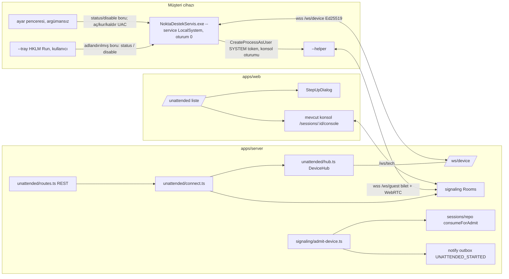

# Mimari — P27 Gözetimsiz erişim (ayrıntılı tasarım)

Tarih: 2026-11-15 · Durum: TASLAK (mimar; güvenlik tasarım turu bekler, AC-290) · Dal tabanı: PT sonrası (`pt-wip` → `main`)
Girdiler: `docs/mimari-e11.md` §10.1, §11, §11.1; ADR-0028, ADR-0022; AC-273..275, 293..297, ortak AC-285..290
(`docs/gereksinimler-kabul-kriterleri-e11-b.md`); PT sınırları (`docs/mimari-temizlik.md` §9, `docs/temizlik/PT-K10.md`,
`PT-K11.md` "P27/P28 için sınırlar"). Bu belge §10.1'i **ayrıntılandırır**, tekrarlamaz; çelişkide bu belge geçerlidir
(gerekçesi §9 K-P27-n'de).

**Bağlayıcı ilke — sadelik (kullanıcı kararı, 2026-11-15):** tek program, tek pencere, tek bağlantı yolu. Gözetimsiz
bağlantı yeni bir oturum türü icat etmez; bugünkü **talep oturumu (P8b ön-kabullü misafir)** kalıbının aynısıdır: sunucu
PENDING `support_sessions` satırı açar, cihazdaki yardımcı süreç bugünkü `/ws/guest` bilet yoluyla bağlanır, sunucu
otomatik kabul eder (`consumeForAdmit`), teknisyen bugünkü konsolu (`/sessions/:id/console`) kullanır. Yeni olan yalnız:
cihaz kaydı, kalıcı `/ws/device` kanalı, cihaz başına yetki, bildirim, yerel kapatma ve Windows servisi.

## 1. Kapsam ve kapsam dışı

**Kapsamda (P27):**

- Windows servis ikilisi `NoktaDestekServis.exe` (aynı Go modülü, ayrı `cmd/`), yönetici yetkisiyle kurulum + tek kullanımlık
  kayıt kodu (AC-273), servis + oturum içi yardımcı, kilit ekranı / UAC (Secure Desktop) görüntü ve girdi (AC-274),
  yeniden başlatma sonrası ≤ 2 dk çevrimiçi, "Uygulamalar"dan iz bırakmadan kaldırma (AC-274).
- Sunucu: cihaz/yetki/kayıt kodu/bildirim adresi tabloları, REST uçları, `/ws/device`, bağlantı ön koşul zinciri,
  step-up tüketimi, otomatik kabul, iptal ≤ 10 sn / yetki geri alma ≤ 5 sn / yerel kapatma ≤ 2 sn (AC-275, 293, 295).
- Bildirim: P19 `notification_outbox` yeni tür `UNATTENDED_STARTED` (e-posta; firmada açıksa SMS/WA) ≤ 60 sn (AC-296).
- Gösterge: tüm monitörlerde + kilit ekranında kapatılamayan şerit; çizilemezse bağlantı yok (AC-294).
- Prod kapısı (AC-297): imza beyanı + SHA-256 listesi; **SignPath bugün yok → prod'da özellik kapalı**, staging'de imzasız
  açık (K-P27-3).
- Web: "Gözetimsiz cihazlar" sayfası (liste, bağlan, cihaz ayrıntısı + teknisyen yetkileri, iptal), kayıt kodu üretimi,
  müşteri ayrıntısında bildirim adresleri; konsolda "Gözetimsiz" rozeti.
- Audit + cihaz Windows olay günlüğü (kaynak `NoktaDestek`), metrikler, runbook, iz testi, kılavuz (AC-288, 289).

**Kapsam dışı / Sonra (gerekçeli):**

| Konu                                                                              | Karar                                                                                                                                                        |
| --------------------------------------------------------------------------------- | ------------------------------------------------------------------------------------------------------------------------------------------------------------ |
| SignPath imzası, prod açılışı                                                     | Sonra (imza alınınca yalnız env değişir: `UNATTENDED_MODE=signed` + liste; kod değişmez). Prod'da P27 sonunda kapalı (AC-297 karşılanır: "imzasızsa kapalı") |
| RDP / çoklu kullanıcı oturumu (Terminal Server)                                   | Sonra: yalnız **fiziksel konsol oturumu** (`WTSGetActiveConsoleSessionId`). Sunucu işletim sistemlerinde RDP oturumuna bağlanma P28+                         |
| Kullanım sayımı (`billable_sessions`)                                             | P26 (§11.1): tek genişleme noktası `sessions/repo.ts consumeForAdmit`                                                                                        |
| Cihazdan teknisyene dosya çekme, uzaktan yeniden başlatma komutu, Wake-on-LAN     | Sonra (AC'de yok)                                                                                                                                            |
| Cihaz adını panelde değiştirme, cihaz grupları                                    | Sonra (genişleme: `unattended_devices.display_name` sütunu eklenir)                                                                                          |
| Oturum sırasında konsol oturumu değişirse (kullanıcı değiştirme) kesintisiz devam | Kapsam dışı: bağlantı `session_changed` ile biter, teknisyen yeniden bağlanır (sadelik)                                                                      |
| Yeniden başlatma sonrası **aynı oturumun** otomatik sürmesi                       | Kapsam dışı: cihaz ≤ 2 dk çevrimiçi olur (AC-274), teknisyen yeni bağlantı açar (yeni step-up — AC-273 bağlantı başına tüketim kuralı bunu zaten ister)      |
| Otomatik güncelleme                                                               | Sonra (P20 ile aynı: yeni sürüm elle kurulur; kurulum üzerine kurma kaydı korur §5.3)                                                                        |
| Çoklu teknisyen aynı cihazda                                                      | P28: oda modeli zaten "tek teknisyen"i sözleşmeye gömmez; cihaz başına tek etkin gözetimsiz oturum P27 kuralıdır (`DEVICE_BUSY`), P28'de gevşetilebilir      |

## 2. Bileşenler ve akış



**Bağlantı akışı (tek yol):**

1. Teknisyen listede "Bağlan" → step-up yoksa `StepUpDialog` (TOTP / kurtarma kodu) → `POST /unattended/devices/:id/connect`.
2. Sunucu ön koşul zincirini (§4.3) sırayla denetler; hepsi geçerse **tek TX**: teknisyen kilidi + açık oturum sınırı (mevcut
   `lockTechnician`/`countOpen`), PENDING `support_sessions` satırı (`device_id`, `customer_id` = cihazın müşterisi,
   `technician_id` = çağıran), step-up **tüketimi** (`auth_sessions.step_up_at = NULL`, koşullu UPDATE), audit
   `unattended.connect`. Commit sonrası: oda + `kind=UNATTENDED` biletli misafir (`rooms.tickets`), `/ws/device` üzerinden
   `connect{sessionId, ticket, techName, tenantName, techIp}`. Yanıt `{sessionId}` → web konsola gider.
3. Servis: yerel anahtar açık mı → yardımcıyı konsol oturumunda başlatır (bilet stdin borusuyla; komut satırında **yok**).
4. Yardımcı: göstergeyi tüm monitörlerde çizer ve doğrular (§5.5) → ancak sonra `/ws/guest` (bilet). Çizemezse `connect.result
{ok:false, reason:"indicator_failed"}` → sunucu oturumu `CANCELLED(indicator_failed)` yapar.
5. Sunucu `admitDeviceGuest` (yeni, `admitRequestGuest` eşi): teknisyen yetkisi + grant + cihaz durumu yeniden denetlenir →
   tek TX: `consumeForAdmit(mode='UNATTENDED')` + `session_consents` VIEW/GRANTED `source='UNATTENDED'` (metinsiz) + audit
   `unattended.session.started` + `notification_outbox` satırları. Commit sonrası mevcut `startActive`.
6. Kontrol: teknisyen bugünkü "Kontrol iste" düğmesini kullanır; yardımcı `control.request`'e kullanıcı arayüzü göstermeden
   `control.state{GRANTED, source:"UNATTENDED"}` döner (mevcut 800 ms fail-closed kayıt aynen). Dosya: teknisyenden cihaza,
   otomatik kabul, `%ProgramData%\NoktaDestek Servis\Gelen\` (§5.6).
7. Bitiş: mevcut `session.end` / süre sınırı (`maxActiveHours`) / iptal / grant geri alma / yerel kapatma → `session.ended`;
   yardımcı çıkar, servis `session.closed` bildirir.
8. Cihaz 60 sn (`timing.requestConnectMs`) içinde katılmazsa oturum `CANCELLED(device_timeout)`; konsol "Cihaz yanıt vermedi".

## 3. Veri modeli — migration `20261121000000_p27_unattended` (dba)

Tüm yeni tablolarda `tenant_id CHAR(26)` + `UQ(id, tenant_id)` (bileşik FK hedefi), `created_at`/`updated_at DATETIME(3)` UTC,
enum'lar ikili CHECK (ADR-0014), FK'ler `RESTRICT`. Tetikleyici **eklenmez** (`REMOTE_EXPECTED_TRIGGERS` değişmez).

### 3.1 `unattended_devices`

| Sütun                                       | Tip                                               | Not                                                                                           |
| ------------------------------------------- | ------------------------------------------------- | --------------------------------------------------------------------------------------------- |
| `id`                                        | CHAR(26) PK                                       | ULID; cihazın kimliği                                                                         |
| `tenant_id`                                 | CHAR(26)                                          | FK tenants                                                                                    |
| `customer_id`                               | CHAR(26) NOT NULL                                 | FK (tenant_id, customer_id) → customers; bildirim adresleri buradan (AC-296)                  |
| `name`                                      | VARCHAR(64)                                       | Windows bilgisayar adı (kayıtta beyan; kontrol karakteri yok CHECK)                           |
| `public_key`                                | VARBINARY(32) UQ                                  | Ed25519 açık anahtar (CHECK `LENGTH=32`)                                                      |
| `os_version`                                | VARCHAR(64)                                       | beyan                                                                                         |
| `agent_version`                             | VARCHAR(20)                                       | her `device.auth`'ta güncellenir (semver CHECK)                                               |
| `binary_sha256`                             | CHAR(64)                                          | her auth'ta güncellenir (küçük hex CHECK)                                                     |
| `signed`                                    | BOOLEAN                                           | WinVerifyTrust beyanı (AC-297, yalnız kullanılabilirlik kapısı)                               |
| `local_enabled`                             | BOOLEAN DEFAULT true                              | yalnız servisin beyanıyla güncellenir (AC-295); panelden değiştiren uç **yoktur**             |
| `last_seen_at`                              | DATETIME(3) NULL                                  | auth başarısı ve kopuşta (her ping'de değil)                                                  |
| `last_ip`                                   | VARCHAR(45) NULL                                  | son auth IP'si; anonimleştirme: iptalde NULL                                                  |
| `registered_by`                             | CHAR(26) NULL                                     | kodu üreten kullanıcı (FK users; P16 kullanıcı silmede NULL'lanır)                            |
| `revoked_at`, `revoked_by`, `revoke_reason` | DATETIME(3) NULL, CHAR(26) NULL, VARCHAR(20) NULL | `ADMIN` \| `UNINSTALLED` \| `CUSTOMER_PASSIVE`; CHECK: üçü birlikte (by yalnız ADMIN'de dolu) |

İndeks: `UQ(id, tenant_id)`, `IX(tenant_id, revoked_at, name)` (liste), `IX(tenant_id, customer_id, revoked_at)` (müşteri pasifi +
FK), `IX(revoked_at)` (temizlik), `IX(registered_by)`, `IX(revoked_by)`.

### 3.2 `unattended_device_grants` (AC-293; varsayılan boş)

`id CHAR(26) PK, tenant_id, device_id, user_id, created_by CHAR(26) NULL, created_at` — `UQ(device_id, user_id)`,
FK (device_id, tenant_id) → devices, FK user_id → users, `IX(tenant_id, user_id)`, `IX(created_by)`. Değişmez satır: verme
INSERT, geri alma DELETE (iz audit'te; `request_blocks` kalıbı). `updated_at` yok (append/delete tablo).
Tenant tutarlılığı: servis kullanıcının `tenant_id`'sini cihazınkiyle eşitler (Super Admin'e grant verilmez — rolü zaten
tenant dışı; K-P27-9).

### 3.3 `unattended_registration_codes` (AC-273)

`id, tenant_id, customer_id NOT NULL, code_hash CHAR(64) UQ (HMAC-SHA256, anahtar `lib/crypto` `macAt`, amaç
"unattended-code"), created_by CHAR(26) NULL, expires_at (created + 24 sa), used_at NULL, device_id NULL, created_at,
updated_at`. CHECK `(used_at IS NULL) = (device_id IS NULL)`. `IX(tenant_id, used_at, expires_at)`, `IX(expires_at)`.
Kod: 16 karakter Crockford base32 (80 bit), `XXXX-XXXX-XXXX-XXXX` gösterim; düz kod yalnız üretim yanıtında bir kez.

### 3.4 `customer_notify_contacts` (AC-296)

`id, tenant_id, customer_id, email VARCHAR(254) NOT NULL, phone VARCHAR(16) NULL (E.164), created_at, updated_at` —
`UQ(customer_id, tenant_id, email)` (+FK), en çok 5/müşteri (servis TX'te `SELECT … FOR UPDATE` sayım; DB'de tetikleyici yok).
Kişisel veri: müşteri anonimleştirmesinde (P13a/P16) **silinir**.

### 3.5 Mevcut tablolara ekler

- `support_sessions`: `device_id CHAR(26) NULL` (INSTANT) + FK (device_id, tenant_id) → unattended_devices + `IX(device_id,
tenant_id)`; `support_sessions_mode_chk` → `IN ('AGENT','BROWSER','UNATTENDED')`; yeni CHECK'ler
  `device_id IS NULL OR request_id IS NULL`, `device_id IS NULL OR mode IS NULL OR mode='UNATTENDED'`,
  `mode<>'UNATTENDED' OR device_id IS NOT NULL OR anonymized_at IS NOT NULL`. CHECK değişimi COPY ALTER — tek ALTER'da
  toplanır, süre `docs/db-notlari.md`'ye (P19 kalıbı). Anonimleştirme `device_id = NULL` yazar (cihaz satırı silinebilsin).
  `customer_name` = cihaz adı (geçmiş listesinde "kim" sütunu dolu; anonimleştirmede zaten NULL'lanır).
- `session_consents.source_chk` → `+ 'UNATTENDED'`.
- `notification_outbox`: `request_id` NULL'a açılır, `session_id CHAR(26) NULL` + FK (session_id, tenant_id) → support_sessions,
  CHECK `(request_id IS NULL) <> (session_id IS NULL)`, kind CHECK `+ 'UNATTENDED_STARTED'`, `UQ(session_id, tenant_id, kind,
channel)`. Mevcut satırlar request'li → geçer.
- `grants.sql`: `unattended_devices` SELECT/INSERT/UPDATE/DELETE; `unattended_device_grants` SELECT/INSERT/DELETE (UPDATE yok);
  `unattended_registration_codes` SELECT/INSERT/UPDATE/DELETE; `customer_notify_contacts` SELECT/INSERT/UPDATE/DELETE. Her
  birinde `REVOKE IF EXISTS ALTER, DROP, INDEX, TRIGGER, REFERENCES` (dosya kalıbı).
- `down.sql`: yeni tablolar düşer; outbox/consent/session CHECK'leri eski haline (UNATTENDED satır varsa ön kontrol uyarır —
  `precheck.sql` kalıbı).

### 3.6 Silme stratejisi

| Veri                  | Kural                                                                                                                                                                         |
| --------------------- | ----------------------------------------------------------------------------------------------------------------------------------------------------------------------------- |
| Cihaz                 | İptal = UPDATE (`revoked_*`, `last_ip=NULL`, grant'lar aynı TX'te DELETE). Gece işi: `revoked_at < now-30 g` ve kendisine bağlı `support_sessions` yoksa DELETE (≤ 500/parti) |
| Kayıt kodu            | Kullanılmış/süresi dolmuş + 7 g → DELETE (gece işi)                                                                                                                           |
| Bildirim adresleri    | Müşteri anonimleştirme TX'inde DELETE; panelden düzenleme = TX'te DELETE+INSERT                                                                                               |
| Firma silme (P16)     | `tenant-purge-parts.ts` adım listesine: contacts, codes, grants, devices (oturumlardan **önce** `device_id` NULL'lanır, sonra mevcut oturum adımı)                            |
| Kullanıcı silme (P16) | grant'ları DELETE; `registered_by`/`revoked_by`/`created_by` NULL                                                                                                             |
| Müşteri pasif         | cihazlar `CUSTOMER_PASSIVE` ile iptal + açık bağlantı kesilir (commit sonrası hub)                                                                                            |

## 4. API sözleşmesi ve protokol

zod şemaları tek kaynak: yeni `packages/contracts/src/api/unattended.ts` (REST) ve `packages/contracts/src/ws-device.ts`
(cihaz kanalı). Web `apps/web/lib/unattended/contract.ts` cephesinden alır (PT-D3 kalıbı). Hata zarfı, CSRF, `requireAuth`,
`tenantScope`, `requirePerm`, `requireStepUp` mevcut ortak altyapıdır; kopyalanmaz.

### 4.1 Yetki anahtarları (AC-285; tek tanım `packages/contracts/src/permissions.ts`)

```ts
// P27 (AC-273, 275, 293, 296): connect = yetkili olduğu cihaza bağlan (+ cihaz grant'ı + step-up); manage = tüm cihazları
// gör, kayıt kodu üret/iptal, teknisyen–cihaz yetkisi ver/al, cihazı iptal et, bildirim adreslerini düzenle.
{ key: "unattended", actions: ["connect", "manage"] },
```

`PERMISSION_DESCRIPTIONS` iki satır alır (toggle ekranı açıklaması). Rol varsayılanı değişmez (Admin açık, User kapalı); Admin'in
`connect`'i açık olsa da **cihaz grant'ı olmadan bağlanamaz** (AC-293 varsayılan kapalı grant'la karşılanır). Admin kendinde
olmayan yetkiyi veremez kuralı mevcut kullanıcı ucunda zaten uygulanır.

### 4.2 REST uçları (`/api/v1`)

| Uç                                                        | Yetki                                     | Girdi (zod)                                                                                                              | Çıktı                                                                                                                                    | Hatalar                                                                                                                      |
| --------------------------------------------------------- | ----------------------------------------- | ------------------------------------------------------------------------------------------------------------------------ | ---------------------------------------------------------------------------------------------------------------------------------------- | ---------------------------------------------------------------------------------------------------------------------------- |
| `GET /unattended/status`                                  | `connect` ∨ `manage`                      | —                                                                                                                        | `{ mode: "off"\|"unsigned"\|"signed", available: boolean }`                                                                              | —                                                                                                                            |
| `GET /unattended/devices`                                 | `connect` ∨ `manage`                      | `q?` (≤ 64), `customerId?`, `state?` (`online\|offline\|all`), `cursor?`, `limit` 1..100 (50)                            | `{ items: DeviceListItem[], nextCursor }`; `manage` yoksa **yalnız grant'lı cihazlar** (sorgu `EXISTS grant`)                            | 400                                                                                                                          |
| `GET /unattended/devices/:id`                             | `connect` (grant'lı) ∨ `manage`           | —                                                                                                                        | `DeviceDetail` (+ `grants: {userId, name, avatarUrl}[]` yalnız `manage`)                                                                 | 404 (yok/başka tenant/grant yok)                                                                                             |
| `PUT /unattended/devices/:id/grants`                      | `manage` + **step-up** (ekleme varsa)     | `{ userIds: ulid[] ≤ 200 }` (tam küme)                                                                                   | `{ grants }`                                                                                                                             | 400 (kullanıcı başka tenant/pasif/`connect` yetkisi yok → `fields.userIds`), 401 `MFA_STEP_UP_REQUIRED`, 404                 |
| `POST /unattended/devices/:id/revoke`                     | `manage`                                  | `{}`                                                                                                                     | 204                                                                                                                                      | 404, 409 (zaten iptal)                                                                                                       |
| `POST /unattended/devices/:id/connect`                    | `connect` + grant + **step-up tüketilir** | `{}`                                                                                                                     | `{ sessionId }`                                                                                                                          | §4.3 zinciri                                                                                                                 |
| `GET /unattended/registration-codes`                      | `manage`                                  | —                                                                                                                        | bekleyen kodlar `{id, customerId, customerName, createdBy, expiresAt}` (kod yok)                                                         | —                                                                                                                            |
| `POST /unattended/registration-codes`                     | `manage` + step-up                        | `{ customerId: ulid }`                                                                                                   | `{ id, code, expiresAt, downloadUrl }` (kod **bir kez**)                                                                                 | 404 müşteri, 409 `UNATTENDED_DISABLED`, 409 `NOTIFY_CONTACT_REQUIRED` (müşteride adres yoksa kod da üretilmez — erken uyarı) |
| `DELETE /unattended/registration-codes/:id`               | `manage`                                  | —                                                                                                                        | 204                                                                                                                                      | 404                                                                                                                          |
| `GET /unattended/customers/:customerId/contacts`          | `manage`                                  | —                                                                                                                        | `{ items: {email, phone?}[] }`                                                                                                           | 404                                                                                                                          |
| `PUT /unattended/customers/:customerId/contacts`          | `manage`                                  | `{ items: {email (notifyEmailKey normalize), phone? (E.164)}[] 0..5, tekil e-posta }`                                    | `{ items }`                                                                                                                              | 400, 404                                                                                                                     |
| `GET /unattended/download`                                | `manage`                                  | —                                                                                                                        | servis ikilisi (`AgentBinary` sınıfı yeniden kullanılır: `UNATTENDED_AGENT_PATH` + `UNATTENDED_AGENT_SHA256`, uyuşmazsa 503 fail-closed) | 503                                                                                                                          |
| `POST /unattended/register` (cihaz, çerezsiz, Origin'siz) | yok (kayıt kodu)                          | `{ code (normalize: tire/boşluk at, büyük harf), publicKey (b64url 32 bayt), name, osVersion, version, sha256, signed }` | `{ deviceId, tenantName, customerName }`                                                                                                 | 404 `REGISTRATION_CODE_INVALID` (yok/kullanılmış/süresi dolmuş — tek gövde), 409 `UNATTENDED_DISABLED`, 429                  |

- `DeviceListItem`: `{ id, name, customerId, customerName, online, localEnabled, signatureOk, lastSeenAt, lastSessionAt,
grantCount, canConnect }` — `canConnect` sunucu hesaplar (grant ∧ `connect` ∧ online ∧ localEnabled ∧ signatureOk ∧ adres var).
  Panel çevrimiçi durumunu **15 sn REST yoklamasıyla** tazeler (ADR-0029 kalıbı; panel için yeni WS yok).
- Hız sınırı (`lib/rate.ts`): `register` IP başına 10/sa + sistem geneli 100/sa; `connect` kullanıcı başına 20/sa; yanlış kayıt
  kodu IP başına 5 hatada 15 dk kilit.
- Grant ve kod üretimi step-up ister ama **tüketmez** (mevcut 5 dk penceresi); yalnız `connect` tüketir (AC-273).

### 4.3 Bağlantı ön koşul zinciri (`unattended/connect.ts`; ADR-0028 sırası, ilk başarısız olan döner)

| #   | Denetim                                                                                                                                                                                                                       | Hata                                                                            |
| --- | ----------------------------------------------------------------------------------------------------------------------------------------------------------------------------------------------------------------------------- | ------------------------------------------------------------------------------- |
| 1   | Oturum + tenant aktif (`requireAuth`, `tenantScope`)                                                                                                                                                                          | 401 / 403                                                                       |
| 2   | `unattended.connect`                                                                                                                                                                                                          | 403 `FORBIDDEN`                                                                 |
| 3   | Cihaz bu tenant'ta, iptal edilmemiş **ve** çağıranın grant'ı var                                                                                                                                                              | 404 `NOT_FOUND` (varlık sızmaz; `manage` sahibi de grant'sız 404 alır)          |
| 4   | Step-up **var** (son 5 dk; tüketim 10. adımda)                                                                                                                                                                                | 401 `MFA_STEP_UP_REQUIRED` / 403 `MFA_SETUP_REQUIRED`                           |
| 5   | `local_enabled = true` (son beyan)                                                                                                                                                                                            | 409 `DEVICE_LOCAL_DISABLED` ("Yerel olarak kapalı")                             |
| 6   | Müşteride ≥ 1 bildirim adresi                                                                                                                                                                                                 | 409 `NOTIFY_CONTACT_REQUIRED`                                                   |
| 7   | İmza kapısı (§4.5)                                                                                                                                                                                                            | 409 `UNATTENDED_DISABLED` ("Gözetimsiz erişim kod imzası olmadan kullanılamaz") |
| 8   | Cihaz hub'da bağlı                                                                                                                                                                                                            | 409 `DEVICE_OFFLINE`                                                            |
| 9   | Cihazda etkin/bekleyen gözetimsiz oturum yok                                                                                                                                                                                  | 409 `DEVICE_BUSY`                                                               |
| 10  | TX: `lockTechnician` + açık oturum sınırı → PENDING satır → step-up koşullu tüketim (`UPDATE auth_sessions SET step_up_at=NULL WHERE id=? AND revoked_at IS NULL AND step_up_at >= now-300s`, count≠1 → TX geri, 401) → audit | 409 `OPEN_SESSION_LIMIT`, 401 `MFA_STEP_UP_REQUIRED`                            |

Gerekçe (K-P27-5): step-up 4'te **denetlenir** ama en sonda **tüketilir** — cihaz çevrimdışı diye kullanıcının kodu boşa
gitmez; "bir doğrulama tek bağlantı" kuralı (AC-273 testi) yine de kesindir. Her ret audit `unattended.connect{result:fail,
reason}` (adım 3 dahil; kullanıcıya 404). Step-up tüketimi aynı oturumdaki diğer step-up korumalı işlemleri de yeniden kod
sormaya zorlar (kabul edilen yan etki, kılavuzda yazılır).

Yeni hata kodları (`packages/contracts/src/errors.ts`): `UNATTENDED_DISABLED` 409, `DEVICE_OFFLINE` 409, `DEVICE_BUSY` 409,
`DEVICE_LOCAL_DISABLED` 409, `NOTIFY_CONTACT_REQUIRED` 409, `REGISTRATION_CODE_INVALID` 404.

### 4.4 `/ws/device` protokolü (`packages/contracts/src/ws-device.ts`, `"v":1`)

Bağlantı: `wss://<host>/ws/device`, alt protokol `rs.device.v1`, sorgu dizesi yok (G-10), Origin başlığı **olmamalı**
(tarayıcıdan açılamaz; ADR-0012 kalıbı). Upgrade öncesi IP kovası (31/dk, 60 sn kilit — `techIp` kalıbı, ayrı kova).
Kimlik **bant içi meydan okuma** (K-P27-6): sunucu açılışta nonce gönderir; 10 sn içinde geçerli `device.auth` gelmezse
4401 ile kapanır. Kimliksiz soket hiçbir mesaj alamaz. Mesaj ≤ 4 KB; cihaz başına 5 mesaj/sn kovası.

| Yön   | Mesaj                                                                                                                                                                      | Anlam                                                                                                                             |
| ----- | -------------------------------------------------------------------------------------------------------------------------------------------------------------------------- | --------------------------------------------------------------------------------------------------------------------------------- |
| S → C | `device.hello{v, nonce (32 bayt b64url)}`                                                                                                                                  | açılış                                                                                                                            |
| C → S | `device.auth{deviceId, sig, version, sha256, signed, localEnabled, osVersion}`                                                                                             | `sig` = Ed25519(`"rs-device-auth-v1\n" + nonce + "\n" + deviceId + "\n" + PUBLIC_BASE_URL origin`)                                |
| S → C | `device.ready{tenantName, customerName}` / kapanış 4401 (imza/iptal/tenant pasif), 4403 (imza kapısı), 4409 (aynı cihaz yeniden bağlandı — eski soket kapanır, yeni kalır) | auth sonucu; başarıda `agent_version/sha/signed/local_enabled/last_seen_at/last_ip` güncellenir                                   |
| S → C | `connect{sessionId, ticket, techName, tenantName, techIp, expiresInSec}`                                                                                                   | bağlantı isteği (§2 adım 2)                                                                                                       |
| C → S | `connect.result{sessionId, ok, reason?}` (`local_disabled\|indicator_failed\|helper_failed\|no_console\|busy`)                                                             | `ok:false` → oturum `CANCELLED(<reason>)`, konsola `session.ended`                                                                |
| S → C | `disconnect{sessionId, reason}`                                                                                                                                            | sunucu tarafı bitiş (yedek yol; asıl bitiş yardımcının `/ws/guest`'ine `session.ended`)                                           |
| C → S | `device.state{localEnabled}`                                                                                                                                               | yerel anahtar değişti → DB + audit `unattended.local_state`; `false` ise cihazın etkin odası `local_disabled` ile **hemen** biter |
| C → S | `session.closed{sessionId, reason}`                                                                                                                                        | yardımcı çıktı (bilgi; oda zaten bitmiş olabilir)                                                                                 |
| C → S | `device.unregister{}`                                                                                                                                                      | kaldırma → `revoke_reason=UNINSTALLED`, soket kapanır                                                                             |
| S → C | `revoked{}` + kapanış 4401                                                                                                                                                 | Admin iptali; servis durumu "İptal edildi" olur, yeniden bağlanmayı bırakır (kayıt silinmez; yeni kod ile yeniden kurulabilir)    |

Ping 30 sn / 2 kayıp → terminate (mevcut zamanlayıcı). Sunucu bellek içi `DeviceHub` (Map deviceId → soket; tek instance,
ADR-0005). Süreç yeniden başlarsa cihazlar geri bağlanır (servis üstel bekleme 1-2-4-…-30 sn + %20 titreşim).

**İptal / yetki / yerel kapatma süreleri:**

- Cihaz iptali (AC-275 ≤ 10 sn): revoke TX commit → `hub.revoke(deviceId)` (soket kapanır) + `rooms.finishDevice(deviceId,
"device_revoked")` → teknisyen ve yardımcıya `session.ended`. Senkron; tipik < 1 sn.
- Grant geri alma (AC-293 ≤ 5 sn): PUT grants commit → çıkarılan her kullanıcı için `rooms.finishDevice(deviceId, "permission",
userId)`. `unattended.connect` toggle'ı düşerse mevcut `applyPermChange` yolu gözetimsiz odaları da bitirir (yedek: 60 sn
  `revalidateTech`).
- Yerel kapatma (AC-295 ≤ 2 sn): servis yardımcıyı `TerminateProcess` ile **kendisi** keser (sunucuya bağlı değil) ve
  `device.state` gönderir; ağ yoksa da görüntü/girdi yerelde durur.

### 4.5 İmza kapısı (AC-297) — `unattended/gate.ts`

Env `UNATTENDED_MODE` (`off` \| `unsigned` \| `signed`, varsayılan `off`):

- `off`: kayıt, kayıt kodu ve bağlantı 409 `UNATTENDED_DISABLED`; panel sayfası açıklama bandı gösterir; hub `device.auth`'u 4403
  ile kapatır.
- `unsigned`: **yalnız `DEPLOY_ENV=staging` iken** kabul edilir (env.ts `superRefine`: aksi halde açılışta hata). Staging.
- `signed`: kayıt ve her `device.auth`/bağlantıda `signed=true` ∧ `sha256 ∈ UNATTENDED_SIGNED_SHA256` (virgüllü hex listesi,
  Release attestation'ından devops yazar); değilse kayıt 409, auth 4403, cihaz listede "İmzasız" rozeti.

`NODE_ENV` yerine `DEPLOY_ENV` (K-P27-3): staging de `NODE_ENV=production` ile koşar (compose varsayılanı); AC-297 metninin
"`NODE_ENV=production`" ifadesi bu nedenle "`DEPLOY_ENV` staging değil" olarak revize edildi (gereksinim revizyon notu).
Kalan risk §10.1'deki gibidir: beyan sahtelenebilir → kapı kimlik doğrulama değildir.

### 4.6 Konsol ve oturum sözleşmesine ekler

- `ws.ts`: `ControlSource` + `"UNATTENDED"` (sunucu yalnız `room.unattended` odasında kabul eder; başka odada protokol hatası +
  audit); `SessionEndedReason` + `device_revoked`, `local_disabled`, `indicator_failed`, `device_timeout`, `session_changed`
  (mevcut `permission` yeniden kullanılır). Teknisyen `hello`'suna `unattended: {deviceId, deviceName} | undefined`.
- `api/sessions.ts`: oturum/geçmiş `mode` kümesi + `UNATTENDED`; geçmiş filtresi "Gözetimsiz" seçeneği alır (mevcut mod filtresi).
- `api/notify.ts`: `NotifyKind` + `UNATTENDED_STARTED`.
- Konsol: oturum ACTIVE olmadan önce "Cihaz bağlanıyor…" (mevcut talep oturumu bekleme durumu metniyle aynı bileşen).

## 5. Windows tarafı (Go) — tek ikili, tek pencere

Yeni bağımlılık **yok**: `golang.org/x/sys/windows` (`svc`, `svc/mgr`, `svc/eventlog`, `registry`), `crypto/ed25519`,
mevcut `coder/websocket`, `pion/webrtc`. Mevcut paketler (`flow`, `signal`, `rtc`, `capture`, `input`, `transfer`, `ui`,
`win`, `config`, `diag`, `dllsafe`) yeniden kullanılır; P20 istemcisi (`NoktaDestek.exe`) **değişmez** (ayrı ürün yolu,
ayrı imzalanabilir ikili — ADR-0028).

### 5.1 Tek ikili, çalışma kipleri

`cmd/noktadestek-servis/main.go` → `NoktaDestekServis.exe`. Kullanıcının gördüğü **tek şey ayar penceresidir**; diğer kipler
sistem tarafından başlatılır ve kullanıcıya ayrı ekran açmaz (sadelik):

| Kip                                      | Kim başlatır                                                                          | Kimlikle                   | İş                                                                                         |
| ---------------------------------------- | ------------------------------------------------------------------------------------- | -------------------------- | ------------------------------------------------------------------------------------------ |
| argümansız                               | kullanıcı (çift tık, Başlat menüsü, tepsi "Ayarlar…")                                 | çağıran (asInvoker)        | **ayar penceresi** (§5.4) — kurulu değilse "Kur…", kuruluysa durum + kapat/aç + kaldır     |
| `--service`                              | SCM                                                                                   | LocalSystem (oturum 0)     | `/ws/device`, yerel anahtar, yardımcı yaşam döngüsü, olay günlüğü, boru sunucusu           |
| `--helper`                               | servis                                                                                | SYSTEM, **konsol oturumu** | gösterge + yakalama + girdi + WebRTC (mevcut `flow` oturumu, kullanıcısız bağımlılıklarla) |
| `--tray`                                 | `HKLM\…\Run` (her oturum açan kullanıcı)                                              | kullanıcı                  | tepsi simgesi + menü (§5.4)                                                                |
| `--install` / `--uninstall` / `--enable` | ayar penceresi (UAC ile yeniden başlatma) / Windows "Uygulamalar" (`UninstallString`) | yönetici                   | kurulum, kaldırma, yerel anahtarı açma                                                     |

Kip argümanı yalnız ilk argümandan okunur; bilinmeyen argüman → ayar penceresi (P20 `--tray` argüman kuralı G-P20-6 kalıbı).
`--helper` yalnız `LocalSystem` jetonu + ebeveyn süreç servis değilse hemen çıkar.

### 5.2 Servis (Session 0) ve yardımcı (konsol oturumu) — Secure Desktop yaklaşımı

**Seçilen en basit uygulanabilir yol (K-P27-1):** yardımcı, servisin kendi SYSTEM jetonunun kopyasıyla
(`DuplicateTokenEx` + `SetTokenInformation(TokenSessionId = WTSGetActiveConsoleSessionId())`) `CreateProcessAsUser` ile
`winsta0\default` masaüstünde başlatılır. Yakalama + girdi + gösterge iş parçacıkları **giriş masaüstünü izler**: 250 ms'de bir
`OpenInputDesktop` adı karşılaştırılır; değişince (`Default` ↔ `Winlogon`/UAC ↔ ekran koruyucu) ilgili iş parçacıkları
(`runtime.LockOSThread`) `SetThreadDesktop` ile geçer, DXGI çoğaltma yeniden kurulur (mevcut `ACCESS_LOST` kurtarma yolu),
gösterge pencereleri yeni masaüstünde yeniden çizilir.

Neden tek yol: aynı mekanizma dört durumu birden karşılar — kullanıcı oturum açmamış (giriş ekranı), açık masaüstü,
kilitli ekran, UAC onayı. Kullanıcı jetonuyla yardımcı (alternatif) Secure Desktop'ı göremez ve oturum açılmamış
cihazda hiç çalışamaz; iki ayrı yardımcı (kullanıcı + SYSTEM) iki yol demektir. Reddedildi.

- Konsol oturumu yoksa / değişirse: `connect.result{no_console}`; oturum sırasında `WTS_CONSOLE_CONNECT/DISCONNECT` →
  bağlantı `session_changed` ile biter (sadelik; §1).
- Yardımcıya girdi: bilet + sunucu adresi + gösterge metni JSON olarak **devralınan anonim boru** ile; komut satırında
  gizli değer yok. Yardımcının çıkış kodu = bitiş nedeni.
- Ctrl+Alt+Del (SAS) gönderimi **Sonra** (K-P27-13): Windows 10/11 kilit ekranı varsayılan olarak SAS istemez; kilit
  ekranı ve UAC fare/klavye ile kullanılır. Etki alanı politikasıyla SAS zorunlu kılınmış cihazlar için runbook notu yazılır.
- Bu bölüm **ayrı alt görevdir (K6b)**; Windows elle testi zorunludur (§8.2). Başarısız olursa AC-274 kapanmaz — risk R-P27-1.

### 5.3 Kurulum, kayıt, kaldırma (AC-273, 274)

**Kur (ayar penceresi "Kur…" → UAC → `--install`):**

1. Kayıt kodu iletişim kutusu (tek alan; tire/boşluk serbest) → Ed25519 anahtar çifti üret → `POST /unattended/register`.
2. Başarıda: `%ProgramFiles%\NoktaDestek Servis\NoktaDestekServis.exe`'ye kopya; `%ProgramData%\NoktaDestek Servis\`
   (ACL: SYSTEM + Administrators tam, devralma kapalı) içine `device.key` (özel anahtar, DPAPI **makine kapsamı** + sabit
   entropi; asıl koruma ACL'dir) ve `servis.log` (P17 `diag` kalıbı, içerik/bilet yok).
3. `HKLM\SOFTWARE\NoktaDestek\Servis` (ACL: SYSTEM + Administrators yazma, Users okuma): `DeviceId`, `TenantName`,
   `CustomerName`, `LocalEnabled=1`.
4. Servis `NoktaDestekServis` (otomatik başlatma, kurtarma: 3 kez 10 sn sonra yeniden başlat) → AC-274 ≤ 2 dk.
5. Olay günlüğü kaynağı `NoktaDestek` (Application). `HKLM\…\Run` `NoktaDestekServis` = `"<yol>" --tray` (tırnaklı, P20 G-P20-6).
6. `HKLM\…\Uninstall\NoktaDestekServis` (DisplayName "Nokta Destek — Gözetimsiz Erişim", Publisher, DisplayVersion,
   `UninstallString` = `"<yol>" --uninstall`, `NoModify=1`).
7. Servisi başlat; pencere "Kuruldu — çevrimiçi" gösterir.

Zaten kuruluyken "Kur…" yerine pencere sürüm farkı varsa **"Güncelle"** gösterir: ikili değiştirilir, servis yeniden başlar,
kayıt (anahtar, `DeviceId`) korunur. Yeni kayıt istenirse önce kaldırılır (tek yol).

**Kaldır (`--uninstall`, "Uygulamalar"dan ya da pencereden):** onay ("Gelen dosyalar klasörü de silinir") → boruyla servise
`unregister` (servis `device.unregister` gönderir; çevrimdışıysa sessizce geçer — cihaz panelde çevrimdışı kalır, Admin iptal
eder) → servis durdur/sil → Run, Uninstall, `HKLM\SOFTWARE\NoktaDestek\Servis`, olay kaynağı, `%ProgramData%\NoktaDestek Servis`
silinir → ikili `%TEMP%` kopyasından çalışıp Program Files klasörünü siler, kendi geçici kopyası `MoveFileEx(DELAY_UNTIL_REBOOT)`.
`trace-check.ps1` yeni `-Servis` profili bu listeyi denetler (AC-289).

### 5.4 Yerel kapatma anahtarı, tepsi ve ayar penceresi (AC-295)

- Tek kaynak: `HKLM\SOFTWARE\NoktaDestek\Servis\LocalEnabled` (DWORD). Servis `RegNotifyChangeKeyValue` ile izler.
- **Kapatma (standart kullanıcı):** tepsi menüsü veya pencere → adlandırılmış boru `\\.\pipe\NoktaDestekServis`
  (DACL: SYSTEM, Administrators tam; `INTERACTIVE` (S-1-5-4) okuma/yazma; ağ erişimi yok — `NT AUTHORITY\NETWORK` deny;
  `PIPE_REJECT_REMOTE_CLIENTS`). Komutlar yalnız `status` ve `disable` (satır tabanlı JSON ≤ 512 B). Servis değeri `0` yazar,
  yardımcıyı keser (≤ 2 sn), `device.state` gönderir, olay günlüğüne yazar.
- **Açma (yerel yönetici):** pencere/tepsi "Gözetimsiz erişimi aç…" → UAC → `--enable` doğrudan HKLM'ye `1` yazar. Borudan
  açma komutu **yoktur**; sunucu protokolünde anahtarı değiştiren mesaj **yoktur** (ADR-0028).
- **Tepsi** (`--tray`): simge + ipucu ("Gözetimsiz erişim: Açık / Kapalı / Bağlantı var: <teknisyen>"), menü: durum satırı,
  "Gözetimsiz erişimi kapat" ya da "Gözetimsiz erişimi aç…", "Ayarlar…". "Çık" yok (gözetim şeffaflığı; kullanıcı simgeyi Windows
  ayarından gizleyebilir). P20 tepsi kodu (`internal/tray`) yeniden kullanılır.
- **Ayar penceresi** (tek ekran, açılış yolundan bağımsız): logo, durum (Kurulu değil / Çevrimiçi / Bağlanamıyor / Yerel
  olarak kapalı / İptal edildi / Bağlantı var), destek firması ve müşteri adı, cihaz kimliğinin ilk 8 karakteri, düğmeler
  "Kur…" ya da "Gözetimsiz erişimi kapat/aç…", "Kaldır…". P17 tema tablosu (koyu/açık, ≤ 4.5:1).

### 5.5 Gösterge — fail-closed (AC-294)

Mevcut `ui.indicator` (AC-103: her monitörde kırmızı kenarlık + üst-orta etiket, tıklama geçirgen, yakalamadan hariç)
yeniden kullanılır; metin `Uzaktan bağlantı: <teknisyen adı> — <destek firması>`, kapatma/küçültme yok, 1 sn'de bir en üste.

- Yardımcı `/ws/guest`'e **göstergeden sonra** bağlanır: her monitör için pencere oluşturuldu ∧ `IsWindowVisible` ∧ konum
  monitör sınırında → `ready`. Değilse çıkış kodu `indicator_failed` (bağlantı hiç açılmaz).
- Masaüstü değişiminde (§5.2) gösterge 2 sn içinde yeni masaüstünde doğrulanamazsa yardımcı oturumu `indicator_failed` ile
  bitirir (görüntü + girdi durur). Monitör eklenince/çıkınca (`WM_DISPLAYCHANGE`) aynı doğrulama.
- Test: gösterge oluşturucuya hata enjeksiyonu (Linux sahte + Windows birim) → `/ws/guest` çağrılmaz.

### 5.6 Yardımcının oturum davranışı (otomatik, kullanıcı arayüzsüz)

`internal/unattended/helper` mevcut `flow` oturumunu **kullanıcısız bağımlılıklarla** kurar: onay ekranı yok (bilet yolu),
monitör seçimi = birincil (teknisyen mevcut monitör değiştirme isteğini kullanır, otomatik kabul), `control.request` →
anında `control.state{GRANTED, source:"UNATTENDED"}`, dosya teklifi → otomatik kabul, hedef `%ProgramData%\NoktaDestek
Servis\Gelen\` (ACL: SYSTEM/Administrators tam, Authenticated Users okuma+yürütme), mevcut boyut sınırı + `.part` + SHA-256 +
MOTW kuralları aynen. Sohbet paneli yok (gözetimsiz; P22 sonrası değerlendirilir). Kontrol kısayolu (müşteri tarafı acil
kapatma) yerine yerel anahtar geçerlidir.

### 5.7 Olay günlüğü (AC-273)

Kaynak `NoktaDestek`, Application: 1001 bağlantı başladı (teknisyen, destek firması, teknisyen IP, oturum id), 1002 bağlantı
bitti (neden, süre), 1003 yerel anahtar kapandı/açıldı (kullanıcı adı), 1004 bağlantı reddedildi (neden), 1005 cihaz iptal
edildi / kayıt kaldırıldı. Bilet, anahtar, nonce yazılmaz.

## 6. Web (`apps/web`; DESIGN.md token'ları, `lucide-react`, iki tema, 390 px, axe 0, `prefers-reduced-motion`)

| Ekran / bileşen                                            | Yetki                | İçerik                                                                                                                                                                                                                                                                                                                                                    |
| ---------------------------------------------------------- | -------------------- | --------------------------------------------------------------------------------------------------------------------------------------------------------------------------------------------------------------------------------------------------------------------------------------------------------------------------------------------------------- |
| Kenar çubuğu "Gözetimsiz cihazlar" → `/unattended`         | `connect` ∨ `manage` | ikon `MonitorCog` (`side-nav.tsx` öğe dizisine bir satır)                                                                                                                                                                                                                                                                                                 |
| `/unattended` — **Cihazlar** sekmesi                       | aynı                 | arama + müşteri combobox + durum filtresi (`FilterButtons`); tablo: ad, müşteri, durum rozeti (Çevrimiçi `Wifi` / Çevrimdışı `WifiOff` / Yerel olarak kapalı `PowerOff` / İmzasız `ShieldAlert`), son görülme, son bağlantı, yetkili sayısı, **Bağlan** (`Plug`) düğmesi (`canConnect` değilse pasif + neden ipucu); 15 sn yoklama                        |
| `/unattended` — **Kayıt kodları** sekmesi                  | `manage`             | bekleyen kodlar listesi, "Kayıt kodu oluştur" (`KeyRound`) → müşteri seç → step-up → kod bir kez (`CodeDisplay`, kopyala) + "Servis programını indir" (`Download`) + 3 adımlı kısa yönerge; iptal (`Trash2`, onaylı)                                                                                                                                      |
| `/unattended/[id]` — cihaz ayrıntısı                       | grant'lı ∨ `manage`  | bilgi kartı (ad, müşteri, işletim sistemi, sürüm, imza, son IP yalnız `manage`), **Teknisyen yetkileri** (`manage`: tenant kullanıcıları toggle listesi + "Tümünü kapat"; ekleme step-up ister; kaydet = PUT tam küme), son 20 gözetimsiz oturum (mevcut geçmiş satır bileşeni), "Cihazı iptal et" (`Ban`, `ConfirmNameDialog` kalıbı: cihaz adı yazılır) |
| Müşteri ayrıntısı → "Gözetimsiz bildirim adresleri" bölümü | `manage`             | ≤ 5 satır e-posta + isteğe bağlı telefon, ekle/kaldır, kaydet; boşken uyarı "Adres yokken bu müşterinin cihazlarına bağlanılamaz" (`BellRing`)                                                                                                                                                                                                            |
| Bağlan akışı                                               | `connect`            | `StepUpDialog` (mevcut; 401 `MFA_STEP_UP_REQUIRED`'da kod sorar, isteği bir kez yineler) → `router.push(/sessions/:id/console)`; hata kodları Türkçe mesaja (lib `errors.ts`)                                                                                                                                                                             |
| Konsol                                                     | mevcut               | başlıkta "Gözetimsiz" rozeti (`MonitorCog`) + cihaz adı; "Cihaz bağlanıyor…" bekleme; yeni bitiş nedenleri için metinler                                                                                                                                                                                                                                  |
| Geçmiş                                                     | mevcut               | mod filtresine "Gözetimsiz"; satırda cihaz adı (`customer_name`)                                                                                                                                                                                                                                                                                          |
| Mod `off` / imza bandı                                     | —                    | `Alert` "Gözetimsiz erişim kod imzası olmadan kullanılamaz." — Bağlan ve Kayıt kodu düğmeleri pasif                                                                                                                                                                                                                                                       |

5 durum: liste/ayrıntı/kodlar/adresler için skeleton (`loading.tsx`), boş (`EmptyState`: "Henüz kayıtlı cihaz yok — Kayıt
kodu oluşturun" / teknisyende "Size yetki verilmiş cihaz yok"), hata (`LoadError`), kısmi (yoklama hatasında son veri + "durum
güncellenemedi" bandı), başarılı (Sonner toast). i18n: `messages/tr.json` `un.*` anahtarları (P23 için tek tablo).
Yeni bileşen yok; mevcut `ListPage`, `Combobox`, `Switch`/`PermissionMatrix` toggle kalıbı, `Dialog`, `Badge` kullanılır.

## 7. Bildirim, audit, metrik

### 7.1 Bildirim (AC-296; P19 `notification_outbox`)

- `admitDeviceGuest` TX'inde `NotifyOutbox.enqueueSession(tx, tenantId, sessionId, "UNATTENDED_STARTED")`: müşterinin her
  adresine EMAIL satırı; firmada `notify_sms_enabled` / `notify_whatsapp_enabled` açıksa telefonu olan adreslere SMS / WA
  satırı. Alıcı şifreli, maske + HMAC (mevcut kurallar). İçerik (`notify/templates.ts`): cihaz adı, teknisyen adı, destek
  firması, başlangıç saati (Europe/Istanbul); bağlantı/URL yok.
- İşçi aynı (2 sn yoklama, 0/10/30 sn, 3 deneme) → ≤ 60 sn. Başarısızlık: satır FAILED + audit `notify.sent{result:fail}`;
  **bağlantı sürer** (§10.1 tablosu).
- **Tavanlar:** S-P19-12 alıcı/firma tavanları müşteri kaynaklı spam'e karşıdır; `UNATTENDED_STARTED` bunlara **tabi değildir**
  (aşımda bildirim düşerse AC-296 bozulur). Yerine kaynak sınırı: bağlantı ucu kullanıcı başına 20/sa (§4.2) — bildirim sayısı
  bağlantı sayısıyla sınırlıdır (K-P27-8).
- `notify/outbox.ts` 387 satır → "dokunan böler" (§9 mimari-temizlik): kuyruğa alma (`enqueue`, `enqueueSession`, tavanlar)
  `notify/outbox-enqueue.ts`'e taşınır, işçi `outbox.ts`'te kalır (K4'ün ilk adımı, davranış değişmeden ayrı commit).

### 7.2 Audit (`packages/contracts/src/audit.ts` → `UNATTENDED_AUDIT`)

| Eylem                                    | entity                                    | Alanlar (gizli değer yok)                                                     |
| ---------------------------------------- | ----------------------------------------- | ----------------------------------------------------------------------------- |
| `unattended.code.created` / `.cancelled` | `unattended_registration_codes`           | customerId, expiresAt (kod yok)                                               |
| `unattended.device.registered`           | `unattended_devices`                      | actor `device`, customerId, name, version, signed, ip; fail: reason (kod yok) |
| `unattended.device.revoked`              | `unattended_devices`                      | reason (`ADMIN`/`UNINSTALLED`/`CUSTOMER_PASSIVE`)                             |
| `unattended.grant.changed`               | `unattended_devices`                      | old → new userId listeleri (kim, kime, eski → yeni; ortak standart §1.3)      |
| `unattended.contacts.changed`            | `customers`                               | old → new **maskeli** e-posta/telefon                                         |
| `unattended.connect`                     | `support_sessions` / `unattended_devices` | success/fail + reason, deviceId, ip; step-up ayrıca `auth.step_up`'ta         |
| `unattended.session.started` / `.ended`  | `support_sessions`                        | deviceId, technicianId, techIp, deviceIp, (ended) reason, süre                |
| `unattended.local_state`                 | `unattended_devices`                      | enabled eski → yeni                                                           |
| `unattended.device.auth`                 | `unattended_devices`                      | yalnız fail; cihaz başına dakikada ≤ 1 (S-P4-T3-2 kalıbı)                     |
| `control.*` (mevcut)                     | `support_sessions`                        | source `UNATTENDED`                                                           |

### 7.3 Metrikler (`ops/metrics.ts`, devops alarmları runbook'ta)

`rs_unattended_devices_online` (gauge), `rs_unattended_connect_total{result}` (ok/forbidden/not_found/step_up/local_disabled/
no_contact/unsigned/offline/busy/limit), `rs_unattended_device_auth_total{result}`, `rs_unattended_register_total{result}`,
`rs_unattended_sessions_ended_total{reason}`, `rs_ws_connections{role="device"}` (mevcut seri, yeni etiket). Tenant etiketi yok.
Alarm: `device_auth{result="bad_sig"}` 10 dk'da > 20 (uyarı), `connect{result="ok"}` mesai dışı ani artış (bilgi).

## 8. Operasyon ve test

### 8.1 Config / env (CLAUDE.md kuralı: `.env.example` boş + `env.ts` + compose + runbook)

| Değişken                                           | Değer                                        | Not                                                                 |
| -------------------------------------------------- | -------------------------------------------- | ------------------------------------------------------------------- |
| `UNATTENDED_MODE`                                  | `off` (varsayılan) \| `unsigned` \| `signed` | prod: `off` (SignPath gelene kadar); staging: `unsigned`            |
| `UNATTENDED_SIGNED_SHA256`                         | virgüllü 64-hex listesi                      | `signed`'da zorunlu                                                 |
| `DEPLOY_ENV`                                       | `production` \| `staging`                    | sunucu ortamına aktarılır (ADR-0021'de deploy değişkeni olarak var) |
| `UNATTENDED_AGENT_PATH`, `UNATTENDED_AGENT_SHA256` | volume yolu, hex                             | indirme ucu (§4.2); `AGENT_*` kalıbı                                |

Migration geri alma: `down.sql` (UNATTENDED satır varsa önce `UNATTENDED_MODE=off` + oturumların bitmesi; runbook adımı).
Uygulama geri alma: önceki imaj + `UNATTENDED_MODE=off` (cihazlar 4403 ile reddedilir, servisler bekleme döngüsünde kalır).
Yedek: yeni tablolar mevcut mysqldump kapsamında; `device.key` cihazdadır, sunucu yedeği gerektirmez. Runbook yeni bölüm:
"Gözetimsiz erişim" (açma/kapama, imza listesi güncelleme, cihaz toplu iptali SQL'siz panelden, AV/SmartScreen notu).

### 8.2 Test stratejisi

| AC       | Seviye                                                                                                                                                                                                                                                                                                              |
| -------- | ------------------------------------------------------------------------------------------------------------------------------------------------------------------------------------------------------------------------------------------------------------------------------------------------------------------- |
| 273      | Sunucu entegrasyon: kayıt kodu tek kullanım (ikinci → 404), zincir sırası (tablo §4.3 her satır), **aynı step-up ile ikinci bağlantı → 401**, kurtarma kodu tüketimi ve e-postası (mevcut testler + yeni), audit alanları; Go birim: imza dizesi, anahtar kaydı (sahte DPAPI); Windows elle: olay günlüğü 1001/1002 |
| 274      | Windows elle (K6b): kilit ekranı, UAC onayı, oturum açılmamış giriş ekranı, yeniden başlatma ≤ 2 dk (zamanlanmış), kaldırma sonrası `trace-check.ps1 -Servis` temiz                                                                                                                                                 |
| 275, 293 | Entegrasyon (sahte saat değil gerçek zaman ölçümü ≤ 5/10 sn): iptal → hub soketi + oda kapanır, `connect` → 404/409; grant kaldır → oda `permission`; listede grant'sız cihaz görünmez; IDOR (başka tenant cihaz id'si → 404)                                                                                       |
| 294      | Go birim: gösterge hata enjeksiyonu → `/ws/guest` çağrılmaz; masaüstü değişiminde doğrulama başarısız → `indicator_failed`; Windows elle: 2 monitör + kilit ekranı fotoğrafı                                                                                                                                        |
| 295      | Go birim: boru komut süzgeci (`enable` reddi), DACL; Windows elle: standart kullanıcı kapatır (≤ 2 sn kesilme), açma UAC ister; sunucu entegrasyon: `device.state{false}` → oda biter, panelde "Yerel olarak kapalı"                                                                                                |
| 296      | Entegrasyon: TX'te outbox satırları (EMAIL + açıksa SMS/WA), tavan muafiyeti, adres yoksa 409 ve kod üretimi 409; işçi testi ≤ 60 sn (mevcut sahte gönderici)                                                                                                                                                       |
| 297      | Birim (`gate.ts`): üç mod × imzalı/imzasız/listede değil; env.ts `unsigned` + prod `DEPLOY_ENV` → açılış hatası; e2e: `off` bandı                                                                                                                                                                                   |
| 285–287  | AC-72 testi (yeni modül toggle'da), e2e: `/unattended` iki tema axe 0, 390 px, 5 durum (mock API)                                                                                                                                                                                                                   |
| 289      | CI: iki ikili tekrarlanabilir build hash eşitliği + `trace-check.ps1` iki profil                                                                                                                                                                                                                                    |

Komutlar: `pnpm -r run test`, `pnpm --filter @remote/server test:int`, `pnpm --filter @remote/web e2e`, Go: docker
`golang:1.26` Linux testleri + `agent-win.yml` Windows işleri. Kapsam raporu (PT-D1) düşmez.

## 9. Görev paketleri (P27-K0..K12)

Sıra: **güvenlik tasarım turu (K11a, kod öncesi)** ‖ K0 ‖ K1 → (K2 → K3) ‖ K4 ‖ K5 ‖ K6 ‖ K6b ‖ K7 ‖ K8 ‖ K9 → (qa ‖ güvenlik kod
turu) → düzeltme → K12 test-operatoru → K13 teknik-yazar. İki görev aynı dosyaya dokunmaz (aşağıdaki "Dosyalar" sütunu
ayrıktır). "Dokunan böler" (mimari-temizlik §9): > 300 satırlık bir dosyaya > 30 satır eklenecekse görev önce o dosyayı böler.

| Paket | Ajan                  | Bağımlı                 | Paralel                  | İş ve dosyalar                                                                                                                                                                                                                                                                                                                                                                                                                                                                                          | AC                                                |
| ----- | --------------------- | ----------------------- | ------------------------ | ------------------------------------------------------------------------------------------------------------------------------------------------------------------------------------------------------------------------------------------------------------------------------------------------------------------------------------------------------------------------------------------------------------------------------------------------------------------------------------------------------- | ------------------------------------------------- |
| K0    | dba                   | —                       | K1 ile                   | `apps/server/prisma/schema.prisma`, `migrations/20261121000000_p27_unattended/{migration,down,precheck}.sql`, `prisma/sql/grants.sql`, `docs/db-notlari.md` "P27" (COPY ALTER süreleri, EXPLAIN: liste + grant EXISTS)                                                                                                                                                                                                                                                                                  | 273, 293, 296                                     |
| K1    | backend-dev           | —                       | K0 ile                   | contracts: yeni `api/unattended.ts`, `ws-device.ts`; ek: `permissions.ts`, `errors.ts`, `audit.ts`, `ws.ts` (ControlSource, SessionEndedReason, hello), `api/notify.ts`, `api/sessions.ts` (mod), `labels.ts`; contracts `pt-surface` anlık görüntüsü güncellenir                                                                                                                                                                                                                                       | 285                                               |
| K2    | backend-dev           | K0, K1                  | K4–K9 ile                | yeni `apps/server/src/unattended/{routes.ts, repo.ts, service.ts, registration.ts, contacts.ts, gate.ts, download.ts}`; `app-routes.ts` (rota kaydı), `env.ts` (+ `DEPLOY_ENV` refine), `ops/metrics.ts` (sayaç tanımları). Testler `test/integration/unattended-*.test.ts`                                                                                                                                                                                                                             | 273, 275, 293, 296, 297                           |
| K3    | backend-dev           | K2                      | K4–K9 ile                | yeni `unattended/{hub.ts, device-ws.ts, connect.ts}`, `signaling/admit-device.ts`; ekler: `signaling/ws.ts` (`roleOf`/`onUpgrade` dalı), `ws-auth.ts` (`deviceUpgrade` + `ticketGuest` UNATTENDED dalı), `types.ts` (`room.unattended`), `rooms.ts` (`finishDevice` + `applyPermChange` dalı; **≤ 30 satır, aşarsa `rooms-device.ts`'e ayır**), `control.ts` (UNATTENDED kaynak kabulü), `app.ts`/`app-hooks.ts` (hub decorate, müşteri pasifi kancası), `customers/write-tx.ts` (pasifte cihaz iptali) | 273, 275, 293, 294 (sunucu), 295 (sunucu)         |
| K4    | backend-dev           | K0, K1                  | K2/K3 ile                | `notify/outbox.ts` → önce bölme (`outbox-enqueue.ts`), sonra `enqueueSession` + tavan muafiyeti; `notify/templates.ts`, `mail/templates.ts` (e-posta gövdesi); `jobs/retention-repo.ts` (`device_id=NULL`, contacts silme), yeni `jobs/unattended-cleanup.ts` + `jobs/scheduler.ts` (bir `TimedJob` satırı), `jobs/tenant-purge-parts.ts`/`tenant-purge-repo.ts` (yeni adımlar), `users/purge.ts` (grant/FK NULL)                                                                                       | 296, 275 (temizlik)                               |
| K5    | backend-dev (Go)      | K1 (`ws-device` şeması) | K6–K9 ile                | yeni `cmd/noktadestek-servis/main.go`, `internal/servis/{svc_windows.go, wsdevice.go, key.go, key_windows.go, registry_windows.go, pipe_windows.go, eventlog_windows.go, launch_windows.go (yardımcı başlatma, SYSTEM jetonu), install_windows.go, uninstall_windows.go}` + Linux testleri (`wsdevice`, imza dizesi, boru komut süzgeci)                                                                                                                                                                | 273, 274 (kurulum/kaldırma/yeniden başlatma), 295 |
| K6    | backend-dev (Go)      | K1                      | K5, K7 ile               | yeni `internal/unattended/helper/{helper.go, deps.go, indicator.go}` (flow'u kullanıcısız bağımlılıkla kurar, gösterge doğrulama, otomatik kontrol/dosya, `Gelen` ACL); `flow` paketine yalnız gerekiyorsa arayüz noktası (dosya değişikliği ≤ 30 satır)                                                                                                                                                                                                                                                | 273 (tam erişim), 294                             |
| K6b   | backend-dev (Go)      | K6                      | K7 ile                   | **Secure Desktop alt görevi:** yeni `internal/desktop/follow_windows.go`; kancalar `capture/source_windows.go` (441 satır → kanca > 30 satırsa `source_desktop_windows.go`'ya ayır), `input/host_windows.go`, `ui/overlay_windows.go` (gösterge yeniden oluşturma). Windows elle test kanıtı zorunlu                                                                                                                                                                                                    | 274, 294 (kilit ekranı)                           |
| K7    | backend-dev (Go)      | K5                      | K6/K6b ile               | yeni `internal/servisui/{window_windows.go, tray_windows.go, code_dialog_windows.go, text.go}` (tek pencere + tepsi; `internal/tray`, `internal/ui` tema yeniden kullanılır, bu paketlerde dosya değişmez)                                                                                                                                                                                                                                                                                              | 295, 273 (kur)                                    |
| K8    | frontend-dev          | K1                      | K2–K7 ile (mock API)     | yeni `app/(panel)/unattended/{page.tsx, loading.tsx, device-list.tsx, codes-tab.tsx, code-dialog.tsx, use-connect.ts, [id]/page.tsx, [id]/grants.tsx}`, `lib/unattended/{contract.ts, errors.ts, query.ts}`; ekler: `app/(panel)/side-nav.tsx`, `app/(panel)/customers/[id]/customer-tabs.tsx` (bildirim adresleri bölümü — yeni `customers/[id]/notify-contacts.tsx`), konsol `console-header.tsx`, geçmiş mod filtresi, `messages/tr.json`, e2e `e2e/unattended.spec.ts`                              | 275, 285–287, 293, 296 (UI)                       |
| K9    | devops                | K5 (build), K2 (env)    | K6–K8 ile                | `.github/workflows/agent-win.yml` (ikinci ikili: tekrarlanabilir ×2, SHA256SUMS, attestation, Release adı `NoktaDestekServis-<sürüm>.exe`, imza adımı varsa ikisi birden), `apps/agent-win/build/*` (ikinci winres; manifest asInvoker), `apps/agent-win/test/trace-check.ps1` (`-Servis` profili), `deploy/docker-compose.yml` + `.env.example` (4 env), staging `UNATTENDED_MODE=unsigned`, `docs/runbook.md` "Gözetimsiz erişim", alarm kuralları                                                    | 289, 297 (ops)                                    |
| K10   | backend-dev           | K2–K4                   | —                        | Uçtan uca sunucu senaryosu (gerçek WS sahte cihaz istemcisi: register → auth → connect → helper bilet → admit → outbox → revoke ≤ 10 sn) `test/integration/unattended-e2e.test.ts`                                                                                                                                                                                                                                                                                                                      | 273, 275, 293, 295, 296                           |
| K11a  | guvenlik              | bu belge                | K0/K1 ile (kod yazılmaz) | Tasarım tehdit modeli turu (§10 girdisi) → `docs/guvenlik-raporu.md` "P27 tasarım turu"; Kritik/Yüksek bulgular bu belgeye r2 olarak işlenmeden K2–K7 kod **birleştirilmez**                                                                                                                                                                                                                                                                                                                            | 290                                               |
| K11   | qa-denetci ‖ guvenlik | K2–K10                  | birbiriyle               | paket sonu denetimi; Windows elle test kanıtları (K6b, K5, K7)                                                                                                                                                                                                                                                                                                                                                                                                                                          | 290                                               |
| K12   | test-operatoru        | K11 GEÇTİ               | —                        | staging (`unsigned`): panel akışları + Windows cihazda kurulum → bağlan → kilit ekranı → UAC → yerel kapat → iptal → kaldır; `docs/test-raporu.md`                                                                                                                                                                                                                                                                                                                                                      | hepsi                                             |
| K13   | teknik-yazar          | K12                     | —                        | KULLANIM_KILAVUZU (Admin: kayıt kodu, yetki, adres; Teknisyen: bağlan; Müşteri BT: kurulum/kapatma/kaldırma), DATASHEET (yalnız kodda olan; "prod'da imza sonrası" notu), CHANGELOG, `docs/api.md`, PDF                                                                                                                                                                                                                                                                                                 | 288                                               |

**PT "dokunan böler" kalanlarından P27'ye düşenler:** `notify/outbox.ts` 387 (K4 böler), `signaling/rooms.ts` 417 (K3: ≤ 30
satır sınırı, aşarsa böler), `capture/source_windows.go` 441 (K6b: aynı kural), `customers/write-tx.ts` 271 ve `tenant-purge-repo.ts`
287 (< 300; eklemeden sonra > 300 olursa ekleyen görev böler), `api/requests.ts` 985 (PT-D5; P27 dokunmaz), `side-nav.tsx`
(küçük). `contracts/src/ws.ts` 352: K1 eklemesi ≤ 30 satır (yalnız sabit kümeler); aşarsa `ws-unattended.ts`'e.

**Paket kabulü:** AC-273..275, 293..297 + 285..290 yeşil; staging Windows elle turu (K6b kanıtı dahil); qa GEÇTİ, güvenlik
Kritik/Yüksek 0; `scripts/pt-olcum.sh` sonucu `docs/temizlik/`'e (yeni > 500 satırlık üretim dosyası yok); prod `off` teyidi.

## 10. Tehdit modeli girdisi (STRIDE; güvenlik ajanı S-P27-n numaralarını bu listeden verir)

Varlıklar: müşteri cihazının tam denetimi (SYSTEM düzeyi), cihaz özel anahtarı, kayıt kodları, teknisyen oturumu + step-up,
bildirim adresleri (kişisel veri), olay günlüğü/audit bütünlüğü. Saldırgan profilleri: ele geçirilmiş teknisyen hesabı (R32,
kabul edilmiş), kötü niyetli iç teknisyen, cihazdaki standart yerel kullanıcı, ağdaki saldırgan, sahte/değiştirilmiş istemci,
başka tenant kullanıcısı.

| #        | STRIDE                  | Tehdit                                                                                                         | Tasarımdaki önlem                                                                                                       | Güvenlik turunda sorulacak                                                           |
| -------- | ----------------------- | -------------------------------------------------------------------------------------------------------------- | ----------------------------------------------------------------------------------------------------------------------- | ------------------------------------------------------------------------------------ |
| S-P27-1  | Spoofing                | Sahte cihaz başka cihaz kimliğiyle `/ws/device`'a bağlanır                                                     | Ed25519 meydan okuma, nonce tek kullanım + origin bağlama; 4409 ile tek soket                                           | Anahtar çalınırsa (yerel yönetici) etki sınırı; anahtar döndürme Sonra mı            |
| S-P27-2  | Spoofing                | Kayıt kodu tahmini / sızıntısı → saldırganın cihazı müşteri adına kaydolur                                     | 80 bit, HMAC'li saklama, 24 sa, tek kullanım, IP kilidi; kayıt audit + panelde yeni cihaz grant'sız (varsayılan kapalı) | Kayıt sonrası Admin'e e-posta bildirimi gerekli mi                                   |
| S-P27-3  | Spoofing / EoP          | Ele geçirilmiş teknisyen hesabı yetkili cihazlara bağlanır                                                     | step-up her bağlantıda tüketilir, cihaz grant'ı, müşteriye bildirim, gösterge, yerel kapatma                            | Kurtarma koduyla gözetimsiz bağlantı ek uyarı ister mi (K-E11-1 kapsamı)             |
| S-P27-4  | Tampering               | Değiştirilmiş servis imza/sha beyanını sahteler                                                                | Kapı kullanılabilirlik içindir (AC-297 notu); güvenlik grant + step-up + bildirime dayanır                              | Kabul yazısı                                                                         |
| S-P27-5  | Tampering / EoP         | Yerel standart kullanıcı boru üzerinden yardımcıyı/servisi yönlendirir veya anahtarı **açar**                  | Boru yalnız `status`/`disable`; açma yalnız HKLM yazımı (yönetici); `--helper` ebeveyn/jeton denetimi                   | Boru DACL, `--helper` taklidi, ikili/klasör ACL'i (Program Files altı)               |
| S-P27-6  | EoP                     | SYSTEM yardımcısı ağdan gelen veriyi (SDP, DC mesajları, dosya) işler — bellek/mantık hatası SYSTEM'e yükselir | Mevcut sıkı ayrıştırıcılar (`signal/strict.go`), dosya yalnız `Gelen\`, ad temizleme, boyut sınırı                      | Yardımcıyı düşük bütünlük/kısıtlı jetonla ayırmak (yakalama SYSTEM ister) — Sonra mı |
| S-P27-7  | EoP                     | Dosya aktarımı SYSTEM yetkisiyle keyfi yola yazar                                                              | Hedef sabit klasör, `.part` + yeniden adlandırma üzerine yazmaz, reparse koruması (AC-249 kalıbı)                       | `Gelen\` klasöründe junction saldırısı                                               |
| S-P27-8  | Repudiation             | Teknisyen bağlantıyı inkâr eder / müşteri haberdar olmaz                                                       | audit (sunucu) + olay günlüğü (cihaz) + müşteriye bildirim + gösterge                                                   | Olay günlüğü yerel yönetici tarafından silinebilir — kabul                           |
| S-P27-9  | Information disclosure  | Başka tenant'ın cihaz/adres/kod verisi (IDOR)                                                                  | `tenantScope` her sorguda, bileşik FK'ler, grant'sız 404                                                                | Super Admin geçişte grant davranışı (K-P27-9)                                        |
| S-P27-10 | Information disclosure  | Bilet/nonce/imza loglara düşer                                                                                 | bilet stdin borusuyla; Caddy logu alt protokol yazmaz (G-10); servis/yardımcı logunda içerik yok                        | `servis.log` ACL                                                                     |
| S-P27-11 | DoS                     | `/ws/device` kimliksiz soket seli; kayıt ucu seli                                                              | IP kovası, 10 sn auth süresi, register tavanları                                                                        | Toplam kimliksiz soket tavanı                                                        |
| S-P27-12 | DoS / güvenlik özelliği | Gösterge masaüstü değişiminde kaybolur ama oturum sürer                                                        | fail-closed 2 sn kuralı (§5.5)                                                                                          | Gösterge pencere sınıfının başka süreçce gizlenmesi (yerel kullanıcı) — kabul        |
| S-P27-13 | Spoofing                | Tarayıcıdan `/ws/device` ya da `/unattended/register` (CSRF benzeri)                                           | Origin başlığı varsa ret; register çerez kullanmaz                                                                      | —                                                                                    |
| S-P27-14 | Tampering               | Grant/kod uçlarında yetki yükseltme (Admin kendinde olmayan yetkiyi verir)                                     | grant alıcısının `unattended.connect`'i olmalı; mevcut "veremez" kuralı; step-up                                        | —                                                                                    |

## 11. Kararlar (K-P27-n; mimar kararı — kullanıcı "soru sorma" dedi, gerekçeli varsayılan uygulanır)

| #        | Karar                                                                                                                                                                 | Alternatif ve neden seçilmedi                                                                                                      |
| -------- | --------------------------------------------------------------------------------------------------------------------------------------------------------------------- | ---------------------------------------------------------------------------------------------------------------------------------- |
| K-P27-1  | Yardımcı **SYSTEM jetonuyla konsol oturumunda**, giriş masaüstünü izler (tek mekanizma: giriş ekranı, masaüstü, kilit, UAC)                                           | Kullanıcı jetonlu yardımcı + ayrı Secure Desktop yardımcısı: iki yol, oturum açılmamış cihazda çalışmaz                            |
| K-P27-2  | Gözetimsiz bağlantı = mevcut talep oturumu kalıbı (PENDING satır + bilet + otomatik kabul + mevcut konsol); ACTIVE geçişi yine `consumeForAdmit`                      | Ayrı "gözetimsiz oda" ve ayrı konsol: ikinci yol, P26 sayım genişleme noktası ikiye bölünür (§11.1 m.1'e aykırı)                   |
| K-P27-3  | Prod kapısı `UNATTENDED_MODE` + `DEPLOY_ENV`; `unsigned` yalnız staging; prod varsayılan `off`                                                                        | AC-297'deki `NODE_ENV`: staging de production modunda koşar → staging'de de kapalı kalırdı                                         |
| K-P27-4  | Tek ikili, kiplerle; kullanıcıya tek ayar penceresi; MSI yok                                                                                                          | MSI/WiX: yeni araç, imza zinciri ve tekrarlanabilir build karmaşıklaşır; ayrı tepsi exe'si: iki ikili                              |
| K-P27-5  | Step-up 4. adımda denetlenir, TX sonunda tüketilir                                                                                                                    | ADR-0028 sırasıyla hemen tüketmek: çevrimdışı cihazda kod boşa gider, kullanıcı ikinci kez kod girer                               |
| K-P27-6  | `/ws/device` kimliği bant içi nonce + imza                                                                                                                            | Upgrade öncesi HTTP meydan okuma ucu: ek uç + nonce deposu; kazanç yalnız erken ret                                                |
| K-P27-7  | Cihaz başına tek etkin gözetimsiz oturum (`DEVICE_BUSY`)                                                                                                              | Çoklu: P28 çoklu teknisyen tasarımına bırakıldı (oda modeli engellemez)                                                            |
| K-P27-8  | `UNATTENDED_STARTED` P19 alıcı/firma tavanlarından muaf; sınır bağlantı ucu hızında                                                                                   | Tavana tabi: tavan aşılınca bildirim düşer, AC-296 bozulur                                                                         |
| K-P27-9  | Grant yalnız cihazın tenant'ındaki kullanıcılara; Super Admin tenant geçişiyle `manage` yapar ama kendine grant **vermez** (bağlanmak için tenant kullanıcısı olmalı) | Super Admin'e grant: tenant dışı hesabın müşteri cihazına erişimi — bildirim/hesap verebilirlik bulanıklaşır                       |
| K-P27-10 | Bildirim adresleri müşteri başına ayrı tablo (≤ 5), telefon isteğe bağlı                                                                                              | `customers.email` yeniden kullanmak: tek adres, AC-296 "en çok 5"i karşılamaz                                                      |
| K-P27-11 | Gelen dosyalar `%ProgramData%\NoktaDestek Servis\Gelen\` (kaldırmada silinir, onayda yazılır)                                                                         | Oturum açmış kullanıcının İndirilenler'i: kullanıcı kimliğine bürünme gerekir, oturum açılmamışken yok                             |
| K-P27-12 | Oturum sırasında konsol oturumu değişirse bağlantı biter; yeniden başlatmada oturum sürmez                                                                            | Kesintisiz sürdürme: yardımcı yeniden başlatma + yeni bilet akışı — ikinci yol; kazanç düşük                                       |
| K-P27-13 | Ctrl+Alt+Del gönderimi (SAS) Sonra                                                                                                                                    | Şimdi: politika değişikliği (`SoftwareSASGeneration`) kurulumda yan etki; Windows 10/11 kilit ekranı varsayılan olarak SAS istemez |

## 12. Riskler

| #       | Risk                                                                                                   | Olasılık / Etki | Önlem                                                                                                                                                         |
| ------- | ------------------------------------------------------------------------------------------------------ | --------------- | ------------------------------------------------------------------------------------------------------------------------------------------------------------- |
| R-P27-1 | Secure Desktop yakalama/girdi (K6b) beklenenden zor (DXGI erişim kaybı, Winlogon'da pencere çizimi)    | Orta / Yüksek   | K6b ayrı ve erken başlar; GDI yakalama yedeği mevcut (`gdi_windows.go`); başarısızsa AC-274 kapanmaz → kullanıcıya rapor, kapsam daraltılmaz (K-E11-3 kalıbı) |
| R-P27-2 | İmzasız SYSTEM servisi AV/EDR tarafından engellenir (R30)                                              | Yüksek / Orta   | Staging'de Defender + VirusTotal kapısı (P20 §8d.8); prod zaten `off`                                                                                         |
| R-P27-3 | SYSTEM yardımcısında güvenlik açığı → yerel yetki yükseltme                                            | Düşük / Yüksek  | S-P27-6/7; fuzz testleri mevcut ayrıştırıcılarda; güvenlik turu                                                                                               |
| R-P27-4 | Tek instance yeniden başlarsa tüm cihaz soketleri aynı anda geri gelir (gürültülü sürü)                | Orta / Düşük    | Servis titreşimli üstel bekleme; IP kovası cihaz IP'leri için yeterli (cihaz başına 1 soket)                                                                  |
| R-P27-5 | `support_sessions` / `session_consents` / `notification_outbox` CHECK değişiklikleri COPY ALTER kilidi | Orta / Orta     | Bakım penceresi; süre staging'de ölçülür (db-notlari); tek ALTER/tablo                                                                                        |
| R-P27-6 | Prod imzasız kalırsa özellik prod'da hiç açılmaz (iş değeri gecikir)                                   | Yüksek / Orta   | Bilinen ve kabul edilen (ADR-0028 sonuçları); SignPath başvurusu takvim riski olarak izlenir                                                                  |

## 13. AC eşlemesi

| AC  | Bileşen / uç                                                                                                                                  | Paket             |
| --- | --------------------------------------------------------------------------------------------------------------------------------------------- | ----------------- |
| 273 | `POST /unattended/register`, kayıt kodları, `connect.ts` zinciri + step-up tüketimi, `admit-device.ts`, servis kurulumu, olay günlüğü, audit  | K0–K3, K5, K6, K7 |
| 274 | `--helper` SYSTEM/konsol + masaüstü izleme, servis otomatik başlatma/kurtarma, `--uninstall` + iz testi                                       | K5, K6b, K9       |
| 275 | cihaz listesi (çevrimiçi, son bağlantı, yerel durum, yetkililer), revoke → hub + `finishDevice` ≤ 10 sn                                       | K2, K3, K8        |
| 293 | `unattended_device_grants`, liste süzgeci, 404, PUT grants + audit eski→yeni, `finishDevice(permission)` ≤ 5 sn                               | K0, K2, K3, K8    |
| 294 | gösterge doğrulaması `/ws/guest` öncesi, masaüstü değişiminde yeniden çizim, `indicator_failed`                                               | K6, K6b           |
| 295 | HKLM anahtarı, boru `disable`, `--enable` UAC, tepsi + pencere, `device.state`, panel "Yerel olarak kapalı", protokolde değiştirme mesajı yok | K5, K7, K3, K8    |
| 296 | `customer_notify_contacts`, zincir 6. adım, outbox `UNATTENDED_STARTED`, tavan muafiyeti, audit                                               | K0, K2, K4, K8    |
| 297 | `gate.ts`, env `UNATTENDED_MODE`/`DEPLOY_ENV`/liste, panel bandı, CI attestation listesi                                                      | K2, K8, K9        |
| 285 | `permissions.ts` `unattended` modülü (AC-72 testi)                                                                                            | K1                |
| 286 | yeni dış servis ayarı yok (bildirim kanalları P19 ayarları); env tabanlı gizli değer yok — uygulanamaz                                        | —                 |
| 287 | `/unattended` ekranları 5 durum, axe, 390 px, lucide ikonları                                                                                 | K8                |
| 288 | kılavuz, DATASHEET, CHANGELOG, PDF                                                                                                            | K13               |
| 289 | iki ikili tekrarlanabilir build, `trace-check.ps1 -Servis`                                                                                    | K9                |
| 290 | güvenlik tasarım turu (K11a) + paket sonu (K11)                                                                                               | K11a, K11         |

## 14. Açık kararlar

Kullanıcıya soru sorulmadı (talimat). Aşağıdakiler mimar varsayımıdır; kullanıcı aksini söylerse yalnız ilgili satır değişir:
K-P27-3 (prod `off` — SignPath gelene kadar), K-P27-9 (Super Admin'e grant yok), K-P27-12 (yeniden başlatmada oturum sürmez),
K-P27-13 (Ctrl+Alt+Del Sonra). Güvenlik tasarım turu (K11a) bu belgeyi r2 ile günceller.
