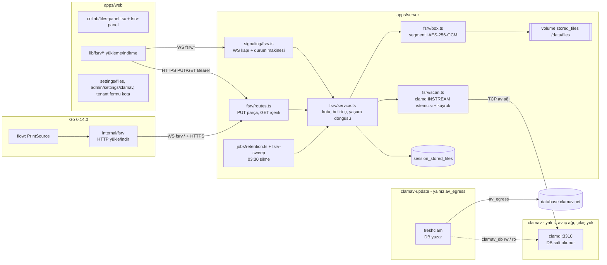

# Mimari — P28b: Sunucuda dosya saklama + ClamAV + sunucu depolama kotası

Tarih: 2026-11-16 · Durum: **r3** (mimar; r2: K9a güvenlik tasarım turu bulguları Y-P28b-1, O-P28b-1..3, D-P28b-1..6 ve K0 ölçümleri — §r2; r3: K3–K6 uygulama sapmaları — §r3; kararlar K-P28b-n)
Girdiler: `docs/gereksinimler-p28.md` (AC-353..363, AC-284, AC-404, AC-285..290, V43/V44/V50/V51, §8, S-P28-2), `docs/mimari-p28.md` §0 + §0.1,
`docs/mimari.md` §3, `docs/mimari-protokol.md` §3–4, ADR-0005, ADR-0009, ADR-0014, ADR-0030, ADR-0031.
Yeni ADR: **ADR-0032** (`docs/adr/0032-sunucu-dosya-deposu-clamav.md`). Kontrol listesi: `docs/tasarim-kontrol.md` "P28b".

**Bağlayıcı ilke — sadelik:** tek ekran, tek yol. Mod oturum açılışında **bir kez** sabitlenir; oturum hangi yoldan açılmış olursa olsun
(kod, bağlantı, talep, kayıtlı bilgisayar) aynı kural. SERVER modunda dosya ve yazdırma **yalnız** sunucu yolundan geçer; iki yol karışmaz.

---

## 1. Kapsam

| Kapsamda                                                                                                                                                                | Kapsam dışı / Sonra (neden)                                                         |
| ----------------------------------------------------------------------------------------------------------------------------------------------------------------------- | ----------------------------------------------------------------------------------- |
| Super Admin ClamAV ayarı (sunucu/port) + "Bağlantıyı Test Et" (PING + EICAR + şifreli zip + imza tarihi) (AC-353, 361)                                                  | ClamAV dışı AV/sandbox, karantina klasörü, S3 vb. nesne deposu (gereksinim §4 m.10) |
| Tenant ayarı "Dosyaları sunucu üzerinden aktar ve virüs tara" + saklama 1–7 gün (yalnız teslim edilen dosya) + aydınlatma onay kutusu (AC-354)                          | Oturum ortasında mod değişimi (AC-355: açılışta sabit)                              |
| SERVER modunda tüm dosya aktarımları + yazdırma: parçalı TLS yükleme → AES-256-GCM şifreli saklama → clamd tarama → teklif                                              | Sunucu modunda gözetimsiz oturumda dosya (K-P28b-7: kapalı; Sonra)                  |
| ≤ 5 dk indirme belirteci, IDOR 404 (AC-356); oturum geçmişinden indirme (AC-360)                                                                                        | Kayıt (P28e) — yalnız kota/depolama genişleme noktası bu pakette                    |
| Kota (tenant başına, vars. 20 GB) + disk boş alanı %10 koruması (AC-362); 03:30 silme + anonimleştirme/kalıcı silmede silme                                             | Dosya önizleme, sunucuda dosya listesi/paylaşım ekranı, çoklu alıcı                 |
| İki konteyner: `clamav` (clamd, çıkışsız iç ağ, DB salt okunur) + `clamav-update` (freshclam), fail-closed, `rs_av_scan_total{result}`, imza yaşı uyarısı (AC-359, 361) | Sunucu modunda > 256 MiB dosya (K-P28b-12, r2)                                      |
| Konsol + müşteri dosya alanında AC-363 satırı; Go istemci 0.14.0 (`rs.cap.fsrv1`, `PrintSource`)                                                                        | macOS/Linux (P28f/g aynı protokolü uygular)                                         |

## 2. Bileşenler



| Bileşen                                    | Sorumluluk                                                                                                                                                                                                          |
| ------------------------------------------ | ------------------------------------------------------------------------------------------------------------------------------------------------------------------------------------------------------------------- |
| `signaling/fsrv.ts` (yeni)                 | WS `fsrv.*` kapı sırası (§5.2), oda başına yön başına tek etkin dosya, teklif/kabul/sonuç, `print` bağlama, oda kapanınca iptal                                                                                     |
| `fsrv/service.ts` (yeni)                   | Satır yaşam döngüsü (§3.2), kota rezervasyonu, disk %10, bellek içi belirteç tablosu (yükleme + indirme), audit + metrik                                                                                            |
| `fsrv/routes.ts` (yeni)                    | `PUT /api/v1/fsrv/uploads/:fid/chunks/:n`, `GET /api/v1/fsrv/files/:fid/content` (Bearer), geçmiş bağlantısı ucu                                                                                                    |
| `fsrv/box.ts` (yeni)                       | Dosya başına HKDF anahtarı, 64 KiB segmentli AES-256-GCM yazma/okuma akışı (§6)                                                                                                                                     |
| `fsrv/store.ts` (yeni)                     | `/data/files/{tenantId}/{rastgele}.rsf` yol kurma/doğrulama (`uploads/store.ts` kalıbı, ayrı kök), `.part` → rename, `statfs`                                                                                       |
| `fsrv/scan.ts` (yeni)                      | clamd TCP istemcisi (PING, VERSION, INSTREAM; kendi kodu, bağımlılık yok), firma başına adil kuyruk + büyük dosya yuvası, bağlantı aşamasında sınırlı yeniden deneme, 60 sn zaman aşımı, sonuç sınıflandırma (§7.2) |
| `fsrv/usage.ts` (yeni)                     | `storageUsage(tx, tenantId)` — **tek** kota fonksiyonu; P28e kayıt toplamını buraya ekler (genişleme noktası)                                                                                                       |
| `settings/clamav.ts` (yeni)                | Sistem ayarı oku/yaz (hedef yalnız `CLAMAV_ALLOWED_CIDR` içinde), test (PING + EICAR + şifreli zip + VERSION), 10 dk öz-sınama yoklaması ve imza yaşı (§7.3)                                                        |
| `tenants/settings.ts`, `tenants/routes.ts` | Tenant dosya modu + saklama alanları; Super Admin tenant düzenlemesine kota                                                                                                                                         |
| `sessions/repo.ts insertSession` (ek)      | `file_mode`'u aynı TX'te `tenant_settings`'ten okuyup yazar (tek ekleme noktası; üç çağıran değişmez)                                                                                                               |
| `signaling/collab.ts`, `rooms-features.ts` | SERVER odasında `file.meta` reddi ve caps daraltma (§5.4)                                                                                                                                                           |
| Go `internal/fsrv` (yeni), `flow` (ek)     | Yükleme/indirme HTTP istemcisi, `flow/files_server.go` akışı, `PrintSource` arayüzü (§8)                                                                                                                            |
| Web `lib/fsrv/*`, `components/collab/*`    | Konsol + misafir sayfası aynı bileşenler; ayar ekranları (§9)                                                                                                                                                       |

## 3. Veri modeli

Migration: **`20261123000000_p28b_stored_files`** (tek migration, expand; rollback = `DROP TABLE` + `DROP COLUMN`, veri kaybı yalnız P28b verisi).

### 3.1 Tablolar ve kolonlar

| Tablo / kolon                         | Tip                                                                                       | Not                                                                                                   |
| ------------------------------------- | ----------------------------------------------------------------------------------------- | ----------------------------------------------------------------------------------------------------- |
| `support_sessions.file_mode`          | `VARCHAR(10) NOT NULL DEFAULT 'P2P'`, CHECK ikili `P2P\|SERVER` (ADR-0014)                | `insertSession` TX'inde yazılır; sonra değişmez (UPDATE grant'ı bu kolona verilmez)                   |
| `tenant_settings.file_server_mode`    | `BOOLEAN NOT NULL DEFAULT FALSE`                                                          | Admin (`settings.edit`)                                                                               |
| `tenant_settings.file_retention_days` | `TINYINT NOT NULL DEFAULT 1`, CHECK 1..7                                                  | Admin                                                                                                 |
| `tenants.storage_quota_gb`            | `SMALLINT NOT NULL DEFAULT 20`, CHECK 1..2000                                             | **Yalnız Super Admin** (tenant varlığı; Admin `tenant_settings`'i düzenler, burayı değil — K-P28b-10) |
| `system_settings` anahtar `clamav`    | `value_json {host, port, lastTest: {ok, at, version, dbDate} \| null}`, `secret_enc` NULL | `system_settings_key_chk` += `clamav` (ikili); `system_settings_clamav_chk` JSON şeması (dba)         |
| **`session_stored_files`** (yeni)     | aşağıda                                                                                   | —                                                                                                     |

`session_stored_files`:

| Kolon                      | Tip                                                                                                                           | Not                                                                                                           |
| -------------------------- | ----------------------------------------------------------------------------------------------------------------------------- | ------------------------------------------------------------------------------------------------------------- |
| `id`                       | `CHAR(26)` PK (ULID = protokoldeki `fid`)                                                                                     | Disk adıyla ilişkisiz                                                                                         |
| `tenant_id`, `session_id`  | `CHAR(26)` NOT NULL; bileşik FK `(session_id, tenant_id)` → `support_sessions` RESTRICT                                       | `tenants`'a doğrudan FK yok; tenant tutarlılığı bileşik FK ile                                                |
| `direction`                | `VARCHAR(12)` CHECK ikili `TO_CUSTOMER\|TO_TECH`                                                                              |                                                                                                               |
| `purpose`                  | `VARCHAR(8)` CHECK ikili `FILE\|PRINT`                                                                                        | PRINT = P28a yazdırma belgesi                                                                                 |
| `uploaded_by_user_id`      | `CHAR(26)` NULL (FK değil; `audit_logs.user_id` kalıbı)                                                                       | Teknisyen yüklemesinde dolu; müşteri yüklemesinde NULL                                                        |
| `file_name`                | `VARCHAR(255)` NOT NULL, CHECK `sanitizeFileName` çıktısı (P5 `session_files` kalıbı)                                         | Yalnız teklif/indirme `Content-Disposition`'ında; audit/log'a girmez. `PRINT`'te sabit `belge.pdf` (D-P28b-3) |
| `ext`                      | `VARCHAR(16)` NOT NULL (küçük harf, `[a-z0-9]{0,16}`)                                                                         | `file.infected` audit'i için (AC-358)                                                                         |
| `size_bytes`               | `BIGINT` NOT NULL, CHECK 1..268435456 (256 MiB, K-P28b-12 r2)                                                                 | Beyan edilen = rezerve edilen; tamamlanınca alınan baytla eşit olmalı                                         |
| `sha256`                   | `CHAR(64)` NOT NULL (beyan; sunucu tamamlanınca kendisi hesaplar, uyuşmazsa `CORRUPT`)                                        |                                                                                                               |
| `storage_rel`              | `VARCHAR(80)` NULL, CHECK `^{tenant_id}/[A-Za-z0-9_-]{24}\.rsf$` (öndek = satırın tenant'ı, P12 kalıbı)                       | Disk silinince NULL                                                                                           |
| `key_ver`                  | `TINYINT UNSIGNED` NOT NULL                                                                                                   | `crypto:check-retire` dosya volume'unu görmeden sürüm kullanımını DB'den sayar                                |
| `state`                    | `VARCHAR(12)` CHECK ikili `UPLOADING\|SCANNING\|CLEAN\|INFECTED\|SCAN_FAILED\|CORRUPT\|REJECTED\|CANCELLED\|EXPIRED\|DELETED` | §3.2 (`REJECTED` r2: alıcı reddetti)                                                                          |
| `scan_reason`              | `VARCHAR(16)` NULL, CHECK ikili `UNAVAILABLE\|TIMEOUT\|ENCRYPTED\|LIMIT\|BUSY\|ERROR`                                         | Yalnız `SCAN_FAILED`                                                                                          |
| `signature`                | `VARCHAR(120)` NULL, CHECK `^[A-Za-z0-9._:/-]{1,120}$`                                                                        | Yalnız `INFECTED`                                                                                             |
| `delivered_at`             | `DATETIME(3)` NULL                                                                                                            | Alıcı `fsrv.result{ok:true}`. Saklama (AC-360) yalnız `delivered_at IS NOT NULL` satırda işler                |
| `expires_at`               | `DATETIME(3)` NULL                                                                                                            | `CLEAN` teslim edilince `delivered_at + file_retention_days` (yükleme anındaki değer)                         |
| `scanned_at`, `deleted_at` | `DATETIME(3)` NULL                                                                                                            |                                                                                                               |
| `created_at`, `updated_at` | `DATETIME(3)`                                                                                                                 |                                                                                                               |

İndeksler: `IX(tenant_id, state)` (kota toplamı: `state IN ('UPLOADING','SCANNING','CLEAN')`), `IX(session_id, created_at)` (geçmiş detayı),
`IX(state, expires_at)` (03:30 işi). Büyüme: oturum başına birkaç satır; satır anonimleştirmede silinir (≤ `retention_days`).

**Oturum tavanı (O-P28b-2, r2):** `SUM(size_bytes) WHERE session_id=?` (**tüm** durumlar — reddedilen/iptal edilen de sayılır, böylece ret döngüsü de
sınırlanır) + yeni beyan > `FSRV_SESSION_MAX_BYTES` (2 GiB) → `REJECTED/SESSION_LIMIT`. `IX(session_id, created_at)` kullanılır.

**Kota kuralı (tek fonksiyon `storageUsage`):** `SUM(size_bytes) WHERE tenant_id=? AND state IN ('UPLOADING','SCANNING','CLEAN')` (+ P28e kayıt
toplamı). `UPLOADING` satırı beyan edilen boyutla **rezerve** eder; eşzamanlı iki yükleme `SELECT … FROM tenants WHERE id=? FOR UPDATE` ile
serileştirilir (rezervasyon + INSERT tek TX).

### 3.2 Durum makinesi (`state`) — r2 (O-P28b-2, D-P28b-3)

```
UPLOADING ─tamam+sha ok→ SCANNING ─temiz→ CLEAN (teklif açık) ─fsrv.result ok→ CLEAN (teslim, delivered_at) ─süre doldu→ EXPIRED
    │             │                 │              ├─alıcı fsrv.reject→ REJECTED (disk hemen silinir)
    │             │                 │              ├─gönderen fsrv.cancel / oda kapandı / 3 indirme denemesi başarısız→ CANCELLED (disk hemen silinir)
    │             │                 │              └─PRINT: fsrv.result ok / P28a son durumu / oda kapandı→ EXPIRED (disk hemen silinir)
    │             │                 ├─virüs→ INFECTED (disk hemen silinir)
    │             │                 └─taranamadı→ SCAN_FAILED (disk hemen silinir)
    │             └─sha/boyut uyuşmaz→ CORRUPT (disk hemen silinir)
    └─iptal / 10 dk hareketsiz / oda kapandı / sunucu yeniden başladı→ CANCELLED (.part silinir)
CLEAN (teslim) ─anonimleştirme/firma silme→ satır silinir (DELETED yalnız elle yapılacak silmeler için ayrılmış; P28b'de yazılmaz → K-P28b-15)
```

Kurallar:

- **Disk dosyası yalnız `CLEAN` iken vardır**; diğer tüm son durumlarda `storage_rel = NULL`.
- **Saklanan dosya** (geçmişten indirilebilir, AC-360) = `purpose='FILE' AND state='CLEAN' AND delivered_at IS NOT NULL`. Teslim edilmemiş `CLEAN`
  satırı yalnız teklif açıkken (oda açıkken) vardır; reddedilen, geri çekilen, oturum sonunda teslim edilmemiş dosya kotada kalmaz (K-P28b-9 r2).
- **Yazdırma belgesi saklanmaz:** `PRINT` satırının diski misafirin `fsrv.result{ok:true}`'sunda, P28a son durumunda (basıldı / reddedildi /
  `ABANDONED`) ya da oda kapanışında (hangisi önceyse) silinir, durum `EXPIRED` olur. Geçmişte "Yazdırma belgesi — saklanmaz" görünür.
- Satır her durumda `retention_days` boyunca kalır (geçmiş kaydı ve oturum tavanı sayımı için); yalnız disk dosyası silinir.

### 3.3 Silme ve kalıcı silme (ADR-0030 uyumu)

- **03:30 işi** (mevcut `jobs/retention.ts`, yeni adım `fsrvExpire`): `state='CLEAN' AND expires_at <= now` → disk sil → `EXPIRED` (teslim edilmemiş `CLEAN` 03:30'da zaten yoktur; mutabakat (c) aşağıda), `storage_rel=NULL`;
  tenant başına bir `file.expired{count, bytes}` audit. Aynı turda **mutabakat**: (a) `.part`/`.rsf` dosyası olup satırı `UPLOADING|CLEAN` olmayan ve
  24 sa'ten eski dosyalar silinir (yetim); (b) `CLEAN` satırı olup dosyası olmayan → `EXPIRED` (yedekten dönüş sonrası, §11.4); (c) `CLEAN` + `delivered_at IS NULL` olup odası açık olmayan
  (süreç çökmesi kenar durumu) → disk sil → `CANCELLED`. Sayılar `retention.run` audit'ine.
- **Anonimleştirme** (`anonymizeSessionBatch`): `session_files` silinirken aynı TX'te `session_stored_files` satırları da silinir; disk dosyaları TX'ten
  **önce** silinir (dosya silinip TX geri alınırsa satır `CLEAN` kalır, sonraki tur mutabakatı `EXPIRED` yapar — güvenli yön).
- **Kalıcı silme (`purgeAnonymized` adım 2):** sıra `session_stored_files` → `session_files` → `session_consents` → `support_sessions` (FK RESTRICT;
  anonimleştirme satırları zaten sildiği için normalde 0 satır, ama sıra eklenmezse kenar durumda `db_signal` üretir).
- **Firma silme (`tenant-purge-repo.ts DATA_STEPS`):** yeni adım `stored_files` oturum adımından **önce**: dosya kökünde `/{tenantId}/` klasörü silinir,
  sonra `byTenant("session_stored_files")`.
- Tetikleyici **eklenmez** (yedek betiği 3 tetikleyici bekler).

### 3.4 Grant (`prisma/sql/grants.sql`, `check-app-grants.sh`)

`app`: `session_stored_files` SELECT, INSERT, UPDATE(state, scan_reason, signature, storage_rel, delivered_at, expires_at, scanned_at, deleted_at,
updated_at), DELETE. `support_sessions.file_mode` için UPDATE **yok**. `tenants` UPDATE(storage_quota_gb) mevcut tenant düzenleme grant'ına eklenir.

## 4. REST API sözleşmesi (zod: `packages/contracts/src/api/fsrv.ts`, `api/clamav.ts`)

Ortak: hata zarfı `docs/mimari-api.md` "Ortak kurallar". Yeni hata kodu: **`STORAGE_QUOTA`** (HTTP 409, "Firma depolama kotası doldu"),
**`AV_NOT_READY`** (HTTP 409, "Önce virüs tarama bağlantısını başarıyla test edin"). Belirteçler yalnız `Authorization: Bearer` başlığında;
**URL'de asla** (Caddy yol loglar, başlığı siler).

| Uç                                                    | Kimlik / yetki                                                                                                                                            | Girdi                                                                                      | Çıktı / hata                                                                                                                                                                                                                                                                                                                                                                                                                                                                                                     |
| ----------------------------------------------------- | --------------------------------------------------------------------------------------------------------------------------------------------------------- | ------------------------------------------------------------------------------------------ | ---------------------------------------------------------------------------------------------------------------------------------------------------------------------------------------------------------------------------------------------------------------------------------------------------------------------------------------------------------------------------------------------------------------------------------------------------------------------------------------------------------------- |
| `PUT /api/v1/fsrv/uploads/:fid/chunks/:n`             | Bearer yükleme belirteci (WS'den, fid'e bağlı); **çerez okunmaz**, CSRF yok                                                                               | `Content-Type: application/octet-stream`, gövde = parça `n` (0'dan); `bodyLimit` 1 MiB + 1 | Belirteç denetimi **`onRequest`'te, gövde okunmadan** (D-P28b-2). 200 `{next, received}`; son parçada 202 `{state:"SCANNING"}`. `n < next` → 200 (idempotent, yazmaz); `n > next` → 409 `{next}`; parça boyu ≠ beklenen (son parça hariç tam 1 MiB) → 400; belirteç yok/süresi dolmuş/fid uyuşmaz → **404** (tek tip; IP başına 60/dk 404 → 429, `lib/rate.ts`); disk %10 → 409 `STORAGE_QUOTA`                                                                                                                  |
| `GET /api/v1/fsrv/files/:fid/content`                 | Bearer indirme belirteci (≤ 5 dk, fid + tenant + oturum bağlı; `HISTORY` ayrıca `authSessionId`'ye); **çerez okunmaz**                                    | —                                                                                          | 200 akış (`application/octet-stream`, `Content-Disposition: attachment; filename="<ASCII yedek>"; filename*=UTF-8''<RFC 5987 yüzde kodlu>`, `Content-Length`, `Cache-Control: no-store`, `X-Content-Type-Options: nosniff`, `Content-Security-Policy: sandbox; default-src 'none'`, `Cross-Origin-Resource-Policy: same-origin`); her istek `file.download` audit. Belirteç yok/süresi dolmuş/fid uyuşmaz/`state≠CLEAN`/(`HISTORY` için) oturum veya kullanıcı etkin değil → **404** (IP başına 60/dk 404 → 429) |
| `POST /api/v1/sessions/:id/stored-files/:fid/link`    | Çerez + Origin + CSRF; `session_history.view` + `file_transfer.use`; `historyScope` (mevcut P8 kuralı: teknisyen yalnız kendi oturumları, Admin tenant'ı) | —                                                                                          | 200 `{fid, token, expiresAt}` (5 dk; belirteç çağıranın `authSessionId`'sine bağlı). Başka tenant/oturum/kapsam dışı/saklanan dosya değil (`FILE`+`CLEAN`+teslim edilmiş, §3.2) → 404; 20/dk/kullanıcı → 429                                                                                                                                                                                                                                                                                                     |
| `GET /api/v1/sessions/:id/history` (ek, P8 detay; r3) | mevcut                                                                                                                                                    | —                                                                                          | yeni alan `storedFiles: {id, direction, purpose, name, sizeBytes, state, scanReason?, signature?, expiresAt?, canDownload}[]` (`canDownload` = saklanan dosya (§3.2) + iki yetki; `PRINT` satırında `name` = `belge.pdf`)                                                                                                                                                                                                                                                                                        |
| `GET /api/v1/admin/settings/clamav`                   | Super Admin                                                                                                                                               | —                                                                                          | `{host, port, source:"panel"\|"env", lastTest, signatureAgeDays?, stale}`. r3: etkin hedef **panel kaydı > env**; env yalnız ilk değerdir — env hedefiyle yapılan başarılı/başarısız test aynı host/port ile panel satırı açar (`lastTest`'in tek yeri), sonra `source:"panel"`. Env'e dönüş ucu (DELETE) yok                                                                                                                                                                                                    |
| `PUT /api/v1/admin/settings/clamav`                   | Super Admin + step-up (mevcut `stepUp`, mysql/whatsapp kalıbı)                                                                                            | `{host: hostname\|IP ≤ 253, port: 1..65535}`                                               | 200 görünüm; host/port değişince `lastTest = null` (yeniden test gerekir). **Hedef kuralı (O-P28b-1, K-P28b-16 r2):** host çözülür, **tüm** adresler `CLAMAV_ALLOWED_CIDR` içinde olmalı (loopback dahil başka hiçbir sınıf kabul edilmez), aksi 400 `HOST_NOT_ALLOWED`. Audit `settings.clamav` eski→yeni                                                                                                                                                                                                       |
| `POST /api/v1/admin/settings/clamav/test`             | Super Admin; 6/dk                                                                                                                                         | `{host?, port?}` (boşsa kayıtlı; verilen host aynı CIDR kuralından geçer)                  | 200 `{ok, eicarDetected, encryptedDetected, version, dbDate, signatureAgeDays, stale, message?}`; başarı = PING `PONG` + EICAR `FOUND` + şifreli zip fikstürü `Heuristics.Encrypted.*` (AC-353, D-P28b-1; aksi `ok=false`, "Şifreli arşiv algılaması kapalı"). Sonuç `lastTest`'e yazılır (yalnız kayıtlı değerle test edildiyse). Audit `settings.clamav.test` (sonuç)                                                                                                                                          |
| `GET/PUT /api/v1/settings/tenant` (ek)                | `settings.view` / `settings.edit`                                                                                                                         | ek alanlar `fileServerMode: boolean`, `fileRetentionDays: 1..7`, `consentUpdated?: true`   | `false→true` geçişinde: `lastTest.ok !== true` → 409 `AV_NOT_READY` (`fields.fileServerMode`); `consentUpdated !== true` → 400 (`fields.consentUpdated`, AC-354). Görünümde `storage: {usedBytes, quotaBytes}` (AC-362). Audit mevcut tenant ayarı olayı, eski→yeni + `consentAck`                                                                                                                                                                                                                               |
| `PATCH /api/v1/admin/tenants/:id` (ek)                | Super Admin                                                                                                                                               | `storageQuotaGb: 1..2000`                                                                  | Audit `tenant.storage_quota` eski→yeni. Kota kullanımın altına düşürülebilir (yeni yüklemeler reddedilir; mevcutlar silinmez)                                                                                                                                                                                                                                                                                                                                                                                    |
| `/health` (ek, iç)                                    | iç ağ                                                                                                                                                     | —                                                                                          | gövdeye `clamav: {configured, reachable, signatureAgeDays, stale}`; **HTTP durumu değişmez**, `/ready` clamd'a bakmaz (compose healthcheck düşmesin — K-P28b-14)                                                                                                                                                                                                                                                                                                                                                 |

**Parça boyu 1 MiB (K-P28b-4):** Caddy `read_body 30s` tam istek süresidir; 1 MiB 30 sn'de ≥ 280 kbit/s ister (müşteri yükleme hattı için güvenli
pay). nginx `client_max_body_size 3m` yeterli; Fastify `bodyLimit` yalnız bu rotada 1 MiB + 1.

**Belirteçler (bellek, ADR-0005):** 32 bayt rastgele, base64url; tabloda SHA-256'sı. **Düşürme (D-P28b-2, r2):** oda kapanışında, misafir
çıkarıldığında/ayrıldığında ve teknisyen odadan ayrıldığında o odanın yükleme ve `TECH`/`CUSTOMER` indirme belirteçleri silinir; `HISTORY` belirteci
üretenin `authSessionId`'sine bağlıdır ve GET anında oturumun ve kullanıcının etkin olduğu denetlenir (çıkış/pasife alma belirteci düşürür). Yükleme belirteci: fid + yön + oturum; son parçadan sonra veya
**10 dk hareketsizlikte** düşer (satır `CANCELLED`). İndirme belirteci: fid + oturum + tenant + `actor` (`TECH:<userId>` | `CUSTOMER` | `HISTORY:<userId>`),
`expiresAt = now + 5 dk`; süre içinde tekrar kullanılabilir (kopan indirmenin yeniden başlaması), her GET ayrı audit. Sunucu yeniden başlarsa belirteçler düşer
(oturumlar da düşer — kabul edilen sınır).

## 5. WS protokolü (`packages/contracts/src/ws-fsrv.ts`, Go eşi `internal/signal`; fikstür `fixtures/fsrv.json`)

### 5.1 Mod ve yetenek (r2: D-P28b-5 tek yardımcı)

- Misafir istemci yeni belirteç bildirir: `rs.cap.fsrv1` (`WS_GUEST_CAP_FSRV`). Tarayıcı misafiri belirteç bildirmez ama yetenekli sayılır
  (web, sunucuyla aynı dağıtımda yayınlanır — K-P28b-20).
- **Tek yardımcı `hasFsrv(peer)`** (`rooms-features.ts`) = `peer.declaredCaps ∋ fsrv` **veya** `peer.guestKind === "BROWSER"`. §5.1 (`hello.fileMode`),
  §5.2 (şema kapısı) ve §5.4 (caps/`guestFeatures`) yalnız bu yardımcıyı çağırır; ayrı koşul yazılmaz.
- Tarayıcı misafirinin özellik kümesi yalnız `{fsrv}`; O-P28a-4 kuralı (AGENT dışı misafirde pano/yazdırma özelliği yok) aynen. `capsFor` tablo testine
  satır: BROWSER → `{fsrv}`, AGENT 0.14 → `{clip, print, fsrv}`, AGENT ≤ 0.13 → `{clip, print}`, gözetimsiz → `∅`.
- Gözetimsiz odada belirteçler okunmaz (O-P28a-4 aynen) → `fsrv` yok.
- `Room.fileMode` (`P2P|SERVER`) oda kurulurken `support_sessions.file_mode`'dan okunur; **oturum boyunca değişmez** (AC-355).
- Teknisyene `hello` ve `peer.joined{guest}`: yeni alan `fileMode?: "P2P"|"SERVER"` (yoksa P2P) + `guestFeatures` içinde `"fsrv"`.
- Misafire `hello.fileMode` **yalnız `hasFsrv(peer)` soketine** (Go katı ayrıştırma; eski istemciye yeni alan gitmez).

### 5.2 Mesajlar

Kimlik: `xid` = istemcinin ürettiği istek kimliği (`/^[A-Za-z0-9_-]{8,26}$/`, P28a cid kalıbı, son 64 tekrar → VALIDATION); `fid` = sunucunun ULID'i.

| t               | Yön              | Alanlar                                                                                               | Sunucu davranışı                                                                                                                                                                                                                                                                                                                                                                                                                                                                                                                                                                                                                                                                                                                                                                                                                                                                                                                                                                                        |
| --------------- | ---------------- | ----------------------------------------------------------------------------------------------------- | ------------------------------------------------------------------------------------------------------------------------------------------------------------------------------------------------------------------------------------------------------------------------------------------------------------------------------------------------------------------------------------------------------------------------------------------------------------------------------------------------------------------------------------------------------------------------------------------------------------------------------------------------------------------------------------------------------------------------------------------------------------------------------------------------------------------------------------------------------------------------------------------------------------------------------------------------------------------------------------------------------- |
| `fsrv.init`     | tech→S, guest→S  | `xid`, `name: string(1..255)`, `size: int 1..268435456`, `sha256`, `purpose: "FILE"\|"PRINT"`, `pid?` | Kapı sırası (ilk tutan döner, `fsrv.status{xid, state:"REJECTED", reason}`): (1) `fileMode≠SERVER` → teknisyene `REJECTED/MODE`; misafir soketinde `fsrv.*` tipleri yalnız SERVER odasında ve `hasFsrv(peer)` sokette şemadadır, aksi 1008 (P28a S-P18-T1 kalıbı); (2) `FILE` için teknisyen `file_transfer.use` / caps'te `file_transfer` yok → `FORBIDDEN`; `PRINT` için P28a print kapısı: gönderen teknisyen, yön TO_CUSTOMER, `pid === printPending.pid` **ve** `size === printPending.sizeBytes` **ve** `size ≤ 20 MiB` (D-P28b-3), aksi `FORBIDDEN`; (3) ADMITTED misafir yok veya `hasFsrv(misafir)` değil → `UNSUPPORTED`; (4) yönde etkin aktarım var → `BUSY` (**etkin** = `UPLOADING\|SCANNING` ya da teklifi açık `CLEAN` + `delivered_at IS NULL`); (5) `size > min(max_file_mb, 256) MiB` → `TOO_LARGE`; (6) 20/dk/oda → `RATE_LIMITED`; (7) oturum toplamı + `size` > 2 GiB → `SESSION_LIMIT` (§3.1); (8) disk boş < %10 veya kota → `QUOTA`; geçerse satır `UPLOADING` + `fsrv.upload` |
| `fsrv.upload`   | S→gönderen       | `xid`, `fid`, `token`, `chunkBytes: 1048576`, `chunks`                                                | Yükleme belirteci                                                                                                                                                                                                                                                                                                                                                                                                                                                                                                                                                                                                                                                                                                                                                                                                                                                                                                                                                                                       |
| `fsrv.status`   | S→iki taraf      | `fid?`, `xid?`, `state`, `reason?`, `signature?`, `progress?: 0..100`                                 | `state` ∈ `UPLOADING SCANNING CLEAN INFECTED SCAN_FAILED CORRUPT CANCELLED REJECTED DELIVERED`. Yükleme ilerlemesi alıcıya en çok 1/sn. `INFECTED` ve `SCAN_FAILED` iki tarafa ≤ 5 sn (AC-358/359)                                                                                                                                                                                                                                                                                                                                                                                                                                                                                                                                                                                                                                                                                                                                                                                                      |
| `fsrv.offer`    | S→alıcı          | `fid`, `name`, `size`, `sha256`, `purpose`, `pid?` (`PRINT`'te zorunlu)                               | `CLEAN` sonrası. `FILE` → alıcı **mevcut kabul diyaloğu** (AC-36, AC-116 aynen; `sanitizeFileName` + tehlikeli uzantı uyarısı). `PRINT` → misafire gider (`name` = `belge.pdf`), misafir diyalog açmaz; Go istemci bekleyen yazdırma işinin `pid` ve boyutuyla eşleşmeyen teklifi reddeder (`report{ERROR}`); eşleşirse doğrudan indirir (onay P28a diyaloğunda, sayfa sayısıyla)                                                                                                                                                                                                                                                                                                                                                                                                                                                                                                                                                                                                                       |
| `fsrv.accept`   | alıcı→S          | `fid`                                                                                                 | Yalnız teklifin alıcısından; sunucu `fsrv.download` döner. Aynı fid için en çok 3 belirteç                                                                                                                                                                                                                                                                                                                                                                                                                                                                                                                                                                                                                                                                                                                                                                                                                                                                                                              |
| `fsrv.reject`   | alıcı→S          | `fid`                                                                                                 | Göndericiye `fsrv.status{REJECTED}`; satır `REJECTED`, **disk hemen silinir** (O-P28b-2; saklanmaz, kotadan düşer)                                                                                                                                                                                                                                                                                                                                                                                                                                                                                                                                                                                                                                                                                                                                                                                                                                                                                      |
| `fsrv.download` | S→alıcı          | `fid`, `token`, `expiresAt`                                                                           | ≤ 5 dk                                                                                                                                                                                                                                                                                                                                                                                                                                                                                                                                                                                                                                                                                                                                                                                                                                                                                                                                                                                                  |
| `fsrv.result`   | alıcı→S          | `fid`, `ok: boolean`                                                                                  | Alıcı SHA-256'yı doğruladıktan sonra. Sunucu `session_files` satırını **kendisi** yazar (`OK`/`CORRUPT`; S-P5-T2-4 riski SERVER modunda kapanır). `ok:true` → `delivered_at`, göndericiye `DELIVERED`; `PRINT`'te disk silinir → `EXPIRED` (§3.2). `ok:false` → teklif açık kalır, alıcı yeniden `fsrv.accept` edebilir (fid başına ≤ 3 belirteç); üçüncü başarısızlıktan sonra `CANCELLED` + disk silinir                                                                                                                                                                                                                                                                                                                                                                                                                                                                                                                                                                                              |
| `fsrv.cancel`   | gönderen/alıcı→S | `fid`                                                                                                 | `UPLOADING/SCANNING` → `CANCELLED` + sil; teslim edilmemiş `CLEAN` teklif → teklif geri çekilir, `CANCELLED` + **disk silinir** (O-P28b-2)                                                                                                                                                                                                                                                                                                                                                                                                                                                                                                                                                                                                                                                                                                                                                                                                                                                              |

Oda kapanınca (oturum sonu, misafir/teknisyen kopması 120 sn sonrası) `UPLOADING/SCANNING` ve teslim edilmemiş `CLEAN` satırları `CANCELLED`
(disk/`.part` silinir), `PRINT` satırları §3.2'ye göre `EXPIRED`; odanın belirteçleri düşer (§4). Sunucu açılışında `UPLOADING/SCANNING`
ve teslim edilmemiş `CLEAN` satırların hepsi `CANCELLED` (`PRINT` → `EXPIRED`) + `.part`/`.rsf` silinir (ADR-0005: odalar zaten düştü).

### 5.3 Yazdırma (AC-355 "yazdırma dahil") — r2 (D-P28b-3)

P28a WS kapısı (`print.request` 3b dahil) aynen. SERVER modunda DC `print.ready` → konsol PDF'i `fsrv.init{purpose:"PRINT", pid}` ile yükler (DC `print.offer`
/ `file` çerçevesi / `print.done` **gönderilmez**) → tarama → misafire `fsrv.offer{purpose:"PRINT", pid}` → misafir `pid` + boyutu bekleyen işle eşler,
`fsrv.accept` → indirir (yalnız bellek) → boyut + SHA-256 + `%PDF-` doğrulaması (`print.done` eşdeğeri) → P28a inceleme/diyalog/basma aynen.

- **Boyut bağı:** `fsrv.init{PRINT}` yalnız `size === printPending.sizeBytes` ve `size ≤ 20 MiB` iken geçer (O-P28a-2 kalıbı; 256 MiB'lık "PRINT" kota ve tarama
  yükü oluşturamaz).
- **Ad:** `PRINT` satırında `file_name` sabit `belge.pdf`; gerçek ad WS'den geçmez ve DB'ye yazılmaz (P28a "ad WS'den geçmez" kuralı SERVER modunda da korunur —
  K-P28b-13 r2).
- **Saklama:** yazdırma belgesi saklanmaz; disk `fsrv.result{ok:true}` / P28a son durumu / oda kapanışında silinir (§3.2). Geçmişten indirilemez.
- Son tarihler: misafirin 8 dk aktarım + inceleme süresi, 20 MB PDF için 1 MiB parça + ≤ 60 sn tarama ile karşılanır; sunucunun 10 dk `ABANDONED` sınırı
  değişmez. `INFECTED/SCAN_FAILED` → `print.status{ERROR}` + aynı virüs/taranamadı metni.

### 5.4 DC dosya kanalının reddi (iki uç, AC-355)

| Uç                   | SERVER odasında                                                                                                                                                                                                                                                                                                                                                                                                |
| -------------------- | -------------------------------------------------------------------------------------------------------------------------------------------------------------------------------------------------------------------------------------------------------------------------------------------------------------------------------------------------------------------------------------------------------------- |
| Sunucu               | (a) Misafire giden `caps`'ten `file_transfer` ve `print` **çıkarılır** (`capsFor(caps, features, fileMode)`); (b) WS `file.meta` (P5) yok sayılır + `rs_fsrv_denied_total{reason="dc_meta"}` + log (audit yok); (c) `hasFsrv(misafir)` değilse teknisyene `guestFeatures`'ta `fsrv` yok → konsol dosya/yazdırma pasif; (d) r3: `hasFsrv(misafir)` değilse P28a `print.request` → `FORBIDDEN` (misafire gitmez) |
| Go istemci (0.14.0)  | `hello.fileMode=SERVER` → DC `file.offer` otomatik `file.reject`, `file` kanalı çerçeveleri düşürülür, `print.offer` reddedilir (`report{ERROR}`), dosya gönderme düğmesi fsrv yoluna bağlanır                                                                                                                                                                                                                 |
| Go istemci (≤ 0.13)  | caps'te `file_transfer` olmadığı için G-09 alıcı kuralı DC `file.offer`'ı zaten reddeder; dosya sekmesi gizli. Teknisyende AC-352 metni: "Müşterinin uygulaması bu özelliği desteklemiyor — güncel sürümü indirmesini isteyin"                                                                                                                                                                                 |
| Konsol / misafir web | `fileMode=SERVER` → `files-panel` yalnız fsrv yolunu kullanır; DC `file.offer` gelirse otomatik reddeder; r3: `file` DC kanalı açılır (ortak PeerLink) ama **dinlenmez**                                                                                                                                                                                                                                       |
| Gözetimsiz oda       | `fsrv` yok → SERVER modunda dosya kapalı (P27 otomatik `Gelen` aktarımı dahil); konsol: "Bu firmada dosyalar sunucuda taranır; gözetimsiz oturumda dosya aktarımı kapalı" (K-P28b-7)                                                                                                                                                                                                                           |

Testler: SERVER odasında eski istemci fikstürüne giden `hello.caps` = `["remote_control"]` (dosya yok); `file.meta` → `session_files` satırı 0;
P2P odasında davranış birebir eski (regresyon).

## 6. Şifreleme (AC-356; `fsrv/box.ts`)

- **Anahtar türetme:** `fileKey = HKDF-SHA256(ikm = APP_ENCRYPTION_KEYS[key_ver], salt = 32 B rastgele (dosya başlığında), info = "remote-support/stored-file/v1|" + tenantId + "|" + fid, 32 B)`.
  Ana anahtar doğrudan kullanılmaz (mevcut `macKey` HKDF kalıbı); türetme `lib/crypto.ts` içinde `deriveFileKey(ver, salt, tenantId, fid)` olarak eklenir,
  `SecretBox.keys` dışarı verilmez. Başlıktaki `key_ver` ≠ DB `key_ver` → okuma reddedilir (`CORRUPT`). `key_ver` = yazım anındaki güncel sürüm, DB kolonunda.
- **Biçim (`.rsf`):** başlık 52 B = `"RSF1"(4) | key_ver(1) | 0(3) | segBytes uint32 BE = 65536 | plainSize uint64 BE | salt(32)`; ardından segmentler
  `ciphertext(≤ 64 KiB) | tag(16)`.
- **Nonce:** `0x00 × 7 | segmentIndex uint32 BE | lastFlag(1)` — anahtar dosyaya özgü olduğundan sayaç nonce'u tekrar etmez. **AAD** = başlığın tamamı.
  Son segment bayrağı + başlıktaki `plainSize` kesilmeyi, sayaç yeniden sıralamayı, AAD başka dosyaya taşımayı yakalar.
- **Akış:** yükleme parçası (1 MiB = 16 segment) bellekte tamamlanır → segmentler şifrelenip `.part`'a eklenir → `fsync`; son parçada SHA-256 (düz metin
  üzerinde akışla hesaplanmış) beyanla karşılaştırılır → `rename(.part → .rsf)`. Düz metin uygulama diskine hiç yazılmaz (clamd'nin tarama geçici dosyaları ayrı tmpfs'te — §7.1, §10.2).
- **Okuma:** segment segment doğrula-sonra-yaz; doğrulanmayan segmentte akış kesilir (istemci boyut/SHA uyuşmazlığıyla `CORRUPT` görür). 50 MB ≈ 800
  segment; Node `aes-256-gcm` ile ölçüm hedefi < 1 sn.
- **Genişleme noktası (P28e):** segment bağımsız çözülebildiği için oynatıcı `Range` ile rastgele erişebilir (`segmentAt(i)`); P28b `Range` sunmaz.
- **Rotasyon:** yeni sürüm eklenince yeni dosyalar onunla yazılır; eski sürüm ≤ 7 gün sonra kullanılmaz. `crypto:check-retire` `session_stored_files`
  `key_ver` sayısını (`state='CLEAN'`) raporlar; `crypto:rewrap` dosyalara dokunmaz (gerek yok, süre kısa) — runbook.
- nginx gövde tamponu (D-P28b-4, K-P28b-17 r2): **yeni `location` açılmaz** (kardeş `location` `proxy_set_header`/G-11 XFF yeniden yazımını devralmaz);
  `client_body_buffer_size 3m;` **server** düzeyinde, `client_max_body_size 3m` ile aynı yere — tüm gövdeler (logo/avatar dahil) bellekte kalır, host
  diskine düz metin yazılmaz. `test-nginx.sh`: yükleme sonrası `client_body_temp_path` dizini boş. Staging'de nginx yok; prod denetimi runbook §28b.

## 7. ClamAV (AC-353, 357..359, 361)

### 7.1 Konteynerler (`deploy/docker-compose.yml`, devops) — r2 (Y-P28b-1, O-P28b-1, O-P28b-3, K0)

İmaj: resmî `clamav/clamav` (Cisco Talos), **sürüm + digest sabit** — K0: `clamav/clamav:1.5.4@sha256:45fe5149fbee5a46509c9848ef20d0c354b7b2323c9369f285939a37cf33422a`
(Alpine, amd64); GPL-2.0 — ayrı süreç/konteyner, kodumuz bağlanmaz, yalnız TCP protokolü (ADR-0032). **İki servis, aynı imaj + digest** (Y-P28b-1:
Docker'da ağ konteynere bağlanır, sürece değil; düşmanca dosyayı ayrıştıran clamd internete çıkamamalı ve imza DB'sini yazamamalı):

| Özellik          | `clamav` (yalnız clamd)                                                                                                                                                                                                                      | `clamav-update` (yalnız freshclam)                                                                                                                                                                                                |
| ---------------- | -------------------------------------------------------------------------------------------------------------------------------------------------------------------------------------------------------------------------------------------- | --------------------------------------------------------------------------------------------------------------------------------------------------------------------------------------------------------------------------------- |
| Ağ               | yalnız **`av`** (`internal: true`, sabit alt ağ — aşağıda); çıkış yok                                                                                                                                                                        | yalnız **`av_egress`** (`database.clamav.net`); `av`'de **değil** (clamd'ye ve server'a yol yok)                                                                                                                                  |
| `clamav_db`      | `/var/lib/clamav` **`:ro`**                                                                                                                                                                                                                  | `/var/lib/clamav` rw (tek yazan)                                                                                                                                                                                                  |
| Komut            | `entrypoint: ["clamd", "--foreground", "--config-file=/etc/clamav/clamd.conf"]` — imajın `/init`'i **kullanılmaz** (her açılışta `chown -R /var/lib/clamav` yapar; salt okunur bağlamada `set -eu` ile çıkar — K0 + imajdaki `/init` okundu) | `entrypoint: ["freshclam", "--daemon", "--foreground", "--stdout", "--checks=6", "--config-file=/etc/clamav/freshclam.conf"]` — `/init` kullanılmaz; `FRESHCLAM_CHECKS` yalnız `/init`'te okunduğu için **yazılmaz**, sayı CLI'da |
| Kullanıcı/sertl. | `user: "100:101"`, `read_only: true`, `cap_drop: [ALL]`, `no-new-privileges` (K0: ek `cap_add` gerekmez)                                                                                                                                     | aynı                                                                                                                                                                                                                              |
| tmpfs            | `/scratch` (`TemporaryDirectory`; `size=1536m,uid=100,gid=101,mode=0700`), `/run/clamav`, `/tmp` (küçük)                                                                                                                                     | `/tmp`, `/var/log/clamav`                                                                                                                                                                                                         |
| `mem_limit`      | `3g` (değişmez aşağıda)                                                                                                                                                                                                                      | `1536m` (`TestDatabases yes` yeni DB'yi doğrulamak için belleğe yükler; K6 ölçer)                                                                                                                                                 |
| Healthcheck      | imajın `clamdcheck.sh` (`PING` → `localhost:3310`; `TCPAddr` yazılmaz — Alpine'de `localhost` `::1`'e çözülür)                                                                                                                               | imajın HEALTHCHECK'i 3310'a baktığı için **ezilir**: `["CMD-SHELL", "ls /var/lib/clamav/main.c?d /var/lib/clamav/daily.c?d >/dev/null"]`                                                                                          |
| Sıra             | `depends_on: { clamav-update: { condition: service_healthy } }` (volume ilk kez rw serviste bağlanır → imajdaki DB volume'a kopyalanır; clamd DB'siz açılmaz)                                                                                | —                                                                                                                                                                                                                                 |
| Port / profil    | yayımlanmaz; staging `profiles: [av]` (K-P28b-18)                                                                                                                                                                                            | yayımlanmaz; staging `profiles: [av]`                                                                                                                                                                                             |

- **`deploy/clamav/clamd.conf`** (ro; K0 tablosu, r2 farkları kalın): `TCPSocket 3310` (`TCPAddr` yok), **`LocalSocket` yok** (yalnız `/init` bekliyordu),
  `Foreground yes`, `User clamav`, **`TemporaryDirectory /scratch`**, **`StreamMaxLength 256M`**, **`MaxFileSize 256M`**, **`MaxScanSize 512M`** (r3: `deploy/clamav/clamd.conf` ile birebir),
  `MaxScanTime 55000`, `AlertExceedsMax yes`, `AlertEncrypted`/`AlertEncryptedArchive`/`AlertEncryptedDoc yes`, `HeuristicAlerts yes`,
  `ConcurrentDatabaseReload no`, `SelfCheck 600`, `MaxThreads 4`, `MaxQueue 20`, `ReadTimeout 120`, `CommandReadTimeout 30`, `IdleTimeout 60`,
  `LogClean no`, `PCREMaxFileSize` varsayılan 100M (R-P28b-7).
- **`deploy/clamav/freshclam.conf`** (ro): `DatabaseOwner clamav`, `DatabaseMirror database.clamav.net`, `TestDatabases yes`, `Foreground yes`;
  **`NotifyClamd` yazılmaz** (clamav-update `av`'de değil). Kontrol sayısı CLI `--checks=6` (günde 6; AC-361 "günde ≥ 1" + pay).
- **Yeniden yükleme:** freshclam yeni CVD/CLD'yi volume'a yazar; clamd salt okunur bağlamada da dizini `stat` ile izler ve `SelfCheck 600` ile en geç
  10 dk'da yeniden yükler. `ConcurrentDatabaseReload no` → yükleme sırasında clamd komut kabul etmez (K0: elle `RELOAD` 8 sn; ilk açılışta 60 sn).
  Bu pencere tarama istemcisinin bağlantı aşaması yeniden denemesiyle (§7.2) kullanıcıya yansımaz; 15 sn'yi aşarsa fail-closed `UNAVAILABLE`.
- **`av` alt ağı (O-P28b-1):** `networks.av: { internal: true, ipam: { config: [{ subnet: "${AV_SUBNET:-172.30.2.0/28}" }] } }`; staging `.env`
  `AV_SUBNET=172.30.3.0/28` (`EDGE_SUBNET` kalıbı; iki yığının alt ağı çakışmaz). `server` servisine `CLAMAV_ALLOWED_CIDR: ${AV_SUBNET:-172.30.2.0/28}`
  aynı değerden geçer. Compose yorumu: "`av`: YALNIZ server + clamav; bu ağa servis EKLENMEZ" (edge S-P2-1 kalıbı).
- **Bellek ve geçici dizin değişmezi (O-P28b-3):** clamd INSTREAM akışını ve arşiv açılımlarını `TemporaryDirectory`'ye **düz metin** yazar. Uygulama
  diskine yazılmaması için ayrı, **boyutu sınırlı** tmpfs `/scratch` kullanılır; tmpfs sayfaları konteyner belleğine sayılır. Değişmez:
  `mem_limit ≥ imza DB tepe (K0 1,1 GiB) + /scratch boyutu + çalışma payı 0,4 GiB` → 1,1 + 1,5 + 0,4 = **3,0 GiB**. `/scratch` hesabı: tarama başına
  akış (≤ 256M) + açılım (≤ `MaxScanSize` 512M); eşzamanlı 2 taramadan en çok biri > 64 MiB (§7.2) → 256 + 512 + 64 + 512 ≈ 1,34 GiB ≤ 1,5 GiB.
  **r3 değişmezi (K6 kapı 5, ENOSPC fail-open önlemi):** tarama başına `StreamMaxLength + MaxScanSize ≤ /scratch / 2` → 256 + 512 = 768M = 1536m / 2;
  `AlertExceedsMax` (LIMIT) tmpfs dolmadan devreye girer. `/scratch` küçülürse sınırlar da yarının altına iner (runbook §28b.1).
  tmpfs taşarsa yalnız o dosya `SCAN_FAILED/ERROR` olur; OOM ile tüm firmaların taraması düşmez. 512 MiB tavanda (K0 adayı `StreamMaxLength 520M` + `MaxScanSize 1024M`) aynı hesap ~4,1 GiB ister → sunucu modu
  tavanı **256 MiB** (K-P28b-12 r2).
- **K6 doğrulama kapısı** (her maddenin yedeği önceden kararlı; sonuç `docs/implementation.md` "P28b K6"):
  1. `clamav` salt okunur DB + `/init`'siz komutla açılıyor, `clamdcheck.sh` "Clamd is up". Eksik yazılabilir dizin çıkarsa o dizin tmpfs eklenir; DB rw'ye **dönülmez**.
  2. `clamav-update` yeni daily indirdikten sonra `clamav` logunda ≤ 10 dk "Database correctly reloaded". Olmazsa yedek: `scan.ts` imza yaşı > 24 sa iken en çok
     6 sa'te bir `zRELOAD\0` gönderir (yalnız bu durumda kodlanır).
  3. Çıkış/ağ testi: `docker compose exec clamav nc -z -w 3 1.1.1.1 443` **başarısız**; `docker compose exec clamav-update nc -z -w 3 clamav 3310`
     **başarısız**; `docker compose exec clamav-update nc -z -w 3 server 3001` **başarısız**; host dışından 3310 kapalı (AC-353 port taraması). Betik
     `deploy/ops/check-av-isolation.sh`, runbook §28b.
  4. Bellek: staging amd64'te bir 256 MiB stored zip + eşzamanlı 64 MiB yüksek sıkıştırmalı zip → `docker stats` tepe < `mem_limit` × 0,85 ve `/scratch`
     tepesi < 1,5 GiB. Aşarsa `MaxScanSize` 384M'e iner (değişmez yeniden yazılır).
  5. ENOSPC: `/scratch` geçici olarak `size=64m` iken 200 MiB tarama → yanıt `stream: OK` **olmamalı**. `OK` dönerse (fail-open) yayın durur; yedek:
     `MaxFileSize`/`MaxScanSize` `/scratch`'ın yarısının altına indirilir ki `AlertExceedsMax` (LIMIT) tmpfs dolmadan devreye girsin.
  6. Host: `free -m` "available" ≥ 3 GiB + mevcut tepe (runbook §21.2 kalıbı); `swapon --show` sonucu runbook'a (§10.2 notu). Yetmezse yedek: sunucu
     modu tavanı 128 MiB, `StreamMaxLength`/`MaxFileSize` 132M, `MaxScanSize` 256M, `/scratch` 768m, `mem_limit` 2304m (değişmez yeniden yazılır).

### 7.2 İstemci ve sınıflandırma (`fsrv/scan.ts`)

- Protokol: `zPING\0` → `PONG`; `zVERSION\0` → `ClamAV x.y.z/<db>/<tarih>` (tarih C `ctime`, UTC, gün < 10'da çift boşluk: `ClamAV 1.5.4/28177/Sun Nov  8 06:23:52 2026`); `zINSTREAM\0` + `uint32 BE uzunluk | veri` (64 KiB) + `0` → yanıt.
  Bağlantı zaman aşımı 3 sn, tarama toplam **60 sn** (AC-359; yuva alındığı anda başlar).
- **Hedef:** her bağlantıda host çözülür; **tüm** adresler `CLAMAV_ALLOWED_CIDR` içinde (ağ adresi, yayın ve ağ geçidi = ilk adres hariç) olmalı, bağlantı
  çözülen IP'ye yapılır (yeniden çözümleme/rebinding yok; netguard kalıbı). Kural panel, env (`CLAMAV_HOST`) ve test ucunun geçici `host`'u için aynıdır;
  dışındaysa tarama `SCAN_FAILED/UNAVAILABLE` + `warn` log (adres yazılmaz), test/PUT `HOST_NOT_ALLOWED`.
- **Adil kuyruk (O-P28b-3):** sistem genelinde 2 yuva; aynı anda en çok **1** tarama > 64 MiB (`AV_LARGE_BYTES`); **firma başına en çok 1 etkin tarama**;
  bekleyen iş toplamı ≤ 20, firma başına ≤ 3 (aşan → hemen `SCAN_FAILED/BUSY`); boşalan yuva bekleyen firmalar arasında sırayla (round-robin; firma
  içinde FIFO) verilir; kuyrukta > 30 sn bekleyen → `SCAN_FAILED/BUSY`. Böylece bir firma ya da büyük dosyalar küçük dosyaların yuvasını tutamaz.
- **Bağlantı aşaması yeniden denemesi (K0 yeniden yükleme penceresi 8 sn):** yuva alındıktan sonra `zPING` (ayrı bağlantı) ve INSTREAM bağlantısının
  kurulması, **ilk veri baytı yazılana kadar** "bağlantı aşaması"dır: bağlantı reddi / 3 sn zaman aşımı / `PONG` yok → 2 sn arayla yeniden dene, toplam
  ≤ 15 sn (`AV_CONNECT_RETRY_MS`), 60 sn bütçe içinde; sonra `UNAVAILABLE`. **Veri gönderilmeye başlandıktan sonra yeniden deneme yok** (fail-closed).
- **Öz-sınama bayrağı (§7.3):** `avMisconfigured=true` iken yeni tarama clamd'ye gönderilmez → hemen `SCAN_FAILED/ERROR`.
- Dosya şifreli dosyadan akışla çözülerek gönderilir (düz metin bellekte segment kadar).

| clamd yanıtı                                                                             | Sonuç                     | Kullanıcı metni (iki taraf, ≤ 5 sn)                      |
| ---------------------------------------------------------------------------------------- | ------------------------- | -------------------------------------------------------- |
| `stream: OK`                                                                             | `CLEAN`                   | (teklif)                                                 |
| `stream: <imza> FOUND`, imza `Heuristics.Encrypted.*`                                    | `SCAN_FAILED/ENCRYPTED`   | "Dosya taranamadı, teslim edilmedi: şifreli arşiv"       |
| `stream: Heuristics.Limits.Exceeded.MaxScanTime FOUND` (55 sn, K0)                       | `SCAN_FAILED/TIMEOUT`     | "… : tarama zaman aşımı"                                 |
| `stream: <imza> FOUND`, imza `Heuristics.Limits.Exceeded*` (diğer)                       | `SCAN_FAILED/LIMIT`       | "Dosya taranamadı, teslim edilmedi: tarama boyut sınırı" |
| `stream: <imza> FOUND` (diğer)                                                           | `INFECTED` + imza         | "Dosya virüslü bulundu (<imza>), teslim edilmedi"        |
| `INSTREAM size limit exceeded. ERROR` (+ bağlantı kapanır)                               | `SCAN_FAILED/LIMIT`       | aynı (sınır)                                             |
| bağlantı aşaması 15 sn içinde kurulamadı / ayar yok / hedef CIDR dışı                    | `SCAN_FAILED/UNAVAILABLE` | "… : tarama servisine ulaşılamadı"                       |
| 60 sn aşımı                                                                              | `SCAN_FAILED/TIMEOUT`     | "… : tarama zaman aşımı"                                 |
| diğer `ERROR` / ayrıştırılamayan / veri yazılırken kopma (yanıt boş) / öz-sınama bayrağı | `SCAN_FAILED/ERROR`       | "… : tarama hatası"                                      |

Sıra: `MaxScanTime` satırı genel `Limits` satırından **önce** eşlenir. Önek adları (`Heuristics.Encrypted.`, `Heuristics.Limits.Exceeded`) K0'da 1.5.4 ile **doğrulandı**: EICAR → `Eicar-Test-Signature`, parolalı zip →
`Heuristics.Encrypted.Zip`, sınırlar → `Heuristics.Limits.Exceeded.{MaxFileSize,MaxScanSize,MaxScanTime}` (ayrıntı `docs/implementation.md` "P28b K0").
Akış sınırı aşımında clamd yanıtı yazıp bağlantıyı kapatır (istemci `EPIPE`/`ECONNRESET` alabilir): yanıt `data` olayıyla biriktirilir, kapanışta sınıflandırılır.
İmza adı `^[A-Za-z0-9._:/-]{1,120}$` dışındaysa "bilinmeyen imza" yazılır. **Fail-closed:** ClamAV ayarı yoksa/kapalıysa SERVER modunda hiçbir dosya
teslim edilmez (tenant anahtarı açılamaz ama sonradan erişim kaybı da aynı sonucu verir).

### 7.3 İmza yaşı ve öz-sınama yoklaması (AC-361, D-P28b-1 — r2)

Sunucu 10 dk'da bir (ve açılışta) yoklar: `VERSION` → gauge `rs_av_signature_age_seconds`; ardından **EICAR** (kaynakta iki parçalı sabit, bellekte
birleştirilir — host AV'si imajı karantinaya almasın) ve **şifreli zip fikstürü** (`packages/contracts` içinde küçük ZipCrypto zip, base64 sabit,
zararsız içerik) INSTREAM ile taranır. Sonuçlar ayrı tutulur:

| Durum                                                                                                                                   | Etki                                                                                                                                                                                                                                                                                                                                                |
| --------------------------------------------------------------------------------------------------------------------------------------- | --------------------------------------------------------------------------------------------------------------------------------------------------------------------------------------------------------------------------------------------------------------------------------------------------------------------------------------------------- |
| Erişilemedi (bağlantı/zaman aşımı, `ERROR`, yanıt öncesi kopma — PING sonrası başlayan yeniden yükleme dahil)                           | `rs_av_up=0`; DB'ye yazılmaz; taramalar kendi yeniden denemesiyle sürer. Alarm yalnız **≥ 2 ardışık** yoklamada (K0: tek yoklama reload'a denk gelebilir)                                                                                                                                                                                           |
| Erişildi, EICAR `FOUND` + `Heuristics.Encrypted.*` `FOUND`                                                                              | `rs_av_up=1`, `rs_av_selftest_ok=1`, `avMisconfigured=false`                                                                                                                                                                                                                                                                                        |
| Kesin yanlış yanıt: EICAR'a ya da şifreli zipe `stream: OK` / eşleşmeyen imzalı `FOUND` (zaman aşımı, `ERROR`, kopma buraya **girmez**) | `rs_av_selftest_ok=0`, `avMisconfigured=true` → yeni taramalar `SCAN_FAILED/ERROR` (§7.2); **geçişte** `lastTest` = `{ok:false, message:"Şifreli arşiv algılaması kapalı"}` yazılır (AC-354 anahtarı yeni açılamaz) + `error` log + anlık alarm. Sonraki iyi yoklama bayrağı kaldırır; `lastTest.ok=true` yalnız Super Admin'in elle testiyle döner |

Yaş > 3 gün → ClamAV ayar ekranında uyarı bandı + `/health` `stale:true` + runbook alarmı. Test sonucu da yaşı gösterir. Yoklama tarama kuyruğuna
girmez (clamd `MaxThreads 4` = 2 tarama + test/yoklama payı).

## 8. Go istemci (0.14.0, `apps/agent-win`)

| Değişiklik                                       | Dosya                                                                                                                                                                                                                                                                                                                              |
| ------------------------------------------------ | ---------------------------------------------------------------------------------------------------------------------------------------------------------------------------------------------------------------------------------------------------------------------------------------------------------------------------------- |
| `rs.cap.fsrv1` bildirimi; `hello.fileMode`       | `internal/signal` (alt protokol listesi, yeni tipler `fsrv.*`, `hello.fileMode` yalnız yeni şemada); helper `features=nil` değişmez                                                                                                                                                                                                |
| HTTP istemcisi                                   | yeni `internal/fsrv/{client.go, upload.go, download.go}`: aynı `PUBLIC_BASE_URL` kökü, mevcut TLS/proxy ayarları (`internal/api` kalıbı), `Authorization: Bearer`, parça başına 3 deneme (1/2/4 sn), `n>next` 409'da `next`'ten devam                                                                                              |
| İndirme                                          | `FILE`: mevcut `internal/transfer` hedefi (`Downloads`, müşteri seçimi, `.part` → SHA → rename, MOTW `Zone.Identifier`) — yalnız bayt kaynağı değişir (`io.Reader`). `PRINT`: yalnız bellek, ≤ 20 MiB sayaç                                                                                                                        |
| Yükleme                                          | r3: Windows istemcide müşteri→teknisyen "Dosya gönder" düğmesi **yok** (P5'ten beri yalnız alıcı); `internal/fsrv.Upload` + `Digest` yazılı ve testli ama akışa bağlı değil. Düğme eklemek yeni özellik → Sonra (AC gerekir)                                                                                                       |
| **`PrintSource` arayüzü** (kodda yok, çıkarılır) | `flow/clipprint_print.go`: `type PrintSource interface { Fetch(ctx, job) ([]byte, error) }`; `dcPrintSource` (bugünkü `dc.Receiver` toplama) ve `serverPrintSource` (fsrv indirme); seçim **oturum başında** `fileMode`'a göre tek kez. Doğrulama (boyut, SHA, `%PDF-`, değişmez tampon) arayüzün **arkasında değil**, ortak kodda |
| DC reddi                                         | `fileMode=SERVER` → `file.offer` otomatik ret, `file` çerçeveleri düşürülür, `print.offer` → `report{ERROR}` (§5.4)                                                                                                                                                                                                                |
| Metinler                                         | `flow/messages_p28.go`: AC-358/359/363 metinleri, "Dosya virüs taramasında…" ilerleme; r2: `SESSION_LIMIT` "Bu oturumda sunucu üzerinden en çok 2 GB aktarılabilir", `REJECTED` "Alıcı reddetti", `BUSY` "Virüs tarama servisi yoğun, dosya teslim edilmedi"                                                                       |
| UI                                               | Dosya alanında AC-363 satırı (yalnız SERVER modunda); ilerleme: "Yükleniyor %n" → "Virüs taraması yapılıyor" → mevcut kabul diyaloğu                                                                                                                                                                                               |

İz testi (AC-289/350): SERVER modunda `%TEMP%`'e yazım yok (yükleme kaynaktan akış, indirme `Downloads\*.part`); yazdırma yalnız bellek.

## 9. Web (`apps/web`; DESIGN.md token'ları, lucide, iki tema, 390 px, axe 0)

| Ekran / bileşen                                                                                                                                       | İçerik                                                                                                                                                                                                                                                                                                                                                                                                                                                                                                                                                                                                                                                                                                                                   |
| ----------------------------------------------------------------------------------------------------------------------------------------------------- | ---------------------------------------------------------------------------------------------------------------------------------------------------------------------------------------------------------------------------------------------------------------------------------------------------------------------------------------------------------------------------------------------------------------------------------------------------------------------------------------------------------------------------------------------------------------------------------------------------------------------------------------------------------------------------------------------------------------------------------------- |
| `components/collab/files-panel.tsx` (konsol + misafir)                                                                                                | Tek bileşen; `fileMode` prop'u bayt yolunu seçer (`lib/dc/file-*` ya da `lib/fsrv/*`), diyaloglar/listeler aynı. SERVER modunda en üstte bilgi satırı (`ShieldCheck`): **"Dosyalar sunucuda virüs taramasından geçer; bu modda uçtan uca şifreli değildir"** (AC-363). Satır durumları: "Yükleniyor %n" → "Virüs taraması yapılıyor" → "Müşteri onayı bekleniyor" → "Teslim edildi" / "Dosya virüslü bulundu (<imza>), teslim edilmedi" / "Dosya taranamadı, teslim edilmedi: <neden>" / "Firma depolama kotası doldu" r2 ek durumlar: "Alıcı reddetti" (`REJECTED`), "Bu oturumda sunucu üzerinden en çok 2 GB aktarılabilir" (`SESSION_LIMIT`), "Virüs tarama servisi yoğun, dosya teslim edilmedi" (`BUSY`); `TOO_LARGE` metni 256 MB |
| `lib/fsrv/{upload.ts, download.ts, ws.ts}` (yeni)                                                                                                     | Yükleme: `File.slice` 1 MiB, SHA-256 (`lib/dc/sha256.ts` yeniden), sıralı PUT, yeniden deneme 3. İndirme: `fetch` + `ReadableStream` → mevcut `lib/dc/file-disk.ts` sink (`showSaveFilePicker` varsa disk, yoksa ≤ max Blob); SHA doğrulanınca `fsrv.result`                                                                                                                                                                                                                                                                                                                                                                                                                                                                             |
| `clip-print-panel.tsx` (ek)                                                                                                                           | SERVER modunda PDF yükleme `lib/fsrv/upload.ts` (`purpose:"PRINT"`); ilerleme "Gönderiliyor (%)" → "Virüs taraması yapılıyor" → mevcut                                                                                                                                                                                                                                                                                                                                                                                                                                                                                                                                                                                                   |
| `settings/files/page.tsx` (yeni sekme "Dosyalar", `FolderLock`)                                                                                       | Anahtar + saklama (1–7) + aydınlatma kutusu (yalnız açarken görünür, zorunlu) + "Kullanım: x GB / y GB" çubuğu (AC-362). AV testi başarısızsa anahtar pasif + neden "Sistem yöneticisi virüs tarama bağlantısını test etmedi" (409 alan hatası da forma yansır)                                                                                                                                                                                                                                                                                                                                                                                                                                                                          |
| `admin/settings/clamav/page.tsx` (yeni sekme, `ShieldCheck`)                                                                                          | Sunucu, port (3310), "Kaydet", "Bağlantıyı Test Et" → sonuç kartı (EICAR yakalandı, sürüm, imza tarihi, yaş); yaş > 3 gün uyarı bandı (AC-361); r2: sonuç kartında "Şifreli arşiv algılandı" (`encryptedDetected`), öz-sınama başarısızsa hata bandı; host alanında `HOST_NOT_ALLOWED` alan hatası "Adres virüs tarama ağının dışında"                                                                                                                                                                                                                                                                                                                                                                                                   |
| `admin/tenants/tenant-form-dialog.tsx` (ek)                                                                                                           | "Sunucu depolama kotası (GB)" sayı alanı, kullanım bilgisi                                                                                                                                                                                                                                                                                                                                                                                                                                                                                                                                                                                                                                                                               |
| `history/[id]` (ek)                                                                                                                                   | "Sunucudaki dosyalar" bölümü (yalnız satır varsa): ad, yön, boyut, durum, son gün; "İndir" (`Download`) yalnız `canDownload`; tıklama → link ucu → akışlı indirme; `PRINT` satırı "Yazdırma belgesi — saklanmaz", `REJECTED`/`CANCELLED` satırı "Teslim edilmedi — saklanmadı" (indirme yok)                                                                                                                                                                                                                                                                                                                                                                                                                                             |
| 5 durum her yeni ekranda: yükleniyor (iskelet), boş ("Bu oturumda sunucuda saklanan dosya yok"; ClamAV "Henüz yapılandırılmadı"), hata (zarf mesajı + |
| ref), kısmi (ClamAV erişilemiyor ama ayar kayıtlı; kota bilgisi alınamadı), başarılı. Sık işlem ilerlemeleri animasyonsuz.                            |

## 10. Güvenlik tasarımı

### 10.1 Tehdit modeli (STRIDE; güvenlik ajanı S-P28b-n'yi bu listeden verir)

| #   | Tehdit                                                                                                                                        | Önlem                                                                                                                                                                                                                                                                                                                                                                                        |
| --- | --------------------------------------------------------------------------------------------------------------------------------------------- | -------------------------------------------------------------------------------------------------------------------------------------------------------------------------------------------------------------------------------------------------------------------------------------------------------------------------------------------------------------------------------------------- |
| T1  | **S/I** Başka tenant/oturumun dosyasını indirme (IDOR)                                                                                        | İçerik yalnız fid+oturum+tenant'a bağlı ≤ 5 dk belirteçle; geçmiş linki `historyScope` + iki yetki; tüm uyuşmazlıklar tek tip 404; entegrasyon IDOR matrisi (AC-356)                                                                                                                                                                                                                         |
| T2  | **I** Belirtecin sızması (log, Referer, tarayıcı geçmişi)                                                                                     | Yalnız `Authorization` başlığı (Caddy siler), URL'de yok; WS kimlik bilgisi kalıbı; 5 dk; log tarama testi belirteç öneki `fsrv-` olmadan da 43 karakter base64url arar                                                                                                                                                                                                                      |
| T3  | **T** Diskteki dosyanın değiştirilmesi/yer değiştirmesi                                                                                       | Segment GCM + başlık AAD + fid/tenant HKDF info → başka satıra taşınan dosya çözülemez; düz metin diske yok                                                                                                                                                                                                                                                                                  |
| T4  | **I** Volume/yedek ele geçirilmesi                                                                                                            | AES-256-GCM, anahtar env'de (volume dışı); dosyalar yedeğe girmez (K-P28b-11)                                                                                                                                                                                                                                                                                                                |
| T5  | **E/D/I** Kötü amaçlı dosya clamd'yi sömürür                                                                                                  | r2 (Y-P28b-1): clamd ayrı `clamav` konteynerinde, **yalnız `av` iç ağı, çıkış yok**, imza DB'si **salt okunur**; freshclam ayrı `clamav-update`'te (yalnız `av_egress`, clamd'ye yolu yok). clamd yalnız server:3001'e genel API kadar erişir (`/metrics` Bearer ister; XFF yalnız edge proxy CIDR'ından). read-only, cap_drop, `mem_limit`; imaj digest + Dependabot; K6 çıkış testi (§7.1) |
| T6  | **D** Kota/disk/tarama kapasitesini tüketme                                                                                                   | Rezervasyonlu kota, disk %10, 256 MiB tavan, oturum başına 2 GiB, 20 init/dk/oda, yön başına tek etkin (teklifi açık dosya dahil), teslim edilmeyen dosya hemen silinir (O-P28b-2), 10 dk hareketsizlik iptali, firma başına adil tarama kuyruğu + tek büyük dosya yuvası (O-P28b-3), sınırlı tmpfs (OOM yerine tek dosya hatası)                                                            |
| T7  | **T** Tarama atlatma: tarama öncesi indirme, `SCAN_FAILED` dosyanın teslimi                                                                   | İndirme belirteci yalnız `CLEAN` satır için üretilir ve GET anında `state=CLEAN` yeniden denetlenir; diğer durumlarda disk dosyası yok                                                                                                                                                                                                                                                       |
| T8  | **T** Değiştirilmiş istemci P2P DC ile taramayı atlar                                                                                         | Sunucu caps'ten `file_transfer`/`print`'i düşürür, güncel istemci DC dosyasını reddeder, `file.meta` yok sayılır. Kalan risk: iki ucu da değiştirilmiş istemci DC'yi kendi kanalı gibi kullanabilir — kabul (K-P28b-19). Tarama bir hijyen denetimidir, kötü niyetli uç noktaya karşı güvenlik sınırı değildir; metinlerde mutlak ifade yok (D-P28b-6, AC-363)                               |
| T9  | **S/I/T** ClamAV hedefinin kötüye kullanımı: iç servis taraması (SSRF) **ve** ters yön — sahte clamd'ye tüm dosyaların akması / sahte "temiz" | r2 (O-P28b-1): hedefin **tüm** çözülen adresleri `CLAMAV_ALLOWED_CIDR` (= `av` sabit alt ağı) içinde olmalı, bağlantı çözülen IP'ye; `av`'de yalnız server + clamav; Super Admin + step-up, test 6/dk, yanıt metni kırpılmış/sabit sınıflı; öz-sınama EICAR + şifreli zip ister (D-P28b-1)                                                                                                   |
| T10 | **R** İndirme inkârı                                                                                                                          | Her GET `file.download` audit (actor, bağlam); yükleme/tarama/teslim audit'i                                                                                                                                                                                                                                                                                                                 |
| T11 | **I** Dosya adı/içerik log ve audit'e sızar                                                                                                   | Audit alanları sayısal/numaralandırılmış (+ uzantı, imza); ad yalnız DB ve `Content-Disposition`; Caddy `resp_headers>Content-Disposition` zaten siliniyor; log tarama testi                                                                                                                                                                                                                 |
| T12 | **I** "Uçtan uca" iddiasının yanıltıcı kalması (R42)                                                                                          | AC-363 satırı iki uçta, aydınlatma onay kutusu, DATASHEET/kılavuz ayrımı                                                                                                                                                                                                                                                                                                                     |
| T13 | **T** Path traversal / yol enjeksiyonu                                                                                                        | Yol sunucuda kurulur, regex + kök altında kalma denetimi, DB CHECK öndek = tenant                                                                                                                                                                                                                                                                                                            |
| T14 | **D/I** nginx/Caddy tamponunun düz metni host diskine yazması                                                                                 | `client_body_buffer_size 3m` **server** düzeyinde (yeni `location` yok, G-11 başlıkları korunur — D-P28b-4); Caddy tampon dosyası kullanmaz; `test-nginx.sh` temp dizini boş denetimi                                                                                                                                                                                                        |
| T15 | **S/T** Belirteçlerin oturum/oda sonrasında ya da gövdeden önce kötüye kullanımı                                                              | Oda kapanışı/misafir çıkarılması/teknisyen ayrılması belirteçleri düşürür; `HISTORY` `authSessionId`'ye bağlı; denetim `onRequest`'te gövde okunmadan; 404'lere IP başına 60/dk (D-P28b-2); fsrv uçları çerez okumaz, `octet-stream` ayrıştırıcısı yalnız fsrv eklenti kapsamında (D-P28b-5)                                                                                                 |

### 10.2 Hassas veri

Dosya içeriği: **gizli**; iletimde TLS, durağanda AES-256-GCM, bellekte segment. Dosya adı: kişisel veri olabilir → DB (anonimleştirmede silinir),
WS/TLS, `Content-Disposition` (RFC 5987 yüzde kodlu + ASCII yedek); audit/log/metrikte yok; `PRINT`'te ad hiç tutulmaz (`belge.pdf`). İmza adı ve
uzantı: audit'te (AC-358). Uygulama CSP'si değişmez (`connect-src 'self'` yeterli); içerik GET'i ayrıca `CSP: sandbox; default-src 'none'` + CORP
`same-origin` taşır (D-P28b-5).

**clamd geçici dizini (O-P28b-3 d):** tarama sırasında düz metin akış ve arşiv açılımları `clamav` konteynerinin `/scratch` tmpfs'inde (RAM) bulunur,
tarama bitince clamd siler; volume'a/diske yazılmaz. Host swap açıksa tmpfs sayfaları swap'e düşebilir → runbook §28b: host swap kapalı ya da şifreli
olmalı (K6 `swapon --show` kaydı). Bu, "düz metin uygulama diskine yazılmaz" sözünün tek istisnasıdır ve bellekle sınırlıdır.

## 11. Audit, metrik, operasyon

### 11.1 Audit (`packages/contracts/src/audit.ts` → `FSRV_AUDIT`; Türkçe etiketler)

| Action                 | Ne zaman                                    | `new_value`                                                        | result          |
| ---------------------- | ------------------------------------------- | ------------------------------------------------------------------ | --------------- |
| `settings.clamav`      | ClamAV ayarı kaydı                          | eski→yeni `{host, port}`                                           | success         |
| `settings.clamav.test` | Test                                        | `{ok, eicarDetected, encryptedDetected, signatureAgeDays}`         | ok → success    |
| (mevcut tenant ayarı)  | Dosya modu / saklama değişimi               | eski→yeni `{fileServerMode, fileRetentionDays}` + `consentAck`     | success         |
| `tenant.storage_quota` | Super Admin kota                            | eski→yeni `{storageQuotaGb}`                                       | success         |
| `file.upload`          | Yükleme tamamlandı (veya CORRUPT/CANCELLED) | `{fid, direction, purpose, sizeBytes, ext, result}`                | tamam → success |
| `file.scan`            | Tarama sonucu                               | `{fid, result: CLEAN\|INFECTED\|SCAN_FAILED, reason?, durationMs}` | CLEAN → success |
| `file.infected`        | INFECTED                                    | `{fid, signature, ext, sizeBytes}` (AC-358)                        | fail            |
| `file.download`        | Her içerik GET'i                            | `{fid, context: "session"\|"history", by: "tech"\|"customer"}`     | success         |
| `file.expired`         | 03:30, tenant başına toplu                  | `{count, bytes}`                                                   | success         |

`entity = "support_sessions"`, `entity_id = sessionId` (oturum zaman çizelgesinde görünür); `file.expired` için `entity = "retention"`.

### 11.2 Metrikler (`ops/metrics.ts`)

`rs_av_scan_total{result="clean|infected|failed_unavailable|failed_timeout|failed_encrypted|failed_limit|failed_busy|failed_error"}`,
`rs_av_scan_duration_seconds` (histogram), `rs_av_up`, `rs_av_selftest_ok`, `rs_av_queue_depth`, `rs_av_signature_age_seconds`, `rs_fsrv_upload_total{result}`, `rs_fsrv_denied_total{reason}`,
`rs_storage_used_bytes` (toplam, tenant etiketi **yok**), `rs_storage_disk_free_ratio`. Alarm (runbook §28b): `rs_av_up == 0` **≥ 2 ardışık yoklama**; `rs_av_selftest_ok == 0` anında;
`failed_*` oranı > %20 / 1 sa; imza yaşı > 3 gün; disk boş < %15 uyarı, < %10 kritik.

### 11.3 Env (`.env.example` boş + `env.ts` + compose `server` + runbook; proje kuralı)

| Değişken              | Varsayılan                             | Not                                                                                                                                                                           |
| --------------------- | -------------------------------------- | ----------------------------------------------------------------------------------------------------------------------------------------------------------------------------- |
| `FILES_DIR`           | `/data/files`                          | Mutlak yol; volume `stored_files` (yalnız server, `uploads`'tan ayrı → yetim taraması karışmaz)                                                                               |
| `CLAMAV_HOST`         | (boş)                                  | İlk değer: panel kaydı yoksa kullanılır; ilk testte panel satırına yazılır, sonra panel geçerli (r3, §4); compose `clamav`                                                    |
| `CLAMAV_PORT`         | `3310`                                 |                                                                                                                                                                               |
| `CLAMAV_ALLOWED_CIDR` | compose: `${AV_SUBNET:-172.30.2.0/28}` | ClamAV hedefinin izinli alt ağı (O-P28b-1). Boşsa SERVER modu çalışmaz (test `HOST_NOT_ALLOWED`); compose değişkeni `AV_SUBNET` (`.env.example` boş; staging `172.30.3.0/28`) |

Sabitler contracts'ta: `FSRV_CHUNK_BYTES = 1048576`, `FSRV_MAX_BYTES = 256 MiB`, `FSRV_SESSION_MAX_BYTES = 2 GiB`, `FSRV_PRINT_MAX_BYTES = 20 MiB`,
`FSRV_NOTFOUND_PER_MIN_IP = 60`, `AV_LARGE_BYTES = 64 MiB`, `AV_TENANT_QUEUE_MAX = 3`, `AV_CONNECT_RETRY_MS = 15000`, `FSRV_SEGMENT_BYTES = 65536`, `FSRV_DOWNLOAD_TTL_MS = 300000`,
`FSRV_UPLOAD_IDLE_MS = 600000`, `FSRV_INIT_PER_MIN = 20`, `AV_SCAN_TIMEOUT_MS = 60000`, `AV_CONCURRENCY = 2`, `AV_QUEUE_MAX = 20`,
`AV_STALE_DAYS = 3`, `DISK_MIN_FREE_RATIO = 0.10`, `DEFAULT_STORAGE_QUOTA_GB = 20`. Feature flag yok: tenant ayarı.

### 11.4 Yedek ve geri dönüş

- **Dosyalar yedeğe dahil edilmez (K-P28b-11, S-P28-3 önerisi).** Gerekçe: ≤ 7 gün ömürlü, şifreli, kişisel veri; yedekten dönüş silinmiş dosyayı
  geri getirirdi (imha defteri dosyayı yeniden oynatmaz). Sonuç: dönüşte DB'de `CLEAN` satırı olup dosyası olmayanlar ilk 03:30 mutabakatında `EXPIRED`
  olur; geçmişte "süresi doldu" görünür. `backup.sh` değişmez (yalnız `uploads` volume'u). `clamav_db` da yedeklenmez (`clamav-update` yeniden indirir; boş volume'a imajdaki DB kopyalanır).
- Migration geri alma: önce tenant anahtarları kapatılır (yeni oturumlar P2P), sonra önceki imaj; tablo/kolon kalabilir (expand).
- Eski sunucuya yeni istemci: `rs.cap.fsrv1` yok sayılır → P2P. Eski istemci + yeni sunucu: §5.4.
- Sunucu yeniden başlarken: `UPLOADING/SCANNING` ve teslim edilmemiş `CLEAN` → `CANCELLED` (`PRINT` → `EXPIRED`) (açılış süpürmesi), disk dosyaları silinir.

## 12. Test stratejisi

| Seviye                                             | Kapsam                                                                                                                                                                                                                                                                                                                                                                                                                                                                                                                                                                                                                                                                                                                                                                                                                                                                                                                                                                                                                                                                | Komut                                    |
| -------------------------------------------------- | --------------------------------------------------------------------------------------------------------------------------------------------------------------------------------------------------------------------------------------------------------------------------------------------------------------------------------------------------------------------------------------------------------------------------------------------------------------------------------------------------------------------------------------------------------------------------------------------------------------------------------------------------------------------------------------------------------------------------------------------------------------------------------------------------------------------------------------------------------------------------------------------------------------------------------------------------------------------------------------------------------------------------------------------------------------------- | ---------------------------------------- |
| contracts                                          | `fixtures/fsrv.json` (WS geçerli/geçersiz, Go'da aynen), `capsFor` SERVER tablosu, API zod                                                                                                                                                                                                                                                                                                                                                                                                                                                                                                                                                                                                                                                                                                                                                                                                                                                                                                                                                                            | `pnpm --filter @remote/contracts test`   |
| Sunucu birim                                       | `box.ts`: gidiş-dönüş (0, 1, 65535, 65536, 65537, 50 MB), segment değiştirme/silme/yer değiştirme/kesme/başka fid AAD → hata; `scan.ts` sahte clamd (OK, FOUND, Encrypted, Limits, size limit, kopma, 60 sn sahte saat); kota rezervasyonu eşzamanlı iki init                                                                                                                                                                                                                                                                                                                                                                                                                                                                                                                                                                                                                                                                                                                                                                                                         | `pnpm --filter @remote/server test`      |
| Sunucu entegrasyon (gerçek MySQL, sahte clamd TCP) | Uçtan uca yükle→tara→teklif→indir→`session_files` OK; IDOR matrisi (başka tenant/oturum/fid/süresi dolmuş/INFECTED → 404, AC-356); 409 `AV_NOT_READY`, `consentUpdated` (AC-354); `file_mode` sabitleme (açılıştan sonra ayar değişir → oda modu aynı, AC-355); SERVER odasında `file.meta` → satır 0, eski istemci caps; INFECTED → disk dosyası yok + audit (AC-358); fail-closed 4 neden + metrik (AC-359); kota + disk %10 (sahte `statfs`) (AC-362); 03:30 + anonimleştirme + purge + firma silme sonrası `FILES_DIR/{tenant}` boş (AC-360); `/ready` clamd kapalıyken 200                                                                                                                                                                                                                                                                                                                                                                                                                                                                                       | `pnpm --filter @remote/server test`      |
| Sunucu r2 ekleri (birim + entegrasyon)             | Reddet/geri çek/oda kapanışında teslim edilmemiş dosya → disk yok + kota düşer; `PRINT` teslim sonrası disk yok, ad `belge.pdf`, boyut ≠ `printPending` → `FORBIDDEN`; oturum tavanı 2 GiB → `SESSION_LIMIT`; adil kuyruk (iki firma, büyük dosya yuvası, firma başına 3, round-robin, sahte saat); bağlantı aşaması yeniden denemesi (sahte clamd 8 sn yanıtsız → başarılı; veri yazıldıktan sonra kopma → `ERROR`, yeniden deneme yok); `MaxScanTime` → `TIMEOUT`; öz-sınama (şifreli zip `OK` → bayrak + `lastTest.ok=false`; erişilemezlik → yalnız `rs_av_up=0`); CIDR (dış adres, çoklu A kaydından biri dışarıda, ağ geçidi, env hedefi, test ucu `host` → `HOST_NOT_ALLOWED`); belirteç düşürme (oda kapanışı, misafir çıkarma, çıkış yapan kullanıcının `HISTORY` belirteci → 404); geçersiz belirteçli 1 MiB PUT gövdesi okunmadan 404; IP 404 sınırı 429; `Content-Disposition` enjeksiyonu (`\r\n`, `"`, `;`) + RFC 5987; içerik yanıtında `sandbox` CSP + CORP; çerez var/Bearer yok → 404; `octet-stream` diğer rotada 415; `capsFor`/`hasFsrv` tablosu | `pnpm --filter @remote/server test`      |
| Log tarama (AC-347 kalıbı)                         | İşaretli dosya adı `gizli-ad-…` + belirteç: sunucu logu, audit, `/metrics`, Caddy logu 0 eşleşme                                                                                                                                                                                                                                                                                                                                                                                                                                                                                                                                                                                                                                                                                                                                                                                                                                                                                                                                                                      | e2e + `scripts/log-scan`                 |
| Web birim + e2e                                    | Parçalama, yeniden deneme `next`, AC-363 satırı yalnız SERVER, 5 durum, ayar ekranları, iki tema axe 0, 390 px; sahte WS ile INFECTED/SCAN_FAILED metinleri                                                                                                                                                                                                                                                                                                                                                                                                                                                                                                                                                                                                                                                                                                                                                                                                                                                                                                           | `pnpm --filter @remote/web test` / `e2e` |
| Go birim (Linux CI)                                | `internal/fsrv` sahte HTTP (409 devam, 404, kesik akış → CORRUPT), `PrintSource` iki uygulama aynı doğrulama, SERVER modunda DC `file.offer` → ret, eski şemada `hello.fileMode` yok                                                                                                                                                                                                                                                                                                                                                                                                                                                                                                                                                                                                                                                                                                                                                                                                                                                                                  | `go test ./...`                          |
| Staging (gerçek clamd, amd64)                      | EICAR + şifreli zip (AC-353, D-P28b-1); **AC-357: arşiv olmayan 50 MB, kuyruk boşken, her tekrar yeni rastgele içerik, 5 tekrar, yükleme bitişi→teklif ≤ 30 sn**; 50 MB stored zip süresi yalnız bilgi için (üst sınır AC-359 60 sn); clamd durdur → fail-closed; yeniden yükleme sırasında tarama (bağlantı yeniden denemesi); imza yaşı (`SelfCheck` sonrası); K6 kapısı §7.1 (ro DB, çıkış testi, bellek/tmpfs, ENOSPC); port taraması 3310 kapalı                                                                                                                                                                                                                                                                                                                                                                                                                                                                                                                                                                                                                 | runbook §28b + `docs/test-raporu.md`     |
| Windows elle                                       | 0.14.0 iki yön dosya + yazdırma SERVER modunda; 0.13.x istemci AC-352 metni; iz testi                                                                                                                                                                                                                                                                                                                                                                                                                                                                                                                                                                                                                                                                                                                                                                                                                                                                                                                                                                                 | `docs/test-raporu.md`                    |

## 13. Görev paketleri (P28b-K0..K11)

Sıra (r2): K9a ve K0 **tamamlandı**, bulgular bu belgeye işlendi (§r2) → K1 (dba) ‖ K2 (contracts) → (K3 ‖ K4 ‖ K5 ‖ K6 ‖ K7) → K8 (qa ‖ güvenlik) → düzeltme →
K9 test-operatoru → K10 teknik-yazar. "Dokunan böler" geçerli; iki görev aynı dosyaya dokunmaz. Kritik/Yüksek K9a bulgusu işlenmeden K3–K7 birleştirilmez.

| Paket | Ajan                  | Bağımlı      | Paralel        | İş ve dosyalar                                                                                                                                                                                                                                                                                                                                                                                                                                                                                                                                                                                                                                                                                                                                                                                                                                                               |
| ----- | --------------------- | ------------ | -------------- | ---------------------------------------------------------------------------------------------------------------------------------------------------------------------------------------------------------------------------------------------------------------------------------------------------------------------------------------------------------------------------------------------------------------------------------------------------------------------------------------------------------------------------------------------------------------------------------------------------------------------------------------------------------------------------------------------------------------------------------------------------------------------------------------------------------------------------------------------------------------------------- |
| K0    | devops                | —            | —              | **Tamamlandı** (`docs/implementation.md` "P28b K0"): imaj 1.5.4 digest, seçenek adları, kesin yanıt dizeleri, bellek/süre ölçümü. İki servis ayrımı, ro DB + `SelfCheck`, tmpfs/ENOSPC K6 kapısına taşındı (§7.1)                                                                                                                                                                                                                                                                                                                                                                                                                                                                                                                                                                                                                                                            |
| K1    | dba                   | bu belge     | K2             | Migration `20261123000000_p28b_stored_files` (§3.1: tablo, 4 kolon, ikili CHECK'ler, `system_settings` `clamav` anahtarı + JSON şeması, indeksler); `grants.sql` + `check-app-grants.sh` (§3.4); `db-notlari.md` P28b; tetikleyici yok; **r2:** `state` CHECK'e `REJECTED`, `size_bytes` CHECK 1..268435456                                                                                                                                                                                                                                                                                                                                                                                                                                                                                                                                                                  |
| K2    | backend-dev           | —            | K0, K1         | contracts: `ws-fsrv.ts`, `api/fsrv.ts`, `api/clamav.ts`, `errors.ts` (+`STORAGE_QUOTA`, `AV_NOT_READY`), `audit.ts` `FSRV_AUDIT` + etiketler, sabitler, `rooms` caps tipi (`fsrv`), `fixtures/fsrv.json`; testler; **r2:** `fsrv.status` reason `SESSION_LIMIT`, `fsrv.offer.pid?` (PRINT'te zorunlu), `fsrv.init.size` ≤ 256 MiB, yeni sabitler (§11.3), şifreli zip fikstürü (base64) + parçalı EICAR, `hasFsrv`/`capsFor` tablo fikstürü                                                                                                                                                                                                                                                                                                                                                                                                                                  |
| K3    | backend-dev           | K1, K2       | K4–K7          | Sunucu: `fsrv/{service,routes,box,store,scan,usage}.ts`, `signaling/fsrv.ts`, ekler `handlers.ts`, `ws-auth.ts` (`rs.cap.fsrv1`), `rooms-features.ts` (`capsFor` + fileMode), `collab.ts` (`file.meta` reddi), `sessions/repo.ts insertSession`, `history-detail.ts`, `settings/clamav.ts` + `routes.ts`, `tenants/*` (kota, dosya ayarları), `jobs/retention*.ts` + `tenant-purge-repo.ts` (§3.3), açılış süpürmesi, `ops/metrics.ts`, `ops/health.ts`, `env.ts`; birim + entegrasyon (§12); **r2:** §3.2 silme kuralları, oturum tavanı, adil kuyruk + bağlantı yeniden denemesi, öz-sınama, CIDR hedefi, belirteç düşürme/`onRequest`/404 sınırı, içerik başlıkları, `deriveFileKey`                                                                                                                                                                                      |
| K4    | frontend-dev          | K2           | K3, K5–K7      | `lib/fsrv/*`, `files-panel.tsx`, `clip-print-panel.tsx` (SERVER yolu), `settings/files`, `admin/settings/clamav`, tenant formu kota, geçmiş "Sunucudaki dosyalar", `messages/tr.json`; sahte WS ile birim + e2e; **r2:** §9 ek durum metinleri, ClamAV `encryptedDetected` + CIDR alan hatası                                                                                                                                                                                                                                                                                                                                                                                                                                                                                                                                                                                |
| K5    | backend-dev (Go)      | K2 (fikstür) | K3, K4, K6, K7 | `internal/signal` (`rs.cap.fsrv1`, `fsrv.*`, `hello.fileMode`), yeni `internal/fsrv`, `flow/files_server.go`, `PrintSource` çıkarımı (`flow/clipprint_print.go` → `print_source.go`), DC reddi, `transfer` bayt kaynağı `io.Reader`, `messages_p28.go`, UI AC-363 satırı; sürüm 0.14.0; **r2:** `PRINT` teklifinde `pid` + boyut eşleşmesi (aksi `report{ERROR}`), yeni durum metinleri                                                                                                                                                                                                                                                                                                                                                                                                                                                                                      |
| K6    | devops                | K0           | K3–K5, K7      | Compose (§7.1 r2): **`clamav` + `clamav-update`** iki servis (aynı digest, `/init`'siz komutlar, ro/rw DB, tmpfs `/scratch` 1536m, `mem_limit` 3g / 1536m, healthcheck'ler, `depends_on`), staging `profiles: [av]`; ağlar `av` (internal, `AV_SUBNET` sabit alt ağ) + `av_egress`; volume `stored_files` + `clamav_db`; `server` env (`FILES_DIR`, `CLAMAV_*`, `CLAMAV_ALLOWED_CIDR`) + `av` ağı; `deploy/clamav/{clamd,freshclam}.conf`; `.env.example` (`AV_SUBNET`, `CLAMAV_ALLOWED_CIDR`); nginx `client_body_buffer_size 3m` server düzeyinde + `test-nginx.sh` temp dizini denetimi (D-P28b-4); `deploy/ops/check-av-isolation.sh`; **K6 doğrulama kapısı 1–6** (§7.1); Dependabot docker; runbook §28b (kapasite + değişmez, alarm eşikleri, imza güncelleme, reload penceresi, kota doluyken Super Admin adımları, swap notu, disk dolu, geri dönüş, yedek kapsamı) |
| K7    | devops                | K5           | K3, K4, K6     | `agent-win.yml`: `internal/fsrv` testleri, iz testi SERVER senaryosu; istemci 0.14.0 staging yayını                                                                                                                                                                                                                                                                                                                                                                                                                                                                                                                                                                                                                                                                                                                                                                          |
| K8    | qa-denetci ‖ guvenlik | K3–K7        | birbiriyle     | AC-353..363, 284, 404, 285..290; güvenlik kod turu T1–T14                                                                                                                                                                                                                                                                                                                                                                                                                                                                                                                                                                                                                                                                                                                                                                                                                    |
| K9a   | guvenlik              | bu belge     | K0, K1, K2     | Tasarım tehdit modeli turu (§10) → `docs/guvenlik-raporu.md` "P28b tasarım turu"; bulgular r2 olarak işlenir                                                                                                                                                                                                                                                                                                                                                                                                                                                                                                                                                                                                                                                                                                                                                                 |
| K9    | test-operatoru        | K8 GEÇTİ     | —              | Staging: ayar ekranları, iki yön dosya, EICAR, kota, geçmişten indirme, Windows elle listesi (§12)                                                                                                                                                                                                                                                                                                                                                                                                                                                                                                                                                                                                                                                                                                                                                                           |
| K10   | teknik-yazar          | K9           | —              | Kılavuz (Super Admin: ClamAV + kota; Admin: Dosyalar sekmesi, aydınlatma metni güncelleme notu; Teknisyen/Müşteri: tarama, virüs/taranamadı metinleri, gözetimsizde dosya kapalı), DATASHEET (AC-363 ayrımı, mutlak ifade yok), `api.md`, CHANGELOG, PDF'ler                                                                                                                                                                                                                                                                                                                                                                                                                                                                                                                                                                                                                 |
| K11   | mimar (r2'de yapıldı) | K9a          | —              | `docs/gereksinimler-p28.md` AC-356, AC-357, AC-360, AC-363 metinleri r2'de doğrudan güncellendi (§r2); Açık-1/2 zaten metinde                                                                                                                                                                                                                                                                                                                                                                                                                                                                                                                                                                                                                                                                                                                                                |

**Paket kabulü:** AC-353..363 + AC-284 + AC-404 + AC-285..290 yeşil; staging EICAR + şifreli zip + 50 MB (arşiv olmayan) ≤ 30 sn ölçümü; K6 kapısı 1–6; qa GEÇTİ, güvenlik Kritik/Yüksek 0; > 500 satırlık yeni üretim dosyası yok.

## 14. Kabul kriterleri eşlemesi

| AC          | Bileşen / uç                                                                                                                                                                                           | Paket          | Test                                                                         |
| ----------- | ------------------------------------------------------------------------------------------------------------------------------------------------------------------------------------------------------ | -------------- | ---------------------------------------------------------------------------- |
| AC-353      | `settings/clamav.ts`, `/admin/settings/clamav` + `/test`, ClamAV ekranı, compose (port yayımlanmaz)                                                                                                    | K3, K4, K6     | entegrasyon (sahte clamd), staging EICAR, port taraması                      |
| AC-354      | `tenant_settings` iki kolon, `PUT /settings/tenant` 409/400, Dosyalar sekmesi                                                                                                                          | K1, K3, K4     | entegrasyon, e2e                                                             |
| AC-355      | `support_sessions.file_mode` (`insertSession`), `Room.fileMode`, §5.4 iki uç ret, §5.3 yazdırma                                                                                                        | K1, K3, K4, K5 | entegrasyon (sabitleme, `file.meta`, caps), Go birim                         |
| AC-356      | §6 şifreleme, `store.ts` tenant klasörü + rastgele ad, belirteç ≤ 5 dk (oda/oturum sonunda düşer), 404; geçmiş yetkilileri AC-360                                                                      | K3             | birim (box), entegrasyon IDOR + belirteç düşürme                             |
| AC-357      | `scan.ts` (adil kuyruk, bağlantı yeniden denemesi) + `fsrv.offer` → mevcut kabul diyaloğu                                                                                                              | K3, K4, K5, K6 | entegrasyon, staging amd64: arşiv olmayan 50 MB ≤ 30 sn (arşiv bilgi amaçlı) |
| AC-358      | INFECTED dalı: disk silme, `fsrv.status`, `file.infected`                                                                                                                                              | K3, K4, K5     | entegrasyon, e2e metin                                                       |
| AC-359      | §7.2 sınıflandırma, fail-closed, `rs_av_scan_total`, runbook alarmı                                                                                                                                    | K3, K6         | birim + entegrasyon (4 neden), runbook                                       |
| AC-360      | §3.2 (yalnız teslim edilmiş `FILE` saklanır; ret/geri çekme/oda sonu/`PRINT` hemen silinir), 03:30 `fsrvExpire` + mutabakat, anonimleştirme/purge/firma silme (§3.3), geçmiş link ucu, `file.download` | K3, K4         | entegrasyon (disk boş testi, ret → disk yok)                                 |
| AC-361      | freshclam, VERSION yoklama, imza yaşı uyarısı (ekran + `/health`)                                                                                                                                      | K3, K4, K6     | birim (tarih ayrıştırma), staging                                            |
| AC-362      | `tenants.storage_quota_gb`, `storageUsage`, disk %10, kullanım çubuğu                                                                                                                                  | K1, K3, K4     | entegrasyon (eşzamanlı rezervasyon)                                          |
| AC-363      | `files-panel` bilgi satırı (konsol + misafir web + Go), DATASHEET/kılavuz                                                                                                                              | K4, K5, K10    | e2e, Windows elle, doküman denetimi                                          |
| AC-284      | Çerçeve: AC-353..363 ile karşılanır                                                                                                                                                                    | —              | —                                                                            |
| AC-404      | Yeni yetki yok (`session_history.view` + `file_transfer.use` mevcut); yeni ekranlar AC-287; metinler `tr.json` + `messages_p28.go`                                                                     | K2, K4, K5     | AC-72 testi, axe                                                             |
| AC-285..290 | Ortak kapı (toggle, 5 durum/a11y, doküman/PDF, iz testi, güvenlik turu)                                                                                                                                | K4, K7, K8–K10 | mevcut kapı testleri                                                         |

## 15. Kararlar (K-P28b-n; mimar kararı, en basit güvenli seçenek)

| #         | Konu                          | Karar                                                                                                                                               | Gerekçe                                                                                                  |
| --------- | ----------------------------- | --------------------------------------------------------------------------------------------------------------------------------------------------- | -------------------------------------------------------------------------------------------------------- |
| K-P28b-1  | Depolama yeri                 | Yerel Docker volume `stored_files` (`/data/files/{tenantId}/{rastgele24}.rsf`), `uploads`'tan ayrı                                                  | Tek sunucu (ADR-0005); S3 kapsam dışı; yetim taraması karışmaz                                           |
| K-P28b-2  | Şifreleme                     | Dosya başına HKDF anahtarı + 64 KiB segmentli AES-256-GCM, `key_ver` kolonda                                                                        | Akışla doğrula-sonra-ver; kesme/sıralama tespiti; P28e rastgele erişim                                   |
| K-P28b-3  | Mod sabitleme                 | `support_sessions.file_mode`, tek ekleme noktası `insertSession`                                                                                    | AC-355; açılış yolundan bağımsız tek kural                                                               |
| K-P28b-4  | Yükleme biçimi                | WS `fsrv.init` → bellek belirteci → sıralı 1 MiB `PUT` parçaları, `next` ile devam                                                                  | Misafirin REST kimliği yok; Caddy 30 sn gövde süresi; nginx 3 MB; yavaş hat                              |
| K-P28b-5  | İndirme                       | 5 dk Bearer belirteci, yalnız başlık; konsol/misafir/Go/geçmiş aynı uç                                                                              | AC-356; URL logları; tek yol                                                                             |
| K-P28b-6  | Eski istemci                  | SERVER odasında `hasFsrv` olmayan misafire (eski AGENT) dosya + yazdırma kapalı (caps daraltma), AC-352 metni                                       | İki yol karışmaz; taramasız yol açılmaz                                                                  |
| K-P28b-7  | Gözetimsiz oturum             | SERVER modunda dosya aktarımı kapalı (P27 otomatik `Gelen` dahil); ayrı kod yolu yok                                                                | O-P28a-4 (`features=∅`) zaten sağlar; V45 ruhu; Sonra listesinde                                         |
| K-P28b-8  | ClamAV istemcisi              | Kendi ~150 satırlık TCP istemcisi; npm bağımlılığı yok                                                                                              | Protokol basit; bağımlılık/lisans yüzeyi yok                                                             |
| K-P28b-9  | Saklama kapsamı (r2)          | Yalnız **teslim edilmiş** `FILE` + `CLEAN` saklanır; ret / geri çekme / oda sonunda teslim yok / `PRINT` → disk hemen silinir                       | AC-358/360; O-P28b-2 (ret döngüsüyle kota doldurma); tek kural                                           |
| K-P28b-10 | Kota yeri ve hesabı           | `tenants.storage_quota_gb` (Admin düzenleyemez); `storageUsage` tek fonksiyon, `UPLOADING` beyan boyutuyla rezerve                                  | AC-362, V50; P28e genişleme noktası                                                                      |
| K-P28b-11 | Yedek                         | Saklanan dosyalar ve `clamav_db` yedeğe **girmez**; dönüşte mutabakat `EXPIRED`                                                                     | ≤ 7 gün ömür, KVKK (silinen geri gelmez), yedek boyutu (R41)                                             |
| K-P28b-12 | Boyut tavanı (r2)             | SERVER modunda `min(max_file_mb, 256 MiB)`; oturum başına 2 GiB                                                                                     | §7.1 bellek değişmezi (512 MiB ~4,1 GiB ister); O-P28b-2/3                                               |
| K-P28b-13 | Yazdırmada dosya adı (r2)     | `PRINT`'te ad `belge.pdf`; gerçek ad WS/DB'ye girmez                                                                                                | D-P28b-3; P28a kuralı korunur                                                                            |
| K-P28b-14 | Sağlık                        | `/ready` clamd'a bakmaz; `/health` gövdesi + metrik                                                                                                 | clamd arızası tüm uygulamayı düşürmesin; fail-closed yalnız dosyada                                      |
| K-P28b-15 | Elle silme                    | P28b'de yok (`DELETED` durumu P28e/sonra için ayrılmış)                                                                                             | Teslim edilmeyen dosya zaten hemen silinir (K-P28b-9 r2); saklama ≤ 7 gün; runbook kota doluyken adımlar |
| K-P28b-16 | ClamAV hedefi (r2)            | `CLAMAV_ALLOWED_CIDR` (= `av` sabit alt ağı) beyaz listesi; çözülen tüm adresler içinde, çözülen IP'ye bağlantı; panel/env/test aynı kural; step-up | O-P28b-1: "herhangi bir özel adres" ters yönde tüm dosyaları sızdırabilirdi                              |
| K-P28b-17 | Ara tampon (r2)               | nginx `client_body_buffer_size 3m` **server** düzeyinde; yeni `location` yok                                                                        | D-P28b-4 (G-11 başlıkları devralınmaz)                                                                   |
| K-P28b-18 | Staging clamd                 | Varsayılan kapalı profil (`clamav` + `clamav-update`); test sırasında açılır                                                                        | Aynı hostta iki yığın RAM'i (her biri `mem_limit` 3g tavan, boşta ~1 GiB)                                |
| K-P28b-19 | İki ucu değiştirilmiş istemci | Risk kabulü (K9a onayladı); tarama hijyen denetimidir, güvenlik sınırı değildir                                                                     | P2P kanalı sunucu engelleyemez; normal istemciler korunur; mutlak ifade yok (D-P28b-6)                   |
| K-P28b-21 | ClamAV servis ayrımı          | `clamav` (clamd, `av`, DB ro, `/init`'siz) + `clamav-update` (freshclam, `av_egress`, DB rw); `NotifyClamd` yok, `SelfCheck 600`                    | Y-P28b-1                                                                                                 |
| K-P28b-22 | Tarama kuyruğu                | 2 yuva, ≤ 1 büyük (> 64 MiB), firma başına 1 etkin + 3 bekleyen, round-robin, 30 sn → `BUSY`                                                        | O-P28b-3                                                                                                 |
| K-P28b-23 | Yeniden yükleme penceresi     | Yalnız bağlantı aşamasında ≤ 15 sn yeniden deneme; veri gönderildikten sonra yok                                                                    | K0: 8 sn kesinti; fail-closed korunur                                                                    |
| K-P28b-24 | Öz-sınama                     | 10 dk yoklama + test: EICAR + şifreli zip; erişilemezlik ≠ yanlış yapılandırma                                                                      | D-P28b-1; reload'da tüm firmalar bloklanmasın                                                            |
| K-P28b-25 | AC-357 ölçüm tanımı           | 30 sn arşiv olmayan 50 MB için; arşivler AC-359 60 sn ile sınırlı, bilgi amaçlı ölçülür                                                             | K0: 50 MiB arşiv 18–32 sn (donanıma bağlı)                                                               |
| K-P28b-26 | Belirteç yaşam döngüsü        | Oda/katılımcı olaylarında düşer; `HISTORY` `authSessionId`'ye bağlı; `onRequest` denetimi; 404 IP sınırı                                            | D-P28b-2                                                                                                 |
| K-P28b-20 | Tarayıcı misafiri (r2)        | Belirteçsiz yetenekli sayılır; tek yardımcı `hasFsrv(peer)`; özellik kümesi yalnız `{fsrv}`                                                         | Web sunucuyla aynı sürümde dağıtılır; D-P28b-5 şema çelişkisi giderildi                                  |

## 16. Riskler ve açık noktalar

| #        | Risk / açık                                                                                                                             | Önlem / sahibi                                                                                                               |
| -------- | --------------------------------------------------------------------------------------------------------------------------------------- | ---------------------------------------------------------------------------------------------------------------------------- |
| R-P28b-1 | clamd RAM (K0: boşta ~976 MiB, tepe ~1,1 GiB/yığın; tmpfs dahil tavan 3 GiB) + imza yeniden yüklemesinde tarama kesintisi (K0: 8–60 sn) | §7.1 değişmez + K6 kapısı 4–6, staging profili, bağlantı yeniden denemesi, fail-closed + metrik (devops)                     |
| R-P28b-2 | freshclam CDN sınırı / çıkış engeli → imza eskir                                                                                        | AC-361 uyarısı + alarm; runbook (devops)                                                                                     |
| R-P28b-3 | Heuristik önek adları imaj sürümüyle değişebilir → şifreli arşiv yanlışlıkla "virüs" görünür                                            | K0 fikstür doğrulaması, Dependabot güncellemesinde aynı test (devops)                                                        |
| R-P28b-4 | Yavaş müşteri hattında 1 MiB parça 30 sn'yi aşar                                                                                        | 3 deneme + `next` devamı; gerekirse parça 512 KiB (sabit, sözleşme `chunkBytes` alanıyla taşınır)                            |
| R-P28b-5 | Disk dolması diğer servisleri etkiler                                                                                                   | %10 eşiği + kota + alarm %15                                                                                                 |
| R-P28b-7 | `PCREMaxFileSize` 100M: daha büyük dosyalarda PCRE imzaları atlanır, bulgu üretmez (`AlertExceedsMax` kapsamı dışı)                     | Kabul edilen kalan risk (K0); 256 MiB'a çıkarmak tarama süresini büyütür; metinlerde mutlak "taranır" ifadesi yok (D-P28b-6) |
| R-P28b-8 | Host swap açıksa clamd tmpfs düz metni swap'e düşebilir                                                                                 | Runbook: swap kapalı/şifreli; K6 kaydı (devops)                                                                              |
| R-P28b-6 | Gözetimsiz erişimi kullanan firmada tarama modu açılınca otomatik dosya kaybı                                                           | Kılavuz + ayar ekranında not (teknik-yazar, frontend)                                                                        |
| Açık-1   | AC-355 metnine "eski istemci ve gözetimsiz oturumda dosya kapalı" eklenmesi                                                             | **Kapandı** (gereksinimler-p28 AC-355 metninde)                                                                              |
| Açık-2   | AC-359'a "şifreli arşiv / sınır bulguları virüs sayılmaz" netleştirmesi                                                                 | **Kapandı** (gereksinimler-p28 AC-359 metninde)                                                                              |
| Açık-3   | **Kapandı (2026-11-16):** kullanıcı 20 GB kotayı ve dosyaların yedek dışı kalmasını onayladı                                            | —                                                                                                                            |

## §r2 — güvenlik tasarım turu işlemesi (2026-11-16)

Kaynak: `docs/guvenlik-raporu.md` "P28b tasarım turu" (K9a: Kritik 0 / Yüksek 1 / Orta 3 / Düşük 6) ve `docs/implementation.md` "P28b K0" ölçümleri.
Y-P28b-1 işlendi; K3–K7 birleştirme kapısı (§13) **güvenlik ajanının r2 doğrulamasından sonra** açılır (P27 K11a kalıbı); doğrulama K6 kapısı ve K8 kod turunda.

| Bulgu / girdi                          | Karar                                                                                                                                                                                                                       | Yer                                     |
| -------------------------------------- | --------------------------------------------------------------------------------------------------------------------------------------------------------------------------------------------------------------------------- | --------------------------------------- |
| Y-P28b-1 servis ayrımı                 | `clamav` (clamd; yalnız `av`; DB ro; `/init`'siz) + `clamav-update` (freshclam; yalnız `av_egress`; DB rw); `NotifyClamd` yok; T5 metni düzeltildi                                                                          | §2, §7.1, T5, K-P28b-21, ADR-0032 m.5   |
| Y-P28b-1 `SelfCheck`/RELOAD            | `SelfCheck 600` ile yeniden yükleme; 8 sn pencere bağlantı aşaması yeniden denemesiyle karşılanır; ro'da çalışmazsa yedek `zRELOAD` (K6 kapısı 2)                                                                           | §7.1, §7.2, K-P28b-23                   |
| Y-P28b-1 port/çıkış testi              | `check-av-isolation.sh`: clamav → internet yok, clamav-update → clamav/server yok, host 3310 kapalı                                                                                                                         | §7.1 K6 kapısı 3, §12                   |
| O-P28b-1 ClamAV hedefi                 | `av` sabit alt ağ (`AV_SUBNET`) = `CLAMAV_ALLOWED_CIDR`; çözülen tüm adresler içinde, çözülen IP'ye bağlantı; panel/env/test aynı; tenant yöneticilerine bildirim **Sonra** (hedef artık yalnız `av`)                       | §4, §7.1, §7.2, §11.3, T9, K-P28b-16    |
| O-P28b-2 (a) teslim edilmeyen dosya    | Ret → `REJECTED`, geri çekme / oda sonu / 3 başarısız indirme → `CANCELLED`, disk hemen silinir; saklama yalnız teslim edilmiş `FILE`                                                                                       | §3.2, §5.2, K-P28b-9, AC-360            |
| O-P28b-2 (b) oturum tavanı             | `FSRV_SESSION_MAX_BYTES` 2 GiB, tüm durumlar sayılır → `SESSION_LIMIT`                                                                                                                                                      | §3.1, §5.2 kapı 7, §11.3                |
| O-P28b-2 (c) misafir dakikalık bayt    | Eklenmedi: (a)+(b) + yön başına tek etkin + adil kuyruk sınırlıyor; Sonra listesinde                                                                                                                                        | tasarim-kontrol "Sonra"                 |
| O-P28b-2 (d) runbook                   | Kota doluyken Super Admin adımları                                                                                                                                                                                          | §13 K6                                  |
| O-P28b-3 (a) adil kuyruk               | 2 yuva, ≤ 1 büyük, firma başına 1 etkin + 3 bekleyen, round-robin                                                                                                                                                           | §7.2, K-P28b-22                         |
| O-P28b-3 (b) "etkin" tanımı            | `UPLOADING\|SCANNING` + teklifi açık `CLEAN`                                                                                                                                                                                | §5.2 kapı 4                             |
| O-P28b-3 (c) tmpfs + bellek            | `/scratch` 1536m, `mem_limit` 3g (değişmez: DB 1,1 + tmpfs 1,5 + pay 0,4); tavan 256 MiB; ENOSPC fail-open denetimi                                                                                                         | §7.1, K-P28b-12, K6 kapısı 4–5          |
| O-P28b-3 (d) düz metin geçici dizin    | §10.2'ye yazıldı; swap notu                                                                                                                                                                                                 | §10.2, R-P28b-8                         |
| D-P28b-1 şifreli arşiv öz-sınaması     | Test + 10 dk yoklama EICAR (parçalı sabit) + şifreli zip; yanlış yapılandırma → bayrak + `lastTest.ok=false`; erişilemezlik ayrı                                                                                            | §4, §7.3, K-P28b-24                     |
| D-P28b-2 belirteç yaşam döngüsü        | Oda/katılımcı olaylarında düşer; `HISTORY` `authSessionId`; `onRequest`; 404 IP 60/dk                                                                                                                                       | §4, T15, K-P28b-26                      |
| D-P28b-3 yazdırma                      | Boyut = `printPending.sizeBytes` ≤ 20 MiB; `fsrv.offer.pid`; Go eşleşmeyeni reddeder; ad `belge.pdf`; saklanmaz                                                                                                             | §3.2, §5.2, §5.3, K-P28b-13             |
| D-P28b-4 nginx                         | `client_body_buffer_size 3m` server düzeyi; yeni `location` yok; `test-nginx.sh` denetimi                                                                                                                                   | §6, T14, K-P28b-17, K6                  |
| D-P28b-5 içerik ucu                    | RFC 5987 + ASCII yedek; `sandbox` CSP + CORP; `octet-stream` yalnız fsrv kapsamı; çerez okunmaz; `hasFsrv(peer)` tek yardımcı, BROWSER = `{fsrv}`                                                                           | §4, §5.1, §5.2, §10.2, T15, K-P28b-20   |
| D-P28b-6 mutlak ifade / AC-356↔360     | "Tüm dosyalar taranır" yok; kapsam cümlesi AC-363'e; AC-356 "katılımcılar + AC-360 yetkilileri"                                                                                                                             | T8, K-P28b-19, gereksinimler AC-356/363 |
| K0 bellek (~1 GiB boşta, 1,1 GiB tepe) | Tahmin güncellendi; tavan değişmezi tmpfs dahil 3 GiB                                                                                                                                                                       | §7.1, R-P28b-1, ADR-0032                |
| K0 AC-357 (50 MiB arşiv 18–32 sn)      | 30 sn arşiv olmayan 50 MB için; arşiv AC-359 60 sn ile sınırlı, bilgi amaçlı ölçülür (gereksinim metni güncellendi)                                                                                                         | §12, §14, K-P28b-25, AC-357             |
| K0 `MaxScanTime 55000`                 | clamd'nin `…MaxScanTime` bulgusu `TIMEOUT` olarak eşlenir (genel `LIMIT`'ten önce)                                                                                                                                          | §7.2                                    |
| K0 imza reload 8 sn                    | Bağlantı aşaması ≤ 15 sn yeniden deneme; `rs_av_up` alarmı ≥ 2 ardışık yoklama                                                                                                                                              | §7.2, §7.3, §11.2                       |
| K0 `FRESHCLAM_CHECKS`                  | `/init` kullanılmadığından geçersiz; `--checks=6` CLI                                                                                                                                                                       | §7.1                                    |
| K0 tmpfs / salt okunur                 | `read_only` + `user 100:101` + `cap_drop ALL` korunur; `/init` ro DB'de çıktığı için komutlar doğrudan; `LocalSocket` kaldırıldı                                                                                            | §7.1                                    |
| K0 PCRE 100M                           | Kabul edilen kalan risk                                                                                                                                                                                                     | R-P28b-7                                |
| Rapor tutarlılık tablosu (HKDF)        | `deriveFileKey` `lib/crypto.ts` içinde; başlık/DB `key_ver` uyuşmazlığı → `CORRUPT`                                                                                                                                         | §6, K3                                  |
| Advisor/öz denetim                     | Öz-sınamada yalnız kesin yanlış yanıt bayrak koyar; açılış süpürmesi teslim edilmemiş `CLEAN`'i de siler; K6 kapı 6 yedeği                                                                                                  | §7.3, §5.2, §11.4, §7.1                 |
| K11 metin işleri                       | AC-356, AC-357, AC-360 (yalnız teslim edilmiş + yazdırma belgesi saklanmaz), AC-363 (kapsam) doğrudan düzeltildi                                                                                                            | `docs/gereksinimler-p28.md`             |
| K0'da doğrulanacaklar                  | **Doğrulandı (K0):** imaj/digest, seçenek adları, yanıt dizeleri, önekler, sertleştirme, bellek. **K6 kapısına (yedekli):** iki servis + ro DB, `SelfCheck` ro'da, çıkış testi, 256 MiB bellek/tmpfs, ENOSPC, host RAM/swap | §7.1 K6 kapısı 1–6                      |

## §r3 — uygulama sapmalarının işlenmesi (2026-11-16)

Kaynak: `docs/implementation.md` "P28b K3/K4/K5/K6" sapma notları; kodla doğrulandı. Sözleşme kırılması yok; aşağıdakiler bu belgenin bağlayıcı hâlidir.

| Sapma                                  | Karar (r3)                                                                                                                                                       | Yer       |
| -------------------------------------- | ---------------------------------------------------------------------------------------------------------------------------------------------------------------- | --------- |
| clamd sınırları (K6 kapı 5)            | `StreamMaxLength`/`MaxFileSize` **256M** (260M değil), `MaxScanSize` 512M; değişmez `akış + açılım ≤ /scratch/2` (768M) — `deploy/clamav/clamd.conf` ile birebir | §7.1      |
| Eski istemciden yazdırma (K3)          | SERVER odasında `hasFsrv` olmayan misafire P28a `print.request` → `FORBIDDEN` (Go SERVER modunda caps'e bakmadığı için kapı sunucuda)                            | §5.4 (d)  |
| `storedFiles` ucu (K3/K4)              | Alan `GET /api/v1/sessions/:id/history` yanıtında (web P8'den beri bu ucu kullanır)                                                                              | §4        |
| ClamAV ayar kaynağı (K3)               | Etkin hedef panel > env; env ilk değer, ilk testte panel satırı açılır (`lastTest` tek yerde); env'e dönüş ucu yok                                               | §4, §11.3 |
| DC dosya kanalı (K4)                   | SERVER odasında `file` DC kanalı açılır ama dinlenmez; gelen `file.offer` reddedilir — tarama atlatma yolu açılmaz (T8 aynen)                                    | §5.4      |
| Windows müşteri→teknisyen yükleme (K5) | Kapsam notu: düğme yok, SERVER modunda Windows misafir yalnız alıcı (dosya + yazdırma). Gönderen metinleri (`SESSION_LIMIT`, "Alıcı reddetti") Go'da yok         | §8        |
