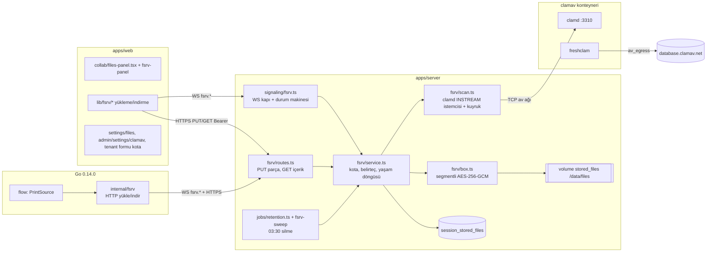

# Mimari — P28b: Sunucuda dosya saklama + ClamAV + sunucu depolama kotası

Tarih: 2026-11-16 · Durum: **r1** (mimar; kullanıcı "soru sorma" dedi, kararlar K-P28b-n; güvenlik tasarım turu K9a bekler)
Girdiler: `docs/gereksinimler-p28.md` (AC-353..363, AC-284, AC-404, AC-285..290, V43/V44/V50/V51, §8, S-P28-2), `docs/mimari-p28.md` §0 + §0.1,
`docs/mimari.md` §3, `docs/mimari-protokol.md` §3–4, ADR-0005, ADR-0009, ADR-0014, ADR-0030, ADR-0031.
Yeni ADR: **ADR-0032** (`docs/adr/0032-sunucu-dosya-deposu-clamav.md`). Kontrol listesi: `docs/tasarim-kontrol.md` "P28b".

**Bağlayıcı ilke — sadelik:** tek ekran, tek yol. Mod oturum açılışında **bir kez** sabitlenir; oturum hangi yoldan açılmış olursa olsun
(kod, bağlantı, talep, kayıtlı bilgisayar) aynı kural. SERVER modunda dosya ve yazdırma **yalnız** sunucu yolundan geçer; iki yol karışmaz.

---

## 1. Kapsam

| Kapsamda                                                                                                                    | Kapsam dışı / Sonra (neden)                                                         |
| --------------------------------------------------------------------------------------------------------------------------- | ----------------------------------------------------------------------------------- |
| Super Admin ClamAV ayarı (sunucu/port) + "Bağlantıyı Test Et" (PING + EICAR + imza tarihi) (AC-353, 361)                    | ClamAV dışı AV/sandbox, karantina klasörü, S3 vb. nesne deposu (gereksinim §4 m.10) |
| Tenant ayarı "Dosyaları sunucu üzerinden aktar ve virüs tara" + saklama 1–7 gün + aydınlatma onay kutusu (AC-354)           | Oturum ortasında mod değişimi (AC-355: açılışta sabit)                              |
| SERVER modunda tüm dosya aktarımları + yazdırma: parçalı TLS yükleme → AES-256-GCM şifreli saklama → clamd tarama → teklif  | Sunucu modunda gözetimsiz oturumda dosya (K-P28b-7: kapalı; Sonra)                  |
| ≤ 5 dk indirme belirteci, IDOR 404 (AC-356); oturum geçmişinden indirme (AC-360)                                            | Kayıt (P28e) — yalnız kota/depolama genişleme noktası bu pakette                    |
| Kota (tenant başına, vars. 20 GB) + disk boş alanı %10 koruması (AC-362); 03:30 silme + anonimleştirme/kalıcı silmede silme | Dosya önizleme, sunucuda dosya listesi/paylaşım ekranı, çoklu alıcı                 |
| clamd konteyneri (iç ağ, freshclam), fail-closed, `rs_av_scan_total{result}`, imza yaşı uyarısı (AC-359, 361)               | Sunucu modunda > 512 MB dosya (K-P28b-12)                                           |
| Konsol + müşteri dosya alanında AC-363 satırı; Go istemci 0.14.0 (`rs.cap.fsrv1`, `PrintSource`)                            | macOS/Linux (P28f/g aynı protokolü uygular)                                         |

## 2. Bileşenler



| Bileşen                                    | Sorumluluk                                                                                                                                        |
| ------------------------------------------ | ------------------------------------------------------------------------------------------------------------------------------------------------- |
| `signaling/fsrv.ts` (yeni)                 | WS `fsrv.*` kapı sırası (§5.2), oda başına yön başına tek etkin dosya, teklif/kabul/sonuç, `print` bağlama, oda kapanınca iptal                   |
| `fsrv/service.ts` (yeni)                   | Satır yaşam döngüsü (§3.2), kota rezervasyonu, disk %10, bellek içi belirteç tablosu (yükleme + indirme), audit + metrik                          |
| `fsrv/routes.ts` (yeni)                    | `PUT /api/v1/fsrv/uploads/:fid/chunks/:n`, `GET /api/v1/fsrv/files/:fid/content` (Bearer), geçmiş bağlantısı ucu                                  |
| `fsrv/box.ts` (yeni)                       | Dosya başına HKDF anahtarı, 64 KiB segmentli AES-256-GCM yazma/okuma akışı (§6)                                                                   |
| `fsrv/store.ts` (yeni)                     | `/data/files/{tenantId}/{rastgele}.rsf` yol kurma/doğrulama (`uploads/store.ts` kalıbı, ayrı kök), `.part` → rename, `statfs`                     |
| `fsrv/scan.ts` (yeni)                      | clamd TCP istemcisi (PING, VERSION, INSTREAM; kendi kodu, bağımlılık yok), eşzamanlılık 2, kuyruk 20, 60 sn zaman aşımı, sonuç sınıflandırma (§7) |
| `fsrv/usage.ts` (yeni)                     | `storageUsage(tx, tenantId)` — **tek** kota fonksiyonu; P28e kayıt toplamını buraya ekler (genişleme noktası)                                     |
| `settings/clamav.ts` (yeni)                | Sistem ayarı oku/yaz, test (PING + EICAR + VERSION), imza yaşı göstergesi (10 dk yoklama)                                                         |
| `tenants/settings.ts`, `tenants/routes.ts` | Tenant dosya modu + saklama alanları; Super Admin tenant düzenlemesine kota                                                                       |
| `sessions/repo.ts insertSession` (ek)      | `file_mode`'u aynı TX'te `tenant_settings`'ten okuyup yazar (tek ekleme noktası; üç çağıran değişmez)                                             |
| `signaling/collab.ts`, `rooms-features.ts` | SERVER odasında `file.meta` reddi ve caps daraltma (§5.4)                                                                                         |
| Go `internal/fsrv` (yeni), `flow` (ek)     | Yükleme/indirme HTTP istemcisi, `flow/files_server.go` akışı, `PrintSource` arayüzü (§8)                                                          |
| Web `lib/fsrv/*`, `components/collab/*`    | Konsol + misafir sayfası aynı bileşenler; ayar ekranları (§9)                                                                                     |

## 3. Veri modeli

Migration: **`20261123000000_p28b_stored_files`** (tek migration, expand; rollback = `DROP TABLE` + `DROP COLUMN`, veri kaybı yalnız P28b verisi).

### 3.1 Tablolar ve kolonlar

| Tablo / kolon                         | Tip                                                                                       | Not                                                                                                   |
| ------------------------------------- | ----------------------------------------------------------------------------------------- | ----------------------------------------------------------------------------------------------------- |
| `support_sessions.file_mode`          | `VARCHAR(10) NOT NULL DEFAULT 'P2P'`, CHECK ikili `P2P\|SERVER` (ADR-0014)                | `insertSession` TX'inde yazılır; sonra değişmez (UPDATE grant'ı bu kolona verilmez)                   |
| `tenant_settings.file_server_mode`    | `BOOLEAN NOT NULL DEFAULT FALSE`                                                          | Admin (`settings.edit`)                                                                               |
| `tenant_settings.file_retention_days` | `TINYINT NOT NULL DEFAULT 1`, CHECK 1..7                                                  | Admin                                                                                                 |
| `tenants.storage_quota_gb`            | `SMALLINT NOT NULL DEFAULT 20`, CHECK 1..2000                                             | **Yalnız Super Admin** (tenant varlığı; Admin `tenant_settings`'i düzenler, burayı değil — K-P28b-10) |
| `system_settings` anahtar `clamav`    | `value_json {host, port, lastTest: {ok, at, version, dbDate} \| null}`, `secret_enc` NULL | `system_settings_key_chk` += `clamav` (ikili); `system_settings_clamav_chk` JSON şeması (dba)         |
| **`session_stored_files`** (yeni)     | aşağıda                                                                                   | —                                                                                                     |

`session_stored_files`:

| Kolon                      | Tip                                                                                                                 | Not                                                                            |
| -------------------------- | ------------------------------------------------------------------------------------------------------------------- | ------------------------------------------------------------------------------ |
| `id`                       | `CHAR(26)` PK (ULID = protokoldeki `fid`)                                                                           | Disk adıyla ilişkisiz                                                          |
| `tenant_id`, `session_id`  | `CHAR(26)` NOT NULL; bileşik FK `(session_id, tenant_id)` → `support_sessions` RESTRICT                             | `tenants`'a doğrudan FK yok; tenant tutarlılığı bileşik FK ile                 |
| `direction`                | `VARCHAR(12)` CHECK ikili `TO_CUSTOMER\|TO_TECH`                                                                    |                                                                                |
| `purpose`                  | `VARCHAR(8)` CHECK ikili `FILE\|PRINT`                                                                              | PRINT = P28a yazdırma belgesi                                                  |
| `uploaded_by_user_id`      | `CHAR(26)` NULL (FK değil; `audit_logs.user_id` kalıbı)                                                             | Teknisyen yüklemesinde dolu; müşteri yüklemesinde NULL                         |
| `file_name`                | `VARCHAR(255)` NOT NULL, CHECK `sanitizeFileName` çıktısı (P5 `session_files` kalıbı)                               | Yalnız teklif/indirme `Content-Disposition`'ında; audit/log'a girmez           |
| `ext`                      | `VARCHAR(16)` NOT NULL (küçük harf, `[a-z0-9]{0,16}`)                                                               | `file.infected` audit'i için (AC-358)                                          |
| `size_bytes`               | `BIGINT` NOT NULL, CHECK 1..536870912                                                                               | Beyan edilen = rezerve edilen; tamamlanınca alınan baytla eşit olmalı          |
| `sha256`                   | `CHAR(64)` NOT NULL (beyan; sunucu tamamlanınca kendisi hesaplar, uyuşmazsa `CORRUPT`)                              |                                                                                |
| `storage_rel`              | `VARCHAR(80)` NULL, CHECK `^{tenant_id}/[A-Za-z0-9_-]{24}\.rsf$` (öndek = satırın tenant'ı, P12 kalıbı)             | Disk silinince NULL                                                            |
| `key_ver`                  | `TINYINT UNSIGNED` NOT NULL                                                                                         | `crypto:check-retire` dosya volume'unu görmeden sürüm kullanımını DB'den sayar |
| `state`                    | `VARCHAR(12)` CHECK ikili `UPLOADING\|SCANNING\|CLEAN\|INFECTED\|SCAN_FAILED\|CORRUPT\|CANCELLED\|EXPIRED\|DELETED` | §3.2                                                                           |
| `scan_reason`              | `VARCHAR(16)` NULL, CHECK ikili `UNAVAILABLE\|TIMEOUT\|ENCRYPTED\|LIMIT\|BUSY\|ERROR`                               | Yalnız `SCAN_FAILED`                                                           |
| `signature`                | `VARCHAR(120)` NULL, CHECK `^[A-Za-z0-9._:/-]{1,120}$`                                                              | Yalnız `INFECTED`                                                              |
| `delivered_at`             | `DATETIME(3)` NULL                                                                                                  | Alıcı `fsrv.result{ok:true}`                                                   |
| `expires_at`               | `DATETIME(3)` NULL                                                                                                  | `CLEAN` olunca `scanned_at + file_retention_days` (yükleme anındaki değer)     |
| `scanned_at`, `deleted_at` | `DATETIME(3)` NULL                                                                                                  |                                                                                |
| `created_at`, `updated_at` | `DATETIME(3)`                                                                                                       |                                                                                |

İndeksler: `IX(tenant_id, state)` (kota toplamı: `state IN ('UPLOADING','SCANNING','CLEAN')`), `IX(session_id, created_at)` (geçmiş detayı),
`IX(state, expires_at)` (03:30 işi). Büyüme: oturum başına birkaç satır; satır anonimleştirmede silinir (≤ `retention_days`).

**Kota kuralı (tek fonksiyon `storageUsage`):** `SUM(size_bytes) WHERE tenant_id=? AND state IN ('UPLOADING','SCANNING','CLEAN')` (+ P28e kayıt
toplamı). `UPLOADING` satırı beyan edilen boyutla **rezerve** eder; eşzamanlı iki yükleme `SELECT … FROM tenants WHERE id=? FOR UPDATE` ile
serileştirilir (rezervasyon + INSERT tek TX).

### 3.2 Durum makinesi (`state`)

```
UPLOADING ─tamam+sha ok→ SCANNING ─temiz→ CLEAN ─süre doldu→ EXPIRED
    │             │                 ├─virüs→ INFECTED (disk hemen silinir)
    │             │                 └─taranamadı→ SCAN_FAILED (disk hemen silinir)
    │             └─sha/boyut uyuşmaz→ CORRUPT (disk hemen silinir)
    └─iptal / 10 dk hareketsiz / oda kapandı / sunucu yeniden başladı→ CANCELLED (.part silinir)
CLEAN ─anonimleştirme/firma silme→ satır silinir (DELETED yalnız elle yapılacak silmeler için ayrılmış; P28b'de yazılmaz → K-P28b-15)
```

Kural: **disk dosyası yalnız `CLEAN` iken vardır.** Diğer tüm son durumlarda `storage_rel = NULL`. Alıcının reddetmesi/teslim edilmesi durumu
değiştirmez (`CLEAN` saklama süresi boyunca geçmişten indirilebilir — AC-360; K-P28b-9).

### 3.3 Silme ve kalıcı silme (ADR-0030 uyumu)

- **03:30 işi** (mevcut `jobs/retention.ts`, yeni adım `fsrvExpire`): `state='CLEAN' AND expires_at <= now` → disk sil → `EXPIRED`, `storage_rel=NULL`;
  tenant başına bir `file.expired{count, bytes}` audit. Aynı turda **mutabakat**: (a) `.part`/`.rsf` dosyası olup satırı `UPLOADING|CLEAN` olmayan ve
  24 sa'ten eski dosyalar silinir (yetim); (b) `CLEAN` satırı olup dosyası olmayan → `EXPIRED` (yedekten dönüş sonrası, §11.4). Sayılar `retention.run` audit'ine.
- **Anonimleştirme** (`anonymizeSessionBatch`): `session_files` silinirken aynı TX'te `session_stored_files` satırları da silinir; disk dosyaları TX'ten
  **önce** silinir (dosya silinip TX geri alınırsa satır `CLEAN` kalır, sonraki tur mutabakatı `EXPIRED` yapar — güvenli yön).
- **Kalıcı silme (`purgeAnonymized` adım 2):** sıra `session_stored_files` → `session_files` → `session_consents` → `support_sessions` (FK RESTRICT;
  anonimleştirme satırları zaten sildiği için normalde 0 satır, ama sıra eklenmezse kenar durumda `db_signal` üretir).
- **Firma silme (`tenant-purge-repo.ts DATA_STEPS`):** yeni adım `stored_files` oturum adımından **önce**: dosya kökünde `/{tenantId}/` klasörü silinir,
  sonra `byTenant("session_stored_files")`.
- Tetikleyici **eklenmez** (yedek betiği 3 tetikleyici bekler).

### 3.4 Grant (`prisma/sql/grants.sql`, `check-app-grants.sh`)

`app`: `session_stored_files` SELECT, INSERT, UPDATE(state, scan_reason, signature, storage_rel, delivered_at, expires_at, scanned_at, deleted_at,
updated_at), DELETE. `support_sessions.file_mode` için UPDATE **yok**. `tenants` UPDATE(storage_quota_gb) mevcut tenant düzenleme grant'ına eklenir.

## 4. REST API sözleşmesi (zod: `packages/contracts/src/api/fsrv.ts`, `api/clamav.ts`)

Ortak: hata zarfı `docs/mimari-api.md` "Ortak kurallar". Yeni hata kodu: **`STORAGE_QUOTA`** (HTTP 409, "Firma depolama kotası doldu"),
**`AV_NOT_READY`** (HTTP 409, "Önce virüs tarama bağlantısını başarıyla test edin"). Belirteçler yalnız `Authorization: Bearer` başlığında;
**URL'de asla** (Caddy yol loglar, başlığı siler).

| Uç                                                 | Kimlik / yetki                                                                                                                                            | Girdi                                                                                      | Çıktı / hata                                                                                                                                                                                                                                                                        |
| -------------------------------------------------- | --------------------------------------------------------------------------------------------------------------------------------------------------------- | ------------------------------------------------------------------------------------------ | ----------------------------------------------------------------------------------------------------------------------------------------------------------------------------------------------------------------------------------------------------------------------------------- |
| `PUT /api/v1/fsrv/uploads/:fid/chunks/:n`          | Bearer yükleme belirteci (WS'den, fid'e bağlı); çerez/CSRF yok                                                                                            | `Content-Type: application/octet-stream`, gövde = parça `n` (0'dan); `bodyLimit` 1 MiB + 1 | 200 `{next, received}`; son parçada 202 `{state:"SCANNING"}`. `n < next` → 200 (idempotent, yazmaz); `n > next` → 409 `{next}`; parça boyu ≠ beklenen (son parça hariç tam 1 MiB) → 400; belirteç yok/süresi dolmuş/fid uyuşmaz → **404** (tek tip); disk %10 → 409 `STORAGE_QUOTA` |
| `GET /api/v1/fsrv/files/:fid/content`              | Bearer indirme belirteci (≤ 5 dk, fid + tenant + oturum bağlı)                                                                                            | —                                                                                          | 200 akış (`application/octet-stream`, `Content-Disposition: attachment; filename*=UTF-8''<ad>`, `Content-Length`, `Cache-Control: no-store`, `X-Content-Type-Options: nosniff`); her istek `file.download` audit. Belirteç yok/süresi dolmuş/fid uyuşmaz/`state≠CLEAN` → **404**    |
| `POST /api/v1/sessions/:id/stored-files/:fid/link` | Çerez + Origin + CSRF; `session_history.view` + `file_transfer.use`; `historyScope` (mevcut P8 kuralı: teknisyen yalnız kendi oturumları, Admin tenant'ı) | —                                                                                          | 200 `{fid, token, expiresAt}` (5 dk). Başka tenant/oturum/kapsam dışı/`state≠CLEAN` → 404; 20/dk/kullanıcı → 429                                                                                                                                                                    |
| `GET /api/v1/sessions/:id` (ek, P8 detay)          | mevcut                                                                                                                                                    | —                                                                                          | yeni alan `storedFiles: {id, direction, purpose, name, sizeBytes, state, scanReason?, signature?, expiresAt?, canDownload}[]` (`canDownload` = `CLEAN` + iki yetki)                                                                                                                 |
| `GET /api/v1/admin/settings/clamav`                | Super Admin                                                                                                                                               | —                                                                                          | `{host, port, source:"panel"\|"env", lastTest, signatureAgeDays?, stale}`                                                                                                                                                                                                           |
| `PUT /api/v1/admin/settings/clamav`                | Super Admin + step-up (mevcut `stepUp`, mysql/whatsapp kalıbı)                                                                                            | `{host: hostname\|IP ≤ 253, port: 1..65535}`                                               | 200 görünüm; host/port değişince `lastTest = null` (yeniden test gerekir). Host kuralı `lib/netguard.ts` + `HOST_NOT_ALLOWED` kalıbı (yalnız özel/iç adres veya tek etiketli konteyner adı — K-P28b-16). Audit `settings.clamav` eski→yeni                                          |
| `POST /api/v1/admin/settings/clamav/test`          | Super Admin; 6/dk                                                                                                                                         | `{host?, port?}` (boşsa kayıtlı)                                                           | 200 `{ok, eicarDetected, version, dbDate, signatureAgeDays, stale, message?}`; başarı = PING `PONG` + EICAR `FOUND` (AC-353). Sonuç `lastTest`'e yazılır (yalnız kayıtlı değerle test edildiyse). Audit `settings.clamav.test` (sonuç)                                              |
| `GET/PUT /api/v1/settings/tenant` (ek)             | `settings.view` / `settings.edit`                                                                                                                         | ek alanlar `fileServerMode: boolean`, `fileRetentionDays: 1..7`, `consentUpdated?: true`   | `false→true` geçişinde: `lastTest.ok !== true` → 409 `AV_NOT_READY` (`fields.fileServerMode`); `consentUpdated !== true` → 400 (`fields.consentUpdated`, AC-354). Görünümde `storage: {usedBytes, quotaBytes}` (AC-362). Audit mevcut tenant ayarı olayı, eski→yeni + `consentAck`  |
| `PATCH /api/v1/admin/tenants/:id` (ek)             | Super Admin                                                                                                                                               | `storageQuotaGb: 1..2000`                                                                  | Audit `tenant.storage_quota` eski→yeni. Kota kullanımın altına düşürülebilir (yeni yüklemeler reddedilir; mevcutlar silinmez)                                                                                                                                                       |
| `/health` (ek, iç)                                 | iç ağ                                                                                                                                                     | —                                                                                          | gövdeye `clamav: {configured, reachable, signatureAgeDays, stale}`; **HTTP durumu değişmez**, `/ready` clamd'a bakmaz (compose healthcheck düşmesin — K-P28b-14)                                                                                                                    |

**Parça boyu 1 MiB (K-P28b-4):** Caddy `read_body 30s` tam istek süresidir; 1 MiB 30 sn'de ≥ 280 kbit/s ister (müşteri yükleme hattı için güvenli
pay). nginx `client_max_body_size 3m` yeterli; Fastify `bodyLimit` yalnız bu rotada 1 MiB + 1.

**Belirteçler (bellek, ADR-0005):** 32 bayt rastgele, base64url; tabloda SHA-256'sı. Yükleme belirteci: fid + yön + oturum; son parçadan sonra veya
**10 dk hareketsizlikte** düşer (satır `CANCELLED`). İndirme belirteci: fid + oturum + tenant + `actor` (`TECH:<userId>` | `CUSTOMER` | `HISTORY:<userId>`),
`expiresAt = now + 5 dk`; süre içinde tekrar kullanılabilir (kopan indirmenin yeniden başlaması), her GET ayrı audit. Sunucu yeniden başlarsa belirteçler düşer
(oturumlar da düşer — kabul edilen sınır).

## 5. WS protokolü (`packages/contracts/src/ws-fsrv.ts`, Go eşi `internal/signal`; fikstür `fixtures/fsrv.json`)

### 5.1 Mod ve yetenek

- Misafir istemci yeni belirteç bildirir: `rs.cap.fsrv1` (`WS_GUEST_CAP_FSRV`). Tarayıcı misafiri belirteç bildirmez ama **daima yetenekli sayılır**
  (web, sunucuyla aynı dağıtımda yayınlanır; eski tarayıcı sayfası olamaz) — sunucu `guestKind=BROWSER` → `fsrv` özelliği var.
- Gözetimsiz odada belirteçler okunmaz (O-P28a-4 aynen) → `fsrv` yok.
- `Room.fileMode` (`P2P|SERVER`) oda kurulurken `support_sessions.file_mode`'dan okunur; **oturum boyunca değişmez** (AC-355).
- Teknisyene `hello` ve `peer.joined{guest}`: yeni alan `fileMode?: "P2P"|"SERVER"` (yoksa P2P) + `guestFeatures` içinde `"fsrv"`.
- Misafire `hello.fileMode` **yalnız `fsrv` bildiren sokete** (Go katı ayrıştırma; eski istemciye yeni alan gitmez).

### 5.2 Mesajlar

Kimlik: `xid` = istemcinin ürettiği istek kimliği (`/^[A-Za-z0-9_-]{8,26}$/`, P28a cid kalıbı, son 64 tekrar → VALIDATION); `fid` = sunucunun ULID'i.

| t               | Yön              | Alanlar                                                                                               | Sunucu davranışı                                                                                                                                                                                                                                                                                                                                                                                                                                                                                                                                                                                                                                                                                                                                            |
| --------------- | ---------------- | ----------------------------------------------------------------------------------------------------- | ----------------------------------------------------------------------------------------------------------------------------------------------------------------------------------------------------------------------------------------------------------------------------------------------------------------------------------------------------------------------------------------------------------------------------------------------------------------------------------------------------------------------------------------------------------------------------------------------------------------------------------------------------------------------------------------------------------------------------------------------------------- |
| `fsrv.init`     | tech→S, guest→S  | `xid`, `name: string(1..255)`, `size: int 1..536870912`, `sha256`, `purpose: "FILE"\|"PRINT"`, `pid?` | Kapı sırası (ilk tutan döner, `fsrv.status{xid, state:"REJECTED", reason}`): (1) `fileMode≠SERVER` → teknisyene `REJECTED/MODE`; misafir soketinde `fsrv.*` tipleri yalnız SERVER odasında ve `fsrv` bildiren sokette şemadadır, aksi 1008 (P28a S-P18-T1 kalıbı); (2) `FILE` için teknisyen `file_transfer.use` / caps'te `file_transfer` yok, `PRINT` için P28a print kapısı (pid bekleyen `printPending.pid` olmalı, yön TO_CUSTOMER, gönderen teknisyen) → `FORBIDDEN`; (3) ADMITTED misafir yok veya misafir `fsrv` yok → `UNSUPPORTED`; (4) yönde etkin aktarım var → `BUSY`; (5) `size > min(max_file_mb, 512) MiB` → `TOO_LARGE`; (6) 20/dk/oda → `RATE_LIMITED`; (7) disk boş < %10 veya kota → `QUOTA`; geçerse satır `UPLOADING` + `fsrv.upload` |
| `fsrv.upload`   | S→gönderen       | `xid`, `fid`, `token`, `chunkBytes: 1048576`, `chunks`                                                | Yükleme belirteci                                                                                                                                                                                                                                                                                                                                                                                                                                                                                                                                                                                                                                                                                                                                           |
| `fsrv.status`   | S→iki taraf      | `fid?`, `xid?`, `state`, `reason?`, `signature?`, `progress?: 0..100`                                 | `state` ∈ `UPLOADING SCANNING CLEAN INFECTED SCAN_FAILED CORRUPT CANCELLED REJECTED DELIVERED`. Yükleme ilerlemesi alıcıya en çok 1/sn. `INFECTED` ve `SCAN_FAILED` iki tarafa ≤ 5 sn (AC-358/359)                                                                                                                                                                                                                                                                                                                                                                                                                                                                                                                                                          |
| `fsrv.offer`    | S→alıcı          | `fid`, `name`, `size`, `sha256`, `purpose`                                                            | `CLEAN` sonrası. `FILE` → alıcı **mevcut kabul diyaloğu** (AC-36, AC-116 aynen; `sanitizeFileName` + tehlikeli uzantı uyarısı). `PRINT` → misafire gider, misafir diyalog açmaz, doğrudan indirir (onay P28a diyaloğunda, sayfa sayısıyla)                                                                                                                                                                                                                                                                                                                                                                                                                                                                                                                  |
| `fsrv.accept`   | alıcı→S          | `fid`                                                                                                 | Yalnız teklifin alıcısından; sunucu `fsrv.download` döner. Aynı fid için en çok 3 belirteç                                                                                                                                                                                                                                                                                                                                                                                                                                                                                                                                                                                                                                                                  |
| `fsrv.reject`   | alıcı→S          | `fid`                                                                                                 | Göndericiye `fsrv.status{REJECTED}`; dosya `CLEAN` kalır (saklama süresince geçmişte)                                                                                                                                                                                                                                                                                                                                                                                                                                                                                                                                                                                                                                                                       |
| `fsrv.download` | S→alıcı          | `fid`, `token`, `expiresAt`                                                                           | ≤ 5 dk                                                                                                                                                                                                                                                                                                                                                                                                                                                                                                                                                                                                                                                                                                                                                      |
| `fsrv.result`   | alıcı→S          | `fid`, `ok: boolean`                                                                                  | Alıcı SHA-256'yı doğruladıktan sonra. Sunucu `session_files` satırını **kendisi** yazar (`OK`/`CORRUPT`; S-P5-T2-4 riski SERVER modunda kapanır), `delivered_at`, göndericiye `DELIVERED`                                                                                                                                                                                                                                                                                                                                                                                                                                                                                                                                                                   |
| `fsrv.cancel`   | gönderen/alıcı→S | `fid`                                                                                                 | `UPLOADING/SCANNING` → `CANCELLED` + sil; `CLEAN` teklif → teklif geri çekilir (dosya saklanır)                                                                                                                                                                                                                                                                                                                                                                                                                                                                                                                                                                                                                                                             |

Oda kapanınca (oturum sonu, misafir/teknisyen kopması 120 sn sonrası) `UPLOADING/SCANNING` satırları `CANCELLED`. Sunucu açılışında `UPLOADING/SCANNING`
satırların hepsi `CANCELLED` + `.part` silinir (ADR-0005: odalar zaten düştü).

### 5.3 Yazdırma (AC-355 "yazdırma dahil")

P28a WS kapısı (`print.request` 3b dahil) aynen. SERVER modunda DC `print.ready` → konsol PDF'i `fsrv.init{purpose:"PRINT", pid}` ile yükler (DC `print.offer`
/ `file` çerçevesi / `print.done` **gönderilmez**) → tarama → misafire `fsrv.offer{purpose:"PRINT"}` → misafir `fsrv.accept` → indirir (yalnız bellek) →
boyut + SHA-256 + `%PDF-` doğrulaması (`print.done` eşdeğeri) → P28a inceleme/diyalog/basma aynen. **Dosya adı bu yolda WS'den geçer** (P28a "ad WS'den
geçmez" kuralı SERVER modunda bilinçli olarak gevşer; ad TLS içinde, DB'de saklanır; audit/log'a yine girmez — K-P28b-13). Son tarihler: misafirin
8 dk aktarım + inceleme süresi, 512 MiB değil 20 MB PDF için 1 MiB parça + ≤ 60 sn tarama ile karşılanır; sunucunun 10 dk `ABANDONED` sınırı değişmez.
`INFECTED/SCAN_FAILED` → `print.status{ERROR}` + aynı virüs/taranamadı metni.

### 5.4 DC dosya kanalının reddi (iki uç, AC-355)

| Uç                   | SERVER odasında                                                                                                                                                                                                                                                                                                         |
| -------------------- | ----------------------------------------------------------------------------------------------------------------------------------------------------------------------------------------------------------------------------------------------------------------------------------------------------------------------- |
| Sunucu               | (a) Misafire giden `caps`'ten `file_transfer` ve `print` **çıkarılır** (`capsFor(caps, features, fileMode)`); (b) WS `file.meta` (P5) yok sayılır + `rs_fsrv_denied_total{reason="dc_meta"}` + log (audit yok); (c) `fsrv` bildirmeyen misafirde teknisyene `guestFeatures`'ta `fsrv` yok → konsol dosya/yazdırma pasif |
| Go istemci (0.14.0)  | `hello.fileMode=SERVER` → DC `file.offer` otomatik `file.reject`, `file` kanalı çerçeveleri düşürülür, `print.offer` reddedilir (`report{ERROR}`), dosya gönderme düğmesi fsrv yoluna bağlanır                                                                                                                          |
| Go istemci (≤ 0.13)  | caps'te `file_transfer` olmadığı için G-09 alıcı kuralı DC `file.offer`'ı zaten reddeder; dosya sekmesi gizli. Teknisyende AC-352 metni: "Müşterinin uygulaması bu özelliği desteklemiyor — güncel sürümü indirmesini isteyin"                                                                                          |
| Konsol / misafir web | `fileMode=SERVER` → `files-panel` yalnız fsrv yolunu kullanır; DC `file.offer` gelirse otomatik reddeder; `file` kanalı açılmaz                                                                                                                                                                                         |
| Gözetimsiz oda       | `fsrv` yok → SERVER modunda dosya kapalı (P27 otomatik `Gelen` aktarımı dahil); konsol: "Bu firmada dosyalar sunucuda taranır; gözetimsiz oturumda dosya aktarımı kapalı" (K-P28b-7)                                                                                                                                    |

Testler: SERVER odasında eski istemci fikstürüne giden `hello.caps` = `["remote_control"]` (dosya yok); `file.meta` → `session_files` satırı 0;
P2P odasında davranış birebir eski (regresyon).

## 6. Şifreleme (AC-356; `fsrv/box.ts`)

- **Anahtar türetme:** `fileKey = HKDF-SHA256(ikm = APP_ENCRYPTION_KEYS[key_ver], salt = 32 B rastgele (dosya başlığında), info = "remote-support/stored-file/v1|" + tenantId + "|" + fid, 32 B)`.
  Ana anahtar doğrudan kullanılmaz (mevcut `macKey` HKDF kalıbı). `key_ver` = yazım anındaki güncel sürüm, DB kolonunda.
- **Biçim (`.rsf`):** başlık 52 B = `"RSF1"(4) | key_ver(1) | 0(3) | segBytes uint32 BE = 65536 | plainSize uint64 BE | salt(32)`; ardından segmentler
  `ciphertext(≤ 64 KiB) | tag(16)`.
- **Nonce:** `0x00 × 7 | segmentIndex uint32 BE | lastFlag(1)` — anahtar dosyaya özgü olduğundan sayaç nonce'u tekrar etmez. **AAD** = başlığın tamamı.
  Son segment bayrağı + başlıktaki `plainSize` kesilmeyi, sayaç yeniden sıralamayı, AAD başka dosyaya taşımayı yakalar.
- **Akış:** yükleme parçası (1 MiB = 16 segment) bellekte tamamlanır → segmentler şifrelenip `.part`'a eklenir → `fsync`; son parçada SHA-256 (düz metin
  üzerinde akışla hesaplanmış) beyanla karşılaştırılır → `rename(.part → .rsf)`. Düz metin diske hiç yazılmaz.
- **Okuma:** segment segment doğrula-sonra-yaz; doğrulanmayan segmentte akış kesilir (istemci boyut/SHA uyuşmazlığıyla `CORRUPT` görür). 50 MB ≈ 800
  segment; Node `aes-256-gcm` ile ölçüm hedefi < 1 sn.
- **Genişleme noktası (P28e):** segment bağımsız çözülebildiği için oynatıcı `Range` ile rastgele erişebilir (`segmentAt(i)`); P28b `Range` sunmaz.
- **Rotasyon:** yeni sürüm eklenince yeni dosyalar onunla yazılır; eski sürüm ≤ 7 gün sonra kullanılmaz. `crypto:check-retire` `session_stored_files`
  `key_ver` sayısını (`state='CLEAN'`) raporlar; `crypto:rewrap` dosyalara dokunmaz (gerek yok, süre kısa) — runbook.
- nginx gövde tamponu: `/api/v1/fsrv/` konumunda `client_body_buffer_size 2m` (parça bellek içinde kalır, host diskine düz metin yazılmaz — K-P28b-17).

## 7. ClamAV (AC-353, 357..359, 361)

### 7.1 Konteyner (`deploy/docker-compose.yml`, devops)

- İmaj: resmî `clamav/clamav` (Cisco Talos), **sürüm + digest sabit**; GPL-2.0 — ayrı süreç/konteyner, kodumuz bağlanmaz, yalnız TCP protokolü (ADR-0032).
- Ağlar: **`av`** (`internal: true`; yalnız `server` + `clamav`) ve **`av_egress`** (yalnız `clamav`; freshclam'ın `database.clamav.net` çıkışı). `edge`
  ağına eklenmez, port **yayımlanmaz** (AC-353 port taraması). Volume `clamav_db:/var/lib/clamav`.
- `read_only: true` + tmpfs (`/run/clamav`, `/tmp`, `/var/log/clamav`), `no-new-privileges`, `cap_drop: [ALL]` (imaj kullanıcı değiştirmesi gerektiriyorsa
  K0'da en az yetki belirlenir), `mem_limit: 2g`, healthcheck `clamdcheck`/PING.
- `deploy/clamav/clamd.conf` ve `freshclam.conf` ro bağlanır. Değerler **sabitlenen imajın örnek `clamd.conf`'undan doğrulanır (devops K0)**; tasarımın
  istediği davranış: TCP 3310 dinleme; akış/dosya/tarama boyutu tavanı ≥ 512 MiB (sunucu modu üst sınırı + pay); şifreli arşiv/belge ve sınır aşımı
  **bulgu olarak raporlanır** (sessizce temiz sayılmaz); veritabanı yeniden yüklemesi eşzamanlı değil (bellek iki katına çıkmasın; yükleme sırasındaki
  tarama zaman aşımına düşer → fail-closed); freshclam günde ≥ 4 kontrol.
- **İki yığın aynı host:** prod ve staging ayrı clamd çalıştırır (~1,2–1,6 GB RAM her biri). Karar: staging clamd varsayılan **kapalı profil**
  (`profiles: [av]`); test haftasında açılır. Ölçüm ve kapasite runbook §28b (K-P28b-18).

### 7.2 İstemci ve sınıflandırma (`fsrv/scan.ts`)

- Protokol: `zPING\0` → `PONG`; `zVERSION\0` → `ClamAV x.y.z/<db>/<tarih>`; `zINSTREAM\0` + `uint32 BE uzunluk | veri` (64 KiB) + `0` → yanıt.
  Bağlantı zaman aşımı 3 sn, tarama toplam **60 sn** (AC-359). Eşzamanlılık 2, kuyruk 20; kuyrukta > 30 sn bekleyen → `SCAN_FAILED/BUSY`.
- Dosya şifreli dosyadan akışla çözülerek gönderilir (düz metin bellekte segment kadar).

| clamd yanıtı                                               | Sonuç                     | Kullanıcı metni (iki taraf, ≤ 5 sn)                      |
| ---------------------------------------------------------- | ------------------------- | -------------------------------------------------------- |
| `stream: OK`                                               | `CLEAN`                   | (teklif)                                                 |
| `stream: <imza> FOUND`, imza `Heuristics.Encrypted.*`      | `SCAN_FAILED/ENCRYPTED`   | "Dosya taranamadı, teslim edilmedi: şifreli arşiv"       |
| `stream: <imza> FOUND`, imza `Heuristics.Limits.Exceeded*` | `SCAN_FAILED/LIMIT`       | "Dosya taranamadı, teslim edilmedi: tarama boyut sınırı" |
| `stream: <imza> FOUND` (diğer)                             | `INFECTED` + imza         | "Dosya virüslü bulundu (<imza>), teslim edilmedi"        |
| `INSTREAM size limit exceeded`                             | `SCAN_FAILED/LIMIT`       | aynı (sınır)                                             |
| bağlantı hatası / ayar yok                                 | `SCAN_FAILED/UNAVAILABLE` | "… : tarama servisine ulaşılamadı"                       |
| 60 sn aşımı                                                | `SCAN_FAILED/TIMEOUT`     | "… : tarama zaman aşımı"                                 |
| diğer `ERROR` / ayrıştırılamayan                           | `SCAN_FAILED/ERROR`       | "… : tarama hatası"                                      |

Önek adları (`Heuristics.Encrypted.`, `Heuristics.Limits.Exceeded`) K0'da sabitlenen imajla EICAR + şifreli zip + büyük dosya fikstürüyle doğrulanır.
İmza adı `^[A-Za-z0-9._:/-]{1,120}$` dışındaysa "bilinmeyen imza" yazılır. **Fail-closed:** ClamAV ayarı yoksa/kapalıysa SERVER modunda hiçbir dosya
teslim edilmez (tenant anahtarı açılamaz ama sonradan erişim kaybı da aynı sonucu verir).

### 7.3 İmza yaşı (AC-361)

Sunucu 10 dk'da bir `VERSION` yoklar → gauge `rs_av_signature_age_seconds`, `rs_av_up`. Yaş > 3 gün → ClamAV ayar ekranında uyarı bandı + `/health`
`stale:true` + runbook alarmı. Test sonucu da yaşı gösterir.

## 8. Go istemci (0.14.0, `apps/agent-win`)

| Değişiklik                                       | Dosya                                                                                                                                                                                                                                                                                                                              |
| ------------------------------------------------ | ---------------------------------------------------------------------------------------------------------------------------------------------------------------------------------------------------------------------------------------------------------------------------------------------------------------------------------- |
| `rs.cap.fsrv1` bildirimi; `hello.fileMode`       | `internal/signal` (alt protokol listesi, yeni tipler `fsrv.*`, `hello.fileMode` yalnız yeni şemada); helper `features=nil` değişmez                                                                                                                                                                                                |
| HTTP istemcisi                                   | yeni `internal/fsrv/{client.go, upload.go, download.go}`: aynı `PUBLIC_BASE_URL` kökü, mevcut TLS/proxy ayarları (`internal/api` kalıbı), `Authorization: Bearer`, parça başına 3 deneme (1/2/4 sn), `n>next` 409'da `next`'ten devam                                                                                              |
| İndirme                                          | `FILE`: mevcut `internal/transfer` hedefi (`Downloads`, müşteri seçimi, `.part` → SHA → rename, MOTW `Zone.Identifier`) — yalnız bayt kaynağı değişir (`io.Reader`). `PRINT`: yalnız bellek, ≤ 20 MiB sayaç                                                                                                                        |
| Yükleme                                          | Mevcut "Dosya gönder" düğmesi; dosya akışla okunur, SHA-256 önce hesaplanır (iki geçiş, bellek sabit)                                                                                                                                                                                                                              |
| **`PrintSource` arayüzü** (kodda yok, çıkarılır) | `flow/clipprint_print.go`: `type PrintSource interface { Fetch(ctx, job) ([]byte, error) }`; `dcPrintSource` (bugünkü `dc.Receiver` toplama) ve `serverPrintSource` (fsrv indirme); seçim **oturum başında** `fileMode`'a göre tek kez. Doğrulama (boyut, SHA, `%PDF-`, değişmez tampon) arayüzün **arkasında değil**, ortak kodda |
| DC reddi                                         | `fileMode=SERVER` → `file.offer` otomatik ret, `file` çerçeveleri düşürülür, `print.offer` → `report{ERROR}` (§5.4)                                                                                                                                                                                                                |
| Metinler                                         | `flow/messages_p28.go`: AC-358/359/363 metinleri, "Dosya virüs taramasında…" ilerleme                                                                                                                                                                                                                                              |
| UI                                               | Dosya alanında AC-363 satırı (yalnız SERVER modunda); ilerleme: "Yükleniyor %n" → "Virüs taraması yapılıyor" → mevcut kabul diyaloğu                                                                                                                                                                                               |

İz testi (AC-289/350): SERVER modunda `%TEMP%`'e yazım yok (yükleme kaynaktan akış, indirme `Downloads\*.part`); yazdırma yalnız bellek.

## 9. Web (`apps/web`; DESIGN.md token'ları, lucide, iki tema, 390 px, axe 0)

| Ekran / bileşen                                                 | İçerik                                                                                                                                                                                                                                                                                                                                                                                                                                                                                                                 |
| --------------------------------------------------------------- | ---------------------------------------------------------------------------------------------------------------------------------------------------------------------------------------------------------------------------------------------------------------------------------------------------------------------------------------------------------------------------------------------------------------------------------------------------------------------------------------------------------------------- |
| `components/collab/files-panel.tsx` (konsol + misafir)          | Tek bileşen; `fileMode` prop'u bayt yolunu seçer (`lib/dc/file-*` ya da `lib/fsrv/*`), diyaloglar/listeler aynı. SERVER modunda en üstte bilgi satırı (`ShieldCheck`): **"Dosyalar sunucuda virüs taramasından geçer; bu modda uçtan uca şifreli değildir"** (AC-363). Satır durumları: "Yükleniyor %n" → "Virüs taraması yapılıyor" → "Müşteri onayı bekleniyor" → "Teslim edildi" / "Dosya virüslü bulundu (<imza>), teslim edilmedi" / "Dosya taranamadı, teslim edilmedi: <neden>" / "Firma depolama kotası doldu" |
| `lib/fsrv/{upload.ts, download.ts, ws.ts}` (yeni)               | Yükleme: `File.slice` 1 MiB, SHA-256 (`lib/dc/sha256.ts` yeniden), sıralı PUT, yeniden deneme 3. İndirme: `fetch` + `ReadableStream` → mevcut `lib/dc/file-disk.ts` sink (`showSaveFilePicker` varsa disk, yoksa ≤ max Blob); SHA doğrulanınca `fsrv.result`                                                                                                                                                                                                                                                           |
| `clip-print-panel.tsx` (ek)                                     | SERVER modunda PDF yükleme `lib/fsrv/upload.ts` (`purpose:"PRINT"`); ilerleme "Gönderiliyor (%)" → "Virüs taraması yapılıyor" → mevcut                                                                                                                                                                                                                                                                                                                                                                                 |
| `settings/files/page.tsx` (yeni sekme "Dosyalar", `FolderLock`) | Anahtar + saklama (1–7) + aydınlatma kutusu (yalnız açarken görünür, zorunlu) + "Kullanım: x GB / y GB" çubuğu (AC-362). AV testi başarısızsa anahtar pasif + neden "Sistem yöneticisi virüs tarama bağlantısını test etmedi" (409 alan hatası da forma yansır)                                                                                                                                                                                                                                                        |
| `admin/settings/clamav/page.tsx` (yeni sekme, `ShieldCheck`)    | Sunucu, port (3310), "Kaydet", "Bağlantıyı Test Et" → sonuç kartı (EICAR yakalandı, sürüm, imza tarihi, yaş); yaş > 3 gün uyarı bandı (AC-361)                                                                                                                                                                                                                                                                                                                                                                         |
| `admin/tenants/tenant-form-dialog.tsx` (ek)                     | "Sunucu depolama kotası (GB)" sayı alanı, kullanım bilgisi                                                                                                                                                                                                                                                                                                                                                                                                                                                             |
| `history/[id]` (ek)                                             | "Sunucudaki dosyalar" bölümü (yalnız satır varsa): ad, yön, boyut, durum, son gün; "İndir" (`Download`) yalnız `canDownload`; tıklama → link ucu → akışlı indirme                                                                                                                                                                                                                                                                                                                                                      |

5 durum her yeni ekranda: yükleniyor (iskelet), boş ("Bu oturumda sunucuda saklanan dosya yok"; ClamAV "Henüz yapılandırılmadı"), hata (zarf mesajı +
ref), kısmi (ClamAV erişilemiyor ama ayar kayıtlı; kota bilgisi alınamadı), başarılı. Sık işlem ilerlemeleri animasyonsuz.

## 10. Güvenlik tasarımı

### 10.1 Tehdit modeli (STRIDE; güvenlik ajanı S-P28b-n'yi bu listeden verir)

| #   | Tehdit                                                                      | Önlem                                                                                                                                                                                                                                                         |
| --- | --------------------------------------------------------------------------- | ------------------------------------------------------------------------------------------------------------------------------------------------------------------------------------------------------------------------------------------------------------- |
| T1  | **S/I** Başka tenant/oturumun dosyasını indirme (IDOR)                      | İçerik yalnız fid+oturum+tenant'a bağlı ≤ 5 dk belirteçle; geçmiş linki `historyScope` + iki yetki; tüm uyuşmazlıklar tek tip 404; entegrasyon IDOR matrisi (AC-356)                                                                                          |
| T2  | **I** Belirtecin sızması (log, Referer, tarayıcı geçmişi)                   | Yalnız `Authorization` başlığı (Caddy siler), URL'de yok; WS kimlik bilgisi kalıbı; 5 dk; log tarama testi belirteç öneki `fsrv-` olmadan da 43 karakter base64url arar                                                                                       |
| T3  | **T** Diskteki dosyanın değiştirilmesi/yer değiştirmesi                     | Segment GCM + başlık AAD + fid/tenant HKDF info → başka satıra taşınan dosya çözülemez; düz metin diske yok                                                                                                                                                   |
| T4  | **I** Volume/yedek ele geçirilmesi                                          | AES-256-GCM, anahtar env'de (volume dışı); dosyalar yedeğe girmez (K-P28b-11)                                                                                                                                                                                 |
| T5  | **E/D** Kötü amaçlı dosya clamd'yi sömürür                                  | clamd ayrı konteyner, `av` iç ağı + yalnız freshclam çıkışı, read-only, cap_drop, bellek sınırı; sunucu konteynerine yol yok; imaj digest + Dependabot                                                                                                        |
| T6  | **D** Kota/disk tüketme, çok sayıda yükleme                                 | Rezervasyonlu kota, disk %10, 512 MiB tavan, 20 init/dk/oda, yön başına tek etkin, 10 dk hareketsizlik iptali, tarama kuyruğu 20                                                                                                                              |
| T7  | **T** Tarama atlatma: tarama öncesi indirme, `SCAN_FAILED` dosyanın teslimi | İndirme belirteci yalnız `CLEAN` satır için üretilir ve GET anında `state=CLEAN` yeniden denetlenir; diğer durumlarda disk dosyası yok                                                                                                                        |
| T8  | **T** Değiştirilmiş istemci P2P DC ile taramayı atlar                       | Sunucu caps'ten `file_transfer`/`print`'i düşürür, güncel istemci DC dosyasını reddeder, `file.meta` yok sayılır. Kalan risk: iki ucu da değiştirilmiş istemci DC'yi kendi kanalı gibi kullanabilir — uçtan uca kanalı sunucu engelleyemez; kabul (K-P28b-19) |
| T9  | **S** Super Admin ClamAV host'unu iç servis taramasına (SSRF) kullanır      | Yalnız Super Admin + step-up, `netguard` + `HOST_NOT_ALLOWED`, test 6/dk, yanıt metni kırpılmış/sabit sınıflı                                                                                                                                                 |
| T10 | **R** İndirme inkârı                                                        | Her GET `file.download` audit (actor, bağlam); yükleme/tarama/teslim audit'i                                                                                                                                                                                  |
| T11 | **I** Dosya adı/içerik log ve audit'e sızar                                 | Audit alanları sayısal/numaralandırılmış (+ uzantı, imza); ad yalnız DB ve `Content-Disposition`; Caddy `resp_headers>Content-Disposition` zaten siliniyor; log tarama testi                                                                                  |
| T12 | **I** "Uçtan uca" iddiasının yanıltıcı kalması (R42)                        | AC-363 satırı iki uçta, aydınlatma onay kutusu, DATASHEET/kılavuz ayrımı                                                                                                                                                                                      |
| T13 | **T** Path traversal / yol enjeksiyonu                                      | Yol sunucuda kurulur, regex + kök altında kalma denetimi, DB CHECK öndek = tenant                                                                                                                                                                             |
| T14 | **D** nginx/Caddy tamponunun düz metni host diskine yazması                 | `client_body_buffer_size 2m` (bellek); Caddy tampon dosyası kullanmaz                                                                                                                                                                                         |

### 10.2 Hassas veri

Dosya içeriği: **gizli**; iletimde TLS, durağanda AES-256-GCM, bellekte segment. Dosya adı: kişisel veri olabilir → DB (anonimleştirmede silinir),
WS/TLS, `Content-Disposition`; audit/log/metrikte yok. İmza adı ve uzantı: audit'te (AC-358). CSP/başlıklar değişmez; `connect-src 'self'` yeterli.

## 11. Audit, metrik, operasyon

### 11.1 Audit (`packages/contracts/src/audit.ts` → `FSRV_AUDIT`; Türkçe etiketler)

| Action                 | Ne zaman                                    | `new_value`                                                        | result          |
| ---------------------- | ------------------------------------------- | ------------------------------------------------------------------ | --------------- |
| `settings.clamav`      | ClamAV ayarı kaydı                          | eski→yeni `{host, port}`                                           | success         |
| `settings.clamav.test` | Test                                        | `{ok, eicarDetected, signatureAgeDays}`                            | ok → success    |
| (mevcut tenant ayarı)  | Dosya modu / saklama değişimi               | eski→yeni `{fileServerMode, fileRetentionDays}` + `consentAck`     | success         |
| `tenant.storage_quota` | Super Admin kota                            | eski→yeni `{storageQuotaGb}`                                       | success         |
| `file.upload`          | Yükleme tamamlandı (veya CORRUPT/CANCELLED) | `{fid, direction, purpose, sizeBytes, ext, result}`                | tamam → success |
| `file.scan`            | Tarama sonucu                               | `{fid, result: CLEAN\|INFECTED\|SCAN_FAILED, reason?, durationMs}` | CLEAN → success |
| `file.infected`        | INFECTED                                    | `{fid, signature, ext, sizeBytes}` (AC-358)                        | fail            |
| `file.download`        | Her içerik GET'i                            | `{fid, context: "session"\|"history", by: "tech"\|"customer"}`     | success         |
| `file.expired`         | 03:30, tenant başına toplu                  | `{count, bytes}`                                                   | success         |

`entity = "support_sessions"`, `entity_id = sessionId` (oturum zaman çizelgesinde görünür); `file.expired` için `entity = "retention"`.

### 11.2 Metrikler (`ops/metrics.ts`)

`rs_av_scan_total{result="clean|infected|failed_unavailable|failed_timeout|failed_encrypted|failed_limit|failed_busy|failed_error"}`,
`rs_av_scan_duration_seconds` (histogram), `rs_av_up`, `rs_av_signature_age_seconds`, `rs_fsrv_upload_total{result}`, `rs_fsrv_denied_total{reason}`,
`rs_storage_used_bytes` (toplam, tenant etiketi **yok**), `rs_storage_disk_free_ratio`. Alarm (runbook §28b): `rs_av_up == 0` 5 dk;
`failed_*` oranı > %20 / 1 sa; imza yaşı > 3 gün; disk boş < %15 uyarı, < %10 kritik.

### 11.3 Env (`.env.example` boş + `env.ts` + compose `server` + runbook; proje kuralı)

| Değişken      | Varsayılan    | Not                                                                                             |
| ------------- | ------------- | ----------------------------------------------------------------------------------------------- |
| `FILES_DIR`   | `/data/files` | Mutlak yol; volume `stored_files` (yalnız server, `uploads`'tan ayrı → yetim taraması karışmaz) |
| `CLAMAV_HOST` | (boş)         | Panel kaydı yoksa kullanılır (WhatsApp env/panel kalıbı); compose `clamav`                      |
| `CLAMAV_PORT` | `3310`        |                                                                                                 |

Sabitler contracts'ta: `FSRV_CHUNK_BYTES = 1048576`, `FSRV_MAX_BYTES = 512 MiB`, `FSRV_SEGMENT_BYTES = 65536`, `FSRV_DOWNLOAD_TTL_MS = 300000`,
`FSRV_UPLOAD_IDLE_MS = 600000`, `FSRV_INIT_PER_MIN = 20`, `AV_SCAN_TIMEOUT_MS = 60000`, `AV_CONCURRENCY = 2`, `AV_QUEUE_MAX = 20`,
`AV_STALE_DAYS = 3`, `DISK_MIN_FREE_RATIO = 0.10`, `DEFAULT_STORAGE_QUOTA_GB = 20`. Feature flag yok: tenant ayarı.

### 11.4 Yedek ve geri dönüş

- **Dosyalar yedeğe dahil edilmez (K-P28b-11, S-P28-3 önerisi).** Gerekçe: ≤ 7 gün ömürlü, şifreli, kişisel veri; yedekten dönüş silinmiş dosyayı
  geri getirirdi (imha defteri dosyayı yeniden oynatmaz). Sonuç: dönüşte DB'de `CLEAN` satırı olup dosyası olmayanlar ilk 03:30 mutabakatında `EXPIRED`
  olur; geçmişte "süresi doldu" görünür. `backup.sh` değişmez (yalnız `uploads` volume'u). `clamav_db` da yedeklenmez (freshclam yeniden indirir).
- Migration geri alma: önce tenant anahtarları kapatılır (yeni oturumlar P2P), sonra önceki imaj; tablo/kolon kalabilir (expand).
- Eski sunucuya yeni istemci: `rs.cap.fsrv1` yok sayılır → P2P. Eski istemci + yeni sunucu: §5.4.
- Sunucu yeniden başlarken: `UPLOADING/SCANNING` → `CANCELLED` (açılış süpürmesi), `.part` silinir.

## 12. Test stratejisi

| Seviye                                             | Kapsam                                                                                                                                                                                                                                                                                                                                                                                                                                                                                                                                                                          | Komut                                    |
| -------------------------------------------------- | ------------------------------------------------------------------------------------------------------------------------------------------------------------------------------------------------------------------------------------------------------------------------------------------------------------------------------------------------------------------------------------------------------------------------------------------------------------------------------------------------------------------------------------------------------------------------------- | ---------------------------------------- |
| contracts                                          | `fixtures/fsrv.json` (WS geçerli/geçersiz, Go'da aynen), `capsFor` SERVER tablosu, API zod                                                                                                                                                                                                                                                                                                                                                                                                                                                                                      | `pnpm --filter @remote/contracts test`   |
| Sunucu birim                                       | `box.ts`: gidiş-dönüş (0, 1, 65535, 65536, 65537, 50 MB), segment değiştirme/silme/yer değiştirme/kesme/başka fid AAD → hata; `scan.ts` sahte clamd (OK, FOUND, Encrypted, Limits, size limit, kopma, 60 sn sahte saat); kota rezervasyonu eşzamanlı iki init                                                                                                                                                                                                                                                                                                                   | `pnpm --filter @remote/server test`      |
| Sunucu entegrasyon (gerçek MySQL, sahte clamd TCP) | Uçtan uca yükle→tara→teklif→indir→`session_files` OK; IDOR matrisi (başka tenant/oturum/fid/süresi dolmuş/INFECTED → 404, AC-356); 409 `AV_NOT_READY`, `consentUpdated` (AC-354); `file_mode` sabitleme (açılıştan sonra ayar değişir → oda modu aynı, AC-355); SERVER odasında `file.meta` → satır 0, eski istemci caps; INFECTED → disk dosyası yok + audit (AC-358); fail-closed 4 neden + metrik (AC-359); kota + disk %10 (sahte `statfs`) (AC-362); 03:30 + anonimleştirme + purge + firma silme sonrası `FILES_DIR/{tenant}` boş (AC-360); `/ready` clamd kapalıyken 200 | `pnpm --filter @remote/server test`      |
| Log tarama (AC-347 kalıbı)                         | İşaretli dosya adı `gizli-ad-…` + belirteç: sunucu logu, audit, `/metrics`, Caddy logu 0 eşleşme                                                                                                                                                                                                                                                                                                                                                                                                                                                                                | e2e + `scripts/log-scan`                 |
| Web birim + e2e                                    | Parçalama, yeniden deneme `next`, AC-363 satırı yalnız SERVER, 5 durum, ayar ekranları, iki tema axe 0, 390 px; sahte WS ile INFECTED/SCAN_FAILED metinleri                                                                                                                                                                                                                                                                                                                                                                                                                     | `pnpm --filter @remote/web test` / `e2e` |
| Go birim (Linux CI)                                | `internal/fsrv` sahte HTTP (409 devam, 404, kesik akış → CORRUPT), `PrintSource` iki uygulama aynı doğrulama, SERVER modunda DC `file.offer` → ret, eski şemada `hello.fileMode` yok                                                                                                                                                                                                                                                                                                                                                                                            | `go test ./...`                          |
| Staging (gerçek clamd)                             | EICAR (AC-353), 50 MB ≤ 30 sn yükleme bitişi→teklif (AC-357), şifreli zip → SCAN_FAILED, clamd durdur → fail-closed, imza yaşı; port taraması 3310 kapalı (AC-353)                                                                                                                                                                                                                                                                                                                                                                                                              | runbook §28b + `docs/test-raporu.md`     |
| Windows elle                                       | 0.14.0 iki yön dosya + yazdırma SERVER modunda; 0.13.x istemci AC-352 metni; iz testi                                                                                                                                                                                                                                                                                                                                                                                                                                                                                           | `docs/test-raporu.md`                    |

## 13. Görev paketleri (P28b-K0..K11)

Sıra: **K9a güvenlik tasarım turu (kod öncesi)** ‖ K0 → K1 (dba) ‖ K2 (contracts) → (K3 ‖ K4 ‖ K5 ‖ K6 ‖ K7) → K8 (qa ‖ güvenlik) → düzeltme →
K9 test-operatoru → K10 teknik-yazar. "Dokunan böler" geçerli; iki görev aynı dosyaya dokunmaz. Kritik/Yüksek K9a bulgusu işlenmeden K3–K7 birleştirilmez.

| Paket | Ajan                  | Bağımlı      | Paralel        | İş ve dosyalar                                                                                                                                                                                                                                                                                                                                                                                                                                                                               |
| ----- | --------------------- | ------------ | -------------- | -------------------------------------------------------------------------------------------------------------------------------------------------------------------------------------------------------------------------------------------------------------------------------------------------------------------------------------------------------------------------------------------------------------------------------------------------------------------------------------------- |
| K0    | devops                | —            | K9a, K2        | clamav imajını sürüm+digest ile seç; `clamd.conf`/`freshclam.conf` seçenek adlarını imajdan doğrula (§7.1 davranışları); EICAR / şifreli zip / > sınır fikstürüyle yanıt önekleri (§7.2) ve bellek ölçümü; sonuç `docs/implementation.md` "P28b K0"                                                                                                                                                                                                                                          |
| K1    | dba                   | bu belge     | K2             | Migration `20261123000000_p28b_stored_files` (§3.1: tablo, 4 kolon, ikili CHECK'ler, `system_settings` `clamav` anahtarı + JSON şeması, indeksler); `grants.sql` + `check-app-grants.sh` (§3.4); `db-notlari.md` P28b; tetikleyici yok                                                                                                                                                                                                                                                       |
| K2    | backend-dev           | —            | K0, K1         | contracts: `ws-fsrv.ts`, `api/fsrv.ts`, `api/clamav.ts`, `errors.ts` (+`STORAGE_QUOTA`, `AV_NOT_READY`), `audit.ts` `FSRV_AUDIT` + etiketler, sabitler, `rooms` caps tipi (`fsrv`), `fixtures/fsrv.json`; testler                                                                                                                                                                                                                                                                            |
| K3    | backend-dev           | K1, K2       | K4–K7          | Sunucu: `fsrv/{service,routes,box,store,scan,usage}.ts`, `signaling/fsrv.ts`, ekler `handlers.ts`, `ws-auth.ts` (`rs.cap.fsrv1`), `rooms-features.ts` (`capsFor` + fileMode), `collab.ts` (`file.meta` reddi), `sessions/repo.ts insertSession`, `history-detail.ts`, `settings/clamav.ts` + `routes.ts`, `tenants/*` (kota, dosya ayarları), `jobs/retention*.ts` + `tenant-purge-repo.ts` (§3.3), açılış süpürmesi, `ops/metrics.ts`, `ops/health.ts`, `env.ts`; birim + entegrasyon (§12) |
| K4    | frontend-dev          | K2           | K3, K5–K7      | `lib/fsrv/*`, `files-panel.tsx`, `clip-print-panel.tsx` (SERVER yolu), `settings/files`, `admin/settings/clamav`, tenant formu kota, geçmiş "Sunucudaki dosyalar", `messages/tr.json`; sahte WS ile birim + e2e                                                                                                                                                                                                                                                                              |
| K5    | backend-dev (Go)      | K2 (fikstür) | K3, K4, K6, K7 | `internal/signal` (`rs.cap.fsrv1`, `fsrv.*`, `hello.fileMode`), yeni `internal/fsrv`, `flow/files_server.go`, `PrintSource` çıkarımı (`flow/clipprint_print.go` → `print_source.go`), DC reddi, `transfer` bayt kaynağı `io.Reader`, `messages_p28.go`, UI AC-363 satırı; sürüm 0.14.0                                                                                                                                                                                                       |
| K6    | devops                | K0           | K3–K5, K7      | Compose: `clamav` servisi (staging `profiles: [av]`), ağlar `av` (internal) + `av_egress`, volume `stored_files` + `clamav_db`, `server` env (`FILES_DIR`, `CLAMAV_*`) + `av` ağı; `.env.example`; nginx `/api/v1/fsrv/` `client_body_buffer_size 2m`; Dependabot docker; dış port taraması betiği; runbook §28b (kapasite, alarm eşikleri, imza güncelleme sorunları, disk dolu, geri dönüş, yedek kapsamı)                                                                                 |
| K7    | devops                | K5           | K3, K4, K6     | `agent-win.yml`: `internal/fsrv` testleri, iz testi SERVER senaryosu; istemci 0.14.0 staging yayını                                                                                                                                                                                                                                                                                                                                                                                          |
| K8    | qa-denetci ‖ guvenlik | K3–K7        | birbiriyle     | AC-353..363, 284, 404, 285..290; güvenlik kod turu T1–T14                                                                                                                                                                                                                                                                                                                                                                                                                                    |
| K9a   | guvenlik              | bu belge     | K0, K1, K2     | Tasarım tehdit modeli turu (§10) → `docs/guvenlik-raporu.md` "P28b tasarım turu"; bulgular r2 olarak işlenir                                                                                                                                                                                                                                                                                                                                                                                 |
| K9    | test-operatoru        | K8 GEÇTİ     | —              | Staging: ayar ekranları, iki yön dosya, EICAR, kota, geçmişten indirme, Windows elle listesi (§12)                                                                                                                                                                                                                                                                                                                                                                                           |
| K10   | teknik-yazar          | K9           | —              | Kılavuz (Super Admin: ClamAV + kota; Admin: Dosyalar sekmesi, aydınlatma metni güncelleme notu; Teknisyen/Müşteri: tarama, virüs/taranamadı metinleri, gözetimsizde dosya kapalı), DATASHEET (AC-363 ayrımı, mutlak ifade yok), `api.md`, CHANGELOG, PDF'ler                                                                                                                                                                                                                                 |
| K11   | proje-yoneticisi      | K9a          | —              | §15 Açık-1..3 AC metin güncellemeleri                                                                                                                                                                                                                                                                                                                                                                                                                                                        |

**Paket kabulü:** AC-353..363 + AC-284 + AC-404 + AC-285..290 yeşil; staging EICAR + 50 MB ölçümü; qa GEÇTİ, güvenlik Kritik/Yüksek 0; > 500 satırlık yeni üretim dosyası yok.

## 14. Kabul kriterleri eşlemesi

| AC          | Bileşen / uç                                                                                                                       | Paket          | Test                                                    |
| ----------- | ---------------------------------------------------------------------------------------------------------------------------------- | -------------- | ------------------------------------------------------- |
| AC-353      | `settings/clamav.ts`, `/admin/settings/clamav` + `/test`, ClamAV ekranı, compose (port yayımlanmaz)                                | K3, K4, K6     | entegrasyon (sahte clamd), staging EICAR, port taraması |
| AC-354      | `tenant_settings` iki kolon, `PUT /settings/tenant` 409/400, Dosyalar sekmesi                                                      | K1, K3, K4     | entegrasyon, e2e                                        |
| AC-355      | `support_sessions.file_mode` (`insertSession`), `Room.fileMode`, §5.4 iki uç ret, §5.3 yazdırma                                    | K1, K3, K4, K5 | entegrasyon (sabitleme, `file.meta`, caps), Go birim    |
| AC-356      | §6 şifreleme, `store.ts` tenant klasörü + rastgele ad, belirteç ≤ 5 dk, 404                                                        | K3             | birim (box), entegrasyon IDOR                           |
| AC-357      | `scan.ts` + `fsrv.offer` → mevcut kabul diyaloğu                                                                                   | K3, K4, K5     | entegrasyon, staging 50 MB ≤ 30 sn                      |
| AC-358      | INFECTED dalı: disk silme, `fsrv.status`, `file.infected`                                                                          | K3, K4, K5     | entegrasyon, e2e metin                                  |
| AC-359      | §7.2 sınıflandırma, fail-closed, `rs_av_scan_total`, runbook alarmı                                                                | K3, K6         | birim + entegrasyon (4 neden), runbook                  |
| AC-360      | 03:30 `fsrvExpire`, anonimleştirme/purge/firma silme (§3.3), geçmiş link ucu, `file.download`                                      | K3, K4         | entegrasyon (disk boş testi)                            |
| AC-361      | freshclam, VERSION yoklama, imza yaşı uyarısı (ekran + `/health`)                                                                  | K3, K4, K6     | birim (tarih ayrıştırma), staging                       |
| AC-362      | `tenants.storage_quota_gb`, `storageUsage`, disk %10, kullanım çubuğu                                                              | K1, K3, K4     | entegrasyon (eşzamanlı rezervasyon)                     |
| AC-363      | `files-panel` bilgi satırı (konsol + misafir web + Go), DATASHEET/kılavuz                                                          | K4, K5, K10    | e2e, Windows elle, doküman denetimi                     |
| AC-284      | Çerçeve: AC-353..363 ile karşılanır                                                                                                | —              | —                                                       |
| AC-404      | Yeni yetki yok (`session_history.view` + `file_transfer.use` mevcut); yeni ekranlar AC-287; metinler `tr.json` + `messages_p28.go` | K2, K4, K5     | AC-72 testi, axe                                        |
| AC-285..290 | Ortak kapı (toggle, 5 durum/a11y, doküman/PDF, iz testi, güvenlik turu)                                                            | K4, K7, K8–K10 | mevcut kapı testleri                                    |

## 15. Kararlar (K-P28b-n; mimar kararı, en basit güvenli seçenek)

| #         | Konu                          | Karar                                                                                                              | Gerekçe                                                                     |
| --------- | ----------------------------- | ------------------------------------------------------------------------------------------------------------------ | --------------------------------------------------------------------------- |
| K-P28b-1  | Depolama yeri                 | Yerel Docker volume `stored_files` (`/data/files/{tenantId}/{rastgele24}.rsf`), `uploads`'tan ayrı                 | Tek sunucu (ADR-0005); S3 kapsam dışı; yetim taraması karışmaz              |
| K-P28b-2  | Şifreleme                     | Dosya başına HKDF anahtarı + 64 KiB segmentli AES-256-GCM, `key_ver` kolonda                                       | Akışla doğrula-sonra-ver; kesme/sıralama tespiti; P28e rastgele erişim      |
| K-P28b-3  | Mod sabitleme                 | `support_sessions.file_mode`, tek ekleme noktası `insertSession`                                                   | AC-355; açılış yolundan bağımsız tek kural                                  |
| K-P28b-4  | Yükleme biçimi                | WS `fsrv.init` → bellek belirteci → sıralı 1 MiB `PUT` parçaları, `next` ile devam                                 | Misafirin REST kimliği yok; Caddy 30 sn gövde süresi; nginx 3 MB; yavaş hat |
| K-P28b-5  | İndirme                       | 5 dk Bearer belirteci, yalnız başlık; konsol/misafir/Go/geçmiş aynı uç                                             | AC-356; URL logları; tek yol                                                |
| K-P28b-6  | Eski istemci                  | SERVER odasında `fsrv` bildirmeyen misafire dosya + yazdırma kapalı (caps daraltma), AC-352 metni                  | İki yol karışmaz; taramasız yol açılmaz                                     |
| K-P28b-7  | Gözetimsiz oturum             | SERVER modunda dosya aktarımı kapalı (P27 otomatik `Gelen` dahil); ayrı kod yolu yok                               | O-P28a-4 (`features=∅`) zaten sağlar; V45 ruhu; Sonra listesinde            |
| K-P28b-8  | ClamAV istemcisi              | Kendi ~150 satırlık TCP istemcisi; npm bağımlılığı yok                                                             | Protokol basit; bağımlılık/lisans yüzeyi yok                                |
| K-P28b-9  | Saklama kapsamı               | Yalnız `CLEAN` dosya saklanır (teslim/ret fark etmez); diğer son durumlar hemen silinir                            | AC-358/360; tek kural                                                       |
| K-P28b-10 | Kota yeri ve hesabı           | `tenants.storage_quota_gb` (Admin düzenleyemez); `storageUsage` tek fonksiyon, `UPLOADING` beyan boyutuyla rezerve | AC-362, V50; P28e genişleme noktası                                         |
| K-P28b-11 | Yedek                         | Saklanan dosyalar ve `clamav_db` yedeğe **girmez**; dönüşte mutabakat `EXPIRED`                                    | ≤ 7 gün ömür, KVKK (silinen geri gelmez), yedek boyutu (R41)                |
| K-P28b-12 | Boyut tavanı                  | SERVER modunda `min(max_file_mb, 512 MiB)`                                                                         | Tarama süresi/bellek, 60 sn fail-closed sınırı                              |
| K-P28b-13 | Yazdırmada dosya adı          | SERVER modunda ad WS/DB'den geçer; audit/log'a girmez                                                              | Tek dosya yolu; P28a kuralı bilinçli gevşer                                 |
| K-P28b-14 | Sağlık                        | `/ready` clamd'a bakmaz; `/health` gövdesi + metrik                                                                | clamd arızası tüm uygulamayı düşürmesin; fail-closed yalnız dosyada         |
| K-P28b-15 | Elle silme                    | P28b'de yok (`DELETED` durumu P28e/sonra için ayrılmış)                                                            | AC'de istenmiyor; saklama ≤ 7 gün                                           |
| K-P28b-16 | ClamAV host doğrulaması       | Mevcut `netguard` + `HOST_NOT_ALLOWED` kalıbı, step-up                                                             | Yeni kural icat edilmez                                                     |
| K-P28b-17 | Ara tampon                    | nginx `client_body_buffer_size 2m` (fsrv konumu)                                                                   | Düz metnin host diskine yazılmaması                                         |
| K-P28b-18 | Staging clamd                 | Varsayılan kapalı profil; test sırasında açılır                                                                    | Aynı hostta iki yığın RAM'i                                                 |
| K-P28b-19 | İki ucu değiştirilmiş istemci | Risk kabulü                                                                                                        | P2P kanalı sunucu engelleyemez; normal istemciler korunur                   |
| K-P28b-20 | Tarayıcı misafiri             | Belirteçsiz yetenekli sayılır (`guestKind=BROWSER`)                                                                | Web sunucuyla aynı sürümde dağıtılır                                        |

## 16. Riskler ve açık noktalar

| #        | Risk / açık                                                                                  | Önlem / sahibi                                                                                    |
| -------- | -------------------------------------------------------------------------------------------- | ------------------------------------------------------------------------------------------------- |
| R-P28b-1 | clamd RAM (~1,5 GB/yığın) + imza yeniden yüklemesinde tarama kesintisi                       | K0 ölçümü, `mem_limit`, staging profili, fail-closed + metrik (devops)                            |
| R-P28b-2 | freshclam CDN sınırı / çıkış engeli → imza eskir                                             | AC-361 uyarısı + alarm; runbook (devops)                                                          |
| R-P28b-3 | Heuristik önek adları imaj sürümüyle değişebilir → şifreli arşiv yanlışlıkla "virüs" görünür | K0 fikstür doğrulaması, Dependabot güncellemesinde aynı test (devops)                             |
| R-P28b-4 | Yavaş müşteri hattında 1 MiB parça 30 sn'yi aşar                                             | 3 deneme + `next` devamı; gerekirse parça 512 KiB (sabit, sözleşme `chunkBytes` alanıyla taşınır) |
| R-P28b-5 | Disk dolması diğer servisleri etkiler                                                        | %10 eşiği + kota + alarm %15                                                                      |
| R-P28b-6 | Gözetimsiz erişimi kullanan firmada tarama modu açılınca otomatik dosya kaybı                | Kılavuz + ayar ekranında not (teknik-yazar, frontend)                                             |
| Açık-1   | AC-355 metnine "eski istemci ve gözetimsiz oturumda dosya kapalı" eklenmesi                  | proje-yoneticisi (K11)                                                                            |
| Açık-2   | AC-359'a "şifreli arşiv / sınır bulguları virüs sayılmaz" netleştirmesi                      | proje-yoneticisi (K11)                                                                            |
| Açık-3   | S-P28-2 (20 GB) ve S-P28-3 (yedek hariç) kullanıcı onayı                                     | kullanıcı                                                                                         |
