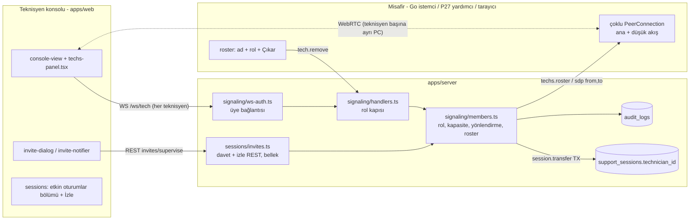

# Mimari — P28c Çoklu teknisyen (davet, süpervizör "İzle", kontrol devri, oturum devri)

Tarih: 2026-11-16 · Durum: **r2** — güvenlik tasarım turu (`docs/guvenlik-raporu.md` "P28c tasarım turu": Y-PC-1..4, O-PC-1..5, D-PC-1..7) işlendi; özet §19 (r1: mimar, "sormadan ilerle" talimatıyla V-PC-n varsayımları) · Dal: `p28c`
Girdiler: `docs/gereksinimler-p28.md` (AC-364..372, R43, R48, V54), `docs/mimari-p28.md` §0 madde 8 (`actorMay`), §0.1 P28c satırı,
`docs/gereksinimler-p28u.md` (P28c notu: izinsiz odaya katılım `unattended.silent` ister), `docs/mimari-p28e.md` §6.3 (`recorderOf`),
`docs/mimari-protokol.md` §3–§4, ADR-0005, ADR-0009, ADR-0013, ADR-0029. Yeni ADR: **ADR-0035**. Kontrol listesi: `docs/tasarim-kontrol.md` "P28c".

**Bağlayıcı ilke — sadelik:** tek ekran / tek yol; yalnız AC-364..372; en az yeni tablo/mesaj. Bu paket **yeni tablo ve migration
getirmez** (oda bellekte, ADR-0005; katılımcı geçmişi audit'ten türetilir).

---

## 1. Özet ve kısıtlar

| Kapsamda                                                                                                                         | Kapsam dışı / Sonra (neden)                                                         |
| -------------------------------------------------------------------------------------------------------------------------------- | ----------------------------------------------------------------------------------- |
| Oturum başına en çok 3 teknisyen (sahip dahil), roller: **Kontrol sahibi / Katılımcı / İzleyici**                                | > 3 teknisyen, SFU (R43; genişleme noktası §7)                                      |
| Davet (2 dk, REST + panel yoklama, sahip geri çekebilir), süpervizör "İzle", kontrol devri, oturum devri, müşterinin "Çıkar"ması | teknisyenler arası özel sohbet                                                      |
| Mesh: müşteri her teknisyene ayrı PeerConnection; kontrol sahibine ana akış, diğerlerine düşük akış (AC-371)                     | Simulcast / tıkanıklık denetimi (GCC) — Sonra                                       |
| Go istemci (katılımlı + P27 yardımcısı aynı `flow`), tarayıcı müşteri sayfası, teknisyen konsolu, sunucu kapısı                  | macOS/Linux istemci (P28f/g bu protokolü aynen alır)                                |
| Yeni yetki `sessions.invite`, `sessions.supervise`; audit AC-370 listesi; geçmişte katılımcılar ve devir                         | Ses (P28d; bu belge yalnız "izleyici mikrofonsuz" kuralını rol tablosunda tanımlar) |

Kısıtlar: tek instance bellek oda (ADR-0005); WS sözleşmeleri `z.strictObject`; Go istemci bilinmeyen alan/tipte bağlantıyı koparır →
çoklu teknisyene ait **hiçbir** alan/mesaj `rs.cap.multi1` bildirmeyen misafire gönderilmez (P28 §0 madde 3).

### 1.1 Roller ve yetenek tablosu (tek kaynak: `packages/contracts/src/ws-multi.ts` `ROLE_MAY`)

Kavramlar: **oturum sahibi** = `support_sessions.technician_id` (oturumu bitirir, davet eder, devreder; kopması mevcut 120 sn kuralıyla
oturumu bitirir). **Kontrol sahibi** = ana görüntü akışını alan ve müşteri makinesinde yan etkili işleri yapabilen tek teknisyen
(varsayılan oturum sahibi). Müşteriye gösterilen rol etiketi: kontrol sahibi → "Kontrol sahibi", diğer katılımcılar → "Katılımcı",
izleyici → "İzleyici"; oturum sahibine ayrıca "Oturum sahibi" rozeti.

| Yetenek                                                                   | Kontrol sahibi                                                 | Katılımcı  | İzleyici      | Kapı                                            |
| ------------------------------------------------------------------------- | -------------------------------------------------------------- | ---------- | ------------- | ----------------------------------------------- |
| Görüntü                                                                   | ana akış                                                       | düşük akış | düşük akış    | Misafir (izi `ReplaceTrack`/sender parametresi) |
| Sohbet okuma                                                              | evet                                                           | evet       | evet          | Misafir yayar                                   |
| Sohbete yazma                                                             | evet                                                           | evet       | **hayır**     | Misafir (DC) + konsol gizler                    |
| `control.request` / `monitor.request` / girdi / gözetimsiz müdahale-kilit | evet                                                           | hayır      | hayır         | Sunucu 403 + misafir kapısı                     |
| Pano, yazdırma, dosya (P2P ve `fsrv.*`, `file.meta`), işaretleme          | evet                                                           | hayır      | hayır         | Sunucu 403 (WS) + misafir (DC)                  |
| Davet, kontrol devri, oturum devri, oturumu bitir, `guest.admit`          | yalnız oturum sahibi (+ `sessions.invite`; bitir mevcut kural) | —          | —             | Sunucu 403                                      |
| Ses (P28d)                                                                | konuşur                                                        | konuşur    | yalnız dinler | P28d                                            |

**V-PC-1:** P28 §0.1 notundaki "yazdırma katılımcılara" bu tabloyla **daraltıldı**: müşteri makinesinde yan etkisi olan her iş
(pano, yazdırma, dosya, işaretleme, girdi) yalnız kontrol sahibindedir. Gerekçe: AC'ler katılımcıya bu yetkileri istemez; tek "ana eş"
kuralı misafirin DC yönlendirmesini tek eşe indirir (sadelik), müşteri açısından "kim ne yapıyor" belirsizliğini kaldırır. Katılımcı
kontrol devriyle (AC-367) bu yetkilere kavuşur.

## 2. Bileşenler ve sorumluluklar



| Bileşen                                                                                                                               | Sorumluluk                                                                                                                                                                                                                                                                                                                                                                                                                                                                                                                                                                                                                                                   |
| ------------------------------------------------------------------------------------------------------------------------------------- | ------------------------------------------------------------------------------------------------------------------------------------------------------------------------------------------------------------------------------------------------------------------------------------------------------------------------------------------------------------------------------------------------------------------------------------------------------------------------------------------------------------------------------------------------------------------------------------------------------------------------------------------------------------ |
| `signaling/members.ts` (yeni)                                                                                                         | `Room.members` yönetimi: rezervasyon, bağlanma, 120 sn kopma payı, ayrılma, çıkarma, kapasite (`seatsUsed`), `controllerOf(room)`, `roleOf(room, conn)`, `rosterOf(room)`, yayın; `control.handover`, `session.transfer`, `tech.remove`, `member.leave` işleyicileri; audit                                                                                                                                                                                                                                                                                                                                                                                  |
| `sessions/invites.ts` + `routes-multi.ts` (yeni)                                                                                      | Davet/izle REST uçları (§4.1), bellekte davet tablosu (oda başına), 2 dk zamanlayıcı, uygunluk zinciri (`eligibleToJoin`)                                                                                                                                                                                                                                                                                                                                                                                                                                                                                                                                    |
| `unattended/device-access.ts` (yeni, tek yardımcı)                                                                                    | `deviceAccessOk(db, tenantId, userId, deviceId)` = `unattended_device_grants` satırı (userId + tenantId) ∧ cihaz `revokedAt` null ∧ `localEnabled` ∧ imza kapısı (`gate.allows`). Super Admin dahil herkes için grant satırı şart (bypass yok). Mevcut `connect.ts precheck` ve `revalidateDevice` de bunu kullanır (O-PC-4)                                                                                                                                                                                                                                                                                                                                 |
| `signaling/ws-auth.ts` (ek)                                                                                                           | `/ws/tech`: sahip değilse §4.3 `eligibleToJoin(…, phase:"ws")` (tek kaynak). Misafir `rs.cap.multi1` okunur (**gözetimsiz odada da** — pano/yazdırmadan farklı, AC-364 gözetimsizde daveti açıkça ister)                                                                                                                                                                                                                                                                                                                                                                                                                                                     |
| `signaling/handlers.ts` (ek)                                                                                                          | Her teknisyen mesajından önce tek satır `if (!roleMay(room, conn, msg.t)) return forbidden()`; `sdp.*`/`ice` yönlendirmesi `from`/`to`                                                                                                                                                                                                                                                                                                                                                                                                                                                                                                                       |
| `signaling/clip-print.ts` `actorMay`, `control*.ts`, `fsrv.ts`, `collab.ts` (`file.meta`, `quality.summary`), `unattended-control.ts` | `room.tech` yerine `controllerOf(room)` (P28 §0 madde 8 genişleme noktası)                                                                                                                                                                                                                                                                                                                                                                                                                                                                                                                                                                                   |
| `signaling/rec.ts` `recorderOf`                                                                                                       | `controllerOf(room)` döndürür (§6.2)                                                                                                                                                                                                                                                                                                                                                                                                                                                                                                                                                                                                                         |
| **Üye geri alma — tek yol `revokeMember(room, userId, reason)`** (members.ts)                                                         | Şu altı yol "sahipse mevcut davranış, üyeyse `revokeMember`" kuralıyla bu fonksiyonu çağırır: `rooms.applyPermChange`, `rooms.endByTechnician`, `unattended/hub.ts grantsRemoved` → `finishDevice` (`deviceRooms` süzgeci "sahip **veya üye**"), `rooms-device.ts revalidateDevice` + `silentStillAllowed` (sahip **ve tüm üyeler**, §4.3 `phase:"revalidate"`), `unattended/policy.ts finishSilent` (politika kapanınca oda zaten biter; yalnız yetki dalı üyeyi de kapsar), `ws-auth.ts revalidateTech` (üyelerin `authToken`'ı da 60 sn'de doğrulanır; üyede geçersiz oturum/pasif kullanıcı → `revokeMember(…,"auth_revoked")`, oda **bitmez** — O-PC-3) |
| `sessions/history-detail.ts` (ek)                                                                                                     | `participants[]` audit'ten; zaman çizelgesi izin listesine AC-370 olayları; aktör kuralında katılımcılar TECH                                                                                                                                                                                                                                                                                                                                                                                                                                                                                                                                                |
| Go `internal/rtc` (ek), `internal/flow` (ek)                                                                                          | Eş haritası (`tid → Peer`), iki iz (ana/düşük), `ReplaceTrack`, rol kapısı, sohbet yayma, roster UI                                                                                                                                                                                                                                                                                                                                                                                                                                                                                                                                                          |
| Go `internal/capture` (ek)                                                                                                            | İkinci (düşük) kodlayıcı: aynı NV12 kare, ≤ 8 FPS, ≤ 1 Mbps; yalnız ≥ 1 ikincil eş varken açık                                                                                                                                                                                                                                                                                                                                                                                                                                                                                                                                                               |
| Web `lib/webrtc/use-guest-session.ts` (ek)                                                                                            | Tarayıcı misafiri: eş haritası, sender `setParameters` (ana/düşük), roster + "Çıkar"                                                                                                                                                                                                                                                                                                                                                                                                                                                                                                                                                                         |
| Web konsol (ek)                                                                                                                       | Teknisyen paneli (roster), "Davet et", "Kontrolü devret", "Oturumu devret", "Ayrıl", davet bildirimi, etkin oturumlar + "İzle"                                                                                                                                                                                                                                                                                                                                                                                                                                                                                                                               |

## 3. Veri modeli

**Yeni tablo, sütun, migration yok (K-PC-1).**

| Veri                                           | Yer                                                                                                | Gerekçe                                                                                         |
| ---------------------------------------------- | -------------------------------------------------------------------------------------------------- | ----------------------------------------------------------------------------------------------- |
| Üyeler, davetler, çıkarılanlar, kontrol sahibi | Bellek (`Room`, ADR-0005)                                                                          | Oda ömrüyle sınırlı; süreç yeniden başlarsa oturum zaten ENDED{server} olur                     |
| Oturum sahibi değişimi                         | `support_sessions.technician_id` UPDATE (mevcut sütun; güncelleme koruması bu sütunu engellemiyor) | AC-369 "oturumun teknisyeni değişir"                                                            |
| Katılımcı geçmişi, devir zamanı                | `audit_logs` (AC-370 olayları; mevcut `IX(tenant_id, entity, entity_id, created_at)`)              | Geçmiş zaman çizelgesi zaten audit'ten üretiliyor (mimari-api §3); ayrı tablo çift kayıt olurdu |

### 3.1 `Room` ekleri (`signaling/types.ts`)

```ts
type MemberRole = "participant" | "observer";
interface Member {
  userId: string; username: string; fullName: string;
  tid: string;                 // oda içi opak kimlik: crypto.randomBytes(8) → base64url (türetilmez, D-PC-6); (oturum, kullanıcı) başına sabit
  role: MemberRole;
  via: "invite" | "supervise";
  conn?: TechConn;             // bağlı soket; yokken rezervasyon (60 sn) ya da kopma payı (120 sn)
  timer?: unknown;
  joinedAudited: boolean;      // participant_join / supervise_join ilk WS'de bir kez
  authSessionId: string;       // rezervasyonu alan (step-up yapılan) kimlik oturumu; WS ve 120 sn dönüşü yalnız bu oturumdan (Y-PC-3)
  authToken?: string;          // bağlı soketin çerez değeri (60 sn yeniden doğrulama; yalnız bellekte, loglanmaz)
  reasonLen?: number;          // silent odada katılım gerekçesinin uzunluğu (metin yalnız audit'te, Y-PC-1)
}
interface Invite { id: string; userId: string; byUserId: string; expiresAt: number; timer: unknown }
// Room +=
ownerTid: string;              // oturum sahibinin tid'i (devirde yeni sahibinki)
controllerId: string;          // kontrol sahibinin userId'si (varsayılan technicianId)
members: Map<string, Member>;  // userId → üye (sahip hariç), ≤ 2
invites: Map<string, Invite>;  // inviteId → davet
removed: Set<string>;          // müşterinin çıkardığı userId'ler (yeniden giremez, AC-366)
multiTimes?: number[];         // son 60 sn'deki devir/davet/çıkarma komutları (oda başına ≤ 10/dk)
transferring?: boolean;        // devir TX'i sürerken tech.remove / control.handover / member.leave → error{CONFLICT} (O-PC-2)
```

Kapasite: `seatsUsed = 1 + members.size + invites.size` ≤ `MAX_TECHS = 3` (bekleyen davet koltuk tutar; kabul edilince davet üyeye
dönüşür, sayı değişmez). Sahip `room.tech` alanında kalır (48 kullanım değişmez); yalnız kontrol işleri `controllerOf(room)` kullanır.

## 4. API sözleşmesi

Şemalar `packages/contracts/src/api/multi.ts` (REST) ve `packages/contracts/src/ws-multi.ts` (WS + `MAX_TECHS`, `INVITE_TTL_MS = 120_000`,
`ROLE_MAY`), hepsi `z.strictObject`. Hata kodları `errors.ts`'e eklenir: `SESSION_FULL` (409, "Oturum dolu"), **yeni** `CLIENT_UNSUPPORTED`
(409, AC-352 metni; mevcut `ACCEPT_CODE_CLIENT_UNSUPPORTED` yeniden kullanılmaz — D-PC-1), `INVITE_GONE` (410, "Davet artık geçerli değil"), `JOIN_NOT_ALLOWED` (409, "İzinli gözetimsiz bağlantıya ek teknisyen katılamaz" — §4.3 adım 6a).

### 4.1 REST (`/api/v1`, çerez + Origin + CSRF mevcut kalıp)

Yetki sütunu yalnız **§4.3'e atıf** yapar; koşulların tek kaynağı §4.3'tür (O-PC-1). Ortak hatalar: 401 `MFA_STEP_UP_REQUIRED`,
403 `MFA_SETUP_REQUIRED` (TOTP kurulmamış — konsol "Önce 2FA kurun" gösterir, D-PC-2), 429 `RATE_LIMITED`.

| Uç                                        | Girdi                                                                                           | Çıktı                                                                                                                                                  | Hatalar                                                                                                                                               | Yetki / kural                                                                                                                                                                                                                                                                              |
| ----------------------------------------- | ----------------------------------------------------------------------------------------------- | ------------------------------------------------------------------------------------------------------------------------------------------------------ | ----------------------------------------------------------------------------------------------------------------------------------------------------- | ------------------------------------------------------------------------------------------------------------------------------------------------------------------------------------------------------------------------------------------------------------------------------------------ |
| GET `/sessions/:id/invite-candidates`     | —                                                                                               | `{ items: {userId, fullName, avatarUrl \| null}[] }` (en çok 200, ada göre)                                                                            | 404, 409 `CLIENT_UNSUPPORTED` / `JOIN_NOT_ALLOWED`                                                                                                    | Çağıran oturum sahibi + `sessions.invite`; liste §4.3 `request` evresi 1–7'yi geçen kullanıcılar                                                                                                                                                                                           |
| POST `/sessions/:id/invites`              | `{ userId: ULID }`                                                                              | 201 `{ inviteId, expiresAt }`                                                                                                                          | 403, 404, 409 `SESSION_FULL` / `CLIENT_UNSUPPORTED` / `JOIN_NOT_ALLOWED` / `CONFLICT`, 429                                                            | `sessions.invite` + sahip; §4.3 `request` 1–7 (davetli için); oda başına 10/dk; audit `session.invite`                                                                                                                                                                                     |
| DELETE `/sessions/:id/invites/:inviteId`  | —                                                                                               | 204                                                                                                                                                    | 404, 410                                                                                                                                              | Oturum sahibi; davet geri çekilir, koltuk boşalır; audit `session.invite_expire{reason:"revoked"}` (D-PC-7)                                                                                                                                                                                |
| GET `/sessions/invites`                   | —                                                                                               | `{ items: {inviteId, sessionId, fromName, customerName, unattended: bool, silent: bool, expiresAt}[] }`, `no-store`                                    | 401                                                                                                                                                   | Oturum açmış her kullanıcı; yalnız kendine gelen, bellekten; 60/dk/kullanıcı (ADR-0029 yoklama kalıbı)                                                                                                                                                                                     |
| POST `/sessions/invites/:inviteId/accept` | silent odada `{ reason: silentReasonSchema }` (20–500, AC-437 ile aynı şema), diğerlerinde `{}` | `{ sessionId, consoleUrl }`                                                                                                                            | 401/403 (ortak), 403, 409 `SESSION_FULL`, 410 `INVITE_GONE`, 422 `fields.reason`, 429                                                                 | Davet bu kullanıcıya ait; §4.3 `request` 1–9; kullanıcı başına 20/dk (D-PC-3); davet → üye rezervasyonu (participant, 60 sn, `authSessionId`); audit `session.invite_accept`                                                                                                               |
| POST `/sessions/invites/:inviteId/reject` | —                                                                                               | 204                                                                                                                                                    | 410                                                                                                                                                   | Davet bu kullanıcıya ait; audit `session.invite_reject`                                                                                                                                                                                                                                    |
| GET `/sessions/active`                    | —                                                                                               | `{ items: {id, technicianName, customerName, mode, startedAt, techCount, full: bool, supported: bool, unattended: bool, silent: bool}[] }`, `no-store` | 403                                                                                                                                                   | `sessions.supervise` + `tenantScope`; bellekteki ACTIVE odalar. **Gözetimsiz oda yalnız çağıran §4.3 adım 5–6'yı geçiyorsa listelenir**; geçemediği oda hiç görünmez (O-PC-1). 60/dk/kullanıcı                                                                                             |
| POST `/sessions/:id/supervise`            | silent odada `{ reason }` (20–500), diğerlerinde `{}`                                           | `{ sessionId, consoleUrl }`                                                                                                                            | 401/403 (ortak), 403, 404 (başka tenant dahil), 409 `SESSION_FULL` / `CLIENT_UNSUPPORTED` / `JOIN_NOT_ALLOWED` / `CONFLICT`, 422 `fields.reason`, 429 | `sessions.supervise` + §4.3 `request` 1–9 (gözetimsizde `unattended.connect` + `deviceAccessOk`; silent'ta `unattended.silent` ∧ politika + gerekçe; step-up); kullanıcı başına 20/dk; üye rezervasyonu (observer, 60 sn, `authSessionId`). Audit WS bağlanınca (`session.supervise_join`) |

Başarısız İzle/kabul/davet `fail` audit'i aynı (kullanıcı, oturum, kod) için dakikada en çok 1 (D-PC-3).

Konsol URL'si mevcut `/sessions/<id>/console`; sayfa rolünü `hello`'dan alır. `GET /sessions/:id` kapsamı (G-22) **üyeler için**
genişler: kullanıcı odanın bağlı/rezerve üyesiyse görür (aksi 404 aynen); sahip olmayan üyeye `techVerifyCode` **boş** döner (D-PC-5).

### 4.2 Davet süresi

Zamanlayıcı 120 sn → davet silinir, audit `session.invite_expire` (aktör system), koltuk boşalır. Kabul/ret/oturum bitişi zamanlayıcıyı
temizler; oturum bitince bekleyen davetler `invite_expire{reason:"session_end"}` ile düşer. Davetli paneli 5 sn'de bir yoklar
(`invite-notifier.tsx`); kaybolan davet listeden düşer.

### 4.3 Uygunluk zinciri — tek kaynak `eligibleToJoin(user, room, via, phase)` (Y-PC-3)

`via ∈ {"invite","supervise"}`, `phase ∈ {"request","ws","revalidate"}`. Davet, kabul, İzle, aday listesi, `/ws/tech` ve 60 sn yeniden
doğrulama **yalnız** bu fonksiyonu çağırır; §2, §4.1, §5 kendi koşul listesi yazmaz. İlk düşen adım dönüş kodunu belirler.

| #   | Adım                                                                                                                                                                                                                            | `request` | `ws`              | `revalidate` | Ret                                                   |
| --- | ------------------------------------------------------------------------------------------------------------------------------------------------------------------------------------------------------------------------------- | --------- | ----------------- | ------------ | ----------------------------------------------------- |
| 1   | Oda canlı ve ACTIVE (admit edilmiş misafir var)                                                                                                                                                                                 | ✓         | ✓                 | —            | 409 `CONFLICT`                                        |
| 2   | Kullanıcı oturumun tenant'ının ACTIVE kullanıcısı (Super Admin yalnız `supervise` ve `tenantScope` seçili tenant'ta); kimlik oturumu geçerli                                                                                    | ✓         | ✓                 | ✓            | 403 (İzle'de 404)                                     |
| 3   | `request`: sahip, üye, bekleyen davetli **değil** (kabulde: davet bu kullanıcıya ait). `ws`: **3'** = `room.members`'ta rezervasyonlu ya da kopma payında. Her evrede `room.removed` içinde değil                               | ✓         | 3'                | —            | 409 `CONFLICT` / 403                                  |
| 4   | Misafir soketi `rs.cap.multi1` bildirdi                                                                                                                                                                                         | ✓         | ✓                 | —            | 409 `CLIENT_UNSUPPORTED`                              |
| 5   | Temel yetki: davette `sessions.view`, İzle'de `sessions.supervise`                                                                                                                                                              | ✓         | ✓                 | ✓            | 403                                                   |
| 6   | Gözetimsiz oda: `unattended.connect` ∧ `deviceAccessOk(db, tenantId, userId, deviceId)` (§2)                                                                                                                                    | ✓         | ✓                 | ✓            | 403                                                   |
| 6a  | Gözetimsiz oda `consentMode='asked'` → katılım **kapalı** (V-PC-5, O-PC-5)                                                                                                                                                      | ✓         | ✓                 | —            | 409 `JOIN_NOT_ALLOWED`                                |
| 6b  | `consentMode='silent'`: `unattended.silent` ∧ tenant politikası açık; `request` evresinde kabul/İzle gövdesinde `reason` (20–500, `silentReasonSchema`) zorunlu (Y-PC-1). Davet anında gerekçe istenmez (davetli kabulde yazar) | ✓         | ✓ (gerekçesiz)    | ✓            | 403 / 422 `fields.reason`                             |
| 7   | Kapasite `seatsUsed < 3` (kabulde davet koltuk tuttuğu için atlanır)                                                                                                                                                            | ✓         | — (koltuk tutulu) | —            | 409 `SESSION_FULL`                                    |
| 8   | `request` (kabul, İzle) ve gözetimsiz oda: `await requireStepUp()(req)` (`connect.ts` kalıbı; 5 dk)                                                                                                                             | ✓         | —                 | —            | 401 `MFA_STEP_UP_REQUIRED` / 403 `MFA_SETUP_REQUIRED` |
| 8'  | `ws`: `member.authSessionId === auth.sessionId` (rezervasyonu ve 120 sn dönüşünü yalnız step-up'ı yapan kimlik oturumu kullanır)                                                                                                | —         | ✓                 | —            | 403                                                   |
| 9   | **Senkron son denetim (O-PC-2):** tüm `await`'lerden sonra, bellek değişikliğinden hemen önce 1, 3 ve 7 senkron yeniden; kabulde davet haritadan bu adımda alınır (tek kullanımlık)                                             | ✓         | ✓ (1, 3')         | —            | aynı kodlar                                           |

Davet anında davetlinin step-up'ı ölçülemez; AC-364'teki "step-up dahil" koşulu kabulde uygulanır (V-PC-2). `revalidate` evresinde düşen
üye `revokeMember(…, "auth_revoked")` ile ≤ 5 sn (anlık yollar) / ≤ 60 sn (yedek döngü) içinde çıkarılır (AC-440 kalıbı, Y-PC-2).

**Silent odaya katılım commit sonrası (Y-PC-1):** mevcut `sendSilentNotice` (`unattended.silent.notify` dört göz e-postası, P28u §9.2)
`event:"join"` ile çağrılır (katılan, rol, gerekçe, oturum sahibi); silent odada `session.transfer` sonrası `event:"transfer"`.
`unattended.silent.notify` `event` enum'una `"join" | "transfer"` eklenir (contracts `audit.ts`).

### 4.4 WS mesajları (`ws-multi.ts`; teknisyen soketleri + yalnız `multi1` misafir)

| `t`                                         | Yön                                 | Alanlar                                                                                                                  | Kural                                                                                                                                                                                                                          |
| ------------------------------------------- | ----------------------------------- | ------------------------------------------------------------------------------------------------------------------------ | ------------------------------------------------------------------------------------------------------------------------------------------------------------------------------------------------------------------------------ |
| `hello` (teknisyen, ek alanlar)             | S→tech                              | `tid`, `role: "owner"\|"participant"\|"observer"`, `roster`                                                              | Konsol yeni sürümle birlikte çıkar; eski konsol yok                                                                                                                                                                            |
| `techs.roster`                              | S→tüm teknisyenler + multi1 misafir | `techs: {tid, name: string(≤100), role: "controller"\|"participant"\|"observer", owner: bool, connected: bool}[]` (1..3) | Her üyelik/rol/bağlantı değişiminde; misafire admit sonrası `hello`'nun hemen ardından da. ≤ 2 sn (AC-366) — olay anında yayılır, toplama yok                                                                                  |
| `sdp.offer` / `ice` (teknisyen→misafir)     | S→guest                             | + `from: tid`                                                                                                            | Sunucu damgalar; yalnız multi1 misafire. **Sıra (Y-PC-4):** bir üyenin ilk `sdp.offer`'ı misafire, o üyeyi içeren `techs.roster` misafire gönderildikten **sonra** iletilir. Eski misafirde yalnız sahip vardır, alan eklenmez |
| `sdp.answer` / `ice` (misafir→teknisyen)    | guest→S                             | + `to: tid` (multi1 misafirde zorunlu)                                                                                   | Sunucu yalnız odadaki bağlı `tid`'e iletir; bilinmeyen `to` → düşer (log oda başına 1/dk)                                                                                                                                      |
| `control.handover`                          | tech→S                              | `to: tid`                                                                                                                | Oturum sahibi + `sessions.invite`; hedef bağlı katılımcı ya da sahibin kendisi (geri alma); izleyiciye 409. Etki §5.1                                                                                                          |
| `session.transfer`                          | eski sahip                          | `{fromUserId, toUserId, consentMode?}`                                                                                   | success / fail (`CONFLICT`, `target_gone`)                                                                                                                                                                                     |
| `unattended.silent.notify` (mevcut, P28u)   | system                              | `event` += `"join" \| "transfer"`; alıcı maskeli, deneme                                                                 | success / fail                                                                                                                                                                                                                 |
| `member.leave`                              | tech→S                              | —                                                                                                                        | Sahip olmayan üye; anında ayrılma (`participant_leave{reason:"left"}`), soket 1000                                                                                                                                             |
| `tech.remove`                               | guest→S                             | `tid`                                                                                                                    | Yalnız multi1 misafir; hedef sahip olamaz (→ `error{FORBIDDEN}`); etki §5.3                                                                                                                                                    |
| `peer.joined` / `peer.left` `{role:"tech"}` | S→guest                             | —                                                                                                                        | **multi1 misafire gönderilmez**; yerini `techs.roster` alır (tek yol). Eski misafire yalnız sahip için aynen                                                                                                                   |
| `session.ended`                             | S→üyeler                            | mevcut                                                                                                                   | Oturum bitince tüm üye soketlerine aynen                                                                                                                                                                                       |

Teknisyen soket kapanış kodları: `4403 "removed"` (müşteri çıkardı / yetki düştü), `4409 "full"` olmaz (koltuk REST'te alınır).

Rol kapısı (`roleMay`, handlers.ts) **varsayılan-ret** (D-PC-6): `ROLE_MAY` tüm teknisyen mesaj birliğini (contracts `ws.ts` +
`ws-*.ts`) kapsayan tip testiyle yazılır; listede olmayan tip katılımcı ve izleyici için reddedilir. Reddedilen mesaj `error{FORBIDDEN}`

- metrik `rs_multi_denied_total{type}`; log oda başına dakikada 1. İzleyici ve katılımcı yalnız `sdp.offer`, `ice`, `ice.restart`,
  `member.leave` gönderebilir.

**Misafir kabul listesi (Y-PC-4, gizli izleyici yok):** misafir (Go, yardımcı, tarayıcı) yalnız **son alınan `techs.roster`'da bulunan ve
ekranda / göstergede adıyla çizilmiş** `tid`'den gelen `sdp.offer`'ı kabul eder; bilinmeyen `from` → offer düşer, PC kurulmaz. Yardımcı
göstergeyi yeni adla yeniden çizemezse (G-17 kalıbı) o eşi kurmaz. Roster'dan düşen `tid`'in eşi hemen kapatılır.

### 4.5 DataChannel (`dc.ts` ek)

- Teknisyen konsolu **her** eşte bugünkü kanal kümesini açar (`ctl`, `input`, `file`); misafir eşin rolüne göre süzer. Böylece kontrol
  devrinde yeniden müzakere gerekmez.
- `chat` mesajına isteğe bağlı `by: tid` (misafir→teknisyen yönünde yayılan teknisyen mesajı; **ad taşımaz**, D-PC-4). Misafir bir
  teknisyenden gelen sohbeti (izleyici değilse) gösterir ve diğer eşlere `by=<gönderenin tid'i>` ile iletir. Konsol adı **kendi sunucu
  roster'ından** çözer (ad sunucu damgalıdır); çözemezse mesajı "Müşteri" olarak gösterir. Müşterinin kendi mesajı `by`'sız tüm eşlere
  gider. Katılımdan önceki sohbet yeni gelene gönderilmez (V-PC-3).
- Misafir kapısı: `input` yalnız kontrol sahibinin eşinden ve kapı GRANTED iken; `file`, `file.*`, `annotation`, pano/yazdırma DC
  içerikleri yalnız kontrol sahibinin eşinden; `chat` izleyiciden düşer; `ping` herkesten.

## 5. Akışlar

### 5.1 Kontrol devri (AC-367)

1. Sahip `control.handover{to}` gönderir. Sunucu: kontrol durumu GRANTED/REQUESTED ise mevcut kapanış yolu (`control.revoke`,
   `CloseRecord{source:"TECH", action:"control.revoked", extra:{reason:"handover"}}`) → VIEW; bekleyen pano/yazdırma işi iptal
   (P28a `onControlClosed`); `controllerId = hedef`.
2. Audit `session.control_handover {fromUserId, toUserId}`; `techs.roster` yayını.
3. Misafir: kapıyı kapatır (zaten `control.revoke` alır), ana izi yeni kontrol sahibinin eşine, düşük izi eskisine taşır, anahtar kare ister.
4. Yeni kontrol sahibi mevcut AC-99 akışıyla `control.request` gönderir; misafir diyaloğu ve AC-103 göstergesi adı **roster'daki kontrol
   sahibinden** alır.
5. Kontrol sahibi kopar/ayrılırsa (sahip değilse): kontrol VIEW (mevcut K3), `controllerId` oturum sahibine döner (audit
   `session.control_handover {reason:"controller_left"}`, aktör system).

### 5.2 Oturum devri (AC-369)

`room.transferring = true` (TX süresince `tech.remove`, `control.handover`, `member.leave` → `error{CONFLICT}`, O-PC-2); hedef §4.3 adım 9 senkron denetimden geçer.
Tek TX: `UPDATE support_sessions SET technician_id=:to WHERE id=:id AND tenant_id=:t AND status='ACTIVE' AND technician_id=:from`
(count=1 değilse `error{CONFLICT}`) + audit `session.transfer {fromUserId, toUserId}`. Commit sonrası bellekte: `room.tech` ↔ üye
yer değiştirir (eski sahip `participant` olur), `technicianId/Name`, `ownerTid` güncellenir, `controllerId = yeni sahip` (§5.1
adım 1'deki kapanış uygulanır, ayrıca `session.control_handover` yazılmaz — devir olayı yeter). Kopma zamanlayıcıları yeni sahibe
göre kurulur. Roster yayını. Kayıt: §6.2. Eski sahip `member.leave` ile ayrılabilir.
Commit sonrası hedef bağlı değilse ya da `removed` içindeyse aynı koşullu UPDATE tersine çalıştırılır (`technician_id=:from`), audit `session.transfer` `fail{code:"target_gone"}` yazılır ve bellek değişmez. `transferring` her durumda `finally` ile düşer. Silent odada commit sonrası dört göz `event:"transfer"` (§4.3).

**V-PC-4:** Geçmiş kapsamı (`historyScope`, USER yalnız kendi) değişmez → devreden USER oturumu "kendi oturumlarım"da artık görmez;
`session_history.view` kapsamlı yöneticiler görür. Genişleme noktası: `historyScope`'a "audit'te katılımcı" koşulu.

### 5.3 Müşterinin çıkarması (AC-366)

Misafir "Çıkar" (onay diyaloğu, varsayılan odak Vazgeç) → `tech.remove{tid}`. Sunucu: hedef sahip değil; `removed.add(userId)`; hedef
kontrol sahibiyse §5.1 adım 5; soket `4403 "removed"`, üye silinir; audit `session.participant_remove` (aktör customer, `{userId, role}`);
roster. Konsol "Müşteri sizi oturumdan çıkardı" gösterir, yeniden bağlanmaz. Çıkarılan kullanıcıya bu oturum için davet, izle ve WS 403.
Gözetimsiz odada müşteri arayüzü yoktur (yalnız gösterge); `asked` odaya ek teknisyen katılamaz (§4.3 adım 6a), `no_user`/`silent` odada "Çıkar" yok; göstergede tüm adlar listelenir, yerel anahtar bağlantıyı bitirir (AC-295) (V-PC-5).

### 5.4 Katılma, kopma, ayrılma, bitiş

- İlk WS bağlantısında audit `session.participant_join` (davetle) ya da `session.supervise_join` (izle), `{userId, role}`; roster.
- Üye kopması: kontrol sahibiyse §5.1 adım 5; üyelik 120 sn korunur (`connected:false`), dönerse yeni PC kurulur (audit yok). Süre dolarsa
  `participant_leave{reason:"disconnect"}`.
- Rezervasyon 60 sn içinde WS'ye dönmezse sessizce düşer (`participant_leave{reason:"no_show"}`).
- Oturum sahibinin kopması/ayrılması: mevcut kural (AC-369 son cümle): 120 sn sonra oturum biter; tüm üyeler `session.ended` alır ve her
  biri için `participant_leave{reason:"session_end"}`.
- Yetki/hesap/grant/politika değişimi: §2 "Üye geri alma" satırındaki altı yol, üye için **yalnız** `revokeMember(room, userId, reason)`
  çağırır (≤ 5 sn anlık, ≤ 60 sn yedek döngü; §4.3 `revalidate`). `revokeMember`: kontrol sahibiyse §5.1 adım 5, eski kaydedicinin yükleme
  belirteçleri düşer (§6.2), soket `4403`, `participant_leave{reason:"auth_revoked"}`, roster. **Üyenin kimlik oturumu düşmesi (çıkış,
  şifre değişimi, süre dolumu, pasif kullanıcı) odayı bitirmez** — oda yalnız sahip için biter (O-PC-3). `sessions.invite` düşen sahibin
  oturumu sürer; yalnız yeni davet/devir 403.

## 6. Diğer özelliklerle etkileşim

| Özellik                          | Kural                                                                                                                                                                                                                                                                                                                                                                    |
| -------------------------------- | ------------------------------------------------------------------------------------------------------------------------------------------------------------------------------------------------------------------------------------------------------------------------------------------------------------------------------------------------------------------------ |
| Pano / yazdırma (P28a)           | `actorMay(room, conn, f)` = `conn === controllerOf(room)`; gözetimsiz kapalılık (V45) aynen                                                                                                                                                                                                                                                                              |
| Dosya P2P / sunucu (P28b)        | Teknisyen yönü yalnız kontrol sahibi; müşteri→teknisyen dosyası kontrol sahibine gider (misafir yalnız ana eşe teklif eder; `fsrv` teslim hedefi `controllerOf`)                                                                                                                                                                                                         |
| Sohbet                           | DC; misafir yayar (§4.5). ADR-0025 sunucu aktarımı P22'de gelince yayma sunucuya geçer (genişleme noktası)                                                                                                                                                                                                                                                               |
| İşaretleme                       | Yalnız kontrol sahibi                                                                                                                                                                                                                                                                                                                                                    |
| Kayıt (P28e)                     | §6.2                                                                                                                                                                                                                                                                                                                                                                     |
| Gözetimsiz (P27/P28u)            | Davet ve İzle `no_user` ve `silent` kipinde desteklenir (yardımcı `rs.cap.multi1` bildirir); `asked` kipinde kapalı (409 `JOIN_NOT_ALLOWED`, düğmeler pasif + neden, V-PC-5); §4.3 adım 6–6b; müdahale/kilit/oturum kapatma komutları yalnız kontrol sahibi; gösterge metni roster adlarını listeler ("Uzaktan izleniyor — A, B"), yeni ad çizilmeden eş kurulmaz (§4.4) |
| Ses (P28d)                       | Rol tablosu izleyiciyi mikrofonsuz tanımlar; ses izi aynı eş haritasını kullanır                                                                                                                                                                                                                                                                                         |
| Kalite özeti (`quality.summary`) | Yalnız kontrol sahibinden yazılır (ana akış)                                                                                                                                                                                                                                                                                                                             |

### 6.1 Medya (AC-371, R43)

- **Go istemci:** tek yakalama, iki kodlayıcı. Ana kodlayıcı bugünkü gibi (30→15 FPS, `bitrateFor`). Düşük kodlayıcı aynı NV12 kareyi
  `LOW_FPS = 8` (taban 5) ve `LOW_BPS = 1_000_000` sabit tavanla kodlar; yalnız ≥ 1 ikincil eş bağlıyken açılır, son ikincil gidince
  kapanır. İki `TrackLocalStaticSample` (`main`, `low`); her eş tek video göndericisi taşır, rol değişiminde `RTPSender.ReplaceTrack` + anahtar kare.
  Yükleme bütçesi 1080p: ana ≈ 4,7 Mbps + düşük 1 Mbps × 2 ≈ 6,7 Mbps < 10 Mbps.
- **Tarayıcı misafir:** aynı `MediaStreamTrack` her PC'ye eklenir; ikincil göndericilerde `setParameters({encodings:[{maxFramerate: 8,
maxBitrate: 1_000_000}]})`, ana göndericide sınır yok. Rol değişiminde parametreler yer değiştirir.
- "Bant yetmezse önce izleyici düşer": öncelik yapısaldır — ikincil akışlar her zaman tavanlıdır, ana akışın bütçesi değişmez.
  Ölçüm: staging, 10 Mbps şekillendirilmiş yükleme, 3 teknisyen, `getStats` FPS (konsol kalite paneli).

### 6.2 Kayıt kaydedicisi (P28e genişleme noktası)

`recorderOf(room) = controllerOf(room)` (**K-PC-6**). mimari-p28e §6.3 "sahip" notu **kontrol sahibi** olarak okunur: kayıt, ana (tam
kalite) akışı alan konsoldan yapılır. Kontrol devri ve oturum devrinde mimari-p28e §6.3 prosedürü aynen: eski kaydediciye
`rec.state{on:true}` (upload'sız), yenisine `upload{series+1}`; kayıt durmaz. Kayıt göstergesi tüm teknisyenlere roster gibi gider (mevcut).
Kaydedici değişiminde (kontrol devri, oturum devri, çıkarma, ayrılma, `revokeMember`) eski kaydedicinin yükleme belirteçleri P28e S-P28e-6 kalıbıyla (`dropUploadTokens`) **hemen** düşer; eski konsolun geç parçaları 401 alır (D-PC-6).

## 7. Performans ve ölçek

- Bellek: oda başına ≤ 2 üye + ≤ 2 davet; ihmal edilebilir. Sunucu medya taşımaz (mesh).
- Yoklama: `GET /sessions/invites` 5 sn × açık panel; bellekten, DB yok. `GET /sessions/active` yalnız sayfa açıkken 10 sn.
- `invite-candidates` tek sorgu (`users WHERE tenant_id AND status='ACTIVE'`, en çok 200) + bellek yetki hesabı.
- **Genişleme noktası (> 3 / SFU):** `MAX_TECHS` sabiti, `members.ts` yönlendirmesi (`from/to`) ve misafirin eş haritası; SFU gelirse misafir
  tek eşe (SFU) yayın yapar, `from/to` SFU'ya taşınır. Bu pakette kod yok.

## 8. Operasyon

- Yeni env yok. Metrikler (`ops/metrics.ts`, tenant etiketi yok): `rs_multi_invites_total{result: sent|accepted|rejected|expired}`,
  `rs_multi_members{role}` (gauge), `rs_multi_denied_total{type}`.
- Log: tid/userId/sessionId; ad, sohbet içeriği yok. Caddy kuralları aynen.
- Migration yok → geri dönüş yalnız ikili geri alma; eski Go istemci (0.16.x) `multi1` bildirmediği için davet/izle pasif kalır.
- Go istemci + yardımcı sürümü **0.17.0** (`rs.cap.multi1`); fixture `packages/contracts/fixtures/multi.json`.
- Runbook: "çoklu teknisyen" bölümü (metrikler, staging ölçüm adımı AC-371).

## 9. Audit (AC-370) ve yetkiler

Tüm olaylar `entity = "support_sessions"`, `entity_id = sessionId`, `tenant_id`; `packages/contracts/src/audit.ts` → `MULTI_AUDIT`;
Türkçe etiketler mevcut tabloya; audit süzgecinde "Çoklu teknisyen" grubu. İçerik (sohbet) yazılmaz.

| Olay                                | Aktör            | `new_value`                                                                                                                              | Sonuç                                                                                  |
| ----------------------------------- | ---------------- | ---------------------------------------------------------------------------------------------------------------------------------------- | -------------------------------------------------------------------------------------- |
| `session.invite`                    | sahip            | `{inviteeUserId, inviteeName}`                                                                                                           | success / fail (403/409 denemeleri de `fail` + `code`)                                 |
| `session.invite_accept` / `_reject` | davetli          | `{inviteId}`                                                                                                                             | success                                                                                |
| `session.invite_expire`             | system           | `{inviteeUserId, reason: "timeout"\|"session_end"}`                                                                                      | success                                                                                |
| `session.participant_join`          | katılan          | `{userId, role:"participant", consentMode?, reasonLen?}` (silent odada gerekçe metni yalnız `unattended` audit kalıbıyla `silentReason`) | success                                                                                |
| `session.supervise_join`            | izleyen          | `{userId, role:"observer", consentMode?, reasonLen?, silentReason?}` (gerekçe yalnız silent)                                             | success / fail (reddedilen İzle `fail` + `code`; aynı kullanıcı/oturum/kod dakikada 1) |
| `session.participant_leave`         | ayrılan / system | `{userId, role, reason: "left"\|"disconnect"\|"no_show"\|"session_end"\|"auth_revoked"}`                                                 | success                                                                                |
| `session.participant_remove`        | customer         | `{userId, role}`                                                                                                                         | success                                                                                |
| `session.control_handover`          | sahip / system   | `{fromUserId, toUserId, reason?: "controller_left"}`                                                                                     | success                                                                                |
| `session.transfer`                  | eski sahip       | `{fromUserId, toUserId}`                                                                                                                 | success / fail (`CONFLICT`)                                                            |

Yetkiler (`permissions.ts`, AC-404; migration yok, rol varsayılanı Admin açık / User kapalı — P28 §0 madde 5):

```ts
{ key: "sessions", actions: [/* mevcut */ "view", "create", "edit", "delete", "terminate", "send_link", "view_recording", "invite", "supervise"] }
// PERMISSION_DESCRIPTIONS["sessions.invite"] = "Etkin oturuma aynı firmadan teknisyen davet eder, kontrolü ve oturumu devreder."
// PERMISSION_DESCRIPTIONS["sessions.supervise"] = "Firmanın etkin oturumlarını izleyici olarak izler (hassas — yalnız gerekene verin)."
```

Geçmiş detayı (`GET /sessions/:id/history`, AC-369): `participants: {name, role: "OWNER"|"PARTICIPANT"|"OBSERVER", joinedAt, leftAt: string|null}[]`
(yukarıdaki olaylardan; sahip = oturum açılışı + `session.transfer`), zaman çizelgesi izin listesine bu olaylar (alan izdüşümü:
ad, rol, neden). Aktör kuralı: audit'te `participant_join/supervise_join` olan `user_id` → TECH (ADMIN değil).

## 10. Arayüz (DESIGN.md token'ları, `lucide-react`, iki tema, 390 px, axe 0, AC-287 beş durum)

| Ekran / bileşen                                                  | Değişiklik                                                                                                                                                                                                                                                                                                                                                                                     |
| ---------------------------------------------------------------- | ---------------------------------------------------------------------------------------------------------------------------------------------------------------------------------------------------------------------------------------------------------------------------------------------------------------------------------------------------------------------------------------------- |
| Konsol üst çubuğu                                                | "Teknisyenler" düğmesi (`Users`) + sayı rozeti; açılan `techs-panel.tsx`: ad, rol etiketi, "Oturum sahibi" rozeti, bağlantı durumu                                                                                                                                                                                                                                                             |
| Teknisyenler paneli eylemleri (yalnız sahip + `sessions.invite`) | "Davet et" (`UserPlus`) → `invite-dialog.tsx` (aday arama listesi, boş durum "Davet edilebilecek kullanıcı yok"); satırda "Kontrolü ver" (`MousePointer2`), "Kontrolü geri al", "Oturumu devret" (`ArrowRightLeft`, onay diyaloğu). Üye için "Oturumdan ayrıl" (`LogOut`)                                                                                                                      |
| Pasif durum (AC-372)                                             | Misafir `multi1` yoksa "Davet et" pasif + AC-352 metni (tooltip ve panelde satır); "İzle" düğmesi aynı                                                                                                                                                                                                                                                                                         |
| Rol durumları                                                    | Katılımcı/izleyici konsolunda kontrol, pano, yazdırma, dosya, işaretleme düğmeleri gizli değil **pasif** + "Yalnız kontrol sahibi kullanabilir"; izleyicide sohbet girişi yerine "İzleyici olarak sohbete yazamazsınız"                                                                                                                                                                        |
| Davet bildirimi                                                  | `invite-notifier.tsx` panel düzeninde (lobby-notifier kalıbı): Sonner toast + kalıcı kart "<Ad> sizi <müşteri> oturumuna davet ediyor", kalan süre, "Katıl" / "Reddet"; gözetimsizde step-up diyaloğu mevcut bileşenle; silent odada kabul öncesi aynı gerekçe diyaloğu; 403 `MFA_SETUP_REQUIRED` → "Önce 2FA kurun". Sahibin teknisyenler panelinde bekleyen davet satırında "Geri çek" (`X`) |
| `/sessions`                                                      | `sessions.supervise` sahibine "Firmadaki etkin oturumlar" bölümü (`Eye` "İzle"); yalnız §4.3 5–6'yı geçtiği gözetimsiz odalar listelenir; dolu/desteklemiyor/`asked` satırında pasif + neden. Silent odada İzle önce gerekçe diyaloğu (20–500, sayaç, "Firma yöneticilerine bildirim gider" satırı), sonra step-up. Ayrı sayfa yok                                                             |
| Geçmiş detayı                                                    | "Katılımcılar" bölümü (`Users`): ad, rol, katılma–ayrılma; devir zaman çizelgesinde                                                                                                                                                                                                                                                                                                            |
| Müşteri sayfası (tarayıcı) ve Go oturum penceresi                | "Bağlı teknisyenler" listesi: ad + rol; sahip dışındakilerde "Çıkar" (`UserX`, onay, odak Vazgeç). Yeni giren teknisyende 3 sn bildirim "<Ad> oturuma katıldı (İzleyici)"                                                                                                                                                                                                                      |
| Go metinleri                                                     | `internal/flow/messages_p28c.go`; web `messages/tr.json`                                                                                                                                                                                                                                                                                                                                       |

## 11. Go istemci (0.17.0, `apps/agent-win`)

| Dosya                             | Değişiklik                                                                                                                                                                                                                                                      |
| --------------------------------- | --------------------------------------------------------------------------------------------------------------------------------------------------------------------------------------------------------------------------------------------------------------- |
| `internal/signal/multi.go` (yeni) | `techs.roster`, `tech.remove`; `SdpOffer/Ice` `From`, `SdpAnswer/Ice` `To` alanları (`omitempty`, yalnız multi1 bağlantıda); `rs.cap.multi1` alt protokolü; fixture testi                                                                                       |
| `internal/rtc/rtc.go`             | `New` dışarıdan iz alır (`main`/`low` paylaşılan `TrackLocalStaticSample`); `SetTrack(t)` = `ReplaceTrack`; eş başına `Handlers` (`tid` bağlamı)                                                                                                                |
| `internal/flow/peers.go` (yeni)   | `map[tid]*rtc.Peer`, roster, `controllerTid`; **kabul listesi**: yalnız roster'da olan ve UI'da çizilmiş `tid`'in `sdp.offer`'ı (bilinmeyen `from` → düşer); rol değişiminde iz takası; DC süzgeci (§4.5); sohbet yayma (`by: tid`); dosya/girdi yalnız ana eşe |
| `internal/flow/session*.go`       | `s.peer` tekil kullanımları `s.peers.main()` üzerinden; eş kopması yalnız o eşi kapatır; kontrol kapısı kontrol sahibinin eşi kopunca kapanır                                                                                                                   |
| `internal/capture`                | `LowEncoder` (ikinci `fallbackEncoder`, sabit 8 FPS/1 Mbps), `pipeline` kare başına ana + (zamanı geldiyse) düşük kodlama; ayrı `keyClock`                                                                                                                      |
| `internal/ui`                     | Oturum penceresinde teknisyen listesi + "Çıkar" onayı; AC-103 göstergesi adı kontrol sahibinden                                                                                                                                                                 |
| `internal/unattended/helper`      | `multi1` bildirir; gösterge adları roster'dan; gösterge yeni adla çizilemezse eş kurulmaz (Y-PC-4); "Çıkar" yok; `asked` kipinde ek katılım sunucuda kapalı (V-PC-5)                                                                                            |

## 12. Test stratejisi

| AC     | Seviye                                                     | Test                                                                                                                                                                                                                                                                                                                                                                                                                                            |
| ------ | ---------------------------------------------------------- | ----------------------------------------------------------------------------------------------------------------------------------------------------------------------------------------------------------------------------------------------------------------------------------------------------------------------------------------------------------------------------------------------------------------------------------------------- |
| AC-364 | Entegrasyon (server, Vitest)                               | Davet 201; davetli yetkisiz/başka tenant/pasif → 403; gözetimsizde `unattended.connect`/cihaz yok → 403; silent odada `unattended.silent` yok → 403; kabulde step-up yok → 401; sahte saatle 120 sn → `invite_expire`, kabul 410                                                                                                                                                                                                                |
| AC-365 | Entegrasyon                                                | Sahip + 2 üye (ya da bekleyen davet) → 4. davet/izle 409 `SESSION_FULL`                                                                                                                                                                                                                                                                                                                                                                         |
| AC-366 | Entegrasyon + e2e (Playwright tarayıcı misafir) + Go birim | Roster ≤ 2 sn; `tech.remove` → 4403, yeniden davet/İzle/WS 403; sahibi çıkarma FORBIDDEN; roster'da olmayan `from` → PC yok (Go `flow` + tarayıcı birim); sunucu sırası roster → offer                                                                                                                                                                                                                                                          |
| AC-367 | Entegrasyon + Go birim + web birim                         | Katılımcı/izleyici `control.request` → 403; misafir kapısı ana olmayan eşten `input`'u düşürür (Go `flow` testi); devirde VIEW + `control.revoke`; yeni kontrol sahibi istek atabilir; gösterge adı                                                                                                                                                                                                                                             |
| AC-368 | Entegrasyon + e2e                                          | İzleyici: `control.*`, `clip.*`, `print.*`, `fsrv.*`, `file.meta` → 403; `ROLE_MAY` tip testi (tüm teknisyen mesajları, varsayılan-ret); DC sohbet misafirde düşer; `GET /sessions/active` yetkisiz 403, başka tenant 404, grant'sız süpervizörün listesinde gözetimsiz oda yok; silent odada İzle gerekçesiz 422, gerekçeli → dört göz e-postası 1 kez + audit; `asked` odada 409 `JOIN_NOT_ALLOWED`; sahip olmayan üyede `techVerifyCode` boş |
| AC-369 | Entegrasyon (DB) + e2e                                     | `session.transfer` TX: `technician_id` değişir, eski sahip katılımcı; geçmişte `participants` + devir; sahip ayrılınca 120 sn sonra tüm üyeler `session.ended`                                                                                                                                                                                                                                                                                  |
| AC-370 | Entegrasyon                                                | Her olay bir kez, alanlar §9; maskeli/içeriksiz                                                                                                                                                                                                                                                                                                                                                                                                 |
| AC-371 | Staging elle ölçüm (test-operatoru + kullanıcı Windows)    | 10 Mbps şekillendirilmiş yükleme, 3 teknisyen; kontrol sahibi ≥ 15 FPS, diğerleri ≥ 5 FPS; Go `capture` birim: düşük kodlayıcı ≤ 8 FPS                                                                                                                                                                                                                                                                                                          |
| AC-372 | Entegrasyon + e2e                                          | `multi1` yok → davet/izle 409 `CLIENT_UNSUPPORTED`; düğmeler pasif + AC-352 metni                                                                                                                                                                                                                                                                                                                                                               |

Ek (Y-PC-2, Y-PC-3, O-PC-2, O-PC-3): geri alma matrisi 6 yol × (sahip / üye) × sahte saat ≤ 5 / ≤ 60 sn; üye çıkış yapar → oda sürer, üye 4403; rezervasyon başka kimlik oturumundan WS → 403; eşzamanlı iki İzle/kabul → biri 409 `SESSION_FULL`; devir TX'i sırasında `tech.remove` → `CONFLICT`, commit sonrası hedef gitmişse geri alma + `fail`; davet geri çekme 204; İzle/kabul 21. istek/dk → 429; sözleşme fixture'ı `multi.json` Vitest + `go test`; axe iki tema.
Komutlar: `pnpm -r run test`, `pnpm --filter @remote/web e2e`, `cd apps/agent-win && go test ./...`.

## 13. Dosya / klasör planı ve sahiplik

| Sahip                 | Dosyalar                                                                                                                                                                                                                                                                                                          |
| --------------------- | ----------------------------------------------------------------------------------------------------------------------------------------------------------------------------------------------------------------------------------------------------------------------------------------------------------------- |
| backend-dev (K0)      | `packages/contracts/src/ws-multi.ts`, `api/multi.ts`, `permissions.ts`, `audit.ts`, `errors.ts`, `fixtures/multi.json`                                                                                                                                                                                            |
| backend-dev (K1)      | `apps/server/src/signaling/members.ts`, `types.ts`, `handlers.ts`, `ws-auth.ts`, `ws.ts`, `rooms.ts` (live control), `control*.ts`, `clip-print.ts`, `fsrv.ts`, `collab.ts`, `rec.ts`, `unattended-control.ts`; `sessions/invites.ts`, `sessions/routes-multi.ts`, `sessions/history-detail.ts`, `ops/metrics.ts` |
| frontend-dev (K2)     | `apps/web/lib/webrtc/*` (konsol eşi `from/to`, misafir eş haritası), `components/console/techs-panel.tsx`, `invite-dialog.tsx`, `components/invite-notifier.tsx`, `app/(panel)/sessions/*`, `app/session/*`, geçmiş detayı, `messages/tr.json`                                                                    |
| backend-dev (Go) (K3) | `apps/agent-win/internal/{signal,rtc,flow,capture,ui,unattended/helper}`                                                                                                                                                                                                                                          |
| devops (K4)           | runbook bölümü, metrik alarmı, sürüm 0.17.0 yayını, staging ölçüm ortamı (yükleme şekillendirme)                                                                                                                                                                                                                  |
| teknik-yazar (K6)     | Kılavuz "Çoklu teknisyen" (V54 uyarısı), DATASHEET, CHANGELOG                                                                                                                                                                                                                                                     |

## 14. Görev paketleri ve atama

| Paket                                                                   | Ajan                                 | Bağımlı olduğu | Paralel mi               |
| ----------------------------------------------------------------------- | ------------------------------------ | -------------- | ------------------------ |
| K0 Sözleşme (contracts, fixture, yetki, audit, hata kodları)            | backend-dev                          | —              | Hayır (önce)             |
| K1 Sunucu (üyeler, rol kapısı, REST, devir TX, live control, geçmiş)    | backend-dev                          | K0             | K2 ‖ K3 ‖ K4 ile paralel |
| K2 Web (konsol, davet, etkin oturumlar, tarayıcı misafir, geçmiş)       | frontend-dev                         | K0             | K1 ‖ K3 ‖ K4             |
| K3 Go istemci + yardımcı 0.17.0 (eş haritası, iki kodlayıcı, roster UI) | backend-dev (Go)                     | K0             | K1 ‖ K2 ‖ K4             |
| K4 Operasyon (runbook, metrik, staging yayın, ölçüm ortamı)             | devops                               | K0             | K1 ‖ K2 ‖ K3             |
| K5 Denetim (qa ‖ güvenlik), düzeltme, test-operatoru + AC-371 ölçümü    | qa-denetci, guvenlik, test-operatoru | K1–K4          | qa ‖ güvenlik            |
| K6 Dokümantasyon                                                        | teknik-yazar                         | K5             | —                        |

dba işi yok (migration yok); güvenlik tasarım turu (K0 öncesi) bu belge üzerinden yapılır.

## 15. Kabul kriterleri eşlemesi

| AC     | Bileşen / uç                                                                                     |
| ------ | ------------------------------------------------------------------------------------------------ |
| AC-364 | `POST /sessions/:id/invites`, `GET /sessions/invites`, `.../accept                               | reject`, `eligibleToJoin`(§4.3),`invite-notifier.tsx` |
| AC-365 | `seatsUsed ≤ MAX_TECHS` (members.ts), `SESSION_FULL`                                             |
| AC-366 | `techs.roster`, `tech.remove`, `room.removed`, misafir listesi (Go + tarayıcı)                   |
| AC-367 | `roleMay`, `controllerOf`, `control.handover`, misafir DC kapısı, AC-103 adı roster'dan          |
| AC-368 | `GET /sessions/active`, `POST /sessions/:id/supervise`, rol tablosu §1.1, misafir sohbet süzgeci |
| AC-369 | `session.transfer` TX, geçmiş `participants`, mevcut sahip kopma kuralı                          |
| AC-370 | §9 audit olayları                                                                                |
| AC-371 | §6.1 ana/düşük akış (Go iki kodlayıcı, tarayıcı `setParameters`)                                 |
| AC-372 | `rs.cap.multi1`, 409 `CLIENT_UNSUPPORTED`, pasif düğmeler + AC-352 metni                         |

## 16. Kararlar (K-PC-n)

| #       | Karar                                                                                                         | Gerekçe                                                                                                                                                |
| ------- | ------------------------------------------------------------------------------------------------------------- | ------------------------------------------------------------------------------------------------------------------------------------------------------ |
| K-PC-1  | Yeni tablo/migration yok; üyelik bellekte, geçmiş audit'ten                                                   | Sadelik; zaman çizelgesi zaten audit'ten                                                                                                               |
| K-PC-2  | Mesh, misafir başına ≤ 3 PC; sunucu `from/to` ile yönlendirir (ADR-0035)                                      | Mevcut "teknisyen offer verir" yapısı aynen; SFU yeni altyapı                                                                                          |
| K-PC-3  | Ana/düşük iki akış; ikincil tavanlı                                                                           | AC-371 önceliği yapısal; tıkanıklık denetimi yok                                                                                                       |
| K-PC-4  | Yan etkili tüm işler yalnız kontrol sahibi (V-PC-1)                                                           | Misafir yönlendirmesi tek eş                                                                                                                           |
| K-PC-5  | Davet bildirimi REST yoklama (5 sn), panel WS'i değil                                                         | `/ws/panel` `support_requests.view` ister; ADR-0029 kalıbı                                                                                             |
| K-PC-6  | `recorderOf = controllerOf`                                                                                   | Kayıt ana akıştan                                                                                                                                      |
| K-PC-7  | `multi1` misafire `peer.joined/left{tech}` yok, roster tek yol                                                | Kontrol kapısının ikincil teknisyen olaylarıyla kapanmaması                                                                                            |
| K-PC-8  | Devir hedefinde AC-11 açık oturum sınırı uygulanır                                                            | Sınırın devirle aşılmaması                                                                                                                             |
| K-PC-9  | Tek üye geri alma yolu `revokeMember`; `eligibleToJoin` evreli (`request`/`ws`/`revalidate`), §4.3 tek kaynak | Y-PC-2, Y-PC-3: koşulların dağılıp birinin atlanmaması                                                                                                 |
| K-PC-10 | `asked` gözetimsiz odada ek teknisyen katılımı kapalı (409 `JOIN_NOT_ALLOWED`)                                | O-PC-5, koordinatör kararı: yardımcıda oturum ortasında rıza diyaloğu yeni mesaj + durum makinesi ister; kapatmak tek sunucu koşulu ve bir UI metnidir |

## 17. Varsayımlar ve açık kararlar

| #      | Varsayım                                                                                                                                                                                                                                                                                                                                                                                                                                                                                                                                                                                |
| ------ | --------------------------------------------------------------------------------------------------------------------------------------------------------------------------------------------------------------------------------------------------------------------------------------------------------------------------------------------------------------------------------------------------------------------------------------------------------------------------------------------------------------------------------------------------------------------------------------- |
| V-PC-1 | Katılımcı yan etkili iş yapamaz (yazdırma dahil); kontrol devriyle yapar                                                                                                                                                                                                                                                                                                                                                                                                                                                                                                                |
| V-PC-2 | Davetlinin step-up'ı davet anında değil kabulde denetlenir                                                                                                                                                                                                                                                                                                                                                                                                                                                                                                                              |
| V-PC-3 | Katılımdan önceki sohbet yeni teknisyene gösterilmez (P22 sunucu sohbetiyle gelir)                                                                                                                                                                                                                                                                                                                                                                                                                                                                                                      |
| V-PC-4 | Devreden USER, devrettiği oturumu "kendi oturumlarım"da görmez                                                                                                                                                                                                                                                                                                                                                                                                                                                                                                                          |
| V-PC-5 | Gözetimsiz odada "Çıkar" yok. `asked` odaya ek teknisyen katılamaz (409 `JOIN_NOT_ALLOWED`; davet/İzle pasif + "İzinli gözetimsiz bağlantıya ek teknisyen katılamaz"). Gerekçe (O-PC-5, koordinatör kararı — kullanıcı "sormadan ilerle"): alternatif olan "yardımcıda P28u onay diyaloğunu yeni adla yeniden göster" yolu yeni WS mesajı, yardımcıda oturum ortası diyalog durumu, zaman aşımı ve ret→tek üye düşürme ister; kapatmak tek sunucu adımıdır. Genişleme noktası: §4.3 adım 6a yerine `consent.request{tid}` → mevcut diyalog. `no_user`/`silent` gösterge + yerel anahtar |
| V-PC-6 | ~~Davet geri çekilemez~~ r2: sahip `DELETE /sessions/:id/invites/:inviteId` ile geri çeker (D-PC-7)                                                                                                                                                                                                                                                                                                                                                                                                                                                                                     |
| V-PC-7 | Kontrol sahibi ayrılınca kontrol oturum sahibine döner                                                                                                                                                                                                                                                                                                                                                                                                                                                                                                                                  |

Açık karar yok (kullanıcıya soru sorulmadı).

## 18. Güvenlik tasarım notları (tehdit modeli, STRIDE özeti)

| #   | Tehdit                                                                                                                                   | Önlem                                                                                                                                                                                                                                                                                                                                                                                                           |
| --- | ---------------------------------------------------------------------------------------------------------------------------------------- | --------------------------------------------------------------------------------------------------------------------------------------------------------------------------------------------------------------------------------------------------------------------------------------------------------------------------------------------------------------------------------------------------------------- |
| T1  | **Yetkisiz katılım** (S/E): sahip olmayan kullanıcı ya da aynı kullanıcının step-up'sız başka oturumu `/ws/tech?sessionId=` ile bağlanır | WS yalnız sahip ya da §4.3 `phase:"ws"`: rezervasyon kullanıcıya **ve kimlik oturumuna** (`authSessionId`) bağlı, 60 sn; 120 sn kopma dönüşü de aynı oturumdan; `sessionId` gizli değildir, kimlik çerezdir                                                                                                                                                                                                     |
| T2  | **Tenant sınırı** (I): başka tenant oturumunu izleme/davet                                                                               | `tenantScope` + oturum tenant'ı eşleşmesi; başka tenant 404; davetli aynı tenant'ın ACTIVE kullanıcısı; aday listesi yalnız kendi tenant'ı                                                                                                                                                                                                                                                                      |
| T3  | **Rol yükseltme** (E): izleyici/katılımcı kontrol, dosya, pano mesajı gönderir; konsol DC'yi elle kullanır                               | Sunucu `roleMay` her teknisyen mesajında (403 + metrik); misafir DC kapısı eşin rolüne göre (roster sunucudan; ikinci katman, ADR-0009); `control.handover`/`session.transfer` yalnız sahip + `sessions.invite`; hedef rolü sunucuda denetlenir                                                                                                                                                                 |
| T4  | **Davet belirteci** (S/R): davet kimliği tahmini/çalınması, başkasının daveti kabulü                                                     | `inviteId` 128 bit rastgele, yalnız davetliye listelenir; kabulde `invite.userId === auth.user.id` ve uygunluk yeniden; tek kullanımlık; 2 dk; URL'de gizli değer yok (kabul gövdesiz POST + CSRF)                                                                                                                                                                                                              |
| T5  | **İzinsiz gözetimsiz oturuma izleyici** (I, R48/R-PU2): yetkisiz ya da gerekçesiz/dört gözsüz izleme                                     | §4.3 adım 6–6b: `unattended.connect` + `deviceAccessOk` + silent'ta `unattended.silent` ∧ açık politika + gerekçe (20–500) + step-up; commit sonrası dört göz e-postası `event:"join"`, devirde `"transfer"` (Y-PC-1); yetki/grant/politika düşerse `revokeMember` ≤ 5 / ≤ 60 sn (Y-PC-2); `GET /sessions/active` uygun olmayana gözetimsiz odayı hiç göstermez (O-PC-1); `asked` odaya katılım kapalı (O-PC-5) |
| T6  | Gizli izleme (I)                                                                                                                         | Sunucu sırası roster → offer; misafir yalnız roster'da olan **ve ekranda/göstergede çizilmiş** `tid`'in offer'ını kabul eder, gösterge çizilemezse eş kurulmaz (Y-PC-4); müşteri bildirimi; audit `supervise_join`                                                                                                                                                                                              |
| T7  | Çıkarılanın geri dönüşü (S)                                                                                                              | `room.removed` davet, izle, kabul ve WS'de 403                                                                                                                                                                                                                                                                                                                                                                  |
| T8  | DoS / audit şişirme: davet/devir seli, yoklama, başarısız İzle döngüsü                                                                   | Oda başına 10/dk komut; İzle ve kabul 20/dk/kullanıcı; `fail` audit'i (kullanıcı, oturum, kod) başına dakikada 1; yoklama 60/dk/kullanıcı; koltuk tavanı 3                                                                                                                                                                                                                                                      |
| T9  | Sinyal karıştırma (T): misafir sahte `to` ile başka odaya                                                                                | `to` yalnız aynı odadaki `tid` kümesinde çözülür                                                                                                                                                                                                                                                                                                                                                                |
| T10 | Bilgi sızıntısı (I): roster'da kullanıcı kimliği                                                                                         | Müşteriye yalnız `tid` (opak) + ad; userId gönderilmez; log/audit'te sohbet yok                                                                                                                                                                                                                                                                                                                                 |
| T11 | Sohbette sahte teknisyen adı (S): değiştirilmiş misafir "B: …" uydurur                                                                   | `by` yalnız `tid`; ad konsolun sunucu roster'ından çözülür; çözülemezse "Müşteri" (D-PC-4)                                                                                                                                                                                                                                                                                                                      |
| T12 | Doğrulama kodu sızıntısı (S): izleyici `techVerifyCode` ile müşteriye sahip gibi görünür                                                 | Sahip olmayan üyeye `techVerifyCode` boş (D-PC-5)                                                                                                                                                                                                                                                                                                                                                               |
| T13 | Yarış (T): eşzamanlı İzle/kabul, devir sırasında çıkarma                                                                                 | §4.3 adım 9 senkron son denetim; `transferring` kilidi; commit sonrası geri alma (O-PC-2)                                                                                                                                                                                                                                                                                                                       |

## 19. r2 değişiklikleri (güvenlik tasarım turu, `docs/guvenlik-raporu.md` "P28c tasarım turu")

| Bulgu                                                               | Karar                                                                                                                                                       | Nerede kapandı                                                                     |
| ------------------------------------------------------------------- | ----------------------------------------------------------------------------------------------------------------------------------------------------------- | ---------------------------------------------------------------------------------- |
| Y-PC-1 Silent odaya katılımda gerekçe/dört göz yok                  | Kabul/İzle gövdesinde `reason` (20–500), commit sonrası `sendSilentNotice` `event:"join"`, devirde `"transfer"`; audit `consentMode`, `reasonLen`           | §4.1, §4.3 adım 6b + son paragraf, §5.2, §9, §18 T5                                |
| Y-PC-2 Geri alma yolları üyeyi görmüyor                             | Tek `revokeMember`; altı yol "sahip → mevcut, üye → `revokeMember`"; `revalidateDevice`/`silentStillAllowed` tüm üyeler; `revalidateTech` üye `authToken`'ı | §2 "Üye geri alma", §3.1 `Member.authToken`, §5.4, §12 Ek                          |
| Y-PC-3 WS kapısı tanımsız, rezervasyon kimlik oturumuna bağlı değil | `eligibleToJoin(…, phase)`; `ws` evresi 3' ve 8' (`authSessionId`); §4.3 tek kaynak, §2 cümlesi kaldırıldı                                                  | §2 ws-auth satırı, §3.1, §4.3, §18 T1                                              |
| Y-PC-4 Gizli izleyici dayanağı yok                                  | Sunucu sırası roster → offer; misafir kabul listesi (roster + çizilmiş ad); gösterge çizilemezse eş yok                                                     | §4.4 (sdp satırı + kabul listesi), §6, §11 `peers.go`/`helper`, §12 AC-366, §18 T6 |
| O-PC-1 İzle satırı dar; `/sessions/active` sızıntısı                | §4.1 yalnız §4.3'e atıf; gözetimsiz oda yalnız 5–6'yı geçene listelenir                                                                                     | §4.1, §10 `/sessions`, §12 AC-368                                                  |
| O-PC-2 TOCTOU                                                       | §4.3 adım 9 senkron son denetim; davet tek kullanımlık; `transferring` kilidi; commit sonrası geri alma + `fail`                                            | §3.1, §4.3, §5.2, §18 T13                                                          |
| O-PC-3 Üye oturumu düşünce oda bitiyor                              | Üyede `revokeMember(…,"auth_revoked")`, oda yalnız sahip için biter                                                                                         | §2, §5.4                                                                           |
| O-PC-4 `canAccessDevice` yok                                        | Yeni tek yardımcı `deviceAccessOk` (`unattended/device-access.ts`); `precheck` ve `revalidateDevice` de kullanır; Super Admin bypass yok                    | §2, §4.3 adım 6                                                                    |
| O-PC-5 `asked` odada rızasız ek katılım                             | Koordinatör kararı, düşük maliyetli seçenek: `asked` odada davet/İzle kapalı (409 `JOIN_NOT_ALLOWED`, pasif + açıklama); diyalog yolu genişleme noktası     | §4.3 adım 6a, §5.3, §6, §16 K-PC-10, §17 V-PC-5                                    |
| D-PC-1 `CLIENT_UNSUPPORTED` yok                                     | Yeni kod (409, AC-352 metni)                                                                                                                                | §4 giriş                                                                           |
| D-PC-2 `MFA_SETUP_REQUIRED`                                         | Hata listelerine 403; `await requireStepUp()(req)`                                                                                                          | §4.1, §4.3 adım 8, §10                                                             |
| D-PC-3 Hız sınırı yok                                               | İzle/kabul 20/dk/kullanıcı; `fail` audit dakikada 1                                                                                                         | §4.1, §9, §18 T8                                                                   |
| D-PC-4 Sohbet `by` sahte ad                                         | `by: tid`, ad konsolun sunucu roster'ından                                                                                                                  | §4.5, §18 T11                                                                      |
| D-PC-5 `techVerifyCode` üyeye açılıyor                              | Sahip olmayan üyeye boş                                                                                                                                     | §4.1 son paragraf, §18 T12                                                         |
| D-PC-6 `roleMay` varsayılan-ret; kayıt belirteçleri; `tid` üretimi  | Tip testli varsayılan-ret; devir/çıkarma/ayrılmada `dropUploadTokens`; `tid` `crypto.randomBytes`                                                           | §3.1, §4.4, §6.2, §5.4                                                             |
| D-PC-7 Davet geri çekilemiyor                                       | `DELETE /sessions/:id/invites/:inviteId` (sahip)                                                                                                            | §4.1, §10, §17 V-PC-6                                                              |
