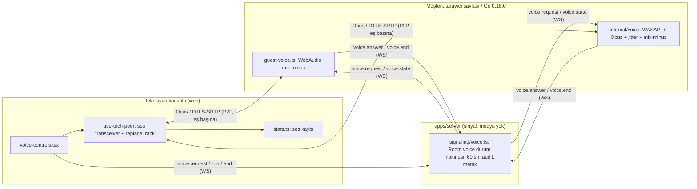

# Mimari — P28d Sesli görüşme (N katılımcı)

Tarih: 2026-11-17 · Durum: **r1** (mimar, "sormadan ilerle"; güvenlik tasarım turu bekliyor) · Dal: `p28d`
Girdiler: `docs/gereksinimler-p28.md` (US-69, AC-373..379, R44, V45), `docs/mimari-p28.md` §0.1, `docs/mimari-p28c.md` (§1.1 rol tablosu,
§4.4 `ROLE_MAY`/roster, §6), `docs/mimari-p28e.md` + ADR-0034 (kayıt konsolda), `docs/mimari-p28u.md` (gözetimsizde ses kapalı).
Yeni ADR: **ADR-0036**. Kontrol listesi: `docs/tasarim-kontrol.md` "P28d".

**Sadelik:** tek yol (tarayıcı ve Windows aynı mesajlar), oda başına tek görüşme, yeni tablo/REST yok, yeni WS mesajı 5 tane.

---

## 1. Özet ve kısıtlar

| Kapsamda                                                                                                                      | Kapsam dışı / Sonra (neden)                                                                    |
| ----------------------------------------------------------------------------------------------------------------------------- | ---------------------------------------------------------------------------------------------- |
| Teknisyen "Sesli görüşme" → müşteri Kabul/Reddet (60 sn) → iki yönlü ses; Sessize al; Görüşmeyi bitir                         | Görüntülü görüşme, ses kaydı (AC-375 yasaklar)                                                 |
| N ≤ 3 teknisyen: sahip/katılımcı kendi düğmesiyle konuşur, izleyici yalnız dinler; müşteride mix-minus (ADR-0036 m.4)         | Teknisyenler arası müşterisiz ses; > 3 kişi / SFU (R43)                                        |
| Tarayıcı müşteri sayfası + Windows istemci 0.18.0 (`rs.cap.voice1`) + teknisyen konsolu + sunucu kapısı/audit                 | macOS/Linux (P28f/g aynı protokolü alır); gözetimsiz oturum (V45, ADR-0036 m.7)                |
| Kalite panelinde ses paket kaybı; AC-376 gecikme ölçümü                                                                       | Windows'ta yankı giderme (kulaklık önerisi; genişleme noktası ADR-0036 m.3)                    |
| Yetki `sessions.voice`; audit `voice.request/accept/reject/end`; `Permissions-Policy microphone=(self)` web sayfalarında (§7) | Bekleyen isteği teknisyenin geri çekmesi (60 sn yeter; Sonra), aygıt seçimi (varsayılan aygıt) |

**Varsayımlar (V-PD-n):**

- **V-PD-1:** Win32 masaüstü uygulamasında mikrofon izin istemi yoktur. AC-374'teki "OS izni", Windows Ayarlar > Gizlilik > Mikrofon >
  "Masaüstü uygulamalarının erişmesine izin ver" anahtarıdır. Kapalıysa ya da aygıt yoksa (`E_ACCESSDENIED` / `AUDCLNT_E_DEVICE_INVALIDATED` /
  aygıt bulunamadı) müşteri penceresinde yol tarif eden metin gösterilir ve görüşme `voice.end{reason:"device"}` ile biter.
- **V-PD-2:** "Görüşmeyi bitir" görüşmeyi **herkes için** bitirir (tek kural). Katılımcının yalnız kendisi susmak istiyorsa "Sessize al"
  kullanır. Konuşan son teknisyen ayrılır ya da koparsa görüşme biter (`reason:"left"`).
- **V-PD-3:** Etkin görüşmede `talkers` dışındaki her teknisyen (izleyici ve henüz katılmamış katılımcı) karışımı otomatik dinler; ayrı
  bildirim yoktur. Müşteri bunu roster etiketleri ve görüşme çubuğundaki "Dinleyen: <adlar>" satırıyla (roster − talkers) görür.
- **V-PD-5:** Konuşan bir teknisyenin soketi koparsa (PC de düşer) o tid `talkers`'tan **hemen** çıkar; P28c'nin 120 sn üyelik payı
  üyeliği korur ama sesi değil. Döndüğünde "Görüşmeye katıl" ile yeniden konuşur. `talkers` boşalırsa görüşme `left` ile biter.
- **V-PD-4:** "Sessize al" yereldir (izin `enabled=false`, Go'da sıfır örnek) ve sunucuya gitmez. Mikrofon aygıtı açık kalır, gösterge
  "Sessizde" olur.

## 2. Bileşenler ve sorumluluklar

| Bileşen                                     | Sorumluluk                                                                                                                               |
| ------------------------------------------- | ---------------------------------------------------------------------------------------------------------------------------------------- |
| `packages/contracts/src/ws-voice.ts` (yeni) | Mesaj şemaları (`z.strictObject`), sabitler, `WS_CAP_VOICE`, sonuç kümeleri; fikstür `fixtures/voice.json` (Vitest + `go test`)          |
| `apps/server/src/signaling/voice.ts` (yeni) | `Room.voice` durum makinesi, kapılar (yetki, rol, `hasVoice`, oran), 60 sn zamanlayıcı, yayın, audit, metrik; oda bitişi/kopma kancaları |
| Konsol (`apps/web`)                         | Düğmeler, mikrofon izni, transceiver, çalma (`<audio>`), autoplay yedeği, kalite paneli                                                  |
| Tarayıcı misafir (`apps/web/app/session`)   | Kabul diyaloğu, `getUserMedia`, eş başına mix-minus grafiği, talker kapısı                                                               |
| Go misafir (`internal/voice`)               | WASAPI yakalama/çalma, eş başına Opus kodlayıcı, tid başına çözücü + jitter tamponu, mix-minus, talker kapısı, ≤ 1 sn bırakma            |

## 3. Veri modeli

**Yeni tablo, sütun ve migration yok; dba işi yok.** Yetki anahtarı `permissions.ts` sabitinden gelir (P28c `sessions.invite` kalıbı,
rol varsayılanları hesapla). Görüşme geçmişi audit'ten okunur.

`Room.voice` (bellek, `signaling/types.ts`):

| Alan            | Tip                               | Not                                             |
| --------------- | --------------------------------- | ----------------------------------------------- |
| `phase`         | `"idle" \| "pending" \| "active"` |                                                 |
| `by`            | `tid \| null`                     | İsteyen teknisyen                               |
| `pendingTimer`  | zamanlayıcı                       | 60 sn                                           |
| `startedAt`     | `number \| null`                  | `voice.end` sırasında `durationSec` hesabı için |
| `talkers`       | `Set<tid>`                        | Konuşma hakkı olan teknisyenler (izleyici asla) |
| `talkersEver`   | `number`                          | Audit için en yüksek konuşan sayısı             |
| `cooldownUntil` | `number`                          | Ret/zaman aşımından sonra 30 sn (AC-116 / G-03) |
| `requests`      | `number`                          | Oturum başına sayaç (≤ 10)                      |

## 4. Sözleşme (WS; REST değişmez)

### 4.1 Yetenek

- Go misafir `/ws/guest` alt protokolüne `rs.cap.voice1` ekler (0.18.0). Tarayıcı misafir sürümü sunucuyla aynı olduğundan destekli sayılır
  (`hasFsrv` kalıbı).
- `hasVoice(room, guest) = !room.unattended && (caps ∋ voice1 || guest.kind === "BROWSER")`. Tek yardımcıdır; gözetimsiz odada her zaman false döner.
- Teknisyen `hello`'suna ve role=guest mesajlarına `guestVoice: boolean` eklenir (`guestMulti` kalıbı). Konsol transceiver'ı ve düğme
  durumunu bu alana göre kurar.
- Ses mesajları yalnız `voice1` misafirin şemasındadır. Eski Go istemciye hiçbir `voice.*` mesajı gitmez (P28 §0 m.3).

### 4.2 Mesajlar (`ws-voice.ts`)

| `t`             | Yön                                 | Alanlar                                                    | Kural / hata                                                                                                                                                                                                                                                                                                 |
| --------------- | ----------------------------------- | ---------------------------------------------------------- | ------------------------------------------------------------------------------------------------------------------------------------------------------------------------------------------------------------------------------------------------------------------------------------------------------------ |
| `voice.request` | tech→S                              | —                                                          | `sessions.voice` yok → `FORBIDDEN`; izleyici → `FORBIDDEN`; `!hasVoice` → `CLIENT_UNSUPPORTED`; phase ≠ idle → `CONFLICT`; bekleme süresi içinde ya da oturumda 11. istek → `RATE_LIMITED`. Geçerse phase=pending, 60 sn zamanlayıcı başlar, audit `voice.request`                                           |
| `voice.request` | S→guest                             | `by: tid`                                                  | Misafir adı kendi roster'ından çözer; roster'da olmayan `by` → yok sayılır (P28c Y-PC-4 kalıbı)                                                                                                                                                                                                              |
| `voice.answer`  | guest→S                             | `accept: boolean`                                          | Misafir **tıklama anında** gönderir; mikrofonu sonra açar (tarayıcı izin istemi 60 sn sayacını yemesin). Yalnız phase=pending iken geçerlidir, aksi halde düşer. `true` → phase=active, `talkers={by}`, audit `voice.accept`. `false` → idle, bekleme süresi başlar, audit `voice.reject{reason:"customer"}` |
| `voice.join`    | tech→S                              | —                                                          | phase=active + `sessions.voice` + rol ≠ izleyici gerekir; izleyici → `FORBIDDEN` (AC-378). Geçerse `talkers` tid'i ekler. Ayrı audit yazılmaz                                                                                                                                                                |
| `voice.end`     | tech→S                              | —                                                          | Gönderenin `talkers` içinde olması gerekir, yoksa `FORBIDDEN`. Görüşmeyi herkes için bitirir (V-PD-2)                                                                                                                                                                                                        |
| `voice.end`     | guest→S                             | `reason: "customer" \| "device"`                           | Yalnız phase=active iken (kabulden sonra mikrofon açılamazsa `device`; müşteri bitirirse `customer`). Pending'de düşer — ret `voice.answer{false}` ile yapılır                                                                                                                                               |
| `voice.state`   | S→tüm teknisyenler + voice1 misafir | `phase`, `by?: tid`, `talkers: tid[]` (0..3), `endReason?` | Her değişimde anında gönderilir. Yeni katılan teknisyene ve yeniden bağlanan misafire `techs.roster`'dan hemen sonra gider. `endReason`: `tech \| customer \| timeout \| left \| device \| disconnect \| session_ended`                                                                                      |

`ROLE_MAY` (P28c, varsayılan-ret) güncellenir: `voice.request`, `voice.join` ve `voice.end` sahip ve katılımcıya açılır, izleyiciye
kapalıdır. Reddedilen mesaj mevcut `error{code}` zarfıyla döner. Rol değişiminde (`control.handover`) `talkers` değişmez; konuşma rolden bağımsızdır.

**Bitiş tetikleyicileri** (hepsi tek `endVoice(room, reason)` fonksiyonundan geçer): teknisyen ya da müşteri bitirir; talkers
boşalır (`left`; üye ayrıldı, çıkarıldı ya da `revokeMember` çalıştı); `sessions.voice` yetkisi oturum ortasında düşer (ilgili tid
talkers'tan çıkar); misafir 30 sn'den uzun kopar (`disconnect`); oturum biter (`session_ended`). Pending durumdayken misafir koparsa
`voice.reject{reason:"disconnect"}` yazılır.

Sabitler: `VOICE_REQUEST_TIMEOUT_MS = 60_000`, `VOICE_DENY_COOLDOWN_MS = 30_000`, `VOICE_REQUESTS_PER_SESSION = 10`,
`VOICE_GUEST_GRACE_MS = 30_000`.

### 4.3 Medya kuralları

- **Konsol:** `guestVoice=true` ise ilk offer'a izsiz bir ses transceiver'ı konur (sahip/katılımcıda `sendrecv`, izleyicide `recvonly`).
  Böylece yeniden müzakere gerekmez (ADR-0036 m.5). Düğmeye basılınca önce `getUserMedia({audio:{echoCancellation:true,noiseSuppression:true,autoGainControl:true}})`
  çağrılır. İzin verilmezse istek **gönderilmez** ve "Mikrofon izni verilmedi" gösterilir (AC-373). İzin alınan iz, `talkers` içine girene
  kadar gönderilmez; ret/zaman aşımı/`CONFLICT`/`RATE_LIMITED` gelirse `track.stop()` ile hemen bırakılır. `replaceTrack(track)` `voice.state.talkers ∋ benim tid` olunca yapılır. Bitişte `track.stop()` + `replaceTrack(null)`.
- **Misafir talker kapısı:** Misafir yalnız `talkers` içindeki tid'lerin gelen sesini çalar ve karışıma katar. Diğer eşlerin ses izi
  sessize alınır ya da atılır. Böylece izleyicinin değiştirilmiş konsolu da konuşamaz.
- **Mix-minus:** Misafir, teknisyen `t`'ye mikrofon + Σ(talkers \ {t}) gönderir. Eşin hoparlör çıkışı Σ talkers'tır. Tarayıcıda eş başına bir
  `MediaStreamAudioDestinationNode` kullanılır; Chrome'da uzak iz WebAudio'ya bağlanmadan önce sessiz bir `<audio>` öğesine de bağlanır
  (bilinen Chrome kısıtı). Go'da 20 ms'lik tikte toplama yapılır ve doymalı s16 kullanılır.
- **Go jitter tamponu:** tid başına hedef 60 ms, üst sınır 200 ms; taşmada en eski çerçeve atılır. Kayıp çerçevede önce FEC, o da yoksa
  PLC (`decode(nil)`) kullanılır.
- **Gecikme bütçesi (AC-376, p95 < 400 ms):** yakalama 20 + kodlama ≤ 5 + ağ (RTT/2 ≤ 75) + jitter 60–100 + çalma tamponu 40 ≈ 200–240 ms.

## 5. Akış

1. Teknisyen "Sesli görüşme"ye basar → mikrofon izni → `voice.request`. Konsolda "Müşterinin yanıtı bekleniyor" ve kalan süre görünür.
2. Misafirde diyalog açılır: "<Ad> sesli görüşme istiyor". Odak "Reddet"tedir, düğmeler 1,5 sn sonra etkinleşir, diyalog imlecin altında açılmaz
   (AC-116). Alt satırda "Yankı olmaması için kulaklık kullanmanız önerilir." yazar.
3. Kabul → misafir hemen `voice.answer{accept:true}` gönderir, sunucu `voice.state{active, talkers:[by]}` yayar; misafir sonra mikrofonu
   açar (tarayıcı izni / Windows aygıtı). Açılamazsa `voice.end{device}` gönderir (V-PD-1).
4. Diğer teknisyen (sahip ya da katılımcı) "Görüşmeye katıl"a basar → `voice.join` → talkers'a eklenir. İzleyici otomatik dinler.
5. Herhangi bir taraf "Görüşmeyi bitir"e basar → `voice.end` → `voice.state{idle, endReason}`. Her iki tarafta mikrofon ≤ 1 sn içinde kapanır.

## 6. Audit (AC-379; `packages/contracts/src/audit.ts` → `VOICE_AUDIT`, Türkçe etiketler mevcut tabloya)

| Action          | Actor                                | `new_value`                                         | result  |
| --------------- | ------------------------------------ | --------------------------------------------------- | ------- |
| `voice.request` | isteyen teknisyen                    | `{}`                                                | success |
| `voice.accept`  | müşteri (guest)                      | `{}`                                                | success |
| `voice.reject`  | müşteri / sistem                     | `{reason: "customer" \| "timeout" \| "disconnect"}` | fail    |
| `voice.end`     | bitiren teknisyen / müşteri / sistem | `{durationSec, reason, talkers: number}`            | success |

Kapıdan dönen ret (403/409/429) audit'e yazılmaz; yalnız metrik tutulur. Ses içeriği ve aygıt adı hiçbir yere yazılmaz.
Metrikler: `rs_voice_calls_total{result="accepted|rejected|timeout"}`, gauge `rs_voice_active`, `rs_voice_denied_total{code}`.

## 7. Yetki ve güvenlik

- **Yetki:** `sessions.voice` ("Etkin oturumda müşteriyle sesli görüşme başlatır ve katılır.") `permissions.ts` içine eklenir. Admin
  varsayılanında açık, User varsayılanında kapalıdır; toggle listesi otomatik oluşur. Yetkisi olmayan kullanıcıda düğme gösterilmez, sunucu da 403 döner.
- **Permissions-Policy:** HTML başlığını Next `apps/web/proxy.ts` üretir (Fastify `app-hooks.ts` yalnız `/api`, `/ws`; orada `microphone=()`
  kalır). Politika **belge yüklenirken** sabitlenir; konsola `Link`/`router.push` ile yumuşak geçilir (`session-list.tsx`,
  `use-connect.ts`, `use-join.ts`) ve girişten panele de yumuşak geçilir. Bu yüzden yalnız konsol yolunda `(self)` vermek mikrofonu
  kırar. Karar (**K-PD-1**): `proxy.ts` tüm sayfalarda `microphone=(self)`, yalnız `/r/*` (herkese açık talep formu; konsola geçmez) `microphone=()`.
  `(self)` üçüncü taraf çerçeveye izin vermez; `frame-ancestors` ve nonce'lu CSP değişmez. Ek risk yoktur: aynı kökenden XSS konsolu zaten
  açabilir. Test: `/login`, `/sessions/<id>/console`, `/session/<t>` → `(self)`; `/r/<ref>` → `()`; e2e'de konsola **listeden tıklayarak**
  geçip `getUserMedia` başarılı.
- **Tehdit özeti:** (T1) Rızasız dinleme: mikrofon yalnız müşteri kabulünden sonra açılır, yalnız `talkers` çalınır ve izleyici görünürdür
  (V-PD-3). (T2) İzleyicinin konuşması: sunucu `voice.join` isteğini 403 ile reddeder ve misafir kapısı da devrededir. (T3) Bitişten sonra açık kalan mikrofon:
  tek `endVoice` fonksiyonu + misafirde ≤ 1 sn bırakma; testle sınanır. (T4) Diyalog bombardımanı: 30 sn bekleme, oturumda en çok 10 istek. (T5) Kayda
  ses sızması: AC-375 testi. (T6) Kayıt/log: ses ve aygıt adı tutulmaz. Ses DTLS-SRTP ile taşınır, TURN yalnız aktarır (AC-375).

## 8. Arayüz (DESIGN.md token'ları, `lucide-react`, iki tema, 390 px, axe 0)

| Yer                                              | Öğe                                                                                                                                                                                                                                                                                                                                                                    |
| ------------------------------------------------ | ---------------------------------------------------------------------------------------------------------------------------------------------------------------------------------------------------------------------------------------------------------------------------------------------------------------------------------------------------------------------- |
| Konsol üst çubuğu                                | idle: "Sesli görüşme" (`Phone`). pending: `PhoneOutgoing` + "Yanıt bekleniyor · 0:45". active ve konuşuyor: "Mikrofon açık" göstergesi (`Mic`, `aria-live=polite`), "Sessize al"/"Sesi aç" geçişi (`MicOff`/`Mic`), "Görüşmeyi bitir" (`PhoneOff`, `danger-ghost`). active ve konuşmuyor: "Görüşmeye katıl" (`PhoneIncoming`)                                          |
| Konsol — izleyici                                | Düğme yerine "Dinleniyor" (`Headphones`). Autoplay engellenirse "Sesi aç" (`Volume2`)                                                                                                                                                                                                                                                                                  |
| Pasif durumlar                                   | Eski istemci: AC-352 metni. Gözetimsiz: "Gözetimsiz oturumda sesli görüşme yapılamaz". Bekleme süresi: "Müşteri reddetti — 30 sn sonra tekrar deneyebilirsiniz". Mikrofon izni yok: tarayıcı ayarı yönergesi                                                                                                                                                           |
| Kalite paneli                                    | Görüşme etkinken "Ses kaybı %x" satırı (`AudioLines`); eşikler video kayıp eşikleriyle aynı (AC-45 kalıbı)                                                                                                                                                                                                                                                             |
| Müşteri (tarayıcı + Go)                          | Diyalog (§5 m.2; dosya kabul diyaloğu kalıbı, `Dialog role=alertdialog`, "Reddet" `secondary` odakta, "Kabul et" `primary` 1,5 sn sonra). Görüşme çubuğu: "Mikrofon açık" (`Mic`), "Konuşan: A, B", varsa "Dinleyen: C", "Sessize al", "Görüşmeyi bitir". Aygıt hatası metni (V-PD-1). Go metinleri `internal/flow/messages_p28d.go`, web metinleri `messages/tr.json` |
| Toast (`ui/toast.tsx`; Sonner CSP nedeniyle yok) | Kabul/ret/zaman aşımı/bitiş toast'ları ("Müşteri sesli görüşmeyi reddetti", "Müşteri yanıt vermedi", "Sesli görüşme bitti · 3 dk 12 sn")                                                                                                                                                                                                                               |

## 9. Test stratejisi

| AC     | Seviye                                  | Test                                                                                                                                                                                                                                                                                                                                                                                                                                                                                                                                                                                                                                                                                     |
| ------ | --------------------------------------- | ---------------------------------------------------------------------------------------------------------------------------------------------------------------------------------------------------------------------------------------------------------------------------------------------------------------------------------------------------------------------------------------------------------------------------------------------------------------------------------------------------------------------------------------------------------------------------------------------------------------------------------------------------------------------------------------- |
| AC-373 | Entegrasyon (server) + e2e              | Yetkisiz → 403; sahte saatle 60 sn → `voice.reject{timeout}` + `voice.state{idle,timeout}`; ikinci istek → `CONFLICT`; ret sonrası 30 sn → `RATE_LIMITED`; e2e: izin reddi (Playwright `permissions: []`) → istek gitmez; diyalog odak/1,5 sn                                                                                                                                                                                                                                                                                                                                                                                                                                            |
| AC-374 | e2e + Go birim + staging elle           | e2e: kabulden sonra iki tarafta gösterge ve düğmeler; bitişten sonra `track.readyState==="ended"` ≤ 1 sn. Go: sahte aygıtla `End` → `Release` ≤ 1 sn. Staging: Windows mikrofon göstergesinin sönmesi                                                                                                                                                                                                                                                                                                                                                                                                                                                                                    |
| AC-375 | Web birim + e2e                         | Kaydedici `MediaStream`'inde ses izi 0 (görüşme etkin); e2e: görüşme sırasında kayıt → indirilen WebM'in Tracks bölümünde `TrackType=2` sayısı 0 (P28e oynatıcı testindeki EBML ayrıştırıcı). SDP'de `a=rtpmap:* opus/48000/2` ve DTLS fingerprint var                                                                                                                                                                                                                                                                                                                                                                                                                                   |
| AC-376 | e2e (otomatik) + staging elle           | **Otomatik:** iki Chromium bağlamı (konsol + tarayıcı misafir), `addInitScript` ile `getUserMedia` OscillatorNode darbesine (1 sn'de 1, 20 darbe) yönlendirilir. Gönderen darbe zamanını, alıcı `AnalyserNode` eşik aşımı zamanını `performance.timeOrigin+now` ile kaydeder (aynı makine, aynı saat). Ölçüt: p95 < 325 ms (400 − RTT/2 75 ms; yerel RTT ≈ 0). Kalite paneli e2e'si: ses kaybı satırı görünür. **Staging elle:** Windows istemci ↔ konsol, kalite panelinde RTT < 150 ms doğrulanır; tek telefon kaydıyla 20 "alkış" denemesi yapılır (konsol tarafında ses + müşteri hoparlörü), aradaki fark Audacity'de ölçülür; p95 < 400 ms. Sonuç `docs/test-raporu.md`'ye yazılır |
| AC-377 | e2e (tarayıcı) + staging elle (Windows) | Aynı senaryo iki misafir türünde; fikstür `voice.json` Vitest + `go test` ile aynı                                                                                                                                                                                                                                                                                                                                                                                                                                                                                                                                                                                                       |
| AC-378 | Entegrasyon + web/Go birim + e2e        | İzleyici `voice.join`/`voice.request` → 403; katılımcı `join` → talkers; mix-minus birim testi (Go toplama: t1 kendi sesini almaz; web graf bağlantıları); talker kapısı: talkers dışı tid sesi çalınmaz; e2e 3 bağlam: B, A'nın darbesini duyar                                                                                                                                                                                                                                                                                                                                                                                                                                         |
| AC-379 | Entegrasyon + e2e                       | Dört olay birer kez, `durationSec` sahte saatle doğru; eski istemci fikstürü (`voice1` yok) → `guestVoice=false`, düğme pasif + AC-352 metni; gözetimsiz oda + `voice1` → `CLIENT_UNSUPPORTED`; eski Go misafire `voice.*` gitmez                                                                                                                                                                                                                                                                                                                                                                                                                                                        |

Ek: `permissionsPolicyFor` birim testi; `ROLE_MAY` tip testi (yeni mesajlar); `endVoice` tetikleyici matrisi (7 neden; V-PD-5 kopma dahil). Go: Opus gidiş-dönüş
(Linux CI'da da çalışır, CGO yok), jitter tamponu, aygıt hata eşlemesi. axe iki tema.
Komutlar: `pnpm -r run test`, `pnpm --filter @remote/web e2e`, `cd apps/agent-win && go test ./...`.

## 10. Dosya planı

| Sahip             | Dosyalar                                                                                                                                                                                                                                                                                                 |
| ----------------- | -------------------------------------------------------------------------------------------------------------------------------------------------------------------------------------------------------------------------------------------------------------------------------------------------------- |
| backend-dev (K0)  | `packages/contracts/src/ws-voice.ts` (yeni), `ws.ts` (birlik + `guestVoice`), `ws-multi.ts` (`ROLE_MAY`), `permissions.ts`, `audit.ts`, `fixtures/voice.json`                                                                                                                                            |
| backend-dev (K1)  | `apps/server/src/signaling/voice.ts` (yeni), `types.ts`, `handlers.ts`, `ws-auth.ts` (`voice1` belirteci), `members.ts`/`rooms.ts` (bitiş kancaları), `ops/metrics.ts`                                                                                                                                   |
| frontend-dev (K2) | `apps/web/lib/webrtc/{peer.ts,use-tech-peer.ts,guest-peers.ts,stats.ts}`, `lib/webrtc/voice.ts` (yeni: konsol durum + misafir mix-minus), `proxy.ts` (K-PD-1), `components/console/voice-controls.tsx` (yeni), `app/session/*` (diyalog + çubuk), kalite paneli, `messages/tr.json`, e2e `voice.spec.ts` |
| Go (K0s, K3)      | `apps/agent-win/internal/voice/{opus.go,wasapi_windows.go,jitter.go,mixer.go,voice.go}` (yeni), `internal/signal` (voice mesajları + `rs.cap.voice1`), `internal/rtc` (eş başına ses izi), `internal/flow` (`voice` bağlama, `messages_p28d.go`), `internal/ui` (diyalog + çubuk), `go.mod`              |
| devops (K4)       | `.github/workflows/agent-win.yml` (değişmez; yalnız SHA ve `go test` yeşil kalmalı), runbook, sürüm 0.18.0 staging yayını                                                                                                                                                                                |

## 11. Görev paketleri

| Paket                                                                                                                                                                                                                                                                                                      | Ajan                                 | Bağımlı | Paralel         |
| ---------------------------------------------------------------------------------------------------------------------------------------------------------------------------------------------------------------------------------------------------------------------------------------------------------- | ------------------------------------ | ------- | --------------- |
| K0s Spike (Go): opus-go + WASAPI yakalama/çalma, Chrome ile iki yönlü ses. Ölçüt: `CGO_ENABLED=0`, iki derlemede SHA eşit, 20 ms mono kodlama ≤ 2 ms/çerçeve (referans Windows), ikili büyümesi ≤ 5 MB, Chrome'un gönderdiği Opus çözülüyor. Başarısızsa ADR-0036 yedeği (gopus → wazero) ve ADR revizyonu | backend-dev (Go)                     | —       | K0 ile paralel  |
| K0 Sözleşme (ws-voice, ROLE_MAY, yetki, audit, fikstür)                                                                                                                                                                                                                                                    | backend-dev                          | —       | K0s ile paralel |
| K1 Sunucu (durum makinesi, kapılar, bitiş kancaları, Permissions-Policy, metrik)                                                                                                                                                                                                                           | backend-dev                          | K0      | K2 ‖ K3 ‖ K4    |
| K2 Web (konsol, tarayıcı misafir mix-minus, kalite, kayıt testi, e2e AC-376)                                                                                                                                                                                                                               | frontend-dev                         | K0      | K1 ‖ K3 ‖ K4    |
| K3 Go istemci 0.18.0 (`internal/voice`, sinyal, eş izi, UI)                                                                                                                                                                                                                                                | backend-dev (Go)                     | K0, K0s | K1 ‖ K2 ‖ K4    |
| K4 Operasyon (runbook, yeni alarm yok, 0.18.0 staging yayını)                                                                                                                                                                                                                                              | devops                               | K0      | K1 ‖ K2 ‖ K3    |
| K5 Denetim (qa ‖ güvenlik), düzeltme, test-operatoru + AC-374/376/377 staging elle ölçüm                                                                                                                                                                                                                   | qa-denetci, guvenlik, test-operatoru | K1–K4   | qa ‖ güvenlik   |
| K6 Dokümantasyon (kılavuz "Sesli görüşme" + kulaklık önerisi + Windows mikrofon izni, DATASHEET, CHANGELOG, lisans listesi)                                                                                                                                                                                | teknik-yazar                         | K5      | —               |

dba işi yok (migration yok). Güvenlik tasarım turu K0 öncesinde bu belge üzerinden yapılır.

**Runbook maddeleri (K4):** (1) 0.18.0 yayını ve eski istemcide düğmenin pasif kalması. (2) "Ses gelmiyor" teşhisi: kalite panelinde
ses kaybı, TURN UDP/TCP, Windows gizlilik anahtarı, varsayılan aygıt. (3) `rs_voice_*` metriklerinin okunması. (4) AC-376 staging ölçüm
prosedürü (§9). (5) Geri alma: ikili geri alma yeterlidir. Eski konsol/sunucu `voice1`'i yok sayar, veri değişikliği yoktur.

**CI:** yeni workflow yok. `agent-win.yml` SHA karşılaştırması ve `go test ./...` aynen kalır (opus-go saf Go olduğundan Linux runner'da
da çalışır). Lisans: opus-go ve libopus BSD-3, `docs/implementation.md` bağımlılık gerekçesine ve lisans listesine eklenir. gitleaks ve Dependabot değişmez.

## 12. Kabul kriterleri eşlemesi

| AC     | Bileşen / uç                                                                                       |
| ------ | -------------------------------------------------------------------------------------------------- |
| AC-373 | `voice.request` (tech→S→guest), 60 sn zamanlayıcı, misafir diyaloğu, konsol `getUserMedia`         |
| AC-374 | `voice.answer`, misafir mikrofonu (tarayıcı / WASAPI), görüşme çubuğu, `endVoice` + ≤ 1 sn bırakma |
| AC-375 | ADR-0036 m.5/m.8, DTLS-SRTP Opus transceiver, kaydedici yalnız video                               |
| AC-376 | Gecikme bütçesi §4.3, jitter tamponu, `stats.ts` ses kaybı, §9 ölçüm yöntemi                       |
| AC-377 | Tek mesaj kümesi (`ws-voice.ts`), tarayıcı + Go misafir                                            |
| AC-378 | `voice.join`, `talkers`, `ROLE_MAY`, mix-minus, talker kapısı                                      |
| AC-379 | `VOICE_AUDIT` (§6), `rs.cap.voice1` / `guestVoice`, pasif düğme + AC-352 metni                     |

## 13. Açık kararlar

| No     | Konu                            | Varsayılan                                                             | Sahibi           |
| ------ | ------------------------------- | ---------------------------------------------------------------------- | ---------------- |
| A-PD-1 | K0s başarısız olursa kodlayıcı  | gopus (toolchain 1.27 ile) → wazero + libopus.wasm; ADR-0036 revizyonu | mimar (K0s sonu) |
| A-PD-2 | Windows AEC (Voice Capture DSP) | Sonra; kullanıcı geri bildirimi yankı şikâyeti gösterirse              | mimar            |
