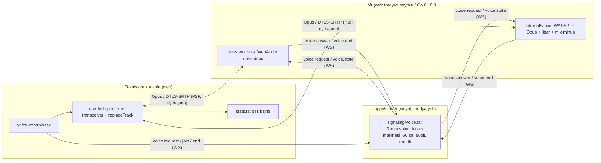

# Mimari — P28d Sesli görüşme (N katılımcı)

Tarih: 2026-11-17 · Durum: **r2** — güvenlik tasarım turu (`docs/guvenlik-raporu.md` "P28d tasarım turu": Y-PD-1..3, O-PD-1..4,
D-PD-1..5) işlendi; özet §14 (r1: mimar, "sormadan ilerle") · Dal: `p28d`
Girdiler: `docs/gereksinimler-p28.md` (US-69, AC-373..379, R44, V45), `docs/mimari-p28.md` §0.1, `docs/mimari-p28c.md` (§1.1 rol tablosu,
§4.4 `ROLE_MAY`/roster, §6), `docs/mimari-p28e.md` + ADR-0034 (kayıt konsolda), `docs/mimari-p28u.md` (gözetimsizde ses kapalı).
Yeni ADR: **ADR-0036**. Kontrol listesi: `docs/tasarim-kontrol.md` "P28d".

**Sadelik:** tek yol (tarayıcı ve Windows aynı mesajlar), oda başına tek görüşme, yeni tablo/REST yok, yeni WS mesajı 5 tane. Misafir mikrofonu tek olayla açılır: aynı sayfa/süreçte o
`callId` için yerel "Kabul et" tıklaması (K-PD-2).

---

## 1. Özet ve kısıtlar

| Kapsamda                                                                                                                                                          | Kapsam dışı / Sonra (neden)                                                                    |
| ----------------------------------------------------------------------------------------------------------------------------------------------------------------- | ---------------------------------------------------------------------------------------------- |
| Teknisyen "Sesli görüşme" → müşteri Kabul/Reddet (60 sn) → iki yönlü ses; Sessize al; Görüşmeyi bitir                                                             | Görüntülü görüşme, ses kaydı (AC-375 yasaklar)                                                 |
| N ≤ 3 teknisyen: sahip/katılımcı kendi düğmesiyle konuşur, izleyici yalnız dinler; müşteride mix-minus (ADR-0036 m.4)                                             | Teknisyenler arası müşterisiz ses; > 3 kişi / SFU (R43)                                        |
| Tarayıcı müşteri sayfası + Windows istemci 0.18.0 (`rs.cap.voice1`) + teknisyen konsolu + sunucu kapısı/audit                                                     | macOS/Linux (P28f/g aynı protokolü alır); gözetimsiz oturum (V45, ADR-0036 m.7)                |
| Kalite panelinde ses paket kaybı; AC-376 gecikme ölçümü                                                                                                           | Windows'ta yankı giderme (kulaklık önerisi; genişleme noktası ADR-0036 m.3)                    |
| Yetki `sessions.voice` (başlatma, katılma ve dinleme); audit `voice.request/accept/reject/join/end`; `Permissions-Policy microphone=(self)` web sayfalarında (§7) | Bekleyen isteği teknisyenin geri çekmesi (60 sn yeter; Sonra), aygıt seçimi (varsayılan aygıt) |

**Varsayımlar (V-PD-n):**

- **V-PD-1:** Win32 masaüstü uygulamasında mikrofon izin istemi yoktur. AC-374'teki "OS izni", Windows Ayarlar > Gizlilik > Mikrofon >
  "Masaüstü uygulamalarının erişmesine izin ver" anahtarıdır. Kapalıysa ya da aygıt yoksa (`E_ACCESSDENIED` / `AUDCLNT_E_DEVICE_INVALIDATED` /
  aygıt bulunamadı) müşteri penceresinde yol tarif eden metin gösterilir ve görüşme `voice.end{reason:"device"}` ile biter.
- **V-PD-2:** "Görüşmeyi bitir" görüşmeyi **herkes için** bitirir (tek kural). Katılımcının yalnız kendisi susmak istiyorsa "Sessize al"
  kullanır. Konuşan son teknisyen ayrılır ya da koparsa görüşme biter (`reason:"left"`).
- **V-PD-3 (r2, Y-PD-3):** Etkin görüşmeyi yalnız sunucunun hesapladığı `listeners` dinler: odada bağlı, rolü sahip/katılımcı/izleyici
  olan ve `sessions.voice` yetkili teknisyenler (`sessions.supervise` ile İzle'den giren de `sessions.voice` ister). `talkers ⊆ listeners`.
  Müşteri görüşme çubuğunda "Dinleyen: <adlar>" (`listeners − talkers`) satırını görür; `listeners` büyüdüğünde belirgin bildirim alır (§8).
- **V-PD-6 (r2):** AC-378 "izleyici yalnız dinler" yetkili izleyici için geçerlidir; `sessions.voice`'u olmayan teknisyen (rol fark
  etmez) görüşmeyi duymaz. Gereksinim metni değişmez; sapma bu varsayımla kayıtlıdır.
- **V-PD-7 (r2, Y-PD-1/O-PD-1):** Misafirin WS'si koparsa görüşme **hemen** biter (`disconnect`, pay yok). Misafir WS kapanınca mikrofonu
  ≤ 1 sn içinde bırakır ve yerel rıza kaydını siler. Ağ kesintisinden sonra görüşme yeni istek + yeni kabul ister (tek kural, sadelik).
- **V-PD-5:** Konuşan bir teknisyenin soketi koparsa (PC de düşer) o tid `talkers`'tan **hemen** çıkar; P28c'nin 120 sn üyelik payı
  üyeliği korur ama sesi değil. Döndüğünde "Görüşmeye katıl" ile yeniden konuşur. `talkers` boşalırsa görüşme `left` ile biter.
- **V-PD-4:** "Sessize al" yereldir (izin `enabled=false`, Go'da sıfır örnek) ve sunucuya gitmez. Mikrofon aygıtı açık kalır, gösterge
  "Sessizde" olur.

## 2. Bileşenler ve sorumluluklar

| Bileşen                                     | Sorumluluk                                                                                                                               |
| ------------------------------------------- | ---------------------------------------------------------------------------------------------------------------------------------------- |
| `packages/contracts/src/ws-voice.ts` (yeni) | Mesaj şemaları (`z.strictObject`), sabitler, `WS_CAP_VOICE`, sonuç kümeleri; fikstür `fixtures/voice.json` (Vitest + `go test`)          |
| `apps/server/src/signaling/voice.ts` (yeni) | `Room.voice` durum makinesi, kapılar (yetki, rol, `hasVoice`, oran), 60 sn zamanlayıcı, yayın, audit, metrik; oda bitişi/kopma kancaları |
| Konsol (`apps/web`)                         | Düğmeler, mikrofon izni, transceiver, çalma (`<audio>`), autoplay yedeği, kalite paneli                                                  |
| Tarayıcı misafir (`apps/web/app/session`)   | Kabul diyaloğu, `getUserMedia`, eş başına mix-minus grafiği, talker kapısı, gönderim kapısı (`listeners`), K-PD-2 rıza kaydı             |
| Go misafir (`internal/voice`)               | WASAPI yakalama/çalma, eş başına Opus kodlayıcı, tid başına çözücü + jitter tamponu, mix-minus, talker kapısı, ≤ 1 sn bırakma            |

## 3. Veri modeli

**Yeni tablo, sütun ve migration yok; dba işi yok.** Yetki anahtarı `permissions.ts` sabitinden gelir (P28c `sessions.invite` kalıbı,
rol varsayılanları hesapla). Görüşme geçmişi audit'ten okunur.

`Room.voice` (bellek, `signaling/types.ts`):

| Alan            | Tip                               | Not                                                                                                                    |
| --------------- | --------------------------------- | ---------------------------------------------------------------------------------------------------------------------- |
| `phase`         | `"idle" \| "pending" \| "active"` |                                                                                                                        |
| `callId`        | `string \| null`                  | r2 (Y-PD-1): her kabul edilen `voice.request`'te `crypto.randomBytes(16).toString("base64url")` (22 kr.); idle'da null |
| `by`            | `tid \| null`                     | İsteyen teknisyen                                                                                                      |
| `pendingTimer`  | zamanlayıcı                       | 60 sn                                                                                                                  |
| `startedAt`     | `number \| null`                  | `voice.end` sırasında `durationSec` hesabı için                                                                        |
| `talkers`       | `Set<tid>`                        | Konuşma hakkı olan teknisyenler (izleyici asla)                                                                        |
| `listeners`     | türetilir (saklanmaz)             | r2 (Y-PD-3): `listenersOf(room)` = bağlı + rolü var + `sessions.voice`; her yayında hesaplanır                         |
| `talkerIds`     | `Set<userId>`                     | r2 (O-PD-2): görüşme boyunca konuşanların birleşimi (≤ 3), audit için                                                  |
| `listenerIds`   | `Set<userId>`                     | r2 (O-PD-2): görüşme boyunca dinleyenlerin birleşimi, audit için                                                       |
| `cooldownUntil` | `number`                          | Ret/zaman aşımından ve r2'de `endReason ∈ {customer, device}` bitişinden sonra 30 sn (AC-116 / G-03, D-PD-2)           |
| `requests`      | `number`                          | Oturum başına sayaç (≤ 10)                                                                                             |

## 4. Sözleşme (WS; REST değişmez)

### 4.1 Yetenek

- Go misafir `/ws/guest` alt protokolüne `rs.cap.voice1` ekler (0.18.0). Tarayıcı misafir sürümü sunucuyla aynı olduğundan destekli sayılır
  (`hasFsrv` kalıbı).
- `hasVoice(room, guest) = !room.unattended && (caps ∋ voice1 || guest.kind === "BROWSER")`. Tek yardımcıdır; gözetimsiz odada her zaman false döner.
- **İstemci kapısı (r2, O-PD-3):** Go istemci cihaz bileti/servis/yardımcı (gözetimsiz) bağlantılarında `rs.cap.voice1` bildirmez ve
  `internal/voice` hiç kurulmaz (`voice.New` çağrılmaz; birim testi). Sunucu kapısı (`hasVoice`) ile iki katman.
- Teknisyen `hello`'suna ve role=guest mesajlarına `guestVoice: boolean` eklenir (`guestMulti` kalıbı). Konsol transceiver'ı ve düğme
  durumunu bu alana göre kurar.
- Ses mesajları yalnız `voice1` misafirin şemasındadır. Eski Go istemciye hiçbir `voice.*` mesajı gitmez (P28 §0 m.3).

### 4.2 Mesajlar (`ws-voice.ts`)

`callId` (r2, Y-PD-1): `z.string().regex(/^[A-Za-z0-9_-]{22}$/)`. Sunucu üretir; istemci üretmez. Etkin `Room.voice.callId` ile eşleşmeyen
mesaj **düşer** (yanıt yok, `rs_voice_denied_total{code="stale_call"}`).

| `t`             | Yön                                 | Alanlar                                                                                          | Kural / hata                                                                                                                                                                                                                                                                                                                                                                                                                                                                                                                                                                         |
| --------------- | ----------------------------------- | ------------------------------------------------------------------------------------------------ | ------------------------------------------------------------------------------------------------------------------------------------------------------------------------------------------------------------------------------------------------------------------------------------------------------------------------------------------------------------------------------------------------------------------------------------------------------------------------------------------------------------------------------------------------------------------------------------ |
| `voice.request` | tech→S                              | —                                                                                                | `sessions.voice` yok → `FORBIDDEN`; izleyici → `FORBIDDEN`; `!hasVoice` → `CLIENT_UNSUPPORTED`; phase ≠ idle → `CONFLICT`; bekleme süresi içinde ya da oturumda 11. istek → `RATE_LIMITED`. Geçerse yeni `callId`, phase=pending, 60 sn zamanlayıcı, audit `voice.request`                                                                                                                                                                                                                                                                                                           |
| `voice.request` | S→guest                             | `callId`, `by: tid`                                                                              | Misafir adı kendi roster'ından çözer; roster'da olmayan `by` → yok sayılır (P28c Y-PC-4 kalıbı). Diyalog açar; mikrofon **açmaz**                                                                                                                                                                                                                                                                                                                                                                                                                                                    |
| `voice.answer`  | guest→S                             | `callId`, `accept: boolean`                                                                      | Misafir **tıklama anında** gönderir ve aynı anda yerel rıza kaydını (`consent = callId`) yazar; mikrofonu sonra açar (K-PD-2). Yalnız phase=pending ve `callId` eşleşirse geçerli, aksi düşer. `true` → active, `talkers={by}`, audit `voice.accept`. `false` → idle, bekleme süresi, audit `voice.reject{reason:"customer"}`                                                                                                                                                                                                                                                        |
| `voice.join`    | tech→S                              | `callId`                                                                                         | phase=active + `sessions.voice` + rol ≠ izleyici gerekir; izleyici → `FORBIDDEN` (AC-378). Geçerse `talkers` tid'i ekler, audit `voice.join` (O-PD-2). Zaten talker ise no-op, yayın yok (D-PD-2)                                                                                                                                                                                                                                                                                                                                                                                    |
| `voice.end`     | tech→S                              | `callId`                                                                                         | Gönderenin `talkers` içinde olması gerekir, yoksa `FORBIDDEN`. Görüşmeyi herkes için bitirir (V-PD-2). phase=idle iken no-op (D-PD-2)                                                                                                                                                                                                                                                                                                                                                                                                                                                |
| `voice.end`     | guest→S                             | `callId`, `reason: "customer" \| "device"`                                                       | Yalnız phase=active iken (mikrofon açılamazsa `device`; müşteri bitirirse ya da rıza kaydı yoksa `customer`). Pending'de düşer — ret `voice.answer{false}` ile yapılır. İki neden de 30 sn bekleme başlatır (D-PD-2)                                                                                                                                                                                                                                                                                                                                                                 |
| `voice.state`   | S→tüm teknisyenler + voice1 misafir | `phase`, `callId?`, `by?: tid`, `talkers: tid[]` (0..3), `listeners: tid[]` (0..3), `endReason?` | Her değişimde (listeners değişimi dahil) anında gönderilir. Yeni katılan teknisyene ve (yeniden) bağlanan misafire `techs.roster`'dan hemen sonra gider. `callId` pending/active'de zorunlu; idle bitiş yayınında biten görüşmenin `callId`'i taşınır; başka idle yayında yoktur. Konsol `voice.join`/`voice.end` için `callId`'i buradan alır. `talkers`/`listeners`/`by` içinde roster'da olmayan tid misafirde yok sayılır (D-PD-3). **Mikrofon açmaz, yalnız kapatabilir** (K-PD-2). `endReason`: `tech \| customer \| timeout \| left \| device \| disconnect \| session_ended` |

**K-PD-2 Misafir rıza kuralı (r2, Y-PD-1 — bağlayıcı):** Misafir mikrofonu **yalnız** aynı sayfa ömrü (tarayıcı: modül belleğinde
değişken; `sessionStorage`/`localStorage` yasak) ya da aynı süreç (Go: bellek) içinde, o `callId` için kullanıcının yerel "Kabul et"
tıklamasından sonra açar. `voice.state`, `voice.request`, DC mesajı ya da SDP (`sendrecv` ses m-line'ı) mikrofon açmaz; yalnız kapatır.
Rıza kaydı WS kapanışında, görüşme bitişinde ve `callId` değiştiğinde silinir. Rıza kaydı olmadan `voice.state{active}` alan misafir
mikrofonu açmaz ve `voice.end{callId, reason:"customer"}` gönderir. Sayfa yenileme, Go yeniden başlama ve WS yeniden bağlanma bu yüzden
yeni istek + yeni kabul ister (V-PD-7).

`ROLE_MAY` (P28c, varsayılan-ret) güncellenir: `voice.request`, `voice.join` ve `voice.end` sahip ve katılımcıya açılır, izleyiciye
kapalıdır. Reddedilen mesaj mevcut `error{code}` zarfıyla döner. Rol değişiminde (`control.handover`) `talkers` değişmez; konuşma rolden bağımsızdır.

**Bitiş tetikleyicileri** (hepsi tek `endVoice(room, reason)` fonksiyonundan geçer): teknisyen ya da müşteri bitirir; talkers
boşalır (`left`; üye ayrıldı, çıkarıldı ya da `revokeMember` çalıştı); `sessions.voice` yetkisi oturum ortasında düşer (r2, Y-PD-3: `applyPermChange`
**her iki yolda** — üye `memberPermChange` ve sahip `narrowCaps` — tek `voicePermChange(room, userId, perms)` çağrılır; tid `talkers` ve
`listeners`'tan çıkar, `voice.state` yayılır; iki yol da teste girer); misafir soketi kapanır **ya da yenisiyle değiştirilir** (`replaced`; `disconnect`, **anında**, V-PD-7); oturum
biter (`session_ended`). Pending durumdayken misafir koparsa `voice.reject{reason:"disconnect"}` yazılır.

Sabitler: `VOICE_REQUEST_TIMEOUT_MS = 60_000`, `VOICE_DENY_COOLDOWN_MS = 30_000`, `VOICE_REQUESTS_PER_SESSION = 10`,
`VOICE_MAX_OPUS_BYTES = 1275` (RFC 6716), `VOICE_MAX_PKT_PER_SEC = 100`. r1'deki `VOICE_GUEST_GRACE_MS` kaldırıldı (V-PD-7).
Mevcut soket başına WS mesaj oranı sınırı `voice.*` mesajlarını da kapsar; bunu entegrasyon testi gösterir (D-PD-2).

### 4.3 Medya kuralları

- **Konsol:** `guestVoice=true` ise ilk offer'a izsiz bir ses transceiver'ı konur (sahip/katılımcıda `sendrecv`, izleyicide `recvonly`).
  Böylece yeniden müzakere gerekmez (ADR-0036 m.5). Düğmeye basılınca önce `getUserMedia({audio:{echoCancellation:true,noiseSuppression:true,autoGainControl:true}})`
  çağrılır. İzin verilmezse istek **gönderilmez** ve "Mikrofon izni verilmedi" gösterilir (AC-373). İzin alınan iz, `talkers` içine girene
  kadar gönderilmez; ret/zaman aşımı/`CONFLICT`/`RATE_LIMITED` gelirse `track.stop()` ile hemen bırakılır. `replaceTrack(track)` `voice.state.talkers ∋ benim tid` olunca yapılır. Bitişte `track.stop()` + `replaceTrack(null)`.
- **Konsol mikrofon bırakma (r2, D-PD-5):** Tek `releaseMic()` (`track.stop()` + `replaceTrack(null)`) şu durumlarda çağrılır: bitiş, ret,
  zaman aşımı, `pagehide`, WS kapanışı, oda bitişi, rol/üyelik kaybı. e2e: konsol sekmesi kapanınca iz `ended`.
- **Misafir talker kapısı (r2, D-PD-3):** Her uzak ses izi `muted=true` bir `<audio>` öğesine bağlanır (Chrome kısıtı; hoparlöre çıkmaz).
  WebAudio grafına yalnız `talkers` içindeki tid bağlanır; `talkers`'tan çıkan tid'in düğümü aynı tikte `disconnect()` edilir. Birim
  testi graf bağlantı listesini doğrular. Go'da talkers dışı tid'in paketi **çözülmeden** atılır (Y-PD-2). Böylece izleyicinin değiştirilmiş
  konsolu da konuşamaz.
- **Misafir gönderim kapısı (r2, Y-PD-3):** Karışım yalnız `listeners` eşlerine gider. Diğer eşlerin ses gönderici izi `replaceTrack(null)`
  (tarayıcı) olur; Go'da o eşe örnek yazılmaz. `listeners` her `voice.state`'te yeniden uygulanır.
- **Misafir WS kopması (r2, O-PD-1, V-PD-7):** WS kapanınca tüm ses göndericileri hemen susturulur (`track.enabled=false` / Go'da sıfır
  örnek), mikrofon ≤ 1 sn içinde bırakılır (`track.stop()` / WASAPI `Close`), rıza kaydı silinir. Test: WS kesme → ≤ 1 sn içinde giden ses
  enerjisi 0.
- **Mix-minus:** Misafir, teknisyen `t`'ye mikrofon + Σ(talkers \ {t}) gönderir. Eşin hoparlör çıkışı Σ talkers'tır. Tarayıcıda eş başına bir
  `MediaStreamAudioDestinationNode` kullanılır; Chrome kısıtı için `muted` `<audio>` kuralı yukarıdadır. Go'da 20 ms'lik tikte toplama yapılır ve doymalı s16 kullanılır.
- **Go Opus yalıtımı (r2, Y-PD-2; yalnız `internal/voice/opus.go`):** Sıra: (1) tid `talkers` içinde değilse paket çözülmeden atılır;
  (2) yük > `VOICE_MAX_OPUS_BYTES` ya da tid başına > `VOICE_MAX_PKT_PER_SEC` → düşer; (3) her `Decode`/`Encode` `defer recover()` ile
  sarılır; panic'te o tid'in çözücüsü atılıp yeniden kurulur; aynı görüşmede o tid için sayaç ≥ 3 olursa o eşin sesi görüşme sonuna dek
  düşürülür. Süreç ölmez; log/metrik yalnız sayı yazar. Çözücü ve kodlayıcı her görüşmede sıfırdan kurulur.
- **WASAPI yaşam döngüsü (r2, D-PD-4):** Tüm COM arayüzleri (`IMMDeviceEnumerator`, `IMMDevice`, `IAudioClient(2)`, `IAudioCaptureClient`,
  `IAudioRenderClient`) tek sahip yapıda tutulur ve `Close()` içinde ters sırayla `Release` edilir. COM çağrıları `runtime.LockOSThread`
  ile kilitli iş parçacığında yapılır. Yakalama goroutine'i olay + `stop` kanalı ve 200 ms zaman aşımlı `WaitForMultipleObjects` ile durur.
  `Close` bitişte, WS kopmasında, oturum bitişinde ve süreç çıkışında (panic dahil `defer`) çağrılır. Aygıt adı/kimliği log'a yazılmaz.
- **Go jitter tamponu:** tid başına hedef 60 ms, üst sınır 200 ms; taşmada en eski çerçeve atılır. Kayıp çerçevede önce FEC, o da yoksa
  PLC (`decode(nil)`) kullanılır.
- **Gecikme bütçesi (AC-376, p95 < 400 ms):** yakalama 20 + kodlama ≤ 5 + ağ (RTT/2 ≤ 75) + jitter 60–100 + çalma tamponu 40 ≈ 200–240 ms.

## 5. Akış

1. Teknisyen "Sesli görüşme"ye basar → mikrofon izni → `voice.request`. Konsolda "Müşterinin yanıtı bekleniyor" ve kalan süre görünür.
2. Misafirde diyalog açılır: "<Ad> sesli görüşme istiyor". Odak "Reddet"tedir, düğmeler 1,5 sn sonra etkinleşir, diyalog imlecin altında açılmaz
   (AC-116). Alt satırda "Yankı olmaması için kulaklık kullanmanız önerilir." yazar.
3. Kabul tıklaması → misafir rıza kaydını (`callId`) yazar ve hemen `voice.answer{callId, accept:true}` gönderir; sunucu
   `voice.state{active, callId, talkers:[by], listeners}` yayar. Misafir mikrofonu **tıklama olayının devamında** açar (tarayıcı izni /
   Windows aygıtı; K-PD-2), `voice.state` ile değil. Açılamazsa `voice.end{callId, device}` gönderir (V-PD-1).
4. Diğer teknisyen (sahip ya da katılımcı) "Görüşmeye katıl"a basar → `voice.join` → talkers'a eklenir. `sessions.voice` yetkili
   izleyici otomatik dinler (`listeners`); yeni dinleyici misafirde duyurulur (§8).
5. Herhangi bir taraf "Görüşmeyi bitir"e basar → `voice.end` → `voice.state{idle, endReason}`. Her iki tarafta mikrofon ≤ 1 sn içinde kapanır.

## 6. Audit (AC-379; `packages/contracts/src/audit.ts` → `VOICE_AUDIT`, Türkçe etiketler mevcut tabloya)

| Action          | Actor                                | `new_value`                                                                                                              | result  |
| --------------- | ------------------------------------ | ------------------------------------------------------------------------------------------------------------------------ | ------- |
| `voice.request` | isteyen teknisyen                    | `{}`                                                                                                                     | success |
| `voice.accept`  | müşteri (guest)                      | `{}`                                                                                                                     | success |
| `voice.reject`  | müşteri / sistem                     | `{reason: "customer" \| "timeout" \| "disconnect"}`                                                                      | fail    |
| `voice.join`    | katılan teknisyen (r2, O-PD-2)       | `{}`                                                                                                                     | success |
| `voice.end`     | bitiren teknisyen / müşteri / sistem | `{durationSec, reason, talkerIds: userId[], listenerIds: userId[]}` (r2, O-PD-2; görüşme boyunca birleşim, her biri ≤ 3) | success |

Kapıdan dönen ret (403/409/429) audit'e yazılmaz; yalnız metrik tutulur. Ses içeriği ve aygıt adı hiçbir yere yazılmaz. `voice.join` AC-379'daki dört olaya eklenir (KVKK hesap verebilirlik:
"görüşmeyi kim dinledi" sorusu `voice.end.listenerIds` ile yanıtlanır).
Metrikler: `rs_voice_calls_total{result="accepted|rejected|timeout"}`, gauge `rs_voice_active`, `rs_voice_denied_total{code}`.

## 7. Yetki ve güvenlik

- **Yetki:** `sessions.voice` ("Etkin oturumda müşteriyle sesli görüşme başlatır, katılır ve görüşmeyi dinler.") `permissions.ts` içine eklenir. Admin
  varsayılanında açık, User varsayılanında kapalıdır; toggle listesi otomatik oluşur. Yetkisi olmayan kullanıcıda düğme gösterilmez, sunucu da 403 döner.
- **Permissions-Policy:** HTML başlığını Next `apps/web/proxy.ts` üretir (Fastify `app-hooks.ts` yalnız `/api`, `/ws`; orada `microphone=()`
  kalır). Politika **belge yüklenirken** sabitlenir; konsola `Link`/`router.push` ile yumuşak geçilir (`session-list.tsx`,
  `use-connect.ts`, `use-join.ts`) ve girişten panele de yumuşak geçilir. Bu yüzden yalnız konsol yolunda `(self)` vermek mikrofonu
  kırar. Karar (**K-PD-1**): `proxy.ts` tüm sayfalarda `microphone=(self)`, yalnız `/r/*` (herkese açık talep formu; konsola geçmez) `microphone=()`.
  r2 (D-PD-1): politika tek saf fonksiyon `permissionsPolicyFor(pathname)` ile üretilir; `/r` ve tüm alt yolları `()`; `camera=()` ve
  `geolocation=()` değişmez ve testle sabitlenir. Kural (implementation.md'ye yazılır): girişsiz/herkese açık yeni bir sayfa eklenirse
  `permissionsPolicyFor` içindeki `()` listesine eklenir; bu liste ve birim testi birlikte güncellenir.
  `(self)` üçüncü taraf çerçeveye izin vermez; `frame-ancestors` ve nonce'lu CSP değişmez. Ek risk yoktur: aynı kökenden XSS konsolu zaten
  açabilir. Test: `/login`, `/sessions/<id>/console`, `/session/<t>` → `(self)`; `/r/<ref>` → `()`; e2e'de konsola **listeden tıklayarak**
  geçip `getUserMedia` başarılı.
- **Tehdit özeti:** (T1) Rızasız dinleme: mikrofon yalnız o `callId` için yerel kabul tıklamasından sonra açılır (K-PD-2); WS kopunca
  kapanır (V-PD-7); karışım yalnız yetkili `listeners`'a gider, yeni dinleyici duyurulur (V-PD-3). (T2) İzleyicinin konuşması: sunucu `voice.join` isteğini 403 ile reddeder ve misafir kapısı da devrededir. (T3) Bitişten sonra açık kalan mikrofon:
  tek `endVoice` fonksiyonu + misafirde ≤ 1 sn bırakma; testle sınanır. (T4) Diyalog bombardımanı: ret ve müşteri/aygıt bitişinden sonra 30 sn bekleme, oturumda en çok 10 istek. (T5) Kayda
  ses sızması: AC-375 testi. (T6) Kayıt/log: ses ve aygıt adı tutulmaz. (T7, r2) Bozuk Opus paketi: kapı → boyut → `recover` sırası (Y-PD-2). (T8, r2)
  Gözetimsiz kipte mikrofon: istemcide ses modülü kurulmaz (O-PD-3). Ses DTLS-SRTP ile taşınır, TURN yalnız aktarır (AC-375).

## 8. Arayüz (DESIGN.md token'ları, `lucide-react`, iki tema, 390 px, axe 0)

| Yer                                              | Öğe                                                                                                                                                                                                                                                                                                                                                                                                                                                                                                                                                                                                                                                                                                                                                                                                  |
| ------------------------------------------------ | ---------------------------------------------------------------------------------------------------------------------------------------------------------------------------------------------------------------------------------------------------------------------------------------------------------------------------------------------------------------------------------------------------------------------------------------------------------------------------------------------------------------------------------------------------------------------------------------------------------------------------------------------------------------------------------------------------------------------------------------------------------------------------------------------------- |
| Konsol üst çubuğu                                | idle: "Sesli görüşme" (`Phone`). pending: `PhoneOutgoing` + "Yanıt bekleniyor · 0:45". active ve konuşuyor: "Mikrofon açık" göstergesi (`Mic`, `aria-live=polite`), "Sessize al"/"Sesi aç" geçişi (`MicOff`/`Mic`), "Görüşmeyi bitir" (`PhoneOff`, `danger-ghost`). active ve konuşmuyor: "Görüşmeye katıl" (`PhoneIncoming`)                                                                                                                                                                                                                                                                                                                                                                                                                                                                        |
| Konsol — izleyici                                | Düğme yerine "Dinleniyor" (`Headphones`). Autoplay engellenirse "Sesi aç" (`Volume2`). `sessions.voice` yoksa "Sesli görüşme sürüyor — dinleme yetkiniz yok" (`Headphones`, pasif; V-PD-6)                                                                                                                                                                                                                                                                                                                                                                                                                                                                                                                                                                                                           |
| Pasif durumlar                                   | Eski istemci: AC-352 metni. Gözetimsiz: "Gözetimsiz oturumda sesli görüşme yapılamaz". Bekleme süresi: "Müşteri reddetti — 30 sn sonra tekrar deneyebilirsiniz"; müşteri bitirdiyse "Müşteri görüşmeyi bitirdi — 30 sn sonra tekrar deneyebilirsiniz" (D-PD-2). Mikrofon izni yok: tarayıcı ayarı yönergesi                                                                                                                                                                                                                                                                                                                                                                                                                                                                                          |
| Kalite paneli                                    | Görüşme etkinken "Ses kaybı %x" satırı (`AudioLines`); eşikler video kayıp eşikleriyle aynı (AC-45 kalıbı)                                                                                                                                                                                                                                                                                                                                                                                                                                                                                                                                                                                                                                                                                           |
| Müşteri (tarayıcı + Go)                          | Diyalog (§5 m.2; dosya kabul diyaloğu kalıbı, `Dialog role=alertdialog`, "Reddet" `secondary` odakta, "Kabul et" `primary` 1,5 sn sonra). Görüşme çubuğu: "Mikrofon açık" (`Mic`), "Konuşan: A, B", varsa "Dinleyen: C" (`listeners − talkers`), "Sessize al", "Görüşmeyi bitir". r2 (Y-PD-3): `listeners` büyüdüğünde belirgin bildirim, `aria-live=assertive`: "<Ad> görüşmeyi dinlemeye başladı" + mevcut "Çıkar" düğmesine doğrudan erişim (Go: çubuk satırı + tepsi balonu). r2 (O-PD-3, Go): mikrofon aygıtı açık olduğu sürece kapatılamaz tepsi göstergesi (mevcut tepsi simgesi + ipucu "Mikrofon açık"/"Sessizde" + menüde "Görüşmeyi bitir"); pencere küçültülse de görünür. Aygıt hatası metni (V-PD-1). Go metinleri `internal/flow/messages_p28d.go`, web metinleri `messages/tr.json` |
| Toast (`ui/toast.tsx`; Sonner CSP nedeniyle yok) | Kabul/ret/zaman aşımı/bitiş toast'ları ("Müşteri sesli görüşmeyi reddetti", "Müşteri yanıt vermedi", "Sesli görüşme bitti · 3 dk 12 sn")                                                                                                                                                                                                                                                                                                                                                                                                                                                                                                                                                                                                                                                             |

## 9. Test stratejisi

| AC     | Seviye                                  | Test                                                                                                                                                                                                                                                                                                                                                                                                                                                                                                                                                                                                                                                                                                       |
| ------ | --------------------------------------- | ---------------------------------------------------------------------------------------------------------------------------------------------------------------------------------------------------------------------------------------------------------------------------------------------------------------------------------------------------------------------------------------------------------------------------------------------------------------------------------------------------------------------------------------------------------------------------------------------------------------------------------------------------------------------------------------------------------- |
| AC-373 | Entegrasyon (server) + e2e              | Yetkisiz → 403; sahte saatle 60 sn → `voice.reject{timeout}` + `voice.state{idle,timeout}`; ikinci istek → `CONFLICT`; ret ve müşteri bitirmesi sonrası 30 sn → `RATE_LIMITED`; eşleşmeyen `callId` düşer; idle'da `voice.end` ve tekrar `voice.join` yayın üretmez; WS oran sınırı `voice.*`'ı kapsar (D-PD-2); e2e: izin reddi (Playwright `permissions: []`) → istek gitmez; diyalog odak/1,5 sn                                                                                                                                                                                                                                                                                                        |
| AC-374 | e2e + Go birim + staging elle           | e2e: kabulden sonra iki tarafta gösterge ve düğmeler; bitişten sonra `track.readyState==="ended"` ≤ 1 sn. **r2 rıza (Y-PD-1):** (a) misafir sayfa yenileme ve Go yeniden bağlanma/yeniden başlama → sunucuda `voice.end{disconnect}`, misafirde `getUserMedia`/WASAPI `Initialize` çağrı sayısı 0; (b) sahte/bayat `voice.state{active}` (rıza kaydı yok) → mikrofon açılmaz, `voice.end{callId, customer}` gider; DC mesajı ve `sendrecv` SDP mikrofon açamaz; WS kesme → ≤ 1 sn giden ses enerjisi 0 (O-PD-1). Go: sahte aygıtla `End` → `Release` ≤ 1 sn; her `AddRef`/`Release` sayısı eşit (D-PD-4); gözetimsiz kipte `voice.New` çağrılmaz (O-PD-3). Staging: Windows mikrofon göstergesinin sönmesi |
| AC-375 | Web birim + e2e                         | Kaydedici `MediaStream`'inde ses izi 0 (görüşme etkin); e2e: görüşme sırasında kayıt → indirilen WebM'in Tracks bölümünde `TrackType=2` sayısı 0 (P28e oynatıcı testindeki EBML ayrıştırıcı). SDP'de `a=rtpmap:* opus/48000/2` ve DTLS fingerprint var                                                                                                                                                                                                                                                                                                                                                                                                                                                     |
| AC-376 | e2e (otomatik) + staging elle           | **Otomatik:** iki Chromium bağlamı (konsol + tarayıcı misafir), `addInitScript` ile `getUserMedia` OscillatorNode darbesine (1 sn'de 1, 20 darbe) yönlendirilir. Gönderen darbe zamanını, alıcı `AnalyserNode` eşik aşımı zamanını `performance.timeOrigin+now` ile kaydeder (aynı makine, aynı saat). Ölçüt: p95 < 325 ms (400 − RTT/2 75 ms; yerel RTT ≈ 0). Kalite paneli e2e'si: ses kaybı satırı görünür. **Staging elle:** Windows istemci ↔ konsol, kalite panelinde RTT < 150 ms doğrulanır; tek telefon kaydıyla 20 "alkış" denemesi yapılır (konsol tarafında ses + müşteri hoparlörü), aradaki fark Audacity'de ölçülür; p95 < 400 ms. Sonuç `docs/test-raporu.md`'ye yazılır                   |
| AC-377 | e2e (tarayıcı) + staging elle (Windows) | Aynı senaryo iki misafir türünde; fikstür `voice.json` Vitest + `go test` ile aynı                                                                                                                                                                                                                                                                                                                                                                                                                                                                                                                                                                                                                         |
| AC-378 | Entegrasyon + web/Go birim + e2e        | İzleyici `voice.join`/`voice.request` → 403; katılımcı `join` → talkers; mix-minus birim testi (Go toplama: t1 kendi sesini almaz; web graf bağlantıları); talker kapısı: talkers dışı tid sesi çalınmaz; e2e 3 bağlam: B, A'nın darbesini duyar. **r2 (Y-PD-3):** `sessions.voice`'u olmayan izleyici `listeners` dışında, gönderici izi null, darbe duyulmaz; `applyPermChange` üye ve sahip yolu ayrı testlerle tid'i `talkers`+`listeners`'tan çıkarır; yeni dinleyicide misafirde `aria-live=assertive` duyuru. Talker kapısı graf bağlantı listesi birim testi (D-PD-3)                                                                                                                              |
| AC-379 | Entegrasyon + e2e                       | Beş olay (dört AC olayı + `voice.join`) birer kez, `voice.end.talkerIds/listenerIds` doğru (O-PD-2), `durationSec` sahte saatle doğru; eski istemci fikstürü (`voice1` yok) → `guestVoice=false`, düğme pasif + AC-352 metni; gözetimsiz oda + `voice1` → `CLIENT_UNSUPPORTED`; eski Go misafire `voice.*` gitmez                                                                                                                                                                                                                                                                                                                                                                                          |

Ek: `permissionsPolicyFor` birim testi (`/r` alt yolları `()`, `camera=()`/`geolocation=()` sabit; D-PD-1); `ROLE_MAY` tip testi (yeni mesajlar); `endVoice` tetikleyici matrisi (7 neden; V-PD-5 kopma dahil). Go: `FuzzDecode` (K0s ölçütü, Y-PD-2), Opus gidiş-dönüş
(Linux CI'da da çalışır, CGO yok), jitter tamponu, aygıt hata eşlemesi. axe iki tema.
Komutlar: `pnpm -r run test`, `pnpm --filter @remote/web e2e`, `cd apps/agent-win && go test ./...`.

## 10. Dosya planı

| Sahip             | Dosyalar                                                                                                                                                                                                                                                                                                                                                                                 |
| ----------------- | ---------------------------------------------------------------------------------------------------------------------------------------------------------------------------------------------------------------------------------------------------------------------------------------------------------------------------------------------------------------------------------------- |
| backend-dev (K0)  | `packages/contracts/src/ws-voice.ts` (yeni), `ws.ts` (birlik + `guestVoice`), `ws-multi.ts` (`ROLE_MAY`), `permissions.ts`, `audit.ts`, `fixtures/voice.json`                                                                                                                                                                                                                            |
| backend-dev (K1)  | `apps/server/src/signaling/voice.ts` (yeni), `types.ts`, `handlers.ts`, `ws-auth.ts` (`voice1` belirteci), `members.ts`/`rooms.ts` (bitiş kancaları), `ops/metrics.ts`                                                                                                                                                                                                                   |
| frontend-dev (K2) | `apps/web/lib/webrtc/{peer.ts,use-tech-peer.ts,guest-peers.ts,stats.ts}`, `lib/webrtc/voice.ts` (yeni: konsol durum + misafir mix-minus), `proxy.ts` (K-PD-1), `components/console/voice-controls.tsx` (yeni), `app/session/*` (diyalog + çubuk), kalite paneli, `messages/tr.json`, e2e `voice.spec.ts`                                                                                 |
| Go (K0s, K3)      | `apps/agent-win/internal/voice/{opus.go,wasapi_windows.go,jitter.go,mixer.go,voice.go}` (yeni), `internal/signal` (voice mesajları + `rs.cap.voice1`), `internal/rtc` (eş başına ses izi), `internal/flow` (`voice` bağlama, `messages_p28d.go`), `internal/ui` (diyalog + çubuk + tepsi göstergesi + "Lisanslar" menü öğesi, gömülü `third_party_notices.txt`; O-PD-3/O-PD-4), `go.mod` |
| devops (K4)       | `.github/workflows/agent-win.yml` (değişmez; yalnız SHA ve `go test` yeşil kalmalı; `GOFLAGS=-mod=readonly`, `GONOSUMDB` boş), `.github/dependabot.yml` (opus-go gruptan hariç, O-PD-4), runbook, sürüm 0.18.0 staging yayını                                                                                                                                                            |

## 11. Görev paketleri

| Paket                                                                                                                                                                                                                                                                                                                                                                                                                                                                                                                                                                                                                                                                                                                                     | Ajan                                 | Bağımlı | Paralel         |
| ----------------------------------------------------------------------------------------------------------------------------------------------------------------------------------------------------------------------------------------------------------------------------------------------------------------------------------------------------------------------------------------------------------------------------------------------------------------------------------------------------------------------------------------------------------------------------------------------------------------------------------------------------------------------------------------------------------------------------------------- | ------------------------------------ | ------- | --------------- |
| K0s Spike (Go): opus-go + WASAPI yakalama/çalma, Chrome ile iki yönlü ses. Ölçüt: `CGO_ENABLED=0` (yayın derlemesi), `go test -race` temiz (yalnız test koşusu, mevcut CI adımı), `go test -fuzz=FuzzDecode` (rastgele + Chrome'dan yakalanmış mutasyonlu paketler) ≥ 30 dk ve panic `opus.go` sarmalayıcısından dışarı kaçmaz (r2, Y-PD-2); modülde `os/exec`, `net`, `syscall` içe aktarımı ve `init()` yan etkisi olmadığı ve sabitlenen commit hash'i `implementation.md`'ye kaydedilir (O-PD-4); iki derlemede SHA eşit, 20 ms mono kodlama ≤ 2 ms/çerçeve (referans Windows), ikili büyümesi ≤ 5 MB, Chrome'un gönderdiği Opus çözülüyor. Başarısızsa (özellikle fuzz) ADR-0036 yedeği (r2 sırası: wazero → gopus) ve ADR revizyonu | backend-dev (Go)                     | —       | K0 ile paralel  |
| K0 Sözleşme (ws-voice, ROLE_MAY, yetki, audit, fikstür)                                                                                                                                                                                                                                                                                                                                                                                                                                                                                                                                                                                                                                                                                   | backend-dev                          | —       | K0s ile paralel |
| K1 Sunucu (durum makinesi, kapılar, bitiş kancaları, Permissions-Policy, metrik)                                                                                                                                                                                                                                                                                                                                                                                                                                                                                                                                                                                                                                                          | backend-dev                          | K0      | K2 ‖ K3 ‖ K4    |
| K2 Web (konsol, tarayıcı misafir mix-minus, kalite, kayıt testi, e2e AC-376)                                                                                                                                                                                                                                                                                                                                                                                                                                                                                                                                                                                                                                                              | frontend-dev                         | K0      | K1 ‖ K3 ‖ K4    |
| K3 Go istemci 0.18.0 (`internal/voice`, sinyal, eş izi, UI)                                                                                                                                                                                                                                                                                                                                                                                                                                                                                                                                                                                                                                                                               | backend-dev (Go)                     | K0, K0s | K1 ‖ K2 ‖ K4    |
| K4 Operasyon (runbook, yeni alarm yok, 0.18.0 staging yayını)                                                                                                                                                                                                                                                                                                                                                                                                                                                                                                                                                                                                                                                                             | devops                               | K0      | K1 ‖ K2 ‖ K3    |
| K5 Denetim (qa ‖ güvenlik), düzeltme, test-operatoru + AC-374/376/377 staging elle ölçüm                                                                                                                                                                                                                                                                                                                                                                                                                                                                                                                                                                                                                                                  | qa-denetci, guvenlik, test-operatoru | K1–K4   | qa ‖ güvenlik   |
| K6 Dokümantasyon (kılavuz "Sesli görüşme" + kulaklık önerisi + Windows mikrofon izni, DATASHEET, CHANGELOG, lisans listesi, kök `NOTICE` dosyasına opus-go + libopus BSD-3 bildirimleri — O-PD-4)                                                                                                                                                                                                                                                                                                                                                                                                                                                                                                                                         | teknik-yazar                         | K5      | —               |

dba işi yok (migration yok). Güvenlik tasarım turu K0 öncesinde bu belge üzerinden yapılır.

**Runbook maddeleri (K4):** (1) 0.18.0 yayını ve eski istemcide düğmenin pasif kalması. (2) "Ses gelmiyor" teşhisi: kalite panelinde
ses kaybı, TURN UDP/TCP, Windows gizlilik anahtarı, varsayılan aygıt. (3) `rs_voice_*` metriklerinin okunması. (4) AC-376 staging ölçüm
prosedürü (§9). (5) Geri alma: ikili geri alma yeterlidir. Eski konsol/sunucu `voice1`'i yok sayar, veri değişikliği yoktur.
(6) r2 (O-PD-4): libopus güvenlik duyurularını izle — opus-go taban sürümü **libopus 1.6.1**; libopus CVE'leri govulncheck'e opus-go olarak
yansımaz, el ile eşlenir. (7) r2 (D-PD-1): herkese açık yeni sayfa → `permissionsPolicyFor` `()` listesi.

**CI:** yeni workflow yok. `agent-win.yml` SHA karşılaştırması ve `go test ./...` aynen kalır (opus-go saf Go olduğundan Linux runner'da
da çalışır). Lisans: opus-go ve libopus BSD-3, `docs/implementation.md` bağımlılık gerekçesine ve lisans listesine eklenir. gitleaks değişmez. r2 (O-PD-4):
lisans bildirimleri (opus-go ve Xiph libopus BSD-3 metinleri) `internal/ui/third_party_notices.txt` olarak ikiliye gömülür ve tepsi menüsü
"Lisanslar" ile gösterilir (BSD-3 m.2). Dependabot: `kazzmir/opus-go` `go-minor-patch` grubundan hariç tutulur (ayrı PR); otomatik
birleştirme yok, PR el ile incelenir ve birleştirmeden önce Y-PD-2 fuzz'ı (≥ 30 dk) yeniden koşulur (clamav yorum kalıbı).

## 12. Kabul kriterleri eşlemesi

| AC     | Bileşen / uç                                                                                                                    |
| ------ | ------------------------------------------------------------------------------------------------------------------------------- |
| AC-373 | `voice.request` (tech→S→guest), 60 sn zamanlayıcı, misafir diyaloğu, konsol `getUserMedia`                                      |
| AC-374 | `voice.answer{callId}` + K-PD-2 rıza kuralı, misafir mikrofonu (tarayıcı / WASAPI), görüşme çubuğu, `endVoice` + ≤ 1 sn bırakma |
| AC-375 | ADR-0036 m.5/m.8, DTLS-SRTP Opus transceiver, kaydedici yalnız video                                                            |
| AC-376 | Gecikme bütçesi §4.3, jitter tamponu, `stats.ts` ses kaybı, §9 ölçüm yöntemi                                                    |
| AC-377 | Tek mesaj kümesi (`ws-voice.ts`), tarayıcı + Go misafir                                                                         |
| AC-378 | `voice.join`, `talkers`, `listeners` (V-PD-6), `ROLE_MAY`, mix-minus, talker + gönderim kapısı                                  |
| AC-379 | `VOICE_AUDIT` (§6), `rs.cap.voice1` / `guestVoice`, pasif düğme + AC-352 metni                                                  |

## 13. Açık kararlar

| No     | Konu                            | Varsayılan                                                                                                                             | Sahibi           |
| ------ | ------------------------------- | -------------------------------------------------------------------------------------------------------------------------------------- | ---------------- |
| A-PD-1 | K0s başarısız olursa kodlayıcı  | r2: wazero + libopus.wasm (bellek WASM içinde yalıtık; fuzz başarısızlığında zorunlu) → gopus (toolchain 1.27 ile); ADR-0036 revizyonu | mimar (K0s sonu) |
| A-PD-2 | Windows AEC (Voice Capture DSP) | Sonra; kullanıcı geri bildirimi yankı şikâyeti gösterirse                                                                              | mimar            |

## 14. r2 değişiklikleri (güvenlik tasarım turu, `docs/guvenlik-raporu.md` "P28d tasarım turu")

| Bulgu                                       | Karar                                                                                                                                                                                                                             | Durum                                                              |
| ------------------------------------------- | --------------------------------------------------------------------------------------------------------------------------------------------------------------------------------------------------------------------------------- | ------------------------------------------------------------------ |
| Y-PD-1 Mikrofon yerel rızaya bağlı değil    | Sunucu üretimli 128 bit `callId` tüm `voice.*`'ta; K-PD-2: mikrofon yalnız aynı sayfa/süreçte o `callId` için yerel kabulle açılır; `voice.state`/DC/SDP yalnız kapatır; yenileme/yeniden bağlanma yeni kabul ister               | işlendi: §3, §4.2, §5, §7, §9, ADR m.6                             |
| Y-PD-2 opus-go çözücüsü panic/`unsafe`      | `opus.go`: talker kapısı → ≤ 1275 bayt + 100 paket/sn → `recover`; 3 panic'te eş susar; K0s ≥ 30 dk fuzz + `-race`; başarısızlıkta wazero                                                                                         | işlendi: §4.2 sabitler, §4.3, §11 K0s, §13 A-PD-1, ADR m.1         |
| Y-PD-3 Dinleme yetkiye bağlı değil          | `voice.state.listeners` (bağlı + rol + `sessions.voice`); karışım yalnız listeners'a; `applyPermChange` iki yol; `assertive` duyuru                                                                                               | işlendi: §1 V-PD-3/V-PD-6, §3, §4.2, §4.3, §7, §8, §9, ADR m.4/m.6 |
| O-PD-1 Misafir WS kopunca ses akar          | WS kapanınca göndericiler hemen susar, mikrofon ≤ 1 sn bırakılır, görüşme anında biter (pay kaldırıldı)                                                                                                                           | işlendi: §1 V-PD-7, §4.2, §4.3, §9                                 |
| O-PD-2 Katılan/dinleyen audit'te yok        | `voice.join` audit; `voice.end.talkerIds/listenerIds`                                                                                                                                                                             | işlendi: §3, §4.2, §6, §9                                          |
| O-PD-3 Go'da istemci kapısı ve gösterge yok | Gözetimsizde `voice1` bildirilmez, `internal/voice` kurulmaz; kalıcı tepsi göstergesi                                                                                                                                             | işlendi: §4.1, §7 T8, §8, §9, §10, ADR m.7                         |
| O-PD-4 Tedarik zinciri                      | ADR tarihi düzeltildi (v1.6.0 = v1.7.0 = `bc2aa842`, 2026-09-25); hash implementation.md'de; Dependabot ayrı PR, otomatik birleştirme yok; runbook libopus 1.6.1 izlemesi; içe aktarım/`init` denetimi; gömülü BSD-3 bildirimleri | işlendi: §10, §11 (K0s, runbook 6, CI), ADR m.1/Sonuçlar           |
| D-PD-1 `microphone=(self)` sınırları        | `permissionsPolicyFor(pathname)`; `/r` alt yolları `()`; camera/geolocation testle sabit; istisna listesi kuralı                                                                                                                  | işlendi: §7, §9, §11 runbook 7                                     |
| D-PD-2 İstek bombardımanı                   | Müşteri/aygıt bitişinde de 30 sn bekleme; join/end no-op; WS oran sınırı testi                                                                                                                                                    | işlendi: §3, §4.2, §8, §9                                          |
| D-PD-3 Talker kapısı ayrıntısı              | `muted` `<audio>`; grafa yalnız talkers; aynı tikte `disconnect()`; roster dışı tid yok sayılır                                                                                                                                   | işlendi: §4.2, §4.3, §9                                            |
| D-PD-4 WASAPI COM yaşam döngüsü             | Tek sahip yapı, ters `Release`, `LockOSThread`, 200 ms durdurma, `defer Close`                                                                                                                                                    | işlendi: §4.3, §9, ADR m.2                                         |
| D-PD-5 Konsol mikrofonu açık kalması        | Tek `releaseMic()`; `pagehide`/WS/oda/rol kaybı; e2e                                                                                                                                                                              | işlendi: §4.3                                                      |
