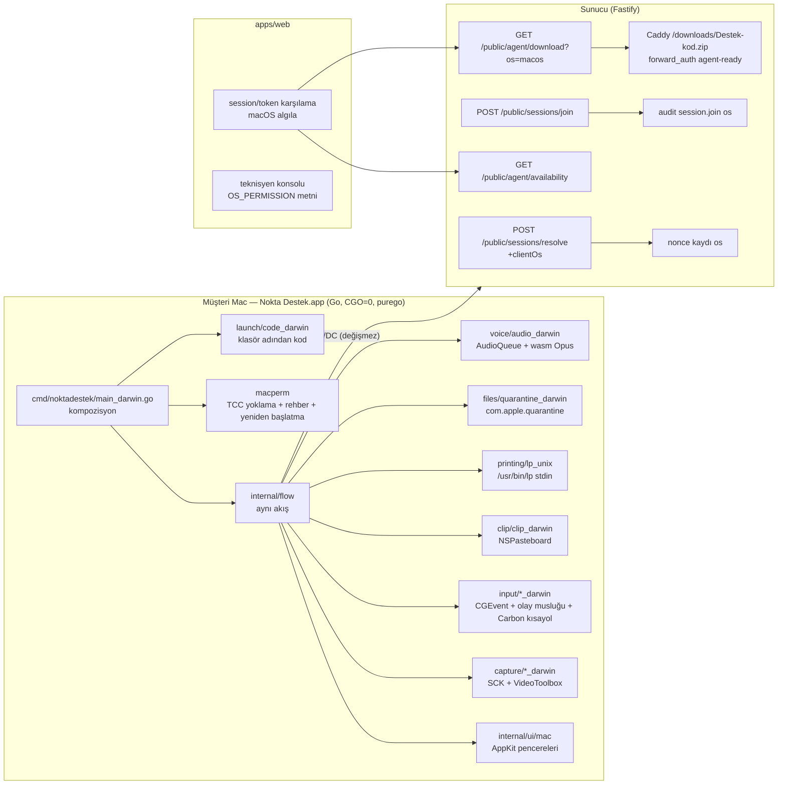

# Mimari — P28f macOS istemci (AC-276)

Tarih: 2026-11-17 · Durum: **r3** · 2026-11-20 r4 ad-hoc prod (§15) — K0s spike sonucu (`docs/spike-p28f-k0s.md`) işlendi, özet §14 · r2: güvenlik tasarım turu (K0g, S-P28f-1..17, tümü kabul, §13) · Dal: `p28f`
Girdiler: `docs/gereksinimler-p28.md` (US-71, AC-389..396, AC-393, R39, R49, V52), `docs/mimari-p28.md` §0 madde 7 ve §0.1 P28f satırı,
`docs/mimari-protokol.md`, `docs/mimari-p28b/c/d/e.md`, ADR-0004, 0009, 0010, 0031, 0035, 0036.
Yeni ADR: **ADR-0037** (purego/objc, AppKit, .app + zip, Linux'ta derleme + macOS'ta imza/notarization). Kontrol listesi:
`docs/tasarim-kontrol.md` "P28f".

**Sadelik:** macOS istemcisi yalnız **Hızlı Destek (kod/bağlantı)** akışıdır; Windows'taki akış (`internal/flow`) ve tüm WS/DC
mesajları aynen kullanılır. Yeni WS mesajı yok; protokolde iki küçük ek var: resolve'da `clientOs` ve `control.state` kaynağına
`OS_PERMISSION` değeri. Yeni tablo/migration yok. Yeni Go bağımlılığı 1 (`purego`).

---

## 1. Özet ve kısıtlar

| Kapsamda                                                                                                                                                              | Kapsam dışı / Sonra (neden)                                                                                                             |
| --------------------------------------------------------------------------------------------------------------------------------------------------------------------- | --------------------------------------------------------------------------------------------------------------------------------------- |
| macOS 13+ universal `.app` (zip), kurulumsuz, İndirilenler'den çalışır (AC-389)                                                                                       | **Gözetimsiz servis (`internal/servis`, P27) — macOS'ta KAPSAM DIŞI**; P28u müdahaleleri de (V52, gereksinim §4 madde 8)                |
| Görüntü (SCK + VideoToolbox), kontrol (CGEvent), chat, dosya, işaretleme, gösterge, monitör seçimi (AC-392)                                                           | Tepsi, otomatik başlatma, çoklu firma kaydı (P20), "Bilgilerimi hatırla" (E9), firma dosyası `NoktaDestek-<label>-<ref>`, destek talebi |
| P28a pano (NSPasteboard) + yazdırma (CUPS `lp`), P28b sunucu dosyası, P28c roster/çıkar, P28d ses (r3: kullanıcı kararı bekliyor, A-PF-1), P28e kayıt rızası (AC-393) | Pencere paylaşımı (AC-248; `WindowCapture` false), LG mesajındaki doğrudan indirme bağlantısı (Windows `.exe` kalır)                    |
| TCC rehberi + yeniden başlatmada kodu koruma (AC-391), iz testi (AC-394)                                                                                              | Ses yankı giderme (VoiceProcessingIO) — Sonra; `SCContentSharingPicker` — Sonra                                                         |
| CI: Linux'ta çapraz derleme + macOS'ta lipo/imza/notarization, SHA256SUMS + attestation (AC-395)                                                                      | Mac App Store, `.pkg`/`.dmg`, otomatik güncelleme (P29 ile değişti → ADR-0040)                                                          |
| Karşılama sayfası macOS algılama + indirme (AC-396), katılım audit'inde `os`                                                                                          | Teknisyen konsolunda müşteri işletim sistemi rozeti (`hello.guestOs`) — Sonra; genişleme noktası §4.3                                   |

Kısıtlar: `CGO_ENABLED=0` korunur (ADR-0037 m.1); Apple Silicon imzasız ikili çalıştırmaz (en az ad-hoc); TCC izinleri imza kimliğine
bağlıdır (ad-hoc'ta her derleme yeni kimlik → staging'de her sürümde izin yeniden verilir); macOS 15+ Ekran Kaydı için periyodik sistem
uyarısı gösterebilir (bilgi, kılavuz). Geliştirme makinesi Apple Silicon macOS 26.3; gerçek Intel makine yok (A-PF-3).

> **P31 ile değişti (2026-11-20, `mimari-p31.md`):** §1 kapsam dışı satırındaki "firma dosyası `NoktaDestek-<label>-<ref>`, destek talebi" macOS'ta açıldı (zip/klasör adından firma, Windows'la aynı ana ekran + Destek iste; ADR-0041). Tepsi, otomatik başlatma, çoklu firma kaydı ve "Bilgilerimi hatırla" kapsam dışı kalır. §2 `launch/code_darwin.go` satırındaki sıra 4 ("kod alanı") de değişti: Mac'te kaynaksız açılış Windows gibi ana ekrana gelir (AC-190), kod "Bağlantı kodum var" ile girilir; kaynak okuma `launch/source.go` `SourceFromBundlePath` (klasör kod > klasör ref > bundle kod). AC-97 / AC-392'nin macOS karşılığı aynı şekilde okunur. r4 web rehberindeki "klasör adından gelmezse kodu elle yazın" metni oturum (kod) sayfası için geçerli kalır.

## 2. Bileşenler ve sorumluluklar



| Bileşen                                | Sorumluluk                                                                                                                                                                                                                                                                                                                                                                                                  |
| -------------------------------------- | ----------------------------------------------------------------------------------------------------------------------------------------------------------------------------------------------------------------------------------------------------------------------------------------------------------------------------------------------------------------------------------------------------------- |
| `cmd/noktadestek/main_darwin.go`       | Ana iş parçacığını kilitler (`runtime.LockOSThread` `init`'te), `NSApplication` döngüsünü ana goroutine'de çalıştırır, `flow.Deps`'i darwin uygulamalarıyla kurar; TCC ön yoklaması; AC-107 kapanış.                                                                                                                                                                                                        |
| `internal/darwin/objc` (yeni, ince)    | purego yükleme (yalnız mutlak çerçeve yolları), `msgSend` sarmalayıcıları, ana iş parçacığına gönderme (`dispatch_async_f` ana kuyruk), `NSString`/`NSData` dönüşümleri, autorelease havuzu.                                                                                                                                                                                                                |
| `internal/ui/mac` (yeni)               | `flow.UI`, `ClipPrintUI`, `FileServerUI`, `RosterUI`, `VoiceUI`, `RecUI` uygulamaları (AppKit). Ekran listesi §2.1.                                                                                                                                                                                                                                                                                         |
| `internal/macperm` (yeni)              | TCC yoklama (`CGPreflightScreenCaptureAccess`, `AXIsProcessTrustedWithOptions`, mikrofon durumu), Sistem Ayarları URL'leri, yeniden başlatma kod dosyası (§5.3).                                                                                                                                                                                                                                            |
| `capture/*_darwin.go`                  | Monitör listesi (`SCShareableContent`), SCStream NV12, VideoToolbox ana/düşük oturum, Annex B, kilit ekranı/oturum durumu (`env` yoklaması).                                                                                                                                                                                                                                                                |
| `input/*_darwin.go`                    | CGEvent fare/klavye, DOM `code` → `kVK_*`, Unicode metin, olay musluğu (yerel girdi + sentetik ayrımı), Carbon kısayol.                                                                                                                                                                                                                                                                                     |
| `clip/clip_darwin.go`                  | `NSPasteboard generalPasteboard` düz metin oku/yaz (≤ 64 KB, mevcut `clip.go` kuralları).                                                                                                                                                                                                                                                                                                                   |
| `printing/lp_unix.go` (`darwin‖linux`) | `/usr/bin/lp -n 1 -t "Nokta Destek" -o document-format=application/pdf -` (mutlak yol, kabuk yok, `-d` ve `lpstat` yok — lp varsayılan yazıcıyı kullanır; ortamdan `LPDEST`/`PRINTER` temizlenir; PDF stdin'den, diske yazılmaz; S-P28f-16). Varsayılan yazıcı yoksa lp hatası → mevcut "yazıcı yok" sonucu. P28g aynı dosyayı kullanır.                                                                    |
| `files/quarantine_darwin.go`           | Alınan dosyaya `.part` aşamasında `com.apple.quarantine` = `0083;<onaltılık zaman>;Nokta Destek;` (`unix.Setxattr`, cgo yok; 0x40 USER_APPROVED bayrağı asla yok) — AC-117 karşılığı; ek savunma `Info.plist` `LSFileQuarantineEnabled=true`. Tehlikeli uzantı listesi macOS türleriyle genişler (S-P28f-9, §13).                                                                                           |
| `voice/audio_darwin.go`                | AudioQueue giriş/çıkış 48 kHz mono Int16, 20 ms × 3 tampon; `VoiceCall` arayüzü WASAPI ile aynı; codec `opus.go` (wasm) aynen.                                                                                                                                                                                                                                                                              |
| `launch/code_darwin.go`                | Kodu bulma sırası: (1) yalnız `--restart <32 onaltılık>` ile açıldıysa ve eşleşen yeniden başlatma dosyası varsa o; (2) bundle'ın (gerekirse `SecTranslocateCreateOriginalPathForURL` ile çözülmüş) üst klasör adı `^Destek-(\d{8})(?: \(\d{1,3}\)\| \d{1,3})?$`; (3) bundle adı aynı desen; (4) kod alanı (AC-97). Belirteçsiz açılışta bekleyen yeniden başlatma dosyaları okunmadan silinir (S-P28f-13). |

### 2.1 Windows ekranları → macOS karşılığı (tek tablo)

| Windows dosyası (`internal/ui`)                                           | macOS (`internal/ui/mac`)                                                        | Not                                                                                                                                                                                                                                                                                                                                                                                                                                           |
| ------------------------------------------------------------------------- | -------------------------------------------------------------------------------- | --------------------------------------------------------------------------------------------------------------------------------------------------------------------------------------------------------------------------------------------------------------------------------------------------------------------------------------------------------------------------------------------------------------------------------------------- |
| `form_windows.go` (kod girişi, AskCode)                                   | `code_darwin.go` — NSWindow + 8 hane alan                                        | AC-97 mesajları `flow` ileti tablosundan                                                                                                                                                                                                                                                                                                                                                                                                      |
| `welcome_windows.go` (AC-98, KVKK, kayıt kutusu)                          | `welcome_darwin.go`                                                              | Logo, teknisyen adı + doğrulama kodu, sunucu, uyarı + "Kötüye kullanımı bildir" (`NSWorkspace openURL mailto:`), KVKK, P28e rıza kutusu                                                                                                                                                                                                                                                                                                       |
| `lobby_windows.go`, Connecting                                            | `lobby_darwin.go`                                                                | admitCode büyük yazı                                                                                                                                                                                                                                                                                                                                                                                                                          |
| `choose_windows.go` (AC-106)                                              | `choose_darwin.go` — yalnız monitör listesi                                      | "Yalnız bir pencere" yok                                                                                                                                                                                                                                                                                                                                                                                                                      |
| `session_windows.go` + `panel_windows.go` + `control_windows.go`          | `session_darwin.go` — tek oturum penceresi                                       | "Erişime izin ver / Kontrolü kapat / Oturumu bitir" her zaman görünür, Tab ile erişilir (AC-100); pano izni anahtarı; kısayol metni                                                                                                                                                                                                                                                                                                           |
| `consent_windows.go` (kontrol/monitör izni)                               | `prompt_darwin.go` — ortak onay diyaloğu (NSPanel)                               | Kontrol, monitör, dosya teklifi, yazdırma, ses kabulü, teknisyen çıkarma aynı bileşen: varsayılan odak "Reddet", Enter/Space ret, 1,5 sn kilit, imlecin altında açılmaz, **`localClick()` beyaz listesi (§5.2a)**; diyalog açıkken enjeksiyon duraklar (S-P28f-1). Aynı `localClick()` pano anahtarı, roster "Çıkar", ses kabul/sessize al/aç, kayıt rızası kutusu ve "Erişime izin ver" için de zorunlu                                      |
| `chat_windows.go`                                                         | `chat_darwin.go` (oturum penceresinde bölüm)                                     | NSTextView salt okunur + giriş alanı                                                                                                                                                                                                                                                                                                                                                                                                          |
| `transfer_windows.go`                                                     | `transfer_darwin.go` (oturum penceresinde ilerleme satırı)                       |                                                                                                                                                                                                                                                                                                                                                                                                                                               |
| `print_windows.go`                                                        | `prompt_darwin.go` (yazdırma onayı)                                              |                                                                                                                                                                                                                                                                                                                                                                                                                                               |
| `rec_windows.go` (P28e şerit + "Kaydı durdur")                            | `rec_darwin.go` — göstergeye eklenen "Kayıt" etiketi + oturum penceresinde düğme |                                                                                                                                                                                                                                                                                                                                                                                                                                               |
| `voice_windows.go` (kabul, sessize al, bitir)                             | `voice_darwin.go` — oturum penceresinde ses çubuğu + kabul diyaloğu              | Mantık `ui/voice.go` (ortak)                                                                                                                                                                                                                                                                                                                                                                                                                  |
| `roster_windows.go` (P28c)                                                | `roster_darwin.go` — oturum penceresinde teknisyen listesi + "Çıkar" (onaylı)    |                                                                                                                                                                                                                                                                                                                                                                                                                                               |
| `overlay_windows.go` (gizlenemeyen gösterge + işaretleme)                 | `overlay_darwin.go` — her `NSScreen`'de kenarlıksız pencere                      | Seviye `NSScreenSaverWindowLevel`, `canJoinAllSpaces` + `stationary` + `fullScreenAuxiliary` + `ignoresCycle`, `ignoresMouseEvents`, `canHide=NO`; 1 sn tik: `NSApp isHidden` ise `unhide:`, her ekranda gösterge var mı, `orderFrontRegardless`; `NSApplicationDidChangeScreenParametersNotification` ile yeni ekrana anında gösterge; ön koşul sağlanamazsa kapı kapanır (§5.2b, S-P28f-2). İşaretleme katmanı aynı pencerede özel `NSView` |
| `ended_windows.go`                                                        | `ended_darwin.go` + 2,5 sn sonra `NSApp terminate` (AC-107)                      |                                                                                                                                                                                                                                                                                                                                                                                                                                               |
| `licenses_windows.go`                                                     | Uygulama menüsü "Lisanslar" → salt okunur pencere                                | `third_party_notices.txt` gömülü (purego Apache-2.0 eklenir)                                                                                                                                                                                                                                                                                                                                                                                  |
| — (yeni)                                                                  | `perm_darwin.go` — TCC rehber ekranı (§5.3)                                      | Ekran Kaydı / Erişilebilirlik / Mikrofon                                                                                                                                                                                                                                                                                                                                                                                                      |
| — (yeni)                                                                  | `testband_darwin.go` — "TEST SÜRÜMÜ — imzasız" bandı                             | Bant çalışma anında türetilir: `SecCodeCopySigningInformation` Team ID boş ya da ad-hoc ise **her durumda** gösterilir; `config.testBuild` yalnız ek koşul (S-P28f-7). Gösterge ve her pencerenin üstünde, kapatılamaz/gizlenemez (AC-390)                                                                                                                                                                                                    |
| `home*`, `request*`, `reqform*`, `reqwait*`, `resident*`, tepsi, servisui | yok                                                                              | V52                                                                                                                                                                                                                                                                                                                                                                                                                                           |

Ortak kullanılan platform bağımsız dosyalar: `ui/accept.go`, `ui/voice.go`, `ui/notices.go`, `ui/logo.go`, `ui/session_fit.go`,
`ui/theme.go` (yalnız tehlike rengi + logo zemini; geri kalan renkler AppKit semantik renkleri → açık/koyu kendiliğinden). Bu dosyalar
`internal/ui`'den `internal/ui/uicore` (yeni, build tag'siz) paketine taşınır ki `ui/mac` Win32 dosyalarını içe aktarmadan kullansın
(K1). Metinler: yeni metinler `internal/flow/messages_p28f.go` tek tablosunda (AC-404).

## 3. Veri modeli

Yeni tablo, kolon, indeks veya migration **yok**. `os` bilgisi mevcut `audit_logs.new_value` JSON'una (`session.join` başarı satırı)
yazılır (gereksinim §8 "yeni olay yok"). Join nonce'u bellek içidir (`rooms.nonces`); `clientOs` alanı nonce kaydına eklenir. Silme
stratejisi değişmez (audit 730 g, P13a).

## 4. API ve protokol sözleşmesi

### 4.1 REST (`packages/contracts/src/api/sessions.ts`, `apps/server/src/public/*`)

| Uç                                                                                  | Değişiklik                                                                                                                                                                                                                                                                                                                                                                                                                                                                                                                           | Hata kodları                                | Yetki                               |
| ----------------------------------------------------------------------------------- | ------------------------------------------------------------------------------------------------------------------------------------------------------------------------------------------------------------------------------------------------------------------------------------------------------------------------------------------------------------------------------------------------------------------------------------------------------------------------------------------------------------------------------------ | ------------------------------------------- | ----------------------------------- |
| `POST /api/v1/public/sessions/resolve`                                              | Her iki birleşim dalına `clientOs: z.enum(["windows","macos","linux"]).optional()`. AGENT'ta yoksa sunucu `"windows"` sayar (eski istemciler); BROWSER'da yok sayılır. Değer nonce kaydına yazılır (`issueJoinNonce(..., clientOs)`); join'de **yeniden beyan alınmaz** (sürüm kalıbı). Yanıt şeması **değişmez** (eski Go istemcisi etkilenmez).                                                                                                                                                                                    | mevcut (400 VALIDATION, 404, 410, 426, 429) | public, ADR-0012 (Origin'siz AGENT) |
| `POST /api/v1/public/sessions/join`                                                 | Girdi değişmez. Başarı audit'i `session.join` `newValue`'ya `{ os: "windows"\|"macos"\|"linux"\|"browser" }` eklenir.                                                                                                                                                                                                                                                                                                                                                                                                                | mevcut                                      | public                              |
| `GET /api/v1/public/agent/download?ref=&os=`                                        | `os: z.enum(["windows","macos"]).default("windows")`; geçersiz `os` → **400 VALIDATION**, ref kovası tüketilmez (yalnız ipKey 20/dk). Sıra mevcut: ref doğrulaması → `os`'a göre **yalnız ilgili** ikili kapısı (`macos` → `macAgent`, `windows` → `agentBinary`) → 302 `/downloads/Destek-<kod>.zip` ya da `.exe`; kapı `ok` değilse 503 `NOT_READY` (S-P28f-15).                                                                                                                                                                   | 400, 404, 410, 429, 503 `NOT_READY`         | public                              |
| `GET /api/v1/public/agent/availability` (yeni)                                      | Çıktı `{ windows: boolean, macos: boolean }` (`binary.check() === "ok"`). Girdi yok, ref yok, çerez yok. `Cache-Control: public, max-age=60`. Hız: `ipKey` 30/dk (mevcut `consume` kalıbı). Karşılama sayfası indirme düğmesini göstermeden önce çağırır (AC-390 "görünmez").                                                                                                                                                                                                                                                        | 429                                         | public                              |
| `/internal/agent-ready/windows`, `/internal/agent-ready/macos` (Caddy forward_auth) | Platform başına **ayrı iç URI** (S-P28f-3). Caddy: mevcut `@agentExe` → `/internal/agent-ready/windows`; yeni `@agentZip` `^/downloads/(NoktaDestek-macOS\|Destek-[0-9]{8})\.zip$` → `/internal/agent-ready/macos`; `X-Forwarded-Uri` maskesi aynen. Her uç yalnız kendi kapısını uygular; bilinmeyen yol 404 (varsayılan ret). Ayrı `agent_zip_file` snippet'i: `rewrite * /NoktaDestek-macOS.zip`, `application/zip`, `attachment`, `nosniff`, `no-store`. Mevcut `/internal/agent-ready` geçiş süresince `/windows` takma adıdır. | 404, 503                                    | iç                                  |

Go istemci: `api.Client.Resolve` gövdesine `ClientOS` (`runtime.GOOS` → `darwin`→`"macos"`, `windows`→`"windows"`); Windows istemci de
0.19.0'dan itibaren gönderir. `clientKindAgent` değişmez. `MIN_AGENT_VERSION` iki platformda ortaktır (tek sürüm numarası).
`clientOs` **müşteri beyanıdır**: hiçbir yetki/özellik kararında kullanılmaz (tek istisna aşağıdaki `OS_PERMISSION` kabul koşulu);
audit etiketi "İşletim sistemi (beyan)"; metrik etiketi ayrıştırılmış enum'dan (S-P28f-15). Web: availability hata/429 → yalnız tarayıcı
modu, indirme düğmesi gösterilmez (fail-closed).

### 4.2 WS (`packages/contracts/src/ws.ts`; Go eşi `internal/signal`)

| Mesaj                     | Değişiklik                                                                                                                                                                                                                                                                                                                                                                                                                                                                                                                                                                                                                                                                                                                                                                                                                                                                                                                                                                                                                                                |
| ------------------------- | --------------------------------------------------------------------------------------------------------------------------------------------------------------------------------------------------------------------------------------------------------------------------------------------------------------------------------------------------------------------------------------------------------------------------------------------------------------------------------------------------------------------------------------------------------------------------------------------------------------------------------------------------------------------------------------------------------------------------------------------------------------------------------------------------------------------------------------------------------------------------------------------------------------------------------------------------------------------------------------------------------------------------------------------------------- |
| `control.state` (guest→S) | `source` enum'una `OS_PERMISSION` eklenir; yalnız `state: "VIEW"` ile geçerli. Anlamı: misafirde Erişilebilirlik izni yok, kontrol diyaloğu açılmadı. Sunucu bunu mimari-protokol K6 satırı gibi **iptal** işler: `session_consents` satırı yok (müşteriye ret atfedilmez), 30 sn bekleme yok, sayaç iade edilmez, audit `control.cancelled{by:"agent", source:"os_permission"}`. Teknisyene `control.state{VIEW, OS_PERMISSION}` iletilir; konsol "Müşteri erişilebilirlik izni vermedi. Müşteri izni verdikten sonra yeniden isteyin." gösterir (AC-391). _Tarihsel not (2026-11-19, P28g K10, D-P28g-K1-2): konsol metni nötr hâle getirildi: "Müşterinin bilgisayarı uzaktan kontrole izin vermiyor (Mac'te erişilebilirlik izni). Müşteri izni verdikten sonra yeniden isteyin." Gerekçe: konsol misafir işletim sistemini bilmez, `OS_PERMISSION` Linux X11'de de gelir. macOS audit etiketi değişmedi (gereksinimler-p28 AC-391)._ REQUESTED dışındaki fazda, BROWSER misafirden ve nonce'taki `clientOs` `macos` değilse yok sayılır (S-P28f-15). |
| diğer                     | Değişmez. Özellik belirteçleri (`rs.cap.*`) aynen; macOS istemci Windows ile aynı listeyi bildirir. Ses arm64 kararı (ADR-0037 m.7 c) gerekiyorsa yalnız `rs.cap.voice1` bildirilmez.                                                                                                                                                                                                                                                                                                                                                                                                                                                                                                                                                                                                                                                                                                                                                                                                                                                                     |

Uyum: sunucu + web önce yayımlanır (K6/K7), macOS istemci sonra; Windows istemcisi `OS_PERMISSION` göndermez. Konsol bilinmeyen kaynağı
zaten "SYSTEM" gibi gösterirdi; yeni metin K7'de.

### 4.3 DataChannel

Değişiklik yok. Genişleme noktası (Sonra): `hello.guestOs` (yalnız tech) → konsolda "macOS" rozeti ve kısayol ipucu.

## 5. Güvenlik tasarımı

### 5.1 Tehdit modeli girdisi (STRIDE; güvenlik ajanı S-P28f-n verir)

| #   | Tehdit                                                                                                      | Karşı önlem                                                                                                                                                                                                                                                                                                                                                                                                                                      |
| --- | ----------------------------------------------------------------------------------------------------------- | ------------------------------------------------------------------------------------------------------------------------------------------------------------------------------------------------------------------------------------------------------------------------------------------------------------------------------------------------------------------------------------------------------------------------------------------------ |
| T1  | Teknisyenin enjekte ettiği tıklamayla korunan denetimlerin tetiklenmesi (S, E)                              | §5.2a `localClick()` beyaz listesi (fail-closed) + korunan denetim açıkken enjeksiyon duraklatma + Erişilebilirlik kısayollarının (Option×5, ⌘F5, ⌘⌥F5) enjekte edilmemesi; 1,5 sn kilit, varsayılan "Reddet", imleç altı değil (G-03). K0s-4 sahte kaynak senaryoları (S-P28f-1).                                                                                                                                                               |
| T2  | Başka bir sürecin ya da sistem erişilebilirlik özelliğinin (Fare Tuşları, VoiceOver, AXPress) onay üretmesi | §5.2a: `currentEvent` yok/AX eylemi/HID dışı kaynak/PID ≠ 0/kendi işaretimiz → ret. Erişilebilirlik izni olan kötü amaçlı yerel uygulama kullanıcıyı zaten ele geçirmiştir (kapsam dışı risk, kılavuz).                                                                                                                                                                                                                                          |
| T3  | Sahte/ değiştirilmiş `.app` (T)                                                                             | Prod: Developer ID + notarization + staple; SHA256SUMS + attestation; AC-128 günlük karşılaştırma zip'i de kapsar. Staging: TEST bandı.                                                                                                                                                                                                                                                                                                          |
| T4  | Sunucu adresinin değiştirilmesi (AC-109)                                                                    | Adres yalnız ldflags; `Info.plist`/ortam değişkeni okunmaz; tek kabul edilen argüman `--restart <32 onaltılık>` (gizli değil, yalnız eşleme; diğer argümanlar yok sayılır, `--self-test` yok — S-P28f-14); Go `crypto/x509` sistem kökleri (CGO=0'da Security.framework).                                                                                                                                                                        |
| T5  | Kütüphane kaçırma (dylib hijack)                                                                            | purego `Dlopen` izin listesi: `/System/Library/Frameworks/...`, `/usr/lib/libobjc.A.dylib`, `/usr/lib/libSystem.B.dylib` (mutlak yol); **staging ve prod** hardened runtime (`--options runtime`, aynı entitlement dosyası; S-P28f-5) → `DYLD_*` yok sayılır; `@rpath` yok.                                                                                                                                                                      |
| T6  | Yeniden başlatma kod dosyasının okunması/değiştirilmesi/bayat kullanımı                                     | Dizin `confstr(_CS_DARWIN_USER_TEMP_DIR)` (ortam değişkeni değil), sahibi UID + 0700 doğrulanır; dosya `O_CREAT` + `O_EXCL` + `O_NOFOLLOW` 0600, okuma `open(O_NOFOLLOW)` sonra `fstat` (sahip, 0600, normal dosya, ≤ 120 sn); yalnız `--restart` belirteci eşleşirse kullanılır; "Vazgeç"/kapanışta silinir; içerik yalnız 8 rakam (S-P28f-13). Kod tek başına oturuma girmez (onay + admitCode).                                               |
| T7  | Göstergenin gizlenmesi (G-17): ⌘H, ⌘⌥H, ⌘M, Görev Kontrolü, Sahne Yöneticisi, yeni ekran                    | §5.2b (S-P28f-2): `canHide=NO`, oturum penceresi küçültülemez, menüde Gizle yok, 1 sn tik + `unhide:`, ekran değişimi bildirimi, fail-closed kapı. K0s-4 senaryoları.                                                                                                                                                                                                                                                                            |
| T8  | Alınan dosyanın karantinasız çalıştırılması                                                                 | `com.apple.quarantine` `.part` aşamasında; yazılamazsa dosya silinir ve sonuç `CORRUPT` (fail-closed); macOS çalıştırılabilir türleri tehlike listesinde; darwin testi `spctl -a -t open` reddini doğrular (S-P28f-9).                                                                                                                                                                                                                           |
| T9  | Yazdırma: PDF ayrıştırıcı yüzeyi, argüman enjeksiyonu                                                       | Ayrıştırma CUPS filtrelerinde (`cupsd` altında); `lp` mutlak yol, sabit argümanlar, yazıcı adı ve `lpstat` yok (S-P28f-16); PDF ≤ 20 MB, `%PDF-` mevcut `printing.go`. CUPS iş geçmişi sistemde kalır (kılavuz, AC-394 istisnası gibi).                                                                                                                                                                                                          |
| T10 | wazero JIT için çalıştırılabilir bellek entitlement'ı                                                       | r3: macOS istemci sesi bildirmez (§14 m.2) → wazero macOS'ta çalışmaz; **entitlement listesi boş**. `device.audio-input` ve (a′) seçilirse `allow-unsigned-executable-memory` yalnız A-PF-1 kullanıcı kararı + ADR revizyonuyla eklenir. CI tam eşleşme denetimi sürer (S-P28f-4).                                                                                                                                                               |
| T11 | Apple imza sırlarının sızması / kötü girdinin imzalanması                                                   | §8.2 `sign-mac` (S-P28f-6): girdi `reproducible-mac` SHA'larıyla doğrulanır, bundle `sign-mac` içinde etiket commit'inden üretilir; ortam deployment policy yalnız `v*` + zorunlu (kendi dışı) onaylayıcı + etiket ruleset'i; geçici keychain rastgele parola, `-T /usr/bin/codesign`, `set-key-partition-list`, `if: always()` silme, `set -x` yok, üçüncü taraf Action'a sır yok; notary anahtarı "Developer" rolü; rotasyon/iptal runbook'ta. |

### 5.2 İzin kapısı (ADR-0009 kalıbı) macOS'ta

`control.Gate` aynen; kapı kapalıyken girdi düşer (AC-101 ≤ 100 ms). Olay musluğu yalnız kapı açıkken kurulur (S7-7 kalıbı); §5.2a
tanımına göre **yerel** olan girdi uzaktan girdiyi 1 sn askıya alır (AC-104). Erişilebilirlik izni kontrol isteği geldiği anda yoklanır:
yoksa kontrol diyaloğu yerine izin rehberi açılır ve `control.state{VIEW, OS_PERMISSION}` gönderilir; izin verilince yeniden başlatma
gerekmez (K0s-3 doğrular; gerekirse §5.3 yolu).

**Olay musluğu fail-closed (S-P28f-10):** musluk kurulamazsa kontrol verilmez (AC-102 kısayol kuralı gibi; teknisyene
`OS_PERMISSION`). `kCGEventTapDisabledByTimeout` / `ByUserInput` alınınca `CGEventTapEnable` ile yeniden açılır; açılamazsa kapı
≤ 100 ms içinde kapanır (`control.state{VIEW, SYSTEM}`). Geri çağrı yalnız zaman damgası + kaynak alanlarını okur. darwin testi.

#### 5.2a Yerel girdi tanımı — `localClick()` (S-P28f-1; T1/T2 ve ADR-0037 m.3 buna atıf yapar)

Tek yardımcı `ui/mac/local.go` `localClick(ev) bool`; **beyaz liste, fail-closed** — aşağıdakilerin hepsi sağlanmazsa eylem reddedilir
(yok sayılır, diyalog açık kalır):

1. Eylem anında `NSApp.currentEvent` mevcut ve türü **sol fare bırakma**; aynı düğmenin **basışı da** `localClick` koşullarıyla
   kaydedilmiş (basış + bırakma ikisi yerel). Klavye etkinleştirmesi (Enter/Space/Tam Klavye Erişimi), `performClick:`, `AXPress`/
   VoiceOver/Sesle Denetim/Switch Control eylemi, `currentEvent == nil` ya da bayat olay → ret.
2. `CGEventGetIntegerValueField(kCGEventSourceStateID) == kCGEventSourceStateHIDSystemState` (= 1). r3 değerlendirmesi: spike'ta
   NULL kaynaklı sentetik olaylarda 0, gerçek tıklamada 1 ölçüldü; HID durum kaynağıyla üretilen sentetik olay bu alanı 1 taşıyabilir
   (sınanmadı). Bu yüzden şart **tek başına yeterli değil, korunur** (ucuz ikinci katman); asıl ayırıcı m.3 (PID 0) ve m.4'tür; K4 elle
   ölçütü HID kaynaklı sentetik tıklamanın reddini doğrular.
3. `kCGEventSourceUnixProcessID == 0`.
4. `kCGEventSourceUserData` alanında kendi enjekte ettiğimiz olaylara koyduğumuz rastgele (süreç başına) işaret **yok**.

İkinci katman: korunan bir denetim ya da onay diyaloğu açıkken `input` enjektörü **duraklar** (kapı "duraklat" durumu; olaylar düşer,
diyalog kapanınca sürer). Enjektör hiçbir durumda Erişilebilirlik kısayollarını (Option ×5 ardışık, ⌘F5, ⌘⌥F5, fn×3) enjekte etmez.
Korunan denetimler (hepsi `localClick`): kontrol/monitör izni, dosya teklifi, yazdırma, ses kabulü, ses sessize al/aç, pano izni anahtarı,
roster "Çıkar" (ve onayı), kayıt rızası kutusu, "Erişime izin ver". VoiceOver kullanıcısı bu denetimleri fareyle kullanmak zorundadır —
kabul edilen erişilebilirlik ödünü (kılavuzda; AC-100 düğmeleri Tab ile odaklanır, korumasız olanlar: "Kontrolü kapat", "Oturumu bitir",
"Kaydı durdur" — bunlar yalnız güvenli yönde işler).

#### 5.2b Gizlenemeyen gösterge (S-P28f-2)

Gösterge, TEST bandı ve oturum penceresinde `canHide = NO`; oturum penceresi stil maskesinde `miniaturizable` yok,
`hidesOnDeactivate = NO`; uygulama menüsünde "Gizle"/"Diğerlerini Gizle" yok. 1 sn tik: `NSApp isHidden` → `unhide:`; her `NSScreen`
için gösterge penceresi var ve görünür mü (`occlusionState` `visible`); `orderFrontRegardless`.
`NSApplicationDidChangeScreenParametersNotification` → yeni ekrana anında gösterge. Gösterge 3 ardışık tikte (≈ 3 sn) görünür
kılınamazsa fail-closed: kontrol kapısı kapanır (`control.state{VIEW, SYSTEM}`) ve oturum penceresinde neden yazılır.

### 5.3 TCC akışı (AC-391) ve iz (AC-394)

1. Açılış: kod bulunur (§2 `launch/code_darwin.go`) → **Ekran Kaydı yoklaması resolve'dan önce** (`CGPreflightScreenCaptureAccess`).
2. İzin yoksa rehber ekranı: üç adım metni + "Sistem Ayarları'nı aç" (`x-apple.systempreferences:com.apple.preference.security?Privacy_ScreenCapture`)
   - "İzni verdim, yeniden başlat" + "Vazgeç". İlk açılışta `CGRequestScreenCaptureAccess` bir kez çağrılır (sistem listeye ekler).
3. "Yeniden başlat": rastgele 128 bit belirteç üretilir; kod `confstr(_CS_DARWIN_USER_TEMP_DIR)/noktadestek-yeniden-<belirteç>`
   dosyasına (§5.1 T6 kuralları) yazılır; `/usr/bin/open -n <bundle yolu> --args --restart <belirteç>` çalıştırılır, süreç çıkar.
   Belirteç gizli değildir (yalnız eşleme); kod argümanla taşınmaz. Yeni süreç yalnız eşleşen dosyayı okur ve siler, kod alanını atlar;
   belirteçsiz açılışta bekleyen dosyalar okunmadan silinir (S-P28f-13). Resolve kodu tüketmediği için oturum etkilenmez; KVKK onayı
   ilk kez bu süreçte verilir.
4. Erişilebilirlik: kontrol isteğinde (§5.2), URL `...?Privacy_Accessibility`. Mikrofon: ilk ses kabulünde sistem istemi; reddedilmişse
   ses çubuğunda "Mikrofon izni yok" + "...?Privacy_Microphone" düğmesi; dinleme devam eder (AC-393, P28d mikrofon yoksa kalıbı).
5. İz: `NSUserDefaults`/geri yükleme/WebKit/NSURLSession yok; kapanışta `Saved Application State` emniyet silmesi; `$TMPDIR` yeniden
   başlatma dosyası silinir. Tanılama logu (0.10.2) macOS'ta **yazılmaz** (kalıcı mod yok). Kılavuz: TCC kaldırma
   `tccutil reset ScreenCapture net.noktabilisim.destek` (+ `Accessibility`, `Microphone`) ya da Sistem Ayarları'ndan "−".
   Ek (S-P28f-14, r3): kullanıcı önbellek dizini `confstr(_CS_DARWIN_USER_CACHE_DIR)/<bundle id>` (AppKit çizimi orada Metal
   önbelleği `com.apple.metalfe` oluşturuyor — spike K0s-7) kapanışta silinir ve iz testinde taranır;
   birleşik loga (`NSLog`/`os_log`) kod, ad, dosya adı, teknisyen adı yazılmaz (istemci log çağrısı yapmaz). Oturum sonu ekranında
   "İzinleri kaldırma" bağlantısı kılavuz bölümünü açar.
6. `Info.plist` izin listesi (S-P28f-14): `CFBundleURLTypes`, `CFBundleDocumentTypes`, `NSAppleScriptEnabled`, `NSServices` **yok**
   (izinli uygulama dışarıdan tetiklenemez); CI `plutil -convert json` ile anahtar listesini tam eşleşmeyle denetler. Staging bundle
   kimliği ayrı: `net.noktabilisim.destek.stg` (TCC kayıtları prod'a taşınmaz).

### 5.4 Hassas veri ve başlıklar

Yeni hassas veri yok. Kod, dosya adı (Caddy logunda `Destek-***` maskesi `.zip` için de genişletilir — G-10), `ref` loglanmaz. Zip
yanıtı: `Content-Type: application/zip`, `Content-Disposition: attachment`, `X-Content-Type-Options: nosniff`, `Cache-Control: no-store`.

**Güvenilmeyen metin ve pano (S-P28f-12):** teknisyen/sunucu kaynaklı her metin (chat, dosya adı, teknisyen/firma adı, durum) yalnız
`setString:`/`setStringValue:` ile; `NSAttributedString` HTML/RTF/markdown başlatıcıları yok; `allowsEditingTextAttributes = NO`,
otomatik bağlantı/veri algılama kapalı. Logo Go'da çözülür (`api/logo.go` `DecodeLogo`) ve ham RGBA bitmap olarak verilir
(`NSImage initWithData:` yok). Pano okuma yalnız `public.utf8-plain-text`; panoda `org.nspasteboard.ConcealedType`,
`TransientType` ya da `AutoGeneratedType` varsa okunmaz, müşteriye "Pano gizli içerik taşıyor, gönderilmedi" gösterilir. `mailto:`
`api.ValidAbuseEmail` sonrası `NSURLComponents` ile kurulur.

**purego/objc FFI kuralları (S-P28f-11; `internal/darwin/objc` paket belgesinde bağlayıcı):** (1) C'de saklanan bağlam olarak Go
işaretçisi verilmez — tamsayı tutamaç tablosu; geçici geçişlerde `runtime.Pinner`. (2) `purego.NewCallback` ve `objc.RegisterClass` yalnız
`init`'te bir kez. (3) Ağdan gelen veriden `NSString`: uzunluk sınırlı, UTF-8 doğrulanmış, `initWithBytes:length:encoding:`; biçim dizesine
güvenilmeyen metin yok; `CGEventKeyboardSetUnicodeString` ≤ 20 birimlik parçalarla. (4) `CVPixelBuffer` düzlem kopyası
`bytesPerRow × height` taşma denetimli, kilit/serbest bırakma eşli. (5) Güvenlik işlevli çağrılarda (gösterge, `canHide`, kapı,
quarantine, `localClick`) sınıf/selector `nil` çözülürse fail-closed (kontrol yok / dosya silinir). (6) `test-macos` `MallocScribble=1`

- `NSZombieEnabled=YES` ile; x86_64 dilim Rosetta altında bağlama testleri (struct dönüş ABI). (7) `Dlopen` izin listesi §5.1 T5.

**Tehlikeli uzantılar (S-P28f-9):** contracts `DANGEROUS_EXT` + Go `files.go` + fikstür aynı anda genişler (liste platformdan bağımsız):
`command tool app pkg mpkg dmg scpt scptd applescript terminal webloc inetloc fileloc workflow action mobileconfig kext dylib bundle
plugin prefpane osax zsh bash csh ksh py rb pl saver`; baştaki noktalı (gizli) adlar da uyarı alır.

## 6. Dosya / klasör planı

| Yer                                                                                                                                                                                                       | İş                                                                                                                                                 |
| --------------------------------------------------------------------------------------------------------------------------------------------------------------------------------------------------------- | -------------------------------------------------------------------------------------------------------------------------------------------------- |
| `apps/agent-win/cmd/noktadestek/main_darwin.go`, `deps_darwin.go` (yeni)                                                                                                                                  | darwin kompozisyonu; mevcut `main.go`/`deps.go` zaten `//go:build windows`                                                                         |
| `apps/agent-win/internal/darwin/objc/` (yeni)                                                                                                                                                             | purego yükleme, msgSend, ana kuyruk, NSString                                                                                                      |
| `apps/agent-win/internal/ui/uicore/` (yeni, taşıma)                                                                                                                                                       | `accept.go`, `voice.go`, `notices.go`, `logo.go`, `session_fit.go`, `theme.go` (+ testleri); `internal/ui` bunları içe aktarır                     |
| `apps/agent-win/internal/ui/mac/` (yeni)                                                                                                                                                                  | §2.1 dosyaları                                                                                                                                     |
| `apps/agent-win/internal/macperm/` (yeni)                                                                                                                                                                 | TCC + yeniden başlatma                                                                                                                             |
| `internal/capture/{source,monitors,vt,sck,sysinfo}_darwin.go`                                                                                                                                             | yakalama + kodlama                                                                                                                                 |
| `internal/input/{host,cgevent,keys}_darwin.go`                                                                                                                                                            | girdi; `keys_darwin.go` DOM `code` → `kVK_*` tablosu                                                                                               |
| `internal/clip/clip_darwin.go`, `internal/files/quarantine_darwin.go`, `internal/printing/lp_unix.go`, `internal/voice/audio_darwin.go`, `internal/env/probe_darwin.go`, `internal/launch/code_darwin.go` | §2 tablo                                                                                                                                           |
| `internal/flow/messages_p28f.go`                                                                                                                                                                          | yeni metinler (tek tablo)                                                                                                                          |
| `internal/api/api.go`                                                                                                                                                                                     | `clientOs`                                                                                                                                         |
| `apps/agent-win/build/build-darwin.sh` (yeni)                                                                                                                                                             | `GOOS=darwin GOARCH=<arm64 / amd64> CGO_ENABLED=0 go build -trimpath -ldflags "-s -w -buildid= -X ...serverURL -X ...version [-X ...testBuild=1]"` |
| `apps/agent-win/build/macos/` (yeni)                                                                                                                                                                      | `Info.plist.tmpl`, `entitlements.plist`, `AppIcon.icns` (`nokta-kucuk.png`'den), `OKUBENI.txt`, `package.sh` (lipo + bundle + sabit mtime + zip)   |
| `apps/agent-win/test/trace-check-mac.sh` (yeni)                                                                                                                                                           | AC-394 iz testi                                                                                                                                    |
| `.github/workflows/agent-win.yml`                                                                                                                                                                         | §8.2 job'ları                                                                                                                                      |
| `packages/contracts/src/api/sessions.ts`, `ws.ts`, `audit.ts`(etiket)                                                                                                                                     | `clientOs`, `OS_PERMISSION`                                                                                                                        |
| `apps/server/src/public/{agent.ts,agent-binary.ts,routes.ts,service.ts}`, `sessions/public.ts`, `signaling/*control*`, `env.ts`                                                                           | §4                                                                                                                                                 |
| `apps/web/lib/device-support.ts`, `lib/agent-download.ts`, `app/session/[token]/{guest-welcome,agent-download}.tsx`, konsol kontrol metni, `messages/tr.json`                                             | §4, AC-396                                                                                                                                         |
| `deploy/Caddyfile`, `deploy/docker-compose.yml`, `.env.example`, `deploy/` yayın betiği, `agent-watch.yml`                                                                                                | `.zip` matcher + maskeleme, `MAC_AGENT_*`, doğrulama                                                                                               |
| `docs/runbook.md`, `docs/KULLANIM_KILAVUZU.md`, `README.md`, `docs/DATASHEET.md`, `CHANGELOG.md`                                                                                                          | K8/K9                                                                                                                                              |

## 7. Performans ve ölçek

| Konu             | Karar / bütçe                                                                                                                                                                                                                                                                                                                                                                                                                                                |
| ---------------- | ------------------------------------------------------------------------------------------------------------------------------------------------------------------------------------------------------------------------------------------------------------------------------------------------------------------------------------------------------------------------------------------------------------------------------------------------------------ |
| Açılış (AC-389)  | Çift tıktan karşılama ekranına ≤ 5 sn (Gatekeeper ilk doğrulaması hariç; notarize pakette ilk açılış ölçülür ve kılavuza yazılır).                                                                                                                                                                                                                                                                                                                           |
| Paket boyutu     | zip ≤ 60 MB (CI'da sert sınır, `stat` ile); universal ikili ≈ 2 × ince ikili. K0s-7 ölçer.                                                                                                                                                                                                                                                                                                                                                                   |
| Yakalama/kodlama | r3: SCK kaynağı GPU'da **uzun kenar ≤ 1920 px** (Retina'da yaklaşık yarı boyut) ölçeklenir; tam Retina (ör. 4112 px) donanım kodlayıcıya hiç girmez (donanım reddediyor, yazılım p95 232 ms). VideoToolbox `RealTime` + Baseline; ölçüt **30 fps sürdürülebilir, kodlama p95 ≤ 33 ms (1 kare), kare kaybı 0** (1080p ölçülen p95 12,3 ms). `EnableLowLatencyRateControl` **kullanılmaz** (zorlanan anahtar kare atlanıyor → teknisyen katılımı/PLI bozulur). |
| Girdi            | AC-101 ≤ 100 ms kapı; olay musluğu geri çağrısı yalnız zaman damgası yazar (≤ 1 ms).                                                                                                                                                                                                                                                                                                                                                                         |
| Ses              | r3: macOS'ta ses yok (`rs.cap.voice1` bildirilmez; §14 m.2). AudioQueue ölçümü GEÇTİ, A-PF-1 kararı gelirse kullanılır.                                                                                                                                                                                                                                                                                                                                      |
| Sunucu           | `availability` 60 sn önbellek + hız sınırı; ikili kapısı mevcut `AgentBinary.check()` önbelleği (dosya hash'i mtime değişince yeniden).                                                                                                                                                                                                                                                                                                                      |

Kuyruk, sayfalama, yeni indeks gerekmez.

## 8. Operasyon

### 8.1 Config / env

| Değişken           | Servis | Anlam                                                                                                                                                                                                                                                                  |
| ------------------ | ------ | ---------------------------------------------------------------------------------------------------------------------------------------------------------------------------------------------------------------------------------------------------------------------- |
| `MAC_AGENT_PATH`   | server | **Sabit** `/srv/downloads/NoktaDestek-macOS.zip` (Caddy'nin `agent_zip_file` ile sunduğu dosya); `env.ts` başka değeri reddeder — sunucunun hash'lediği dosya = Caddy'nin sunduğu dosya (S-P28f-3). Aynı eşitlik denetimi Windows `AGENT_BINARY_PATH` için de eklenir. |
| `MAC_AGENT_SHA256` | server | Yayın betiğinin attestation + SHA256SUMS doğrulamasından sonra yazdığı zip SHA-256'sı. İkisi dolu ve eşleşmedikçe macOS indirmesi yok (503 / availability `macos:false`).                                                                                              |

**K6 uygulama notu (sapmalar, backend-dev 2026-11-17):** (1) Sunucu volume'u `/data/downloads`'ta bağlar (Caddy `/srv/downloads`);
env.ts sabiti bu yüzden `MAC_AGENT_PATH=/data/downloads/NoktaDestek-macOS.zip` (aynı dosya) ve eşitlik denetimi (Windows
`AGENT_BINARY_PATH=/data/downloads/NoktaDestek.exe` dahil) yalnız `NODE_ENV=production`'da uygulanır (testler geçici dizin kullanır).
(2) Başarılı join'in audit satırı `session.join` değil `guest.pending`'dir (`session.join` yalnız 410 başarısızlığında yazılır);
`os` alanı `guest.pending` `newValue`'suna eklendi (yeni olay yok, §3). (3) Availability yanıtına K7 isteğiyle `macosTestBuild`
eklendi: `DEPLOY_ENV !== "production"` ve `macos` iken true, prod'da her zaman false (S-P28f-8 "Yine de Aç" yalnız staging).

Kural: `.env.example` (boş) + `env.ts` + `deploy/docker-compose.yml` server servisi + runbook (CLAUDE.md değişmez kural). Prod'da
yayın betiği macOS zip'ini **yalnız GitHub Release'ten** alır; Release'e yalnız notarize edilmiş zip girer (§8.2) → AC-390.
GitHub: `vars.APPLE_TEAM_ID`; `agent-mac-sign` environment secret'ları `APPLE_DEVELOPER_ID_P12_BASE64`, `APPLE_DEVELOPER_ID_P12_PASSWORD`,
`APPLE_NOTARY_KEY_P8`, `APPLE_NOTARY_KEY_ID`, `APPLE_NOTARY_ISSUER_ID` (App Store Connect API anahtarı; Apple ID şifresi kullanılmaz).

### 8.2 CI (`.github/workflows/agent-win.yml`'e eklenir; Action'lar SHA sabit, `permissions: contents: read`)

| Job (yeni)                      | Çalıştırıcı                      | İş                                                                                                                                                                                                                                                                                                                                                                                                                                                                                                                                                                                                                                                                                                                                                                                                                                                                                                                     |
| ------------------------------- | -------------------------------- | ---------------------------------------------------------------------------------------------------------------------------------------------------------------------------------------------------------------------------------------------------------------------------------------------------------------------------------------------------------------------------------------------------------------------------------------------------------------------------------------------------------------------------------------------------------------------------------------------------------------------------------------------------------------------------------------------------------------------------------------------------------------------------------------------------------------------------------------------------------------------------------------------------------------------- |
| `check` (genişler)              | ubuntu, GO_IMAGE                 | `GOOS=darwin go vet` (arm64 ve amd64) + staticcheck + govulncheck + go-licenses (darwin hedefi).                                                                                                                                                                                                                                                                                                                                                                                                                                                                                                                                                                                                                                                                                                                                                                                                                       |
| `build-mac` 1/2, 2/2            | ubuntu, GO_IMAGE                 | `build/build-darwin.sh` iki mimari; artifact ince ikililer.                                                                                                                                                                                                                                                                                                                                                                                                                                                                                                                                                                                                                                                                                                                                                                                                                                                            |
| `reproducible-mac`              | ubuntu                           | İki derleme SHA eşit (arm64 ve amd64 ayrı).                                                                                                                                                                                                                                                                                                                                                                                                                                                                                                                                                                                                                                                                                                                                                                                                                                                                            |
| `package-mac`                   | `macos-15` (arm64)               | İnce ikilileri `reproducible-mac` artifact'inden alır, SHA'larını doğrular; `lipo -create`, `build/macos/package.sh` (bundle, sabit mtime `SOURCE_DATE_EPOCH`, **ad-hoc + hardened runtime**: `codesign -s - --options runtime --entitlements build/macos/entitlements.plist` — prod ile aynı dosya, S-P28f-5); zip ≤ 60 MB; `codesign --verify --strict`; entitlement ve `Info.plist` tam eşleşme denetimi (S-P28f-4, -14). Staging/PR çıktısı `NoktaDestek-macOS-stg-<sürüm>.zip`, bundle kimliği `.stg`. Release notu için dilim başına imzasız SHA kaydı (S-P28f-17).                                                                                                                                                                                                                                                                                                                                              |
| `test-macos`                    | `macos-15`                       | `go test ./...` (darwin; `MallocScribble`/`NSZombieEnabled`), purego bağlama testleri (arm64 + `arch -x86_64`), quarantine `spctl` reddi, olay musluğu yeniden açma; ekran izni gerektiren testler `t.Skip` + görünür SKIP; `trace-check-mac.sh` **`.invalid` sunuculu ayrı derlemeyle argümansız** (prod ikilisinde `--self-test` yok; S-P28f-14) — paketi aç, çalıştır, kapat, iz denetle (kullanıcı önbellek dizini + `log show` dahil).                                                                                                                                                                                                                                                                                                                                                                                                                                                                            |
| `sign-mac`                      | `macos-15`, env `agent-mac-sign` | `approve` sonrası ve `vars.APPLE_TEAM_ID` varsa (yoksa atlanır). **Güvenlik sınırı `if:` değil ortamdır:** deployment policy yalnız `v*` etiketleri, zorunlu onaylayıcı (kendi onayı yasak), etiket oluşturma ruleset'le kısıtlı (runbook'ta ekran ayarı). Girdi: `reproducible-mac` ince ikilileri + SHA doğrulaması; bundle + zip **bu job'da** etiket commit'indeki `package.sh` ile üretilir. Geçici keychain (rastgele parola, `security import -T /usr/bin/codesign`, `set-key-partition-list -S apple-tool:,apple:`), `codesign --options runtime --timestamp --entitlements`, `notarytool submit --wait` (zaman aşımı 30 dk), `stapler staple`, `spctl -a -vv -t exec` "Notarized Developer ID" grep, `TeamIdentifier = vars.APPLE_TEAM_ID` denetimi; `.p8`/`.p12`/keychain silme `if: always()`; `set -x` yok; sırlar yalnız Apple araçlarına. Notary anahtarı App Store Connect "Developer" rolü (S-P28f-6). |
| `attest` / `release` (genişler) | ubuntu                           | İmzalı zip varsa attestation + ayrı "notarized" predicate'li attestation (`sign-mac` çıktısı) + Release'e `NoktaDestek-macOS-<sürüm>.zip`; SHA256SUMS'a zip ve `Contents/MacOS/noktadestek` satırı; Release notunda dilim başına imzasız SHA + `lipo -thin` / `codesign --remove-signature` karşılaştırma adımı (S-P28f-17). İmzalı zip yoksa Release'te macOS dosyası **yok**.                                                                                                                                                                                                                                                                                                                                                                                                                                                                                                                                        |

Etikette sıra: (reproducible ‖ reproducible-mac) → approve (mevcut `agent-release` onayı; kontrol listesine "macOS imzalı mı" maddesi)
→ (sign ‖ sign-mac) → attest → release. `workflow_dispatch` staging girdisi macOS stg zip'ini de üretir (Release'e gitmez).
`agent-watch.yml` (AC-128) indirme adresindeki zip hash'ini Release ile karşılaştırır (zip yayımlandıysa).

**Prod yayın betiği (S-P28f-7):** macOS için `verify-and-publish.sh` `--source-ref refs/tags/v<sürüm>` **zorunlu**, dosya adı
`^NoktaDestek-macOS-[0-9]+\.[0-9]+\.[0-9]+\.zip$` (`-stg-` ret), "notarized" predicate'li attestation zorunlu. Ad-hoc derlemeye
prod adresi gömülemez: `build-darwin.sh` `testBuild` yoksa (prod) yalnız etiket iş akışında koşar; staging adresi yalnız `testBuild=1` ile.

### 8.3 Log / metrik

İstemci tanılama dosyası yok (iz). Sunucu: mevcut `rs_agent_download_total`'a `os` etiketi (yoksa yeni sayaç
`rs_agent_download_total{os}`); `session.join` audit `os`. Yeni alarm yok (agent-watch mevcut alarmı kapsar).

### 8.4 Migration, rollback, yedek

Migration yok. Rollback: `MAC_AGENT_*` boşaltılır → macOS indirmesi görünmez, sayfa tarayıcı moduna döner (sunucu/web geri alınmadan).
Sunucu sürüm geri alınırsa `clientOs` alanı eski şemada reddedilir mi? Eski sunucu `z.object` (strict değil) → alan yok sayılır;
yine de sıra sunucu önce. Yedek: yeni veri yok.

## 9. Test stratejisi

| Seviye                                                            | Ne                                                                                                                                                                                                                                                                                                                                                    | Komut                                                |
| ----------------------------------------------------------------- | ----------------------------------------------------------------------------------------------------------------------------------------------------------------------------------------------------------------------------------------------------------------------------------------------------------------------------------------------------- | ---------------------------------------------------- |
| Go birim (her platform)                                           | Kod bulma (`Destek-12345678`, `Destek-12345678 (1)`, translocation yolu), yeniden başlatma dosyası (izin, yaş, sembolik bağ reddi), DOM code→kVK tablosu + Türkçe karakter metin yolu, değiştirici eşleme, quarantine değeri, `lp` argümanları (stdin, sabit yol), `clientOs`                                                                         | `go test ./...` (Linux) + `GOOS=darwin go vet ./...` |
| Go darwin (macos runner)                                          | purego bağlama (her selector/işlev çözülüyor), NSPasteboard yaz/oku, quarantine xattr gerçek dosyada, VideoToolbox sentetik NV12 → Annex B ayrıştırılabilir, AudioQueue açılabilir (aygıt yoksa SKIP), wazero arm64 eşitlik                                                                                                                           | `go test ./...` on `macos-15`                        |
| İz testi (AC-394)                                                 | `trace-check-mac.sh`: öncesi/sonrası `~/Library/{Application Support,Caches,Preferences,LaunchAgents,Saved Application State,HTTPStorages,WebKit}`, `$TMPDIR` ve **`$(getconf DARWIN_USER_CACHE_DIR)`** (Metal önbelleği `<bundle id>/com.apple.metalfe` dahil) içinde `net.noktabilisim.destek`/`noktadestek` geçen yol 0; `log show` içinde kod yok | CI `test-macos` + elle                               |
| Sunucu                                                            | resolve `clientOs` (yok → windows, BROWSER yok sayılır, geçersiz → 400), join audit `os`, download `os=macos` 302/503, availability, agent-ready `.zip`, `control.state OS_PERMISSION` (iptal, consent yok, bekleme yok, audit)                                                                                                                       | `pnpm --filter @remote/server test`                  |
| Web                                                               | `isMacDesktop` (UA + `userAgentData.platform`; iPad masaüstü UA'sı `maxTouchPoints>1` → değil), availability false → yalnız tarayıcı; macOS rehberi (TEST/Yine de Aç, izinler); konsol OS_PERMISSION metni; axe 0, iki tema, 390 px                                                                                                                   | `pnpm --filter @remote/web test` + `e2e`             |
| Elle (Apple Silicon, macOS 26.3 + bir macOS 13/14 VM ya da cihaz) | D-listesi: AC-389 süre, AC-391 akış, AC-392 alt AC'leri, AC-393 P28a–e, Rosetta ile x86_64 dilim (`arch -x86_64`)                                                                                                                                                                                                                                     | test-operatoru + runbook                             |

## 9.1 K0s spike (backend-dev Go; zaman kutusu 2 iş günü; sonuç `docs/spike-p28f-k0s.md`)

Amaç: purego yolunun (ADR-0037 m.1) gerçek donanımda çalıştığını ölçmek. Ortam: geliştirme Mac'i (Apple Silicon, macOS 26.3); x86_64
dilim Rosetta ile. Kod repoda değildir (geliştirme makinesindeki yerel arşiv, ayrı Go modülü; **PR'a girmez**, yalnız sonuç belgesi `docs/spike-p28f-k0s.md` girer). **Sonuç: r3, §14.**

| #     | Ölçüm                                                                                                                                                                                                                                                                                                                                                                                                                                             | GEÇTİ ölçütü                                                                                                                               |
| ----- | ------------------------------------------------------------------------------------------------------------------------------------------------------------------------------------------------------------------------------------------------------------------------------------------------------------------------------------------------------------------------------------------------------------------------------------------------- | ------------------------------------------------------------------------------------------------------------------------------------------ |
| K0s-1 | purego ile SCShareableContent + SCStream (ana ekran, NV12, Retina boyut, kendi uygulama hariç) 60 sn                                                                                                                                                                                                                                                                                                                                              | ≥ 25 fps teslim, süreç CPU ≤ %15, sızıntı yok (RSS artışı ≤ 20 MB), kendi penceremiz karede yok                                            |
| K0s-2 | VideoToolbox Baseline gerçek zamanlı, ana + düşük oturum; Annex B'yi mevcut `rtc` ile Chrome konsoluna yayınla                                                                                                                                                                                                                                                                                                                                    | Chrome görüntüyü çözer; kodlama ≤ 10 ms/kare (p95); anahtar kare zorlaması çalışır                                                         |
| K0s-3 | CGEvent fare/klavye: 0–1 koordinat → hedef ±2 px (Retina + ölçekli çözünürlük), `ç ğ ı ö ş ü İ` + Ctrl→⌘ kısayolları; Erişilebilirlik izni verildikten sonra yeniden başlatmasız çalışıyor mu; Carbon Control+Shift+F12 arka planda                                                                                                                                                                                                               | Hepsi evet; olay musluğunda kendi olayımız PID'imizle, yerel olay PID 0 ile görünür                                                        |
| K0s-4 | AppKit (purego) pencere + düğme + gösterge. **Gösterge (S-P28f-2):** tüm masaüstleri, tam ekran uygulama üstü, Görev Kontrolü, ⌘H, başka uygulamadan ⌘⌥H, ⌘M, Masaüstünü Göster, Sahne Yöneticisi, ekran takma/çıkarma. **Sentetik girdi (S-P28f-1):** kendi CGEvent'imiz, HID durum kaynaklı olay, PID alanı 0'a çekilmiş olay, `CGEventPostToPid`, Fare Tuşları (Option×5 + "5"), VoiceOver VO-Space, başka süreçten `AXPress`, `performClick:` | Gösterge tüm senaryolarda ≤ 1 sn görünür (ya da kapı kapanır); sahte kaynakların **%100'ü** reddedilir, gerçek fare tıklaması kabul edilir |
| K0s-5 | Paketleme: iki üst öğeli zip Safari otomatik açma + Chrome + çift tık → `Destek-<kod>/` klasörü; translocation altında özgün yol çözümü; `open -n` ile yeniden başlatmada kod dosyası; ad-hoc imzalı paket "Yine de Aç" sonrası çalışır                                                                                                                                                                                                           | Kod 3 tarayıcı yolunun en az ikisinde klasör adından okunur (değilse kod alanı — AC-97 yine geçer, karar kaydı)                            |
| K0s-6 | Ses: AudioQueue 48k mono giriş/çıkış 5 dk kesintisiz; **wazero yorumlayıcı** iki dilimde (arm64 yerli, x86_64 Rosetta) karmaşıklık 0/2/5 için kodla + 3 çöz süresi; bilgi için arm64 derleyici eşitlik testi                                                                                                                                                                                                                                      | Kesinti 0; yorumlayıcıda ≤ 10 ms/çerçeve sağlayan en yüksek karmaşıklık belirlenir (ADR-0037 m.7)                                          |
| K0s-7 | Linux GO_IMAGE'de iki darwin derlemesi SHA eşit; universal zip boyutu; AppKit'in `~/Library`'ye yazdığı dosyalar (boş çalıştırma)                                                                                                                                                                                                                                                                                                                 | SHA eşit; zip ≤ 60 MB; `~/Library`'de iz 0 (ya da hangi dosya, nasıl önlenir)                                                              |

FAIL dalı: K0s-1/2/4 FAIL → ilgili paket cgo'ya geçer (ADR-0037 r2, darwin derlemesi macOS çalıştırıcısına); K0s-4 sentetik girdi ya da gösterge senaryosu FAIL → K4 başlamaz, tasarım yeniden (güvenlik onayı); K0s-6 yorumlayıcı bütçesi FAIL →
A-PF-1 kullanıcı kararı; K0s-5 klasör adı FAIL → kod alanı (AC-97 geri dönüşü), ek iş yok.

## 10. Görev paketleri ve atama (P28f-K0s..K11)

| Paket | Ajan                          | İş                                                                                                                                                                                                                                                                                                                                                                                                                                                                                                                                                                                                                                                                                                                                              | Bağımlı olduğu            | Paralel mi                   |
| ----- | ----------------------------- | ----------------------------------------------------------------------------------------------------------------------------------------------------------------------------------------------------------------------------------------------------------------------------------------------------------------------------------------------------------------------------------------------------------------------------------------------------------------------------------------------------------------------------------------------------------------------------------------------------------------------------------------------------------------------------------------------------------------------------------------------- | ------------------------- | ---------------------------- |
| K0g   | guvenlik                      | Tasarım güvenlik turu (§5.1 T1–T11, entitlement'lar, zip/kod okuma, OS_PERMISSION)                                                                                                                                                                                                                                                                                                                                                                                                                                                                                                                                                                                                                                                              | bu belge                  | K0s ile paralel              |
| K0s   | backend-dev (Go)              | §9.1 spike → `docs/spike-p28f-k0s.md`; ADR-0037 r2 (gerekirse)                                                                                                                                                                                                                                                                                                                                                                                                                                                                                                                                                                                                                                                                                  | bu belge                  | K0g, K6, K7, K8a ile paralel |
| K1    | backend-dev (Go)              | İskelet: `uicore` taşıması, `internal/darwin/objc`, `main_darwin.go`, `build-darwin.sh`, `GOOS=darwin go vet ./...` yeşil, `clientOs`, `messages_p28f.go`                                                                                                                                                                                                                                                                                                                                                                                                                                                                                                                                                                                       | K0s GEÇTİ, K0g            | —                            |
| K2    | backend-dev (Go)              | Yakalama + VideoToolbox + monitörler + env yoklaması (kilit ekranı → "Müşteri güvenli masaüstünde")                                                                                                                                                                                                                                                                                                                                                                                                                                                                                                                                                                                                                                             | K1                        | K3, K4, K5 ile paralel       |
| K3    | backend-dev (Go)              | Girdi: CGEvent, tuş tablosu, değiştirici eşleme, olay musluğu, Carbon kısayol, Erişilebilirlik → OS_PERMISSION, App Nap kapatma. **Tamamlanma ölçütü (r3):** Control+Shift+F12 (yedek F11) **fiziksel tuşla, imzalı/ad-hoc `.app` içinden, uygulama arka plandayken** elle doğrulanır (sentetik tuş Carbon kısayolunu tetiklemiyor — spike, saf C'de de)                                                                                                                                                                                                                                                                                                                                                                                        | K1                        | evet                         |
| K4    | backend-dev (Go UI)           | `ui/mac` tüm ekranlar (§2.1), gösterge/işaretleme, TEST bandı, TCC rehberi + yeniden başlatma, kod klasör adından. **Kabul ölçütü (r3, spike kanıtlamadı):** kontrollü elle yeniden koşu — Fare Tuşları, VoiceOver VO-Space, başka süreçten `AXPress`, `CGEventSourceCreate(HIDSystemState)` kaynaklı sentetik tıklama **%100 ret**; eller klavye/faredeyken değil, çekiliyken 60 sn sentetik akışta **0 kabul**; gerçek tıklama kabul; gösterge ⌘H, başka uygulamadan ⌘⌥H, ⌘M, tam ekran, Görev Kontrolü, ekran takma sonrası ≤ 1 sn görünür. TCC akışı (Ekran Kaydı rehberi → izin → yeniden başlatma → kod korunur; Erişilebilirlik → OS_PERMISSION; kaldırma) **gerçek bundle** ile elle (spike'ta izinler barındıran uygulamaya atfedildi) | K1                        | evet                         |
| K5    | backend-dev (Go)              | Pano, `lp_unix.go`, quarantine, AudioQueue ses (r3: kodlanmaz — A-PF-1 kararı beklenir; `VoiceUI`/`OpenVoice` nil → `rs.cap.voice1` yok), iz önlemleri (savedState silme)                                                                                                                                                                                                                                                                                                                                                                                                                                                                                                                                                                       | K1                        | evet                         |
| K6    | backend-dev                   | Sunucu §4.1–4.2: resolve/nonce/join audit `os`, download `os`, availability, agent-ready `.zip`, `MAC_AGENT_*` env, `OS_PERMISSION`; testler                                                                                                                                                                                                                                                                                                                                                                                                                                                                                                                                                                                                    | bu belge                  | K0s'tan itibaren paralel     |
| K7    | frontend-dev                  | Karşılama sayfası macOS (AC-396): algılama, availability, indirme + rehber (TEST/Yine de Aç, izinler), konsol OS_PERMISSION metni, audit etiketi `os`; 5 durum, axe, iki tema                                                                                                                                                                                                                                                                                                                                                                                                                                                                                                                                                                   | K6 sözleşmesi (bu belge)  | K6 ile paralel               |
| K8a   | devops                        | CI: `check` darwin, `build-mac`, `reproducible-mac`, `package-mac`, `test-macos`; `build/macos/*`; `trace-check-mac.sh`                                                                                                                                                                                                                                                                                                                                                                                                                                                                                                                                                                                                                         | K1 (derlenebilir iskelet) | K2–K5 ile paralel            |
| K8b   | devops                        | `sign-mac` (koşullu), attest/release genişletmesi, Caddy `.zip` + maskeleme, compose/env, yayın betiği, agent-watch, runbook; staging dağıtımı                                                                                                                                                                                                                                                                                                                                                                                                                                                                                                                                                                                                  | K8a, K6                   | K2–K5 ile paralel            |
| K9    | (qa ‖ guvenlik)               | AC denetimi + AppSec                                                                                                                                                                                                                                                                                                                                                                                                                                                                                                                                                                                                                                                                                                                            | K2–K8                     | qa ‖ güvenlik                |
| K10   | düzeltme döngüsü              | Bulgular                                                                                                                                                                                                                                                                                                                                                                                                                                                                                                                                                                                                                                                                                                                                        | K9                        | —                            |
| K11   | test-operatoru + teknik-yazar | Elle macOS D-listesi (staging 0.19.0); kılavuz macOS bölümü, README, DATASHEET (yalnız yayımlanan), CHANGELOG, PDF                                                                                                                                                                                                                                                                                                                                                                                                                                                                                                                                                                                                                              | K10                       | test ‖ doküman               |

Sürüm: istemci **0.19.0** (Windows ve macOS aynı etiket; Windows'ta davranış değişikliği yalnız `clientOs` gönderimi).
Paket kuralı (CLAUDE.md §10.1): K9'da qa GEÇTİ + güvenlik Kritik/Yüksek 0 olmadan P28g başlamaz.

### 10.1 P28g (Linux) için yeniden kullanım notu

P28g şunları **aynen** alır: `printing/lp_unix.go` (`darwin || linux`), `launch` yeniden başlatma dosyası kalıbı (`macperm`'deki
`restartfile_unix.go` ortak dosyaya ayrılır), `cmd/noktadestek/main_darwin.go` kompozisyon kalıbı (Linux için `main_linux.go`),
`ui/uicore`, `input` tuş tablosu yapısı (DOM `code` → platform tuş kodu, tablo başına bir dosya), `build-darwin.sh` kalıbı
(`build-linux.sh`), `trace-check` iz testi kalıbı, availability/download `os` enum'u (`linux` eklenir). Linux'ta imza yok (AC-403);
UI araç takımı ve Wayland portalı P28g tasarım turundadır. P28f'te ortak dosyalar `_unix.go` olarak ama **yalnız darwin'de kullanılan**
kod olmadan yazılır (spekülatif soyutlama yok).

## 11. Kabul kriterleri eşlemesi

| AC                    | Bileşen / uç                                                                                                                                         | Test seviyesi                                            |
| --------------------- | ---------------------------------------------------------------------------------------------------------------------------------------------------- | -------------------------------------------------------- |
| AC-389                | `build/macos/package.sh` (universal, ≤ 60 MB, LSMinimumSystemVersion 13), açılış süresi                                                              | CI boyut + elle süre                                     |
| AC-390                | `sign-mac` + `spctl` grep; Release'te yalnız imzalı zip; `MAC_AGENT_*` + availability; `testband_darwin.go`; kılavuz "Yine de Aç"                    | CI + sunucu testi + elle                                 |
| AC-391                | `macperm`, `ui/mac/perm_darwin.go`, yeniden başlatma dosyası; `control.state OS_PERMISSION` + konsol metni                                           | Go birim + sunucu + web + elle                           |
| AC-392 / AC-97        | `launch/code_darwin.go` (klasör/bundle adı, kod alanı)                                                                                               | Go birim + elle (K0s-5)                                  |
| AC-392 / AC-98, 125   | `ui/mac/welcome_darwin.go` (flow.Welcome aynen)                                                                                                      | elle                                                     |
| AC-392 / AC-99, 116   | `ui/mac/prompt_darwin.go` (odak, 1,5 sn, imleç, sentetik ret) + `flow` sayaçları                                                                     | Go birim (karar mantığı) + elle                          |
| AC-392 / AC-100       | `session_darwin.go` düğmeleri, Tab sırası                                                                                                            | elle (VoiceOver dahil)                                   |
| AC-392 / AC-101, 104  | `control.Gate` + `input/host_darwin.go` olay musluğu                                                                                                 | mevcut kapı testleri + darwin testi                      |
| AC-392 / AC-102       | Carbon `RegisterEventHotKey` Control+Shift+F12 / F11; ikisi de olmazsa kontrol verilemez                                                             | **elle, fiziksel tuş** (K3 ölçütü)                       |
| AC-392 / AC-103       | `overlay_darwin.go`                                                                                                                                  | elle (K0s-4 senaryoları)                                 |
| AC-392 / AC-105       | `env/probe_darwin.go`: kilit ekranı / güvenli giriş (`IsSecureEventInputEnabled`) → mevcut konsol mesajları                                          | elle                                                     |
| AC-392 / AC-106       | `capture/monitors_darwin.go` + `choose_darwin.go`                                                                                                    | elle (2 monitör)                                         |
| AC-392 / AC-107       | `ended_darwin.go` + terminate ≤ 3 sn                                                                                                                 | elle                                                     |
| AC-392 / AC-109       | ldflags yalnız; `crypto/x509` sistem kökleri                                                                                                         | mevcut config testi                                      |
| AC-392 / AC-110       | AppKit nokta düzeni, Retina, ölçekli çözünürlük; Türkçe metin                                                                                        | elle                                                     |
| AC-392 / AC-111       | Değişmez (sunucu audit)                                                                                                                              | mevcut                                                   |
| AC-392 / AC-117       | `files` ad temizleme (ortak) + `quarantine_darwin.go`                                                                                                | Go birim + darwin testi                                  |
| AC-392 / AC-128       | Hakkında: sürüm + `Contents/MacOS/noktadestek` SHA-256 ilk 8 + sunucu; agent-watch zip                                                               | CI + elle                                                |
| AC-392 / AC-48, AC-49 | `input/keys_darwin.go`, `cgevent_darwin.go`                                                                                                          | Go birim + elle (K0s-3)                                  |
| AC-393 (P28a)         | `clip_darwin.go`, `lp_unix.go`, onay diyaloğu                                                                                                        | darwin testi + elle                                      |
| AC-393 (P28b)         | `fsrv` (ortak) + `FileServerUI` mac                                                                                                                  | elle                                                     |
| AC-393 (P28c)         | `roster_darwin.go`                                                                                                                                   | elle                                                     |
| AC-393 (P28d)         | **Kullanıcı kararı bekliyor (A-PF-1).** r3 varsayılanı: macOS `rs.cap.voice1` bildirmez; konsolda ses düğmesi mevcut "desteklenmiyor" metniyle pasif | qa: AC-393 ses kısmı "karar bekliyor" olarak işaretlenir |
| AC-393 (P28e)         | welcome rıza kutusu + `rec_darwin.go`                                                                                                                | elle                                                     |
| AC-394                | §5.3 madde 5, `trace-check-mac.sh`                                                                                                                   | CI + elle                                                |
| AC-395                | `build-mac`/`reproducible-mac`/`package-mac`/`sign-mac`/attest; sırlar `agent-mac-sign`; gitleaks                                                    | CI                                                       |
| AC-396                | `device-support.ts` `isMacDesktop`, `guest-welcome.tsx`, `agent-download.tsx` (os), availability                                                     | web birim + e2e                                          |
| AC-27 (güncellenir)   | Windows ve macOS aynı düzen; Linux/mobil yalnız tarayıcı (P28g'ye kadar)                                                                             | e2e                                                      |
| AC-285..290, AC-404   | Yeni yetki yok; yeni web metni `tr.json`, Go metni `messages_p28f.go`; yeni ekranlar AC-287 (5 durum, axe); audit `os`                               | qa                                                       |

## 12. Açık kararlar ve riskler

| #      | Konu                                                                                                       | Varsayılan / öneri                                                                                                                                                                                                                                                                                                                                                                                                                                                                                                                | Sahip                       |
| ------ | ---------------------------------------------------------------------------------------------------------- | --------------------------------------------------------------------------------------------------------------------------------------------------------------------------------------------------------------------------------------------------------------------------------------------------------------------------------------------------------------------------------------------------------------------------------------------------------------------------------------------------------------------------------- | --------------------------- |
| A-PF-1 | macOS'ta ses (K0s-6: arm64 derleyici karmaşıklık 2/5'te tuzak; yorumlayıcı karmaşıklık 0'da bile 20–26 ms) | **Varsayılan (c): ses bildirilmez, entitlement yok, cgo yok** (AC-393 ses kısmı açık). Kullanıcı seçenekleri: **(a′)** wazero derleyici + kodlayıcı karmaşıklık 0/1 (spike'ta arm64 derleyici = yorumlayıcı bayt eşit, 0,2 ms/çerçeve; ses kalitesi Windows'tan düşük, ölçülmedi) — `com.apple.security.cs.allow-unsigned-executable-memory` + `device.audio-input` gerekir, S-P28f-4 risk kabulü; **(cgo)** libopus cgo ile — darwin derlemesi macOS çalıştırıcısına geçer. Her iki seçenek ADR revizyonu + güvenlik onayı ister | kullanıcı + mimar           |
| A-PF-2 | Değiştirici eşleme Ctrl→⌘ (Windows teknisyen varsayımı); Mac kullanan teknisyen için ters                  | Sabit eşleme; Sonra: konsolda "Mac tuş eşlemesi" anahtarı (`input` mesajına bayrak)                                                                                                                                                                                                                                                                                                                                                                                                                                               | mimar                       |
| A-PF-3 | Gerçek Intel Mac yok; x86_64 yalnız Rosetta                                                                | Kabul; ilk Intel müşteri geri bildirimi runbook'ta izlenir                                                                                                                                                                                                                                                                                                                                                                                                                                                                        | test-operatoru              |
| A-PF-4 | macOS 13/14 test cihazı                                                                                    | UTM ile macOS 14 VM (SCK VM'de sınırlı olabilir); yoksa 13/14 "beyan, test edilmedi" olarak README'ye                                                                                                                                                                                                                                                                                                                                                                                                                             | devops                      |
| A-PF-5 | Staging "Yine de Aç" (macOS 15+ parola isteyebilir)                                                        | Adım yalnız staging karşılama sayfasında + runbook/test bölümünde; müşteri kılavuzu ve prod sayfası: "Nokta Destek hiçbir zaman 'Yine de Aç' istemez; macOS uyarı verirse açmayın, teknisyeninize bildirin" (S-P28f-8)                                                                                                                                                                                                                                                                                                            | teknik-yazar + frontend-dev |
| A-PF-6 | Ad-hoc imzada her sürüm yeni TCC kimliği                                                                   | Staging'de kabul; prod Developer ID'de sabit                                                                                                                                                                                                                                                                                                                                                                                                                                                                                      | —                           |
| R39    | Apple Developer hesabı yok → prod macOS yok                                                                | Staging TEST; `vars.APPLE_TEAM_ID` gelince `sign-mac` kendiliğinden açılır                                                                                                                                                                                                                                                                                                                                                                                                                                                        | kullanıcı + devops          |
| R49    | TCC kafa karışıklığı                                                                                       | Rehber ekran + kılavuz + yeniden başlatma tek düğme                                                                                                                                                                                                                                                                                                                                                                                                                                                                               | frontend-dev + teknik-yazar |

## 13. r2 — güvenlik tasarım turu işlemesi (`docs/guvenlik-raporu.md` "P28f Tasarım turu", K0g, 2026-11-17)

Bulguların tamamı kabul edildi; reddedilen yok. "Yer" sütunu bağlayıcı metnin bulunduğu bölümdür.

| Bulgu             | Karar                                                                                                                                                                                                                                                                                             | Yer                                               | Paket        |
| ----------------- | ------------------------------------------------------------------------------------------------------------------------------------------------------------------------------------------------------------------------------------------------------------------------------------------------- | ------------------------------------------------- | ------------ |
| S-P28f-1 (Yüksek) | Kabul. `localClick()` beyaz liste (sol bırakma + yerel basış, HID durum kaynağı, PID 0, kendi işaretimiz yok; `currentEvent` yok/AX/klavye = ret); korunan denetim açıkken enjeksiyon durur; Erişilebilirlik kısayolları enjekte edilmez; korunan denetim listesi; K0s-4 sahte kaynak senaryoları | §5.1 T1/T2, §5.2a, §2.1, §9.1 K0s-4, ADR m.3      | K0s, K3, K4  |
| S-P28f-2 (Yüksek) | Kabul. `canHide=NO`, küçültülemez oturum penceresi, menüde Gizle yok, 1 sn tik `unhide:` + ekran başına denetim, ekran değişimi bildirimi, 3 sn görünür kılınamazsa kapı kapanır; K0s-4 senaryoları                                                                                               | §5.1 T7, §5.2b, §2.1, §9.1 K0s-4                  | K0s, K4      |
| S-P28f-3 (Yüksek) | Kabul. Platform başına iç URI (`/internal/agent-ready/{windows,macos}`), ayrı `@agentZip` matcher + `agent_zip_file` snippet'i, varsayılan ret; `MAC_AGENT_PATH` sabit yol (Windows için de eşitlik); `test-caddy.sh` çapraz senaryolar                                                           | §4.1, §8.1                                        | K6, K8b      |
| S-P28f-4 (Orta)   | Kabul. Varsayılan yorumlayıcı + JIT entitlement yok (iki dilim); entitlement tam eşleşme denetimi; derleyici yalnız K0s-6 FAIL + kullanıcı risk kabulüyle                                                                                                                                         | §5.1 T10, §9.1 K0s-6, §12 A-PF-1, ADR m.6/m.7     | K0s, K5, K8a |
| S-P28f-5 (Orta)   | Kabul. Staging ad-hoc da `--options runtime` + aynı entitlement dosyası; testler bu paketle                                                                                                                                                                                                       | §5.1 T5, §8.2 `package-mac`                       | K8a          |
| S-P28f-6 (Orta)   | Kabul. `sign-mac` girdiyi SHA ile doğrular ve bundle'ı kendisi üretir; ortam deployment policy + zorunlu onaylayıcı + etiket ruleset'i; keychain kuralları; notary "Developer" rolü; rotasyon/iptal runbook                                                                                       | §5.1 T11, §8.2 `sign-mac`                         | K8b          |
| S-P28f-7 (Orta)   | Kabul. Prod yayında `--source-ref` zorunlu, ad deseni (`-stg-` ret), "notarized" predicate'li attestation, Team ID denetimi; bant çalışma anında imzadan türetilir; ad-hoc'a prod adresi gömülmez                                                                                                 | §2.1 testband, §8.2 attest/release + yayın betiği | K4, K8b      |
| S-P28f-8 (Orta)   | Kabul. "Yine de Aç" yalnız staging sayfası + runbook/test bölümü; müşteri kılavuzu ve prod sayfası "asla Yine de Aç istemez" uyarısı; staging sayfasında TEST uyarısı düğme yanında                                                                                                               | §12 A-PF-5, K7, K11                               | K7, K11      |
| S-P28f-9 (Orta)   | Kabul. macOS türleri tehlike listesine (contracts + Go + fikstür), gizli adlar uyarılı; `spctl` ile Gatekeeper etkisi darwin testi; 0x40 yok; `LSFileQuarantineEnabled=true`                                                                                                                      | §2 quarantine satırı, §5.1 T8, §5.4               | K5, K6       |
| S-P28f-10 (Orta)  | Kabul. Musluk kurulamazsa kontrol yok (`OS_PERMISSION`); devre dışı olayında yeniden aç, olmazsa kapı ≤ 100 ms kapanır                                                                                                                                                                            | §5.2                                              | K3           |
| S-P28f-11 (Orta)  | Kabul. FFI kuralları (tutamaç tablosu/Pinner, geri çağrı yalnız `init`, NSString sınırları, CVPixelBuffer taşma, `nil` selector fail-closed, MallocScribble/Zombie, Dlopen izin listesi)                                                                                                          | §5.4, §5.1 T5, §8.2 `test-macos`                  | K1           |
| S-P28f-12 (Orta)  | Kabul. Yalnız düz metin, veri algılama kapalı, logo Go'da çözülür, pano Concealed/Transient/AutoGenerated okunmaz, mailto doğrulanır                                                                                                                                                              | §5.4                                              | K4, K5       |
| S-P28f-13 (Düşük) | Kabul. `--restart <belirteç>` eşlemesi, `confstr` dizini + `fstat` denetimleri, belirteçsiz açılışta silme, çapalı desen (" 2" eki dahil)                                                                                                                                                         | §2 `code_darwin`, §5.1 T6, §5.3 m.3               | K4           |
| S-P28f-14 (Düşük) | Kabul. İz testi önbellek dizini + birleşik log; `.invalid` derlemeyle argümansız (prod'da `--self-test` yok); `Info.plist` izin listesi CI'da; staging bundle kimliği `.stg`; oturum sonu "izinleri kaldırma" bağlantısı                                                                          | §5.1 T4, §5.3 m.5–6, §8.2 `test-macos`            | K4, K8a      |
| S-P28f-15 (Düşük) | Kabul. Geçersiz `os` → 400 (ref kovası tüketilmez); `OS_PERMISSION` yalnız AGENT + `clientOs=macos`; `clientOs` beyan, karar girdisi değil; availability hata → yalnız tarayıcı                                                                                                                   | §4.1, §4.2                                        | K6, K7       |
| S-P28f-16 (Düşük) | Kabul. `lp` sabit argümanlar, `-d`/`lpstat` yok, `LPDEST`/`PRINTER` temizlenir; CUPS geçmişi kılavuzda                                                                                                                                                                                            | §2 `lp_unix` satırı, §5.1 T9                      | K5, K11      |
| S-P28f-17 (Düşük) | Kabul. Release notunda dilim başına imzasız SHA + karşılaştırma adımı (runbook)                                                                                                                                                                                                                   | §8.2 attest/release                               | K8b          |

## 14. r3 — K0s spike sonucu (`docs/spike-p28f-k0s.md`, 2026-11-17)

Spike kodu repoda değildir (yerel arşiv, ayrı modül). purego yolu (ADR-0037 m.1) korunur: cgo kontrolü aynı değerleri
verdi (fark ≤ 0,6 ms), darwin ikilileri Linux'ta iki mimaride SHA eşit, universal zip 10,9 MiB, `~/Library` izi 0.

| #   | Karar                                                                                                                                                                                                                                                                                                      | Yer                           |
| --- | ---------------------------------------------------------------------------------------------------------------------------------------------------------------------------------------------------------------------------------------------------------------------------------------------------------- | ----------------------------- |
| 1   | Kodlayıcı `RealTime` + Baseline; ölçüt "30 fps, p95 ≤ 33 ms, kare kaybı 0"; SCK GPU'da uzun kenar ≤ 1920 px (tam Retina donanım kodlayıcıya girmez). Düşük gecikmeli oran denetimi **reddedildi** (zorlanan anahtar kare atlanması teknisyen katılımını/PLI'yi bozar)                                      | §7, ADR m.2                   |
| 2   | Ses: varsayılan dal (c) — macOS `rs.cap.voice1` bildirmez, entitlement yok, cgo yok. (a′) ve cgo-libopus kullanıcı kararına açık (A-PF-1). AC-393 ses kısmı "kullanıcı kararı bekliyor"                                                                                                                    | §12 A-PF-1, §11, T10, ADR m.7 |
| 3   | App Nap oturum boyunca kapalı: `NSProcessInfo beginActivityWithOptions:` (`NSActivityUserInitiated` + `NSActivityLatencyCritical`), oturum sonunda `endActivity:`; Metal önbellek klasörü `DARWIN_USER_CACHE_DIR/<bundle id>` kapanışta silinir ve iz testinde taranır                                     | §5.3 m.5, §9, ADR m.8         |
| 4   | Control+Shift+F12 sentetik tuşla tetiklenmedi (saf C'de de) → K3 tamamlanma ölçütü fiziksel tuşla `.app` içinden elle doğrulama; yedek F11 korunur                                                                                                                                                         | §10 K3, §11 AC-102            |
| 5   | S-P28f-1/2 senaryoları spike'ta kanıtlanmadı → K4 kabul ölçütü ve elle test listesi (Fare Tuşları, VO-Space, AX press, HID kaynaklı sentetik ret; eller çekiliyken 0 kabul; ⌘H/⌘⌥H/⌘M). TCC akışı gerçek bundle ile test edilmedi → elle liste. `stateID=1` şartı korunur ama yeterli sayılmaz (§5.2a m.2) | §5.2a, §10 K4                 |
| 6   | K0s-1/3/5/7 GEÇTİ; K0s-2 10 ms ölçütü yerine m.1'deki ölçüt geçerli; K0s-4 otomatik kısım (PID 0 sentetik = 0, `CGEventPostToPid` eylemi tetiklemiyor) GEÇTİ, elle kısım K4'e                                                                                                                              | §9.1                          |

Elle test listesi (test-operatoru, K11; runbook'a da girer): fiziksel Control+Shift+F12/F11 arka planda; S-P28f-1 senaryoları; S-P28f-2
senaryoları; TCC Ekran Kaydı → yeniden başlatma → kod korunur; Erişilebilirlik yok → teknisyende "Müşteri erişilebilirlik izni vermedi";
TCC kaldırma (`tccutil reset`); iz testi (Metal önbelleği dahil); App Nap: uygulama arka planda 10 dk oturumda fps düşmez.

**K5 uygulama notu (backend-dev, 2026-11-17) — mimar + güvenlik kararı gerekli:** macOS yazdırma bağlanmadı (`Printer` nil →
`rs.cap.print1` bildirilmez). `flow` onaydan önce **sayfa sayısı ≥ 1** (AC-349, `onInspected`) ve boş olmayan **yazıcı adı**
(`clipprint.DefaultPrinter`) ister; bu belge ise `lpstat`'ı yasaklar (S-P28f-16) ve PDF ayrıştırmayı cupsd'ye bırakır (T9) —
macOS'ta ikisinin kaynağı tanımsız. Seçenekler: (a) sayfa sayısı CoreGraphics `CGPDFDocument` ile **süreç içinde** (Ekran
Kaydı + Erişilebilirlik izinli süreçte ayrıştırıcı yüzeyi; T9'a aykırı), (b) ayrı yalıtılmış süreç (T4 "tek argüman `--restart`"
ile çelişir), (c) macOS'ta diyalog sayfa sayısız + `flow` istisnası (AC-349 sapması); yazıcı adı için `NSPrintInfo
defaultPrinter` (AppKit, alt süreç yok) ya da sabit "Varsayılan yazıcı". `printing/lp_unix.go` (`PrintLP`, sabit argümanlar,
stdin, LPDEST/PRINTER temizliği) hazır ve sahte lp ile sınanmış; karar gelince yalnız `printing.New` darwin uygulaması +
`deps_darwin.go` bağlantısı kalır. Diğer K5 sapmaları `docs/implementation.md` "P28f K5".

**r4 karar (mimar, 2026-11-17) — seçenek (c): macOS'ta sayfa sayısı istemcide hesaplanmaz.**

- **Neden (a)/(b) değil:** (a) TCC izinli süreçte PDF ayrıştırır (T9'a aykırı). (b) macOS'ta alt süreç TCC'de "sorumlu süreç" olarak
  bizim uygulamaya bağlanır; yani işçi süreç de Ekran Kaydı/Erişilebilirlik yetkisini fiilen devralır. Sandbox profili olmadan
  (`sandbox_init` kullanımdan kalktı) gerçek yalıtım sağlamaz. Üstelik yeni bir argüman yüzeyi açar (T4). Bedeli yüksek, kazancı düşük.
  (c) ayrıştırmayı tamamen cupsd'ye bırakır (T9 korunur), en sade yoldur.
- **Uygulama:** `printing.New` (darwin) `Inspect` adımında yalnız mevcut `%PDF-` + ≤ 20 MB denetimini yapar. `Info{Pages: 0,
PagesUnknown: true, Printer: "Varsayılan yazıcı"}` döner. `flow` (`onInspected`) `pages ≥ 1` şartını yalnız `PagesUnknown`
  bildiren yazıcıda atlar; bu bildirim yalnız darwin `Printer` uygulamasındadır, Windows yolu değişmez. Yazıcı adı sabit metindir;
  `lpstat` ve `NSPrintInfo` yoktur (S-P28f-16; gösterilen ad ile `lp`'nin kullandığı varsayılan ayrışmaz). Varsayılan yazıcı yoksa
  `lp` hatası mevcut "yazıcı yok" sonucuna eşlenir (onaydan sonra).
- **Diyalog:** "Sayfa sayısı: yazıcıda belirlenir" + dosya boyutu (MB) + "Yazıcı: Varsayılan yazıcı". G-03 kuralları aynen geçerli.
- **Protokol/audit:** Değişiklik yok (contracts sayfa sayısı taşımıyor). `print.job` audit'i aynı.
- **AC etkisi:** AC-349 macOS'ta **kısmi**: sayfa sayısı ve yazıcının gerçek adı gösterilmez. Teknisyen adı, dosya adı, Yazdır/Reddet,
  AC-116 ve 60 sn kuralı geçer. AC-393 (P28a yazdırma) bu sapmayla geçer. qa raporunda "kabul edilmiş sapma (r4)" olarak işlenir;
  kılavuza bir cümle eklenir. Genişleme noktası (Sonra): sandbox'lı yardımcı ya da `lp -o page-ranges` ile sayfa üst sınırı.

## 15. r4 — Developer ID'siz (ad-hoc) prod yayını (2026-11-20)

**Kullanıcı kararı (2026-11-20, tartışılmaz):** Apple Developer Program ücreti ödenmeyecek. macOS istemcisi prod'a Developer ID /
notarization **olmadan, ad-hoc imzalı** çıkar. Developer ID yolu (`vars.APPLE_TEAM_ID` tanımlıysa: `sign-mac`, notarized predicate,
`OKUBENI.txt`, "asla Yine de Aç istemez" rehberi, bant kuralı) kodda **aynen kalır**; tanımsızsa ad-hoc prod yolu devreye girer. P29
macOS güncellemesi "yalnız bildir" (K-P29-10, `DecideMac` → `ErrManualOnly`, zip inmez) **değişmez**; yerinde değiştirme yazılmaz.
Not: §14'teki "r4 karar" (yazdırma, K5) bu bölümden bağımsızdır; bu bölümün kararları **K-P28f-r4-n** olarak anılır.

### 15.1 Etkilenen eski kurallar ("r4 ile değişti")

| Eski kural                       | Eski metin (özet)                                                                                          | r4 ile değişti →                                                                                                                                                                                                                                                                                                                          |
| -------------------------------- | ---------------------------------------------------------------------------------------------------------- | ----------------------------------------------------------------------------------------------------------------------------------------------------------------------------------------------------------------------------------------------------------------------------------------------------------------------------------------- |
| AC-390 (gereksinimler-p28)       | Prod'da yalnız Developer ID + notarize; imza yoksa macOS indirmesi görünmez                                | Prod'da **notarize ya da ad-hoc** (Release + attestation'lı) zip yayımlanır; ad-hoc'ta karşılama sayfası TEST'siz "Yine de Aç" rehberini gösterir (AC-500..503). Staging TEST kısmı aynen                                                                                                                                                 |
| S-P28f-7                         | Ad-hoc/prod adresli zip hiçbir zaman artifact/Release olmaz; yayında notarized predicate + Team ID zorunlu | Ad-hoc prod zip **yalnız etiket + `APPLE_TEAM_ID` boş** iken `agent-mac-adhoc` artifact'i olur, **yalnız approve sonrası** attest edilir ve Release'e girer; yayın betiği dalı ortamdan deterministik seçer, ad-hoc dalda `macos-adhoc` predicate'i zorunlu (K-P28f-r4-3/4). `-stg-` reddi, `--source-ref`, bundle kimliği denetimi aynen |
| S-P28f-8 / A-PF-5                | "Yine de Aç" yalnız staging; prod sayfası "asla Yine de Aç istemez"                                        | Prod ad-hoc'ta "Yine de Aç" rehberi **TEST kelimesi olmadan** + sosyal mühendislik uyarısı (K-P28f-r4-6). "Asla istemez" metni yalnız notarize yayında kalır                                                                                                                                                                              |
| R39                              | Apple hesabı yok → prod macOS yok                                                                          | Kapandı (kullanıcı kararı). Yerine **R39-r4**: ad-hoc'ta Gatekeeper onayı + her sürümde TCC izni yeniden; macOS 15'te "Yine de Aç" yönetici kimliği ister (standart kullanıcı tek başına açamaz → tarayıcı modu) — kabul edilen risk                                                                                                      |
| ADR-0037 m.6                     | Prod = Developer ID + notarize; `APPLE_TEAM_ID` yoksa Release'e macOS girmez                               | ADR-0037 "Değişiklik (2026-11-20)"                                                                                                                                                                                                                                                                                                        |
| A-PF-6                           | Ad-hoc yeni TCC kimliği yalnız staging'de kabul                                                            | Prod ad-hoc'ta da geçerli; rehber metni eski kaydı kapsar (K-P28f-r4-8)                                                                                                                                                                                                                                                                   |
| K-P29-10 / K-P29-13 (mimari-p29) | macOS yalnız bildir; "Apple hesabı olmadığından bugün"                                                     | Davranış aynı; gerekçe "Developer ID yok (kullanıcı kararı 2026-11-20)". Ad-hoc zip için manifest **üretilir** (K-P28f-r4-7). Darwin'de platform imza kapısına hiç ulaşılmaz (`Prepare` → `ErrManualOnly`, indirme öncesi) — teamId zorunluluğu yok, kod değişmez                                                                         |
| §2.1 testband satırı             | Ad-hoc / Team ID boş → bant her durumda                                                                    | Bant: `testBuild` **ya da** (beklenen Team ID gömülü **ve** imza ona uymuyor). Prod ad-hoc'ta bant yok (K-P28f-r4-5)                                                                                                                                                                                                                      |

### 15.2 Kararlar

| #            | Karar                                                                                                                                                                                                                                                                                                                                                                                                                                                                                                                                                                                                                                                                                                                                                                                                                                                                                                                                                                    | Gerekçe                                                                                                                                                                                                          |
| ------------ | ------------------------------------------------------------------------------------------------------------------------------------------------------------------------------------------------------------------------------------------------------------------------------------------------------------------------------------------------------------------------------------------------------------------------------------------------------------------------------------------------------------------------------------------------------------------------------------------------------------------------------------------------------------------------------------------------------------------------------------------------------------------------------------------------------------------------------------------------------------------------------------------------------------------------------------------------------------------------ | ---------------------------------------------------------------------------------------------------------------------------------------------------------------------------------------------------------------- |
| K-P28f-r4-1  | **Sunucu sinyali:** availability yanıtına ekleme yoluyla `macosSigning: "notarized" \| "adhoc" \| null` (contracts `AgentAvailabilityResponse`). `macos` false → `null`; true → `env.MAC_AGENT_SIGNING ?? "adhoc"`. `macosTestBuild` **değişmez** (yalnız `DEPLOY_ENV !== production`), prod için yeniden kullanılmaz                                                                                                                                                                                                                                                                                                                                                                                                                                                                                                                                                                                                                                                    | Prod ad-hoc ile staging TEST farklı iki bilgi; TEST metni prod'a sızmaz                                                                                                                                          |
| K-P28f-r4-2  | **Yeni env `MAC_AGENT_SIGNING`** (`adhoc` \| `notarized`, boş = yok), server servisi. Kaynak DEPLOY_ENV değil gerçek yayın: `publish-mac.sh --apply` doğruladığı predicate'e göre `MAC_AGENT_SHA256`'nın yanına yazar; `--withdraw` ikisini boşaltır. Boşsa sunucu `adhoc` sayar (bugüne kadar hiç notarize yayın yapılmadı; "notarized" yalnız betiğin kanıtladığı durumda yazılır). `NODE_ENV=production` + `MAC_AGENT_SHA256` dolu + `MAC_AGENT_SIGNING` boş → açılışta uyarı logu (hata değil)                                                                                                                                                                                                                                                                                                                                                                                                                                                                       | Yanlış yön "notarized" iddiası yalnız açık değerle olur; varsayılan dürüst taraf                                                                                                                                 |
| K-P28f-r4-3  | **Web eksik alan:** `macosSigning` eksik/geçersiz → `"adhoc"` (rehber "Yine de Aç" + sosyal mühendislik uyarısı). Varyant: `macosTestBuild` true → `test`; değilse `macosSigning === "notarized"` → `notarized`; diğer her durum → `adhoc`. Güvenlik görüşüne açık (alternatif: eksik → indirme gizli)                                                                                                                                                                                                                                                                                                                                                                                                                                                                                                                                                                                                                                                                   | Eski sunucu prod'da hiç `macos:true` vermedi; ad-hoc rehberi notarize pakette zararsız (fazladan adım), tersi (ad-hoc pakete "asla açmayın") işlevsiz                                                            |
| K-P28f-r4-4  | **CI:** etiket + `vars.APPLE_TEAM_ID == ''` → `package-mac` prod ad-hoc paketini `agent-mac-adhoc` artifact'i olarak yükler (zip + SHA256SUMS + `icerik-sha256.txt` + build-meta + `adhoc.json`, retention **7 gün** — onay 1 günü aşabilir; Windows `agent-win` önceden yükleme kalıbı). Attestation **yalnız approve sonrası** `attest-mac`'te: build provenance + ikinci attestation predicate-type **`https://noktabilisim.net/attestation/macos-adhoc/v1`** (env `MAC_ADHOC_PREDICATE`), içerik `{bundleId:"net.noktabilisim.destek", version, file, signature:"adhoc", notarized:false, executableSha256}`. Etikette macOS **zorunlu**: `attest-mac` `skipped` artık Release'i geçirmez. Developer ID yolu aynen                                                                                                                                                                                                                                                   | Yeniden paketleme (onay sonrası ikinci macOS işi) reddedildi: codesign/zip bayt eşitliği koşucu sürümüne bağlı, sahte kırmızı riski; attestation'sız artifact yayın betiğinden geçemez                           |
| K-P28f-r4-5  | **İstemci bandı:** prod ad-hoc'ta (`testBuild=false`, gömülü Team ID boş) bant **yok**. `showTestBand = testBuild \|\| (expectedTeam != "" && (Err \|\| TeamID=="" \|\| AdHoc \|\| TeamID != expectedTeam))`. Hakkında penceresine tek imza satırı: ad-hoc → "İmza: ad-hoc (Apple Developer ID yok)"; Developer ID → "İmza: Apple Developer ID (Ekip XXXXXXXXXX)"; okunamadı → "İmza: doğrulanamadı". Parmak izi satırı (footer) aynen                                                                                                                                                                                                                                                                                                                                                                                                                                                                                                                                   | Sadelik: tek ekran; müşteriye kalıcı "imzasız" şeridi bilgi değil gürültü. Bant zaten kötü niyetli derlemeye karşı kontrol değil (açık kaynak); D-P28f-K3 yeniden imzalama denetimi Developer ID yolunda korunur |
| K-P28f-r4-6  | **Web rehberi** `MacGuide` boolean `testBuild` yerine `variant: "test" \| "adhoc" \| "notarized"`. 2. adım metni `test` ve `adhoc`'ta **ortak** yeni metin (aşağıda; TEST kelimesi yok) — staging, prod metnini prova eder. TEST uyarısı (`mac-test-build`), TEST girişi ve `gm.verifyBodyTest` yalnız `test`. `adhoc`: yeni giriş, yeni doğrulama metni, "asla" uyarısı yerine `mac-adhoc-only-this` uyarısı. `notarized`: bugünkü metinler aynen                                                                                                                                                                                                                                                                                                                                                                                                                                                                                                                       | Mevcut bileşen yeniden kullanılır; yeni bileşen yok                                                                                                                                                              |
| K-P28f-r4-7  | **P29:** `update-manifest` etikette `attest-mac`'in artifact'ini (`agent-mac-signed` ya da `agent-mac-adhoc`) kullanır → ad-hoc zip için `update-client-macos-universal.json` üretilir (aksi halde "Yeni sürüm var" bildirimi hiç çıkmaz). İstemci kodu değişmez (`DecideMac` yalnız bildir). Kılavuz: her güncelleme yeni indirmedir → Gatekeeper onayı ve izinler yeniden. Aynı sürümü yeniden indirmek TCC iznini düşürmez (cdhash aynı)                                                                                                                                                                                                                                                                                                                                                                                                                                                                                                                              | Sunucu manifest kapısı zaten `MAC_AGENT_SHA256`'ya bağlı, imza türünden bağımsız                                                                                                                                 |
| K-P28f-r4-8  | **TCC eski kayıt:** diske işaretçi yazılmaz (AC-394/484). Ekran Kaydı rehberi (`PermGuide`) ve Erişilebilirlik rehberi (`AccessBody`) metnine **her derlemede aynı** ek adım: listede "Nokta Destek" açık görünüyorsa seçip "−" ile kaldır, uygulamayı yeniden aç/izni yeniden ver. Uygulama içi "Eski izin kaydını temizle" düğmesi (`tccutil reset`) **yok** — kullanıcı hakkıyla çalıştığı doğrulanmadı (E-7); E-7 GEÇERSE genişleme noktası `macperm.ResetStale(service)` + `PermGuide` üçüncü düğmesi (ayrı paket)                                                                                                                                                                                                                                                                                                                                                                                                                                                  | Sadelik + doğrulanmamış davranış varsayılmaz; tek metin, açılış yoluna göre dallanma yok                                                                                                                         |
| K-P28f-r4-9  | **`publish-mac.sh` dal seçimi deterministik:** `APPLE_TEAM_ID` ortamda tanımlı → mevcut notarized yol aynen (`signing=notarized`); tanımsız → ad-hoc yol: `macos-adhoc` predicate'li attestation **zorunlu** (`--source-ref refs/tags/<etiket>`, `--signer-workflow`, `--deny-self-hosted-runners`), predicate `.file == rel`, `.version == etiket`, `.signature == "adhoc"`, `.notarized == false`, `.bundleId == net.noktabilisim.destek`; bundle kimliği prod; Darwin'de `codesign --verify --strict` + `Signature=adhoc`. Notarize zip'i ad-hoc'a indirecek bayrak **yok** (notarize zip'te adhoc predicate yoktur → ad-hoc dal reddeder; tersi de). `--no-attestation` prod'da yasak (aynen). `--stg-run`/`--dir` → `signing=adhoc`. `--apply` 6. argüman `<adhoc\|notarized>` (enum doğrulamalı) → `.env` `MAC_AGENT_SIGNING`. `lock()` production mesajı: "DEPLOY_ENV=production hedefe yalnız attestation'lı Release (vX.Y.Z; notarize ya da ad-hoc) yayınlanır" | Operatör tercihi yok; kanıt predicate'ten gelir                                                                                                                                                                  |
| K-P28f-r4-10 | **Sürüm:** istemci sürümü yükseltilmez (P30 / PR #35 = 0.23.0 paralel). CHANGELOG `[Unreleased]` altında "Değişti — macOS prod ad-hoc (r4)". İlk ad-hoc prod Release, P30 ile birlikte çıkan bir sonraki etikettir                                                                                                                                                                                                                                                                                                                                                                                                                                                                                                                                                                                                                                                                                                                                                       | Kod değişikliği istemcide yalnız bant/metin; sürüm etiketi CI'da                                                                                                                                                 |
| K-P28f-r4-11 | **OKUBENI:** `OKUBENI.txt` (Developer ID) **değişmez**; yeni `OKUBENI-adhoc.txt`. `package.sh adhoc … prod` → `OKUBENI-adhoc.txt`; `bundle … prod` (sign-mac) → `OKUBENI.txt`; `stg` → `OKUBENI-stg.txt` (aynen)                                                                                                                                                                                                                                                                                                                                                                                                                                                                                                                                                                                                                                                                                                                                                         | Developer ID yolu davranışı değişmesin; aynı dosya iki çelişkili metin taşıyamaz                                                                                                                                 |

### 15.3 Sözleşme ve metinler

**Contracts** (`packages/contracts/src/api/sessions.ts`):
`AgentAvailabilityResponse` + `macosSigning: "notarized" | "adhoc" | null` (JSDoc: kaynak `MAC_AGENT_SIGNING`, `macos` false → null;
`macosTestBuild` anlamı değişmez). Uç, hız sınırı, önbellek (`max-age=60`) aynı. Hata kodu yok.

**Env** (`MAC_AGENT_SIGNING`): `.env.example` (boş, yorum: "publish-mac.sh yazar; elle değiştirmeyin"), `apps/server/src/env.ts`
`z.enum(["adhoc","notarized"]).optional()` (boş dize → undefined), `deploy/docker-compose.yml` server `MAC_AGENT_SIGNING: ${MAC_AGENT_SIGNING:-}`,
runbook §28f.

**Web metinleri** (`messages/tr.json`; yeni anahtarlar, mevcutlar `notarized` için aynen):

- `gm.guideIntroAdhoc`: "Nokta Destek açık kaynaklıdır ve Apple Developer ID olmadan imzalanır. Bu yüzden macOS ilk açılışta uygulamayı durdurur; aşağıdaki 2. adımla bir kez onaylarsınız. Kurulum gerekmez."
- `gm.step2Unsigned` (test + adhoc ortak, `gm.step2Test` yerine): "macOS uygulamayı durdurursa: Sistem Ayarları → Gizlilik ve Güvenlik → Yine de Aç"
- `gm.step2UnsignedBody`: "Nokta Destek'e çift tıklayın. macOS “Nokta Destek” açılmadı / Apple kötü amaçlı yazılım içermediğini doğrulayamadı derse **Bitti**'yi seçin (Çöp Sepetine Taşı'yı değil). Apple menüsü → Sistem Ayarları → Gizlilik ve Güvenlik'i açın, sayfayı aşağı kaydırın: “Nokta Destek” Mac'inizi korumak için engellendi satırının yanındaki **Yine de Aç**'a tıklayın. Açılan pencerede yeniden **Yine de Aç**'ı seçin ve Mac parolanızı ya da Touch ID'yi girin. macOS 13–14'te kısa yol: uygulamaya Control tuşuyla tıklayıp Aç'ı seçmek de olur; macOS 15 ve sonrasında yalnız Sistem Ayarları yolu çalışır. Bu onay her yeni sürümde bir kez tekrarlanır."
- `gm.adhocOnlyTitle` (uyarı, `mac-adhoc-only-this`): "“Yine de Aç”ı yalnız bu sayfadan şimdi indirdiğiniz Nokta Destek için kullanın"
- `gm.adhocOnlyBody`: "E-posta ekiyle, mesajla ya da telefonda size söylenen başka bir uygulama için “Yine de Aç” demeyin. Açılan pencerede teknisyen doğrulama kodu {code} ve sunucu {host} görünmelidir; farklıysa pencereyi kapatıp teknisyeninize bildirin."
- `gm.verifyBodyAdhoc`: "Nokta Destek açık kaynaktır; macOS sürümü Apple Developer ID olmadan (ad-hoc) imzalıdır ve GitHub'da derlenip kaynağı kanıtlanır (attestation). Zip dosyasının SHA-256 özeti GitHub sürüm sayfasındaki SHA256SUMS ile eşleşmelidir. Hakkında penceresindeki parmak izi uygulama dosyası özetinin ilk 8 hanesidir."
- `gm.permScreenBody` sonuna (tüm varyantlar): " Yeni sürümde macOS izni yeniden ister."

Ekran metinleri (macOS 14/15 Türkçe) E-1/E-2'de gerçek cihazda karşılaştırılır; farklıysa yalnız metin düzeltilir.

**Go metinleri** (`internal/flow/messages_p28f.go`, tek tablo):

- `ScreenSteps` 4. adım: "4. Listede \"Nokta Destek\" zaten açık görünüyorsa (önceki sürümden kalmış olabilir): seçin, \"−\" ile kaldırın, bu pencereyi kapatıp uygulamayı yeniden açın ve izni yeniden verin."
- `AccessBody` ek cümle: "Listede \"Nokta Destek\" açık göründüğü hâlde çalışmıyorsa: seçip \"−\" ile kaldırın, sonra \"+\" ile ya da teknisyenin yeni isteğinde yeniden ekleyip açın."
- Yeni `AboutSigAdhoc`, `AboutSigDevID` (`%s` = Team ID), `AboutSigUnknown` (K-P28f-r4-5 metinleri). `PermGuide` yüksekliği yeni satıra göre büyür.

**`OKUBENI-adhoc.txt`** (UTF-8, CRLF yok):

```
Nokta Destek — uzaktan destek istemcisi (macOS 13 ve üstü)

Bu uygulama açık kaynaklıdır ve Apple Developer ID olmadan imzalanmıştır. macOS ilk
açılışta uygulamayı durdurur; aşağıdaki adımla bir kez onaylarsınız.

1. Bu klasördeki "Nokta Destek" uygulamasını çift tıklayın. macOS "açılmadı" ya da
   "doğrulanamadı" derse "Bitti"yi seçin (Çöp Sepetine Taşı'yı değil).
2. Sistem Ayarları > Gizlilik ve Güvenlik sayfasını açıp aşağı kaydırın. "Nokta Destek"
   satırının yanındaki "Yine de Aç"a tıklayın, açılan pencerede yeniden "Yine de Aç"ı
   seçin ve Mac parolanızı ya da Touch ID'yi girin.
3. Ekranınızı paylaşmak için "Ekran Kaydı", teknisyenin farenizi kullanabilmesi için
   "Erişilebilirlik" izni istenir. Listede "Nokta Destek" zaten açık görünüyor ama
   uygulama yine izin istiyorsa: seçin, "-" ile kaldırın ve izni yeniden verin.
4. Oturum bitince uygulama kendiliğinden kapanır. Bu klasörü silebilirsiniz.

"Yine de Aç"ı YALNIZ teknisyeninizle görüşürken destek sayfasından indirdiğiniz bu
uygulama için kullanın. Pencerede görünen teknisyen doğrulama kodu ve sunucu adresi
destek sayfasındakiyle aynı olmalıdır; farklıysa uygulamayı kapatın.

Verilen izinleri kaldırmak: Sistem Ayarları > Gizlilik ve Güvenlik > Ekran Kaydı /
Erişilebilirlik listesinden "Nokta Destek"i seçip "-" düğmesine basın.
```

**Release notu (ad-hoc dalı):** "macOS istemcisi `$MAC_ZIP`: ad-hoc imzalı (Apple Developer ID / notarization YOK); ilk açılışta
Gizlilik ve Güvenlik → “Yine de Aç” onayı ve her sürümde Ekran Kaydı/Erişilebilirlik izni yeniden gerekir. macOS 13+, universal.
Köken: `gh attestation verify <zip> … --source-ref refs/tags/$TAG --predicate-type https://noktabilisim.net/attestation/macos-adhoc/v1`."
S-P28f-17 imzasız dilim SHA bölümü ad-hoc dalında da yazılır. Yalnız `APPLE_TEAM_ID` tanımlıyken eski "Developer ID (Team …)" satırı.

### 15.4 CI ayrıntısı (`.github/workflows/agent-win.yml` — yalnız devops)

1. Başlık yorumları (L12–16) ve `package-mac`/`sign-mac`/`attest-mac`/`release` iş yorumları r4'e göre yeniden yazılır ("ad-hoc asla Release olmaz" kaldırılır; "APPLE_TEAM_ID boşsa ad-hoc prod zip Release'e girer, approve sonrası attest").
2. Üst `env`: `MAC_ADHOC_PREDICATE: https://noktabilisim.net/attestation/macos-adhoc/v1`.
3. `package-mac`: etiket + `vars.APPLE_TEAM_ID == ''` → dağıtım klasörü (zip, SHA256SUMS, `icerik-sha256.txt`, build-meta, `adhoc.json` — `executableSha256` = paket içi ikili SHA'sı) + `codesign -dv` `Signature=adhoc` denetimi + upload `agent-mac-adhoc` (retention 7). Çıktı `zip_sha`. Etiket + Team ID dolu → bugünkü gibi yükleme yok. Etiket dışı değişmez.
4. `attest-mac`: `needs: [reproducible-mac, package-mac, sign-mac, approve]`; `if` etiket dalı: `needs.approve.result == 'success' && ((vars.APPLE_TEAM_ID != '' && needs.sign-mac.result == 'success') || (vars.APPLE_TEAM_ID == '' && needs.package-mac.result == 'success'))` (`sign-mac` skipped ret edilen onayda da olur → kapı onaya bağlanır). Artifact seçimi buna göre; `adhoc` dalında `adhoc.json` alan denetimi (file, version, signature, notarized=false, bundleId) + zip SHA = `package-mac.outputs.zip_sha`; provenance + `MAC_ADHOC_PREDICATE`. Çıktı `signing`.
5. `release` + `update-manifest`: `agent-mac-signed` sabiti yerine `needs.attest-mac.outputs.artifact` ∈ {`agent-mac-signed`,`agent-mac-adhoc`}; Team ID dolu ⇒ signed, boş ⇒ adhoc (tutarsızlık hata). Etikette `attest-mac.result == 'success'` **zorunlu** (`skipped` kaldırılır); "macOS bu sürümde YOK" dalı silinir.
6. Approve kontrol listesi macOS maddesi: "APPLE_TEAM_ID tanımsız → macOS **ad-hoc** Release (Gatekeeper 'Yine de Aç'); E-listesi (§15.7) aynı commit'in staging TEST paketiyle macOS 14 + 15'te GEÇTİ mi? Tanımlıysa Developer ID + D-listesi (§28f.6)".
7. `update-manifest-stg`, `update-resign*`: değişmez (ad aynı `NoktaDestek-macOS-<sürüm>.zip`).

### 15.5 Dosya planı ve sınırlar (çakışmasız)

| Ajan                                  | Dosyalar (yalnız bunlar)                                                                                                                                                                                                                                                                                                                                                                                                                   |
| ------------------------------------- | ------------------------------------------------------------------------------------------------------------------------------------------------------------------------------------------------------------------------------------------------------------------------------------------------------------------------------------------------------------------------------------------------------------------------------------------ |
| **devops** (P28f-r4-D)                | `.github/workflows/agent-win.yml`; `deploy/agent/publish-mac.sh`, `deploy/agent/test-publish-mac-lock.sh`; `apps/agent-win/build/macos/package.sh`, **yeni** `apps/agent-win/build/macos/OKUBENI-adhoc.txt`; `deploy/docker-compose.yml` (server `MAC_AGENT_SIGNING`); `.env.example`; `docs/runbook.md` (§28f.* ad-hoc prod yayını, `MAC_AGENT_SIGNING`, R39 geçen yerler "r4 ile değişti", yayın sırası: publish-mac → publish-manifest) |
| **backend-dev (sunucu)** (P28f-r4-B1) | `packages/contracts/src/api/sessions.ts`; `apps/server/src/env.ts`; `apps/server/src/public/agent.ts` (+ çağıran rota dosyası, env'i geçirmek için); sunucu testleri (`agent` availability, env)                                                                                                                                                                                                                                           |
| **backend-dev (Go)** (P28f-r4-B2)     | `apps/agent-win/internal/ui/mac/logic.go`, `logic_test.go`, `screens_darwin.go` (Hakkında satırı, `PermGuide` boyu), `ui_darwin.go` (imza bilgisini Hakkında'ya taşıma); `apps/agent-win/internal/flow/messages_p28f.go` (+ varsa metin testi). `internal/update/*` **değişmez** (yalnız `selfreplace.go` yorumundaki "Apple hesabı yokken" gerekçesi güncellenir)                                                                         |
| **frontend-dev** (P28f-r4-F)          | `apps/web/lib/agent-download.ts`; `apps/web/app/session/[token]/{agent-offer,agent-download,mac-guide,guest-welcome,join-form}.tsx`, `mac-guide.test.tsx` (+ agent-offer testi varsa); `apps/web/messages/tr.json`; ilgili e2e                                                                                                                                                                                                             |
| **teknik-yazar** (P28f-r4-T)          | `docs/KULLANIM_KILAVUZU.md` (macOS: Yine de Aç adımları 14/15, standart kullanıcı notu, güncellemede izin yeniden, eski kayıt "−"), `README.md`, `docs/DATASHEET.md` ("notarize" iddiaları kaldırılır), `CHANGELOG.md` `[Unreleased]`, `docs/pdf/*`                                                                                                                                                                                        |
| **proje-yoneticisi**                  | `docs/gereksinimler.md` yeni bölüm: AC-500..AC-508 (metinler §15.6'dan aynen) + AC-390/R39 "r4 ile değişti" notu (`docs/gereksinimler-p28.md`)                                                                                                                                                                                                                                                                                             |
| **mimar** (bu tur)                    | `docs/mimari-p28f.md` §15, ADR-0037 notu. `docs/mimari-p29.md` K-P29-10/13 satırına "r4 ile değişti" dipnotu (proje-yoneticisi ile aynı turda, mimar)                                                                                                                                                                                                                                                                                      |

`docs/test-raporu.md` yalnız test-operatoru; `docs/implementation.md` her geliştirici kendi "P28f-r4-x" başlığı altında.

### 15.6 Paketler, sıra, AC eşlemesi

Yeni AC'ler **AC-500..AC-508** (P30 AC-494..499 kullandı; proje kalıbı sıralı numara).

| Paket | Ajan                                                                                                       | Bağımlı          | Paralel                                     |
| ----- | ---------------------------------------------------------------------------------------------------------- | ---------------- | ------------------------------------------- |
| r4-0  | proje-yoneticisi (AC metinleri) ‖ guvenlik (tasarım görüşü: K-P28f-r4-3 eksik alan, -4 artifact, -6 metin) | bu bölüm         | ikisi paralel                               |
| r4-B1 | backend-dev sunucu                                                                                         | r4-0             | B2, F, D ile paralel                        |
| r4-B2 | backend-dev Go                                                                                             | r4-0             | paralel                                     |
| r4-F  | frontend-dev                                                                                               | sözleşme (§15.3) | paralel (B1'i beklemez; eksik alan → adhoc) |
| r4-D  | devops                                                                                                     | r4-0             | paralel                                     |
| r4-Q  | qa ‖ guvenlik                                                                                              | B1, B2, F, D     | paralel                                     |
| r4-E  | test-operatoru (E-listesi, staging TEST paketi macOS 14 + 15) ‖ teknik-yazar                               | r4-Q GEÇTİ       | paralel                                     |

Yayın sırası (runbook): sunucu + web (r4-B1/F) prod → etiket (approve listesi madde 6) → `publish-mac.sh --tag` (APPLE_TEAM_ID tanımsız) → `publish-manifest.sh`.

| AC     | Metin (özet; gereksinimler'e aynen)                                                                                                                                                                                                                                                                                                     | Bileşen                                        | Test                                                                                                                                                                                        |
| ------ | --------------------------------------------------------------------------------------------------------------------------------------------------------------------------------------------------------------------------------------------------------------------------------------------------------------------------------------- | ---------------------------------------------- | ------------------------------------------------------------------------------------------------------------------------------------------------------------------------------------------- |
| AC-500 | `vars.APPLE_TEAM_ID` boşken onaylı etikette Release'te `NoktaDestek-macOS-<sürüm>.zip` + SHA256SUMS (zip + paket içi ikili satırı) + build provenance + `macos-adhoc/v1` predicate'li attestation bulunur; onay reddedilirse hiçbiri üretilmez; etikette macOS zip'i yoksa Release oluşmaz; Team ID tanımlıyken Developer ID yolu aynen | `agent-win.yml` package-mac/attest-mac/release | CI (dry etiket koşusu) + qa yml incelemesi                                                                                                                                                  |
| AC-501 | `publish-mac.sh --tag`: `APPLE_TEAM_ID` tanımlı → notarized dal; tanımsız → ad-hoc predicate + `--source-ref` + prod bundle kimliği + (Darwin) `Signature=adhoc` zorunlu; notarize zip ad-hoc dalda, ad-hoc zip notarized dalda reddedilir; `--no-attestation` prod'da ret; `.env`'e `MAC_AGENT_SIGNING` yazılır, withdraw boşaltır     | `publish-mac.sh`                               | `test-publish-mac-lock.sh` (`AGENT_PUBLISH_RESTART=0`; yeni durumlar: apply 6. argüman enum, `.env` `MAC_AGENT_SIGNING` tek satır, withdraw, production + ad-hoc etiket kabul, mesaj metni) |
| AC-502 | Availability `macosSigning`: macos false → null; true → `MAC_AGENT_SIGNING` ya da boşsa `adhoc`; `macosTestBuild` prod'da her zaman false (değişmez); env geçersiz değer → açılış hatası                                                                                                                                                | contracts, `env.ts`, `agent.ts`                | sunucu birim                                                                                                                                                                                |
| AC-503 | Prod ad-hoc karşılama: "TEST" kelimesi ve `mac-test-build` yok; Yine de Aç adımı (13–14 / 15 farkı), `mac-adhoc-only-this` uyarısı, ad-hoc doğrulama metni; notarized varyantı bugünkü metin; staging TEST varyantı TEST uyarısı + ortak 2. adım; eksik/geçersiz `macosSigning` → adhoc; 5 durum, axe 0, iki tema, 390 px               | web dosyaları                                  | web birim (3 varyant + eksik alan) + e2e                                                                                                                                                    |
| AC-504 | Prod ad-hoc istemcide TEST bandı yok; staging (`testBuild`) bant var; Developer ID derlemesinde Team ID uyuşmazlığı/ad-hoc/okunamayan imza → bant (D-P28f-K3 aynen); Hakkında'da imza satırı                                                                                                                                            | `logic.go`, `screens_darwin.go`                | Go birim (`showTestBand` tablo testi) + elle E-5                                                                                                                                            |
| AC-505 | Ad-hoc prod zip'indeki `OKUBENI.txt` = `OKUBENI-adhoc.txt` metni; Developer ID zip'inde mevcut metin; stg'de TEST metni                                                                                                                                                                                                                 | `package.sh`                                   | CI `package.sh check` + unzip içerik karşılaştırması                                                                                                                                        |
| AC-506 | Ekran Kaydı ve Erişilebilirlik rehberleri eski (açık görünen) kayıt için "−" ile kaldırma adımını içerir; istemci diske işaretçi yazmaz (AC-394 iz testi aynen geçer)                                                                                                                                                                   | `messages_p28f.go`, `screens_darwin.go`        | Go metin testi + `trace-check-mac.sh` + elle E-4                                                                                                                                            |
| AC-507 | Ad-hoc etiket için `update-client-macos-universal.json` üretilir (UPDATE_SIGNING_ENABLED=1 iken), sha256 = Release zip; macOS istemcisi yalnız "Yeni sürüm var" bildirir, zip indirmez                                                                                                                                                  | `update-manifest`, `DecideMac` (değişmez)      | CI + mevcut `selfreplace_test` + elle E-6                                                                                                                                                   |
| AC-508 | Kılavuz, README, DATASHEET, CHANGELOG, runbook ad-hoc prod'a göre güncel ("notarize" iddiası yok); E-listesi macOS 14 ve 15'te `docs/test-raporu.md`'ye yazıldı                                                                                                                                                                         | dokümanlar                                     | qa + test-operatoru                                                                                                                                                                         |

### 15.7 Elle doğrulama listesi (gerçek Mac; macOS 14 ve 15; `docs/test-raporu.md` "P28f-r4")

Staging TEST paketi (`.stg` kimliği) Gatekeeper/TCC açısından prod ad-hoc ile aynı davranır; prod etiketinden sonra E-1 ve E-5 prod paketiyle bir kez daha.

| #   | Senaryo                                                                                                           | Beklenen                                                                                                                                                                                                                                                          |
| --- | ----------------------------------------------------------------------------------------------------------------- | ----------------------------------------------------------------------------------------------------------------------------------------------------------------------------------------------------------------------------------------------------------------- |
| E-1 | Safari ile indir (zip kendiliğinden açılır), İndirilenler'den çift tık                                            | 14: "doğrulanamadı" iletişim kutusu; Control-tık → Aç ile açılır. 15: "açılmadı" + Bitti/Çöp Sepetine Taşı; Control-tık yolu yok. Ekran metinleri web/OKUBENI metniyle karşılaştırılır                                                                            |
| E-2 | Sistem Ayarları → Gizlilik ve Güvenlik → Yine de Aç → ikinci "Yine de Aç" → parola/Touch ID                       | Uygulama açılır; kod klasör adından gelir. **Standart (yönetici olmayan) hesapta** ne istendiği kaydedilir (yönetici adı/parolası bekleniyor)                                                                                                                     |
| E-3 | Translocation: İndirilenler'den açılış                                                                            | Kod okunur (çözülmüş yol); güncelleme bildirimi `NOT_WRITABLE` dalı                                                                                                                                                                                               |
| E-4 | Ekran Kaydı + Erişilebilirlik izni ver; sonra N → N+1 (yeni sürüm zip'i) aç                                       | N+1'de Ekran Kaydı rehberi çıkar; Sistem Ayarları'nda eski "Nokta Destek" kaydının görünümü (açık mı, iki kayıt mı) ekran görüntüsüyle kaydedilir; rehberdeki "−" adımıyla izin yeniden verilip çalışır; Erişilebilirlik için aynı (konsolda OS_PERMISSION metni) |
| E-5 | Hakkında ve bant                                                                                                  | Prod ad-hoc: bant yok, "İmza: ad-hoc (Apple Developer ID yok)", parmak izi = Release SHA256SUMS paket içi satırın ilk 8 hanesi. Staging: TEST bandı var                                                                                                           |
| E-6 | Eski sürümü yeniden açma (N, sunucuda N+1 manifesti)                                                              | Oturum sonunda "Yeni sürüm var — …" bilgisi; zip inmez                                                                                                                                                                                                            |
| E-7 | Terminal'de kullanıcı haklarıyla `tccutil reset ScreenCapture net.noktabilisim.destek.stg` ve `… Accessibility …` | Sonuç (çalıştı / yetki istedi / etkisiz) kaydedilir — K-P28f-r4-8 genişleme noktasının girdisi                                                                                                                                                                    |
| E-8 | Aynı sürümü ikinci kez indirip açma                                                                               | Gatekeeper onayı istenir mi kaydedilir; TCC izni korunur (cdhash aynı)                                                                                                                                                                                            |
| E-9 | `--restart` akışı (izin sonrası yeniden başlat) ad-hoc onaylı pakette                                             | Yeni süreç Gatekeeper'a yeniden takılmaz, kod korunur                                                                                                                                                                                                             |

### 15.8 Açık noktalar

| #      | Konu                                                                       | Varsayılan                                                                                                 |
| ------ | -------------------------------------------------------------------------- | ---------------------------------------------------------------------------------------------------------- |
| A-r4-1 | `macosSigning` eksik → adhoc mı, indirme gizli mi                          | adhoc (K-P28f-r4-3); güvenlik r4-0'da onaylar ya da değiştirir                                             |
| A-r4-2 | macOS 15 standart kullanıcı "Yine de Aç"ı yönetici kimliği olmadan geçemez | Kabul; kılavuz + web: "Yönetici parolası yoksa tarayıcıdan paylaşımı kullanın" (E-2 sonucu ile kesinleşir) |
| A-r4-3 | Uygulama içi TCC temizleme düğmesi                                         | E-7 sonucuna bağlı, ayrı paket                                                                             |

### 15.9 r4 — güvenlik turu ve uygulama sonrası işleme (2026-11-20)

Güvenlik tasarım turu (`docs/guvenlik-raporu.md` "P28f-r4 Tasarım turu", K/Y 0) ve uygulama, §15.3 metinlerini şu noktalarda
değiştirdi; **bağlayıcı metin koddadır** (`tr.json` `gm.*`, `messages_p28f.go`, `OKUBENI-adhoc.txt`):

| Kaynak                 | Değişiklik                                                                                                                                                                                                                                                                                                                                                                           |
| ---------------------- | ------------------------------------------------------------------------------------------------------------------------------------------------------------------------------------------------------------------------------------------------------------------------------------------------------------------------------------------------------------------------------------ |
| S-r4-1                 | `gm.adhocOnlyBody` doğrulama kodu/parmak izini sahte kopyaya karşı kanıt saymaz; uyarı indirme kaynağına bağlıdır ("yalnız {host} adresindeki bu sayfadan şimdi indirdiğiniz…; Nokta Bilişim e-posta eki ya da mesajla göndermez") ve indirme düğmesinin yanında, 2. adımdan önce gösterilir. A-r4-1 onaylandı: eksik/geçersiz `macosSigning` → `adhoc`, bilinmeyen asla `notarized` |
| S-r4-2                 | Koşulsuz "Çöp Sepetine Taşı'yı değil" kaldırıldı; "zarar verir / kötü amaçlı" uyarısında Çöp Sepeti + teknisyene bildir (`gm.step2Harmful`, `mac-harmful`). Yönetici parolası yoksa tarayıcı modu cümlesi                                                                                                                                                                            |
| S-r4-3/4/5/6/7         | CI dal kararı tek kaynak `reproducible-mac.signing`; predicate iş çıktılarından; yayın betiği tüm attestation'ları 6 alanla denetler; notarized hedefe ad-hoc yayın `--withdraw`'suz RET; `.env` iki anahtar tek yazım                                                                                                                                                               |
| S-r4-9 + yeni davranış | `AccessBody`'de "+" ile ekleme yolu yok. Bunun yerine Erişilebilirlik penceresindeki "Sistem Ayarları'nı aç" düğmesi, izin yoksa `macperm.RequestAccessibility()` → `AXIsProcessTrustedWithOptions({kAXTrustedCheckOptionPrompt:true})` çağırır; "−" ile kaldırılan kayıt listeye geri gelir. Sembol bağlanamazsa sessiz atlanır, diske yazmaz (E-4'te doğrulanır)                   |
| S-r4-10                | OKUBENI-adhoc ve kılavuz: "oturum bitince klasörü silin — eski sürümler verilen izni korur"                                                                                                                                                                                                                                                                                          |
| S-r4-11                | `DecideMac`/`MacReplacer.Prepare` hiçbir girdide Staging döndürmez (test)                                                                                                                                                                                                                                                                                                            |
| QA                     | `gm.permScreenBody` eki ("Yeni sürümde macOS izni yeniden ister.") tüm varyantlarda; AC-503 buna göre                                                                                                                                                                                                                                                                                |
| E-10 (yeni)            | Finder → Bilgi Al → "Nereden" alanında indirme adresi = destek sayfası sunucusu (S-r4-1); liste `docs/test-raporu.md` "P28f-r4"                                                                                                                                                                                                                                                      |
| Görev metninden sapma  | "İzin kaybını algılama" ayrı bir durum olarak yapılmadı: AC-394/484 diske işaretçiyi yasaklar; rehber metni eski kaydı her sürümde kapsar (K-P28f-r4-8)                                                                                                                                                                                                                              |
