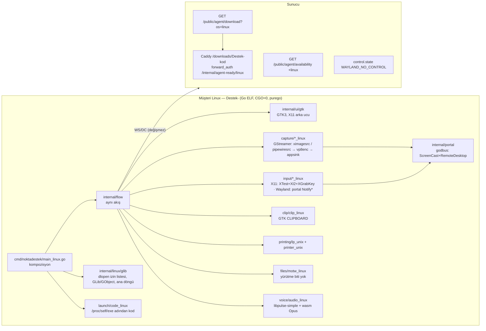

# Mimari — P28g Linux istemci (AC-277)

Tarih: 2026-11-17 · Durum: **r2** — K0g güvenlik turu (S-P28g-1..13, tümü kabul; §13) ve K0s spike (`docs/spike-p28g-k0s.md`; §14) işlendi. §13/§14 bağlayıcıdır; §1–§12'de r2 ile değişen satırlar işaretlidir · Dal: `p28g`
Girdiler: `docs/gereksinimler-p28.md` (US-72, AC-397..403, R46, V52), `docs/mimari-p28.md` §0 madde 7 ve §0.1 P28g satırı,
`docs/mimari-p28f.md` (özellikle §10.1), ADR-0035, ADR-0036, ADR-0037, `docs/spike-p28f-k0s.md`.
Yeni ADR: **ADR-0038** (Linux: purego + GTK3 (X11 arka ucu) + GStreamer VP8 + xdg-desktop-portal + tek ELF).
Kontrol listesi: `docs/tasarim-kontrol.md` "P28g".

**Sadelik:** Linux istemcisi macOS gibi yalnız **Hızlı Destek (kod/bağlantı)** akışıdır. `internal/flow` ve tüm WS/DC mesajları
aynen kullanılır. Protokoldeki ekler şunlardır: `control.state` kaynağına `WAYLAND_NO_CONTROL`, indirme/availability `os` enum'una
`linux`. Yeni tablo ya da migration yoktur. Yeni Go bağımlılığı **1** tanedir: `godbus/dbus/v5`. purego zaten var. r2: `jezek/xgb` çıkarıldı; X11'in tamamı (XTest, XI2, kısayol, monitörler) purego ile libX11/libXi/libXtst ve GDK üzerinden yapılır (§14 m.1).
Video Linux'ta **tek yoldan VP8** olarak gider: Windows ve macOS'taki H.264 yolu değişmez, codec `rtc.NewMedia` parametresiyle seçilir.

---

## 1. Özet ve kısıtlar

| Kapsamda                                                                                                                                 | Kapsam dışı / Sonra (neden)                                                                                                         |
| ---------------------------------------------------------------------------------------------------------------------------------------- | ------------------------------------------------------------------------------------------------------------------------------------ |
| Ubuntu 22.04 / 24.04 LTS x86_64, GNOME; X11 ve Wayland oturumu; tek ELF dosyası ≤ 60 MB, root gerekmez, kurulum yok (AC-397)              | Diğer dağıtımlar/masaüstleri, ARM64 (gereksinim §4 madde 9); Flatpak/Snap/AppImage/.deb paketi                                      |
| X11: görüntü (ximagesrc) + kontrol (XTest) + chat + dosya + gösterge + monitör seçimi (AC-398)                                           | Gözetimsiz servis (P27), tepsi/otomatik başlatma/çoklu firma (P20), "Bilgilerimi hatırla" (E9), firma dosyası, destek talebi (V52) |
| Wayland: ScreenCast + RemoteDesktop portalı (tek birleşik oturum), portal izin vermezse görüntü + AC-399 metni (AC-399, AC-400)          | Pencere paylaşımı (AC-248; `WindowCapture` false); H.264 Linux'ta (Sonra, genişleme noktası §7)                                      |
| P28a pano (GTK CLIPBOARD) + yazdırma (`lp`, r4 kalıbı), P28b sunucu dosyası, P28c roster, P28d ses (PulseAudio simple + wasm Opus), P28e rıza | Wayland'de global kısayol (GlobalShortcuts portalı GNOME 48+, hedef sürümlerde yok) → sistem "Durdur"u (§5.2)                       |
| İz testi (AC-401), SHA256SUMS + attestation, karşılama sayfası Linux algılama + kopyalanabilir komut (AC-397, AC-403)                    | Wayland'de AC-104 (yerel girdinin önceliği): istemci global girdiyi göremez → kabul edilen sapma (§5.2, R46)                         |

Kısıtlar:

- `CGO_ENABLED=0` korunur (ADR-0037 m.1). Sistem kitaplıkları purego ile **mutlak yoldan** `dlopen` edilir
  (`/usr/lib/x86_64-linux-gnu/…`).
- Linux'ta **GPU/sistem H.264 kodlayıcısı garanti değildir**: `x264enc` GPL'dir (plugins-ugly), `openh264enc` Ubuntu'da varsayılan
  gelmez, `vah264enc` GPU'ya bağlıdır.
- Wayland'de istemci pencere konumunu ve global girdiyi göremez. Bu yüzden GTK her iki oturumda da **X11 arka ucuyla** çalışır;
  Wayland'de bu XWayland demektir. Ubuntu'da mutter `xwayland`'e bağımlıdır.
- Gerçek Linux masaüstü yok. Geliştirme makinesi Apple Silicon + Docker; amd64 emülasyonla ölçülen değerler **vekildir** (§9.1, A-PG-1).
- Sürüm: istemci **0.20.0**, üç platform aynı etiketi kullanır. Windows ve macOS'ta davranış değişikliği yoktur.

## 2. Bileşenler ve sorumluluklar



| Bileşen                                         | Sorumluluk                                                                                                                                                                                                                                                                                                                                          |
| ----------------------------------------------- | --------------------------------------------------------------------------------------------------------------------------------------------------------------------------------------------------------------------------------------------------------------------------------------------------------------------------------------------------- |
| `cmd/noktadestek/main_linux.go`, `deps_linux.go` | `init`'te `runtime.LockOSThread`. Oturum türünü belirler (`WAYLAND_DISPLAY` doluysa Wayland, değilse `DISPLAY` ile X11; ikisi de yoksa stderr + çıkış 2). Özel geçici dizini kurar (§5.3), ortam değişkenlerini ayarlar, `gtk_init_check` çağırır (yalnız x11 arka ucu), `flow.Deps`'i kurar. `SIGHUP`'ı yok sayar (terminal kapanınca oturum düşmez). AC-107 kapanışı da buradadır. |
| `internal/linux/glib` (yeni, ince)               | `dlopen` izin listesi (§5.1 T5), GLib/GObject temel çağrıları (`g_object_unref`, `g_free`, `g_signal_connect_data`), ana döngüye gönderme (`g_idle_add` + tek kayıtlı geri çağrı + tutamaç tablosu), C dizgisi dönüşümü, `g_setenv`. **Paket `init`'inde dlopen yok** (CI Linux'ta derlenir/test edilir); yükleme `Load()` ile açıkça yapılır. |
| `internal/ui/gtk` (yeni)                         | `flow.UI`, `ClipPrintUI`, `FileServerUI`, `RosterUI`, `VoiceUI`, `RecUI` uygulamaları (GTK3). Ekran listesi §2.1.                                                                                                                                                                                                                                  |
| `internal/portal` (yeni, `//go:build linux`)     | godbus ile `org.freedesktop.portal.RemoteDesktop` + `ScreenCast`: `CreateSession` → `SelectDevices(KEYBOARD\|POINTER)` → `SelectSources(types=MONITOR, multiple=false, cursor_mode=EMBEDDED, persist_mode=0)` → `Start(parent "x11:<XID>")` → `OpenPipeWireRemote` (fd). Sonuç: `{fd, node, size, devices}`. `Closed` sinyalini izler. Notify* girdi çağrıları. |
| `capture/*_linux.go`                             | Monitör listesi (X11: r2 — GDK `gdk_display_get_monitor` + `gdk_monitor_get_geometry`/ölçek; Wayland: portaldan gelen tek akış) ve GStreamer boru hattı (§4.4). `rtc.Source` + `LowSource` + `KeyframeRequester` arayüzlerini doğrudan uygular. NV12 `Encoder` arayüzü kullanılmaz.                                                                                                              |
| `input/*_linux.go`                               | `keys_linux.go`: DOM `code` → evdev tuş kodu (tek tablo; X11 tuş kodu = evdev + 8). `xtest_linux.go`: XTest enjektörü + XI2 ham olaylarla yerel girdi algılama + `XGrabKey` kısayolu. `portal_linux.go`: Wayland enjektörü (`NotifyPointerMotionAbsolute`, `NotifyPointerButton`, `NotifyPointerAxisDiscrete`, `NotifyKeyboardKeycode`, metin için `NotifyKeyboardKeysym`). |
| `clip/clip_linux.go`                             | GTK `GDK_SELECTION_CLIPBOARD` üzerinden düz metin okur/yazar (≤ 64 KB, mevcut `clip.go` kuralları). Hedef listesinde `x-kde-passwordManagerHint` varsa okunmaz (S-P28f-12 karşılığı). Wayland'de mutter'ın XWayland seçim köprüsüne dayanır (K0s-8).                                                                                              |
| `printing/printer_unix.go`                       | `printer_darwin.go` `darwin \|\| linux` olarak yeniden adlandırılır. r4 kararı **aynen** uygulanır: `PagesUnknown`, "Varsayılan yazıcı", PDF istemcide ayrıştırılmaz (T9). `lp_unix.go` değişmez.                                                                                                                                                  |
| `files/motw_linux.go`, `downloads_linux.go`, `traces_linux.go` | MOTW karşılığı: alınan dosya `0644`, yürütme biti asla yok (`.part` dahil; §5.1 T8). İndirme dizini `~/.config/user-dirs.dirs` içindeki `XDG_DOWNLOAD_DIR`'dan saf Go ile okunur (alt süreç yok); yoksa `~/Downloads`, o da yoksa `$HOME`. Kapanışta özel geçici dizin silinir. |
| `voice/audio_linux.go`                           | `libpulse-simple.so.0`: 48 kHz mono S16LE, 20 ms parça, engelleyen `pa_simple_read`/`pa_simple_write` goroutine'lerde (C geri çağrısı yok). PipeWire (24.04) ve PulseAudio (22.04) aynı pulse protokolünü sunar. Codec `opus.go` (wasm) aynen; amd64'te wazero derleyicisiyle çalışır (ADR-0036 m.1). |
| `env/probe_linux.go`                             | Kilit ekranı: godbus `org.gnome.ScreenSaver.GetActive` (oturum veri yolu) → "Müşteri güvenli masaüstünde" (AC-105).                                                                                                                                                                                                                                 |
| `launch/code_linux.go`                           | Kod bulma sırası: (1) `/proc/self/exe` taban adı `folderCode` desenine uyuyorsa (genişletilmiş desen §4.3); (2) kod alanı (AC-97). Yeniden başlatma dosyası **yok** (§10.1 notu).                                                                                                                                                                  |

**Geri çağrı kuralı (ADR-0038 m.2):** Hiçbir C iş parçacığı Go'ya geri çağrı yapmaz. GStreamer çekme kipinde çalışır
(`gst_app_sink_try_pull_sample`), veri yolu yoklaması `gst_bus_timed_pop_filtered` ile yapılır. Pulse engelleyen API'yle, D-Bus saf
Go ile kullanılır. GTK sinyal geri çağrıları yalnız kilitli ana iş parçacığında ve `init`'te kaydedilmiş sabit sayıda
`purego.NewCallback` ile alınır. Değerle yapı geçirilmez; yapılar işaretçiyle verilir.

### 2.1 Windows ekranları → Linux karşılığı (tek tablo)

| Windows (`internal/ui`)                     | Linux (`internal/ui/gtk`)                         | Not                                                                                                                                                                                                                                                                                    |
| ------------------------------------------- | ------------------------------------------------- | -------------------------------------------------------------------------------------------------------------------------------------------------------------------------------------------------------------------------------------------------------------------------------------- |
| `form_windows.go` (AskCode)                 | `code_linux.go` — GtkWindow + 8 haneli alan       | AC-97 mesajları `flow` ileti tablosundan gelir                                                                                                                                                                                                                                          |
| `welcome_windows.go`                        | `welcome_linux.go`                                | Logo, teknisyen adı + doğrulama kodu, sunucu, uyarı + "Kötüye kullanımı bildir" (`g_app_info_launch_default_for_uri`, yalnız `api.ValidAbuseEmail` sonrası kurulan `mailto:`), KVKK, P28e rıza kutusu                                                                                         |
| `lobby_windows.go`, Connecting              | `lobby_linux.go`                                  | admitCode büyük yazıyla                                                                                                                                                                                                                                                                 |
| `choose_windows.go` (AC-106)                | X11: `choose_linux.go` (monitör listesi). **Wayland: kendi seçim ekranı yok**; "Sistem izin penceresi açılıyor…" ekranı + portal diyaloğu (monitörü sistem seçtirir) | Portal reddinde/iptalinde aynı ekranda "Paylaşım başlatılmadı" + "Tekrar dene" + "Oturumu bitir" (AC-399). Çifte seçim yoktur (macOS'ta picker'ın reddedilme gerekçesiyle aynı) |
| `session_windows.go` + panel + control      | `session_linux.go` — tek oturum penceresi         | "Erişime izin ver / Kontrolü kapat / Oturumu bitir" her zaman görünür ve Tab ile erişilir (AC-100). Kısayol metni X11'de "Ctrl+Shift+F12", Wayland'de "Üst çubuktaki ekran paylaşımı simgesi → Durdur"                                                                                    |
| `consent_windows.go`, `print_windows.go`    | `prompt_linux.go` — ortak onay diyaloğu           | Kontrol, monitör, dosya teklifi, yazdırma, ses kabulü, teknisyen çıkarma aynı bileşende. Varsayılan odak "Reddet", Enter/Space ret, 1,5 sn kilit, imlecin altında açılmaz, **`localClick()` (§5.2a)**; diyalog açıkken enjeksiyon durur                                                   |
| `chat_windows.go`, `transfer_windows.go`    | `session_linux.go` içinde bölüm                   | GtkTextView salt okunur, `gtk_text_buffer_insert` (markup yok)                                                                                                                                                                                                                          |
| `rec_windows.go`, `voice_windows.go`, `roster_windows.go` | `rec_linux.go`, `voice_linux.go`, `roster_linux.go` | Mantık `uicore` (ortak)                                                                                                                                                                                                                                                       |
| `overlay_windows.go`                        | `overlay_linux.go` — monitör başına GTK_WINDOW_POPUP (override-redirect), RGBA görsel, boş giriş şekli (tıklama geçer) | Gösterge çerçevesi + işaretleme katmanı. 1 sn tik: `gdk_window_raise` + görünürlük denetimi; RGBA görsel yoksa ya da 3 tikte görünür kılınamazsa fail-closed (kapı kapanır). **Yakalamadan hariç tutma Linux'ta yok** (§5.4) |
| `ended_windows.go`                          | `ended_linux.go` + 2,5 sn sonra `gtk_main_quit` (AC-107) |                                                                                                                                                                                                                                                                                  |
| `licenses_windows.go`                       | Oturum penceresi menüsünde "Lisanslar"            | `third_party_notices.txt` gömülü: godbus BSD-2 eklenir (r2: xgb yok); sistem kitaplıkları (GTK/GStreamer/libpulse LGPL) dağıtılmaz, notta "çalışma anında sistemden yüklenir" yazılır                                                                                                          |
| `testband` (macOS)                          | r2: pencere başlığı + Hakkında'da "TEST" (yalnız staging) | Linux'ta imza yok (AC-403). Gömülü adres prod değilse "TEST" metni çalışma anında türetilir (S-P28g-9)                                                                                                                                                                                 |
| `home*`, `request*`, tepsi, servisui        | yok                                               | V52                                                                                                                                                                                                                                                                                     |

Ortak dosyalar: `ui/uicore` aynen kullanılır. Renkler GTK teması (Yaru / Yaru-dark, XSETTINGS) üzerinden açık/koyu kendiliğinden
gelir; tehlike rengi ve logo zemini `uicore/theme.go`'dan tek bir `GtkCssProvider` ile uygulanır. Yeni metinler
`internal/flow/messages_p28g.go` tek tablosundadır (AC-404). Güvenilmeyen metin yalnız `gtk_label_set_text` ile yazılır
(`use-markup=FALSE`, `set_markup` yok). Logo Go'da çözülür ve `gdk_pixbuf_new_from_bytes` ile ham RGBA olarak verilir.

## 3. Veri modeli

Yeni tablo, kolon, indeks ya da migration **yoktur**. `os: "linux"` mevcut `guest.pending.newValue.os` alanına yazılır;
`JOIN_AUDIT_OS` ve `CLIENT_OS` zaten `linux` içeriyor. Silme stratejisi değişmez.

## 4. API ve protokol sözleşmesi

### 4.1 REST

| Uç                                         | Değişiklik                                                                                                                                                                                                                                                                                       | Hata kodları                        | Yetki |
| ------------------------------------------ | ------------------------------------------------------------------------------------------------------------------------------------------------------------------------------------------------------------------------------------------------------------------------------------------------ | ----------------------------------- | ----- |
| `POST /public/sessions/resolve`            | Değişiklik yok: `clientOs: "linux"` enum'da zaten var. Go istemcisi `runtime.GOOS=linux` → `"linux"` gönderir                                                                                                                                                                                    | mevcut                              | public |
| `GET /public/agent/download?ref=&os=`      | `AGENT_DOWNLOAD_OS = ["windows","macos","linux"]`. `linux` → yalnız `linuxAgent` kapısı → 302 `/downloads/Destek-<kod>` (**uzantısız**). Kapı `ok` değilse 503 `NOT_READY`. Geçersiz `os` → 400, ref kovası tüketilmez (S-P28f-15 aynen)                                                         | 400, 404, 410, 429, 503             | public |
| `GET /public/agent/availability`           | Çıktı `{ windows, macos, linux, macosTestBuild }`. `linux = linuxAgent.check() === "ok"`. Web, eksik alanı `false` sayar (fail-closed). `linuxTestBuild` yok (imza yok, TEST bandı yok)                                                                                                          | 429                                 | public |
| `/internal/agent-ready/linux` (forward_auth) | Yeni iç URI; yalnız `linuxAgent` kapısını uygular (S-P28f-3 kalıbı). Caddy: `@agentLinux path_regexp agentLinux ^/downloads/(NoktaDestek-linux\|Destek-[0-9]{8})$` → `/internal/agent-ready/linux`, `X-Forwarded-Uri "/downloads/***"`. Snippet `agent_bin_file`: `rewrite * /NoktaDestek-linux`, `Content-Type: application/octet-stream`, `Content-Disposition: attachment; filename="{args[0]}"`, `nosniff`, `no-store`. Log maskesi `/downloads/Destek-[^/?]+` bunu zaten kapsar | 404, 503 | iç |

### 4.2 WS (`packages/contracts/src/ws.ts`; Go eşi `internal/signal`)

| Mesaj                     | Değişiklik |
| ------------------------- | ---------- |
| `control.state` (guest→S) | `CONTROL_SOURCES` / `GUEST_VIEW_SOURCES` enum'larına `WAYLAND_NO_CONTROL` eklenir; yalnız `state: "VIEW"` ile geçerlidir. Anlamı: Wayland portal oturumunda klavye/işaretçi aygıtı izni yok (`devices == 0`), kontrol diyaloğu açılmadı. Sunucu bunu `OS_PERMISSION` gibi **iptal** olarak işler: consent satırı açılmaz, 30 sn bekleme uygulanmaz, sayaç iade edilmez. Audit `control.cancelled{by:"agent", source:"wayland_no_control"}`. Yalnız REQUESTED fazında, AGENT misafirden ve nonce'taki `clientOs` `linux` ise kabul edilir; aksi durumda yok sayılır. Konsol AC-399 metnini birebir gösterir: "Müşterinin masaüstü uzaktan kontrole izin vermiyor (Wayland)". `OS_PERMISSION` macOS'a bağlı kalır, metni değişmez |
| diğer                     | Değişmez. Özellik belirteçleri Windows ile aynıdır. Wayland'de `remote_control` yine bildirilir (izin portal diyaloğunda belli olur); ret durumunda yukarıdaki mesaj gider |

Yayın sırası: sunucu + web (K6/K7) önce, istemci sonra.

### 4.3 Dosya adı ve kod taşıma

- Sunulan ad `Destek-<8 hane>`, uzantısızdır. Baytlar her kodda aynıdır (SHA256SUMS, AC-128 korunur).
- `launch/code_folder.go` deseni Firefox'un çift indirme adını (`Destek-12345678(1)`) da kapsayacak biçimde genişletilir:
  `^Destek-([0-9]{8})(?: ?\([0-9]{1,3}\)| [0-9]{1,3})?$`. macOS davranışı korunur; eski örnekler testte kalır.
- Karşılama sayfası kodu bilmez (ref opaktır, G-22). Bu yüzden kopyalanan komut **sabit metindir** ve sunucu verisi içermez
  (enjeksiyon yüzeyi yok). **r2 (S-P28g-6, bağlayıcı metin; kopyalanan bayt dizisi budur, sonda satır sonu yok):** son 30 dk'daki, `folderCode` desenine uyan en yeni normal dosyayı seçer ve yalnız ona `u+x` verir:

  ```
   d="$(xdg-user-dir DOWNLOAD)" && [ -d "$d" ] && cd "$d" && f="$(find . -maxdepth 1 -type f -mmin -30 -regextype posix-extended -regex './Destek-[0-9]{8}( ?\([0-9]{1,3}\))?' -printf '%T@ %f\n' | sort -nr | head -n 1 | cut -d' ' -f2-)" && [ -n "$f" ] && chmod u+x -- "$f" && ./"$f"
  ```

  Baştaki boşluk, Ubuntu'nun varsayılan `HISTCONTROL=ignoreboth` ayarıyla komutun geçmişe yazılmamasını sağlar (en iyi çaba).
  Türkçe yerelde `İndirilenler` klasörünü `xdg-user-dir` çözer. Komutun 22.04 ve 24.04'te bash ile çalıştığı K0s-9'da doğrulanır.
  "Terminale komut yapıştırma" kimlik avına benzer bir kalıptır; K0g'ye açıkça sorulur (S-P28f-8 "Yine de Aç" eşi, A-PG-5).
- İkincil yol (kılavuz): Dosyalar → sağ tık → Özellikler → "Program olarak çalıştır" → çift tık. Bu yol yalnız K0s-9 / elle
  doğrulanırsa kılavuza girer.

### 4.4 Video: GStreamer boru hattı (tek yol, VP8)

Boru hattı dizgisi **sabittir**. İçine yalnız istemcinin ürettiği tamsayılar girer (monitör koordinatları, PipeWire fd/node,
kare hızı); `decodebin`/`autovideo*` gibi otomatik eklenti seçicileri yoktur. Kaynak öğesi:

- X11: `ximagesrc use-damage=false show-pointer=true startx=… starty=… endx=… endy=…` (r2, S-P28g-4: `display-name` yazılmaz; ximagesrc `DISPLAY`'i kendisi okur, değer açılışta `^:[0-9]{1,3}(\.[0-9]{1,2})?$` ile doğrulanır, uymazsa X11 yolu açılmaz)
- Wayland: `pipewiresrc fd=<fd> path=<node> do-timestamp=true keepalive-time=1000`

Ortak kuyruk:

```
<kaynak> ! videorate ! video/x-raw,framerate=30/1 ! videoconvert ! videoscale ! video/x-raw,format=I420,width=<W>,height=<H>
 ! tee name=t
 t. ! queue leaky=downstream max-size-buffers=2 ! vp8enc name=main deadline=1 cpu-used=<K0s> end-usage=cbr target-bitrate=<bps>
      keyframe-max-dist=<ratectl> lag-in-frames=0 error-resilient=default threads=<n> ! appsink name=mainsink sync=false max-buffers=2 drop=true
 t. ! queue leaky=downstream max-size-buffers=1 ! valve name=lowvalve drop=true ! videorate ! video/x-raw,framerate=<LowFPS>/1
      ! videoscale ! video/x-raw,width=<Wl>,height=<Hl> ! vp8enc name=low deadline=1 cpu-used=<K0s> end-usage=cbr target-bitrate=<LowBPS>
      lag-in-frames=0 ! appsink name=lowsink sync=false max-buffers=2 drop=true
```

- `<W>×<H>`: r2 (K0s-3 FAIL dalı): **varsayılan uzun kenar 1280**; ölçülen süreç CPU'suna göre basamaklı yükseltme 1600 → 1920 (§14 m.3). Çift sayılara yuvarlanır.
- **Anahtar kare:** `gst_video_event_new_upstream_force_key_unit(GST_CLOCK_TIME_NONE, TRUE, 0)` ilgili `appsink`'e
  `gst_element_send_event` ile gönderilir. Anahtar kare tespiti bit akışından yapılır (VP8 çerçeve etiketi bit 0 == 0), yapı ofseti okunmaz.
- **Bit hızı / düşük akış:** `gst_util_set_object_arg(enc, "target-bitrate", "<n>")` ve `valve drop=true|false`. Değişken argümanlı
  `g_object_set` kullanılmaz.
- **Çekme:** `gst_app_sink_try_pull_sample(sink, 100 ms)` → `gst_buffer_map` → Go'ya kopyala → `unmap` / `unref`. `GstMapInfo` Go
  belleğinde ayrılır, işaretçiyle verilir, içinde Go işaretçisi yoktur.
- **Hata:** veri yolu `ERROR`/`EOS` → kaynak hata döner → mevcut yakalama hatası yolu çalışır. Wayland'de portal `Closed` sinyali
  kapıyı kapatır ve `EvEnd` üretir (Oturumu bitir ile aynı; §5.2).
- `rtc.NewMedia(codec)`: `rtc.H264` (Windows/macOS, mevcut `h264` yeteneği) ya da `rtc.VP8` (`MimeTypeVP8`, 90 kHz). Ana ve düşük iz
  aynı codec'i kullanır, böylece ReplaceTrack yeniden müzakere istemez (ADR-0035). İstemci yalnız yanıt (answer) üretir. pion
  `NewAPI` varsayılan kodekleri kaydeder (VP8 dahil; v4.2.26 doğrulandı); tarayıcı teklifinde VP8 her zaman vardır. Web konsolu
  ve sunucu codec varsaymaz (kayıt `MediaRecorder` ile çözülmüş kareden VP8 üretir, P28e). **Web/sunucu değişikliği gerekmez.**
  `rtc.New(…, nil)` varsayılanı H.264 kalır; testler iki codec için de koşar.

## 5. Güvenlik tasarımı

### 5.1 Tehdit modeli girdisi (güvenlik ajanı K0g'de S-P28g-n verir)

| #   | Tehdit | Karşı önlem |
| --- | ------ | ----------- |
| T1  | Teknisyenin enjekte ettiği girdiyle korunan denetimin tetiklenmesi | §5.2a `localClick()` beyaz listesi. Korunan denetim açıkken enjektör durur (iki oturumda da). X11'de XTEST kaynaklı olay reddedilir |
| T2  | Başka yerel sürecin onay üretmesi (X11'de her istemci XTest/XSendEvent kullanabilir) | `send_event` bayraklı olay ret, XTEST aygıtı ret. Aynı X oturumunda kötü amaçlı süreç zaten ekranı okuyup tuş kaydedebilir; macOS T2 gibi kapsam dışı risk olarak kılavuza yazılır. Wayland'de başka süreç bize girdi enjekte edemez (kendi portal izni olmadan) |
| T3  | Sahte ya da değiştirilmiş ikili | İmza yok (AC-403). SHA256SUMS + GitHub attestation; karşılama sayfası/kılavuz doğrulama komutunu verir (`sha256sum`). AC-128 agent-watch Linux ikilisini de karşılaştırır. Prod yalnız Release + `--source-ref refs/tags/v*` |
| T4  | Sunucu adresinin değiştirilmesi | Adres yalnız ldflags'te. Argüman kabul edilmez (Linux'ta `--restart` yok); r2 (S-P28g-5): ortam **izin listesiyle süzülür** (§13 S-P28g-5); `SSL_CERT_FILE/DIR` asla, proxy yalnız `HTTPS_PROXY`/`NO_PROXY`. TLS Go `crypto/x509` sistem kökleriyle (`/etc/ssl/certs`) doğrulanır |
| T5  | Kitaplık/modül kaçırma | r2 (S-P28g-5): aynı kullanıcı yetkisindeki saldırgan kapsam dışıdır; ortamdan gelen kitaplık/modül yüklemesi **ortam izin listesi + bir kez temiz yeniden çalıştırma** ile kapatılır (§13). `dlopen` izin listesi (mutlak yol) birinci düzeyi korur; listeye r2'de `libX11.so.6`, `libXi.so.6`, `libXtst.so.6` eklenir. GStreamer değişkenleri yeniden çalıştırmadan sonra ayarlanır (`GST_PLUGIN_PATH(_1_0)` yok, `GST_PLUGIN_SYSTEM_PATH_1_0`, `GST_PLUGIN_SCANNER_1_0`, `GST_REGISTRY_1_0` sabit). `GDK_CORE_DEVICE_EVENTS` ve tüm `GDK_DEBUG`/`GTK_DEBUG` silinir (K0s-5: XTEST ayrımını siliyor) |
| T6  | GPL kodun sürece girmesi (lisans) | Boru hattında yalnız base/good öğeleri (`ximagesrc`, `videoconvert`, `videoscale`, `videorate`, `tee`, `queue`, `valve`, `vp8enc`, `appsink`) ve `pipewiresrc` adlandırılır. r2 (S-P28g-4): **beyaz liste iki katman** — CI şablondaki öğe adlarının `{ximagesrc, pipewiresrc, videorate, videoconvert, videoscale, tee, queue, valve, vp8enc, appsink, capsfilter}` alt kümesi olduğunu, çalışma anında `gst_bin_iterate_elements` her öğenin fabrika adının aynı listede olduğunu denetler (değilse başlatılmaz). Kayıt taramasını ayrı süreç (`gst-plugin-scanner`) yapar |
| T7  | Göstergenin gizlenmesi (G-17) | X11: override-redirect pencere pencere yöneticisince küçültülemez/gizlenemez; 1 sn tik yükseltme + eşleme denetimi + monitör değişiminde (RandR) yeni gösterge; 3 tikte görünür kılınamazsa kapı kapanır. Wayland: XWayland override-redirect + **sistemin ekran paylaşım göstergesi** (GNOME üst çubuk). Garanti yok, AC-400 kabulü ve kılavuz |
| T8  | Alınan dosyanın çalıştırılması | Linux'ta zorunlu bir MOTW yok (GNOME xattr denetlemez). Karşılık: dosya `0644` (`.part` dahil) yazılır ve yürütme biti **asla** konmaz, kaydedilen ad mevcut temizlemeden geçer. Tehlike listesine Linux türleri eklenir (§5.4); bunun için contracts + Go + fikstür **aynı pakette (K5)** değişir |
| T9  | Yazdırma | P28f T9 / r4 aynen (sabit `lp` argümanları, stdin, ayrıştırma cupsd'de) |
| T10 | wazero JIT | Linux amd64'te derleyici (ADR-0036 m.1). Yürütülebilir bellek kısıtı yok; `TestP28dK0sCompilerMatchesInterpreter` amd64'te zaten koşuyor |
| T11 | Portal kalıcılığı / sessiz yeniden yetkilendirme | `persist_mode=0`, `restore_token` istenmez/saklanmaz. Her oturumda sistem diyaloğu açılır |
| T12 | Kopyalanan terminal komutu | Sabit metin, sunucu verisi yok, yalnız `Destek-*` dosyasına `u+x` verir. Sayfada komutun ne yaptığı ve "Nokta Destek size bundan başka komut vermez" uyarısı yazılır (A-PG-5, K0g) |

### 5.2 İzin kapısı ve değişmezler (X11 / Wayland)

`control.Gate` aynen kullanılır; kapı kapalıyken girdi düşer (AC-101 ≤ 100 ms).

| Değişmez | X11 | Wayland | Telafi / sapma | FAIL dalı |
| -------- | --- | ------- | -------------- | --------- |
| AC-102 kapatma kısayolu (kısayol yoksa kontrol verilmez) | r2: `XGrabKey` Ctrl+Shift+F12 (yedek F11) NumLock/CapsLock varyantlarıyla, **GDK'nın X bağlantısında, ana iş parçacığında** `gdk_x11_display_error_trap_push/pop` arasında (BadAccess eşzamanlı alınır; S-P28g-13 m.2); olay `gdk_window_add_filter` ile. Biri başarısızsa F11, o da olmazsa `HotkeyErr` → kontrol yok | Global kısayol yok; XWayland'e `XGrabKey` **denenmez** (S-P28g-13 m.3). Karşılık: GNOME üst çubuğu "Durdur" (K0s-6: `Closed` 6–8 ms) + **kilit ekranı = REVOKED** telafisi (§13 S-P28g-1) | Kullanıcı onayı bekleniyor (gereksinimler-p28 AC-399 notu); varsayılan: telafiyle kontrol | Telafi gerçek makinede (E-7) tutmazsa **tek dal: Wayland yalnız görüntü** (RemoteDesktop istenmez) |
| AC-104 yerel girdi uzaktan girdiyi 1 sn askıya alır | r2: XI2 ham olaylar purego **libX11 + libXi** ile (GTK'dan önce `XInitThreads`, ayrı `Display`, kilitli ayrı iş parçacığında engelleyen `XNextEvent`; C geri çağrısı yok). `sourceid`, `XIQueryDevice` ile bulunan XTEST alt aygıt **kimlikleriyle** karşılaştırılır (ad değil; `XIHierarchyChanged`'de yeniden okunur). Kimlik alınamazsa kontrol verilmez. K0s-5: sentetik %100 ret | İstemci global girdiyi göremez | Wayland'de AC-104 yok → S-P28g-1 telafisi (kilit = REVOKED, uyarı metni). **Zaman tabanlı yedek hiçbir dalda yoktur** (S-P28g-7) | — |
| G-03 / `localClick` | §5.2a | §5.2a | — | — |
| Kendi pencerelerimiz | Enjektör, korunan diyalog açıkken durur. İşaretçi kendi pencere dikdörtgenlerimize enjekte edilmez (P28f düzeltme 1 kuralı; dikdörtgenler GDK'dan) | Durdurma aynen geçerli. XWayland pencere konumu kök koordinatıdır ama portal akış koordinatıyla eşleşmesi garanti değildir → yalnız durdurma kuralı uygulanır | Wayland'de pencere dikdörtgeni kuralı yok | — |
| Kontrol izni yok | — | `devices` bit maskesinde KEYBOARD\|POINTER yoksa kontrol isteğinde diyalog açılmaz, `control.state{VIEW, WAYLAND_NO_CONTROL}` gider | AC-399 | — |

#### 5.2a `localClick()` (tek tanım `input/localclick_linux.go`; korunan denetim listesi P28f §5.2a ile aynı)

Beyaz listedir, fail-closed çalışır; aşağıdakilerin hepsi sağlanmazsa eylem yok sayılır:

1. Eylem GTK `button-release-event` (sol düğme) ile gelir ve **aynı denetimde** aynı düğmenin `button-press-event`'i de bu
   kurallarla kaydedilmiştir. `clicked`/`activate` sinyali (klavye, AT-SPI `do_action`, mnemonic) eylem üretmez.
2. `GdkEventButton.send_event == 0`.
3. Kaynak aygıt kimliği (`gdk_x11_device_get_id(gdk_event_get_source_device)`) XTEST alt aygıt kimliklerinden biri değildir (r2, S-P28g-13; X11 ve XWayland). Kimlik listesi yoksa ret.
4. Basış anında enjektör "duraklatılmış" durumdadır (korunan denetim açıkken zaten öyle) ve son enjeksiyondan bu yana ≥ 1,5 sn
   geçmiştir (diyalog kilidiyle aynı süre).

Wayland'de m.3 portal enjeksiyonunu ayırt edemez (mutter → XWayland çekirdek olayı). Bu durumda asıl ayırıcı m.4'tür: yalnız bizim
sürecimiz enjekte edebilir ve korunan denetim açıkken durmuştur. Erişilebilirlik ödünü (yalnız gerçek fare) P28f'teki gibi kılavuza yazılır.

### 5.3 İz bırakmama (AC-401)

- Açılışta `$XDG_RUNTIME_DIR/noktadestek-<rastgele>` (0700, tmpfs, `/tmp` dışı) oluşturulur. `XDG_RUNTIME_DIR` yoksa ya da sahibi
  bizim UID değilse kullanılmaz, iz testinde sapma olarak görünür. `XDG_CACHE_HOME` ve `GST_REGISTRY_1_0` bu dizine yönlendirilir:
  GStreamer kaydı, fontconfig/mesa önbelleği oraya düşer. Dizin kapanışta silinir; çökmede oturum kapanışında tmpfs ile gider.
- Ortam değişkenleri C kitaplıkları yüklenmeden önce ayarlanır. `os.Setenv` fakecgo ile libc `environ`'a yansımıyorsa `g_setenv`
  kullanılır (K0s-1 belirler).
- Yazılmayanlar: `~/.config/autostart`, `~/.config/noktadestek`, `recently-used.xbel` (dosya seçici yok), portal izin deposu
  (`persist_mode=0`; izin deposuna yazılıyorsa K0s-7 ölçer ve kılavuz istisnası olur), tanılama logu (Linux'ta yazılmaz).
- Paylaşılan dosyalar (`~/.config/pulse/cookie`, `~/.config/dconf/user`) yalnız yoksa sistem kitaplığınca oluşturulabilir.
  K0s-7 boş HOME ile ölçer. Oluşuyorsa istemciye ait değildir, kılavuzda istisna olarak yazılır (macOS TCC kalıbı).
- Kalan izler: İndirilenler'deki ikili ve alınan dosyalar (Windows ile aynı). Kopyalanan komut, baştaki boşluk tutmazsa kabuk
  geçmişinde kalır (kod tek kullanımlık, kılavuz).

### 5.4 Hassas veri, başlıklar, girdi

- Yeni hassas veri yoktur. Kod ve dosya adı loglanmaz; Caddy maskesi uzantısız adı da kapsar.
- İkili yanıtı: `application/octet-stream`, `attachment`, `nosniff`, `no-store`.
- Tehlikeli uzantılar (contracts `DANGEROUS_EXT` + Go `files.go` + fikstür, K5'te birlikte): `desktop run bin appimage deb rpm snap
  flatpak flatpakref flatpakrepo so ko service` (zaten olanlar tekrar eklenmez).
- FFI kuralları (S-P28f-11 Linux eşi): tutamaç tablosu (C'ye Go işaretçisi yok), geri çağrılar yalnız `init`'te ve yalnız ana iş
  parçacığında, ağdan gelen dizgiler uzunluk sınırlı ve UTF-8 doğrulanmış, değerle yapı yok, güvenlik işlevli sembol (`gdk_window_raise`,
  `gdk_event_get_source_device`, giriş şekli) çözülemezse fail-closed.
- **Yakalamadan hariç tutma yoktur:** gösterge çerçevesi ve işaretleme katmanı videoya girer. Teknisyen kendi çizimini videoda bir
  kez daha görür (aynı konumda, ≤ 1 kare gecikmeyle). Bu kabul edilen bir görsel farktır, güvenlik etkisi yoktur. Kılavuzda ve
  elle testte (E-11) yazılır.

## 6. Dosya / klasör planı

| Yer | İş |
| --- | -- |
| `apps/agent-win/cmd/noktadestek/main_linux.go`, `deps_linux.go` (yeni); `identity.go` etiketi `windows \|\| darwin \|\| linux` | Linux kompozisyonu |
| `internal/linux/glib/` (yeni) | dlopen izin listesi, GLib/GObject, ana döngüye gönderme |
| `internal/portal/` (yeni) | ScreenCast + RemoteDesktop (godbus); sahte D-Bus servisiyle durum makinesi testleri |
| `internal/ui/gtk/` (yeni) | §2.1 ekranları |
| `internal/capture/{gst,monitors,env}_linux.go` | GStreamer boru hattı, RandR monitörleri |
| `internal/rtc/media.go`, `rtc.go` | `NewMedia(codec)`, `rtc.H264` / `rtc.VP8` (Windows/darwin çağrıları `H264` geçer) |
| `internal/input/{keys,xtest,portal,host,localclick}_linux.go` | Girdi, kısayol, yerel girdi, `localClick` |
| `internal/clip/clip_linux.go`; `clip_other.go` etiketi `!windows && !darwin && !linux` | Pano |
| `internal/printing/printer_darwin.go` → `printer_unix.go` (`darwin \|\| linux`); `printer_other.go` etiketi daralır | r4 aynen |
| `internal/files/{motw,downloads,traces}_linux.go`, `files.go` (Linux türleri) | §5.3/5.4 |
| `internal/voice/audio_linux.go` | Ses |
| `internal/env/probe_linux.go`, `internal/launch/code_linux.go`, `code_folder.go` (desen) | Kilit ekranı, kod |
| `internal/flow/messages_p28g.go`, `internal/api/api.go` (`linux`) | Metinler, clientOs |
| `internal/ui/uicore/third_party_notices.txt` | godbus + sistem kitaplığı notu (r2: xgb yok) |
| `apps/agent-win/build/build-linux.sh` (yeni) | `GOOS=linux GOARCH=amd64 CGO_ENABLED=0 go build -trimpath -ldflags "-s -w -buildid= -X …serverURL -X …version"`. Prod adres yalnız `v<sürüm>` etiket iş akışında ya da `.invalid` (build-darwin kalıbı) |
| `apps/agent-win/test/trace-check-linux.sh`, `test/linux/Dockerfile.{2204,2404}` (yeni) | AC-401 + GUI duman testi imajları (Xvfb, GStreamer base/good, pipewire, dbus, Yaru) |
| `.github/workflows/agent-win.yml` | §8.2 |
| `packages/contracts/src/api/sessions.ts`, `ws.ts`, `labels.ts`, `files.ts`, `fixtures/file-names.json` | §4, §5.4 |
| `apps/server/src/{env.ts,app.ts,public/agent.ts,public/routes.ts,signaling/control*.ts,ops/metrics.ts}` | `linuxAgent` kapısı, `os=linux`, availability, `WAYLAND_NO_CONTROL` |
| `apps/web/lib/device-support.ts`, `lib/agent-download.ts`, `app/session/[token]/{agent-download,guest-welcome}.tsx`, `linux-guide.tsx` (yeni), konsol kontrol metni, `messages/tr.json` | AC-397/403 |
| `deploy/Caddyfile`, `test-caddy.sh`, `docker-compose.yml`, `.env.example`, `deploy/agent/publish-linux.sh` (yeni), `agent-watch.yml` | §8 |
| `docs/runbook.md`, `KULLANIM_KILAVUZU.md`, `README.md`, `DATASHEET.md`, `CHANGELOG.md`, `api.md` | K11 |

## 7. Performans ve ölçek

| Konu | Karar / bütçe |
| ---- | ------------- |
| Açılış | Komut çalıştıktan sonra karşılama ekranına ≤ 5 sn. GStreamer yalnız paylaşım başlarken yüklenir; ilk kayıt taraması (özel önbellek) ≤ 3 sn (K0s-3 ölçer) |
| Boyut | ELF ≤ 60 MB (CI sert sınır); beklenen ≈ 25 MB (vekil K0s-1) |
| Kodlama | VP8 yazılım, `deadline=1`, r2: varsayılan uzun kenar 1280, CPU'ya göre 1600/1920 basamağı (§14 m.3). Ölçüt **30 fps, kodlama p95 ≤ 33 ms, kare kaybı 0, süreç CPU ≤ %60 (tek çekirdek eşdeğeri)**; tutmazsa uzun kenar 1600/1280'e iner (K0s-3 karar). Zorlanan anahtar kare ≤ 2 kare içinde gelir; bit hızı değişimi çalışırken etkili olur |
| Genişleme noktası (Sonra) | H.264: `capture/gst_linux.go` içindeki tek kodlayıcı dizgisi + `rtc.H264`. Yalnız LGPL/BSD bir öğe (ör. `vah264enc`) ve bir ADR revizyonuyla |
| Ses | amd64 wazero derleyicisi ≈ 0,22 ms/çerçeve (ADR-0036); pulse 20 ms parça |
| Sunucu | availability 60 sn önbellek; kapı mevcut `AgentBinary.check()` önbelleği |

## 8. Operasyon

### 8.1 Config / env

| Değişken | Servis | Anlam |
| -------- | ------ | ----- |
| `LINUX_AGENT_PATH` | server | **Sabit** `/data/downloads/NoktaDestek-linux` (Caddy'de `/srv/downloads/NoktaDestek-linux`, aynı volume). Prod'da başka değer reddedilir (P28f K6 kalıbı) |
| `LINUX_AGENT_SHA256` | server | Yayın betiğinin attestation + SHA256SUMS doğrulamasından sonra yazdığı SHA. İkisi dolu ve eşleşmedikçe Linux indirmesi yok (503 / `linux:false`) |

Kural: `.env.example` (boş) + `env.ts` + `docker-compose.yml` server servisi + runbook. Rollback: `publish-linux.sh --withdraw` →
`LINUX_AGENT_SHA256` boşaltılır.

### 8.2 CI (`agent-win.yml`; Action'lar SHA ile sabit, `permissions: contents: read`)

| Job | Çalıştırıcı | İş |
| --- | ----------- | -- |
| `check` (genişler) | ubuntu, GO_IMAGE | `GOOS=linux go vet` + staticcheck + govulncheck + go-licenses (linux hedefi; GPL/AGPL ret) |
| `build-linux` | ubuntu, GO_IMAGE | `build/build-linux.sh`; boyut ≤ 60 MB; `readelf -d` ile NEEDED listesi yalnız `libc.so.6` (ve gerekiyorsa `libdl`/`libpthread`) |
| `reproducible-linux` | ubuntu | İki derlemenin SHA'sı eşit |
| `test-linux-gui` (matris 22.04 / 24.04) | ubuntu, `test/linux/Dockerfile.*` | `go test ./...` (linux; kitaplık yoksa görünür SKIP) + Xvfb duman testi (pencere aç, ximagesrc 5 sn VP8 kare, XTest tıklama, XTEST aygıt reddi) + `trace-check-linux.sh` (`.invalid` sunuculu derleme, boş HOME, öncesi/sonrası farkı) + portal durum makinesi (sahte D-Bus) |
| `attest` / `release` (genişler) | ubuntu | `NoktaDestek-linux-x86_64-<sürüm>` attestation; SHA256SUMS satırı; Release'e girer (imza yok) |

Staging: `workflow_dispatch` `agent-linux-stg` artifact'ı (staging adresi gömülü). `deploy/agent/publish-linux.sh`
(`publish-mac.sh` kalıbı): `--tag` (prod; ad `^NoktaDestek-linux-x86_64-[0-9]+\.[0-9]+\.[0-9]+$`, `--source-ref` zorunlu),
`--stg-run`, `--withdraw`, `--dry-run`; ELF + x86-64 başlık denetimi; ≤ 60 MiB. `agent-watch.yml` Linux dosya hash'ini Release ile
karşılaştırır.

### 8.3 Log / metrik, migration, yedek

`rs_agent_download_total{os="linux"}` (mevcut etiket). İstemci tanılama dosyası yoktur. Migration ve yeni veri yoktur.
Sıra: sunucu + web → istemci.

## 9. Test stratejisi

| Seviye | Ne | Komut |
| ------ | -- | ----- |
| Go birim (Linux CI) | DOM code → evdev tablosu, kod deseni (`(1)`, ` (1)`, `(1)` boşluksuz), XDG indirme dizini ayrıştırma (Türkçe, tırnak, `$HOME`), boru hattı dizgisi üretimi (tamsayı, yasak öğe yok — T6), VP8 anahtar kare biti, portal durum makinesi (sahte D-Bus: kabul / ret / iptal / `devices=0` / `Closed`), `localClick` karar mantığı, `NewMedia(VP8)` SDP eşleşmesi (pion yanıtı VP8), `motw_linux` izin bitleri | `go test ./...` |
| Go linux GUI (imaj) | §8.2 `test-linux-gui` | CI |
| İz (AC-401) | `trace-check-linux.sh`: `~/.config`, `~/.cache`, `~/.local/share`, `~/.config/autostart`, `/tmp` öncesi/sonrası; yeni yol 0 (belgelenmiş istisnalar hariç) | CI + elle |
| Sunucu | download `os=linux` 302 uzantısız ad / 503 / 400; availability `linux`; agent-ready linux + çapraz kapı; `WAYLAND_NO_CONTROL` (yalnız linux nonce, iptal, audit); `LINUX_AGENT_PATH` sabiti | `pnpm --filter @remote/server test`, `deploy/test-caddy.sh` |
| Web | `isLinuxDesktop`: UA `X11; Linux x86_64` (ya da UA-CH `platform=Linux` ve mimari x86); Android, CrOS, `aarch64`/`armv`, mobil → değil; availability `linux:false` → yalnız tarayıcı; Linux rehberi + komut kopyalama düğmesi; konsol AC-399 metni; axe 0, iki tema, 390 px | `pnpm --filter @remote/web test` + `e2e` |
| Elle | §12.1 E-listesi | test-operatoru |

### 9.1 K0s spike (backend-dev Go; zaman kutusu 2 iş günü; sonuç `docs/spike-p28g-k0s.md`; kod PR'a girmez)

Ortam: Apple Silicon üzerinde Docker. İşlev testleri `linux/amd64` imajında (Rosetta/QEMU) koşar; performans arm64 yerli imajda
**vekil** olarak ölçülür. Sayılar etiketlenir, nihai değer elle testte alınır. Üç Wayland katmanı vardır: (a) sahte D-Bus portal,
(b) başsız `mutter --headless --virtual-monitor` (ya da weston) + `xdg-desktop-portal-gnome` + pipewire, (c) gerçek GNOME diyaloğu (elle).

| # | Ölçüm | GEÇTİ ölçütü |
| - | ----- | ------------ |
| K0s-1 | purego Linux CGO=0: ikili yükleniyor mu; `readelf -d` NEEDED; 22.04 (glibc 2.35) ve 24.04'te başlıyor mu; GTK3 x11 penceresi + düğme + ana döngü gönderme; `os.Setenv` C ortamına yansıyor mu; iki derleme SHA eşit | Hepsi evet (Setenv hayırsa `g_setenv` yolu yazılır) |
| K0s-2 | Varsayılan paket doğrulaması: 22.04 ve 24.04 `ubuntu-desktop` (minimal ve tam kurulum) imajında `libgstreamer1.0-0`, `gstreamer1.0-plugins-base`, `-good` (`ximagesrc`, `vp8enc`), `gstreamer1.0-pipewire`, `libpulse0`, `libgtk-3-0`, `xdg-desktop-portal-gnome`, `xdg-user-dirs`, `cups-client` (`/usr/bin/lp`) var mı (`apt-cache rdepends --installed` + `gst-inspect-1.0`) | Hepsi varsayılan; değilse eksik paket için A-PG-2 kararı |
| K0s-3 | Xvfb 1920×1080 ximagesrc → vp8enc ana + düşük, 60 sn; pion ile Chrome'a (ya da Go çözücüyle doğrulama); anahtar kare zorlama gecikmesi; çalışırken bit hızı değişimi; GStreamer ilk kayıt taraması süresi | §7 ölçütleri (vekil); çözülebilir akış |
| K0s-4 | XTest fare/klavye: 0–1 → ±2 px, Türkçe Q (`setxkbmap tr`) `ç ğ ı ö ş ü İ`, değiştiriciler; `XGrabKey` Ctrl+Shift+F12 | Hepsi evet |
| K0s-5 | XI2 ham olaylarda XTEST alt aygıtı ayrımı (r2 sonuç: xgb XI2 desteklemiyor → libXi); GTK `gdk_event_get_source_device` XTEST tıklamasını tanıyor mu; `send_event` | Sentetik %100 ret, gerçek (xdotool olmadan `xinput` test aygıtı yok → Xvfb'de "XTEST dışı" kaynak için uinput gerekmez; ayrım yalnız XTEST=ret kanıtlanır, gerçek kabul elle) |
| K0s-6 | Başsız mutter + portal: CreateSession→Start (diyalog otomatik onay arka ucu ya da `xdg-desktop-portal` test arka ucu), `OpenPipeWireRemote` → pipewiresrc kare; Notify* ile girdi; `devices=0` yolu; `Closed` sinyali | Kare alınıyor, girdi uygulanıyor, `Closed` ≤ 100 ms kapı. Gerçek GNOME "Durdur" düğmesi ve diyalog **ELLE** |
| K0s-7 | Boş HOME ile tam akış (X11) sonrası fark: `~/.config`, `~/.cache`, `~/.local/share`, `/tmp`; pulse cookie, dconf, fontconfig, GStreamer kaydı, portal izin deposu | İstemciye ait 0; paylaşılan dosyalar listelenir |
| K0s-8 | Pano: GTK CLIPBOARD X11'de; başsız mutter'da Wayland istemcisi ↔ XWayland köprüsü | X11 evet; Wayland hayırsa `rs.cap.clip1` Wayland'de bildirilmez (mimari-p28 §0.1) |
| K0s-9 | §4.3 komutu (bash, Türkçe yerel `İndirilenler`, ` (1)` / `(1)` adları); Chrome/Firefox (snap) indirmesinde uyarı var mı (elle); Nautilus çift tık davranışı (elle) | Komut iki sürümde çalışır |
| K0s-10 | libpulse-simple 48k mono giriş/çıkış 5 dk (pipewire-pulse 24.04, pulseaudio 22.04 imajı) | Kesinti 0 |

FAIL dalı: K0s-1 FAIL → ADR-0038 revizyonu (cgo ile Linux derlemesi, GO_IMAGE'de). K0s-3 ölçütü tutmazsa çözünürlük basamağı
düşürülür (K2'ye girdi). K0s-5 FAIL → §5.2 X11 yedeği (güvenlik onayı). K0s-6 FAIL (portal girdisi ya da Closed) → Wayland yalnız
görüntü. K0s-8 FAIL → Wayland'de pano yok. K0s-2 eksik paket → A-PG-2.

## 10. Görev paketleri ve atama (P28g-K0g..K11)

| Paket | Ajan | İş | Bağımlı olduğu | Paralel mi |
| ----- | ---- | -- | -------------- | ---------- |
| K0g | guvenlik | Tasarım güvenlik turu: §5.1 T1–T12, §5.2 değişmez tablosu (Wayland sapmaları), komut kalıbı (A-PG-5), yakalama hariç tutmanın yokluğu | bu belge | K0s ile paralel |
| K0s | backend-dev (Go) | §9.1 spike → `docs/spike-p28g-k0s.md`; gerekirse ADR-0038 r2 | bu belge | K0g, K6, K7, K8a ile paralel |
| K1 | backend-dev (Go) | İskelet: `internal/linux/glib`, `main_linux.go`/`deps_linux.go`, `build-linux.sh`, `_other.go` etiketleri, `rtc.NewMedia(codec)`, `clientOs` linux, `messages_p28g.go`, özel geçici dizin + ortam; `GOOS=linux go vet` yeşil, Windows/darwin derlemeleri değişmez (SHA dışında) | K0s GEÇTİ, K0g | — |
| K2 | backend-dev (Go) | Yakalama: GStreamer boru hattı, RandR monitörleri, `internal/portal` ScreenCast kısmı, kilit ekranı yoklaması | K1 | K3, K4, K5 ile paralel |
| K3 | backend-dev (Go) | Girdi: evdev tablosu, XTest + XI2 + XGrabKey, portal Notify*, `WAYLAND_NO_CONTROL`, `Closed` → kapı + EvEnd. Tamamlanma ölçütü: Xvfb'de XTEST reddi + elle fiziksel kısayol | K1 (K2 ile `portal` paketi paylaşılır: K2 oturumu kurar, K3 Notify ekler) | evet |
| K4 | backend-dev (Go UI) | `ui/gtk` tüm ekranlar, gösterge/işaretleme, Wayland portal ekranı + "Tekrar dene", `localClick`, kod adından | K1 | evet |
| K5 | backend-dev (Go) | Pano, `printer_unix.go` (r4 aynen), `motw_linux` + indirme dizini + **DANGEROUS_EXT (contracts + Go + fikstür aynı commit)**, pulse ses, iz önlemleri, `trace-check-linux.sh` | K1 | evet |
| K6 | backend-dev | Sunucu §4.1–4.2: `os=linux`, availability, `/internal/agent-ready/linux`, `LINUX_AGENT_*`, `WAYLAND_NO_CONTROL`; testler | bu belge | K0s'tan itibaren |
| K7 | frontend-dev | Karşılama sayfası Linux (`isLinuxDesktop`, x86_64 dışı ret), rehber + kopyalanabilir komut + uyarı, konsol AC-399 metni; 5 durum, axe, iki tema | K6 sözleşmesi | K6 ile paralel |
| K8a | devops | CI: `check` linux, `build-linux`, `reproducible-linux`, `test-linux-gui` (22.04/24.04 imajları) | K1 | K2–K5 ile paralel |
| K8b | devops | attest/release, Caddy `@agentLinux` + `agent_bin_file` + `test-caddy.sh`, compose/env, `publish-linux.sh`, agent-watch, runbook; staging dağıtımı | K8a, K6 | evet |
| K9 | qa ‖ guvenlik | AC denetimi + AppSec | K2–K8 | qa ‖ güvenlik |
| K10 | düzeltme döngüsü | Bulgular | K9 | — |
| K11 | test-operatoru + teknik-yazar | §12.1 E-listesi (staging 0.20.0); kılavuz Linux bölümü, README, DATASHEET (yalnız yayımlanan), CHANGELOG 0.20.0, api.md, PDF | K10 | test ‖ doküman |

Sürüm **0.20.0** (Windows, macOS, Linux aynı etiket; Windows/macOS'ta davranış değişikliği yok). Paket kuralı: K9 qa GEÇTİ +
güvenlik Kritik/Yüksek 0 olmadan prod açılışına geçilmez.

### 10.1 P28f §10.1 yeniden kullanım notunun karşılığı

| P28f maddesi | P28g kararı |
| ------------ | ----------- |
| `printing/lp_unix.go` | Aynen. Ayrıca `printer_darwin.go` → `printer_unix.go` (r4 `PagesUnknown`, yeniden karar verilmez) |
| Yeniden başlatma dosyası (`restartfile_unix.go`) | **Kullanılmaz.** TCC'deki gibi bir izin sonrası yeniden başlatma Linux'ta yok; portal izni süreç içinde alınır. Ortak dosyaya ayırma yapılmaz (spekülatif soyutlama yok) |
| `main_darwin.go` kompozisyon kalıbı | `main_linux.go` / `deps_linux.go` aynı yapıda |
| `ui/uicore` | Aynen |
| `input` tuş tablosu yapısı | `keys_linux.go` (evdev) — tablo başına bir dosya |
| `build-darwin.sh` kalıbı | `build-linux.sh` (lipo/imza yok; prod adres yalnız etikette) |
| `trace-check` kalıbı | `trace-check-linux.sh` |
| availability/download `os` | `linux` eklenir (§4.1) |
| Linux'ta imza yok | AC-403: SHA256SUMS + attestation |
| UI araç takımı / Wayland portalı | ADR-0038 m.3–m.5 |

## 11. Kabul kriterleri eşlemesi

| AC | Bileşen / uç | Test seviyesi |
| -- | ------------ | ------------- |
| AC-397 | `build-linux.sh` (amd64, ≤ 60 MB), root yok; `main_linux.go` oturum türü; `linux-guide.tsx` komut | CI boyut + web e2e + elle (22.04/24.04, X11/Wayland) |
| AC-398 / AC-97 | `launch/code_linux.go` + genişletilmiş desen, kod alanı | Go birim + elle |
| AC-398 / AC-98, 125 | `welcome_linux.go` | elle |
| AC-398 / AC-99, 116 | `prompt_linux.go` + `localClick` + flow sayaçları | Go birim + GUI imaj + elle |
| AC-398 / AC-100 | `session_linux.go` düğmeleri, Tab sırası | elle (Orca dahil) |
| AC-398 / AC-101, 104 | `control.Gate` + XI2 yerel girdi (X11) | mevcut kapı testleri + GUI imaj |
| AC-398 / AC-102 | `XGrabKey` Ctrl+Shift+F12 / F11 | elle, fiziksel tuş |
| AC-398 / AC-103 | `overlay_linux.go` | elle |
| AC-398 / AC-105 | `env/probe_linux.go` (ScreenSaver) | elle |
| AC-398 / AC-106 | RandR + `choose_linux.go` | GUI imaj (Xvfb iki ekran) + elle |
| AC-398 / AC-107 | `ended_linux.go` | elle |
| AC-398 / AC-109 | ldflags, argüman yok | mevcut config testi |
| AC-398 / AC-110 | GTK ölçekleme (GDK_SCALE), Türkçe metin | elle |
| AC-398 / AC-111 | Değişmez | mevcut |
| AC-398 / AC-117 | `files` ad temizleme + `motw_linux` (yürütme biti yok) + Linux türleri | Go birim |
| AC-398 / AC-128 | Hakkında: sürüm + `/proc/self/exe` SHA ilk 8 + sunucu; agent-watch | CI + elle |
| AC-398 / AC-48, 49 | `keys_linux.go`, XTest | Go birim + GUI imaj (`setxkbmap tr`) + elle |
| AC-399 | `internal/portal`, Wayland portal ekranı (Tekrar dene), `WAYLAND_NO_CONTROL` + konsol metni | Go birim (sahte D-Bus) + sunucu + web + başsız mutter + elle |
| AC-400 | `overlay_linux.go` (XWayland en iyi çaba) + sistem göstergesi; kılavuz sınır metni | elle + doküman |
| AC-401 | §5.3, `trace-check-linux.sh` | CI + elle |
| AC-402 (P28a) | `clip_linux.go`, `printer_unix.go` + `lp_unix.go` (r4 sapması aynen), onay diyaloğu | Go birim + GUI imaj + elle (gerçek CUPS) |
| AC-402 (P28b) | `fsrv` (ortak) + `FileServerUI` gtk | elle |
| AC-402 (P28c) | `roster_linux.go` | elle |
| AC-402 (P28d) | `audio_linux.go` + wasm Opus (amd64 derleyici); `rs.cap.voice1` bildirilir | imaj (K0s-10) + elle |
| AC-402 (P28e) | welcome rıza kutusu + `rec_linux.go`; kayıt VP8 kareden (konsol) | elle |
| AC-403 | `build-linux`/`reproducible-linux`/attest/release; `isLinuxDesktop` + availability + AC-396 düzeni | CI + web e2e |
| AC-27 (güncellenir) | Windows/macOS/Linux x86_64 aynı düzen; Linux ARM/ChromeOS/Android yalnız tarayıcı | e2e |
| AC-285..290, 404 | Yeni yetki yok; Go metni `messages_p28g.go`, web `tr.json`; yeni ekranlar AC-287 | qa |

## 12. Açık kararlar ve riskler

| # | Konu | Varsayılan / öneri | Sahip |
| - | ---- | ------------------ | ----- |
| A-PG-1 | **Gerçek x86_64 Ubuntu masaüstü yok** (en büyük risk): Wayland diyaloğu, "Durdur", fiziksel kısayol, gösterge, ses, CUPS yalnız elle doğrulanabilir | Kullanıcıdan bir x86_64 makine ya da bulut masaüstü VM (ör. GNOME'lu Ubuntu 24.04 + 22.04) istenir. Yedek: Apple Silicon'da UTM ile **yalnız test amaçlı arm64 derlemesi** (ürün hedefi değil, Release'e girmez) davranışı doğrular; x86_64 performansı yine açık kalır | kullanıcı + devops |
| A-PG-2 | K0s-2 bir paketi varsayılan bulmazsa (ör. `gstreamer1.0-pipewire` minimal kurulumda) | Eksik öğe varsa istemci "Bu bilgisayarda ekran paylaşımı bileşeni eksik" gösterir, tarayıcı moduna yönlendirir; kılavuzda `sudo apt install …` (yönetici işi). Root istenmez | mimar |
| A-PG-3 | Wayland'de AC-102/AC-104 sapmaları | r2: S-P28g-1 telafisi (kilit = REVOKED, kilit kısayolu koruması, uyarı metni) + "Durdur"; gereksinimde "kabul edilmiş sapma — kullanıcı onayı bekleniyor (varsayılan: telafiyle kontrol)". Telafi tutmazsa Wayland yalnız görüntü | kullanıcı + guvenlik + qa |
| A-PG-4 | XWayland'de kesirli ölçekte bulanık arayüz | Kabul; native Wayland GTK arka ucu Sonra (konum/üstte tutma kaybı nedeniyle) | — |
| A-PG-5 | Terminal komutu kalıbı | r2: K0g koşullu kabul (S-P28g-6 koşulları §13) | kapandı |
| A-PG-6 | Gösterge/işaretleme videoya giriyor | Kabul (§5.4) | — |
| A-PG-7 | Tarayıcı indirme uyarısı (uzantısız ELF) | K0s-9 elle; uyarı varsa kılavuza adım | test-operatoru |
| R46 | Wayland parçalı | Destek matrisi GNOME; portal ret/izin yok yolları AC-399 | backend-dev |
| R50 | Elle test yükü | E-listesi tek turda; A-PG-1 | proje-yoneticisi |

### 12.1 Elle test listesi (test-operatoru, K11; runbook'a da girer)

E-1 22.04 X11 ve E-2 24.04 Wayland: komutla açılış ≤ 5 sn; kod dosya adından okunuyor (`(1)` dahil). E-3 X11 kontrol, Türkçe Q, ±2 px,
fiziksel Ctrl+Shift+F12 / F11 arka planda. E-4 X11 yerel fare hareketi uzaktan girdiyi 1 sn askıya alıyor. E-5 korunan diyaloglar:
`xdotool click` ile tıklama reddediliyor, gerçek tıklama kabul ediliyor, Enter/Space ret. E-6 Wayland portal: "Paylaş" → görüntü;
"İptal" → "Paylaşım başlatılmadı / Tekrar dene"; "Uzaktan etkileşim" kapalı → teknisyende AC-399 metni. E-7 Wayland üst çubuk "Durdur"
→ ≤ 1 sn içinde kontrol kapanır ve oturum biter. E-8 gösterge: tam ekran uygulama, Etkinlikler görünümü, monitör takma (X11 ve Wayland
gözlemi kılavuza). E-9 kilit ekranı → "Müşteri güvenli masaüstünde". E-10 P28a–e: pano iki yön, gerçek CUPS yazıcı, sunucu dosyası,
ikinci teknisyen + Çıkar, ses (kulaklık), kayıt rızası + "Kaydı durdur". E-11 işaretleme videoda (beklenen fark). E-12 iz testi
(`trace-check-linux.sh` elle). E-13 Chrome ve Firefox (snap) indirmesi; Nautilus çift tık yolu. E-14 iki tema (Yaru / Yaru-dark).

## 13. r2 — güvenlik tasarım turu işlemesi (`docs/guvenlik-raporu.md` "P28g Tasarım turu", K0g, 2026-11-17)

Bulguların tamamı kabul edildi, reddedilen yok. Aşağıdaki metin bağlayıcıdır; §1–§12 ile çelişirse bu bölüm geçerlidir.

| Bulgu | Karar ve bağlayıcı uygulama | Yer | Paket |
| ----- | --------------------------- | --- | ----- |
| S-P28g-1 (Yüksek) | **Kabul; koordinatör kararı: Wayland'de kontrol telafiyle kalır.** (1) Kilit ekranı = REVOKED: `org.gnome.ScreenSaver.ActiveChanged(true)` sinyali (ayrıca 1 sn `GetActive` yoklama yedeği) → kapı ≤ 100 ms kapanır, kontrol **REVOKED** olur (askı değil, yeniden kontrol yeni onay ister). X11'de de aynı kural uygulanır. (2) Kilit kısayolu koruması: oturum başında `org.gnome.settings-daemon.plugins.media-keys screensaver` ve `org.gnome.desktop.lockdown disable-lock-screen` portal `Settings.Read` ile okunur (godbus; şema sunulmuyorsa libgio `g_settings_new` + `g_settings_get_strv/boolean` yedeği, ana iş parçacığında). `disable-lock-screen=true` ise ya da kısayol boşsa Wayland'de kontrol **verilmez** (`WAYLAND_NO_CONTROL`). Oturum sırasında değişirse (`SettingChanged` sinyali + 1 sn yoklama) kontrol kapanır (fail-closed). (3) Enjektör bir değiştiriciyi 2 sn'den uzun basılı tutmaz; süre dolunca kendiliğinden bırakır. (4) Wayland onay diyaloğu ve oturum penceresinde sabit metin: "Bu masaüstünde fareniz teknisyenin hareketini durdurmaz; kesmek için Super+L (ekranı kilitle) ya da üst çubukta Durdur." (5) Gereksinime işlendi: `gereksinimler-p28.md` AC-399 notu "kabul edilmiş sapma — kullanıcı onayı bekleniyor (varsayılan: telafiyle kontrol)". R46 atfı düzeltildi. (6) **Tek FAIL dalı:** telafi gerçek makinede tutmazsa (E-7: 60 Hz portal işaretçi enjeksiyonu altında fiziksel Super+L → `ActiveChanged` ≤ 1 sn, kapı kapanır) Wayland **yalnız görüntü** olur: RemoteDesktop istenmez, yalnız ScreenCast oturumu açılır, kontrol isteğine `WAYLAND_NO_CONTROL` gider | §5.2, §2.1, §12.1 E-7, gereksinimler-p28 AC-399 notu | K3, K4, proje-yoneticisi |
| S-P28g-2 (Orta) | Kabul. Kilit etkinken kapı kapanır, kontrol REVOKED (S-P28g-1 m.1 ile aynı). `GetActive` yanıt vermez ya da hata verirse kontrol verilmez. Sinyal yalnız kayıtlı adın sahibinden kabul edilir (S-P28g-10). Go birim (sahte D-Bus) + başsız mutter | §2 `env/probe_linux.go` | K2, K3 |
| S-P28g-3 (Orta) | Kabul. (1) `org.gnome.desktop.a11y.mouse dwell-click-enabled` ve `org.gnome.desktop.a11y.keyboard mousekeys-enable` oturum başında okunur. Oturumda kapalıdan açığa geçerse korunan denetimler fail-closed reddeder ("Erişilebilirlik ayarı oturum sırasında değişti; onay için oturumu yeniden başlatın"). Başta açıksa kabul edilir (ödün, kılavuz). (2) X11'de mousetweaks bekleme tıklaması ve XKB MouseKeys kaynağının XTEST olduğu K2/K3'te ölçülür (%100 ret ölçütü). Değilse aynı ayar kuralı X11'de de uygulanır. (3) Wayland'de diyalog "imlecin altında değil" yerine **ekran ortasında**, odak Reddet'te, 1,5 sn kilitli açılır (yazılı sapma). (4) XTest ve portal enjektörleri aynı `Applier` üzerinden geçer. `Pause` portal için de `NotifyKeyboardKeycode`/`NotifyPointerButton` bırakma olayları üretir | §5.2a, §2.1 prompt satırı | K3, K4 |
| S-P28g-4 (Orta) | Kabul. `display-name` yazılmaz; `DISPLAY` doğrulanır. Dizgiye yalnız `strconv` tamsayıları girer (birim testi tüm yer tutucular için). Öğe beyaz listesi CI'da ve çalışma anında `gst_bin_iterate_elements` ile denetlenir. `pipewiresrc fd=` öncesi `fstat` `S_ISSOCK` | §4.4, §5.1 T6 | K2 |
| S-P28g-5 (Orta) | Kabul. `main_linux.go` ilk iş olarak ortamı izin listesine göre süzer: `HOME USER LOGNAME LANG LC_* DISPLAY WAYLAND_DISPLAY XAUTHORITY XDG_RUNTIME_DIR XDG_SESSION_TYPE XDG_CURRENT_DESKTOP XDG_DATA_DIRS XDG_CONFIG_DIRS DBUS_SESSION_BUS_ADDRESS GDK_SCALE GDK_DPI_SCALE GTK_IM_MODULE HTTPS_PROXY NO_PROXY`; `PATH=/usr/bin:/bin` sabittir. Liste dışı değişken varsa `/proc/self/exe` **argümansız** `syscall.Exec` ile bir kez yeniden başlatılır (ikinci açılışta fark yoktur, döngü olmaz). `SSL_CERT_FILE/DIR`, `LD_*`, `GTK_MODULES`, `GTK3_MODULES`, `GTK_PATH`, `GTK_DEBUG`, `GDK_CORE_DEVICE_EVENTS`, `GIO_*`, `GDK_PIXBUF_MODULE_FILE`, `GSETTINGS_BACKEND`, `GST_*`, `LIBGL_*`, `__EGL_*`, `PULSE_SERVER` listede **yoktur**. Proxy kararı: kurumsal proxy için `HTTPS_PROXY`/`NO_PROXY` izinlidir (Windows ile aynı). `DBUS_SESSION_BUS_ADDRESS` izinlidir (portal için zorunlu; aynı kullanıcı kapsam dışı). T4/T5 metni düzeltildi. CI: `LD_PRELOAD=… GTK_MODULES=… GST_PLUGIN_PATH=… SSL_CERT_FILE=… GDK_CORE_DEVICE_EVENTS=1` ile başlatmada işaret dosyası oluşmaz, TLS sistem kökleriyle doğrulanır, XTEST ayrımı korunur | §5.1 T4/T5, §8.2 | K1, K8a |
| S-P28g-6 (Orta) | **Koşullu kabul; koşullar uygulanır.** (1) Komut tek dosya seçer, yalnız onu değiştirir; desen istemcideki `folderCode` ile aynıdır (yalnız normal dosya, son 30 dk, en yeni): ` d="$(xdg-user-dir DOWNLOAD)" && [ -d "$d" ] && cd "$d" && f="$(find . -maxdepth 1 -type f -mmin -30 -regextype posix-extended -regex './Destek-[0-9]{8}( ?\([0-9]{1,3}\))?' -printf '%T@ %f\n' \| sort -nr \| head -n 1 \| cut -d' ' -f2-)" && [ -n "$f" ] && chmod u+x -- "$f" && ./"$f"`. Tarayıcı mtime'ı `Last-Modified`'dan alıyorsa (E-13 ölçer) `agent_bin_file` `Last-Modified` göndermez (Caddy `header -Last-Modified`); bu yüzden `-mmin` yeterlidir. `.crdownload`/`.part` desene uymaz. (2) Kopyalanan metin görünen metinle bayt bayt aynıdır, sonda satır sonu ve `sudo` yoktur. Düğmenin yanında uyarı: "Nokta Destek size bundan başka komut vermez; bu komutu yalnız bu sayfadan kopyalayın — sohbet, e-posta ya da telefonla verilen komutu çalıştırmayın." (3) İstemci (K5, platformdan bağımsız; contracts + Go + fikstür aynı commit): alınan dosyanın temizlenmiş adı `^destek-` ile başlıyorsa (büyük/küçük harf duyarsız) `Dosya-` önekiyle yeniden adlandırılır. İçerik `\x7fELF` ya da `#!` ile başlıyorsa uzantıdan bağımsız tehlike uyarısı gösterilir (istemci diyaloğunda, ilk 4 bayttan). (4) Kılavuzda birincil yol "Dosyalar → Özellikler → Program olarak çalıştır" (E-13 doğrularsa), komut kolaylık olarak kalır | §4.3, §5.1 T8/T12, §5.4 | K5, K7, K8b, K11 |
| S-P28g-7 (Orta) | Kabul. Zaman tabanlı yedek **kaldırıldı**. K0s-5 GEÇTİ: XI2 libXi ile kimlik tabanlı (S-P28g-13). Zaman kuralı hiçbir dalda `localClick`'te ya da AC-104'te kullanılmaz | §5.2, §5.2a, §9.1 FAIL dalı | K3 |
| S-P28g-8 (Orta) | Kabul. Oturum penceresi: `gtk_window_set_keep_above`, `gtk_window_stick`, `window-state-event` ICONIFIED → tikte `deiconify` + `present`. `delete-event` (✕) → "Oturumu bitir?" onayı (kapatma = bitir, sessiz gizleme yok). 3 tikte geri getirilemezse kapı kapanır. X11 görünürlük ölçütü: tikte `XQueryTree` kök çocuk sırasında gösterge en üsttedir; üstünde eşlenmiş başka override-redirect varsa yeniden yükseltilir, 3 tikte olmazsa fail-closed. Wayland'de ölçülemez (AC-400, kılavuz). E-8'e Super+H, çalışma alanı taşıma, ✕, Etkinlikler, tam ekran video eklendi | §2.1 overlay/session, §5.1 T7, §12.1 E-8 | K4 |
| S-P28g-9 (Orta) | Kabul. `publish-linux.sh` prod: `--source-ref refs/tags/v<sürüm>` zorunlu, ad `^NoktaDestek-linux-x86_64-[0-9]+\.[0-9]+\.[0-9]+$`, `-stg-` ret, ELF'te prod adresi var / staging adresi ve `.invalid` yok, attestation iş akışı = etiket iş akışı. Staging ikilisi pencere başlığında ve Hakkında'da sabit "TEST" metni gösterir; metin adres prod değilse çalışma anında türetilir (S-P28f-7 m.2 eşi; §2.1 testband satırı r2'de "yok" yerine bu). Doğrulama komutu GitHub Release SHA256SUMS'una ve `gh attestation verify`'a bağlanır; sayfadaki SHA yalnız kolaylık. Test imajları taban digest'iyle sabit; `GOOS=linux` govulncheck/go-licenses ve `readelf -d` NEEDED denetimi zorunlu job | §8.2, §2.1, §5.1 T3 | K4, K8a, K8b |
| S-P28g-10 (Düşük) | Kabul. `GetNameOwner` ile `org.freedesktop.portal.Desktop` ve `org.gnome.ScreenSaver` benzersiz adları alınır. Eşleme kuralı `sender=<benzersiz ad>` + beklenen nesne yoludur ve çağrıdan **önce** kurulur. `handle_token`/`session_handle_token` 128 bit rastgeledir; dönen yol beklenenle karşılaştırılır. Değer sınırları: tam 1 stream, `node` uint32, `size` 1..16384, `devices` ⊆ {1,2} bitleri, fd `S_ISSOCK` + `O_CLOEXEC`. Sahte servis testinde "yabancı gönderen" senaryosu | §2 `internal/portal` | K2, K3 |
| S-P28g-11 (Düşük) | Kabul. `XDG_RUNTIME_DIR` `Lstat` ile denetlenir: sembolik bağ değil, dizin, sahibi `getuid()`, kip 0700. Alt dizin `os.MkdirTemp` ile açılır ve yeniden doğrulanır. Geçersizse yedek `os.MkdirTemp("", "noktadestek-")` (0700, kapanışta silinir). K0s-7 `~/.config`/`~/.local/share`'de istemci yazımı bulmadı → `XDG_CONFIG_HOME`/`XDG_DATA_HOME` yönlendirilmez. stdout/stderr'e kod, ad, dosya adı yazılmaz; GLib varsayılan log işleyicisi sessiz (`g_log_set_default_handler` + boş işleyici, ana iş parçacığı). Çekirdek dökümü: `prctl(PR_SET_DUMPABLE, 0)` yalnız portal ve pipewire bununla çalışıyorsa uygulanır (K2'nin ilk ölçümüne eklendi). Çalışmıyorsa kılavuzdaki apport istisnasına not düşülür | §5.3 | K1, K2, K11 |
| S-P28g-12 (Düşük) | Kabul. `control.ts`'teki `OS_PERMISSION` kalıbının aynısı: `WAYLAND_NO_CONTROL` yalnız AGENT + REQUESTED + `clientOs === "linux"`; aksi halde yok sayılır. Konsol metni sabittir (`tr.json`). `binaries()` haritasına `linux`, enum contracts'tan. Caddy `@agentLinux` `handle /downloads/*` 404'ünden önce. `test-caddy.sh` çapraz senaryolar (Windows ok + Linux uyuşmaz → `Destek-<kod>` 503 / `.exe` 200; macOS ok + Linux yok → 503; `Destek-12345678.sh` ve `NoktaDestek-linux/` → 404). availability `linux` eksik/hata → yalnız tarayıcı | §4.1, §4.2 | K6, K7, K8b |
| S-P28g-13 (Düşük) | Kabul. XTEST ayrımı aygıt **kimliğiyle** yapılır (`XIQueryDevice`, `XIHierarchyChanged`'de yeniden okunur); kimlik alınamazsa kontrol yok. `XGrabKey` hatası eşzamanlı alınır (GDK error trap; xgb kaldırıldığı için `GrabKeyChecked` yerine). XWayland'de `XGrabKey` denenmez | §5.2, §5.2a m.3 | K3 |

**Güvenlik ikinci bakışı için açık noktalar:**
- (a) S-P28g-1 telafisinin gerçek GNOME'da tutup tutmadığı (E-7). Tutmazsa Wayland yalnız görüntü.
- (b) `DBUS_SESSION_BUS_ADDRESS` ve `HTTPS_PROXY` izin listesinde kalıyor (gerekçe yukarıda).
- (c) XTest enjektörü, XI2 ve kısayol için xgb yerine purego libX11/libXi/libXtst kullanılıyor; bu FFI yüzeyini genişletir (ayrı `Display`, `XInitThreads`).
- (d) Wayland diyaloğunun ekran ortasında açılması (S-P28g-3 m.3).

## 14. r2 — K0s spike sonucu (`docs/spike-p28g-k0s.md`, 2026-11-17)

Özet: K0s-1, 2, 4, 5, 7, 8, 9, 10 GEÇTİ; K0s-6 24.04'te GEÇTİ, 22.04'te ELLE; K0s-3'te 1920 px için CPU ölçütü KALDI, FAIL dalı
(çözünürlük basamağı) uygulanır. İkili ≈ 15 MB. Spike kodu repo dışındadır.

| # | Karar | Yer | Paket |
| - | ----- | --- | ----- |
| 1 | **xgb çıkarıldı (tek yol).** xgb v1.3.1'de XI2 yok (`xinput` paketi yok, olay okuyucu 32 bayt sabit). XI2 libXi ile yapılması gerektiğinden XTest (`libXtst.so.6` — K0s-2: varsayılan), kısayol (GDK error trap + `XGrabKey`) ve monitörler (GDK) de purego/GDK'ya alınır; iki X bağlama yolu tutulmaz. Kurallar: `XInitThreads` `gtk_init`'ten önce; XI2 ve XTest ayrı `Display`'lerde, her biri kilitli kendi iş parçacığında, engelleyen çağrılarla; X hata işleyicisi kurulmaz (XTest/XI2 çağrıları hata üretmeyen biçimde; kısayol hataları GDK trap ile ana iş parçacığında). İzin listesine `libX11.so.6`, `libXi.so.6`, `libXtst.so.6` | ADR-0038 m.6, §5.1 T5, §5.2 | K1, K3 |
| 2 | `GDK_CORE_DEVICE_EVENTS` ve GDK/GTK hata ayıklama değişkenleri ortamdan silinir (izin listesi dışı → S-P28g-5 yeniden çalıştırması). Bu değişken XTEST ayrımını siliyor ve `send_event=1` tıklamayı kabul ettiriyordu. CI pozitif kontrolü | §5.1 T5, §13 S-P28g-5 | K1, K8a |
| 3 | **Çözünürlük basamağı:** varsayılan uzun kenar **1280**. 10 sn'lik pencerede süreç CPU'su (`/proc/self/stat`, tek çekirdek eşdeğeri) < %40 ve kodlama p95 < 20 ms ise 1600'e, aynı koşulla 1920'ye çıkılır. > %60 ya da p95 > 33 ms ise bir basamak inilir. Basamak değişimi boru hattını yeniden kurar ve anahtar kare ister; en çok 30 sn'de bir değişir. **Eşikler vekildir**; gerçek amd64'te elle ölçülüp (E-15) `implementation.md`'ye yazılır. Ölçüt: 30 fps, kare kaybı 0, p95 ≤ 33 ms, CPU ≤ %60 (vekil arm64 1280'de %44) | §4.4, §7 | K2 |
| 4 | Düşük dal appsink'ine `async=false` (valve preroll'u kilitliyordu). İki appsink de `async=false` | §4.4 | K2 |
| 5 | Tüketim başlarken (Stream başı, yeni eş, iz takası) ana ve düşük için açık `force-key-unit`; ilk anahtar kare `drop=true` ile düşebiliyordu. Mevcut `Media.Stream` zaten `RequestKeyframe` çağırıyor; Linux kaynağı bunu boru hattı PLAYING'e geçtikten sonra da bir kez uygular | §4.4 | K2 |
| 6 | Portal diyaloğunda "Uzaktan etkileşime izin ver" **varsayılan kapalı** (24.04). `devices=0` → yalnız izleme; kontrol isteğinde `WAYLAND_NO_CONTROL`. Portal ekranındaki ve kılavuzdaki metin: "Teknisyenin kontrol etmesini istiyorsanız sistem penceresinde 'Uzaktan etkileşime izin ver'i açın." Notify hatası ("not allowed", "Invalid session") çökmeye değil "izin yok" durumuna eşlenir | §2.1 choose satırı, §5.2, kılavuz | K3, K4, K11 |
| 7 | Wayland klavye ısınması: portal oturumu başladığında Shift bas-bırak + 1 sn bekleme. Kapı açılmadan önce kullanıcıya görünmeyen tek seferlik işlemdir; kontrol kapısı kapalıyken enjeksiyon kuralına istisna değildir, yalnız oturum başında ve kontrol verildiği anda yapılır. Gerçek makinede gerekliliği E-2'de doğrulanır | §5.2 | K3 |
| 8 | "Durdur" tüm portal oturumlarını kapatır, `Closed` 6–8 ms → AC-102 Wayland sütunundaki "Durdur kapatmıyorsa" FAIL dalı gereksiz. Kılavuz metni: "Üst çubuktaki ekran paylaşımı simgesinden Durdur, paylaşımı ve oturumu bitirir" | §5.2, kılavuz | K11 |
| 9 | Karmaşık içerikte CBR hedefi aşılıyor (≈ 4,2 Mbit/s). `ratectl` girdisi hedef değil **ölçülen** çıkış bit hızıdır (appsink'ten alınan bayt/sn, 1 sn pencere); aşım %20'yi geçerse hedef orantılı düşürülür | §4.4 | K2 |
| 10 | 22.04 pulseaudio akış oranı 0,9934 (null sink, 44,1 kHz). Mevcut jitter tamponu (`voice/jitter.go`) ±%1 sapmayı karşılamalı; birim testi eklenir, gerçek ses kartında E-10 | §2 `voice/audio_linux.go` | K5 |
| 11 | 22.04'te `xdg-desktop-portal-gnome` ve `cups-client` yalnız Recommends ile geliyor. Sistem gereksinimi ve kılavuz notu: "Önerilen paketler olmadan (no-install-recommends) kurulumda Wayland paylaşımı ve yazdırma için `xdg-desktop-portal-gnome` / `cups-client` gerekir." Portal arayüzü yoksa istemci "Bu masaüstünde ekran paylaşımı bileşeni eksik" gösterir (A-PG-2) | §12 A-PG-2, DATASHEET, kılavuz | K4, K11 |
| 12 | Süreç içi `pipewiresrc → vp8enc` ölçülmedi. **K2'nin ilk işi** bu ölçümdür (başsız gnome-shell 24.04): 30 fps, durağan ekranda keepalive (≈ 1 fps) altında `videorate` son kareyi tekrarlıyor mu. Tekrarlamıyorsa `videorate` yerine son kare uygulama tarafında yeniden gönderilmez; yalnız çıkış zaman damgası düzeltilir (sonuç `implementation.md`) | §4.4 | K2 |

r2 sonrası FAIL dalları:
- K0s-3 uygulandı (m.3).
- K0s-5 zaman tabanlı yedek kaldırıldı (S-P28g-7).
- K0s-6 "Durdur" dalı kapandı (m.8).
- Wayland için tek FAIL dalı kaldı: S-P28g-1 telafisi tutmazsa yalnız görüntü.
- 22.04 Wayland (onay, kare, girdi, `Closed`, pano) **ELLE**.

**Elle test listesine r2 eklemeleri (§12.1):**
- E-7: 60 Hz portal işaretçi enjeksiyonu altında fiziksel Super+L → kontrol REVOKED ≤ 1 sn; `disable-lock-screen` ve kilit kısayolu değişimi → kontrol kapanır.
- E-15: gerçek amd64'te 1280/1600/1920 CPU ve p95, basamak eşikleri.
- E-16: oturum sırasında bekleme tıklaması / Fare Tuşları açılınca korunan denetim reddi; X11'de mousetweaks ve MouseKeys kaynağı.
- E-17: `x-kde-passwordManagerHint` hedefli pano okunmuyor.
- E-18: 22.04 Wayland tam akış.
- E-19: gerçek fiziksel cihazla XI2 "yerel" kabulü.
