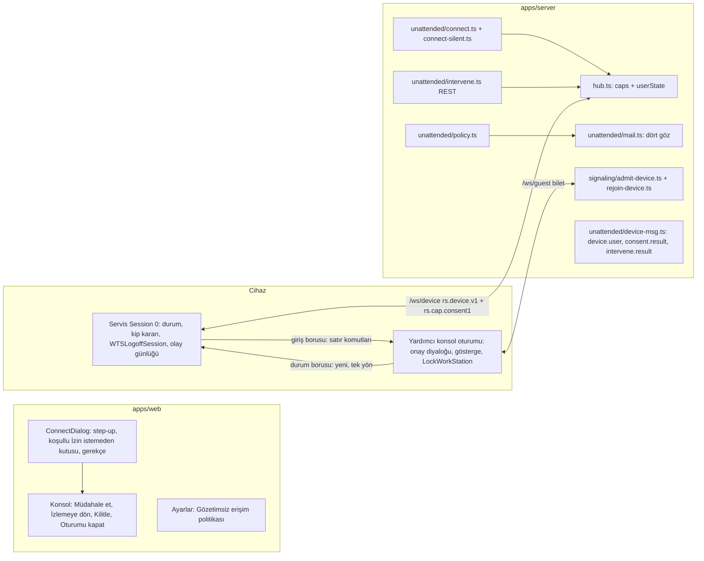

# Mimari — P28u: Gözetimsiz cihazda izinli / izinsiz bağlantı, müdahale (+ P28e kayıt kancaları)

Tarih: 2026-11-16 · **r3 2026-11-18: onaysız tek yol — §r3 önceki bölümleri geçersiz kılar** · Durum: r2 (güvenlik tasarım turu O-P28u-1..3, D-P28u-1..6 işlendi — §r2) · Gereksinim: `docs/gereksinimler-p28u.md` (AC-429..446; AC-447..450 yalnız
kanca) · Bağlam: `docs/mimari-p27.md` (P27 gözetimsiz erişim), `docs/gereksinimler-p28.md` (V45), ADR-0028, **ADR-0033** (bu paket).
Kullanıcı uyurken yazıldı: belirsizlikler en basit güvenli seçenekle **K-P28u-n** kararı olarak yazıldı (§15); kullanıcıya soru yok.

## 1. Özet ve kısıtlar

P28u, P27'nin "her zaman onaysız" gözetimsiz bağlantısını üç kipe ayırır:

| Kip (`consentMode`) | Ne zaman                                                                | Cihazda                                      | İlk erişim                                  |
| ------------------- | ----------------------------------------------------------------------- | -------------------------------------------- | ------------------------------------------- |
| `asked`             | İzinli istek + cihazda **canlı** durum `active` (oturum açık, kilitsiz) | Onay diyaloğu (60 sn) → izin → gösterge      | P27 gibi (görüntü; "Kontrol iste" otomatik) |
| `no_user`           | İzinli istek + canlı durum `locked` / `none`                            | Diyalog yok → gösterge                       | P27 gibi                                    |
| `silent`            | Politika açık + `unattended.silent` + step-up + gerekçe (AC-437)        | Diyalog yok → gösterge ("Uzaktan izleniyor") | **İzleme**; "Müdahale et" ile kontrol       |

Kısıtlar (değişmez): gösterge her kipte görünür ve çizilemezse bağlantı açılmaz (AC-294, V-PU4, G-17 — gizli izleme yok); yerel
kapatma anahtarı (AC-295) her kipte geçerlidir; pano/yazdırma/ses gözetimsizde kapalı kalır (V45/AC-352, V-PU8); yalnız Windows
servis (P27); tek akış ve tek "Bağlan" diyaloğu (sadelik ilkesi, V-PU3); P27 staging'dedir, prod kapalıdır (AC-297 r3).
Ekran kaydı **kodlanmaz**; yalnız P28e'nin bağlanacağı kanca noktaları tanımlanır (§13).

Yeni teknoloji/bağımlılık **yok** (Go: `golang.org/x/sys/windows` zaten var — `WTSQuerySessionInformation`, `WTSLogoffSession`,
`LockWorkStation`; sunucu/web: mevcut). Yeni env değişkeni **yok**.

## 2. Bileşenler ve akış



**İzinli bağlantı (`ask`) — tek yol:**

1. Konsol "Bağlan" → `ConnectDialog` (kutu işaretsiz) → step-up → `POST /unattended/devices/:id/connect {}`.
2. Sunucu zinciri (§5.1). TX: PENDING oturum (`expires_at = now + 150 sn`, K-P28u-4), step-up tüketimi, audit
   `unattended.connect{consentRequested:"ask"}`. Commit sonrası `connect{…, consent:"ask"}` (§6.2).
3. Servis canlı durumu okur (§7.2): `active` ise kip `asked`, değilse `no_user` (**cihaz karar verir**, K-P28u-2). Yardımcıyı
   `Input.Consent = "ask" | "none"` ile başlatır.
4. `asked`: yardımcı **göstergeden ve `/ws/guest`'ten önce** onay diyaloğunu Default masaüstünde çizer (§7.3). Karar durum
   borusuyla servise → `consent.result{mode:"asked", decision, ms}` → sunucu audit `unattended.consent` + metrik.
   - `granted`: yardımcı göstergeyi çizer/doğrular → `/ws/guest` (P27 adım 4–5 aynen).
   - `denied` / `timeout`: yardımcı çıkış kodu `ExitConsentDenied` / `ExitConsentTimeout` → servis
     `connect.result{ok:false, reason:"consent_denied"|"consent_timeout"}` → oturum `CANCELLED(<neden>)`, konsola `session.ended`.
5. `no_user`: servis hemen `consent.result{mode:"no_user"}` gönderir; yardımcı P27 gibi gösterge → `/ws/guest`.
6. `admitDeviceGuest`: `ask` odasında `room.unattended.consent` = `granted` ya da `no_user` kaydı **yoksa** kabul etmez
   (`CANCELLED(consent_missing)`, K-P28u-3). Başarıda `support_sessions.consent_mode` yazılır, audit `unattended.session.started
{consentMode}` (AC-445 "başlangıç satırı").

**İzinsiz bağlantı (`silent`):** 1'de kutu işaretli + gerekçe → `POST …/connect {silent:true, reason}`; zincir ek adımları (§5.1);
TX PENDING 60 sn, `consent_mode='silent'`, `silent_reason`; audit `unattended.connect{consentMode:"silent", silentReason}`; commit sonrası
dört göz e-postası (§9.2) ve `connect{consent:"silent", indicatorView, indicatorControl}`. Servis diyalog göstermez (canlı durum ne
olursa olsun); yardımcı gösterge metni "Uzaktan izleniyor: <ad> — <firma>" ile başlar. Teknisyen "Müdahale et" (web onay
diyaloğu) → mevcut `control.request` → yardımcı otomatik GRANTED (P27) → gösterge "Uzaktan kontrol: …" (≤ 1 sn), audit
`unattended.control_toggle`. "İzlemeye dön" → mevcut teknisyen kontrol bırakma → gösterge geri döner, audit.

**Müdahale:** kontrol açıkken konsol düğmeleri → `POST /sessions/:id/unattended/{lock|logoff}` → sunucu denetler (§5.3) →
`/ws/device intervene{…}` → servis: `lock` → giriş borusuyla yardımcıya, yardımcı `LockWorkStation`; `logoff` → servis
`WTSLogoffSession` → yeni konsol oturumunda **yeniden katılım** (§7.5) → giriş ekranı görüntülenir. `asked` odasında yeniden
katılımdan sonra konsolda bir kullanıcı oturum açarsa oda `session_changed` ile biter (onay aklama yok, K-P28u-17).

## 3. Veri modeli — migration `20261124000000_p28u_unattended_consent` (dba)

Sıra: P28b'nin `20261123000000_p28b_stored_files`'ından sonra. Expand-only; tetikleyici yok (`REMOTE_EXPECTED_TRIGGERS` değişmez);
enum'lar ikili CHECK (ADR-0014). Yeni tablo **yok** → `grants.sql` değişmez (mevcut tablolara sütun).

### 3.1 `tenant_settings` (AC-436)

| Sütun                       | Tip                          | Not                                                                                     |
| --------------------------- | ---------------------------- | --------------------------------------------------------------------------------------- |
| `unattended_silent_enabled` | `BOOLEAN NOT NULL DEFAULT 0` | Politika anahtarı; yalnız `PUT /unattended/policy` değiştirir                           |
| `unattended_silent_ack_at`  | `DATETIME(3) NULL`           | Aydınlatma kutusunun son işaretlendiği an (açarken yazılır, kapatınca **korunur** — iz) |
| `unattended_silent_ack_by`  | `CHAR(26) NULL`              | FK `users(id)`; P16 kullanıcı silmede NULL'lanır (`tenant-purge-parts` / user-delete)   |

CHECK `tenant_settings_silent_ack_chk`: `unattended_silent_enabled = 0 OR unattended_silent_ack_at IS NOT NULL` (açık politika
aydınlatma izi olmadan var olamaz). `IX(unattended_silent_ack_by)` (FK).

### 3.2 `support_sessions` (AC-445, 446, 431)

| Sütun           | Tip                 | Not                                                                                                       |
| --------------- | ------------------- | --------------------------------------------------------------------------------------------------------- |
| `consent_mode`  | `VARCHAR(8) NULL`   | `asked` \| `no_user` \| `silent`; `silent` connect TX'inde, diğerleri admit TX'inde yazılır               |
| `silent_reason` | `VARCHAR(500) NULL` | Yalnız `silent`; kişisel veri olabilir → **anonimleştirmede NULL** (audit kopyası audit saklamasına tabi) |

CHECK'ler (tek ALTER, COPY — süre `docs/db-notlari.md` "P28u"; P19/P27 kalıbı):

- `support_sessions_consent_mode_chk`: `consent_mode IS NULL OR CAST(consent_mode AS BINARY) IN ('asked','no_user','silent')`.
- `support_sessions_consent_mode_dev_chk`: `consent_mode IS NULL OR device_id IS NOT NULL OR anonymized_at IS NOT NULL`.
- `support_sessions_silent_reason_chk`: `silent_reason IS NULL OR (consent_mode = 'silent' AND CHAR_LENGTH(silent_reason) BETWEEN 20 AND 500)`.
- `support_sessions_ttl_chk` **yeniden tanım** (K-P28u-4): talep oturumu (`request_id IS NOT NULL`) 55..65 sn aynen; cihaz oturumu
  (`device_id IS NOT NULL`) **55..155 sn**; anonim satır kuralı aynen. Sunucu: `ask` → 150 sn, `silent` → 60 sn
  (`DEVICE_CONNECT_WINDOW_MS` + yeni `DEVICE_CONSENT_WINDOW_MS = 150_000`, `connect-tx.ts`).

İndeks: yeni indeks **yok** (geçmiş filtresi mevcut `IX(tenant_id, …)` + satır süzgeci; zaman çizelgesi mevcut audit
`IX(tenant_id, entity, entity_id, created_at)`). Kullanıcı durumu (`active/locked/none`) **DB'ye yazılmaz** — hub belleği (§6.3,
K-P28u-6).

### 3.3 Silme / anonimleştirme / geri alma

| Veri                         | Kural                                                                                                                                                                                                                |
| ---------------------------- | -------------------------------------------------------------------------------------------------------------------------------------------------------------------------------------------------------------------- |
| `silent_reason`              | Oturum anonimleştirme TX'inde (P13a/P16 mevcut adım) `NULL`; `consent_mode` kalır (kişisel değil)                                                                                                                    |
| `ack_by`                     | Kullanıcı silme (P16) → `NULL`; firma silme → satır zaten silinir                                                                                                                                                    |
| Audit (`silentReason` dahil) | 730 gün mevcut saklama; silinmez/düzenlenmez (ortak standart §1.1)                                                                                                                                                   |
| `down.sql`                   | Sütunlar düşer, TTL CHECK eski haline. `precheck.sql`: `consent_mode IS NOT NULL` ya da `expires_at-created_at > 65` olan cihaz satırı varsa uyarı (önce `UNATTENDED_MODE=off` + açık oturumların bitmesi — runbook) |

Prisma: `TenantSettings` + 3 alan, `SupportSession` + 2 alan (`consentMode String? @db.VarChar(8)`, `silentReason String? @db.VarChar(500)`).
Seed değişmez (varsayılan kapalı).

## 4. Yetki

`packages/contracts/src/permissions.ts` tek kaynak (AC-285, AC-446):

```ts
{ key: "unattended", actions: ["connect", "manage", "silent"] },
// PERMISSION_DESCRIPTIONS["unattended.silent"] = "İzin istemeden bağlanma (hassas — yalnız gerekene verin). Firma politikası,
//   cihaz yetkisi ve 2FA ayrıca gerekir."
```

Rol varsayılanı ortak standart (Admin açık, User kapalı — V-PU10); asıl kapı varsayılan kapalı politikadır. Toggle ekranı
`PermissionMatrix` açıklama satırını `TriangleAlert` (uyarı tonu) ile gösterir (AC-404 kalıbı). Admin kendinde olmayanı veremez
(mevcut). Müdahale düğmeleri için yeni yetki **yok** (V-PU7): `unattended.connect` + cihaz grant'ı + oturumun teknisyeni olmak.
P28c notu: izinsiz odaya davet/izleme katılımı `unattended.silent` ister (P28c kendi zincirine ekler; P28u'da kod yok).

## 5. REST API sözleşmesi (`/api/v1`; zod `packages/contracts/src/api/unattended.ts`)

Ortak: hata zarfı, CSRF, `requireAuth`, `tenantScope`, `requirePerm`, `requireStepUp` mevcut. **Doğrulama hatası mevcut
`VALIDATION` (400, `fields`) zarfıyla döner** — AC-436/437'deki "422" ifadesi projede bulunmayan bir koddur (K-P28u-12, gereksinim
revizyon notu; test alan hatasını `fields.reason` / `fields.ack` ile doğrular).

Yeni hata kodları (`packages/contracts/src/errors.ts`, Türkçe metin `apps/web/lib/errors.ts`):

| Kod                 | HTTP | Metin                                                                    |
| ------------------- | ---- | ------------------------------------------------------------------------ |
| `DEVICE_OUTDATED`   | 409  | "Cihazdaki servis güncel değil — güncelleyin"                            |
| `SILENT_DISABLED`   | 409  | "Firma politikası izin istemeden bağlanmaya izin vermiyor"               |
| `INTERVENE_PENDING` | 409  | "Önceki komut henüz tamamlanmadı"                                        |
| `INTERVENE_FAILED`  | 502  | "Cihaz komutu uygulayamadı" (`details.reason`: `timeout`/`not_locked`/…) |

### 5.1 `POST /unattended/devices/:id/connect` (değişir; AC-430, 434, 435, 437)

Girdi: `z.strictObject({ silent: z.literal(true).optional(), reason: silentReasonSchema.optional() }).refine(silent ⇔ reason)`;
`silentReasonSchema` = trim, 20..500 karakter (kod noktası), kontrol karakteri yok (`\n` hariç; `UNSAFE_NAME_CHARS` kalıbı).
Çıktı `{ sessionId }` aynı.

Zincir (P27 §4.3 sırası korunur; **yeni adımlar kalın**; ilk başarısız döner, her ret `unattended.connect{result:fail, failReason,
mode}` audit + metrik):

| #      | Denetim                                                                                                                  | Hata                                 |
| ------ | ------------------------------------------------------------------------------------------------------------------------ | ------------------------------------ |
| 1–2    | oturum/tenant, `unattended.connect`                                                                                      | 401/403                              |
| **2a** | `silent` ise `unattended.silent`                                                                                         | 403 `FORBIDDEN`                      |
| **2b** | `silent` ise tenant politikası açık                                                                                      | 409 `SILENT_DISABLED`                |
| —      | kullanıcı kovası 20/sa (mevcut)                                                                                          | 429                                  |
| **2c** | `ask` ise teknisyen×cihaz kovası **60 sn'de 1** (`FixedWindowCounter`, anahtar `userId:deviceId`; cihaza mesaj gitmeden) | 429 `RATE_LIMITED` (`retryAfterSec`) |
| 3      | cihaz + grant                                                                                                            | 404                                  |
| 4      | step-up var                                                                                                              | 401/403                              |
| 5–7    | yerel anahtar, adres, SMTP, imza kapısı (aynen)                                                                          | 409                                  |
| 8      | çevrimiçi                                                                                                                | 409 `DEVICE_OFFLINE`                 |
| **8a** | hub'daki soket `rs.cap.consent1` bildirmiş                                                                               | 409 `DEVICE_OUTDATED`                |
| 9      | açık/bekleyen gözetimsiz oturum yok (bekleyen onay diyaloğu = PENDING satır → kapsanır)                                  | 409 `DEVICE_BUSY`                    |
| 10     | TX (P27 r2 sırası) + **politika ve `unattended.silent` TX içinde yeniden** (`tenant_settings` `FOR SHARE`)               | 409 / 403 / 401                      |

Kova 2c yalnız `ask` için (AC-434 "izinli istek"); `silent` diyalog açmaz. 2c'de yalnız **okunur** (`blockedFor`); sayaç
(`hit`) ancak TX başarıyla bittiğinde, cihaza `connect` gönderilirken artar. Böylece web'in olağan "401 step-up → bir kez yinele"
akışı 429'a düşmez; diyalog seli yine imkânsızdır (TX başarısı = cihaza giden tek istek). Step-up 2a–2c, 8a'da tüketilmez.

Alan adları (D-P28u-4, K-P28u-20): REST gövdesindeki `reason` ve DB sütunu `silent_reason` değişmez; **audit** `new_value`'da gerekçe
`silentReason`, ret kodu `failReason` adını taşır (aynı anahtar iki anlam taşımaz; maskeleme/filtre ayırt eder).

Dosyalar: `connect.ts` 157 satır → `silent` zinciri ve gerekçe ayrı dosya `unattended/connect-silent.ts` ("dokunan böler").

### 5.2 Politika (AC-436)

| Uç                       | Yetki                                                                             | Girdi                                    | Çıktı / hata                                                                                                                                                                                |
| ------------------------ | --------------------------------------------------------------------------------- | ---------------------------------------- | ------------------------------------------------------------------------------------------------------------------------------------------------------------------------------------------- |
| `GET /unattended/policy` | `unattended.manage` ∧ `settings.view`                                             | —                                        | `{ silentEnabled, ackAt, ackByName }`                                                                                                                                                       |
| `PUT /unattended/policy` | `unattended.manage` ∧ `settings.edit`; açarken step-up (tüketmez, 5 dk penceresi) | `{ silentEnabled: boolean, ack?: true }` | 200 görünüm. `false→true`: `ack !== true` → 400 `VALIDATION{fields.ack}`; step-up yok → 401 `MFA_STEP_UP_REQUIRED`. `true→false` step-up istemez (güvenli yön). Aynı değer → 200, audit yok |

TX: `tenant_settings` `FOR UPDATE` → yaz → audit `settings.unattended_silent{old,new,ack:true}`. Commit sonrası: (a) kapatıldıysa
`rooms.finishSilent(tenantId, "permission")` (§8.4); (b) dört göz e-postası (§9.2). `GET /unattended/status` yanıtına
`silentAllowed: boolean` (= politika ∧ çağıranda `unattended.silent`) eklenir — `ConnectDialog` kutuyu buna göre çizer (AC-430);
sunucu yine zincirde zorlar.

### 5.3 Müdahale (AC-442..444)

| Uç                                     | Girdi               | Çıktı                               |
| -------------------------------------- | ------------------- | ----------------------------------- |
| `POST /sessions/:id/unattended/lock`   | `{}`                | 200 `{ ok: true }`                  |
| `POST /sessions/:id/unattended/logoff` | `{ confirm: true }` | 200 `{ ok: true, rejoin: boolean }` |

Ön koşul (sırayla, `unattended/intervene.ts`): `unattended.connect` (403) → oturum bu tenant'ta (404) → çağıran oturumun teknisyeni
(403) → oda canlı ∧ `room.unattended` (katılımlı oda → **403 `FORBIDDEN`**, AC-442 testi) → cihaz grant'ı hâlâ var (404) →
oda kontrol durumu `GRANTED` (izleme kipi → 403) → cihaz `consent1` (409 `DEVICE_OUTDATED`) → bekleyen komut yok
(409 `INTERVENE_PENDING`) → oda başına 6/dk kova (429). Sonra `hub.send(intervene{sessionId, id: ulid, cmd})`, yanıt
`intervene.result` beklenir (kilit 5 sn, oturum kapatma 15 sn); süre aşımı → 502 `INTERVENE_FAILED{reason:"timeout"}`. Her sonuç
audit `unattended.lock` / `unattended.logoff` `{deviceId, result, failReason?, durationMs}` (başarısız dahil) + metrik. Onay
diyaloğu (oturum kapatma) web'dedir; sunucu `confirm: true` ister (yanlışlıkla API çağrısına karşı).

### 5.4 Diğer değişen uçlar

- `GET /unattended/devices` / `:id`: `DeviceListItem` + `userState: "active"|"locked"|"none"|null` (çevrimdışı/eski servis → `null`;
  yalnız grant'lı cihaz, hiçbir dışa aktarım/audit'te yok — D-P28u-6);
  `connectBlockedReason` + `"outdated"`; `canConnect` hesabına `consent1` eklenir.
- `GET /sessions/:id` (geçmiş detay, `session_history.view`, mevcut kapsam; başka tenant 404): `unattended?: { consentMode,
silentReason? (yalnız silent), timeline: { at, kind: "consent"|"control_on"|"control_off"|"lock"|"logoff"|"rejoin", result?, decision?, ms? }[] }`
  — audit satırlarından (`entity='support_sessions'`, `entity_id`, eylem kümesi; mevcut indeks) ≤ 200 satır.
- `GET /sessions` (geçmiş listesi) satırına `consentMode`; filtre parametresi `consentMode?` (P27 mod filtresinin yanında).
- `GET /audit` filtresi `consentMode?: asked|no_user|silent` → `new_value->'$.consentMode'` eşitliği (Prisma JSON path; mevcut
  `tenant+created_at` indeksiyle sayfalı). Kipi taşıyan eylemler: `unattended.connect` (yalnız silent), `unattended.consent`,
  `unattended.session.started/ended`, `unattended.control_toggle`, `unattended.lock/logoff`. Reddedilen/zaman aşımlı istekler
  `unattended.consent{consentMode:"asked"}` ile filtrede görünür (AC-445).

## 6. Protokol değişiklikleri

### 6.1 Yetenek bildirimi ve geri uyum (`/ws/device`, `"v":1` kalır)

- Servis (0.15.0) upgrade'de alt protokol listesine `rs.cap.consent1` ekler (`rs.device.v1` yanında). Sunucu `precheck` yalnız
  `includes(rs.device.v1)` baktığı için **eski sunucu yeni servisi kabul eder** (geri alma güvenli). Yeni sunucu belirteci
  `DeviceConn.caps`'e yazar (P28a `rs.cap.*` kalıbı; bilinmeyen yok sayılır). Belirteç kimlik değildir; Caddy loglamaz (G-10).
- Sunucu `device.ready`'den hemen sonra **yalnız belirteci bildiren** sokete `device.features{caps:["consent1"]}` gönderir.
  `device.ready` şeması **değişmez** (eski Go ayrıştırıcısı strict — yeni alan eski servisi koparırdı).
- Servis yeni C→S mesajlarını (§6.2) **yalnız `device.features` aldıktan sonra** gönderir. Böylece geri alınmış (eski) sunucuya
  bilinmeyen mesaj gitmez (1008 döngüsü yok, K-P28u-8). Eski sunucuda servis P27 davranışında kalır (onaysız — eski sunucu zaten
  P27'dir; gizlilik gerilemesi runbook §28u'da yazılı, §14.1).
- **Fail-closed (D-P28u-5):** `device.features` alınmış bir sokette gelen `connect`'te `consent ∉ {ask, silent}` (Go'da eksik alan
  `""`) → yardımcı başlatılmaz, `connect.result{ok:false, reason:"protocol"}` (servis birim testi). `protocol` yalnız DB bitiş
  nedenidir (P27 K3 kalıbı, `helper_failed` gibi); konsola `device_timeout` metni gider.
- Eski servise (belirteç yok) hiçbir yeni S→C mesajı gitmez; bağlantı 409 `DEVICE_OUTDATED` (AC-435).

### 6.2 Yeni / değişen mesajlar (`packages/contracts/src/ws-device.ts`, Go eşi `internal/servis/wire.go`, fikstür `fixtures/ws-device.json`)

| Yön   | Mesaj                                                                                                                                | Anlam                                                                                                                                                             |
| ----- | ------------------------------------------------------------------------------------------------------------------------------------ | ----------------------------------------------------------------------------------------------------------------------------------------------------------------- |
| S → C | `device.features{caps: ("consent1")[]}`                                                                                              | §6.1                                                                                                                                                              |
| S → C | `connect{…mevcut, consent: "ask"\|"silent", indicatorControl?: string}`                                                              | yalnız `consent1` cihaza gider → alanlar **zorunlu** (`consent`), `indicatorControl` yalnız silent'ta zorunlu. silent'ta `indicatorText` = "Uzaktan izleniyor: …" |
| C → S | `device.user{state: "active"\|"locked"\|"none"}`                                                                                     | §7.2; değişimde (500 ms debounce) + her `device.features` sonrası bir kez; cihaz başına 5 msg/sn kovası aynen                                                     |
| C → S | `consent.result{sessionId, mode: "asked"\|"no_user", decision?: "granted"\|"denied"\|"timeout", ms?: 0..65000}`                      | `asked` ⇔ decision+ms zorunlu; `no_user` ⇔ yok. Oturum başına tek; ikinci → yok sayılır + log                                                                     |
| S → C | `intervene{sessionId, id: ulid, cmd: "lock"\|"logoff"}`                                                                              | §5.3                                                                                                                                                              |
| C → S | `intervene.result{sessionId, id, cmd, ok, reason?: "no_session"\|"not_in_control"\|"not_locked"\|"no_user"\|"api_error"\|"timeout"}` | `ok:false` ⇔ reason                                                                                                                                               |
| S → C | `rejoin{sessionId, ticket, mode, indicatorText, indicatorControl?, expiresInSec: 1..30}`                                             | §7.5; yalnız başarılı `logoff` sonucundan sonra, oturum başına en çok 1                                                                                           |
| C → S | `connect.result.reason` + `consent_denied`, `consent_timeout`, `protocol`                                                            | `DEVICE_CONNECT_FAIL_REASONS` genişler (`protocol`: D-P28u-5)                                                                                                     |

`ws.ts` `SESSION_ENDED_REASONS` + `consent_denied`, `consent_timeout`, `consent_missing` (konsol metinleri: "Kullanıcı bağlantıyı
reddetti", "Kullanıcı yanıt vermedi", "Cihaz onay sonucunu bildirmedi"). `device.user`/`consent.result` sunucu doğrulaması:
`sessionId` bu cihazın canlı odası değilse yok sayılır + `rs_unattended_device_msg_rejected_total` (cihaz başka cihazın oturumunu
etkileyemez).

### 6.3 Hub (`unattended/hub.ts`)

`DeviceConn` + `caps: ReadonlySet<"consent1">`, `userState?: "active"|"locked"|"none"`, `userStateAt`. Soket kapanınca silinir
(liste `null` gösterir). `hub.userState(id)`, `hub.has(id,"consent1")`. Bekleyen müdahale: `pendingIntervene: Map<sessionId, {id,
cmd, resolve, timer}>`. hub.ts 183 satır → +30'dan fazla eklenirse `hub-intervene.ts`'e bölünür.

### 6.4 `/ws/tech` ve `/ws/guest`

- Teknisyen `hello.unattended` + `consentMode`, `intervene: boolean` (cihaz `consent1`). Konsol düğmeleri bu alanlara göre.
- `/ws/guest` **değişmez** (yardımcı yeni mesaj göndermez; kip ve gösterge metni boruyla gelir).
- Sunucu, `silent` odada kontrol `GRANTED` değilken teknisyenden gelen `file.meta`/dosya teklifi sinyalini reddeder
  (`FORBIDDEN` + metrik) — G-09 "caps yalnız daralır" kuralı bozulmadan kontrol durumuna bağlı kapı (K-P28u-9).

## 7. Windows tarafı (Go, `apps/agent-win`) — R-PU3 çözümü

### 7.1 Karar: onay diyaloğunu **yardımcı** çizer (ADR-0033, K-P28u-1)

| Seçenek                                                                | Sonuç                                                                                                                                                                                                                                                                                                                         |
| ---------------------------------------------------------------------- | ----------------------------------------------------------------------------------------------------------------------------------------------------------------------------------------------------------------------------------------------------------------------------------------------------------------------------- |
| **A. Yardımcı (SYSTEM, konsol oturumu), gösterge bileşeninin kardeşi** | **Seçildi.** Masaüstü izleme (K6b), kısıtlı jeton, job, derleme sınırı zaten var. Pencere System bütünlüğünde → kullanıcı düzeyindeki (Medium IL) bir süreç UIPI nedeniyle ona ileti gönderemez / `SendInput` ile tıklayamaz. Diyalog kararından önce `/ws/guest` hiç açılmaz → AC-431 "kare/girdi 0" yapısal olarak sağlanır |
| B. Tepsi süreci (`--tray`, kullanıcı jetonu)                           | Ret: oturum açan her kullanıcının jetonunda çalışır → aynı kullanıcıdaki zararlı yazılım pencereyi tıklar/sahte yanıt verir; tepsi kapalı/gizli olabilir; servis→tepsi yönünde yeni boru gerekir                                                                                                                              |
| C. Servis `WTSSendMessage`                                             | Ret: 1,5 sn kilit, enjekte tıklama süzgeci, geri sayım, odak kuralı (AC-116) uygulanamaz                                                                                                                                                                                                                                      |

P27 §5.2 m.4 / AC-341 ile uyum: yasak **`MessageBox`, URL/e-posta açma, dosya seçici, `ShellExecute`, `internal/ui` paketi**dir; bu
yasak aynen kalır. Diyalog, gösterge gibi yardımcının kendi paketinde, `internal/win` ham Win32 çağrılarıyla çizilen **tek amaçlı**
penceredir (yeni dosya `internal/unattended/helper/consent_windows.go` ≤ 250 satır + platformdan bağımsız `consent.go` karar
mantığı). P27 §5.2 m.4'teki "gösterge dışında hiçbir pencere/diyalog yok" cümlesi ve `helper/helper.go` paket yorumu "gösterge ve onay
diyaloğu dışında" olarak güncellenir (ADR-0033; belge K11, yorum K6). `boundary_test.go` yasak listesi (`internal/ui`, `internal/tray`,
`internal/servis` kök paketi, `os/exec`, `MessageBox`, `ShellExecute`, dosya seçiciler …) korunur ve **genişler**:
`ChangeWindowMessageFilter`, `ChangeWindowMessageFilterEx` eklenir (çağrılırsa UIPI delinir — D-P28u-1); diyaloğun ihtiyacı olan
`internal/win` pencere/çizim yordamları, `internal/control` ve `internal/servis/helperio` zaten izinlidir. **Yeni test**
(`helper/windows_test.go`, K6): yardımcı paketinde `RegisterClassEx` çağrılarının sınıf adı kümesi = {`NoktaDestekGosterge`,
`NoktaDestekOnay`} (AST taraması) — üçüncü bir pencere eklenemez.

### 7.2 Servis: kullanıcı durumu (AC-429) ve kip kararı

- Kaynak: `SERVICE_CONTROL_SESSIONCHANGE` (`svc` `AcceptSessionChange`; `WTS_SESSION_LOCK/UNLOCK/LOGON/LOGOFF`,
  `WTS_CONSOLE_CONNECT/DISCONNECT`) **olay** + doğrulama okuması `WTSQuerySessionInformation(WTSGetActiveConsoleSessionId(),
WTSSessionInfoEx)` → `SessionFlags` (`WTS_SESSIONSTATE_LOCK` / `UNLOCK`) ve `UserName`. Kural: konsol oturumu yok ∨ kullanıcı adı
  boş → `none`; LOCK → `locked`; aksi → `active`. Okunamazsa **`active`** (onay sormaya meyilli, gizlilik yönünde fail-safe).
- Yeni dosyalar: `internal/servis/userstate.go` (saf karar + debounce 500 ms, Linux birim test), `userstate_windows.go` (WTS).
- Gönderim: değişimde + `device.features` alındığında; ≤ 1 sn. Panel yoklaması (§10) ile uçtan uca ≤ 10 sn (AC-429).
- **Kip kararı cihazdadır (K-P28u-2):** `connect.consent="ask"` geldiğinde servis o anki durumu okur: `active` → yardımcıya
  `Consent:"ask"`; `locked`/`none` → `Consent:"none"` ve hemen `consent.result{mode:"no_user"}`. `consent="silent"` → `Consent:"none"`,
  `consent.result` gönderilmez (sunucu kipi zaten biliyor). Sunucunun son bildirilen durumu yalnız panel içindir; eski kalmış
  durum gizlilik aleyhine kullanılamaz.

### 7.3 Onay diyaloğu (AC-431, 432; AC-116 kalıbı)

- **Masaüstü:** yalnız `Default` giriş masaüstünde çizilir; `Winlogon`/UAC/ekran koruyucuda **asla** (kilit ekranı sahteciliği ve
  güvenli masaüstüne pencere sokma yok). Geri sayım sürerken giriş masaüstü değişirse (UAC açıldı, kullanıcı kilitledi) diyalog
  gizlenir, sayaç **durmaz**; `Default`'a dönülürse yeniden gösterilir ve 1,5 sn kilit yeniden başlar; süre dolarsa `timeout`.
- **Konum/odak:** birincil monitör ortası, fare imlecinin altında açılmaz (imleç alanı dışlanır), `WS_EX_TOPMOST`, 1 sn'de bir en
  üste; varsayılan odak **Reddet**; Esc / pencere kapatma = Reddet.
- **Örtülme kuralı (O-P28u-1, K-P28u-18; Android `filterTouchesWhenObscured` kalıbı):** UIPI yalnız enjeksiyonu kapatır; kullanıcı
  oturumundaki bir süreç diyaloğun üstüne kendi `WS_EX_TOPMOST | WS_EX_LAYERED | WS_EX_TRANSPARENT` penceresini koyup fiziksel
  tıklamayı "İzin ver"e geçirebilir. Bu yüzden: (1) her 250 ms'de ve her tıklama anında `GetWindow(GW_HWNDPREV)` zinciri
  (diyalogdan z-sırasında yukarı) gezilir; diyalog dikdörtgenini kesen **görünür** (`IsWindowVisible`, sıfır olmayan alan; katmanlı/
  saydam pencereler **dahil**) bir pencere varsa diyalog "örtülü"dür. İstisna yalnız kendi gösterge pencerelerimizdir ve **HWND
  kümesiyle** (yardımcının oluşturduğu tanıtıcılar) belirlenir, sınıf adıyla değil. (2) Örtülüyken "İzin ver" pasif çizilir ve
  "Pencerenin üstünde başka bir pencere var" satırı gösterilir; örtülme kalkınca 1,5 sn kilit **yeniden başlar** (ilk gösterimdeki gibi).
  (3) Tıklama anında ek olarak `WindowFromPoint(pt)` = "İzin ver" düğmesi doğrulanır (savunma derinliği; `WS_EX_TRANSPARENT`
  pencereleri atlayabileceği için asıl denetim (1)'dir — K6s spike sorusu 4). (4) Reddet her zaman etkin (güvenli yön). Karar mantığı
  platformdan bağımsız `internal/control/occlusion.go` (sahte z-sırası ile birim test); Win32 gezintisi `consent_windows.go`. Bu
  paket P20 katılımlı onay penceresine de taşınabilecek genişleme noktasıdır (Sonra, S-P28u-6).
- **İzin ver kuralı:** mevcut `internal/control.Consent` (`ShownAt`, `ArmDelay` 1,5 sn, `Check(now, trigger, injected)`) aynen;
  Enter/Space "İzin ver"i tetiklemez; enjekte fare/klavye olayı mevcut mekanizmayla yok sayılır: `internal/win` `GetCurrentInputMessageSource` okuması +
  platformdan bağımsız `control.OriginInjected` / `control.CharInjected` (bugün `ui/consent_windows.go`'nun kullandığı, `internal/ui`
  dışındaki kod); enjekte tıklamada `control.InjectedWarning` satırı gösterilir (0.8.1 kalıbı). Klavye yolu (a11y): Tab ile "İzin ver"e geçilip **Alt+V** erişim tuşu (`İzin &ver`; P28a
  `hotkeyOK` kalıbı) — yalnız fiziksel tuş, 1,5 sn sonra.
- **İçerik:** başlık "Uzaktan bağlantı isteği"; gövde "<teknisyen adı> (<destek firması>) bilgisayarınıza bağlanmak istiyor.";
  "Kalan süre: NN sn"; düğmeler "Reddet" / "İzin ver". Metin girişi, bağlantı, dosya denetimi **yok**. **Destek firması** (D-P28u-6) = `connect.tenantName`; sunucu
  bunu `tenants.name`'den üretir, teknisyenin düzenleyebildiği hiçbir alandan gelmez; diyalogda ad ile firma ayrı ve firma kalın
  satırda gösterilir ("Bilgi İşlem — Acil Güvenlik" gibi bir görünen ad firma yerine geçemez; ad değişikliği zaten audit'te). Ad/firma
  `helperio.Text(…, 120)` ile süzülür (kontrol/çift yönlü karakter yok — sahte metin). Metinler `flow/messages_p28u.go` (tek tablo, P23).
- **Kanca (P28e, AC-449):** `ConsentSpec.RecordingLine string` — boş değilse gövdeye satır eklenir ve satır görünmeden "İzin ver"
  etkinleşmez. P28u'da her zaman boş; alan P28e'de eklenir (§13).
- **Zaman:** servis `connect` alır almaz yardımcıyı başlatır; diyalog ≤ 3 sn (AC-431 bütçesi: sunucu → servis < 100 ms, süreç başlatma
  ~300 ms, pencere ~100 ms). 60 sn yardımcı içi sayaç; sunucu PENDING 150 sn (izin sonrası gösterge + `/ws/guest` için pay).
- **Yanıt süresi `ms`:** diyalog ilk görünürden karara; `consent.result` ile sunucuya.

### 7.4 Servis ↔ yardımcı kanalı

- **Giriş borusu** (mevcut, servis → yardımcı): ilk satır `helperio.Input` JSON (yeni alanlar: `Consent "ask"|"none"`,
  `IndicatorControl string` (silent), `Mode "asked"|"no_user"|"silent"`); **sonraki satırlar komut**: `{"cmd":"lock","id":"…"}`.
  Boru açık kalır; servis kapatırsa yardımcı mevcut davranışla sürer. `DisallowUnknownFields` korunur (iki uç aynı ikili).
- **Durum borusu** (YENİ, yardımcı → servis, anonim, tek yön): satır JSON ≤ 512 B: `{"ev":"consent","decision":…,"ms":…}`,
  `{"ev":"lock","id":…,"ok":…,"reason":…}`. `PROC_THREAD_ATTRIBUTE_HANDLE_LIST` = giriş okuma ucu + **durum yazma ucu** (iki tanıtıcı);
  `boundary`/`launch` testi listeyi denetler (ADR-0033). Servis okuyucusu satır başına boyut ve şema süzer; bozuk satır → yardımcı
  `TerminateProcess` + olay 1004 `helper_protocol`.
- **Olay × durum tablosu (D-P28u-1, K-P28u-19;** servis okuyucusu, `internal/servis/helperstatus.go` saf mantık + Linux birim test):

  | Olay          | Kabul koşulu                                                              | Aksi                                   |
  | ------------- | ------------------------------------------------------------------------- | -------------------------------------- |
  | `ev:consent`  | Yardımcı `Consent=="ask"` ile başlatıldı ∧ henüz karar yok (**bir kez**)  | `helper_protocol` + `TerminateProcess` |
  | `ev:control`  | Karar verilmiş (`granted`) ya da `Consent=="none"`; yalnız değer değişimi | `helper_protocol` + `TerminateProcess` |
  | `ev:lock`     | `id` = servisin bekleyen `lock` komutunun kimliği (tek bekleyen)          | `helper_protocol` + `TerminateProcess` |
  | Diğer / bozuk | —                                                                         | `helper_protocol` + `TerminateProcess` |

  Servisin tuttuğu `control` değeri yardımcı **başlatılırken ve çıkışında** `off`'a sıfırlanır (yeniden katılan yardımcı eski `on`
  değerini devralmaz). Testler: `Consent=="none"` iken `ev:consent` → sonlandırma; ikinci `ev:consent` → sonlandırma; yardımcı çıkışı
  sonrası `intervene{lock}` → `no_session`.

- Yeni çıkış kodları (`helperio`): `ExitConsentDenied 24`, `ExitConsentTimeout 25`; `Reason()` → `consent_denied` / `consent_timeout`.

### 7.5 Müdahale komutları (AC-443, 444)

- **İstemci tarafı ret (AC-442):** yardımcı kontrol her açılıp kapandığında durum borusuna `{"ev":"control","on":bool}` yazar; servis
  son değeri tutar. `intervene` için `sessionId` çalışan yardımcınınki değilse `no_session`, son değer `on:false` ise
  `ok:false, reason:"not_in_control"` (komut uygulanmaz). Katılımlı oturumda servis hiç yoktur (P20 istemcisi bu mesajı tanımaz).
- **Oturumu kilitle:** servis `intervene{lock}` → bu oturumun yardımcısı yoksa `ok:false no_session` → giriş borusuna komut →
  yardımcı (Default masaüstü iş parçacığı) `LockWorkStation()` → masaüstü izleyicisi ≤ 2 sn içinde `Winlogon`'u görürse `ok`, aksi
  `not_locked`. Bağlantı sürer; kilit ekranı K6b masaüstü geçişiyle görüntülenir (AC-274). Gösterge kilit ekranında yeniden doğrulanır.
- **Kullanıcı oturumunu kapat (D-P28u-3):** hedef oturum = **çalışan yardımcının `SessionId`'si** (servis yardımcıyı başlatırken
  kaydeder); `WTSGetActiveConsoleSessionId()` bununla eşit değilse (hızlı kullanıcı değiştirme / konsol geçişi) komut uygulanmaz,
  `ok:false, reason:"no_session"`. Eşitse servis (Session 0, LocalSystem) `WTSLogoffSession(WTS_CURRENT_SERVER_HANDLE, <bu kimlik>,
bWait=FALSE)` — uygulamalar beklenmeden kapanır (zorla, V-PU7). Konsolda kullanıcı yoksa `no_user`. ≤ 10 sn içinde
  `WTS_SESSION_LOGOFF` gelirse `ok`, aksi `timeout`. Kilit için aynı eşleşme kuralı geçerlidir; K-P28u-5b `--lock` geri dönüşünde de
  hedef bu kimliktir, süreç `dllsafe` ilk satırla ve tam yol ile başlatılır.
- **Yeniden katılım (K-P28u-5, r2 tek tanım — D-P28u-2):** süreler tek sabit dosyada (sunucu `unattended/rejoin-const.ts`, Go
  `internal/servis/rejoin.go`): **pencere `REJOIN_WINDOW = 45 sn`, komut gönderildiği/kabul edildiği andan**; **bilet ömrü
  `REJOIN_TICKET_TTL = 30 sn`** (`rejoin.expiresInSec ≤ 30`); yeni konsol oturumu bekleme ≤ 20 sn (spike ile ayarlanır, pencereyi
  aşamaz). Oturum kapanınca yardımcının konsol oturumu yok olur (P27 kuralıyla bu `session_changed` bitişi olurdu). İşaretleme
  komut kabul edildiği anda yapılır (yardımcı `WTS_SESSION_LOGOFF` onayından önce ölür): servis `intervene{logoff}`'u kabul ettiğinde
  `rejoinPending` işaretler, yardımcı çıkışında `session.closed` **göndermez** ve `WTS_CONSOLE_DISCONNECT`'i `session_changed`
  bitişine çevirmez; `rejoinPending` **45 sn sonra kendiliğinden düşer**. Sunucu `intervene{logoff}`'u gönderdiği anda
  `room.unattended.rejoinUntil = now + 45 sn` koyar (misafir kopuşu odayı bitirmez); `rejoinUntil` geçince oda (misafir yoksa)
  `session_changed` ile biter. **`ok:false` ve 15 sn yanıtsızlık (502 `timeout`) aynı temizlik yolunu kullanır:** sunucu
  `rejoinUntil`'i kaldırır; misafir hâlâ bağlıysa oturum sürer, değilse `session_changed`. Yeniden katılan yardımcı oturumun kipini
  korur: `rejoin` mesajı `mode` (`asked`/`no_user`/`silent`) ve silent'ta `indicatorControl` taşır; kontrol **kapalı** başlar
  (servis `control=off`, D-P28u-1; silent'ta izleme kipi, dosya kapısı aynen; teknisyen yeniden "Müdahale et"/"Kontrol iste" der).
  Sunucu `rejoin{ticket (tek kullanımlık, gen+1), indicatorText, expiresInSec:30}` gönderir; servis yeni konsol oturumu belirince
  (500 ms yoklama) yardımcıyı `Consent:"none"` ile başlatır → gösterge → `/ws/guest` → sunucu `rejoinDeviceGuest` (§8.3). Pencerede
  olmazsa oda `session_changed` ile biter ve konsol "Kullanıcı oturumu kapatıldı; bağlantı yeniden kurulamadı" der (oturum kapatma
  yine başarılıdır, audit `result:success, rejoin:false`).
- **`asked` odasında yeni kullanıcı oturumu (O-P28u-3, K-P28u-17 — onay aklama yok):** `asked` onayı yalnız o anki kullanıcıdan
  alınmıştır. Servis `asked` kipli odada `intervene{logoff}`'u kabul ettiği andan itibaren (yeniden katılım penceresi dahil) konsolda
  `WTS_SESSION_LOGON` görürse ya da yeni konsol oturumunda `UserName` boş değilse yardımcıyı sonlandırır ve
  `session.closed{reason:"session_changed"}` gönderir; yeniden katılım henüz olmadıysa yardımcı hiç başlatılmaz. Sunucu odayı
  `endDeviceRoom("session_changed")` ile bitirir (yeni sözleşme değeri yok; mevcut neden ve konsol metni). Teknisyen yeniden
  bağlanırsa kullanıcı aktif olduğundan onay diyaloğu çıkar. **Aynı** kullanıcının yeniden oturum açması da bitirir (sadelik: kimlik
  karşılaştırması yapılmaz). `no_user` (AC-433 "yeni onay istenmez") ve `silent` davranışı **değişmez**. Kalıcı "kilit açılınca / yeni
  oturumda yeniden onay" Sonra'dır (S-P28u-5).
- **Doğrulama (K6s, kod öncesi Windows spike):** (1) `LockWorkStation` kısıtlı SYSTEM jetonlu yardımcıdan Default masaüstünde
  çalışıyor mu; (2) oturum kapatma sonrası konsol oturum kimliği değişiyor mu ve yeni oturum ne kadar sürede görünür; (3)
  `SessionFlags` Windows 10/11'de doğru mu. **Geri dönüş:** (1) başarısızsa kilit servis tarafından `WTSQueryUserToken` +
  `CreateProcessAsUser` ile kullanıcı oturumunda kısa ömürlü `NoktaDestekServis.exe --lock` kipi (yalnız `LockWorkStation`
  çağırıp çıkar; argüman dışında girdi yok) olur — K-P28u-5b; (2) beklenmedikse yeniden katılım ≤ 20 sn bütçesi spike ölçümüne
  göre ayarlanır; (3) yanlışsa `WTSQuerySessionInformation(WTSSessionInfo)` + `OpenInputDesktop` adı yedek kural.
- **Olay günlüğü (AC-444, P27 §5.7 kalıbı; servis yazar):** 1006 oturum kilitlendi (teknisyen, oturum id, sonuç), 1007 kullanıcı
  oturumu kapatıldı (teknisyen, oturum id, sonuç), 1008 bağlantı onayı (karar, kip, teknisyen) — 1001 satırına `kip` eklenir.
  Gerekçe olay günlüğüne **yazılmaz** (cihaz kullanıcısı okuyabilir; denetim kaydı sunucu audit'idir).

### 7.6 Kip ve izleme ↔ müdahale (AC-439)

- Yardımcı `Mode=="silent"` iken: gösterge `IndicatorText` ("Uzaktan izleniyor: …") ile başlar; kendi verdiği
  `control.state{GRANTED}` ile `IndicatorControl`'a, kontrol kapanınca geri döner (aynı pencereler, yalnız etiket yeniden çizilir —
  ≤ 1 sn). `asked`/`no_user` P27 metniyle aynen ("Uzaktan bağlantı: …").
- Girdi: P27'de olduğu gibi kontrol `GRANTED` değilken enjektör kapısı kapalıdır (mevcut `desktop.Gate`/`control.Gate`); birim test
  sayaç 0.
- Dosya: `headless.FileOffer` → `Mode=="silent" && !controlGranted` ise `EvFileReject` (yeni dal). `asked`/`no_user` P27 gibi kabul.
- Sürüm: **0.15.0** (K-P28u-11). Dosya planı §11.

## 7a. Performans ve ölçek kararları

- Kullanıcı durumu yalnız hub belleğinde (DB yazımı yok); cihaz mesajı değişimde + 500 ms debounce.
- Liste yoklaması 15 → 8 sn (yalnız `/unattended` sayfası açıkken; mevcut indeksli sayfalı sorgu) — AC-429.
- Audit "Bağlantı kipi" filtresi JSON yolu eşitliği; mevcut `IX(tenant_id, action, created_at)` ile daraltılıp sayfalanır; yeni indeks
  yok (ölçüm db-notlari; yavaşlarsa genişleme noktası: `audit_logs`'a üretilmiş sütun + indeks, ayrı migration).
- Geçmiş zaman çizelgesi ≤ 200 audit satırı, mevcut `IX(tenant_id, entity, entity_id, created_at)`.
- Dört göz e-postası süreç içi deneme (kuyruk yok); hacim izinsiz bağlantı sayısıyla sınırlı (kullanıcı 20/sa).
- Önbellek yok; ölçek tek instance (ADR-0005) varsayımı değişmez.

## 8. Sunucu: oda, kip, kesme

### 8.1 `admit-device.ts`

- `room.unattended` + `consentMode?: "asked"|"no_user"|"silent"`, `consent?: {decision, ms}`, `rejoinUntil?`, `rejoinTicketGen?`.
- `consent.result` işleyicisi (`device-msg.ts`): oda bu cihazın, PENDING, `ask` ise → `room.unattended.consentMode` + audit
  `unattended.consent{consentMode:"asked", decision, ms, deviceId}` (aktör cihazdır: `user_id` NULL, `username` = `device:<deviceId>`
  — P27 `unattended.device.registered` aktör kalıbı; teknisyen kimliği `newValue.technicianId`'de) + metrik `rs_unattended_consent_total{decision}`; `denied`/`timeout` oda sonucu
  `connect.result` ile gelir. `no_user` → yalnız kip.
- Sıra garantisi: yardımcı `granted` kararını durum borusuna yazdıktan sonra giriş borusunda servisin `{"cmd":"proceed"}` satırını
  bekler (≤ 5 sn, gelmezse `helper_failed`); servis `proceed`'i ancak `consent.result`'u `/ws/device`'a yazdıktan sonra gönderir.
  Ayrıca sunucu admit'te `consentMode` henüz yoksa ≤ 3 sn bekler (aynı oda için tek bekleyen söz). Böylece `/ws/guest` sonucu
  geçemez.
- Admit TX: `ask` odasında `consentMode ∈ {asked(granted), no_user}` değilse `CANCELLED(consent_missing)` (K-P28u-3). Başarıda
  `UPDATE support_sessions SET consent_mode=?` (silent zaten yazılı) + audit `unattended.session.started{consentMode}` (gerekçe
  yalnız `unattended.connect` satırında, D-P28u-4) + outbox (mevcut). **`silent` odasında admit TX'i (O-P28u-2, K-P28u-21):** kilit
  sırası connect TX ile aynı — cihaz `FOR UPDATE` → grant → kapı → **`tenant_settings` `FOR SHARE`** (politika) → çağıran teknisyenin
  `unattended.silent` yetkisi yeniden okunur; politika kapalı ya da yetki yoksa `CANCELLED` + `session.ended("permission")`, audit
  `unattended.session.started{result:fail, failReason:"permission"}`. Bitiş audit'i `unattended.session.ended{consentMode, durationSec}` (mevcut alan + kip).

### 8.2a Kontrol isteği sayacı (AC-116) gözetimsizde

AC-116'nın "oturum başına 5 istek / ret sonrası 30 sn" kuralı kullanıcıyı diyalog selinden korur; gözetimsiz odada kullanıcıya
kontrol diyaloğu gösterilmez. Sınır kalırsa 5 "Müdahale et" ↔ "İzlemeye dön" geçişinden sonra kontrol açılamaz. Karar (K-P28u-16):
`room.unattended` odasında sunucu `control.ts` sayaç/bekleme kuralını uygulamaz; Go `flow/control.go` `s.d.Unattended` iken
`ctlReq.Admit` yerine yalnız "bekleyen istek yok" denetimi yapar. Seli önlemek için oda başına 30/dk kontrol isteği kovası (metrik
`rs_control_total{event="unattended_rate"}`). Dosyalar: K4 (`control.ts`), K6 (`flow/control.go` — tek dal).

### 8.2 Kontrol geçişi audit'i (`control.ts`/`control-revoke.ts`, tek satır kanca)

`room.unattended` odasında kontrol `GRANTED` olduğunda ve kapandığında `unattended.control_toggle{from, to, consentMode}` audit'i
(her kipte; AC-439 yalnız silent ister ama kayıt tek yoldan — sadelik). Kanca `signaling/unattended-control.ts` (yeni, ≤ 60 satır).

### 8.3 `rejoin-device.ts` (yeni)

`intervene{logoff}` gönderilirken `room.unattended.rejoinUntil = now + 45 sn` (§7.5 tek tanım); `intervene.result{logoff, ok}` →
oda canlı ∧ teknisyen hâlâ yetkili → yeni misafir + bilet (`tickets.issue gen+1`, ömür 30 sn) → `hub.send(rejoin)`. `ok:false` ya da
15 sn yanıtsızlık → `rejoinUntil` kaldırılır (tek temizlik yolu). Eski misafirin kopuşu pencerede odayı bitirmez (mevcut misafir kopma
bekleme yolu `rejoinUntil` varken `endDeviceRoom` çağırmaz); pencere dolarsa `endDeviceRoom("session_changed")`. Yeni bilet
`/ws/guest`'e gelince `rejoinDeviceGuest`: aynı TX kilit sırası (cihaz `FOR UPDATE` → grant → kapı) yeniden; **`silent` odada ek olarak
§8.1'deki politika + `unattended.silent` yeniden okuması** (O-P28u-2; değilse `endDeviceRoom("permission")`, audit
`unattended.rejoin{result:fail, failReason:"permission"}`); onay kaydı **yazılmaz**, bildirim **gitmez** (aynı oturum), audit
`unattended.rejoin{result}`; misafir `admitted` olur, teknisyene mevcut `peer.joined`. `asked` odada konsolda yeni kullanıcı oturumu
açılırsa servisin `session_changed` bildirimi odayı bitirir (§7.5, K-P28u-17). Bilet tek kullanımlık, oturuma ve cihaza bağlı, yalnız
sunucunun kendi gönderdiği başarılı `logoff`'tan sonra, oturum başına 1 kez (tehdit T7).

### 8.4 Politika / yetki geri alma (AC-440)

- Anlık (≤ 5 sn): `PUT /unattended/policy` `true→false` commit sonrası `rooms.finishSilent(tenantId, "permission")` — tenant'ın
  `consentMode==="silent"` bellek odaları **ve** (O-P28u-2) DB'de `consent_mode='silent' AND status='PENDING'` satırları tek UPDATE
  ile `CANCELLED(permission)` (henüz `rooms`'a girmemiş ya da `/ws/guest` bekleyen oturumlar kaçmaz; bellekte odası olanlara
  `disconnect{permission}`). `unattended.silent` geri alımında `applyPermChange` aynı iki adımı o teknisyenin oturumlarıyla sınırlı yapar. `unattended.silent` toggle'ı geri alınınca mevcut `applyPermChange` yolu: silent odada teknisyende
  `unattended.silent` yoksa `finishDevice(…, "permission")`.
- Yedek (≤ 60 sn): `revalidateTech` (`ws-auth.ts`) silent odalarda ek koşul: `unattended.silent` ∧ `tenant_settings.unattended_silent_enabled`
  (mevcut tek sorguya sütun eklenir). Test: `finishSilent` no-op sahtesi + sahte saat → ≤ 60 sn kesilme.
- Yarış kapanışı: connect TX commit'i ile oda kaydı arasına `finishSilent` sokulsa da PENDING satır iptal edilir; iptal edilmiş
  satırın admit'i mevcut durum denetimiyle reddedilir; admit/rejoin TX'leri politikayı yeniden okur (§8.1, §8.3). **Entegrasyon testi**
  (`unattended-silent-race.test.ts`): kanca ile connect commit'i sonrası, `rooms` kaydından önce `finishSilent` → oturum açılmaz; aynı
  senaryo yetki geri alma ile; politika kapalıyken bekleyen silent misafirin admit'i → `permission`.

## 9. Audit, bildirim, metrik

### 9.1 Audit (`packages/contracts/src/audit.ts` → `UNATTENDED_AUDIT` ekleri; Türkçe etiketler `api/unattended.ts`)

| Eylem                                         | entity / id                                | Alanlar                                                                                                                                      |
| --------------------------------------------- | ------------------------------------------ | -------------------------------------------------------------------------------------------------------------------------------------------- |
| `unattended.connect` (genişler)               | `support_sessions`                         | + `consentRequested:"ask"` ya da `consentMode:"silent"`, `silentReason` (yalnız silent, **yalnız bu satırda**), fail'de `failReason`, `mode` |
| `unattended.consent` (yeni)                   | `support_sessions`                         | `consentMode:"asked"`, `decision`, `ms`, `deviceId`                                                                                          |
| `unattended.session.started` / `.ended`       | `support_sessions`                         | + `consentMode`; ended'de `durationSec` (mevcut süre)                                                                                        |
| `unattended.control_toggle` (yeni)            | `support_sessions`                         | `from`, `to` (`view`/`control`), `consentMode`                                                                                               |
| `unattended.lock`, `unattended.logoff` (yeni) | `support_sessions`                         | `deviceId`, `result`, `failReason?`, `durationMs`, logoff'ta `rejoin`                                                                        |
| `unattended.rejoin` (yeni)                    | `support_sessions`                         | `result`, `failReason?`                                                                                                                      |
| `settings.unattended_silent` (yeni)           | `tenant_settings` / tenantId               | `old`, `new`, `ack:true`, `stepUp:true`                                                                                                      |
| `unattended.silent.notify` (yeni)             | `support_sessions` ya da `tenant_settings` | `event: "connect" \| "policy"`, `recipient` (maskeli), `result`, `attempt`                                                                   |

Görüntü içeriği hiçbir satıra yazılmaz. Gerekçe audit'te açık metin (denetim konusu; R-PU1 kabulü), log'a (`pino`) **yazılmaz**.
Alan adları (D-P28u-4, K-P28u-20): `silentReason` = kişisel veri olabilen gerekçe (yalnız `unattended.connect`), `failReason` = makine
ret kodu (sabit küme); hiçbir audit satırında çıplak `reason` anahtarı kalmaz (`started`/`ended` gerekçe taşımaz). `userState`
(aktif/kilitli/yok) hiçbir audit satırına ve dışa aktarıma yazılmaz (D-P28u-6; test).

### 9.2 Dört göz e-postası (AC-436, 441)

`unattended/mail.ts` `sendInternalNotice` kalıbı genişler: alıcı = tenant'taki etkin `unattended.manage` sahipleri (bağlanan/değiştiren
hariç); **bu küme boşsa** bağlanan kişinin kendisi + tenant'ın etkin Admin rolündeki kullanıcıları (tekil). Gönderim commit sonrası,
süreç içi 3 deneme (0 / 10 / 30 sn) → ≤ 60 sn; her deneme sonucu `unattended.silent.notify` + `mail.sent` (mevcut). Son deneme de
başarısızsa: audit `result:fail`, metrik `rs_unattended_silent_notify_total{result="fail"}` (runbook alarmı — dört göz kontrolü
çalışmıyor demektir), bağlantı **sürer** (SMTP yapılandırması zaten zincir 6b'de zorunlu). Sunucu yeniden başlarsa bekleyen deneme
kaybolur (ADR-0005 kabulü; audit'te başarı satırı yoksa denetçi görür). İçerik: bağlanan, cihaz, müşteri, saat (Europe/Istanbul),
gerekçe; politika e-postası: değiştiren, eski→yeni, saat. URL yok. **Kaçış (D-P28u-4):** konu satırı sabit metin ("İzin istenmeden
bağlanıldı" / "Gözetimsiz erişim politikası değişti"), gerekçe yalnız gövdede; gövde düz metin, HTML sürümü varsa gerekçe ve tüm
kullanıcı kaynaklı alanlar mevcut HTML kaçış yardımcısından geçer. Tek kişilik tenant'ta alıcının yalnız bağlananın kendisi
olabileceği (dört göz fiilen tek göz) kılavuzda (K11) açıkça yazılır.

### 9.3 Müşteri bildirimi (AC-438)

Outbox satırı değişmez; işçi `UNATTENDED_STARTED` şablonunu işlerken oturumun `consent_mode`'unu okur, `silent` ise
"İzin istenmeden bağlanıldı." satırını ekler (gerekçe **eklenmez**). `notify/templates.ts` tek dal.

### 9.4 Metrikler (`ops/metrics.ts`; tenant etiketi yok)

`rs_unattended_connect_total{mode="ask"|"silent", result}` (mevcut seriye etiket; yeni sonuçlar `silent_disabled`, `outdated`,
`pair_limit`), `rs_unattended_consent_total{decision}`, `rs_unattended_intervene_total{cmd, result}`,
`rs_unattended_silent_notify_total{result}`, `rs_unattended_rejoin_total{result}`, `rs_unattended_device_msg_rejected_total`.
Alarmlar (runbook §28u): `connect_total{mode="silent",result="ok"}` 1 saatte > 5 (uyarı, R-PU2), `silent_notify_total{result="fail"}`
sıfırdan büyük (uyarı), `consent_total{decision="timeout"}` oranı > %50 / gün (bilgi — diyalog görünmüyor olabilir).

## 10. Web (`apps/web`; DESIGN.md token'ları, `lucide-react`, iki tema, 390 px, axe 0, `prefers-reduced-motion`)

| Ekran / bileşen                                                                                              | Yetki                                                             | İçerik                                                                                                                                                                                                                                                                                                                                                                                                                                                                                                                                                                                                                                                                                                                                                                                         |
| ------------------------------------------------------------------------------------------------------------ | ----------------------------------------------------------------- | ---------------------------------------------------------------------------------------------------------------------------------------------------------------------------------------------------------------------------------------------------------------------------------------------------------------------------------------------------------------------------------------------------------------------------------------------------------------------------------------------------------------------------------------------------------------------------------------------------------------------------------------------------------------------------------------------------------------------------------------------------------------------------------------------- |
| `unattended/connect-dialog.tsx` (yeni; `connect-button.tsx` açar)                                            | `connect`                                                         | Tek "Bağlan" diyaloğu (V-PU3): cihaz adı, kullanıcı durumu, "Kullanıcı varsa izin istenir" bilgisi (`Info`). `status.silentAllowed` ise `Checkbox` "İzin istemeden bağlan" (**her açılışta işaretsiz**, `EyeOff`) + işaretliyken `Textarea` "Gerekçe" (20–500, sayaç, alan hatası `fields.reason`) + uyarı "Bu bağlantı diğer yöneticilere e-postayla bildirilir; cihazda gösterge görünür." (`TriangleAlert`). Gönder → `StepUpDialog` (401'de) → bir kez yinele → konsol                                                                                                                                                                                                                                                                                                                     |
| Konsol bekleme                                                                                               | mevcut                                                            | `asked` beklenirken "Kullanıcının onayı bekleniyor… (60 sn)" (`Hourglass`, `aria-live=polite`); bitişte `consent_denied` "Kullanıcı bağlantıyı reddetti", `consent_timeout` "Kullanıcı yanıt vermedi" + "Yeniden dene" (yeni step-up ister — metinde yazar)                                                                                                                                                                                                                                                                                                                                                                                                                                                                                                                                    |
| Konsol üst çubuğu (`components/console/unattended-actions.tsx` yeni)                                         | oturum teknisyeni                                                 | Kip rozeti: "İzinli" (`UserCheck`) / "Kullanıcı yok" (`UserX`) / "İzinsiz" (`EyeOff`, uyarı tonu). silent + kontrol yok: "İzleniyor" + **"Müdahale et"** (`Hand`) → onay "Kontrol açılacak ve cihaz göstergesi 'Uzaktan kontrol' olacak." → mevcut kontrol isteği; kontrolde **"İzlemeye dön"** (`Eye`). Kontrol açıkken (her kip): **"Oturumu kilitle"** (`Lock`, onaysız) ve **"Kullanıcı oturumunu kapat"** (`LogOut`, yıkıcı ton, onay "Kaydedilmemiş çalışmalar kaybolur. Oturumu kapatmak istiyor musunuz?" — varsayılan odak "Vazgeç"). `intervene:false` → pasif + AC-352 metni. Katılımlı oturumda bileşen render edilmez. Yeniden katılımda "Cihaz yeniden bağlanıyor…" (logoff 502 `timeout` dönse de en çok 45 sn; sonra oda ya katılır ya `session_changed` ile biter — D-P28u-2) |
| `settings/unattended/page.tsx` (yeni sekme "Gözetimsiz erişim", `MonitorCog`; `settings-tabs.tsx` bir satır) | `unattended.manage` ∧ `settings.view` (düzenleme `settings.edit`) | `Switch` "İzin istemeden bağlanmaya izin ver" (varsayılan kapalı). Açarken: aydınlatma `Checkbox` (AC-436 metni aynen, zorunlu) → Kaydet → `StepUpDialog` → yinele. Açıkken son açan/zaman satırı. Kapatma onaysız + toast. Açıklama: KVKK uyarısı + "Gizli izleme yoktur; cihazda gösterge her zaman görünür." + "Panelde cihaz kullanıcısının durumu (aktif / kilitli / oturum yok) görünür; aydınlatma metniniz bunu da kapsamalıdır." (`ShieldAlert`, D-P28u-6)                                                                                                                                                                                                                                                                                                                            |
| Cihaz listesi / ayrıntı                                                                                      | mevcut                                                            | Yeni sütun "Kullanıcı": Aktif (`User`) / Kilitli (`Lock`) / Oturum yok (`UserX`) / — ; `outdated` rozeti "Servis güncel değil" (`CircleAlert`) + Bağlan pasif + ipucu. **Yoklama 15 → 8 sn** (`use-device-poll.ts` sabiti; AC-429 ≤ 10 sn, ADR-0029 REST kalıbı aynen — K-P28u-6). `userState` yalnız çağıranın grant'ı olan cihazlarda döner; CSV/dışa aktarımda yok (D-P28u-6, test)                                                                                                                                                                                                                                                                                                                                                                                                         |
| Geçmiş detay (`history/[id]`)                                                                                | `session_history.view`                                            | "Bağlantı kipi" satırı + (silent) "Gerekçe" + "Müdahale zaman çizelgesi" listesi (mevcut zaman çizelgesi bileşeni; ikonlar `UserCheck`/`Hand`/`Eye`/`Lock`/`LogOut`/`RefreshCw`). Liste filtresine "Bağlantı kipi"                                                                                                                                                                                                                                                                                                                                                                                                                                                                                                                                                                             |
| Audit Log                                                                                                    | mevcut                                                            | Filtre "Bağlantı kipi" (İzinli / Kullanıcı yok / İzinsiz); yeni eylem etiketleri                                                                                                                                                                                                                                                                                                                                                                                                                                                                                                                                                                                                                                                                                                               |
| Kullanıcı yetki toggle'ları                                                                                  | mevcut                                                            | `unattended.silent` satırı açıklama + "Hassas" rozeti (`TriangleAlert`)                                                                                                                                                                                                                                                                                                                                                                                                                                                                                                                                                                                                                                                                                                                        |

5 durum: ayar sekmesi (skeleton `loading.tsx`, hata `LoadError`, başarılı toast, kısmi: politika okunur ama `settings.edit` yok → salt
okunur görünüm, boş yok — tek kayıt), Bağlan diyaloğu (gönderiliyor → düğme pasif + `Loader2`; alan/sunucu hatası forma yansır),
konsol düğmeleri (bekliyor → pasif + `Loader2`; hata toast'u `INTERVENE_FAILED` metniyle), geçmiş zaman çizelgesi (boş: "Müdahale
yok"). Yeni bileşen yok; `Dialog`, `Checkbox`, `Textarea`, `Switch`, `Badge`, `ConfirmDialog` mevcut. Metinler `messages/tr.json`
`un.consent.*`, `un.silent.*`, `un.intervene.*`. Yıkıcı onaylarda varsayılan odak "Vazgeç". Animasyon: diyalog mevcut primitif.

## 11. Dosya/klasör planı (görev başına ayrık)

| Görev | Oluşturulacak / değişecek                                                                                                                                                                                                                                                                                                                                                                                                                                                                                                                     |
| ----- | --------------------------------------------------------------------------------------------------------------------------------------------------------------------------------------------------------------------------------------------------------------------------------------------------------------------------------------------------------------------------------------------------------------------------------------------------------------------------------------------------------------------------------------------- |
| K1    | `apps/server/prisma/schema.prisma`, `migrations/20261124000000_p28u_unattended_consent/{migration,down,precheck}.sql`, `docs/db-notlari.md` "P28u", anonimleştirme/kullanıcı silme adımlarına `silent_reason`/`ack_by` (`tenant-purge-parts.ts`, session anonymize)                                                                                                                                                                                                                                                                           |
| K2    | `packages/contracts/src/{permissions.ts, errors.ts, audit.ts, ws.ts, ws-device.ts, api/unattended.ts, api/sessions.ts, api/audit.ts}`, `fixtures/ws-device.json`                                                                                                                                                                                                                                                                                                                                                                              |
| K3    | `apps/server/src/unattended/{connect.ts, connect-silent.ts (yeni), connect-tx.ts, policy.ts (yeni), mail.ts, routes.ts, service.ts}`, `notify/templates.ts`, `settings` okuma; testler `test/integration/unattended-silent-*.test.ts`, `unattended-policy.test.ts`                                                                                                                                                                                                                                                                            |
| K4    | `apps/server/src/unattended/{hub.ts (+hub-intervene.ts), device-ws.ts, device-msg.ts, intervene.ts (yeni)}`, `unattended/rejoin-const.ts` (yeni), `signaling/{admit-device.ts, rejoin-device.ts (yeni), unattended-control.ts (yeni), control.ts, control-revoke.ts, ws-auth.ts, rooms-device.ts, handlers.ts}`, `sessions` geçmiş detay/filtre, `audit` filtre, `ops/metrics.ts`; testler `test/integration/unattended-consent-*.test.ts`, `unattended-intervene-*.test.ts`, `unattended-silent-race.test.ts`, `unattended-rejoin-*.test.ts` |
| K5    | `apps/agent-win/internal/servis/{wsdevice.go, wsdevice_io.go, wire.go, core.go, userstate.go, userstate_windows.go, intervene.go, intervene_windows.go, launch_windows.go, events.go, eventlog_windows.go, svc_windows.go, helperstatus.go, rejoin.go, helperio/helperio.go}`, `cmd/noktadestek-servis/main.go` (yalnız K-P28u-5b gerekirse `--lock`)                                                                                                                                                                                         |
| K6    | `apps/agent-win/internal/control/occlusion.go` (+ test), `apps/agent-win/internal/unattended/helper/{consent.go, consent_windows.go, status.go, lock_windows.go, helper.go, headless.go, indicator_windows.go (etiket değiştirme), main_windows.go, boundary_test.go}`, `internal/flow/messages_p28u.go`                                                                                                                                                                                                                                      |
| K7    | `apps/web/app/(panel)/unattended/{connect-dialog.tsx, connect-button.tsx, use-connect.ts, device-rows.tsx, device-badges.tsx, use-device-poll.ts}`, `settings/unattended/*`, `settings/settings-tabs.tsx`, `components/console/unattended-actions.tsx` + konsol üst çubuğuna tek satır, `history/[id]/*`, `history-filter-fields.tsx`, `audit/audit-filters.tsx`, `lib/errors.ts`, `messages/tr.json`; e2e `e2e/unattended-p28u.spec.ts`                                                                                                      |
| K8    | `.github/workflows/agent-win.yml` (0.15.0, yeni Go test paketleri, Windows elle kontrol listesi — saydam katman maddesi dahil), `docs/runbook.md` §28u (geri alma = onay diyaloğu kapanır uyarısı, D-P28u-5), `scripts` değişmez                                                                                                                                                                                                                                                                                                              |

"Dokunan böler" (mimari-temizlik §9): `connect.ts`, `hub.ts`, `admit-device.ts`, `wsdevice.go` > 30 satır büyüyecekse önce bölünür.

## 12. Güvenlik tasarımı — tehdit modeli eki (STRIDE; güvenlik ajanı S-P28u-n numaralarını buradan verir)

| #   | Tehdit                                                                                                   | Önlem                                                                                                                                                                                                                                                                                                                                                                                                     |
| --- | -------------------------------------------------------------------------------------------------------- | --------------------------------------------------------------------------------------------------------------------------------------------------------------------------------------------------------------------------------------------------------------------------------------------------------------------------------------------------------------------------------------------------------- |
| T1  | **S** Diyalog sahteciliği (kullanıcı oturumunda zararlı yazılım sahte "izin verildi"/sahte diyalog)      | Karar cihaz kullanıcısının yanıtıdır ve yalnız yardımcıdan (SYSTEM) durum borusuyla gelir; kullanıcı süreci boruya erişemez (devralınan anonim tanıtıcı). Sahte diyalog kullanıcıyı kandırsa bile bağlantı açmaz. **Üst üste bindirme (overlay)** ile gerçek diyaloğa tıklatma: örtülme kuralı (§7.3, O-P28u-1)                                                                                           |
| T2  | **E** Girdi enjeksiyonuyla "İzin ver"e otomatik tıklama                                                  | UIPI (System IL pencere; yalnız enjeksiyonu kapatır), `ChangeWindowMessageFilter(Ex)` yasak, `injected` süzgeci, 1,5 sn kilit, örtülme kuralı, Enter/Space tetiklemez, imleç altında açılmaz, varsayılan Reddet. **Windows elle test** (SendInput/AutoHotkey ile tıklama → kabul edilmez; saydam katmanlı TOPMOST pencere üstteyken fiziksel tıklama → kabul edilmez, katman kalkınca 1,5 sn sonra etkin) |
| T3  | **T** Eski kalmış durum bilgisiyle onay atlatma (sunucu `locked` sanır, kullanıcı aktif)                 | Kip cihazda canlı durumla seçilir; okunamazsa `active` (K-P28u-2)                                                                                                                                                                                                                                                                                                                                         |
| T4  | **E** Ele geçirilmiş teknisyen hesabıyla izinsiz bağlantı                                                | Politika (varsayılan kapalı) + ayrı yetki + grant + step-up (tüketilir) + gerekçe + dört göz e-postası + müşteri bildirimi + görünür gösterge + izleme kipinde başlama + alarm                                                                                                                                                                                                                            |
| T5  | **R** Gerekçe/kip inkârı                                                                                 | Audit (değiştirilemez), olay günlüğü 1001/1008, oturum satırında kip/gerekçe                                                                                                                                                                                                                                                                                                                              |
| T6  | **I** Gerekçe kişisel veri sızıntısı                                                                     | Log'a yazılmaz; olay günlüğüne yazılmaz; müşteri bildirimine eklenmez; geçmişte yalnız `session_history.view`; anonimleştirmede oturumdan silinir                                                                                                                                                                                                                                                         |
| T7  | **E** Yeniden katılım bileti ile adım atlama                                                             | Bilet yalnız sunucunun gönderdiği başarılı `logoff` sonrası, aynı oda/cihaz/teknisyen, tek kullanım, bilet 30 sn / pencere 45 sn, oturum başına 1; admit kilit sırası, yetki ve (silent) politika yeniden denetimi                                                                                                                                                                                        |
| T8  | **D** Onay diyaloğu seli (kullanıcıyı taciz)                                                             | Teknisyen×cihaz 60 sn'de 1, kullanıcı 20/sa, DEVICE_BUSY                                                                                                                                                                                                                                                                                                                                                  |
| T9  | **E** Katılımlı oturumda veya izleme kipinde müdahale komutu                                             | Sunucu zinciri (§5.3) + servis yalnız kendi yardımcısının oturum kimliği için uygular                                                                                                                                                                                                                                                                                                                     |
| T10 | **T** Cihazın başka oturuma `consent.result`/`intervene.result` göndermesi                               | `sessionId` cihazın canlı odası değilse yok sayılır; bekleyen komut kimliği eşleşmeli                                                                                                                                                                                                                                                                                                                     |
| T11 | **D** Zorla oturum kapatma veri kaybı (R-PU5)                                                            | Web onayı + sunucu `confirm:true` + audit + kılavuz "önce kilitle" önerisi                                                                                                                                                                                                                                                                                                                                |
| T12 | **I** Gizli izleme talebi                                                                                | Hiçbir kipte gösterge kapatılamaz (V-PU4); kılavuz/DATASHEET "gizli izleme yoktur"                                                                                                                                                                                                                                                                                                                        |
| T13 | **E** Onay aklama: `asked` onayı logoff → yeniden katılım ile sonraki kullanıcıya taşınır                | `asked` odasında logoff kabulünden sonra konsolda oturum açılması → `session_changed` bitişi (§7.5, K-P28u-17)                                                                                                                                                                                                                                                                                            |
| T14 | **T/E** Ele geçirilmiş yardımcının durum borusuyla servisi yanıltması (sahte `consent`/`control`/`lock`) | Olay × durum tablosu, beklenmeyen olay = `TerminateProcess`, `control=off` sıfırlama (§7.4, K-P28u-19)                                                                                                                                                                                                                                                                                                    |
| T15 | **E** Politika/yetki geri alma ile silent admit/rejoin yarışı                                            | Admit/rejoin TX'inde politika + yetki yeniden okuma; `finishSilent` PENDING satırları iptal (§8.1, §8.4, K-P28u-21)                                                                                                                                                                                                                                                                                       |
| T16 | **I** Kullanıcı varlık durumunun göstergesiz izlenmesi; diyalogda yanıltıcı ad                           | `userState` yalnız bellekte, grant'lı cihazda, audit/dışa aktarımda yok; aydınlatma metni + kılavuz; diyalogda değiştirilemez firma adı (D-P28u-6)                                                                                                                                                                                                                                                        |

Hassas veri: gerekçe (PII olabilir), kip/karar (kişisel davranış). Başlıklar/CSP değişmez. Güvenlik tasarım turu **kod öncesi
zorunludur** (AC-290).

## 13. P28e kanca noktaları (AC-447..450; P28u'da kod yazılmaz)

| Kanca                   | Yer                                                                                                                                     | P28e'de eklenecek                                                                                     |
| ----------------------- | --------------------------------------------------------------------------------------------------------------------------------------- | ----------------------------------------------------------------------------------------------------- |
| Tenant anahtarı         | `tenant_settings` (§3.1 yanına)                                                                                                         | `unattended_recording_enabled` + ack; `PUT /unattended/policy` yerine P28e kayıt ayar ucunda (AC-447) |
| Kayıt kararı            | `admit-device.ts` admit TX'i (consentMode yazıldığı yer) ve `rejoin-device.ts`                                                          | `recording.start{basis:"tenant_policy"}`; rejoin'de yeni parça dizisi                                 |
| Diyalog satırı (AC-449) | `connect` mesajına `recording: boolean` (yalnız `rs.cap.record1` bildiren cihaza) → `Input.RecordingLine` → `ConsentSpec.RecordingLine` | Yeni yetenek belirteci gerekir: `helperio`/`wire.go` strict olduğundan alan eski servise gönderilemez |
| Gösterge eki (AC-448)   | `deviceIndicatorText` + `IndicatorControl` üretimi                                                                                      | " — Kayıt yapılıyor" eki                                                                              |
| Liste/oynatıcı (AC-450) | geçmiş detay `unattended.consentMode/silentReason`                                                                                      | Kayıt listesinde aynı alanlar                                                                         |

## 14. Operasyon ve test

### 14.1 Operasyon

- Env/config: **yeni yok**. Migration ileri: COPY ALTER süresi db-notlari'ye; staging'de bakım penceresi gerekmez (tablo küçük).
- Geri alma: uygulama önceki imaj → yeni servisler `device.features` almaz, P27 davranışına düşer (§6.1); migration geri alma
  `down.sql` (önce `UNATTENDED_MODE=off`, açık oturumlar biter). **Gizlilik gerilemesi (D-P28u-5):** sunucu imajı geri alınırsa tüm
  cihazlar onaysız P27 davranışına döner; runbook §28u: geri alımda önce `UNATTENDED_MODE=off` ya da müşteriye bildirim. Yedek: yeni sütunlar mevcut mysqldump'ta.
- Sürüm: servis + istemci **0.15.0** staging yayını (`publish-servis.sh --dir` kalıbı); runbook §28u: servis güncelleme adımı
  (R-PU7 — eski servisli staging cihazlarında "Güncelle"), alarmlar (§9.4), "izinsiz bağlantı sayısı arttı" inceleme adımı (audit
  filtresi "İzinsiz"), K6s spike sonucu.
- Log: gerekçe, bilet, nonce, komut kimliği dışı alan yazılmaz; `event` alanları `unattended_consent`, `unattended_intervene`.

### 14.2 Test stratejisi

| AC  | Seviye (komut)                                                                                                                                                                                                                                                                                                                                                                                                                                                                                                                                                                              |
| --- | ------------------------------------------------------------------------------------------------------------------------------------------------------------------------------------------------------------------------------------------------------------------------------------------------------------------------------------------------------------------------------------------------------------------------------------------------------------------------------------------------------------------------------------------------------------------------------------------- |
| 429 | Go birim `userstate` (olay dizisi → durum, debounce, okunamazsa active); entegrasyon `device.user` → liste `userState`; Windows elle üç geçiş ≤ 10 sn; `userState` grant'sız cihazda yok, dışa aktarım/audit'te yok                                                                                                                                                                                                                                                                                                                                                                         |
| 430 | e2e: politika kapalı / yetki yok / ikisi → kutu yalnız sonuncuda; her açılışta işaretsiz                                                                                                                                                                                                                                                                                                                                                                                                                                                                                                    |
| 431 | Go birim `consent.go` (sahte saat: 1,5 sn öncesi tıklama, enjekte, Enter → ret; 60 sn → timeout; masaüstü değişimi → gizle/yeniden kilit); helper testi: karar öncesi `/ws/guest` Dial sayacı 0, kare/girdi 0; Windows elle ≤ 3 sn + T2 enjeksiyon testi; Go birim `control/occlusion` (sahte z-sırası: örtülüyken tıklama → ret, örtülme kalkınca kilit yeniden 1,5 sn, kendi gösterge HWND'i istisna, katmanlı/saydam pencere örtü sayılır); servis birim `helperstatus` (olay × durum, `control=off` sıfırlama); Go birim `consent==""` → `protocol`; Windows elle saydam katman maddesi |
| 432 | Entegrasyon: `consent.result` + `connect.result{consent_denied \| consent_timeout}` → CANCELLED, konsol nedeni, step-up tüketilmiş (yeni connect 401); `connect.result{protocol}` → CANCELLED (D-P28u-5)                                                                                                                                                                                                                                                                                                                                                                                    |
| 433 | Entegrasyon: `no_user` → admit, onay satırı yok; Go birim: kilit açılınca yeni diyalog yok; Windows elle; Go birim + entegrasyon: `asked` odada logoff kabulünden sonra `WTS_SESSION_LOGON` → `session_changed` (yeniden katılım öncesi ve sonrası), `no_user`/`silent`'ta bitiş yok                                                                                                                                                                                                                                                                                                        |
| 434 | Entegrasyon: 60 sn'de 2. → 429 ve hub'a giden `connect` 0; PENDING varken → 409 `DEVICE_BUSY`                                                                                                                                                                                                                                                                                                                                                                                                                                                                                               |
| 435 | Entegrasyon: belirteçsiz cihaz → 409 `DEVICE_OUTDATED`, liste `outdated`; e2e Bağlan pasif + metin; geri uyum: eski sunucu sahtesi + yeni servis (Go) → yeni mesaj gönderilmez                                                                                                                                                                                                                                                                                                                                                                                                              |
| 436 | Entegrasyon: ack yok → 400 `fields.ack`; step-up yok → 401; audit eski→yeni; e-posta alıcıları (diğer manage / boşsa kendisi+Admin)                                                                                                                                                                                                                                                                                                                                                                                                                                                         |
| 437 | Entegrasyon yetki matrisi: politika × silent × connect × grant × step-up × gerekçe (19/20/500/501 karakter)                                                                                                                                                                                                                                                                                                                                                                                                                                                                                 |
| 438 | Go birim: silent → diyalog yok, gösterge hatası → bağlantı yok; entegrasyon şablon ibaresi, gerekçe yok                                                                                                                                                                                                                                                                                                                                                                                                                                                                                     |
| 439 | Go birim: silent izleme girdi sayacı 0, dosya teklifi ret, GRANTED sonrası etiket değişimi; entegrasyon toggle audit, silent+kontrolsüz `file.meta` ret; e2e "Müdahale et" onayı                                                                                                                                                                                                                                                                                                                                                                                                            |
| 440 | Entegrasyon (sahte saat): politika kapat → ≤ 5 sn; `finishSilent` no-op → ≤ 60 sn; yetki geri alma; `unattended-silent-race`: connect commit'i ile oda kaydı arasına `finishSilent` → oturum açılmaz; PENDING silent satır `CANCELLED(permission)`; politika kapalıyken silent admit/rejoin → `permission`                                                                                                                                                                                                                                                                                  |
| 441 | Entegrasyon (sahte posta): alıcılar, içerik, 3 deneme, fail audit + metrik                                                                                                                                                                                                                                                                                                                                                                                                                                                                                                                  |
| 442 | Entegrasyon: katılımlı → 403, izleme → 403, başka teknisyen → 403, başka tenant → 404; Go: başka oturum kimliği → `no_session`                                                                                                                                                                                                                                                                                                                                                                                                                                                              |
| 443 | Windows elle (Not Defteri kaydedilmemiş): kilit ≤ 2 sn bağlantı sürer; logoff ≤ 10 sn + yeniden katılım giriş ekranı; entegrasyon rejoin (bilet tek kullanım, 30 sn); logoff yanıtsız (sahte saat) → 15 sn 502, 45 sn'de oda `session_changed`; `ok:false` aynı temizlik; servis `rejoinPending` 45 sn'de düşer; yardımcı oturum kimliği ≠ konsol → `no_session`                                                                                                                                                                                                                            |
| 444 | Entegrasyon audit alanları; Go birim olay günlüğü 1006/1007 sahte sink                                                                                                                                                                                                                                                                                                                                                                                                                                                                                                                      |
| 445 | Entegrasyon: üç kipin audit alanları; e2e audit "Bağlantı kipi" filtresi üç kip; audit'te çıplak `reason` anahtarı yok, `silentReason` yalnız `unattended.connect`te; e-posta konusu sabit, gerekçe kaçışlı                                                                                                                                                                                                                                                                                                                                                                                 |
| 446 | Entegrasyon geçmiş detay + 404; AC-72 toggle testi `unattended.silent`; e2e iki tema axe 0, 390 px, 5 durum; teknik-yazar kılavuz/DATASHEET                                                                                                                                                                                                                                                                                                                                                                                                                                                 |

Komutlar: `pnpm -r run test`, `pnpm --filter @remote/server test:int`, `pnpm --filter @remote/web e2e`, Go Linux birim (docker
`golang:1.26`) + `agent-win.yml` Windows işleri. Windows elle maddeleri `docs/test-raporu.md` kontrol listesine.

## 15. Kararlar (K-P28u-n)

| #         | Karar                                                                                                                                                                                           | Gerekçe                                                                                    |
| --------- | ----------------------------------------------------------------------------------------------------------------------------------------------------------------------------------------------- | ------------------------------------------------------------------------------------------ |
| K-P28u-1  | Onay diyaloğunu yardımcı çizer; ayrı pencere sınıfı, `internal/ui` içe aktarılmaz (ADR-0033)                                                                                                    | UIPI + mevcut masaüstü izleme + karar öncesi `/ws/guest` yok; AC-341 yasak listesi korunur |
| K-P28u-2  | `asked`/`no_user` kararını cihaz canlı durumla verir; okunamazsa `active`                                                                                                                       | Gizlilik yönünde fail-safe; sunucu durumu eski olabilir                                    |
| K-P28u-3  | `ask` odası onay sonucu olmadan admit edilmez (`consent_missing`)                                                                                                                               | Sunucu tarafı tutarlılık; yanlış davranan servise karşı                                    |
| K-P28u-4  | Cihaz PENDING TTL 55..155 sn (`ask` 150 sn, `silent` 60 sn); zaman aşımı `expiresAt`'ten                                                                                                        | 60 sn diyalog + gösterge + katılım                                                         |
| K-P28u-5  | Oturum kapatma sonrası sunucu güdümlü tek seferlik yeniden katılım (r2: pencere 45 sn komuttan, bilet 30 sn; tek sabit dosya); olmazsa `session_changed`                                        | AC-443 "giriş ekranı görüntülenir"; P27 oturum değişimi kuralı korunur; D-P28u-2           |
| K-P28u-5b | `LockWorkStation` yardımcıda; spike başarısızsa kullanıcı jetonlu kısa ömürlü `--lock` kipi                                                                                                     | Windows davranışı kod öncesi doğrulanır                                                    |
| K-P28u-6  | Kullanıcı durumu hub belleğinde; liste yoklaması 8 sn                                                                                                                                           | AC-429 ≤ 10 sn; DB gürültüsü yok; ADR-0029 kalıbı                                          |
| K-P28u-7  | Yetenek `rs.cap.consent1` alt protokol belirteci; tek belirteç onay + müdahale + rejoin'i kapsar                                                                                                | P28a kalıbı; AC-435 eski servisi tümden engellediği için ayrı müdahale yeteneği gereksiz   |
| K-P28u-8  | Yeni C→S mesajları yalnız `device.features` sonrası; `device.ready` değişmez                                                                                                                    | Strict ayrıştırıcılar iki yönde; geri alma güvenliği                                       |
| K-P28u-9  | İzleme kipi = mevcut "kontrol yok" durumu; silent'ta dosya sinyali kontrol durumuna bağlı kapı                                                                                                  | G-09 bozulmaz; yeni kip makinesi yok                                                       |
| K-P28u-10 | `control_toggle` audit'i her gözetimsiz kipte yazılır; gösterge etiket değişimi yalnız silent'ta                                                                                                | Tek kod yolu; P27 metni/testleri değişmez                                                  |
| K-P28u-11 | Sürüm: P28b 0.14.0 → P28u **0.15.0** (servis + istemci tek sürüm hattı). P28u P28b'den önce birleşirse **sıradaki minor** kuralı; özellik sürüme değil belirtece bağlı                          | Çakışma yok, yetenek tespiti sürümden bağımsız                                             |
| K-P28u-12 | Doğrulama hatası mevcut 400 `VALIDATION` (AC-436/437'deki 422 yerine)                                                                                                                           | Projede 422 yok; tek hata zarfı                                                            |
| K-P28u-13 | Politika ucu `unattended.manage` ∧ `settings.edit`; açma step-up (tüketmez), kapatma step-up'sız                                                                                                | En az yetki; güvenli yönde sürtünme yok                                                    |
| K-P28u-14 | Dört göz e-postası süreç içi 3 deneme, outbox'a girmez; başarısızlık alarm + audit, bağlantıyı durdurmaz                                                                                        | P27 iç e-posta kalıbı (K-P27-20); SMTP zaten zorunlu                                       |
| K-P28u-15 | `silent_reason` oturum satırında da tutulur, anonimleştirmede silinir                                                                                                                           | Geçmiş detayı basit sorgu; KVKK                                                            |
| K-P28u-16 | Gözetimsiz odada AC-116 kontrol isteği sayacı (5/oturum, 30 sn) uygulanmaz; yerine oda başına 30/dk kova                                                                                        | Kullanıcıya diyalog yok; izleme ↔ müdahale geçişi sınırsız kalmalı                         |
| K-P28u-17 | `asked` odasında logoff kabulünden sonra (yeniden katılım penceresi dahil) konsolda kullanıcı oturumu açılırsa oda `session_changed` ile biter; onay aklanmaz; `no_user`/`silent` değişmez      | O-P28u-3; A-P28u-2 kapanır; kalıcı yeniden onay S-P28u-5 (Sonra)                           |
| K-P28u-18 | Onay diyaloğunda örtülme kuralı: z-sırası taraması (250 ms + tıklama anı), örtülüyken "İzin ver" pasif, kalkınca 1,5 sn kilit yeniden; `WindowFromPoint` ek doğrulama                           | O-P28u-1; UIPI yalnız enjeksiyonu kapatır                                                  |
| K-P28u-19 | Servis durum borusu okuyucusu olay × durum tablosu; beklenmeyen olay = `helper_protocol` + `TerminateProcess`; `control=off` başlatma/çıkışta                                                   | D-P28u-1; yardımcı daha az güvenilen süreç (S-P27-6)                                       |
| K-P28u-20 | Audit'te gerekçe `silentReason` (yalnız `unattended.connect`), ret kodu `failReason`; REST `reason` ve DB `silent_reason` değişmez                                                              | D-P28u-4; veri en aza indirme, filtre/maskeleme ayrımı                                     |
| K-P28u-21 | `silent` admit/rejoin TX'leri politika (`tenant_settings FOR SHARE`, kapıdan sonra) + `unattended.silent` yeniden okur; `finishSilent`/`applyPermChange` PENDING satırları da iptal eder        | O-P28u-2; AC-440 ≤ 5 sn yalnız yedek yola kalmaz                                           |
| K-P28u-22 | `consent1` sokette `consent ∉ {ask, silent}` → `protocol` (fail-closed); sunucu geri alımı onay diyaloğunu kapatır → runbook uyarısı                                                            | D-P28u-5                                                                                   |
| K-P28u-23 | Diyalogda firma adı `connect.tenantName` (sunucu `tenants.name`), teknisyen değiştiremez; `userState` yalnız grant'lı cihazda, audit/dışa aktarımda yok; aydınlatma metni varlık bilgisini anar | D-P28u-6; KVKK                                                                             |

## 16. Görev paketleri ve atama

Sıra: **K0 güvenlik tasarım turu ‖ K6s Windows spike** → K1 → (K2 → (K3 ‖ K4)) ‖ K5 ‖ K6 ‖ K7 ‖ K8 → (qa ‖ güvenlik kod turu) →
düzeltme → K10 test-operatoru → K11 teknik-yazar. K5/K6 K2'nin fikstürüne (`fixtures/ws-device.json`) bağlıdır; K7 K2 sözleşmesiyle
mock API üzerinden paralel.

| Paket | Ajan                  | Bağımlı olduğu | Paralel mi                   | İş                                                                                                                                                                                        | AC                                               |
| ----- | --------------------- | -------------- | ---------------------------- | ----------------------------------------------------------------------------------------------------------------------------------------------------------------------------------------- | ------------------------------------------------ |
| K0    | guvenlik              | bu belge       | K6s ile                      | Tasarım turu: §12 T1–T16, ADR-0033 — **GEÇTİ (Orta 3 / Düşük 6), r2'de işlendi (§r2)**                                                                                                    | 290                                              |
| K6s   | backend-dev (Go)      | —              | K0 ile                       | Windows spike (§7.5 üç soru + 4: `WindowFromPoint`/`GW_HWNDPREV` saydam-katmanlı pencereyi görüyor mu), sonuç `docs/implementation.md`                                                    | 443 (ön koşul)                                   |
| K1    | dba                   | K0             | —                            | Migration §3, down/precheck, db-notlari, anonimleştirme adımı                                                                                                                             | 436, 445, 446                                    |
| K2    | backend-dev           | K1             | K5, K6, K7 (fikstür sonrası) | Sözleşmeler §4–6, fikstür                                                                                                                                                                 | 430, 435, 437, 446                               |
| K3    | backend-dev           | K2             | K4                           | Bağlantı zinciri, politika, dört göz, müşteri şablonu                                                                                                                                     | 430, 434, 436, 437, 438, 441                     |
| K4    | backend-dev           | K2             | K3                           | Hub, cihaz mesajları, admit/rejoin, müdahale ucu, toggle audit, kesme, geçmiş/audit filtresi, metrik                                                                                      | 429, 431–435, 439, 440, 442–446                  |
| K5    | backend-dev (Go)      | K2, K6s        | K6                           | Servis: belirteç, features, durum, kip kararı, borular, logoff, rejoin, olay günlüğü                                                                                                      | 429, 431–433, 435, 443, 444                      |
| K6    | backend-dev (Go)      | K2, K6s        | K5                           | Yardımcı: onay diyaloğu, durum borusu, kilit, etiket, dosya kapısı, sınır testi                                                                                                           | 431, 438, 439, 443                               |
| K7    | frontend-dev          | K2             | K3–K6                        | §10 ekranları, e2e                                                                                                                                                                        | 429, 430, 432, 435, 436, 439, 442, 443, 445, 446 |
| K8    | devops                | K5, K6         | K3, K4, K7                   | CI 0.15.0, runbook §28u, alarmlar, staging yayını                                                                                                                                         | §9.4                                             |
| K9    | qa-denetci ‖ guvenlik | K1–K8          | birbiriyle                   | AC/DoD + kod turu                                                                                                                                                                         | tümü                                             |
| K10   | test-operatoru        | K9 GEÇTİ       | —                            | Web tarama + staging duman; Windows elle listesi kullanıcıya                                                                                                                              | 429, 431, 433, 443                               |
| K11   | teknik-yazar          | K10            | —                            | Kılavuz (üç kip, KVKK, "gizli izleme yok", önce kilitle önerisi, panelde kullanıcı varlık durumunun göründüğü, tek kişilik tenant'ta dört göz uyarısı), DATASHEET, api.md, CHANGELOG, PDF | 446                                              |

## 17. Kabul kriterleri eşlemesi

| AC          | Bileşen / uç                                                                                                                                 |
| ----------- | -------------------------------------------------------------------------------------------------------------------------------------------- |
| AC-429      | `userstate*.go` → `device.user` → `hub.userState` → `GET /unattended/devices.userState` → liste sütunu (8 sn)                                |
| AC-430      | `GET /unattended/status.silentAllowed` + `connect-dialog.tsx`; sunucu zinciri 2a/2b                                                          |
| AC-431      | `helper/consent*.go` (yardımcı) + `control/occlusion.go` (örtülme), `connect{consent:"ask"}`, karar öncesi `/ws/guest` yok                   |
| AC-432      | `consent.result` + `connect.result{consent_*}` → `endDeviceRoom`, step-up connect TX'inde tüketilmiş                                         |
| AC-433      | Servis kip kararı (§7.2), `no_user` → P27 yolu; `asked`'da logoff sonrası yeni oturum → bitiş (K-P28u-17)                                    |
| AC-434      | Zincir 2c (teknisyen×cihaz kovası) + adım 9                                                                                                  |
| AC-435      | `rs.cap.consent1`, zincir 8a `DEVICE_OUTDATED`, liste `outdated`                                                                             |
| AC-436      | `PUT /unattended/policy` + `settings/unattended` + dört göz e-postası                                                                        |
| AC-437      | Zincir 2a/2b/10 + `silentReasonSchema`                                                                                                       |
| AC-438      | Servis `consent:"silent"` → diyalog yok; gösterge fail-closed aynen; `notify/templates.ts` ibaresi                                           |
| AC-439      | §7.6 + §8.2 + §6.4 dosya kapısı + konsol "Müdahale et"/"İzlemeye dön"                                                                        |
| AC-440      | §8.4 `finishSilent` (+ PENDING iptali), `applyPermChange`, admit/rejoin TX yeniden okuma (§8.1, §8.3), `revalidateTech`                      |
| AC-441      | §9.2 `unattended/mail.ts`                                                                                                                    |
| AC-442      | `POST /sessions/:id/unattended/{lock,logoff}` (§5.3) + `unattended-actions.tsx` + servis oturum kimliği denetimi                             |
| AC-443      | §7.5 `LockWorkStation` (yardımcı) / `WTSLogoffSession` (servis, yardımcı oturum kimliği) + `rejoin-device.ts` + `rejoin-const.ts` (45/30 sn) |
| AC-444      | Audit `unattended.lock/logoff` + olay günlüğü 1006/1007; `intervene:false` pasif düğme                                                       |
| AC-445      | §9.1 audit alanları + `GET /audit?consentMode`                                                                                               |
| AC-446      | `GET /sessions/:id.unattended` + geçmiş detay; `permissions.ts`; K11 dokümanlar                                                              |
| AC-447..450 | P28e — yalnız kanca (§13); P28u'da kod yok                                                                                                   |

## 18. Riskler ve açık kararlar

| #        | Risk                                                                                            | Önlem                                                                                                                            |
| -------- | ----------------------------------------------------------------------------------------------- | -------------------------------------------------------------------------------------------------------------------------------- |
| R-P28u-1 | `LockWorkStation` kısıtlı SYSTEM jetonundan çalışmayabilir                                      | K6s spike + K-P28u-5b geri dönüşü                                                                                                |
| R-P28u-2 | Oturum kapatma sonrası yeni konsol oturumu geç belirir → yeniden katılım düşer                  | Yeni oturum bekleme ≤ 20 sn spike ile ayarlanır, pencere 45 sn (tek tanım); düşerse oturum kapatma yine başarılı, konsol açıklar |
| R-P28u-3 | UIPI/enjeksiyon savunmasının Windows sürümlerinde farklı davranması; overlay ile görsel aldatma | Tek savunma değil (1,5 sn, injected, odak, örtülme kuralı K-P28u-18); Windows elle T2 testi (saydam katman dahil)                |
| R-P28u-4 | 8 sn yoklama panel yükü                                                                         | Liste sorgusu indeksli ve sayfalı; yalnız sayfa açıkken; ölçüm runbook                                                           |
| R-P28u-5 | Dört göz e-postası sunucu yeniden başlarsa kaybolur                                             | Audit'te başarı satırının yokluğu görünür; alarm; kabul (ADR-0005)                                                               |
| R-P28u-6 | TTL CHECK değişimi COPY ALTER                                                                   | Staging tablo küçük; süre db-notlari; bakım penceresi prod öncesi                                                                |
| R-P28u-7 | KVKK (R-PU1/R-PU2) teknik önlemle tümden kapanmaz                                               | Aydınlatma kutusu, dört göz, kılavuz uyarısı; kullanıcı kararları S-P28u-1..5                                                    |

Açık (kullanıcı uyanınca; varsayımla ilerlenir): S-P28u-1..5 (gereksinim §9) aynen; ek **A-P28u-1**: AC-436/437 "422" ifadesi
gereksinimde 400 `VALIDATION` olarak revize edilsin (K-P28u-12); ~~**A-P28u-2**~~: AC-443 yeniden katılım davranışı — r2'de **kapandı** (K-P28u-5 + K-P28u-17: `asked`'da yeni kullanıcı oturumu
bağlantıyı bitirir; kalıcı yeniden onay S-P28u-5 Sonra); **A-P28u-3**: liste yoklaması 8 sn (ADR-0029'daki 15 sn'den sapma) onayı.

## §r2 — güvenlik tasarım turu işlemesi (2026-11-16, `docs/guvenlik-raporu.md` "P28u tasarım turu")

| Bulgu                                | Karar                                                                                                                                                                                                                                                              | Yer                                                                                                   |
| ------------------------------------ | ------------------------------------------------------------------------------------------------------------------------------------------------------------------------------------------------------------------------------------------------------------------ | ----------------------------------------------------------------------------------------------------- |
| O-P28u-1 overlay ile tıklatma        | Örtülme kuralı: 250 ms + tıklama anı z-sırası taraması (katmanlı/saydam dahil, kendi gösterge HWND'leri hariç), örtülüyken "İzin ver" pasif, kalkınca 1,5 sn kilit yeniden; `WindowFromPoint` ek doğrulama; K6s spike sorusu 4; Windows elle saydam katman maddesi | §7.3, §11 K6/K8, §12 T1/T2, §14.2 AC-431, §16 K6s, §18 R-P28u-3, K-P28u-18, ADR-0033                  |
| O-P28u-2 silent geri alma yarışı     | Silent admit ve rejoin TX'i politika (`tenant_settings FOR SHARE`, kapıdan sonra) + `unattended.silent` yeniden okur; `finishSilent`/`applyPermChange` PENDING silent satırları da `CANCELLED(permission)`; `unattended-silent-race` entegrasyon testi             | §8.1, §8.3, §8.4, §12 T15, §14.2 AC-440, §17, K-P28u-21                                               |
| O-P28u-3 onay aklama                 | **Varsayılan:** `asked` odasında logoff kabulünden sonra (yeniden katılım dahil) konsolda kullanıcı oturumu açılırsa oda `session_changed` ile biter; `no_user`/`silent` değişmez (AC-433); A-P28u-2 kapandı; kalıcı yeniden onay S-P28u-5 (Sonra)                 | §2, §7.5, §8.3, §12 T13, §14.2 AC-433, §17, §18, K-P28u-17                                            |
| D-P28u-1 durum borusu durum makinesi | Olay × durum tablosu, beklenmeyen olay = `TerminateProcess`; `control=off` başlatma/çıkışta; `ChangeWindowMessageFilter(Ex)` sınır testi yasak listesine                                                                                                           | §7.1, §7.4, §7.5, §12 T14, §14.2 AC-431, K-P28u-19                                                    |
| D-P28u-2 yeniden katılım süreleri    | Tek tanım: pencere 45 sn (komuttan), bilet 30 sn, sabit dosya; `timeout` ve `ok:false` aynı temizlik; servis `rejoinPending` 45 sn'de düşer; konsol metni                                                                                                          | §7.5, §8.3, §10, §12 T7, §14.2 AC-443, §18 R-P28u-2, K-P28u-5                                         |
| D-P28u-3 logoff hedefi               | Hedef = yardımcının `SessionId`'si; konsol kimliği farklıysa `no_session`; `--lock` geri dönüşünde aynı eşleşme + `dllsafe` + tam yol                                                                                                                              | §7.5, §14.2 AC-443                                                                                    |
| D-P28u-4 audit `reason` iki anlam    | `silentReason` (yalnız `unattended.connect`) / `failReason`; started'da gerekçe yok; e-posta konusu sabit, gövde kaçışlı; tek kişilik tenant notu kılavuza                                                                                                         | §2, §3.3, §5.1, §5.3, §8.1, §9.1, §9.2, §14.2 AC-445, §16 K11, K-P28u-20                              |
| D-P28u-5 geri uyum fail-closed       | `consent ∉ {ask, silent}` → `connect.result{protocol}`; runbook geri alma uyarısı                                                                                                                                                                                  | §6.1, §6.2, §11 K8, §14.1, §14.2 AC-432, K-P28u-22                                                    |
| D-P28u-6 varlık durumu, yanıltıcı ad | Diyalogda firma = `connect.tenantName` (sunucu, değiştirilemez); `userState` yalnız grant'lı cihazda, audit/dışa aktarımda yok (test); aydınlatma metni + kılavuz notu                                                                                             | §5.4, §7.3, §9.1, §10, §12 T16, §14.2 AC-429, §16 K11, K-P28u-23, `gereksinimler-p28u.md` AC-436 notu |
| "Sonra" önerisi                      | Kalıcı yeniden onay S-P28u-5 ile; örtülme tespitinin P20 katılımlı onay penceresine taşınması S-P28u-6 (genişleme noktası `internal/control/occlusion.go`)                                                                                                         | §7.3, `tasarim-kontrol.md` P28u Sonra listesi                                                         |

## §r3 — onaysız tek yol (kullanıcı kararı 2026-11-18)

Kullanıcı kararı: "gözetimsiz ajanda tekrar kullanıcının masaüstünü görmek ve kontrol için onayını almamalıyız. zaten gözetimsizin
amacı bu. personele server'a destek ve müdahale." → Gözetimsiz bağlantı **her zaman** cihaz kullanıcısına sorulmadan açılır; tek kip
`no_user` (P27 yolu). Bu bölüm önceki bölümlerle çelişirse **§r3 geçerlidir**. AC değişiklikleri: `docs/gereksinimler-p28u.md` §5r3.

### r3.1 Geçersiz kılınan / değişen bölümler

| Yer                                                                       | r3 durumu                                                                                                       |
| ------------------------------------------------------------------------- | --------------------------------------------------------------------------------------------------------------- |
| §1 kip tablosu (`asked`, `silent`)                                        | Geçersiz. Tek kip `no_user`                                                                                     |
| §2 izinli/izinsiz akış, mermaid'deki ConnectDialog kutusu, policy, mail   | Geçersiz; müdahale akışı (§2 son paragraf) kalır, `asked` cümlesi hariç                                         |
| §3.1 `tenant_settings.unattended_silent_*`                                | Sütunlar kalır (expand-only); **yazılmaz, okunmaz**                                                             |
| §3.2 `consent_mode`, `silent_reason`                                      | Sütunlar/CHECK'ler kalır; yeni yazım yalnız `consent_mode='no_user'`, `silent_reason` NULL. Anonimleştirme kalır |
| §4 `unattended.silent`                                                    | Kaldırıldı (K-P28u-r3-7)                                                                                        |
| §5 `SILENT_DISABLED`; §5.1 girdi, 2a/2b/2c, 8a; §5.2 politika uçları      | Kaldırıldı; 8a `direct1`'e döner (r3.3)                                                                         |
| §5.3 müdahale                                                             | Kalır; "izleme kipi → 403" yerine "kontrol `GRANTED` değil → 403"                                               |
| §5.4 `silentAllowed`, `consentMode` filtresi                              | `silentAllowed` kaldırıldı; filtre eski kayıtlar için kalır                                                     |
| §6.1–6.2 `consent1` / `connect.consent` / `consent.result`                | r3.3 ile değişir                                                                                                |
| §6.4 silent dosya kapısı                                                  | Kaldırıldı                                                                                                      |
| §7.1, §7.3 onay diyaloğu, örtülme kuralı; ADR-0033                        | Geçersiz (ADR-0033 "Yerine geçen karar" notu)                                                                   |
| §7.2 kip kararı cihazda (K-P28u-2)                                        | Geçersiz; durum okuma yalnız panel bilgisi (AC-429)                                                             |
| §7.4 `ev:consent`, `proceed`, çıkış kodu 24/25                            | Kaldırıldı; `ev:control`, `ev:lock`, giriş borusu komutları kalır                                               |
| §7.5 K-P28u-17 (`asked` odada yeni oturum → bitiş)                        | Konusuz; yeniden katılım tek kipte P27/`no_user` davranışıyla                                                   |
| §7.6 silent etiket değişimi, dosya kapısı                                 | Kaldırıldı; gösterge tek metin                                                                                  |
| §8.1 consent bekleme / `consent_missing`, silent admit TX                 | r3.4                                                                                                            |
| §8.3 silent yeniden okuma; §8.4 tamamı (`finishSilent`)                   | Kaldırıldı; AC-440 = P27 AC-293/338 yolu                                                                        |
| §9.1 `unattended.consent`, `settings.unattended_silent`, `.silent.notify` | Okuma için sözleşmede kalır, **yeni yazım yok**                                                                 |
| §9.2 dört göz e-postası; §9.3 ibare                                       | Kaldırıldı                                                                                                      |
| §9.4 metrikler                                                            | `consent_total`, `silent_notify_total` ve üç alarm kaldırılır                                                   |
| §10 kutu, gerekçe, politika sekmesi, Müdahale et/İzlemeye dön, kip rozeti | r3.6                                                                                                            |
| §12 T1, T2, T3, T4 (silent kısmı), T8, T13, T15                           | Konusuz; T12 (gizli izleme yok) güçlenir                                                                        |
| §13 diyalog satırı kancası (AC-449)                                       | Kaldırıldı; diğer kancalar kalır                                                                                |
| §14.1 "gizlilik gerilemesi" geri alma uyarısı                             | Konusuz (eski sunucu da onaysız açar)                                                                           |
| K-P28u-1, 2, 3 (r3.4'e bak), 4 (ask 150 sn), 7, 9, 10 (etiket), 12, 13, 14, 15 (yeni yazım yok), 16 (kalır), 17, 18, 19 (consent satırı), 20, 21, 22, 23 (diyalog kısmı) | Geçersiz ya da daraltıldı; 5, 5b, 6, 8, 11, 16 aynen |
| P28c AC-368 / mimari-p28c silent katılım koşulu                           | Kaldırıldı (K-P28u-r3-9)                                                                                        |

### r3.2 Kararlar (K-P28u-r3-n)

| #           | Karar                                                                                                                                                                                                                                                                                                                                | Gerekçe                                                                                                                       |
| ----------- | ------------------------------------------------------------------------------------------------------------------------------------------------------------------------------------------------------------------------------------------------------------------------------------------------------------------------------------- | ----------------------------------------------------------------------------------------------------------------------------- |
| K-P28u-r3-1 | Tek kip `no_user`; kullanıcı durumu bağlantıyı etkilemez                                                                                                                                                                                                                                                                             | Kullanıcı kararı; sadelik ilkesi (tek yol)                                                                                    |
| K-P28u-r3-2 | **Yeni yetenek belirteci `rs.cap.direct1`**; sunucu bağlanmayı yalnız bunu bildiren servise açar, aksi 409 `DEVICE_OUTDATED` (zincir 8a, step-up tüketilmeden). 0.15–0.19 servisler (`consent1`) güncellenene kadar bağlanamaz                                                                                                       | `ask` gönderilirse eski servis diyalog açar (karara aykırı); `silent` gönderilirse eski servis olay günlüğüne "izinsiz (izleme)" yazar ve izleme kipinde başlar. Yeni `consent` değeri eski serviste `protocol` = yanıltıcı "cihaz yanıt vermedi". `DEVICE_OUTDATED` net mesaj + mevcut kalıp (AC-435, runbook §28u.5 "Güncelle…") |
| K-P28u-r3-3 | **Tel değeri değişmez:** sunucu `connect.consent="ask"` göndermeye devam eder (r3'ten itibaren anlamı "gözetimsiz bağlantı isteği; cihaz sormaz" — tarihsel ad, sözleşmede yorumla belirtilir). Sözleşmede değer `z.literal("ask")`'e daralır; `silent` ve `indicatorControl` sunucu şemasından çıkar                                   | En az değişiklik: fikstür/ayrıştırıcı aynı; yeni servis eski sunucuda da aynı mesajı alır. Yeni değer (`none`) eklemek iki yönlü fikstür istisnası doğururdu |
| K-P28u-r3-4 | Sunucu oda akışı korunur: `ask` odası cihazdan `consent.result{mode:"no_user"}` bekler (K-P28u-3 `consent_missing` korunur, fail-closed). `consent.result.mode` sözleşmede `"no_user"`'a daralır (`asked` → reddedilen cihaz mesajı). Cihaz PENDING TTL 150 → **60 sn** (`DEVICE_CONNECT_WINDOW_MS`; mevcut 55..155 CHECK'e uyar, migration yok) | Mevcut, testli kod; yalnız `asked` dalı silinir. Admit'te `consent_mode='no_user'` yazılır → yeni yazımda sabit değer |
| K-P28u-r3-5 | **Yeni servis + eski sunucu:** `consent="ask"` → kullanıcıya sormadan açar ve `consent.result{no_user}` gönderir (eski sunucu admit eder); `consent="silent"` → `connect.result{protocol}` (fail-closed; eski sunucunun izleme kipi/dosya kapısı yeni yardımcıda yok, teknisyen kutusuz "Bağlan" ile bağlanır). Runbook §28u.7 "gizlilik gerilemesi" uyarısı kalkar | Sadelik: tek davranış; silent'ı taklit etmek ikinci yol olurdu                                                                  |
| K-P28u-r3-6 | Girdi kapısı (`desktop.Gate`, `control.Gate`, `internal/input`) **dokunulmaz**. Kontrol P27 kuralıyla: yardımcı `control.request`'i anında `GRANTED{UNATTENDED}` yapar. **Konsol, gözetimsiz odada misafir katıldığında (ve yeniden katılımda) bir kez otomatik `control.request` gönderir** → teknisyen doğrudan görüntü + kontrol alır; bırakıp yeniden alabilir | "Doğrudan kontrol" ortak paketlere dokunmadan web'de tek etkiyle sağlanır; yardımcıda kip makinesi yok |
| K-P28u-r3-7 | Gösterge tek metin: **"Uzaktan bağlantı: <ad> — <firma>"** (P27 metni, sunucu üretir; kayıt eki P28e aynen). "Uzaktan izleniyor"/"Uzaktan kontrol" kaldırılır                                                                                                                                                                         | P27 metni ve testleri değişmez; görüntü+kontrol tek kip                                                                      |
| K-P28u-r3-8 | `unattended.silent` `permissions.ts`'den silinir. **Migration yok:** okuma zaten hoşgörülü — `effectivePermissions` yalnız `PERMISSION_KEYS`'i süzer, `users/guard.ts normalizeRows` bilinmeyen satırı atar ve `users/repo.ts` sonraki kayıtta siler; `permissionMapSchema` yalnız *girdide* bilinmeyen anahtarı reddeder (web artık göndermez). Eski audit satırları ham anahtarı JSON'da taşır (bilgi) | En basit; veri temizliği kendiliğinden. AC-451 testi saklı satırla giriş + kaydetmeyi doğrular |
| K-P28u-r3-9 | P28c: silent odaya katılım koşulu (`unattended.silent`, gerekçe, `rooms.silentNotify` e-postası, `join-reason-dialog`) kalkar; katılım genel P28c kuralı. Gösterge ad listesi (gizli süpervizör yok) aynen                                                                                                                                  | Kip yok → koşul konusuz                                                                                                      |
| K-P28u-r3-10 | Politika sütunları (`unattended_silent_enabled/_ack_at/_ack_by`) kalır, okunmaz/yazılmaz; staging'de `1` kalmış değer etkisizdir (CHECK sağlanır). P16 kullanıcı silmedeki `ack_by` NULL'lama adımı **kalır** (FK). AC-447 kayıt anahtarı zaten kendi kutusunu (`employeeNoticeAck`) ve step-up'ı kullanır; yalnız AC metni düzeltildi, kod değişmez | Expand-only; FK bütünlüğü                                                                                                   |
| K-P28u-r3-11 | AC-434 "dakikada 1" (zincir 2c, `FixedWindowCounter userId:deviceId`) kaldırılır; 20/sa ve `DEVICE_BUSY` kalır. AC-429 kullanıcı durumu panelde bilgi olarak kalır (D-P28u-6 kısıtlarıyla)                                                                                                                                              | Diyalog seli yok; durum bilgisi sunucu bakımında yararlı                                                                     |
| K-P28u-r3-12 | Eski kayıt okuma (AC-451): sözleşmede kalan değerler — `consentMode` enum `asked|no_user|silent` (yanıt/filtre), `SESSION_ENDED_REASONS` `consent_denied/timeout/missing`, `DEVICE_CONNECT_FAIL_REASONS` `consent_*` (yalnız DB/okuma), audit eylemleri `unattended.consent`, `unattended.control_toggle` (**yazılmaya devam eder**), `settings.unattended_silent`, `unattended.silent.notify` + etiketleri. Etiketler: `no_user` "Onaysız", `asked` "Kullanıcı onayıyla (eski)", `silent` "İzinsiz (eski)". Kaldırılan: `SILENT_DISABLED` hata kodu, `silentReasonSchema`, politika şemaları, `silentAllowed` | Geçmiş/audit değiştirilemez ve okunur kalmalı |

Müşteri bildirimi (AC-438): `notify/templates.ts` silent dalı silinir; P27 `UNATTENDED_STARTED` metni aynen. Müdahale düğmeleri,
yeniden katılım (K-P28u-5), olay günlüğü 1001/1006/1007, kayıt kancaları (P28e) aynen; olay 1008 (onay) artık yazılmaz, 1001 kip metni
"onaysız" olur.

### r3.3 Protokol ve uyum matrisi

- Yeni servis alt protokol listesi: `rs.device.v1`, `rs.cap.consent1`, `rs.cap.record1`, **`rs.cap.direct1`** (consent1 kalır: `device.features`,
  `device.user`, `intervene`, `rejoin` buna bağlı). Sunucu `device-ws.ts` belirteci `DeviceConn.caps`'e ekler; `device.features.caps`
  **değişmez** (`direct1` gönderilmez — eski Go `validFeatures` strict; gerek de yok).
- `connect`: `consent: "ask"` (tek değer, K-P28u-r3-3), `indicatorControl` yok. `consent.result`: yalnız `{sessionId, mode:"no_user"}`.

| Sunucu       | Servis                    | Sonuç                                                                          |
| ------------ | ------------------------- | ------------------------------------------------------------------------------ |
| r3           | r3 (`direct1`)            | Sormadan açılır, `consent_mode=no_user`, konsol otomatik kontrol               |
| r3           | 0.15–0.19 (`consent1`)    | 409 `DEVICE_OUTDATED`, rozet "Servis güncel değil", Bağlan pasif → "Güncelle…" |
| r3           | ≤ 0.14 (belirteçsiz)      | 409 `DEVICE_OUTDATED` (mevcut)                                                 |
| P28u..P28f   | r3                        | `ask` → sormadan açılır + `consent.result{no_user}`; `silent` → `protocol`     |
| P27          | r3                        | P27 (features yok, onaysız) — mevcut                                           |

### r3.4 Sunucu

- `connect.ts`: girdi `z.strictObject({})`; 2a/2b/2c silinir; 8a `hub.has(id,"direct1")`. `connect-tx.ts`: silent dalı ve
  `DEVICE_CONSENT_WINDOW_MS` silinir (TTL 60 sn); audit `unattended.connect{consentRequested:"ask"}` kalır.
- `admit-device.ts`: `consent.result{no_user}` bekleme + `consent_missing` kalır; asked/silent dalları ve silent politika TX'i silinir.
- `device-msg.ts`: `consent.result` asked dalı ve `unattended.consent` audit/metrik yazımı silinir.
- `rejoin-device.ts`: silent yeniden okuma silinir; `rejoin.mode` her zaman `no_user`.
- `rooms.ts`, `rooms-device.ts`, `ws-auth.ts`: `silentLost`, `finishSilent`, `cancelPendingSilent`, revalidate silent koşulu silinir.
- Müdahale (`intervene.ts`): "izleme kipi → 403" koşulu "kontrol GRANTED değil → 403" olarak aynen kalır (mevcut denetim).
- `control.ts`/`unattended-control.ts`: `control_toggle` audit'i kalır (`consentMode:"no_user"`); K-P28u-16 kova aynen. Silent `file.meta` kapısı silinir.

### r3.5 Windows (Go) — dokunulmaz paketler

`internal/ui` (P20 `consent_windows.go` dahil), `internal/ui/uicore`, `internal/input`, `internal/capture`, `internal/portal`,
`cmd/noktadestek/*_linux.go`, sürüm gösterimi/sürüm dosyası **değişmez**. `internal/control/consent.go`, `origin.go`, `gate.go`
P20 tarafından kullanıldığı için kalır.

### r3.6 Web

- `connect-dialog.tsx`: kutu/gerekçe/uyarı silinir; bilgi satırı "Bağlantı cihaz kullanıcısına sorulmadan açılır. Cihazda bağlantı
  göstergesi görünür." (`Info`). Kullanıcı durumu satırı bilgi olarak kalır.
- Konsol: "Kullanıcının onayı bekleniyor…" yerine P27 "Cihaz bağlanıyor…"; `consent_denied/timeout` "Yeniden dene" bağlantısı silinir
  (bitiş metinleri geçmiş için `lib/errors`'ta kalır). `unattended-actions.tsx`: kip rozeti, "İzleniyor", "Müdahale et", "İzlemeye dön"
  silinir; Kilitle / Oturumu kapat kontrol açıkken (mevcut). Otomatik kontrol isteği (K-P28u-r3-6) konsol bileşeninde tek etki.
- Ayarlar "Gözetimsiz erişim" sekmesi (`settings/unattended/*`) ve `settings-tabs.tsx` satırı silinir. `permission-matrix.tsx` `SENSITIVE` kümesinden
  `unattended.silent` çıkar (küme `sessions.view_recording` vb. kullanılmıyorsa sabit tümden silinir).
- Audit/geçmiş "Bağlantı kipi" filtresi kalır, etiketler K-P28u-r3-12. `join-reason-dialog.tsx` silinir.

### r3.7 Görev listesi (dosya bazında)

Sıra: **R1 contracts + fikstür (tek sahip, önce)** → (R2 backend ‖ R3 frontend ‖ R4 Go) → R5 devops → (qa ‖ güvenlik) → R6 test-operatoru
→ R7 teknik-yazar. **dba: iş yok** (migration yok — K-P28u-r3-4, r3-8, r3-10). `consent` grep isabetlerinden şunlar KATILIMLI/KVKK
rızasıdır ve **dokunulmaz**: `apps/server/src/public/consent.ts`, `settings/consent.ts`, `rec/*`, `settings/consent-text/*`,
`components/consent/*`, `internal/ui/consent_windows.go`, `internal/control/consent.go`.

| Görev | Ajan            | Dosyalar                                                                                                                                                                                                                                                                                                                                                                                                                                                                                                                                                                                                                                       |
| ----- | --------------- | ---------------------------------------------------------------------------------------------------------------------------------------------------------------------------------------------------------------------------------------------------------------------------------------------------------------------------------------------------------------------------------------------------------------------------------------------------------------------------------------------------------------------------------------------------------------------------------------------------------------------------------------------- |
| R1    | backend-dev     | `packages/contracts/src/permissions.ts` (`silent` eylemi + açıklama sil), `errors.ts` (`SILENT_DISABLED` sil), `api/unattended.ts` (connect girdisi `{}`, `silentReasonSchema`/`SILENT_REASON_MAX`, politika şemaları, `silentAllowed`, `SILENT_DISABLED` metni sil; `CONSENT_MODE_LABELS` yeni etiketler), `ws-device.ts` (`DEVICE_CAP_DIRECT="rs.cap.direct1"`; `connect.consent` literal `ask`, `indicatorControl` sil; `consent.result.mode` literal `no_user`; `rejoin.mode` literal `no_user`, `indicatorControl` sil), `ws.ts` (ENDED_REASONS aynen — yorum), `audit.ts` (sabitler okuma için kalır — yorum "r3: yazılmaz"), `api/multi.ts` (katılım/davet `reason` alanı sil), `unattended-consent.ts` (içeriğe göre: yalnız silent/asked yazımı içinse daralt), `labels.ts`; `fixtures/ws-device.json` (`connect` silent ve `consent.result` asked örnekleri **geçersiz** listesine; Go çekirdeği bunları `protocol`/ret ile karşılar) |
| R2    | backend-dev     | `apps/server/src/unattended/{connect.ts, connect-tx.ts, device-msg.ts, device-ws.ts, hub.ts, service.ts (canConnect/outdated → direct1), routes.ts (policy uçları sil), mail.ts (silent/politika/join e-postaları sil; P27 iç bildirimi kalır)}`; **sil:** `unattended/connect-silent.ts`, `unattended/policy.ts`; `signaling/{admit-device.ts, rejoin-device.ts, rooms.ts, rooms-device.ts, ws-auth.ts, handlers.ts/fsrv.ts (silent dosya kapısı), member-cmds.ts, member-life.ts}`; `sessions/{eligibility.ts, invites.ts, routes-multi.ts (silentNotify), history-unattended.ts (eski silentReason okuma kalır)}`; `notify/templates.ts`, `notify/outbox-content.ts` (silent ibaresi); `ops/metrics.ts` (`consent_total`, `silent_notify_total` sil; connect `mode` etiketi sabit); `env.ts` (yalnız consent penceresi sabiti varsa); `tenants/service.ts` (politika okuması varsa). Testler: **sil** `test/integration/{unattended-silent-k3, unattended-silent-race, unattended-policy}.test.ts`, `test/helpers/unattended-silent.ts`, `test/unit/audit-silent-reason-p28u.test.ts`; **güncelle** `unattended-consent-k4` (yalnız no_user + `consent_missing`), `unattended-connect-k3` (boş gövde, ek alan 400, `direct1` yok → 409, 2c yok), `unattended-audit-modes-k4`, `unattended-intervene-k4`, `unattended-rejoin-k4`, `unattended-limits-k4`, `multi-p28c`, `rec-p28e-unattended`, `test/helpers/{unattended.ts, unattended-device.ts, unattended-k4.ts}` (sahte cihaz `direct1` bildirir); **yeni** AC-451 testi (saklı `unattended.silent` satırı + eski kip/bitiş/audit etiketleri) |
| R3    | frontend-dev    | `apps/web/app/(panel)/unattended/{connect-dialog.tsx, use-connect.ts, device-badges.tsx, device-list.tsx, (list)/page.tsx, [id]/page.tsx, [id]/device-actions.tsx}`; `sessions/[id]/console/{console-view.tsx (otomatik kontrol etkisi, inviteBlockOf), console-stage.tsx, console-parts.tsx}`; `components/console/{unattended-actions.tsx, stage-overlay.tsx}`; `lib/unattended/{consent.ts (+test), console-overlay.test.ts, contract.ts}`; `lib/webrtc/tech-machine.ts` (+`machines.test.ts`); **sil** `app/(panel)/settings/unattended/*`, `components/multi/join-reason-dialog.tsx`; `settings/settings-tabs.tsx`, `settings/tenant-settings-page.tsx`; `components/multi/use-join.ts`, `components/invite-notifier.tsx`, `lib/multi/errors.ts`; `components/admin/permission-matrix.tsx`; `audit/{audit-filters.tsx, use-audit-filters.ts}`, `lib/audit/actions.ts`, `history/{history-filter-fields.tsx, [id]/unattended-info.tsx, [id]/recording.tsx}`; `lib/errors.ts`, `messages/tr.json` (`un.silent.*`, `un.policy.*`, `un.consent.*` onay metinleri, `un.intervene.monitoring/start/back` sil; yeni bilgi satırı); e2e `e2e/{p28u-unattended.spec.ts, mock-p28u.mjs, p28c-multi.spec.ts, mock-p28c.mjs, unattended.spec.ts, mock-audit.mjs, mock-history.mjs}` (iki tema axe 0, 390 px) |
| R4    | backend-dev (Go) | **Sil:** `internal/unattended/helper/{consent.go, consent_windows.go, consent_input_windows.go}`, `internal/control/{occlusion.go, occlusion_test.go}` (yalnız onay diyaloğu kullanıyor; S-P28u-6 git geçmişinden), `internal/flow/messages_p28u.go`, `internal/win/p28u_windows.go`'dan `PrevWindow`/`Visible`/`WindowRect`/`WindowAt` (`LockWorkStation` kalır; `win/k6s_overlay_windows_test.go` silinir ya da daraltılır). **Sadeleştir:** `helper/helper.go` (`AskConsent`, `runConsent`, `proceed` bekleme), `helper/headless.go` (silent etiket ve dosya kapısı; `ControlState` yalnız `st.setControl`), `helper/status.go` (`ev:consent`), `helper/main_windows.go`, `helper/indicator_windows.go` (`SetText` yalnız gerekiyorsa kalır), `helper/{boundary_test.go, windows_test.go}` (sınıf kümesi = {`NoktaDestekGosterge`}), `helper/{p28u_test.go, p28e_test.go}`; `servis/helperio/{p28u.go (Consent ""/"none", Mode "no_user"; `IndicatorControl`, `Decision*`, `ExitConsent*`, `ReasonConsent*` sil), p28e.go/helperio.go (`RecordingLine` sil), testler}`; `servis/core.go` (`decideMode` → her zaman none/no_user; ask'ta `consent.result{no_user}` gönderimi kalır), `servis/wire_consent.go` (`DeviceCapDirect`; silent → `RejectProtocol`; `validRejoin` asked/no_user, silent ret; `consentOnly` consent_* sil), `servis/wire.go` (`indicatorControl` alanı eski sunucuyu ayrıştırmak için kalır, kullanılmaz), `servis/wsdevice.go` (alt protokole `direct1`), `servis/helperstatus.go` (`ev:consent` satırı), `servis/events.go` (1008 ve `evConsent` sil, `modeText` "onaysız"), `servis/intervene.go`, `servis/rejoin.go` (`asked`/`guardLogon` K-P28u-17 dalı), `servis/{p28u_test.go, p28u_helperpipe_test.go, wsdevice_test.go, p28e_k6_test.go}`; yeni Go birim: eski sunucu `ask` → no_user + `consent.result`, `silent` → `protocol`, alt protokolde `direct1` |
| R5    | devops          | `.github/workflows/agent-win.yml` (silinen test paketleri), `deploy/ops/remote-watch.sh` (üç P28u alarmı sil), `docs/runbook.md` §28u (uyum matrisi r3.3, 28u.5 `consent1`→`direct1`, 28u.1 politika ve 28u.7 gizlilik uyarısı kaldır), staging yayını + test VM'lerinde "Güncelle…" |
| R6    | test-operatoru  | Panel tarama + staging duman; Windows elle: aktif kullanıcıda diyalogsuz açılış ≤ 3 sn, gösterge, yerel anahtar, kilit/oturum kapatma |
| R7    | teknik-yazar    | r3.8 notları                                                                                                                                                                                                                                                                                                                                                                                                                                                                                                                                                                                                                                    |

**Ana oturuma not:** R4 yeni servis + yardımcı derlemesi gerektirir (yeni alt protokol belirteci). Servis sürüm dosyasına bu oturum
dokunmaz (P28g sürüm gösterimini yönetiyor); sürüm numarası ve `publish-servis.sh` yayını ana oturumda verilir. Yayın ile sunucu aynı
pencerede staging'e çıkmalıdır (aksi halde tüm staging cihazları `DEVICE_OUTDATED`).

### r3.8 Teknik yazar notu

Kılavuz ve DATASHEET'te üç kip, politika, gerekçe, dört göz, "Müdahale et" ve onay diyaloğu anlatımı kaldırılır. Yeni ifade (tek kip):
"Gözetimsiz cihaza bağlantı cihaz kullanıcısına sorulmadan açılır; amaç sunucu ve personel bilgisayarlarına destek ve müdahaledir.
**Gizli izleme yoktur:** bağlantı süresince cihazda 'Uzaktan bağlantı' göstergesi her zaman görünür ve cihaz kullanıcısı bağlantıyı yerel
kapatma anahtarıyla sonlandırabilir. **KVKK:** firma, çalışanlarını bu bilgisayarlara sorulmadan uzaktan bağlanılabileceği, ekranın
görülebileceği, kontrol edilebileceği ve (açıksa) kaydedilebileceği konusunda yazılı olarak bilgilendirmekten sorumludur; panelde
cihaz kullanıcısının durumu (aktif / kilitli / oturum yok) görünür." Ayrıca: eski kayıtlarda "Kullanıcı onayıyla (eski)" / "İzinsiz
(eski)" etiketleri, servis güncelleme ("Servis güncel değil" → Güncelle…), `unattended.silent` yetkisinin kalktığı. CHANGELOG + PDF.

### r3.9 Kabul kriterleri eşlemesi (r3)

| AC     | Bileşen                                                                                   |
| ------ | ----------------------------------------------------------------------------------------- |
| AC-429 | `userstate*.go` → `device.user` → liste sütunu (bilgi)                                    |
| AC-430 | `connect-dialog.tsx`, connect girdisi `{}`                                                |
| AC-433 | `servis/core.go decideMode`, admit `consent_mode=no_user`, konsol otomatik kontrol        |
| AC-434 | Zincir adım 9 + 20/sa                                                                     |
| AC-435 | `rs.cap.direct1`, 8a, `wire_consent.go` eski sunucu dalı                                  |
| AC-438 | Gösterge fail-closed (aynen), `templates.ts` P27                                          |
| AC-440 | P27 `applyPermChange` / `revalidateTech` (aynen)                                          |
| AC-442..444 | §5.3, §7.5 (aynen; kontrol GRANTED koşulu)                                           |
| AC-445, 446 | Audit/geçmiş (`no_user`), filtre + etiketler, `permissions.ts`                       |
| AC-447, 448, 450 | P28e (kod aynen; AC-448/450 kip/gerekçe gösterimi eski kayıtla sınırlı)         |
| AC-451 | Sözleşmede kalan enum/etiketler (K-P28u-r3-12), hoşgörülü yetki okuma (K-P28u-r3-8)       |

Açık karar yok; belirsizlikler K-P28u-r3-n olarak yazıldı (kullanıcıya soru sorulmadı).
