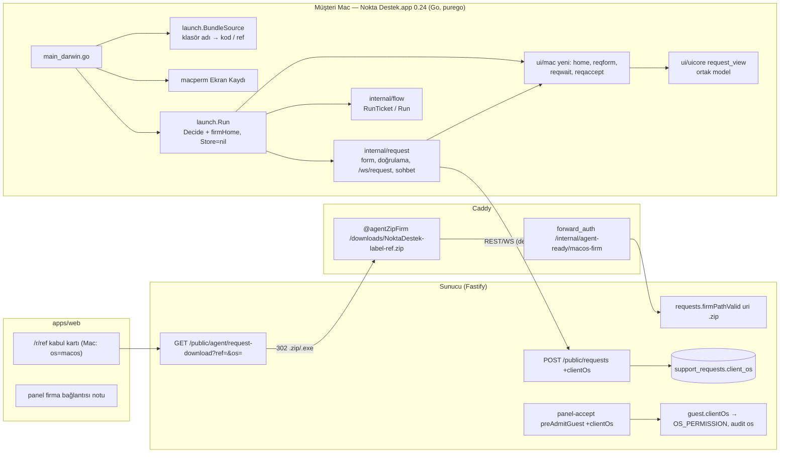

# Mimari — P31 macOS Hızlı Destek'te "Destek iste"

Tarih: 2026-11-20 · Durum: **r1.3** (r1.2: güvenlik tasarım turu S-P31-1..8 işlendi — gövde yerinde düzeltildi; öncelik §15 > §14 > gövde. r1.3: qa P31 tur 1 m.5 ve S-P31-K1 metinleri §15.3'e işlendi — Developer ID OKUBENI kaynak cümlesi, `/r/` kartında `gm.firmNameNotProof`, `gm.adhocOnlyTitle`) · Dal: `p31-mac-destek-iste` (main 257891c)
Girdiler: `docs/gereksinimler.md` §14 (AC-509..AC-522, US-P31-1/2, V-P31-1..3, R-P31-1..4), `docs/mimari-e9.md` (talep),
`docs/mimari-e10.md` §8.1 (açılış karar tablosu), `docs/mimari-e11.md` §8d (P20 ana ekran), `docs/mimari-p28f.md` (macOS
istemci), P28f-r4 (ayrı dal, `mimari-p28f.md` §15, AC-500..508), `docs/mimari-p22.md` (saklama satırı), ADR-0006 r4/r5,
ADR-0037. Yeni ADR: **ADR-0041** (macOS'ta firma kimliği zip/klasör adından). Kontrol listesi: `docs/tasarim-kontrol.md` "P31".

**Sadelik:** Tek yol. Firma bağlantısı tek kalır (Mac'te kendiliğinden `.zip` iner), firma kimliği tek kaynaktan (klasör
adı) okunur, macOS açılış kararı Windows'un `launch.Decide` tablosunun kendisidir, talep mantığı `internal/request`'in
kendisidir. Mac'e özgü yeni kod yalnız AppKit ekranlarıdır. Yeni WS mesajı ve yeni genel uç yok (yalnız bir iç forward_auth ucu: `/internal/agent-ready/macos-firm`, S-P31-1); bir uca isteğe bağlı parametre,
bir gövdeye isteğe bağlı alan ve bir tabloya bir sütun eklenir.

---

## 1. Özet ve kısıtlar

| Kapsamda                                                                                                    | Kapsam dışı / Sonra (neden)                                                                                                |
| ----------------------------------------------------------------------------------------------------------- | -------------------------------------------------------------------------------------------------------------------------- |
| Firma bağlantısı Mac'te `NoktaDestek-<label>-<ref>.zip` indirir (UA ya da `os=macos`) (AC-509, 510)         | "Bilgilerimi hatırla", bilgisayar kaydı, çoklu firma listesi (P20) — AC-394 iz kuralı + Keychain/ad-hoc (K-P31-6), Sonra   |
| Talepten doğan oturumda `clientOs` (OS_PERMISSION, audit) (AC-511)                                          | Tepsi, otomatik başlatma (P28f kararı aynen)                                                                               |
| Firma ref'i `.app`'in üst klasör adından (AC-512, ADR-0041)                                                 | `noktadestek://` URL şeması, ref yapıştırma alanı (K-P31-1 seçenek c; yalnız E-P31-1 başarısızsa yeniden açılır)           |
| Mac'te `launch.Run` (Windows ile aynı karar tablosu, `Store=nil`) + sade ana ekran (AC-513)                 | Firma dosyası için web rehber sayfası (zip içi OKUBENI + kılavuz)                                                          |
| AppKit talep formu, bekleme + talep sohbeti, kapanış/engel ekranları, korumalı kabul diyaloğu (AC-514..516) | Konsolda müşteri OS rozeti (`hello.guestOs`), panelde OS sütunu — Sonra (veri artık `client_os`'ta, genişleme noktası §12) |
| İz bırakmama, TCC sırası, eski sürüm indirme adresi (AC-517..519)                                           | Linux firma dosyası/talep (AC-521 davranışı sabitler), macOS gözetimsiz                                                    |
| `/r/` kabul kartı + panel notu + OKUBENI cümlesi (AC-520); 0.24.0 + doküman (AC-522)                        |                                                                                                                            |

Kısıtlar: `CGO_ENABLED=0`, purego/AppKit (ADR-0037); macOS istemcisi diske kalıcı dosya yazmaz (AC-394); prod macOS ad-hoc
imzalı (P28f-r4) → TCC kimliği her sürümde yeni; `.app` paketine dosya eklenemez/değiştirilemez (imza mühürlüdür:
`_CodeSignature/CodeResources` paket içeriğini kapsar). Paralel dal P28f-r4 `ui/mac/{logic,screens_darwin,ui_darwin,testband_darwin,prompt_darwin}.go`,
`flow/messages_p28f.go`, `macperm/tcc_darwin.go`, `build/macos/package.sh`, OKUBENI dosyaları ve web `session/[token]/*`
dosyalarını değiştiriyor → P31 bu dosyalarda **yalnız ekleme** yapar ve r4 birleştikten sonra kodlanır (§11.1).

## 2. Kararlar

| #        | Karar                                                                                                                                                                                                                                                                                                                                                                                                                                                                                                                                                                                                                                                                                                                                                                                                                                                                                                                                                                                                                                                                                                                                                                                                                                                                                                           |
| -------- | --------------------------------------------------------------------------------------------------------------------------------------------------------------------------------------------------------------------------------------------------------------------------------------------------------------------------------------------------------------------------------------------------------------------------------------------------------------------------------------------------------------------------------------------------------------------------------------------------------------------------------------------------------------------------------------------------------------------------------------------------------------------------------------------------------------------------------------------------------------------------------------------------------------------------------------------------------------------------------------------------------------------------------------------------------------------------------------------------------------------------------------------------------------------------------------------------------------------------------------------------------------------------------------------------------------- |
| K-P31-1  | **Firma kimliği klasör adından (seçenek a; ADR-0041).** Sunucu jenerik macOS zip'ini `NoktaDestek-<label>-<ref>.zip` adıyla sunar. Zip'te iki üst öğe vardır (`Nokta Destek.app` + `OKUBENI*.txt`, ADR-0037 m.5), bu yüzden Arşiv İzlencesi onu zip adıyla bir klasöre açar: `NoktaDestek-<label>-<ref>/Nokta Destek.app`. İstemci ref'i bu klasör adından okur — kodda bugün yapılanın (P28f `Destek-<kod>/`) aynısı. `.app` adı ve içeriği **hiç değişmez** → imza ve TCC kimliği etkilenmez; zip baytları her adda aynıdır (tek SHA, attestation aynen). **Reddedilenler:** (b) `.app` içine ya da `Contents/` altına yan dosya — mühürlü kaynakları değiştirir, `codesign --verify --strict` bozulur, Gatekeeper reddeder; zip'e üçüncü öğe olarak ref dosyası — zip baytları firma başına değişir (SHA/attestation kırılır) ve klasör adı zaten aynı bilgiyi taşır. (c) `noktadestek://` URL şeması ya da ref yapıştırma — ikinci bir açılış yolu (sadelik ilkesine aykırı), `Info.plist` değişikliği + Launch Services kaydı (iz), tarayıcıdan uygulama tetikleme yüzeyi; yalnız E-P31-1 başarısız olursa kullanıcıya sorulacak yedek (A-P31-1). (d) `.app` adında ref (`NoktaDestek-<label>-<ref>.app`) — zip içeriğini firma başına değiştirir (yine SHA kırılır); bundle adı Dock/menüde ref gösterir. |
| K-P31-2  | **Tek firma bağlantısı, platformu sunucu seçer.** Dağıtılmış bağlantılar (panel, müşteri kartı, K3 e-posta/WhatsApp, portal, `/r/`) `request-download?ref=` biçimindedir ve değişmez. Uç isteğe bağlı `os` (`windows\|macos`) alır; yoksa UA'dan seçer (Mac ve iOS/iPadOS değil **ve** macOS kapısı `ok` → `macos`; aksi `windows`). Kapı kapalıyken Mac kullanıcısı bugünkü gibi `.exe` alır (gerileme yok). Açık `os=macos` kapı kapalıyken 503 (web ön denetimi için anlamlı hata). `linux` → 400 (Linux firma dosyası yok). UA güvenlik kararı değildir: yalnız aynı ref için hangi jenerik ikilinin adlandırılacağını seçer; firma yolu Caddy'de ayrıca doğrulanır.                                                                                                                                                                                                                                                                                                                                                                                                                                                                                                                                                                                                                                        |
| K-P31-3  | **Firma zip yolu Caddy'de doğrulanır** (Windows `@agentExeFirm` kalıbı): yeni `@agentZipFirm` `^/downloads/(NoktaDestek-[A-Za-z0-9]{1,20}-[a-z2-7]{16})\.zip$` → `forward_auth` **ayrı iç uç** `/internal/agent-ready/macos-firm` (r1.2, S-P31-1), `X-Forwarded-Uri` = `/downloads/<ad>.zip` (yalnız yol, tam ad; `/downloads/***` değil). `macos-firm` fail-closed'dur: başlık eksik, maskeli ya da tam firma deseni değilse veya `firmPathValid(uri, ".zip")` false ise 404; sonra mac kapısı (503). `/agent-ready/macos` bugünkü `onlyGate` olarak kalır ve URI okumaz (jenerik ve kod zip'i). Eski sunucuda `macos-firm` kayıtlı olmadığından 404 döner → sürüm kayması ve geri alma kendiliğinden kapalıdır. `firmPathValid` uzantıyı parametre alır; `/agent-ready/windows` yalnız `.exe`, `macos-firm` yalnız `.zip` kabul eder (çaprazlama yok). Ayrıntı §15.1. Sunulan dosya `NoktaDestek-macOS.zip`, `Content-Disposition` `<ad>.zip` (mevcut `agent_zip_file` snippet'i).                                                                                                                                                                                                                                                                                                                            |
| K-P31-4  | **`clientOs` talepte kalıcı.** Talep, kabulüne kadar DB'de bekler (sunucu yeniden başlayabilir) → `support_requests.client_os VARCHAR(10) NULL` (CHECK: NULL ya da `windows/macos`; `source='WEB'` ⇒ NULL). `createRequestInputSchema` + `clientOs: requestClientOsSchema.optional()` — **yeni, yalnız `z.enum(["windows","macos"])`** (r1.2, S-P31-7; `ClientOs`/resolve şeması `linux` içerdiği için kullanılmaz). Kabulde `preAdmitGuest({... clientOs: r.clientOs ?? undefined})` → misafirin `clientOs`'u (rooms-lobby `clientOs?` alanı zaten var). Böylece `session.join` audit `os`, `OS_PERMISSION` kabulü ve P28g linux kuralları talepten doğan oturumda da doğru çalışır. `request.create` audit `newValue`'ya `clientOs` eklenir. Go istemci alanı yalnız macOS'ta `"macos"` olarak gönderir (D-1); Windows gövdesi değişmez.                                                                                                                                                                                                                                                                                                                                                                                                                                                                      |
| K-P31-5  | **Mac'te `launch.Run` (Windows açılışının kendisi).** `main_darwin.go` `flow.Run` yerine `launch.Run`'ı çağırır: `Store: nil` (kayıt 0, hatırla yok), `Autostart` kapalı (`autostart_other.go` zaten), `Home`/`Request.UI`: `ui/mac`. Kaynak dosya adından değil, yeni `launch.Deps.Source` alanından gelir (§3.2): Windows `nil` bırakır (bugünkü `Exe` adı yolu aynen), Mac `launch.BundleSource()` (kod ya da ref), Linux bugünkü `flow.Run` yolunda kalır. Davranış farkı: Mac'te süresi dolmuş kod/kaynaksız açılış artık Windows'taki gibi ana ekranı (AC-190) açar; geçerli kodda akış değişmez.                                                                                                                                                                                                                                                                                                                                                                                                                                                                                                                                                                                                                                                                                                         |
| K-P31-6  | **Hatırla ve bilgisayar kaydı kapsam dışı.** Gerekçe: (1) AC-394 "kapanınca `~/Library`'de iz yok" bir P28f taahhüdü ve r4'ün AC-506'sı ("diske işaretçi yazmaz") ile pekişti; kalıcı dosya bu kuralı değiştirmeyi gerektirir. (2) `remember` deposunun koruması yalnız DPAPI (Windows); Mac eşi Keychain olur, ad-hoc imzada Keychain ACL'si imza kimliğine bağlı olduğundan her sürümde "Nokta Destek anahtar zincirine erişmek istiyor" onayı çıkar. (3) Asgari kapsam "Destek iste"; firma klasörü varken kayıt olmadan da talep her zaman mümkündür. Uygulama: `Store=nil` → `flow.Deps.Binding=nil` (sunucunun `binding.offer`'ı istemcide yanıtsız kalır, kayıt oluşmaz; AC-188 satırı `rememberNote` boş döner), mac formunda hatırla kutusu çizilmez (`Form.Remember` hep false; `request` paketi değişmez).                                                                                                                                                                                                                                                                                                                                                                                                                                                                                           |
| K-P31-7  | **Ortak arayüz modeli `uicore`'a.** `internal/ui/home.go`'daki platformdan bağımsız ana ekran düğme/metin mantığı (`firmButtons` vb.) ve talep formu alan tablosu (etiket, sıra, uzunluk, ipucu) `internal/ui/uicore/request_view.go`'ya taşınır; Win32 ve AppKit aynı tablodan çizer. Windows çıktısı değişmez (mevcut `home_test.go` testleri uicore'a taşınıp aynen geçer). Mac'te hatırla satırı ve "unut" düğmeleri tablo düzeyinde `Platform{Remember:false, Bindings:false}` ile düşer.                                                                                                                                                                                                                                                                                                                                                                                                                                                                                                                                                                                                                                                                                                                                                                                                                  |
| K-P31-8  | **Kabul diyaloğu = P28f korumalı diyalog.** `RequestAccepted` mevcut `prompt_darwin.go` korumalı istem bileşeniyle (kontrol izni diyaloğunun kullandığı: 1,5 sn gecikme, Return/boşluk eylem değil, `input.LocalClick` ile yalnız yerel fiziksel tıklama, varsayılan odak Vazgeç) kurulur; karar `uicore.AcceptDecision` (Win32 ile aynı). Öne getirme `NSApp activateIgnoringOtherApps:` + `requestUserAttention:NSCriticalRequest` (Windows görev çubuğu yanıp sönme karşılığı).                                                                                                                                                                                                                                                                                                                                                                                                                                                                                                                                                                                                                                                                                                                                                                                                                              |
| K-P31-9  | **İzin sırası ve yeniden başlatma.** Ekran Kaydı yoklaması bugünkü yerinde (kaynak okunduktan sonra, ağdan ve ana ekrandan önce). Yeniden başlatma `open -n <BundleLocation() ile translocation çözülmüş özgün bundle yolu>` ile yapılır; translocated `…/AppTranslocation/<UUID>/d/` yolu asla kullanılmaz (yeni örnek yeniden translocate olur ve yeniden çözer). Yeni örnek aynı klasör adını okur → ref hiçbir dosyaya yazılmaz, yedek yok (r1.2, S-P31-5; K0'da ölçülür, başarısızsa A-P31-5); `macperm` dosya biçimi değişmez (yalnız kod taşır). Talep sırrı bellekte olduğundan talep sonrası yeniden başlatma talebi düşürür (kılavuz).                                                                                                                                                                                                                                                                                                                                                                                                                                                                                                                                                                                                                                                                |
| K-P31-10 | **Metinler.** Form/bekleme/kapanış metinleri `internal/request` + `flow` tablolarından (Windows ile aynı). Yeni Mac metni yalnız AC-512 bilgi satırı (`launch` `NoticeMacFolder`, yalnız Mac'te ve kaynak okunamadığında). OKUBENI (`OKUBENI.txt`, `OKUBENI-stg.txt`, r4 `OKUBENI-adhoc.txt`) son paragrafı **kaynağa çapalanır**, kanal (teknisyenle görüşme / firma bağlantısı) ayrımı yapılmaz (Developer ID `OKUBENI.txt`'de "Yine de Aç"sız kaynak cümlesi, r1.3 §15.3); firma adı cümlesi öz-beyan denetimi olarak yazılmaz (r1.2, S-P31-2; metinler §15.3). r4'ün web `gm.adhocOnlyBody` anahtarı aynı kalır, metni kanaldan bağımsız hâle gelir ve `/r/<ref>` Mac kabul kartında da gösterilir (AC-520).                                                                                                                                                                                                                                                                                                                                                                                                                                                                                                                                                                                                |
| K-P31-11 | **Sürüm:** istemci 0.24.0 (Windows/Linux davranışı değişmez; ortak kod taşıması nedeniyle tüm platformlar aynı sürümü taşır), sunucu aynı yayında. `MIN_AGENT_VERSION` değişmez.                                                                                                                                                                                                                                                                                                                                                                                                                                                                                                                                                                                                                                                                                                                                                                                                                                                                                                                                                                                                                                                                                                                                |

## 3. Bileşenler ve sorumluluklar



### 3.1 Sunucu / web / Caddy

| Bileşen                                                                  | Sorumluluk                                                                                                                                                                                                                                                                                                                                                                                         |
| ------------------------------------------------------------------------ | -------------------------------------------------------------------------------------------------------------------------------------------------------------------------------------------------------------------------------------------------------------------------------------------------------------------------------------------------------------------------------------------------- |
| `requests/public-routes.ts` `/request-download`                          | `os` sorgu parametresi (zod `z.enum(["windows","macos"]).optional()`), UA kararı (`lib/agent-os.ts` yeni saf fonksiyon `osFromUserAgent(ua)`), `assertReady` platforma göre. Geçersiz `os` önce (kova tüketmeden) 400.                                                                                                                                                                             |
| `requests/service.ts` `download(ctx, ref, os, gates)`                    | Konum `requestDownloadLocation(label, ref, os)`; açık `os=macos` + kapı kapalı → 503; örtük → kapı kapalıysa `windows`. Metrik `rs_agent_download_total{os, kind="firm"}`.                                                                                                                                                                                                                         |
| `requests/ref.ts`                                                        | `requestFileName(label, ref, os="windows")` (`.exe`/`.zip`); `parseFirmDownloadUri(uri, ext)`; panel/müşteri görünümündeki `fileName` alanı Windows adı olarak kalır.                                                                                                                                                                                                                              |
| `public/routes.ts` `/internal/agent-ready/macos-firm` (yeni) ve `/macos` | `macos-firm`: denetim sırası (1) `X-Forwarded-Uri` tam olarak `^/downloads/NoktaDestek-[A-Za-z0-9]{1,20}-[a-z2-7]{16}\.zip$` değilse (eksik, `***`, sorgu dizesi, büyük harfli ref dahil) 404 → (2) `firmPathValid(uri, ".zip")` false ise 404 → (3) mac kapısı `ok` değilse 503 → 204. `/macos` değişmez (`onlyGate`, URI okumaz). `/agent-ready/windows` `firmPathValid(uri, ".exe")` (bugünkü). |
| `requests/service.ts` `create`, `repo`                                   | `clientOs` AGENT talebinde yazılır, WEB'de yazılmaz; audit `request.create` `newValue.clientOs`.                                                                                                                                                                                                                                                                                                   |
| `requests/panel-accept.ts`                                               | `preAdmitGuest` girdisine `clientOs`. Yeniden ticket (`reissueRequestTicket`) mevcut misafiri kullandığından ek iş yok.                                                                                                                                                                                                                                                                            |
| `deploy/Caddyfile`                                                       | `@agentZipFirm` bloğu `@agentExeFirm`'in hemen altında, `forward_auth` `uri /internal/agent-ready/macos-firm` ve `header_up X-Forwarded-Uri {path}` (tam ad; `@agentZip` bloğundaki `/downloads/***` kopyalanmaz), `handle /downloads/*` 404'ünden önce; log maskesi `NoktaDestek-[^/?]+` zaten kapsıyor.                                                                                          |
| `apps/web/app/r/[ref]/waiting-parts.tsx`                                 | `AcceptedCard`: `detectAgentOs()` (mevcut `lib/device-support`) = macos ve `availability.macos` → metin `wr.downloadMac`, href `+&os=macos`; aksi bugünkü. Availability `/public/agent/availability` (mevcut, 30/dk).                                                                                                                                                                              |
| Panel firma bağlantısı + müşteri kartı                                   | Bağlantının altında `rq.linkMacNote` satırı (yalnız metin).                                                                                                                                                                                                                                                                                                                                        |

### 3.2 Go istemci

| Bileşen                                                               | Sorumluluk                                                                                                                                                                                                                                                                                                                                                            |
| --------------------------------------------------------------------- | --------------------------------------------------------------------------------------------------------------------------------------------------------------------------------------------------------------------------------------------------------------------------------------------------------------------------------------------------------------------- |
| `internal/launch/source.go` (yeni, etiketsiz)                         | `type Source struct{ Code, Ref string }`; `SourceFromBundlePath(bundle string) Source`. Desen ve öncelik tek tanımdır: §15.2 (`pairing.RefCorePattern` ortak çekirdek; klasör kod > klasör ref > bundle adı yalnız kod > yok; bundle adından ref okunmaz). Ref küçük harfe çevrilir, etiket atılır. `CodeFromBundlePath` bu fonksiyonun `Code`'unu döner (geri uyum). |
| `internal/launch/code_darwin.go`                                      | `BundleSource() Source` (translocation çözümü aynen).                                                                                                                                                                                                                                                                                                                 |
| `internal/launch/run.go`                                              | `Deps.Source *Source` (nil → bugünkü `pairing.FromFileName/RefFromFileName(d.Exe)`); `openFile` kaynağı buradan alır. `Deps.SourceHint string` (Mac: AC-512 satırı; kaynak boşken `Decide` Notice'ine eklenir). Karar tablosu ve `firmHome` değişmez.                                                                                                                 |
| `internal/request/policy.go`                                          | `DownloadURL(server, ref, os string)`: `os=="macos"` → `&os=macos` eki; Windows adresi bayt bayt aynı. `request.Deps.DownloadOS`.                                                                                                                                                                                                                                     |
| `internal/api/requests.go`                                            | `CreateRequestBody.ClientOS string json:"clientOs,omitempty"` = `clientOS(runtime.GOOS)`.                                                                                                                                                                                                                                                                             |
| `internal/ui/uicore/request_view.go` (yeni)                           | Ana ekran düğme tablosu (`HomeButtons(v launch.FirmView, p Platform)`), form alan tablosu (`FormFields(p Platform)`), bekleme metin biçimleyicileri (talep kodu "123 456", süre). `internal/ui/home.go` buradan çağırır.                                                                                                                                              |
| `internal/ui/mac/home_darwin.go` (yeni)                               | `FirmHome`: tek satır firma metni (ya da AC-190 açıklaması), bilgi satırı, düğmeler (uicore tablosu), Kötüye kullanımı bildir (`mailto:` mevcut yol).                                                                                                                                                                                                                 |
| `internal/ui/mac/reqform_darwin.go` (yeni)                            | `RequestForm/RequestFormBusy/RequestFormClose/RequestProblem`: `form` yardımcısı (mevcut `form_darwin.go`), `NSTextField` ×3, `NSTextView` (sorun, kaydırmalı), salt okunur `NSTextView` (aydınlatma metni), `NSButton` onay kutuları, alan altı hata etiketleri, ilk hatalı alana `makeFirstResponder:`.                                                             |
| `internal/ui/mac/reqwait_darwin.go` (yeni)                            | `RequestWaiting/RequestChat/RequestChatSends/RequestClosed/RequestWaitClose/OpenURL` + `RequestEvents()`; sohbet görünümü oturum sohbeti bileşeniyle (`session_darwin.go` `appendLine` kalıbı) aynı kurallar. `OpenURL` yalnız `request.DownloadURL` çıktısını ya da `mailto:` açar.                                                                                  |
| `internal/ui/mac/reqaccept_darwin.go` (yeni)                          | `RequestAccepted/RequestAcceptedTick`: korumalı istem (K-P31-8).                                                                                                                                                                                                                                                                                                      |
| `cmd/noktadestek/main_darwin.go`, `start_darwin.go`, `deps_darwin.go` | `startCode` → `startSource` (kaynak + TCC; yeniden başlatma dosyası yalnız kod için, bugünkü gibi); `launch.Deps` kurulumu (`Store:nil`, `Home:u`, `Request: request.Deps{UI:u, Events:u.RequestEvents(), Version, Logo, DownloadOS:"macos"}`, `Flow: flowDeps(...)`, `UpdateNotice`).                                                                                |

## 4. API sözleşmesi (değişen uçlar)

| Uç                                                     | Değişiklik                              | Girdi                                                        | Çıktı                                                                                            | Hata                                                                                                                                  | Yetki / limit                                                 |
| ------------------------------------------------------ | --------------------------------------- | ------------------------------------------------------------ | ------------------------------------------------------------------------------------------------ | ------------------------------------------------------------------------------------------------------------------------------------- | ------------------------------------------------------------- |
| `GET /api/v1/public/agent/request-download`            | `os` isteğe bağlı                       | `ref` (16, `[a-z2-7]`), `os?: "windows"\|"macos"`            | 302 `Location: /downloads/NoktaDestek-<label>-<ref>.exe` ya da `.zip`; `Cache-Control: no-store` | 400 VALIDATION (`os` geçersiz; kova tüketilmez), 404 REQUEST_REF_INVALID, 429 RATE_LIMITED, 503 NOT_READY (seçilen platformun kapısı) | Kimliksiz; mevcut `req.download` ip kovası + ref engeli aynen |
| `GET /downloads/NoktaDestek-<label>-<ref>.zip` (Caddy) | Yeni yol                                | —                                                            | 200 zip (`Content-Disposition: attachment; filename="<ad>.zip"`)                                 | 404 (ref pasif / label eski / yanlış uzantı), 503 (kapı)                                                                              | forward_auth `/internal/agent-ready/macos-firm`               |
| `GET /internal/agent-ready/macos-firm` (iç, yeni)      | Firma URI denetimi, fail-closed (§15.1) | `X-Forwarded-Uri`                                            | 204                                                                                              | 404, 503                                                                                                                              | Yalnız güvenilen proxy                                        |
| `POST /api/v1/public/requests`                         | `clientOs` alanı                        | `createRequestInputSchema` + `clientOs?: "windows"\|"macos"` | 201 değişmez                                                                                     | 400 VALIDATION (geçersiz değer, `linux` dahil)                                                                                        | AGENT kuralı aynen                                            |

Contracts: `packages/contracts/src/api/requests.ts` (`createRequestInputSchema`, `CreateRequestInput`), `requestDownloadQuerySchema`
(yeni, `ref` + `os`), `ClientOs` mevcut tip (`api/sessions.ts`). Fixture: `fixtures/requests.json`'a `clientOs` örneği (Go
testleri aynı fixture'ı okuyorsa).

## 5. Veri modeli

| Tablo              | Değişiklik  | Tip                                                                              | Kısıt                                                                                                                                                                                                                                                        | İndeks             | Silme / saklama                                                             |
| ------------------ | ----------- | -------------------------------------------------------------------------------- | ------------------------------------------------------------------------------------------------------------------------------------------------------------------------------------------------------------------------------------------------------------ | ------------------ | --------------------------------------------------------------------------- |
| `support_requests` | `client_os` | `VARCHAR(10) NULL` (Prisma `clientOs String? @map("client_os") @db.VarChar(10)`) | CHECK `client_os IS NULL OR client_os IN ('windows','macos')` (S-P31-7; Linux talebi gelirse CHECK migration ile genişler); CHECK `source <> 'WEB' OR client_os IS NULL` (mevcut `source_version_chk` yanına ayrı CHECK, `\z` kuralı gereksiz — sabit liste) | Yok (filtrelenmez) | Kişisel veri değil; anonimleştirmede korunur; retention mevcut satır kuralı |

Migration: `ALTER TABLE support_requests ADD COLUMN client_os VARCHAR(10) NULL` + iki CHECK; eski satırlar NULL (= windows).
Geri dönüş: sütun NULL'lanabilir ve kod onu okumazsa zararsız; rollback migration'ı yalnız `DROP CHECK` + `DROP COLUMN`.
`prisma/sql/grants.sql`: `app` kullanıcısının bu tabloda sütun düzeyi INSERT/UPDATE listesi varsa `client_os` INSERT'e
eklenir (UPDATE gerekmez — oluşturulduktan sonra değişmez). dba doğrular.

> dba notu (P31-D, 2026-11-20): `client_os` CHECK'i ADR-0014 kalıbıyla ikili yazıldı (`CAST(client_os AS BINARY) IN (...)`);
> düz IN tablo harmanlamasında `'MACOS'`/`'macos '` kabul ediyordu (ölçüldü). grants.sql tablo düzeyi — yeni GRANT yok. Ayrıntı: `docs/db-notlari.md` "P31".

## 6. Güvenlik tasarımı

| Tehdit                                                                                                                                                       | Önlem                                                                                                                                                                                                                                                                    |
| ------------------------------------------------------------------------------------------------------------------------------------------------------------ | ------------------------------------------------------------------------------------------------------------------------------------------------------------------------------------------------------------------------------------------------------------------------ |
| T-P31-1 Sahte klasör adı (saldırgan kendi firmasının ref'iyle zip'i kurbana gönderir → kurbanın talebi saldırganın tenant'ına gider)                         | Windows'taki dosya adı tehdidinin aynısı (G-E9-11 kabulü): pencerede yalnız sunucudan gelen firma adı + kırmızı uyarı + teknisyen doğrulama kodu + yerel tıklamalı "Ekranımı paylaş". Etiket asla gösterilmez.                                                           |
| T-P31-2 Keyfi adlı "resmi" zip bağlantısı (ör. `NoktaDestek-Bankaniz-xxxx.zip`)                                                                              | `@agentZipFirm` → ayrı iç uç `macos-firm`: ref aktif ve label güncel değilse 404 (AC-510); fail-closed (eksik/maskeli/desen dışı URI ve eski sunucuda uç yokluğu da 404), yayın sırası sunucu → Caddyfile (S-P31-1, §15.1).                                              |
| T-P31-3 Uzantı çaprazlama ile kapı atlama (`.zip` yolunu Windows kapısından geçirmek)                                                                        | Kapı başına sabit uzantı (K-P31-3); Caddy matcher'ları ayrı.                                                                                                                                                                                                             |
| T-P31-4 UA sahteciliği                                                                                                                                       | Etkisi yalnız hangi jenerik ikilinin adlandırıldığı; yetki/veri sonucu yok.                                                                                                                                                                                              |
| T-P31-5 `clientOs` sahteciliği (Windows istemcisi `macos` beyan eder → OS_PERMISSION)                                                                        | Kod akışında da beyan esaslıdır (S-P28f-15 kabulü): OS_PERMISSION yalnız kontrolü **kısıtlar** (izin yok bildirimi), yetki vermez.                                                                                                                                       |
| T-P31-6 Ref'in iz bırakması                                                                                                                                  | Ref klasör adında zaten müşterinin diskindedir; istemci ek kopya yazmaz, log yazmaz (AC-517). Sunucu ref'i loglamaz (mevcut).                                                                                                                                            |
| T-P31-7 Kabul diyaloğunun uzaktan/sentetik tıklanması                                                                                                        | K-P31-8 korumalı istem (P28f S-P28f-1 kuralları).                                                                                                                                                                                                                        |
| T-P31-8 `OpenURL` ile keyfi adres                                                                                                                            | Yalnız `DownloadURL` (gömülü köken + sabit yol + doğrulanmış ref) ve `mailto:` (sunucunun abuse adresi, mevcut doğrulama).                                                                                                                                               |
| T-P31-9 Yeniden paketlenmiş (yeniden ad-hoc imzalı) zararlı zip, gerçek ref'li klasör adıyla mesajla gönderilir; pencerede doğru firma adı görünür (S-P31-2) | Firma adı güvenlik kanıtı olarak sunulmaz (AC-520 cümlesi); OKUBENI, `/r/` kartı, K3 mesajı ve kılavuz kaynağa çapalı: "yalnız https://{host}/ adresinden indirilen", "dosya eki göndermeyiz", Bilgi Al → Nereden (§15.3). Kalıntı: kabul edilmiş ad-hoc riski (R39-r4). |
| T-P31-10 Doğrudan `/downloads/NoktaDestek-…` yolunda sınırsız istek (DB sorgusu + tam aktarım)                                                               | nginx `limit_req` IP başına 10/dk, burst 5, 429 (S-P31-6, §15.4); staging nginx'ten geçmez → kapsam dışı, kabul.                                                                                                                                                         |
| T-P31-11 Eski firma klasörlerinin ad-hoc cdhash'e bağlı TCC iznini taşıması (S-P31-8)                                                                        | Kılavuz + OKUBENI: "Mac'te dosyayı saklamayın; her seferinde yeniden indirin, eski klasörü silin"; yerel tıklamalı "Ekranımı paylaş" engeli korunur.                                                                                                                     |

Hassas veri: ad, telefon, e-posta, sorun metni yalnız bellekte; HTTPS ile gönderilir; mevcut sunucu saklama kuralları. Yeni
başlık/CSP yok. Audit: yeni eylem yok; `request.create` ve `session.join` mevcut eylemler doğru `os` ile yazılır.

## 7. Dosya / klasör planı

| Ajan                 | Dosya                                                                                                                                                                                                                                                                                                                                                                                                                                                                                                                              | İşlem          |
| -------------------- | ---------------------------------------------------------------------------------------------------------------------------------------------------------------------------------------------------------------------------------------------------------------------------------------------------------------------------------------------------------------------------------------------------------------------------------------------------------------------------------------------------------------------------------- | -------------- |
| dba                  | `apps/server/prisma/schema.prisma`, `prisma/migrations/<ts>_p31_request_client_os/migration.sql`, `prisma/sql/grants.sql` (gerekirse), `docs/db-notlari.md`                                                                                                                                                                                                                                                                                                                                                                        | Değişir / yeni |
| backend-dev (sunucu) | `packages/contracts/src/api/requests.ts` (+ test), `apps/server/src/requests/{public-routes,service,ref,repo,panel-accept}.ts`, `apps/server/src/public/routes.ts`, yeni `apps/server/src/lib/agent-os.ts`, `apps/server/src/ops/metrics.ts` (etiket), `apps/server/src/notify/customer-templates.ts` (K3 kaynak satırı, §15.3), testler `test/integration/p31-*.test.ts`, `test/unit/agent-os.test.ts`                                                                                                                            | Değişir / yeni |
| devops               | `deploy/Caddyfile` (`@agentZipFirm` → `macos-firm`), `deploy/test-caddy.sh` (§15.1 satırları), `deploy/nginx/remote.noktabilisim.net.conf` + `deploy/nginx/test-nginx.sh` (`limit_req`, §15.4), `apps/agent-win/build/macos/OKUBENI.txt`, `OKUBENI-stg.txt`, `OKUBENI-adhoc.txt` (r4'ten sonra; son paragraf kaynağa çapalı, §15.3), `docs/runbook.md` (firma zip yolu, staging `curl -I` denetimi, yayın sırası sunucu → Caddyfile ve ters geri alma, "ref sızdı → ref yenile" Mac notu, talep yolunda `CLIENT_OUTDATED` notu)    | Değişir        |
| backend-dev (Go)     | yeni `internal/launch/source.go` (+ test), `internal/launch/{run.go,code_folder.go,code_darwin.go,home_text.go}`, `internal/request/{policy.go,run.go}` (+ test), `internal/api/requests.go` (+ test), yeni `internal/ui/uicore/request_view.go` (+ test), `internal/ui/home.go` (uicore'a delege), yeni `internal/ui/mac/{home,reqform,reqwait,reqaccept}_darwin.go`, `internal/ui/mac/ui_darwin.go` (yalnız `RequestEvents` kanalı ve alan ekleme), `cmd/noktadestek/{main_darwin,start_darwin}.go`, macOS CI iz testi senaryosu | Değişir / yeni |
| frontend-dev         | `apps/web/app/r/[ref]/waiting-parts.tsx` (+ test), panel firma bağlantısı bileşeni ve müşteri kartı (`apps/web/app/(panel)/…requests settings`, `customers/[id]`), `apps/web/messages/tr.json`, e2e `apps/web/e2e/p31-mac-request.spec.ts`                                                                                                                                                                                                                                                                                         | Değişir / yeni |
| teknik-yazar         | `docs/KULLANIM_KILAVUZU.md` (Destek iste macOS alt başlığı; "Mac sürümünde olmayanlar"), `README.md`, `docs/DATASHEET.md`, `CHANGELOG.md`, `docs/api.md` (`os`, `clientOs`), `docs/pdf/*`; `docs/gereksinimler-p28.md` kapsam dışı 8 ve `docs/mimari-p28f.md` §1'e "P31 ile değişti" notu (yalnız ekleme)                                                                                                                                                                                                                          | Değişir        |

Dokunulmayan: `internal/remember`, `internal/tray`, `internal/autorun`, `internal/flow` (davranış), `macperm` dosya biçimi,
`ui/mac/{screens,logic,testband,prompt}_darwin.go` gövdeleri (r4 dosyaları; `prompt_darwin.go` yalnız çağrılır).

## 8. Performans ve ölçek

Ek yük yok: indirme ucunda bir UA regex'i ve bir kapı denetimi (önbellekli `check()`); forward_auth'ta bir ref sorgusu
(Windows firma yolu ile aynı, indeksli). Talep akışı Windows'la aynı istek sayısı. Mac formu yerel.

## 9. Operasyon

- nginx: `/downloads/NoktaDestek-` için `limit_req` (§15.4); yeni env yok.
- Env: yeni değişken yok (`MAC_AGENT_SHA256`, r4'ün `MAC_AGENT_SIGNING` aynen).
- Metrik: `rs_agent_download_total{os="macos",kind="firm"}` etiketi; mevcut seri adı.
- Log: Caddy maskesi mevcut; sunucu ref ve UA'yı loglamaz.
- Migration: tek `ALTER`; `migrate` servisi; geri dönüş §5.
- Yayın: sunucu + istemci 0.24.0 aynı etiket; **sıra: önce sunucu (`macos-firm` ucu canlı, `curl` ile iç uç 404/204 doğrulanır), sonra Caddyfile** (S-P31-1); macOS zip r4 hattından (ad-hoc). Staging doğrulama: `curl -sI -A "<Mac Safari UA>" …/request-download?ref=<ref>` → `Location: …zip`; `curl -sI …/downloads/NoktaDestek-<label>-<ref>.zip` → 200; label bozuk → 404.
- Rollback (ters sıra: önce Caddyfile, sonra sunucu): Caddyfile geri alınınca `@agentZipFirm` yoktur → `/downloads/NoktaDestek-…zip` `handle /downloads/*` 404'üne düşer. Yalnız sunucu geri alınırsa (Caddyfile kalırsa) eski sunucuda `/internal/agent-ready/macos-firm` kayıtlı değildir → forward_auth 404 → firma zip'i 404 (fail-closed; r1.1'deki "eski `onlyGate` 204" açığı ayrı uçla kapandı). Eski sunucu Mac'e de `.exe` yönlendirir → kılavuz "Windows dosyası indi" durumu. İstemci 0.23.x zip'i yeniden yayımlanırsa firma klasörlü açılış kod alanına düşer (zararsız). DB sütunu §5.

## 10. Test stratejisi

| AC          | Seviye                                                     | Test                                                                                                                                                                                                                                                         |
| ----------- | ---------------------------------------------------------- | ------------------------------------------------------------------------------------------------------------------------------------------------------------------------------------------------------------------------------------------------------------ |
| AC-509, 521 | Sunucu birim + entegrasyon                                 | `agent-os.test.ts` UA tablosu; `p31-request-download.test.ts` (açık/örtük `os`, kapı kapalı, `linux` 400 + kova tüketilmez)                                                                                                                                  |
| AC-510      | Sunucu entegrasyon + Caddy inceleme + staging              | `/internal/agent-ready/macos-firm` (geçerli, eski label, pasif ref, `.exe` URI, eksik/`***`/büyük harfli ref başlığı → 404; kapı kapalı → 503); `/macos` URI okumaz; `deploy/test-caddy.sh` §15.1 satırları; `deploy/nginx/test-nginx.sh` `limit_req` satırı |
| AC-511      | Sunucu entegrasyon + migration                             | oluştur (`clientOs: macos`) → kabul → `/ws/guest` → `session.join` audit `os=macos`; `control.state OS_PERMISSION` kabul; WEB NULL; CHECK ihlali; `clientOs: linux` → 400                                                                                    |
| AC-512, 513 | Go birim (her platform)                                    | `source_test.go` yol tablosu; `run_test.go` `Source` ile karar (Windows tablo testleri değişmeden)                                                                                                                                                           |
| AC-514..516 | Go birim (uicore modeli, `request` mevcut testleri) + elle | `request_view_test.go` (Mac'te hatırla/unut yok; Windows çıktısı aynı)                                                                                                                                                                                       |
| AC-517      | CI macOS iz testi                                          | Sahte sunucuyla form → talep → iptal → kapanış; `~/Library` + `$TMPDIR` taraması                                                                                                                                                                             |
| AC-518      | Elle                                                       | E-P31-7                                                                                                                                                                                                                                                      |
| AC-519      | Go birim                                                   | `policy_test.go` `DownloadURL`                                                                                                                                                                                                                               |
| AC-520      | Web birim + e2e + CI `cmp`                                 | Mac UA'lı Playwright, iki tema, axe 0, Mac kartında `gm.adhocOnlyBody` uyarısı; OKUBENI `cmp` (zip içi ↔ kaynak dosya, profil başına); K3 şablon birim testi (kaynak satırı)                                                                                 |
| AC-522      | qa                                                         | Doküman denetimi                                                                                                                                                                                                                                             |

Elle (gerçek Mac, macOS 14 ve 15; `docs/test-raporu.md` "P31" bölümüne):
E-P31-1 Safari (otomatik açma açık/kapalı) ve Chrome ile firma bağlantısı → klasör adı `NoktaDestek-<label>-<ref>` → ana ekranda firma adı; ikinci indirme `(1)` eki; Finder Bilgi Al "Nereden" alanı Safari ve Chrome'da görünüyor mu, `https://{host}/` ile mi başlıyor (S-P31-2 m.5) · E-P31-2 geçersiz ref klasörü, kaynaksız açılış, süresi dolmuş kod klasörü · E-P31-3 form doğrulama, VoiceOver, iki tema · E-P31-4 bekleme, sohbet, iptal, kopma, zaman aşımı, ret · E-P31-5 kabul diyaloğu (1,5 sn, Return yok, Fare Tuşları/uzak tıklama reddi), paylaşım, kontrol izni (Erişilebilirlik yok → konsolda OS_PERMISSION metni) · E-P31-6 iz testi elle · E-P31-7 Ekran Kaydı izni yokken firma klasörüyle açılış → rehber → yeniden başlat (`open -n` çözülmüş özgün yol) → aynı firma; `~/Library` ve `$TMPDIR`'da ref içeren dosya yok.

Komutlar: `pnpm -r run test`, `pnpm --filter @remote/web e2e`, `cd apps/agent-win && go test ./...` ve
`GOOS=darwin GOARCH=arm64 CGO_ENABLED=0 go vet ./...` (CI `agent-win.yml` mevcut işleri).

## 11. Görev paketleri

### 11.1 Sıra kuralı

P31, P28f-r4 (AC-500..508) main'e birleşip qa GEÇTİ + güvenlik Kritik/Yüksek 0 olduktan sonra başlar (V-P31-2). İlk iş
**P31-K0** (kod yok): r4 staging zip'i elle `NoktaDestek-Test-abcdefghijklmnop.zip` adıyla staging'den sunularak (ya da yerel
HTTP sunucusundan) Safari ve Chrome'da E-P31-1 ölçülür. K0 GEÇMEZSE kodlamaya başlanmaz; A-P31-1 kullanıcıya sorulur.

| Paket                                                                                                              | Ajan                               | Bağımlı olduğu                           | Paralel mi    | İş tahmini |
| ------------------------------------------------------------------------------------------------------------------ | ---------------------------------- | ---------------------------------------- | ------------- | ---------- |
| P31-K0 klasör adı elle doğrulama                                                                                   | test-operatoru (+ kullanıcı Mac'i) | P28f-r4 birleşmesi                       | —             | 0,5 g      |
| P31-D `client_os` migration + grants                                                                               | dba                                | K0                                       | —             | 0,5 g      |
| P31-B1 sunucu: indirme `os`/UA, firma zip kapısı, `clientOs` talep→misafir, contracts                              | backend-dev                        | D                                        | ‖ O, B2, F    | 1,5 g      |
| P31-O Caddy `@agentZipFirm`, OKUBENI cümlesi, runbook                                                              | devops                             | K0                                       | ‖ B1, B2, F   | 0,5 g      |
| P31-B2 Go: `launch.Source`, `DownloadURL os`, `clientOs`, uicore modeli, `ui/mac` 4 ekran, `main_darwin`, iz testi | backend-dev (Go)                   | K0 (contracts alan adı bu belgede sabit) | ‖ B1, O, F    | 4–5 g      |
| P31-F web `/r/` kabul kartı, panel/müşteri notu, e2e                                                               | frontend-dev                       | K0                                       | ‖ B1, O, B2   | 0,5–1 g    |
| P31-Q qa ‖ güvenlik                                                                                                | qa-denetci ‖ guvenlik              | B1, B2, O, F                             | qa ‖ güvenlik | 1 g        |
| P31-T elle E-P31-1..7                                                                                              | test-operatoru                     | Q düzeltmeleri, staging yayını           | —             | 1 g        |
| P31-W doküman + PDF                                                                                                | teknik-yazar                       | T                                        | —             | 1 g        |

Yayın notu: B1 ‖ O geliştirmede paraleldir; **yayında sunucu (B1) önce, Caddyfile (O) sonra** (§9, S-P31-1).

Toplam ≈ 10–11 adam-gün; paralel yürütmeyle takvim ≈ 6–7 iş günü (kritik yol K0 → B2 → Q → T → W).

## 12. Açık kararlar ve genişleme noktaları

| #       | Konu                                                                    | Varsayım / karar                                                                                                                                                                                                                                                                                                                                                                                                                                                                             | Kim               |
| ------- | ----------------------------------------------------------------------- | -------------------------------------------------------------------------------------------------------------------------------------------------------------------------------------------------------------------------------------------------------------------------------------------------------------------------------------------------------------------------------------------------------------------------------------------------------------------------------------------- | ----------------- |
| A-P31-1 | E-P31-1 bir tarayıcı yolunda klasör adı oluşmazsa                       | Varsayılan: kabul + kılavuz notu ("zip'e çift tıklayın"). İki yolda da oluşmazsa yedek (c) "Firma bağlantısını yapıştırın" alanı (ana ekranda tek alan, `request-download?ref=` ya da `/r/<ref>` adresinden ref ayrıştırma, yalnız gömülü köken) — kullanıcı kararı gerekir                                                                                                                                                                                                                  | kullanıcı         |
| A-P31-2 | Hatırla / kayıt macOS'ta                                                | Kapsam dışı (K-P31-6). Genişleme noktası: `remember.Store{Protect,Unprotect}` darwin eşi (`dpapi_darwin.go` → Keychain `kSecClassGenericPassword`, purego Security.framework) + `main_darwin` `Store` atanır; `launch` ve `request` değişmez; AC-394 iz kuralı değiştirilir; Developer ID gelirse ACL sorunu kalkar. Ek gerekçe (S-P31-3): kayıt yokken Mac talepleri hep "bilinmeyen kaynak" tenant kovasına (60/sa) düşer; ref sızınca Mac müşterileri Windows'tan önce dışlanır (R-P31-4) | kullanıcı (Sonra) |
| A-P31-3 | Konsolda müşteri OS rozeti                                              | Sonra; veri artık talep oturumunda da `guest.clientOs` (P28f §4.3 genişleme noktası aynen)                                                                                                                                                                                                                                                                                                                                                                                                   | —                 |
| A-P31-4 | iPad UA'nın zip alması                                                  | Kabul (R-P31-2); istenirse `os` ayrıştırıcısına `navigator.maxTouchPoints` denetimi web tarafında eklenebilir (yalnız `/r/`)                                                                                                                                                                                                                                                                                                                                                                 | —                 |
| A-P31-5 | K0'da `open -n` (çözülmüş özgün yol) firma klasörünü yeniden okuyamazsa | Yedek yok; kodlama durur. Seçenek: ref'i `macperm` yeniden başlatma dosyasında taşımak — yalnız AC-517 ve AC-518 açıkça değiştirilirse (0600/belirteç, ilk okumada silme, AC-394 iz testi yeniden başlatma sonrası da koşar). AC değişmeden yedek kodlanmaz (S-P31-5)                                                                                                                                                                                                                        | kullanıcı         |
| A-P31-6 | Windows firma yolunda da ayrı iç uç (`/agent-ready/windows-firm`)       | Sonra (S-P31-1 m.1); P31 Windows'a dokunmaz. Genişleme noktası: `public/routes.ts` aynı fail-closed işleyici `.exe` ile, Caddyfile `@agentExeFirm` `uri` değişir, test-caddy satırları kopyalanır                                                                                                                                                                                                                                                                                            | —                 |

## 13. Kabul kriterleri eşlemesi (AC → bileşen / uç → paket)

| AC     | Bileşen / uç                                                                                                                                                                                       | Paket          |
| ------ | -------------------------------------------------------------------------------------------------------------------------------------------------------------------------------------------------- | -------------- |
| AC-509 | `GET /public/agent/request-download` `os` + `lib/agent-os.ts` UA kararı, `requests/service.ts download`                                                                                            | B1             |
| AC-510 | Caddy `@agentZipFirm` + `/internal/agent-ready/macos-firm` (fail-closed) `firmPathValid(uri, ".zip")`, `ref.ts`, `deploy/test-caddy.sh`, nginx `limit_req`                                         | B1 + O         |
| AC-511 | `createRequestInputSchema.clientOs`, `support_requests.client_os`, `panel-accept.ts preAdmitGuest`, Go `CreateRequestBody.ClientOS`                                                                | D + B1 + B2    |
| AC-512 | `launch/source.go SourceFromBundlePath` (§15.2), `pairing.RefCorePattern`, `code_darwin.go BundleSource`, `NoticeMacFolder`                                                                        | B2 (+ K0 elle) |
| AC-513 | `main_darwin.go` → `launch.Run` (`Deps.Source`, `Store=nil`), `ui/mac/home_darwin.go`, `uicore.HomeButtons`                                                                                        | B2             |
| AC-514 | `ui/mac/reqform_darwin.go`, `uicore.FormFields`, `internal/request` (değişmez)                                                                                                                     | B2             |
| AC-515 | `ui/mac/reqwait_darwin.go`, `internal/request` bekleme + sohbet modeli                                                                                                                             | B2             |
| AC-516 | `ui/mac/reqaccept_darwin.go` (korumalı istem `prompt_darwin.go`), `uicore.AcceptDecision`, `flow.RunTicket`                                                                                        | B2             |
| AC-517 | `Store=nil`, `flow.Deps.Binding=nil`, CI macOS iz testi talep senaryosu                                                                                                                            | B2             |
| AC-518 | `start_darwin.go startSource` (TCC sırası, `open -n` çözülmüş özgün yol, klasörden yeniden okuma, diske ref yok)                                                                                   | B2 + T         |
| AC-519 | `request/policy.go DownloadURL(…, os)`, `request.Deps.DownloadOS`                                                                                                                                  | B2             |
| AC-520 | `web/app/r/[ref]/waiting-parts.tsx AcceptedCard`, panel/müşteri kartı notu, Mac kartında `gm.adhocOnlyBody`, `tr.json`, OKUBENI üç dosya (kaynak çapası), `notify/customer-templates.ts` K3 satırı | F + O          |
| AC-521 | `request-download` `os=linux` 400, UA Linux → `windows`                                                                                                                                            | B1             |
| AC-522 | Kılavuz, README, DATASHEET, CHANGELOG, api.md, PDF, p28/p28f notları; sürüm 0.24.0                                                                                                                 | W + B2         |

## 14. r1.1 düzeltmeleri (bağlayıcı; yukarıdaki metinle çelişirse bu bölüm geçerlidir)

| #                                                                                | Düzeltme                                                                                                                                                                                                                                                                                                                                                                                                                                                                                                                                                                                                                                                                                                                                                                                                                                                                                                   |
| -------------------------------------------------------------------------------- | ---------------------------------------------------------------------------------------------------------------------------------------------------------------------------------------------------------------------------------------------------------------------------------------------------------------------------------------------------------------------------------------------------------------------------------------------------------------------------------------------------------------------------------------------------------------------------------------------------------------------------------------------------------------------------------------------------------------------------------------------------------------------------------------------------------------------------------------------------------------------------------------------------------- |
| D-1 (K-P31-4, §3.2 api satırı)                                                   | Go istemci `clientOs`'u **yalnız `windows` dışı** platformda gönderir (`clientOS(runtime.GOOS) != "windows"`). Windows talep gövdesi bayt bayt aynı kalır; sunucu geri alınsa da Windows "Destek iste" 400 almaz (AC-522 "Windows davranışça değişmez"). NULL = windows kuralı aynen.                                                                                                                                                                                                                                                                                                                                                                                                                                                                                                                                                                                                                      |
| D-2 (AC-511)                                                                     | Talep yolu nonce değil ticket kullanır; `session.join` audit'i bugün yalnız nonce yolunda (`public/service.ts`) yazılır. B1: `PreAdmitInput`'a `clientOs?: ClientOs` eklenir ve `preAdmitGuest` misafir nesnesine yazar (`clientVersion` kalıbı). Audit taahhüdü `request.create newValue.clientOs`'tur; ticket yolunda katılım audit'i varsa aynı değeri taşır, yoksa yeni audit eylemi eklenmez.                                                                                                                                                                                                                                                                                                                                                                                                                                                                                                         |
| D-3 (AC-517, §10)                                                                | CI'da AppKit form otomasyonu yok. CI iz testi: aynı `.invalid` sunuculu derleme `NoktaDestek-Test-abcdefghijklmnop/Nokta Destek.app` klasöründen açılır (firma kaynağı → ağ hatası → ana ekran) → SIGTERM → `trace-check-mac.sh` karşılaştırma. Talep akışının izsizliği Go birim (`Store=nil`, `Remember=nil` → hiçbir dosya yazılmaz) + elle E-P31-6 ile.                                                                                                                                                                                                                                                                                                                                                                                                                                                                                                                                                |
| D-4 (K-P31-7)                                                                    | `uicore` `launch`/`request` tiplerini içe aktarabilir; `launch`, `request`, `flow` **uicore'u içe aktarmaz** (bugünkü yön; döngü yok).                                                                                                                                                                                                                                                                                                                                                                                                                                                                                                                                                                                                                                                                                                                                                                     |
| D-5 (K0 ölçütü — tek ölçüt; §11.1, R-P31-1, A-P31-1 bunun yerine)                | K0 GEÇTİ = Arşiv İzlencesi çift tık yolu **ve** Safari/Chrome'dan en az birinin varsayılan indirme yolunda klasör adı `NoktaDestek-<label>-<ref>[ (n)]` oluşur. Yalnız bir tarayıcı başarısızsa: kabul + kılavuz notu ("zip'e çift tıklayın"). İki tarayıcı da başarısızsa kodlama başlamaz, A-P31-1 (ref yapıştırma) kullanıcıya sorulur. K0 ayrıca `open -n` yeniden başlatmada firma klasörünün yeniden okunduğunu (E-T1 eşi) ölçer; okunamazsa **yedek yok** (r1.2, S-P31-5): kodlama durur, A-P31-5 kullanıcıya sorulur; ref hiçbir koşulda diske yazılmaz.                                                                                                                                                                                                                                                                                                                                           |
| D-6 (adlar)                                                                      | Web: mevcut anahtar `wr.download` ("Uzaktan kontrol gerekiyorsa Windows programını indirin") korunur; Mac metni için **yeni anahtar** (ad frontend-dev'de, ör. `wr.downloadMac`); OS tespiti mevcut `lib/device-support.ts` `agentOsOf()` / `isMacDesktop()`. Panel/müşteri notu `apps/web/app/(panel)/customers/general-link.tsx`, `customers/[id]/page.tsx`, `settings/support-requests/*` ve portal `apps/web/app/portal/(app)/page.tsx` (portal `fileName` `.exe` gösterir → yanına Mac notu); anahtar adları yeni, frontend-dev'de. Sunucu talep şeması `requestClientOsSchema` (yeni, yalnız `windows\|macos`; resolve/`ClientOs` eşi `linux` içerdiği için kullanılmaz — r1.2, S-P31-7). K3 müşteri mesajı bağlantıya ek olarak §15.3'teki kaynak satırını içerir (`notify/customer-templates.ts`; `.exe` adı geçiyorsa "Windows'ta .exe, Mac'te .zip iner" satırı da eklenir) — r1.2, S-P31-2 m.4. |
| D-7 (K-P31-6)                                                                    | `flow.Deps.Binding=nil` iken `onBinding` hemen döner (`flow/binding.go`): sunucunun `binding.offer`'ı yanıtlanmaz, kayıt oluşmaz (doğrulandı).                                                                                                                                                                                                                                                                                                                                                                                                                                                                                                                                                                                                                                                                                                                                                             |
| D-8 ("P31 ile değişti" listesi — teknik-yazar + proje-yoneticisi, yalnız ekleme) | `gereksinimler-p28.md` kapsam dışı 8 (firma dosyası/destek talebi macOS'ta açıldı); `mimari-p28f.md` §1 kapsam dışı satırı ve §2 `launch/code_darwin.go` satırı (sıra 4 "kod alanı" → Mac'te kaynaksız açılış Windows gibi ana ekran, AC-190; kod alanı "Bağlantı kodum var" ile); AC-97/AC-392 macOS karşılığı aynı şekilde; r4 web rehberindeki "klasör adından gelmezse kodu elle yazın" metni oturum (kod) sayfası için geçerli kalır, değişmez; kılavuz "Mac sürümünde olmayanlar".                                                                                                                                                                                                                                                                                                                                                                                                                   |

## 15. r1.2 güvenlik tasarım turu düzeltmeleri (bağlayıcı; §14 ve gövdeyle çelişirse bu bölüm geçerlidir)

Kaynak: `docs/guvenlik-raporu.md` "P31 — Tasarım turu" (Orta 2, Düşük 6). Gövde ve §14 yerinde düzeltildi; bu bölüm
ayrıntıyı ve izi tutar.

### 15.1 Firma zip kapısı: ayrı iç uç (S-P31-1)

Sözleşme — `GET /internal/agent-ready/macos-firm` (yalnız güvenilen proxy; `public/routes.ts`):

| Adım | Denetim                                                                                                                    | Sonuç                     |
| ---- | -------------------------------------------------------------------------------------------------------------------------- | ------------------------- |
| 1    | `X-Forwarded-Uri` tam olarak `^/downloads/NoktaDestek-[A-Za-z0-9]{1,20}-[a-z2-7]{16}\.zip$` (büyük/küçük harf **duyarlı**) | Değilse 404               |
| 2    | `firmPathValid(uri, ".zip")` (ref aktif + label güncel `file_label`)                                                       | False ise 404             |
| 3    | mac ikili kapısı (`MAC_AGENT_SHA256` doğrulaması)                                                                          | `ok` değilse 503          |
| 4    | —                                                                                                                          | 204 (Caddy dosyayı sunar) |

Eksik, boş, `/downloads/***` ya da sorgu dizeli başlık 1. adımda 404'tür (fail-closed). 404 gövdesi tek tiptir (oracle yok).
Sıra değişmez: ref denetimi kapıdan önce kalır (S-P31-9, bilgi). `/internal/agent-ready/macos` bugünkü `onlyGate` olarak kalır,
URI okumaz; yalnız jenerik `NoktaDestek-macOS.zip` ve `Destek-<kod>.zip` onu kullanır.

Caddyfile (`@agentZipFirm`): `forward_auth` `uri /internal/agent-ready/macos-firm`, `header_up X-Forwarded-Uri {path}`. Blok
`@agentZip`'ten kopyalanırsa `header_up X-Forwarded-Uri "/downloads/***"` satırı **kaldırılır**; kalırsa 1. adım 404 verir
(hata kapalı yönde görünür olur, açık yönde değil).

`deploy/test-caddy.sh` yeni satırları (sahte sunucu `macos-firm` yolunu kaydeder):

1. `NoktaDestek-<label>-<ref>.zip` → forward_auth yolu `/internal/agent-ready/macos-firm`.
2. Aynı istekte `X-Forwarded-Uri` = `/downloads/NoktaDestek-<label>-<ref>.zip` (tam ad, `***` değil, sorgu dizesi yok).
3. `NoktaDestek-Yanlis-<ref>.zip` → 404.
4. mac kapısı kapalı (`/tmp/macos-closed`) iken geçerli firma zip'i → 503.
5. `NoktaDestek-<label>-<ref>.exe` → mac kapısına (`macos` ya da `macos-firm`) gitmez.
6. `NoktaDestek-macOS.zip` → `/internal/agent-ready/macos`'a gider, `macos-firm`'e gitmez.
7. Caddy erişim logunda yol `NoktaDestek-***` (G-10, mevcut satır `.zip` firma adıyla da koşar).

Yayın ve geri alma: önce sunucu (yeni uç canlı; `curl` ile iç uç doğrulanır), sonra Caddyfile. Geri alma ters sırayla: önce
Caddyfile, sonra sunucu. Hangi sırada kayma olursa olsun firma zip'i 404 olur, 200 olmaz (§9).

### 15.2 Ref deseni ve kaynak önceliği — tek tanım (S-P31-4)

Çekirdek tek sabittir ve `internal/pairing` içinde durur; Windows ve macOS desenleri ondan türetilir. Aşağıdaki ifadeler Go
kaynağına olduğu gibi yazılır (tablo kaçışı yok):

```go
// internal/pairing
const RefCorePattern = `NoktaDestek-[A-Za-z0-9]{1,20}-([a-z2-7]{16})`

// Windows (bugünkü refFileNameRe ile bayt eşdeğeri; davranış değişmez)
var refFileNameRe = regexp.MustCompile(`(?i)^` + RefCorePattern + `(?: ?\(\d+\))?\.exe$`)

// internal/launch — macOS üst klasör adı
var folderRef = regexp.MustCompile(`(?i)^` + pairing.RefCorePattern + `(?: ?\([0-9]{1,3}\)| [0-9]{1,3})?$`)
```

| Kural            | Karar                                                                                                                                                                                                                                                                                                                                                                                                                          |
| ---------------- | ------------------------------------------------------------------------------------------------------------------------------------------------------------------------------------------------------------------------------------------------------------------------------------------------------------------------------------------------------------------------------------------------------------------------------ |
| Büyük/küçük harf | İstemci: önek, etiket ve ref duyarsız (`(?i)`), ref `strings.ToLower` ile döner. Sunucu ve Caddy (URL): duyarlı; sunucu ref'i her zaman küçük harfle üretir, büyük harfli ref içeren URL 404.                                                                                                                                                                                                                                  |
| Kopya eki        | ` (n)`, `(n)` ya da ` n`; n 1–3 hane (P28f `folderCode` ile aynı). Başka sonek yok.                                                                                                                                                                                                                                                                                                                                            |
| Kaynaklar        | (1) üst klasör adı; (2) bundle adı (`.app` uzantısız) **yalnız kod için** (P28f mevcut davranışı). Bundle adından ref okunmaz: `.app` adı hiçbir dağıtımda ref taşımaz (K-P31-1), yedek yalnız elle yeniden adlandırma yüzeyi ekler.                                                                                                                                                                                           |
| Öncelik          | Klasör kod > klasör ref > bundle kod > kaynak yok (AC-190 + `NoticeMacFolder`). Klasör adı aynı anda iki desene uyamaz (önekler ayrık).                                                                                                                                                                                                                                                                                        |
| Test tablosu     | `source_test.go`: kod klasörü; firma klasörü; ` (1)`, `(2)`, ` 3` ekleri; `NoktaDestek-X-ABCDEFGHIJKLMNOP` ≡ `…abcdefghijklmnop`; 21 karakterlik etiket, 15/17 karakterlik ref, `-x` / ` (1234)` sonekleri, Türkçe harfli etiket → kaynak yok; translocation yolu → kaynak yok; bundle adında ref, klasör eşleşmiyor → kaynak yok; klasörde ref + bundle adında kod → ref. Windows `RefFromFileName` tablosu değişmeden geçer. |

### 15.3 Metinler: kaynağa çapa (S-P31-2, S-P31-3, S-P31-8)

| Yer                                                          | Metin                                                                                                                                                                                                                                                                                                                                                                                                                                                                                                                                                                                                               |
| ------------------------------------------------------------ | ------------------------------------------------------------------------------------------------------------------------------------------------------------------------------------------------------------------------------------------------------------------------------------------------------------------------------------------------------------------------------------------------------------------------------------------------------------------------------------------------------------------------------------------------------------------------------------------------------------------- |
| `OKUBENI-stg.txt`, `OKUBENI-adhoc.txt` son paragraf          | "“Yine de Aç”ı yalnız tarayıcınızda {host} adresinden indirdiğiniz Nokta Destek için kullanın (Finder → Bilgi Al → “Nereden” satırı https://{host}/ ile başlamalı). Firmanız size yalnız bağlantı gönderir, dosya göndermez. Dosya ek olarak geldiyse açmayın."                                                                                                                                                                                                                                                                                                                                                     |
| `OKUBENI.txt` (Developer ID) kaynak paragrafı                | Mevcut uyarı korunur: "Nokta Destek hiçbir zaman "Yine de Aç" istemez. macOS uygulamanın açılamayacağını söylerse uygulamayı AÇMAYIN ve teknisyeninize bildirin." Ardından "Yine de Aç" içermeyen kaynak cümlesi: "Nokta Destek'i yalnız tarayıcınızda remote.noktabilisim.net adresinden indirin (Finder → Bilgi Al → “Nereden” satırı https://remote.noktabilisim.net/ ile başlamalı). Firmanız size yalnız bağlantı gönderir, dosya göndermez. Dosya ek olarak geldiyse açmayın." (r1.3, qa P31 tur 1 m.5: koordinatör kararı, P31-O önerisi; K-P28f-r4-11 "asla Yine de Aç istemez" uyarısıyla çelişmemek için) |
| OKUBENI (üç dosya), firma adı                                | "Pencerede firmanızın adı ya da teknisyen doğrulama kodu görünür; bu yalnız doğru firmaya bağlandığınızı gösterir, dosyanın güvenli olduğunu göstermez."                                                                                                                                                                                                                                                                                                                                                                                                                                                            |
| OKUBENI (üç dosya) + kılavuz                                 | "Mac'te dosyayı saklamayın; her destek isteğinde firmanızın bağlantısından yeniden indirin, eski klasörü silin."                                                                                                                                                                                                                                                                                                                                                                                                                                                                                                    |
| `/r/<ref>` Mac kabul kartı                                   | r4 `gm.adhocOnlyBody` (anahtar aynı, metin kanaldan bağımsız: yukarıdaki stg/ad-hoc OKUBENI son paragrafının web eşi) indirme düğmesinin yanında; başlık `gm.adhocOnlyTitle` "“Yine de Aç” yalnız resmi adresten indirdiğiniz uygulama için" (r1.3, S-P31-K1: kaynağa çapalı; oturum sayfasıyla ortak anahtar). Uyarı yalnız `macosSigning` `notarized` değilken gösterilir.                                                                                                                                                                                                                                        |
| `/r/<ref>` Mac kabul kartı, firma adı                        | `gm.firmNameNotProof` — OKUBENI firma adı cümlesiyle aynı metin, uyarının ikinci satırı (r1.3, qa P31 tur 1 kararı: kalır).                                                                                                                                                                                                                                                                                                                                                                                                                                                                                         |
| K3 müşteri mesajı (`notify/customer-templates.ts`) + kılavuz | "Bağlantı her zaman https://{host}/ ile başlar; dosya eki göndermeyiz." İndirme satırının etiketi "Hızlı Destek programı (Windows / macOS)" (r1.3, qa P31 tur 1 m.3; aynı bağlantı Mac'te `.zip` indirir).                                                                                                                                                                                                                                                                                                                                                                                                          |
| Kılavuz + runbook                                            | "Firmanız bağlantıyı yenilediyse yeni bağlantıdan yeniden indirin" (S-P31-3; runbook "ref sızdı → ref yenile" Mac için de).                                                                                                                                                                                                                                                                                                                                                                                                                                                                                         |

`{host}` mekanizması: tek karar — **dosya başına sabit metin**, derleme anında yerleştirme yok. `OKUBENI-stg.txt` staging
kökenini (runbook'taki staging adresi), `OKUBENI-adhoc.txt` ve `OKUBENI.txt` `remote.noktabilisim.net`'i yazar; `package.sh`
profil seçimi zaten dosyayı belirler. CI `cmp`: zip içindeki `OKUBENI*.txt` ↔ profilin kaynak dosyası bayt bayt aynı (üç profil; Developer ID `sign-mac` işinde). Web ve
K3 metninde `{host}` çalışma anında sunucunun mevcut genel köken ayarından gelir (yeni env yok). Zip tek ve sabit olduğundan metin ref'e özgü olamaz; yeterli.

### 15.4 Doğrudan indirme yolunda hız sınırı (S-P31-6)

`deploy/nginx/remote.noktabilisim.net.conf` mevcut `location /`'a ek; **yeni `location` açılmaz** (dosyadaki G-11 notu: kardeş
location `proxy_set_header`'ları devralmaz). Dosya `map`'leri http bağlamında tanımladığından bölge de orada durur:

```nginx
map $uri $rs_dl_key { ~^/downloads/NoktaDestek- $binary_remote_addr; default ""; }   # boş anahtar = sınırsız
limit_req_zone $rs_dl_key zone=rs_dl:10m rate=10r/m;
# location / içinde:
limit_req zone=rs_dl burst=5 nodelay;
limit_req_status 429;
```

Kapsam: Mac `.zip` ve Windows `.exe` firma yolları birlikte (ve jenerik `NoktaDestek-macOS.zip`). Ön koşul: nginx istemci
IP'sini görmeli; alan adı bir CDN vekilinin arkasındaysa devops önce `real_ip` (vekil aralıkları + başlık) ekler, ekleyemezse
`limit_req` açılmaz ve runbook'a kabul edilen risk olarak yazılır (tek kova herkesi keser). Staging (4450) nginx'ten geçmez →
kapsam dışı, kabul. `test-nginx.sh`: aynı IP'den ardışık 7. istekte 429 satırı (1 + burst 5), `/api/` yolunda sınır yok satırı.

### 15.5 Güvenlik turu izi

| Bulgu               | Karar                                                                                                                                                                                                                                                                                                                | AC / dosya                                                                                                                          |
| ------------------- | -------------------------------------------------------------------------------------------------------------------------------------------------------------------------------------------------------------------------------------------------------------------------------------------------------------------- | ----------------------------------------------------------------------------------------------------------------------------------- |
| S-P31-1 (Orta)      | Uygulandı: ayrı iç uç `/internal/agent-ready/macos-firm`, fail-closed; `/macos` URI okumaz; test-caddy 7 satır; yayın sunucu → Caddyfile, geri alma ters; §9 yanlış "404" ifadesi düzeltildi. Windows eşi Sonra (A-P31-6).                                                                                           | AC-510; K-P31-3, §3.1, §4, §6 T-P31-2, §9, §10, §13, §15.1; ADR-0041 m.3; `public/routes.ts`, `Caddyfile`, `test-caddy.sh`, runbook |
| S-P31-2 (Orta)      | Uygulandı: OKUBENI kaynağa çapalı, kanal ayrımı yok; firma adı "güvenlik kanıtı değil" cümlesi; `/r/` Mac kartında `gm.adhocOnlyBody`; K3 + kılavuz kaynak satırı; E-P31-1'e "Nereden" ölçümü.                                                                                                                       | AC-520, AC-522; K-P31-10, D-6, §6 T-P31-9, §10, §15.3; OKUBENI ×3, `waiting-parts.tsx`, `tr.json`, `customer-templates.ts`          |
| S-P31-3 (Düşük)     | Kabul edilen risk R-P31-4; runbook "ref sızdı → ref yenile" Mac için; kılavuz "yeni bağlantıdan yeniden indirin"; A-P31-2'ye gerekçe.                                                                                                                                                                                | R-P31-4 (gereksinimler §14), AC-522; A-P31-2, §15.3                                                                                 |
| S-P31-4 (Düşük)     | Uygulandı, bir sapmayla: ortak çekirdek `pairing.RefCorePattern`, `(?i)` + `ToLower`, öncelik klasör kod > klasör ref > bundle kod. **Sapma:** rapor "bundle adı (kod > ref)" diyordu; bundle adından ref **okunmaz** (gerekçe §15.2: `.app` adı ref taşımaz, yedek yalnız yüzey). Desen tablo dışında kod bloğunda. | AC-512; §3.2, §13, §15.2; ADR-0041 m.2 + alternatif satırı; `launch/source.go`, `pairing/pairing.go`                                |
| S-P31-5 (Düşük)     | Uygulandı: `open -n` çözülmüş özgün yol; D-5 `r:<ref>` yedeği kaldırıldı; K0'da ölçülür; başarısızsa AC-517/518 değişikliği kullanıcı kararı (A-P31-5).                                                                                                                                                              | AC-517, AC-518; K-P31-9, D-5, §10 E-P31-7, §12 A-P31-5; ADR-0041 m.5; `start_darwin.go`                                             |
| S-P31-6 (Düşük)     | Uygulandı: nginx `limit_req` IP başına 10/dk, burst 5, 429; map anahtarlı, yeni location yok; CDN arkasındaysa `real_ip` ön koşulu, yoksa runbook'ta kabul edilen risk.                                                                                                                                              | AC-510 (test); §6 T-P31-10, §7, §9, §15.4; `remote.noktabilisim.net.conf`, `test-nginx.sh`                                          |
| S-P31-7 (Düşük)     | Uygulandı, sıkılaştırarak: talep gövdesi `requestClientOsSchema` = `windows\|macos`; DB CHECK de `('windows','macos')` (rapor CHECK'te `linux` kalabilir diyordu; ölü değer tutulmaz, Linux talebi gelirse migration).                                                                                               | AC-511 (`linux` → 400); K-P31-4, §4, §5, §10, D-6                                                                                   |
| S-P31-8 (Düşük)     | Uygulandı: "Mac'te dosyayı saklamayın…" kılavuz + OKUBENI; runbook'ta talep yolu `CLIENT_OUTDATED` notu.                                                                                                                                                                                                             | AC-520, AC-522; §6 T-P31-11, §7, §15.3                                                                                              |
| S-P31-9..11 (Bilgi) | Değişiklik yok; S-P31-9 için denetim sırası (ref → kapı) §15.1'de sabitlendi.                                                                                                                                                                                                                                        | §15.1                                                                                                                               |
| S-P31-K1 (kod turu) | Uygulandı (294c3cf, r1.3): `gm.adhocOnlyTitle` "“Yine de Aç” yalnız resmi adresten indirdiğiniz uygulama için" — başlık da kaynağa çapalı; §15.3.                                                                                                                                                                    | AC-520; `tr.json`                                                                                                                   |
