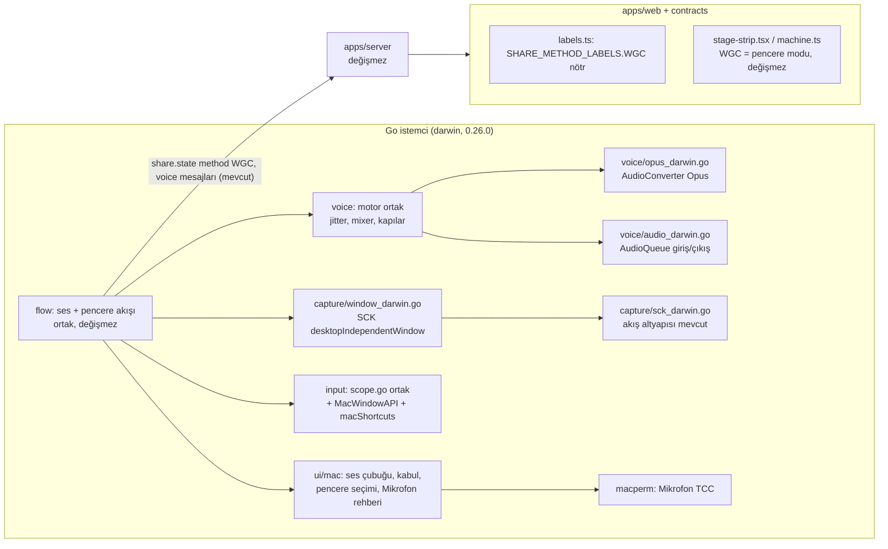

# Mimari — P33 macOS istemcisine ses ve tek pencere paylaşımı

Tarih: 2026-11-22 · Durum: **r1** (mimar, "sormadan ilerle") — güvenlik tasarım turu (K0g) ve K0s spike'ları bekliyor · Dal: `claude/p33-mac-ses-pencere`
Girdiler: `docs/gereksinimler-p33.md` (AC-534..558, V-P33-1..12, R-P33-1..10, S-P33-1..6, "Ek — Orkestratör notları"),
`docs/mimari-p28d.md` + ADR-0036 (ses protokolü, wasm/wazero Opus, mix-minus), `docs/mimari-p28f.md` + ADR-0037 (purego, SCK,
A-PF-1, K0s-6), `docs/spike-p28f-k0s.md` (K0s-6 ölçümleri), `docs/mimari-e11.md` §8.1 (AC-248 pencere modu, S17-1, S-P17-1/7).
Yeni ADR: **ADR-0043** (ADR-0036 m.1 ve ADR-0037 m.6/m.7'yi macOS için değiştirir). Kontrol listesi: `docs/tasarim-kontrol.md` "P33".
Sürüm: **0.26.0** (istemci üç platform + sunucu/web aynı etiket). **DB/migration yok, yeni REST/WS mesajı yok, sözleşme değeri değişmez.**

**Sadelik:** Mac, Windows'un ses ve pencere modunu **aynı `flow` akışı, aynı `voice` motoru (mix-minus, jitter, kapılar), aynı
`input` kapsam kuralları ve aynı web/sunucu** ile kullanır. Yalnız işletim sistemi uçları (kodek arka ucu, ses aygıtı, pencere
yakalama, pencere sorguları, kısayol tablosu) darwin dosyalarına eklenir. Tek yol: Mac'te kodek tek (AudioToolbox), aygıt tek
(AudioQueue), pencere yakalama tek (SCK).

---

## 1. Özet ve kısıtlar

| Kapsamda                                                                                                          | Kapsam dışı / Sonra (neden)                                                                  |
| ----------------------------------------------------------------------------------------------------------------- | -------------------------------------------------------------------------------------------- |
| Mac katılımlı oturumda P28d sesi (`rs.cap.voice1`), Mikrofon TCC izni ve rehberi                                  | Sistem sesi aktarımı (V-P33-1); yankı giderme (VoiceProcessingIO) ve aygıt seçimi — Sonra    |
| Mac'te AC-248 pencere modu: seçim ekranı, liste, yalnız pencere içeriği, girdi kapsamı, Mac kısayol tablosu       | `SCContentSharingPicker`; menü çubuğu paylaşımı (S-P33-4); çoklu pencere; Linux pencere modu |
| Konsolda platform-nötr pencere etiketi (AC-552)                                                                   | Mac gözetimsiz/servis, Developer ID/notarization (kullanıcı kararı)                          |
| Paket: `NSMicrophoneUsageDescription`, entitlement kümesi `{device.audio-input}`, darwin ikilisinden wazero çıkar | macOS yerinde otomatik güncelleme (K-P29-10 "yalnız bildir" kalır)                           |
| TCC (Ekran Kaydı, Erişilebilirlik, **Mikrofon**) güncelleme rehberi, OKUBENI, `MacGuide`, kılavuz                 | Başka Space / tam ekran pencerelerin listelenmesi (S-P33-3 = Hayır)                          |

### 1.1 Kararlar (K-P33-n)

| #        | Karar                                                                                                                                                                                                                                                                                                                                                                                                                                                                                                                                                                                            | Gerekçe (kısa; ayrıntı ADR-0043)                                                                                                                                                                                         |
| -------- | ------------------------------------------------------------------------------------------------------------------------------------------------------------------------------------------------------------------------------------------------------------------------------------------------------------------------------------------------------------------------------------------------------------------------------------------------------------------------------------------------------------------------------------------------------------------------------------------------ | ------------------------------------------------------------------------------------------------------------------------------------------------------------------------------------------------------------------------ |
| K-P33-1  | **S-P33-1: Opus macOS'ta AudioToolbox `AudioConverter` (`kAudioFormatOpus`) ile, kodlama ve çözme, purego üzerinden.** darwin ikilisine wazero ve `libopus.wasm` **bağlanmaz**. JIT yok, cgo yok, yeni Go bağımlılığı yok, entitlement yalnız `device.audio-input`.                                                                                                                                                                                                                                                                                                                              | 2026-11-22 doğrulama (bu makine, macOS 26.3.1, M4 Pro): `afconvert -d opus@48000 -c 1 -b 32000` kodladı, CAF'ta "opus, 960 frames/packet, 33,9 kbit/s, priming 312", geri çözdü. Seçenek tablosu §2.1                    |
| K-P33-2  | Ses aygıtı **AudioQueue** (K0s-6 GEÇTİ: 5 dk kesinti 0, iki dilim): 48 kHz mono Int16, 20 ms × 3 tampon, giriş ve çıkış ayrı kuyruk. `voice.New(voice.OpenAudioQueue, onFail)` — WASAPI/Pulse ile aynı aygıt arayüzü. Mix-minus, jitter, talker/gönderim kapıları ortak koddan, **değişmez**.                                                                                                                                                                                                                                                                                                    | AVAudioEngine ObjC blok/graf yüzeyi daha büyük, kazanç yok; AudioQueue C API purego'ya uygun ve ölçüldü                                                                                                                  |
| K-P33-3  | Mikrofon izni `AVCaptureDevice authorizationStatusForMediaType:AVMediaTypeAudio` / `requestAccessForMediaType:completionHandler:` (`macperm`), **yalnız** yerel "Kabul" tıklamasının devamında. İzin yok/aygıt yok → `voice.end{reason:"device"}` + rehber (V-P33-3, S-P33-5 = Windows gibi). mimari-p28f §5.3 m.4'teki "dinleme devam eder" taslağı geçersiz.                                                                                                                                                                                                                                   | Tek kural (Windows V-PD-1). İstem, AudioQueue'nun örtük istemine bırakılmaz: sonuç belirli olsun                                                                                                                         |
| K-P33-4  | **Pencere yakalama: ScreenCaptureKit `SCContentFilter initWithDesktopIndependentWindow:`**, mevcut `sck_darwin.go` akış altyapısı (aynı temsilci sınıf, NV12, GPU ölçekleme uzun kenar ≤ 1920, 30 fps, VideoToolbox) genişletilir. Boyut değişiminde `updateConfiguration:completionHandler:`. `CGWindowListCreateImage` **seçilmedi** (SDK başlığı `CGWindow.h`: `SCREEN_CAPTURE_OBSOLETE(10.5,14.0,15.0)` — 14'te deprecated, 15'te obsoleted, 2026-11-22 doğrulandı; yoklama tabanlı, üstteki pencereyi de yakalar).                                                                          | Blok çağrısı sorunu yok: purego `objc.NewBlock` bugün `getShareableContent…` ve `startCapture…`'da kullanılıyor                                                                                                          |
| K-P33-5  | **Pencere durumu tek kaynaktan:** `CGWindowListCopyWindowInfo(kCGWindowListOptionIncludingWindow, wid)` 250 ms'de bir (yakalama) ve her girdi olayında (girdi kapsamı). Yok → `WINDOW_CLOSED`; `kCGWindowIsOnscreen` yok/false → "görünmez" (küçültme, ⌘H, başka Space, tam ekran: AC-545'in dört durumu tek durum) → siyah kare + "Pencere simge durumunda" + tüm girdi düşer.                                                                                                                                                                                                                  | SCK kare durumu (Idle/Suspended) tek başına kapanmayı/küçültmeyi ayırmaz; CG sorgusu ucuz ve izinsiz                                                                                                                     |
| K-P33-6  | **S-P33-2: `SHARE_METHODS` değişmez; Mac pencere modu tel değeri olarak `"WGC"` gönderir** (değer = "pencere modu" belirteci). Yalnız etiketler nötr olur: `SHARE_METHOD_LABELS.WGC = "Pencere yakalama"`. Yeni neden kodu yok (Mac `WINDOW_CLOSED` / `WINDOW_UNAVAILABLE` kullanır; `WGC_UNSUPPORTED` Mac'te üretilmez).                                                                                                                                                                                                                                                                        | `share.state` `strictObject` + `z.enum(SHARE_METHODS)`: yeni değer eski sunucuda **tüm mesajı** düşürürdü (AC-553 riski, R-P33-8). Yeniden kullanım: sözleşme değişmez → yayın sırası kısıtı yok, eski sunucu da çalışır |
| K-P33-7  | **S-P33-3: Liste = geçerli Space'te ekranda görünen normal pencereler** (`onScreenWindowsOnly:YES`). Başka Space ve tam ekran pencereler listede yok; seçim ekranındaki ipucu "Pencere listede yoksa: Dock'tan açın, bu masaüstüne getirin ya da tam ekrandan çıkın, sonra Listeyi yenile'ye tıklayın."                                                                                                                                                                                                                                                                                          | Windows ile aynı (geçerli masaüstü). Paylaşılan pencere sonradan başka Space'e giderse K-P33-5 "görünmez" durumu                                                                                                         |
| K-P33-8  | **Sapma D-P33-1 (AC-543 "(simge durumunda)" satırı):** Simge durumundaki pencereler varsayılan olarak **listelenmez** (ipucu K-P33-7). Gerekçe: izinsiz, güvenilir bir "küçültülmüş" işareti bilinmiyor — bu makinedeki yoklamada (2026-11-22, SCK `SCWindow`, ekran dışı pencerelerin durumu ayrıca belirlenmedi) `isActive` her pencerede `isOnScreen` ile aynı çıktı, küçültülmüş ↔ başka Space ayrımı gösterilemedi (K0s-W2 karar verir); AX `kAXMinimizedAttribute` Erişilebilirlik izni ister (paylaşım başında çoğu zaman yok). K0s-W2 izinsiz bir işaret bulursa AC-543 aynen uygulanır. | Erişilebilirlik iznine göre değişen liste "tek yol" ilkesine aykırı (sadelik ilkesi). qa bu sapmayı AC-543'e karşı kayıtlı sapma olarak denetler                                                                         |
| K-P33-9  | Girdi kapsamı: mevcut `input` kapsam motoru (`scope.go`) aynen; Mac için `MacWindowAPI` (CGWindowList sırası + `kCGWindowOwnerPID` + `NSWorkspace.frontmostApplication`) ve **platform kısayol politikası** (`ShortcutPolicy`: Windows mevcut kurallar taşınır, Mac AC-549 tablosu). Mac tablosu eşlemeden **sonraki** tuşlarla (Ctrl→⌘, Meta→⌃, Alt→⌥) değerlendirilir. Şüphede olay düşer (fail-closed).                                                                                                                                                                                       | Kurallar tek yerde; Mac'e kopya kapsam motoru yazılmaz                                                                                                                                                                   |
| K-P33-10 | Entitlement kümesi **tam olarak** `com.apple.security.device.audio-input`; hardened runtime (`--options runtime`) korunur. `Info.plist`'e `NSMicrophoneUsageDescription` (AC-554 metni). `allow-unsigned-executable-memory`, `allow-jit`, `disable-library-validation` **yok**.                                                                                                                                                                                                                                                                                                                  | Hardened runtime'da mikrofon bu entitlement olmadan sessizce reddedilir; K-P33-1 JIT'i gereksiz kılar                                                                                                                    |
| K-P33-11 | Mac'te `voice.Supported()` = **çalışma zamanı yoklaması**: AudioToolbox Opus kodlayıcı ve çözücü kurulabiliyor ve 1 çerçeve gidiş-dönüş öz-testi geçiyor. false ise `VoiceUI/OpenVoice` bağlanmaz, `rs.cap.voice1` bildirilmez, konsolda AC-352 metniyle pasif düğme (AC-541'in eski istemci davranışıyla aynı).                                                                                                                                                                                                                                                                                 | macOS 13'te Opus kodlayıcı varlığı doğrulanmadı; yoklama 13'te sorun varsa sessizce güvenli dala düşürür (A-PD-6 kalıbı)                                                                                                 |

### 1.2 Varsayımlar (gereksinimdekilere ek)

- **V-P33-A1:** AudioToolbox Opus çözücüsü RFC 6716 uyumlu ham Opus paketlerini (TOC baytlı, CAF'taki gibi kapsülsüz) kabul eder; Chrome'un
  `opus/48000/2` (stereo bayraklı, içerik çoğunlukla mono) 20 ms paketlerini mono çıkışa çözer. **K0s-A1 doğrular.** 20 ms dışı paket
  (10/40/60 ms) çözülemezse düşer ve sayılır (`DecodeErr`); Chrome varsayılanı 20 ms'dir.
- **V-P33-A2:** AudioConverter Opus çözücüsünde bant içi FEC ve PLC API'si **olmayabilir**. Yoksa: `DecodeFEC` "desteklenmiyor" döner (jitter
  doğrudan `Conceal`'e geçer), `Conceal` Go'da üretilir: son çerçeve her adımda −6 dB ile tekrarlanır, 5 adımdan sonra sessizlik (mevcut jitter
  "5 PLC sonra sessizlik" kuralıyla aynı sayaç). Ölçüt K0s-A1'de.
- **V-P33-A3:** Mac'te kontrol (girdi) yalnız Erişilebilirlik izni verilmişse açılır (P28f); bu yüzden pencere modunda girdi kapsamı AX'e
  ihtiyaç duymadan CG sorgularıyla yapılır (K-P33-9), AX yalnız ek doğrulama olarak gerekmez.

---

## 2. Bileşenler ve sorumluluklar

| Bileşen                                            | Sorumluluk (P33'te)                                                                                                                                                                                                  |
| -------------------------------------------------- | -------------------------------------------------------------------------------------------------------------------------------------------------------------------------------------------------------------------- |
| `internal/voice/opus.go` (ortak, bölünür)          | Sabitler, hatalar, `Decoder` politikası (talker kapısı çağıranda; boyut, hız, tuzak/hata sayacı → `ErrPeerDropped`), genel API imzaları. Arka uç bir `codecBackend` arayüzü (kodlayıcı + çözücü) üzerinden seçilir   |
| `internal/voice/opus_wasm.go` (`!darwin`)          | Bugünkü wazero/libopus kodu **taşınır, davranış aynı** (Windows/Linux)                                                                                                                                               |
| `internal/voice/opus_darwin.go` (yeni)             | AudioToolbox `AudioConverterNew` (LPCM s16 48k mono ↔ `kAudioFormatOpus` 48k mono 960 çerçeve/paket), `kAudioConverterEncodeBitRate = 32000`, `kAudioConverterPrimeInfo` → `Lookahead`. Çözmeden önce Go doğrulayıcı |
| `internal/voice/opuspkt.go` (yeni, ortak saf Go)   | RFC 6716 §3.4 paket geçerlilik kuralları R1–R7 (TOC, kod 0–3, çerçeve sayısı ≤ 48, uzunluk tutarlılığı, toplam süre ≤ 120 ms). Yalnız darwin arka ucu çağırır; fuzz her platformda koşar                             |
| `internal/voice/audio_darwin.go` (yeni)            | AudioQueue giriş + çıkış; geri çağrılar `purego.NewCallback` (süreçte bir kez, tutamaç tablosu); 1 sn örneksiz giriş → `ErrDeviceLost`; `Close` = `AudioQueueStop(immediate)` + `AudioQueueDispose` (≤ 1 sn)         |
| `internal/voice/supported_darwin.go` (yeni)        | K-P33-11 yoklaması (sonuç süreçte bir kez önbelleklenir)                                                                                                                                                             |
| `internal/macperm/mic_darwin.go` (yeni)            | Mikrofon izin durumu/isteği (AVFoundation, `objc.NewBlock`), `Privacy_Microphone` URL'si                                                                                                                             |
| `internal/capture/window_darwin.go` (yeni)         | Pencere listesi (süzgeç §6.2), pencere akışı, CG durum yoklaması, siyah kare (`iconicPlate` ortak), `WindowCaptureSupported()` = true (macOS 13+; SCK yoksa false)                                                   |
| `internal/input/window_darwin.go` (yeni)           | `MacWindowAPI` (`WindowAPI` arayüzü, §6.3)                                                                                                                                                                           |
| `internal/input/shortcuts.go` + `shortcuts_mac.go` | `ShortcutPolicy` arayüzü; `scope_keys.go`'daki Windows kuralları `winShortcuts`'a **davranış değişmeden** taşınır; `macShortcuts` AC-549 tablosu (build etiketi yok → tablo testi Linux CI'da da koşar)              |
| `internal/ui/mac/*`                                | `voice_darwin.go` (kabul = `prompt_darwin.go`, ses çubuğu, Mikrofon rehberi; mantık `uicore/voice.go`), `screens_darwin.go` seçim ekranı genişler (§6.1), gösterge metni pencere modunda                             |
| `cmd/noktadestek/deps_darwin.go`                   | `VoiceUI/OpenVoice` (yoklama true ise), `WindowCapture/CaptureWindow/SetInputWindow` bağlanır                                                                                                                        |
| `packages/contracts/src/labels.ts`                 | `SHARE_METHOD_LABELS.WGC` → `"Pencere yakalama"`; açıklama yorumları nötr                                                                                                                                            |
| `apps/web`                                         | Davranış değişmez (rozet/monitör temizliği zaten `"WGC"` değerine bağlı); yalnız beklenen metinli testler                                                                                                            |
| `apps/server`                                      | **Değişmez** (`hasVoice` yeteneğe bağlı, `share.state` şeması aynı)                                                                                                                                                  |

### 2.1 S-P33-1 seçenek karşılaştırması (karar K-P33-1)

| Seçenek                                        | Ölçülen / doğrulanan                                                                                                                                                                                            | Sonuç                                                                                                                                                                                                       |
| ---------------------------------------------- | --------------------------------------------------------------------------------------------------------------------------------------------------------------------------------------------------------------- | ----------------------------------------------------------------------------------------------------------------------------------------------------------------------------------------------------------- |
| (a′) wazero derleyici (arm64)                  | K0s-6: karmaşıklık 2/5'te **yanlış derleme tuzağı**, 0/1'de eşit, 0,2 ms. Ad-hoc + hardened runtime'da entitlement'sız **SIGKILL**; `allow-jit` yetmiyor, yalnız `allow-unsigned-executable-memory` çalıştı     | **Red.** Entitlement yalnız ad-hoc imza + hardened runtime için de gerekli (doğrulandı). Bilinen yanlış derleme sandbox iddiasını zayıflatır; karmaşıklık 1 kalite düşüşü; W^X yüzeyi tüm süreç için açılır |
| (a″) hardened runtime'ı kapatmak               | Ölçülmedi (entitlement'sız JIT'in çalışacağı varsayımı)                                                                                                                                                         | **Red.** AC-554 ve S-P28f-5 `--options runtime` ister (`DYLD_*` yok sayma, T5)                                                                                                                              |
| (b) wazero yorumlayıcı                         | 2026-11-22, M4 Pro, darwin/arm64, mevcut benchmark (`BenchmarkP28dK0s{Encode,Decode}20ms`, 300×): **kodlama 16,2 ms, çözme 3,27 ms**/çerçeve (karmaşıklık 5). K0s-6: karmaşıklık 0'da bile kodla+3 çöz 20–26 ms | **Red.** AC-538 (≤ 10 ms) ve CPU +10 puan bütçesi tutmaz                                                                                                                                                    |
| (b′) Apple kodlayıcı + wasm yorumlayıcı çözücü | Çözme 3,27 ms/konuşan (M4 Pro; M1/Rosetta daha yavaş) → tek konuşanda ≈ %16 çekirdek                                                                                                                            | **Red** (yedek değil): CPU bütçesi; 3 konuşanda ≈ 10 ms. Güvenlik açısından çekici (güvenilmeyen girdi sandbox'ta) — K0g'ye bilgi                                                                           |
| (cgo) libopus                                  | —                                                                                                                                                                                                               | **Red.** `CGO_ENABLED=0` + Linux'ta tekrarlanabilir darwin derlemesi (ADR-0037 m.1, K0s-7) bozulur; güvenlik profili AudioToolbox ile aynı (yerel kod, sandbox yok) ama yamayı biz taşırız                  |
| **(d) AudioToolbox Opus**                      | macOS 26.3.1'de kodlama/çözme çalıştı (afconvert). purego: C API + tek geri çağrı (`AudioConverterFillComplexBuffer` giriş işlevi); `purego.NewCallback` AudioQueue'da kanıtlı                                  | **Seçildi.** JIT/cgo/yeni bağımlılık yok; iki dilimde yerli; kodek güncellemesi işletim sistemiyle gelir; darwin ikilisi ≈ 2,5 MiB küçülür                                                                  |

**Kabul edilen bedel (K0g'ye soru G-P33-1):** Teknisyenden gelen Opus paketleri macOS'ta wasm sandbox'ı yerine **süreç içi Apple
çözücüsüne** gider (Windows/Linux'taki Y-PD-2 birincil savunması Mac'te yok). Azaltım: (1) yalnız `talkers` içindeki, kimliği doğrulanmış
teknisyenden, DTLS-SRTP içinde gelen paket; (2) boyut ≤ 1275 + 100 paket/sn (mevcut); (3) **R1–R7 Go doğrulayıcısı** (geçersiz paket
yerel koda hiç girmez); (4) K0s-A1 30 dk fuzz (doğrulayıcıdan geçen mutasyonlar AudioConverter'a) 0 çökme; (5) çözücü OS güncellemesiyle
yamalanır (CoreAudio yamaları macOS güvenlik güncellemelerinde gelir). Kalan risk: yerel çözücüde bellek hatası süreci düşürebilir ya da
istismar edilebilir — R-P33-11.

---

## 3. Veri modeli

**Yeni tablo, sütun, indeks, migration, seed yok; dba işi yok** (V-P33-9). Yetki (`sessions.voice`), audit eylemleri (`voice.*`,
`session.join{os}`) ve `Room.voice` bellek durumu değişmez. Silme stratejisi değişmez. İstemci yeni kalıcı veri yazmaz (AC-556):
pencere listesi ve başlıklar yalnız bellekte, seçim ekranı kapanınca bırakılır; ses verisi diske yazılmaz.

## 4. Sözleşme (REST/WS)

### 4.1 Değişmeyenler (bağlayıcı)

- REST: değişiklik yok. WS mesaj kümesi ve şemaları değişmez; `share.state.method` enum'u `["DXGI","GDI","WGC"]` olarak kalır.
- Ses: Mac istemci `/ws/guest` alt protokolüne `rs.cap.voice1` ekler (yalnız K-P33-11 yoklaması true ise); sunucu `hasVoice` ve web
  `guestVoice` kapıları **değişmez** (AC-541). Mesajlar `voice.request/answer/join/end/state` aynen (mimari-p28d §4.2).
- Pencere modu: Mac `share.state{state:"sharing", method:"WGC"}` gönderir, monitör listesi göndermez, `monitor.request`'i yok sayar
  (mevcut `flow.sendShare` + `session_media.go` yolu, platformdan bağımsız). Kapanışta `share.state{stopped, reason:"WINDOW_CLOSED", method:"WGC"}`;
  pencere açılamazsa `WINDOW_UNAVAILABLE`.

### 4.2 Etiket değişikliği (`packages/contracts/src/labels.ts`, yalnız metin)

| Anahtar                                    | Eski                                                  | Yeni                                                                                          |
| ------------------------------------------ | ----------------------------------------------------- | --------------------------------------------------------------------------------------------- |
| `SHARE_METHOD_LABELS.WGC`                  | "Pencere yakalama (WGC)"                              | "Pencere yakalama"                                                                            |
| `SHARE_FAIL_REASON_LABELS.WGC_UNSUPPORTED` | "Bu Windows sürümü pencere paylaşımını desteklemiyor" | Değişmez (yalnız Windows üretir; Mac üretmez — Go birim testi: darwin `Reason` kümesinde yok) |
| `ws.ts` / `labels.ts` yorumları            | "WGC P17 pencere modu"                                | "`WGC` = pencere modu belirteci (Windows WGC, macOS SCK; ADR-0043)"                           |

Konsol ipucu `cs.windowShareHint` → "Müşteri yalnız bir pencereyi paylaşıyor (Pencere yakalama)". Hata metni:
"Neden: Paylaşılan pencere kapatıldı — Pencere yakalama". Bilinmeyen kod kuralı (`describeShareFailure`) aynen.

### 4.3 Geriye uyum ve yayın sırası (AC-553)

| İstemci \\ Sunucu | 0.25.x sunucu                                                                                 | 0.26.0 sunucu              |
| ----------------- | --------------------------------------------------------------------------------------------- | -------------------------- |
| 0.25.x (tümü)     | bugünkü                                                                                       | aynen (sözleşme değişmedi) |
| 0.26.0 Mac        | ses ve pencere modu **çalışır**; konsol rozeti eski etiketle "Pencere yakalama (WGC)" görünür | tam (nötr etiket)          |

Sözleşme değişmediği için `strictObject` düşürme riski yoktur; runbook sırası yine "önce sunucu/web, sonra istemci Release" (V-P33-7)
ama sıra bozulması yalnız etiket metnini etkiler, Release bekletilmez. Sunucu birim testi: Mac'ten gelen `share.state{method:"WGC"}` ve
`voice1` alt protokolü 0.26.0 şemasında geçer (mevcut fikstür + `clientOs: "macos"`).

## 5. Güvenlik tasarımı

### 5.1 Tehdit modeli özeti (STRIDE; K0g S-P33-n numaralarını ekler)

| #   | Tehdit                                                                                     | Kontrol                                                                                                                                                                                                                                     |
| --- | ------------------------------------------------------------------------------------------ | ------------------------------------------------------------------------------------------------------------------------------------------------------------------------------------------------------------------------------------------- |
| T1  | Mikrofonun müşteri bilmeden açılması (uzaktan kontrol/sentetik tıklama ile "Kabul")        | K-PD-2 rıza kuralı aynen (bellekte `callId`); Kabul, Sessize al/Sesi aç, Mikrofon rehberi düğmeleri `localClick()` (mimari-p28f §5.2a); kabul diyaloğu açıkken enjeksiyon duraklar (S-P28f-1). `voice.state`/DC/SDP yalnız kapatır (AC-537) |
| T2  | Kötü niyetli teknisyenin bozuk Opus paketiyle yerel çözücüyü istismarı                     | §2.1 azaltımları (talker kapısı → boyut/hız → R1–R7 → AudioConverter); hata sayacı → 3'te eş düşer; R-P33-11 risk kaydı; G-P33-1                                                                                                            |
| T3  | JIT/çalıştırılabilir bellek yüzeyi                                                         | Kaldırıldı: darwin ikilisinde wazero yok (CI `go list -deps` denetimi, §8.4); entitlement'ta `allow-*-executable-memory`/`allow-jit` yok (tam eşleşme)                                                                                      |
| T4  | Pencere modunda teknisyenin paylaşılmayan pencereye/ sisteme girdi göndermesi              | K-P33-9 fail-closed kapsam: nokta kırpma + en üst pencere hedef ya da aynı PID'li bağlı pencere; klavye yalnız hedef uygulama önde ve hedef o uygulamanın en öndeki normal penceresiyken; AC-549 tablosu; tuş kovası (40/sn)                |
| T5  | Sistem kısayoluyla pencere dışına çıkma (⌘Tab, Spotlight, Görev Kontrolü, ekran görüntüsü) | `macShortcuts` tablosu (§6.4) ve kilit (değiştiriciler bırakılana dek düşer); OS değiştirici durumu (`CGEventSourceFlagsState`) birleşik karar                                                                                              |
| T6  | Pencere başlıklarının sızması (KVKK)                                                       | Başlık/uygulama adı yalnız seçim ekranında; WS, audit, tanılama logu, `input_dropped` satırı başlık içermez (Go birim: log yakalayıcı + ağ fikstürü)                                                                                        |
| T7  | Paylaşılan pencerenin üstüne gelen başka pencerenin görüntüye girmesi                      | SCK masaüstünden bağımsız pencere filtresi yalnız o pencerenin katmanını verir (AC-544 elle doğrulanır, K0s-W1)                                                                                                                             |
| T8  | Görünmez pencereye kör girdi (küçültülmüşken)                                              | K-P33-5: görünmez durumda bütün girdi düşer (`DropMinimized`)                                                                                                                                                                               |
| T9  | dylib kaçırma (yeni çerçeveler)                                                            | `objc.Allowed` izin listesi zaten yalnız `/System/Library/Frameworks/<Ad>.framework/<Ad>` mutlak yolları; AudioToolbox ve AVFoundation bu kalıba uyar, liste genişletilmez                                                                  |
| T10 | Ses verisinin kaydı/iz                                                                     | AC-540: kayıt konsolda yalnız video; istemci PCM'i yalnız bellek tamponunda tutar; AC-556 iz testi                                                                                                                                          |
| T11 | Eski TCC kaydının "açık" görünüp çalışmaması (ad-hoc)                                      | Güvenlik değil kullanılabilirlik; AC-555 ölçümü + rehber; `tccutil reset Microphone net.noktabilisim.destek` kılavuzda                                                                                                                      |

### 5.2 Entitlement ve Info.plist (AC-554)

- `build/macos/entitlements.plist`: yalnız `<key>com.apple.security.device.audio-input</key><true/>`; yorum ADR-0043'e işaret eder.
- `Info.plist.tmpl`: `NSMicrophoneUsageDescription` = "Teknisyenle sesli görüşme için. Mikrofon yalnız siz Kabul'e tıkladığınızda açılır."
  `info-plist-keys.txt` izin listesine eklenir (S-P28f-14 denetimi).
- `package.sh check`: entitlement tam eşleşme (yeni küme), `codesign -d --entitlements :-` çıktısı = dosya; `--options runtime` bayrağı
  (`codesign -dv` "flags=0x10000(runtime)") denetimi korunur.

### 5.3 Güvenliğe sorulacaklar (K0g)

- **G-P33-1:** Mac'te sandbox'sız yerel Opus çözücüsü (T2) — R1–R7 doğrulayıcı + talker kapısı + fuzz yeterli mi; kabul edilmezse tek alternatif (b′) (çözücü wasm yorumlayıcıda) ve bedeli CPU (AC-538 sapması).
- **G-P33-2:** `macShortcuts` tablosu eksiksiz mi (R-P33-5): §6.4 + eklenen Görev Kontrolü/F-tuşları/⌃F2 klavye gezinmesi.
- **G-P33-3:** Pencere kapsamında "aynı PID'li bağlı pencere" kabulü (sayfa/panel/menü) — tarayıcı gibi çok pencereli uygulamada aynı PID'in **başka** normal penceresi kabul edilmez (yalnız katman ≠ 0 ya da hedefle kesişen sayfa); yeterli mi.
- **G-P33-4:** Erişilebilirlik ayarı (Yapışkan Tuşlar/Fare Tuşları) okunamazsa fail-closed kuralı (§6.4 son madde).
- **G-P33-5:** `"WGC"` tel değerinin Mac'te yeniden kullanımı (K-P33-6) — konsol/audit açısından yanıltıcı bir iz var mı (audit'e `method` yazılmıyor; doğrulanacak).

## 6. Ayrıntılı davranış

### 6.1 Seçim ekranı (AC-542; `ui/mac/screens_darwin.go`, `flow.UI.ChooseShare` aynen)

- Pencere modu sunulduğunda (`windowMode()` true) tek monitörde de açılır. Başlık "Teknisyenle neyi paylaşmak istiyorsunuz?". Radyo grubu
  "Tüm ekran" (varsayılan; çoklu monitörde altında bugünkü monitör listesi) / "Yalnız bir pencere".
- Pencere listesi: `NSScrollView` içinde radyo düğmeli satırlar ("<Başlık> — <Uygulama>", başlık 80 karakterde kısaltılır); "Listeyi yenile",
  "Paylaş". Altında kalın: "Paylaştığınız pencereden açılan yeni pencereler ve menü çubuğu teknisyene görünmez." ve K-P33-7 ipucu.
- Liste boş → "Paylaşılabilecek pencere yok — programı açıp Listeyi yenile'ye tıklayın", "Paylaş" pasif (AC-543).
- Tüm denetimler `localClick()`; Tab sırası mantıklı; VoiceOver etiketleri (`setAccessibilityLabel:`); renkler AppKit semantik (iki tema).
- Seçim `ShareChoice.Window` = `CGWindowID` (uintptr). Paylaşım başlarken pencere hâlâ listede ve ekranda değilse `WINDOW_UNAVAILABLE`.

### 6.2 Liste süzgeci (AC-543; saf işlev `filterWindows`, sahte `SCWindow` dilimiyle Go birim testi)

Kaynak: `SCShareableContent getShareableContentExcludingDesktopWindows:YES onScreenWindowsOnly:YES`. Bir pencere listeye girer ancak:
`windowLayer == 0`; `isOnScreen`; başlık boş değil; `frame` ≥ 64×64 pt; `owningApplication` var ve PID ≠ kendi PID'imiz; paket kimliği
sistem listesinde değil (`com.apple.dock`, `com.apple.controlcenter`, `com.apple.notificationcenterui`, `com.apple.WindowManager`,
`com.apple.Spotlight`, `com.apple.systemuiserver`, `com.apple.loginwindow`, `com.apple.screencaptureui`). Sıra: ön-arka (SCK sırası).
Başlık ve uygulama adı hiçbir log/WS'ye gitmez (yalnız `count`).

### 6.3 Yakalama ve pencere durumu (AC-544..546, AC-550; `capture/window_darwin.go`)

1. `SCContentFilter initWithDesktopIndependentWindow:<SCWindow>`; `SCStreamConfiguration`: `width/height` = pencere boyutu × ölçek,
   uzun kenar ≤ 1920 (tam ekran kuralıyla aynı), `minimumFrameInterval` 1/30, `pixelFormat` '420v', `showsCursor` YES. Akış temsilcisi,
   kare yuvası, VideoToolbox kodlayıcı ve kare kopyalama **mevcut kod**.
2. CG yoklaması 250 ms: yok → kalıcı `WINDOW_CLOSED` (paylaşım durur, tüm ekrana geçilmez, AC-546); görünmez → kodlayıcıya siyah kare +
   ortada "Pencere simge durumunda" (Windows `iconicPlate` ortak işlevi) ve girdi düşer; görünür olunca ≤ 2 sn içinde gerçek kareye döner.
   Sınır/ölçek değişti → `updateConfiguration:` (boyut değişince kodlayıcı yeni çözünürlükle yeniden kurulur — tam ekran monitör
   değişimiyle aynı yol). `stream:didStopWithError:` + CG'de pencere yok → `WINDOW_CLOSED`; pencere varsa akış bir kez yeniden açılır.
3. İşaretleme katmanı pencere modunda gösterilmez, `monitor.request` yok sayılır (ortak `flow`). Gösterge metni: "Paylaştığınız pencere
   izleniyor — <teknisyen adı>"; §5.2b gösterge kuralları aynen (AC-551).
4. Ölçüt: teslim ≥ 25 fps (K0s-W1), kodlama p95 ≤ 33 ms (P28f ölçütü).

### 6.4 Girdi kapsamı (AC-547..549; `input`)

`MacWindowAPI` (`WindowAPI` arayüzü; durumsuz, her olayda güncel sorgu):

| Yöntem           | Mac karşılığı                                                                                                                                                   |
| ---------------- | --------------------------------------------------------------------------------------------------------------------------------------------------------------- |
| `Exists/Iconic`  | CG tek pencere sorgusu (K-P33-5); `Iconic` = görünmez                                                                                                           |
| `Bounds`         | `kCGWindowBounds` (global nokta koordinatı; enjektörün kullandığı uzay ile aynı — `SetInputMonitor` darwin'de de nokta uzayı)                                   |
| `RootAt(x,y)`    | `kCGWindowListOptionOnScreenOnly` ön-arka listesinde noktayı içeren ilk pencere (kendi gösterge/oturum pencerelerimiz atlanır — zaten fareye geçirgen)          |
| `ForegroundRoot` | `NSWorkspace.frontmostApplication` PID'inin listedeki ilk katman-0 penceresi                                                                                    |
| `Owner`          | Mac'te sahip zinciri yok: hedefle **aynı PID** ve (katman ≠ 0 [sayfa/panel/menü] ya da hedef sınırları içinde kalan sayfa) ise hedef döner, değilse 0 (G-P33-3) |
| `ThreadProcess`  | `(0, kCGWindowOwnerPID)`                                                                                                                                        |
| `IsMenu`         | `kCGWindowLayer == 101` (`kCGPopUpMenuWindowLevel`)                                                                                                             |
| `OSModifiers`    | `CGEventSourceFlagsState(kCGEventSourceStateCombinedSessionState)` → ⌘/⌥/⌃ (arayüz adları "win/alt/ctrl" yerine `ShortcutPolicy`'ye ham bayrak verilir)         |
| `Accessibility`  | `com.apple.universalaccess` `stickyKey` / `mouseDriver`; okunamazsa **açık** sayılır (arayüz kuralı) — K0s-W3                                                   |

**Süreç dışı paneller (R-P33-4):** Korumalı uygulamalarda Kaydet/Aç paneli ayrı süreçtir (yoklamada "Open and Save Panel Service (…)" ayrı uygulama olarak görüldü). Aynı-PID kuralı bu panele giden girdiyi **düşürür** (fail-closed) ve SCK pencere filtresi paneli göstermeyebilir; kılavuzda "Kaydet/Aç penceresini müşteri kullanır" yazılır; K0s-W1/W3 ve elle test listesine girer.

**Mac kısayol tablosu (`macShortcuts`, eşleme sonrası Mac tuşları; eşleşince kilit açılır ve ⌘/⌥/⌃ bırakılana dek tüm basmalar düşer):**
⌘Tab, ⌘\`, ⌘Space, ⌥⌘Space, ⌃Space (giriş kaynağı), ⌥⌘Esc, ⌃⌘Q, ⌘⇧3/4/5 ve ⌃⌘⇧3/4/5, ⌃←/→/↑/↓, Fn/Globe (`Fn`, `FnLock`), ⌘H, ⌥⌘H, ⌘M, ⌥⌘M,
⌥⌘D (Dock), ⌃F2..⌃F8 (menü çubuğu/Dock klavye odağı), F3/F4/F11 ve `LaunchApp*`/`MediaSelect`/`BrowserSearch` (Görev Kontrolü/Launchpad/masaüstü),
`PrintScreen`. İletilen: ⌘C/⌘V/⌘X/⌘Z/⌘A, ⌘W, ⌘Q (paylaşılan programı kapatır → `WINDOW_CLOSED`), normal yazı.
Erişilebilirlik: Yapışkan Tuşlar açık → tek başına ⌘/⌥/⌃/⇧ basması ve tablo tuşlarının değiştiricisiz basması düşer; Fare Tuşları açık →
`Numpad*`/`NumLock` düşer. Ayar okunamazsa ve K0s-W3 `CGEventSourceFlagsState`'in kilitli değiştiriciyi yansıttığını gösterirse ek kural
yok (tablo OS bayrağıyla zaten yakalar); yansıtmıyorsa ayar "açık" sayılır (fail-closed, G-P33-4). Pencere modu tuş kovası (40/sn) aynen.

### 6.5 Ses (AC-534..541)

- Akış P28d §5 ile aynı. Kabul tıklaması → rıza kaydı + `voice.answer` → (aynı goroutine) `macperm.Microphone()`: `authorized` → aç;
  `notDetermined` → sistem istemi (blok tamamlanmasını ≤ 60 sn bekler); `denied/restricted` ya da aygıt yok → `voice.end{device}` +
  rehber penceresi: "Sistem Ayarları → Gizlilik ve Güvenlik → Mikrofon → Nokta Destek açık olmalı" + "Sistem Ayarları'nı aç"
  (`x-apple.systempreferences:com.apple.preference.security?Privacy_Microphone`, `localClick`). Oturum etkilenmez.
- Aygıt kaybı (kulaklık çıkarıldı, varsayılan aygıt değişti): AudioQueue `kAudioQueueProperty_IsRunning` dinleyicisi ya da 1 sn örneksiz
  giriş → `ErrDeviceLost` → `voice.end{device}` (Windows ile aynı; yeniden bağlama yok).
- ≤ 1 sn bırakma: `Close` → `AudioQueueStop(q, true)` + `AudioQueueDispose(q, true)` giriş kuyruğuna önce; turuncu gösterge söner (AC-535 elle).
- Bütçe: AudioToolbox kodla + çöz hedefi ≤ 2 ms/çerçeve (K0s-A1); AC-538 ≤ 10 ms p95 rahat kalır.

## 7. Dosya / klasör planı

| Dosya                                                                                                                          | İşlem                                                                                                                                   | Paket |
| ------------------------------------------------------------------------------------------------------------------------------ | --------------------------------------------------------------------------------------------------------------------------------------- | ----- |
| `packages/contracts/src/labels.ts`, `ws.ts` (yalnız yorum)                                                                     | §4.2 etiket                                                                                                                             | K0    |
| `apps/web/messages/tr.json` (gerekirse), `apps/web/e2e/p17-console.spec.ts`, ilgili web birim testleri                         | Beklenen metin "Pencere yakalama"; yeni e2e: sahte Mac misafiri (`clientOs: macos`, `voice1`) → ses düğmesi etkin + pencere rozeti      | K0    |
| `apps/agent-win/internal/voice/{opus.go,opus_wasm.go,opus_darwin.go,opuspkt.go,audio_darwin.go,supported_darwin.go}` + testler | §2; `supported_other.go` → `//go:build !amd64 && !darwin`; wasm'a bağlı testler `!darwin`                                               | K1    |
| `apps/agent-win/internal/macperm/mic_darwin.go` (+ test)                                                                       | K-P33-3                                                                                                                                 | K1    |
| `apps/agent-win/internal/ui/mac/{voice_darwin.go,prompt_darwin.go,session_darwin.go}`                                          | Ses çubuğu, kabul, Mikrofon rehberi (`uicore/voice.go` mantığı)                                                                         | K1    |
| `apps/agent-win/internal/capture/window_darwin.go` (+ `window_darwin_test.go`), `sck_darwin.go` (filtre parametresi)           | §6.1–6.3                                                                                                                                | K2    |
| `apps/agent-win/internal/input/{window_darwin.go,shortcuts.go,shortcuts_mac.go,scope_keys.go}` + testler                       | §6.4; `scope_keys.go` Windows kuralları `winShortcuts`'a taşınır (mevcut testler değişmeden geçer)                                      | K2    |
| `apps/agent-win/internal/ui/mac/{screens_darwin.go,overlay_darwin.go}`                                                         | Seçim ekranı, gösterge metni                                                                                                            | K2    |
| `apps/agent-win/cmd/noktadestek/deps_darwin.go`                                                                                | Ses (K1) ve pencere (K2) bağlama — iki paket ayrı bloklar ekler                                                                         | K1/K2 |
| `apps/agent-win/internal/ui/uicore/texts.go`                                                                                   | Yeni Türkçe metinler (tek ileti tablosu)                                                                                                | K1/K2 |
| `apps/agent-win/build/macos/{entitlements.plist,Info.plist.tmpl,info-plist-keys.txt,OKUBENI*.txt,package.sh}`                  | §5.2; OKUBENI izin adımlarına Mikrofon                                                                                                  | K3    |
| `apps/agent-win/test/trace-check-mac.sh`                                                                                       | Ses + pencere modu kullanılmış oturum senaryosu; TCC istisnası Mikrofon dahil                                                           | K3    |
| `.github/workflows/agent-win.yml`                                                                                              | darwin derlemesinde wazero yok denetimi; entitlement tam eşleşme yeni küme; `test-macos` darwin ses/pencere testleri                    | K3    |
| `apps/web/app/session/[token]/mac-guide.tsx`, `messages/tr.json` `gm.*`                                                        | Mikrofon izni adımı (orkestratör notu)                                                                                                  | K0    |
| `third_party_notices.txt` (darwin)                                                                                             | darwin ikilisinde libopus/wazero bildirimleri gereksiz; liste platformdan bağımsız tek dosya kalır (fazla bildirim zararsız) — değişmez | —     |
| `docs/runbook.md`, `CHANGELOG.md`, `docs/KULLANIM_KILAVUZU.md`, `README.md`, `docs/DATASHEET.md`, PDF                          | AC-557                                                                                                                                  | K3/K7 |

## 8. Performans ve operasyon

### 8.1 Performans

| Konu             | Karar / ölçüt                                                                               |
| ---------------- | ------------------------------------------------------------------------------------------- |
| Opus             | AudioToolbox yerli; kodla + çöz p95 ≤ 2 ms/çerçeve iki dilimde (K0s-A1); AC-538 p95 ≤ 10 ms |
| CPU              | Ses açıkken süreç CPU artışı ≤ 10 puan (AC-538; elle, Etkinlik Monitörü 60 sn ortalama)     |
| Pencere yakalama | ≥ 25 fps teslim; kodlama p95 ≤ 33 ms; CG yoklaması 250 ms (tek sorgu, ≈ µs)                 |
| İkili boyutu     | darwin dilimleri wazero + wasm (≈ 2,5 MiB) kadar küçülür; zip ≤ 60 MB (AC-389)              |

### 8.2 Config / env

Yeni env değişkeni **yok**. Sunucu/web ayarı yok. İstemci sabitleri koddadır.

### 8.3 Log / metrik

- Tanılama: mevcut `ses_ozet` (sayaçlar) Mac'te de yazılır; yeni alan `backend: "audiotoolbox"|"wasm"` (yalnız sabit). Pencere modu düşürmeleri
  mevcut `input_dropped{reason}`; başlık/koordinat yok. Sunucu metrikleri değişmez.

### 8.4 CI (yalnız ekleme)

- `check`: `GOOS=darwin go list -deps ./cmd/noktadestek | grep -c tetratelabs/wazero` = 0 (her iki dilim); `macShortcuts` ve `opuspkt` testleri Linux'ta.
- `test-macos` (macos-15) ve yeni matris satırı **macos-14**: AudioToolbox Opus yoklaması + gidiş-dönüş + fikstür çözümü (SNR ölçütü), AudioQueue açılış (aygıt yoksa SKIP), SCK pencere süzgeci (izin yoksa görünür SKIP).
- `package-mac`: entitlement tam eşleşme (`device.audio-input`), Info.plist anahtar listesi, `--options runtime`.

### 8.5 Migration / rollback / yedek

Migration yok. Rollback: istemci 0.25.1 zip'i yeniden yayınlanır (Release); sunucu/web geri alınırsa yalnız etiket eski metne döner.
Mac sesinde ciddi sorun → acil düzeltme sürümünde `supported_darwin.go` false (ses pasif, pencere modu sürer). Yedek etkisi yok.

## 9. Test stratejisi

| Seviye                     | Kapsam                                                                                                                                                                                                                                                               | Komut                                    |
| -------------------------- | -------------------------------------------------------------------------------------------------------------------------------------------------------------------------------------------------------------------------------------------------------------------- | ---------------------------------------- |
| Go ortak (Linux CI)        | `opuspkt` R1–R7 tablo + `FuzzOpusPacketValid`; `macShortcuts` tablo testi (AC-549 her satır + iletilenler + kilit); `Owner/RootAt` karar mantığı sahte `WindowAPI` ile (AC-547/548: örtüşen pencere → düşer, başka uygulama önde → 0 olay); `filterWindows` (AC-543) | `pnpm -r run test` / `go test ./...`     |
| Go darwin (macos-14/15)    | AudioToolbox yoklama, kodla/çöz gidiş-dönüş SNR ≥ 20 dB, `testdata/opus-fixtures.txt` çözümü, R1–R7 reddi yerel koda gitmeden; AudioQueue aç/kapat; `voice.end device` sahte aygıt hatası (AC-536); Info.plist/entitlement                                           | `go test ./...` (darwin)                 |
| Web birim + e2e            | Etiket nötr (AC-552); sahte Mac misafiri `voice1` → düğme etkin, 0.25 sahte Mac → pasif + AC-352 metni (AC-541); monitör seçici gizli (AC-550); kayıtta ses izi 0 (AC-540 mevcut test Mac misafiriyle)                                                               | `pnpm --filter @remote/web test` / `e2e` |
| Sunucu birim               | `share.state{WGC}` + `clientOs macos` + `voice1` geçer (AC-553); `hasVoice` OS'tan bağımsız (AC-541)                                                                                                                                                                 | `pnpm --filter @remote/server test`      |
| Elle (test-operatoru, Mac) | D-listesi: AC-534..540, 542..551, 555 (macOS 14 veya 15 + 26, arm64 + Rosetta x86_64)                                                                                                                                                                                | `docs/test-raporu.md`                    |

## 10. Görev paketleri ve atama

| Paket | İçerik                                                                                                                   | Ajan                       | Bağımlı             | Paralel mi |
| ----- | ------------------------------------------------------------------------------------------------------------------------ | -------------------------- | ------------------- | ---------- |
| K0s   | Spike'lar (§10.1; bu Mac'te koşturulabilir) → sonuç `docs/spike-p33-k0s.md`                                              | backend-dev (Go)           | —                   | K0g ‖ K0   |
| K0g   | Güvenlik tasarım turu (G-P33-1..5, T1–T11, entitlement)                                                                  | guvenlik                   | bu belge            | K0s ‖ K0   |
| K0    | Contracts etiketi + web metin/e2e + `MacGuide` Mikrofon adımı                                                            | frontend-dev               | —                   | K0s ‖ K0g  |
| K1    | Go ses: `opus_darwin`/`opuspkt`/`audio_darwin`/`supported_darwin`, `opus.go` bölme, `macperm` mikrofon, ui/mac ses, deps | backend-dev (Go)           | K0s-A*, K0g         | K2 ‖ K3    |
| K2    | Go pencere: `window_darwin` (capture + input), `ShortcutPolicy` taşıma + `macShortcuts`, seçim ekranı, gösterge, deps    | backend-dev (Go, 2. örnek) | K0s-W*, K0g         | K1 ‖ K3    |
| K3    | devops: entitlement/Info.plist/OKUBENI/package.sh, CI (§8.4), trace-check, runbook, 0.26.0 staging                       | devops                     | K0g                 | K1 ‖ K2    |
| K4    | qa (AC-534..558, D-P33-1 sapma kaydı)                                                                                    | qa-denetci                 | K0..K3              | K5 ile     |
| K5    | Güvenlik kod denetimi                                                                                                    | guvenlik                   | K0..K3              | K4 ile     |
| K6    | Staging Mac D-listesi + AC-555 TCC ölçümü                                                                                | test-operatoru             | K4, K5 düzeltmeleri | —          |
| K7    | Doküman (AC-557): kılavuz, README, DATASHEET, CHANGELOG 0.26.0, PDF; eski belgelere notlar                               | teknik-yazar               | K6                  | —          |

Çakışma notu: `deps_darwin.go` ve `uicore/texts.go` K1 ile K2'nin ortak dosyalarıdır; her paket yalnız kendi bloğunu ekler, ikinci birleşen çakışmayı çözer.

### 10.1 K0s spike ölçütleri (bu makine: Apple Silicon macOS 26; ayrıca CI macos-14/15)

| #      | Konu                             | Ölçüt (GEÇTİ)                                                                                                                                                                                                                                                                                                                                                                                                                                                                                                                            | FAIL dalı                                                                                                                                                                                                                                                                                   |
| ------ | -------------------------------- | ---------------------------------------------------------------------------------------------------------------------------------------------------------------------------------------------------------------------------------------------------------------------------------------------------------------------------------------------------------------------------------------------------------------------------------------------------------------------------------------------------------------------------------------- | ------------------------------------------------------------------------------------------------------------------------------------------------------------------------------------------------------------------------------------------------------------------------------------------- |
| K0s-A1 | AudioToolbox Opus (purego)       | (1) Kodlayıcı + çözücü macOS 14, 15, 26'da kurulur (13: VM varsa; yoksa K-P33-11 yoklaması güvence). (2) 32 kbit/s ayarlanır, çıkış 20 ms paket. (3) Apple → libopus.wasm ve libopus.wasm → Apple çözümü SNR ≥ 20 dB; fikstürlerin (stereo, CELT) 20 ms olanları çözülür. (4) Kodla + çöz p95 ≤ 2 ms arm64 ve Rosetta x86_64. (5) PLC/FEC var mı — yoksa V-P33-A2 yolu. (6) R1–R7 doğrulayıcısından geçen mutasyonlarla 30 dk fuzz: 0 çökme, 0 askı (> 200 ms çağrı). (7) Chrome'dan yakalanmış Opus yükü çözülür (P28d ertelenen ölçüt) | Kodlayıcı (1)–(4) FAIL → Mac'te ses kapalı kalır (dal (c), pencere modu sürer) ya da kullanıcı risk kabulüyle (a′) — ADR-0043 r2; yalnız **çözücü** FAIL ya da G-P33-1 reddi → (b′) (Apple kodlayıcı + wasm yorumlayıcı çözücü) + AC-538 CPU sapması kullanıcıya; (6) FAIL → aynı (b′) dalı |
| K0s-A2 | Mikrofon TCC (ad-hoc + hardened) | `device.audio-input` ile istem çıkar, izinle örnek gelir; entitlement'sız reddedilir (belgelenir); `Dispose` sonrası turuncu gösterge ≤ 1 sn söner; reddedilmiş durumda `authorizationStatus` = denied okunur                                                                                                                                                                                                                                                                                                                            | Davranış farklıysa K-P33-3 güncellenir                                                                                                                                                                                                                                                      |
| K0s-W1 | SCK pencere akışı (purego)       | `initWithDesktopIndependentWindow:` ile yalnız pencere karesi (üstüne pencere/bildirim gelince görünmez); ≥ 25 fps; boyut değişiminde `updateConfiguration` ≤ 2 sn; küçült/⌘H/Space/kapat dört durumda CG durumu doğru ayrılır                                                                                                                                                                                                                                                                                                           | Yeni kare durumu gerekiyorsa §6.3 güncellenir; yalnız-pencere karesi FAIL → tasarım yeniden                                                                                                                                                                                                 |
| K0s-W2 | Küçültülmüş işareti              | İzinsiz (Erişilebilirlik olmadan) küçültülmüş ↔ başka Space ayrımı yapan güvenilir bir alan var mı (SCK, CGWindowList, NSRunningApplication). Bu makinede 2026-11-22 yoklama: `isOnScreen` = `isActive`                                                                                                                                                                                                                                                                                                                                  | Bulunamazsa D-P33-1 sapması kalır                                                                                                                                                                                                                                                           |
| K0s-W3 | Girdi sorguları                  | CG ön-arka sırası, sayfa/panel/menü katmanları ve PID; `CGEventSourceFlagsState` Yapışkan Tuşlar kilidini yansıtıyor mu; `com.apple.universalaccess` okunabiliyor mu; süreç dışı Kaydet/Aç paneli görüntüde mi, girdisi düşüyor mu                                                                                                                                                                                                                                                                                                       | §6.4 fail-closed dalı                                                                                                                                                                                                                                                                       |

## 11. Kabul kriterleri eşlemesi

| AC     | Bileşen / uç                                                                         | Test                                   |
| ------ | ------------------------------------------------------------------------------------ | -------------------------------------- |
| AC-534 | `supported_darwin.go` → `rs.cap.voice1`; `ui/mac` kabul diyaloğu (P28d metinleri)    | Go birim (alt protokol), web e2e, elle |
| AC-535 | `macperm/mic_darwin.go`, `audio_darwin.go` `Close`, ses çubuğu                       | elle (5 tekrar, kronometre)            |
| AC-536 | K-P33-3, §6.5 rehber, `voice.end{device}`                                            | Go birim + elle                        |
| AC-537 | `localClick()` korumalı ses düğmeleri; K-PD-2 rıza kuralı (ortak `flow`)             | Go birim + elle K4 senaryoları         |
| AC-538 | K-P33-1 AudioToolbox, K0s-A1 ölçütleri, ortak jitter                                 | darwin bench iki dilim + elle          |
| AC-539 | Ortak `voice` mix-minus/listeners; ui/mac "Dinleyen" satırı                          | elle (1+1+1)                           |
| AC-540 | Kayıt konsolda (ADR-0034); istemci diske yazmaz                                      | otomatik kayıt testi + iz testi        |
| AC-541 | Sunucu `hasVoice`, web `guestVoice` değişmez                                         | sunucu birim + web e2e                 |
| AC-542 | §6.1 seçim ekranı                                                                    | elle + Go birim                        |
| AC-543 | §6.2 süzgeç; **D-P33-1 sapması** (simge durumu)                                      | Go birim + elle + ağ dökümü            |
| AC-544 | §6.3 SCK pencere filtresi, `updateConfiguration`                                     | elle                                   |
| AC-545 | K-P33-5 görünmez durumu, siyah kare, girdi düşer                                     | Go birim + elle (4 durum)              |
| AC-546 | `WINDOW_CLOSED` kalıcı                                                               | Go birim + elle                        |
| AC-547 | `MacWindowAPI.RootAt/Owner`, kırpma (ortak `scope.go`)                               | Go birim + elle                        |
| AC-548 | `ForegroundRoot`, `releaseKeysLocked`                                                | Go birim + elle                        |
| AC-549 | `macShortcuts` §6.4                                                                  | Go tablo testi + elle örneklem         |
| AC-550 | Ortak `flow` pencere modu; konsol `machine.ts`                                       | Go birim + web birim                   |
| AC-551 | `overlay_darwin.go` metni; §5.2b                                                     | elle                                   |
| AC-552 | §4.2 etiket; K-P33-6                                                                 | web birim + e2e                        |
| AC-553 | §4.3 (sözleşme değişmez)                                                             | sunucu birim + runbook                 |
| AC-554 | §5.2 entitlement + Info.plist                                                        | CI                                     |
| AC-555 | Rehberler, K6 ölçümü                                                                 | elle                                   |
| AC-556 | `trace-check-mac.sh`, kılavuz `tccutil`                                              | CI + elle                              |
| AC-557 | K7 doküman                                                                           | qa                                     |
| AC-558 | 0.26.0 etiketi, regresyon (`opus_wasm.go` taşıma davranışsız, `winShortcuts` taşıma) | CI + test raporu                       |

## 12. Açık kararlar, sapmalar ve riskler

| #        | Konu                                                                                                                                                                                        | Karar / durum                                                                                                                                                                 | Sahibi                    |
| -------- | ------------------------------------------------------------------------------------------------------------------------------------------------------------------------------------------- | ----------------------------------------------------------------------------------------------------------------------------------------------------------------------------- | ------------------------- |
| D-P33-1  | AC-543 "(simge durumunda)" satırı                                                                                                                                                           | Varsayılan sapma (K-P33-8); K0s-W2 izinsiz işaret bulursa kalkar. Proje yöneticisi/qa bilgisine                                                                               | mimar, qa                 |
| D-P33-2  | AC-558 "Windows e2e'leri değişmeden geçer"                                                                                                                                                  | Davranış aynı; yalnız `p17-console.spec.ts` beklenen etiket metni "Pencere yakalama (WGC)" → "Pencere yakalama" (AC-552 gereği)                                               | frontend-dev, qa          |
| R-P33-11 | Sandbox'sız yerel Opus çözücüsü (T2)                                                                                                                                                        | Azaltımlar §2.1; G-P33-1 güvenlik kararı; kabul edilmezse (b′) + AC-538 sapması kullanıcıya. Apple **kodlayıcı** yoksa/başarısızsa (b′) de olmaz → dal (c) ya da (a′) (§10.1) | guvenlik + mimar          |
| R-P33-12 | AudioToolbox Opus'un macOS 13'te olmaması                                                                                                                                                   | K-P33-11 yoklaması: ses pasif, oturum etkilenmez; README'de "Sesli görüşme macOS 14+ (13'te doğrulanmadı)" K0s sonucuna göre                                                  | backend-dev, teknik-yazar |
| R-P33-13 | PLC/FEC yokluğu (V-P33-A2) kayıplı ağda kalite                                                                                                                                              | Go PLC; AC-538 ölçümü RTT < 150 ms ağda; şikâyet olursa genişleme noktası: çözücü arka ucu arayüzü (`codecBackend`) değişmeden yenisi                                         | mimar                     |
| R-P33-14 | Aynı PID'li çok pencereli uygulamalar (tarayıcı) pencere kapsamında                                                                                                                         | `Owner` yalnız katman ≠ 0 ya da hedef içindeki sayfayı kabul eder; aynı PID'in başka normal penceresi düşer (G-P33-3)                                                         | guvenlik                  |
| Sonra    | Yankı giderme (VoiceProcessingIO: AudioUnit `kAudioUnitSubType_VoiceProcessingIO` `audio_darwin.go` içinde AudioQueue yerine), aygıt seçimi, menü çubuğu paylaşımı (S-P33-4), çoklu pencere | Genişleme noktaları: aygıt `voice.Open*` işlevi; filtre `SCContentFilter initWithDisplay:includingWindows:` (menü çubuğu dahil çoklu pencere)                                 | mimar                     |
