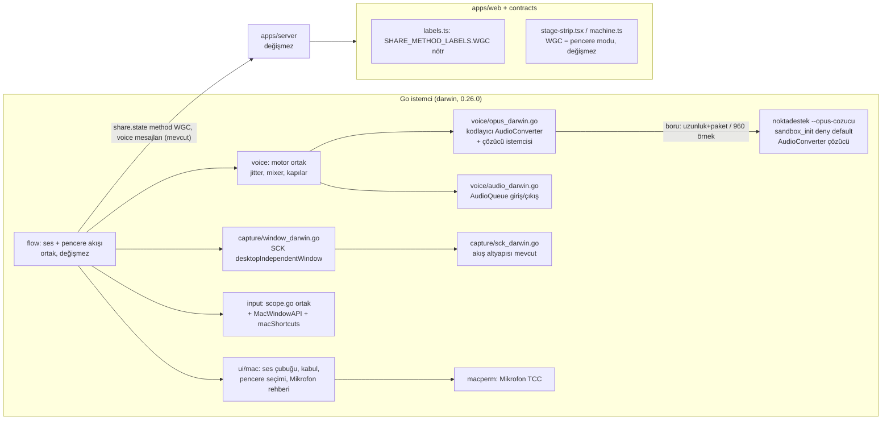

# Mimari — P33 macOS istemcisine ses ve tek pencere paylaşımı

Tarih: 2026-11-22 · Durum: **r2** — güvenlik tasarım turu (`docs/guvenlik-raporu.md` "P33 tasarım turu": S-P33-T-1..10, B-1/B-2) ve K0s spike'ı (`docs/spike-p33-k0s.md`: A1 GEÇTİ, W2 KALDI, A2/W1 elle bekliyor, W3 kısmi) işlendi; değişiklik özeti §13 · r1: mimar, "sormadan ilerle" · Dal: `claude/p33-mac-ses-pencere`
Girdiler: `docs/gereksinimler-p33.md` (AC-534..558, V-P33-1..12, R-P33-1..10, S-P33-1..6, "Ek — Orkestratör notları"),
`docs/mimari-p28d.md` + ADR-0036 (ses protokolü, wasm/wazero Opus, mix-minus), `docs/mimari-p28f.md` + ADR-0037 (purego, SCK,
A-PF-1, K0s-6), `docs/spike-p28f-k0s.md` (K0s-6 ölçümleri), `docs/mimari-e11.md` §8.1 (AC-248 pencere modu, S17-1, S-P17-1/7).
Yeni ADR: **ADR-0043** (ADR-0036 m.1 ve ADR-0037 m.6/m.7'yi macOS için değiştirir). Kontrol listesi: `docs/tasarim-kontrol.md` "P33".
Sürüm: **0.26.0** (istemci üç platform + sunucu/web aynı etiket). **DB/migration yok, yeni REST/WS mesajı yok, sözleşme değeri değişmez.**

**Sadelik:** Mac, Windows'un ses ve pencere modunu **aynı `flow` akışı, aynı `voice` motoru (mix-minus, jitter, kapılar), aynı
`input` kapsam kuralları ve aynı web/sunucu** ile kullanır. Yalnız işletim sistemi uçları (kodek arka ucu, ses aygıtı, pencere
yakalama, pencere sorguları, kısayol tablosu) darwin dosyalarına eklenir. Tek yol: Mac'te kodek tek (AudioToolbox), aygıt tek
(AudioQueue), pencere yakalama tek (SCK).

---

## 1. Özet ve kısıtlar

| Kapsamda                                                                                                          | Kapsam dışı / Sonra (neden)                                                                  |
| ----------------------------------------------------------------------------------------------------------------- | -------------------------------------------------------------------------------------------- |
| Mac katılımlı oturumda P28d sesi (`rs.cap.voice1`), Mikrofon TCC izni ve rehberi                                  | Sistem sesi aktarımı (V-P33-1); yankı giderme (VoiceProcessingIO) ve aygıt seçimi — Sonra    |
| Mac'te AC-248 pencere modu: seçim ekranı, liste, yalnız pencere içeriği, girdi kapsamı, Mac kısayol tablosu       | `SCContentSharingPicker`; menü çubuğu paylaşımı (S-P33-4); çoklu pencere; Linux pencere modu |
| Konsolda platform-nötr pencere etiketi (AC-552)                                                                   | Mac gözetimsiz/servis, Developer ID/notarization (kullanıcı kararı)                          |
| Paket: `NSMicrophoneUsageDescription`, entitlement kümesi `{device.audio-input}`, darwin ikilisinden wazero çıkar | macOS yerinde otomatik güncelleme (K-P29-10 "yalnız bildir" kalır)                           |
| TCC (Ekran Kaydı, Erişilebilirlik, **Mikrofon**) güncelleme rehberi, OKUBENI, `MacGuide`, kılavuz                 | Başka Space / tam ekran pencerelerin listelenmesi (S-P33-3 = Hayır)                          |

### 1.1 Kararlar (K-P33-n)

| #        | Karar                                                                                                                                                                                                                                                                                                                                                                                                                                                                                                                                                                                         | Gerekçe (kısa; ayrıntı ADR-0043)                                                                                                                                                                                                                             |
| -------- | --------------------------------------------------------------------------------------------------------------------------------------------------------------------------------------------------------------------------------------------------------------------------------------------------------------------------------------------------------------------------------------------------------------------------------------------------------------------------------------------------------------------------------------------------------------------------------------------- | ------------------------------------------------------------------------------------------------------------------------------------------------------------------------------------------------------------------------------------------------------------ |
| K-P33-1  | **S-P33-1: Opus macOS'ta AudioToolbox `AudioConverter` (`kAudioFormatOpus`) ile, purego üzerinden.** r2 (S-P33-T-1 öneri A): **kodlama ana süreçte** (girdi kendi mikrofonumuz); **çözme ayrı, sandbox'lı alt süreçte** — aynı ikili `noktadestek --opus-cozucu` kipiyle başlar, ilk iş `sandbox_init` ile `(deny default)` profiline girer (§6.6), ana süreçle stdin/stdout borusu üzerinden konuşur. darwin ikilisine wazero ve `libopus.wasm` **bağlanmaz**. JIT yok, cgo yok, yeni Go bağımlılığı yok, entitlement yalnız `device.audio-input` (`sandbox_init` entitlement istemez, B-2). | K0s-A1 GEÇTİ (macOS 26.3.1, M4 Pro): kodla+çöz p95 arm64 0,136 ms, Rosetta 0,155 ms; Apple↔libopus aynı paketlerin çıktıları arasında SNR ≥ 106 dB; PLC var; 10 dk fuzz 0 çökme. Sandbox'lı çözücü ölçüldü: p95 değişmedi (spike §2.2). Seçenek tablosu §2.1 |
| K-P33-2  | Ses aygıtı **AudioQueue** (K0s-6 GEÇTİ: 5 dk kesinti 0, iki dilim): 48 kHz mono Int16, 20 ms × 3 tampon, giriş ve çıkış ayrı kuyruk. `voice.New(voice.OpenAudioQueue, onFail)` — WASAPI/Pulse ile aynı aygıt arayüzü. Mix-minus, jitter, talker/gönderim kapıları ortak koddan, **değişmez**.                                                                                                                                                                                                                                                                                                 | AVAudioEngine ObjC blok/graf yüzeyi daha büyük, kazanç yok; AudioQueue C API purego'ya uygun ve ölçüldü                                                                                                                                                      |
| K-P33-3  | Mikrofon izni `AVCaptureDevice authorizationStatusForMediaType:AVMediaTypeAudio` / `requestAccessForMediaType:completionHandler:` (`macperm`), **yalnız** yerel "Kabul" tıklamasının devamında. İzin yok/aygıt yok → `voice.end{reason:"device"}` + rehber (V-P33-3, S-P33-5 = Windows gibi). mimari-p28f §5.3 m.4'teki "dinleme devam eder" taslağı geçersiz.                                                                                                                                                                                                                                | Tek kural (Windows V-PD-1). İstem, AudioQueue'nun örtük istemine bırakılmaz: sonuç belirli olsun                                                                                                                                                             |
| K-P33-4  | **Pencere yakalama: ScreenCaptureKit `SCContentFilter initWithDesktopIndependentWindow:`**, mevcut `sck_darwin.go` akış altyapısı (aynı temsilci sınıf, NV12, GPU ölçekleme uzun kenar ≤ 1920, 30 fps, VideoToolbox) genişletilir. Boyut değişiminde `updateConfiguration:completionHandler:`. `CGWindowListCreateImage` **seçilmedi** (SDK başlığı `CGWindow.h`: `SCREEN_CAPTURE_OBSOLETE(10.5,14.0,15.0)` — 14'te deprecated, 15'te obsoleted, 2026-11-22 doğrulandı; yoklama tabanlı, üstteki pencereyi de yakalar).                                                                       | Blok çağrısı sorunu yok: purego `objc.NewBlock` bugün `getShareableContent…` ve `startCapture…`'da kullanılıyor                                                                                                                                              |
| K-P33-5  | **Pencere durumu tek kaynaktan:** `CGWindowListCopyWindowInfo(kCGWindowListOptionIncludingWindow, wid)` 250 ms'de bir (yakalama) ve her girdi olayında (girdi kapsamı). Yok → `WINDOW_CLOSED`; `kCGWindowIsOnscreen` yok/false → "görünmez" (küçültme, ⌘H, başka Space, tam ekran: AC-545'in dört durumu tek durum) → siyah kare + "Pencere simge durumunda" + tüm girdi düşer.                                                                                                                                                                                                               | SCK kare durumu (Idle/Suspended) tek başına kapanmayı/küçültmeyi ayırmaz; CG sorgusu ucuz ve izinsiz                                                                                                                                                         |
| K-P33-6  | **S-P33-2: `SHARE_METHODS` değişmez; Mac pencere modu tel değeri olarak `"WGC"` gönderir** (değer = "pencere modu" belirteci). Yalnız etiketler nötr olur: `SHARE_METHOD_LABELS.WGC = "Pencere yakalama"`. Yeni neden kodu yok (Mac `WINDOW_CLOSED` / `WINDOW_UNAVAILABLE` kullanır; `WGC_UNSUPPORTED` Mac'te üretilmez).                                                                                                                                                                                                                                                                     | `share.state` `strictObject` + `z.enum(SHARE_METHODS)`: yeni değer eski sunucuda **tüm mesajı** düşürürdü (AC-553 riski, R-P33-8). Yeniden kullanım: sözleşme değişmez → yayın sırası kısıtı yok, eski sunucu da çalışır                                     |
| K-P33-7  | **S-P33-3: Liste = geçerli Space'te ekranda görünen normal pencereler** (`onScreenWindowsOnly:YES`). Başka Space ve tam ekran pencereler listede yok; seçim ekranındaki ipucu "Pencere listede yoksa: Dock'tan açın, bu masaüstüne getirin ya da tam ekrandan çıkın, sonra Listeyi yenile'ye tıklayın."                                                                                                                                                                                                                                                                                       | Windows ile aynı (geçerli masaüstü). Paylaşılan pencere sonradan başka Space'e giderse K-P33-5 "görünmez" durumu                                                                                                                                             |
| K-P33-8  | **Sapma D-P33-1 (AC-543 "(simge durumunda)" satırı) — r2: KALICI.** Simge durumundaki pencereler **listelenmez** (ipucu K-P33-7). K0s-W2 KALDI: ekranda olmayan 125 katman-0 pencerede `kCGWindowIsOnscreen` dışında ayırt edici CG alanı yok; SCK `isActive` = `isOnScreen`; AX `kAXMinimizedAttribute` Erişilebilirlik izni ister.                                                                                                                                                                                                                                                          | Erişilebilirlik iznine göre değişen liste "tek yol" ilkesine aykırı. qa bu sapmayı AC-543'e karşı kayıtlı sapma olarak denetler; proje yöneticisi onayı gerekir                                                                                              |
| K-P33-9  | Girdi kapsamı: mevcut `input` kapsam motoru (`scope.go`) aynen; Mac için `MacWindowAPI` (CGWindowList sırası + PID; r2 S-P33-T-3: sayfa ve ön plan **AX ile kesin**, AX okunamazsa düşer) ve **platform kısayol politikası** (`ShortcutPolicy`: Windows kuralları davranışsız taşınır; Mac r2 S-P33-T-2: **önce genel kural** — {⌘,⌥,⌃}'den iki değiştirici basılıysa düşer — sonra tablo, sonra **açık izinli liste**). Eşleme sonrası tuşlarla (Ctrl→⌘, Meta→⌃, Alt→⌥). Fail-closed koşulsuz (S-P33-T-5).                                                                                   | Kurallar tek yerde; kapalı liste yerine genel kural (sistem/üçüncü taraf/kullanıcı kısayolları açık kümedir)                                                                                                                                                 |
| K-P33-10 | Entitlement kümesi **tam olarak** `com.apple.security.device.audio-input`; hardened runtime (`--options runtime`) korunur. `Info.plist`'e `NSMicrophoneUsageDescription` (AC-554 metni). `allow-unsigned-executable-memory`, `allow-jit`, `disable-library-validation` **yok**.                                                                                                                                                                                                                                                                                                               | Hardened runtime'da mikrofon bu entitlement olmadan sessizce reddedilir; K-P33-1 JIT'i gereksiz kılar                                                                                                                                                        |
| K-P33-11 | Mac'te `voice.Supported()` = **çalışma zamanı yoklaması**: kodlayıcı kurulur, sahte PCM (sinüs) 1 çerçeve kodlanır, çözücü yardımcısı başlatılıp bu paket çözülür. r2 (S-P33-T-4): yoklama **hiçbir AudioQueue açmaz ve `AVCaptureDevice` çağırmaz** (darwin testi: yoklama sonrası `authorizationStatus` `notDetermined` kalır). false ise `VoiceUI/OpenVoice` bağlanmaz, `rs.cap.voice1` bildirilmez, konsolda AC-352 metniyle pasif düğme.                                                                                                                                                 | macOS 13–15'te Opus varlığı CI'da (macos-14/15) doğrulanacak; yoklama sorunlu sürümde güvenli dala düşürür (A-PD-6 kalıbı); uygulama açılışında rıza dışı mikrofon istemi olmaz                                                                              |

### 1.2 Varsayımlar (gereksinimdekilere ek)

- **V-P33-A1 (r2, K0s-A1 B1/B2):** Çözücü giriş ASBD'si `mFramesPerPacket = 960` **sabittir** (B2: değişken kip 0 baytlık pakette
  120 ms PLC üretip sonraki çıktıya taşar). R1–R7'den sonra paket süresi 20 ms (960 örnek) değilse paket Apple'a **verilmeden** düşer ve
  `DecodeErr` sayılır; Apple'dan 0 örnekle dönüş de hatadır (B1: 20 ms dışı paket hatasız 0 örnekle dönüyor). Chrome varsayılanı 20 ms;
  stereo bayraklı ve CELT/hibrit 20 ms paketler mono çözülür (ölçüldü).
- **V-P33-A2 (r2):** PLC Apple'dadır: `Conceal` = 0 baytlık paket + çıktı kapasitesi 960 (RMS libopus `Conceal` ile aynı ölçüldü); Go PLC
  yazılmaz. FEC çözme API'si yok: `DecodeFEC` "desteklenmiyor" döner, jitter doğrudan `Conceal`'e geçer. **B3:** çözücü ilk çerçevede
  840 örnek verir (ön atlama 120); 960'tan kısa çıktı sonu sıfırla doldurulur. Kodlayıcı `Lookahead()` = `kAudioConverterPrimeInfo`
  leading (312). Apple kodlayıcıda karmaşıklık/uygulama seçimi yok (ağırlıkla CELT); kabul.
- **V-P33-A3:** Mac'te kontrol (girdi) yalnız Erişilebilirlik izni verilmişse açılır (P28f); bu yüzden pencere modunda girdi kapsamı AX'e
  ihtiyaç duymadan CG sorgularıyla yapılır (K-P33-9), AX yalnız ek doğrulama olarak gerekmez.

---

## 2. Bileşenler ve sorumluluklar



| Bileşen                                            | Sorumluluk (P33'te)                                                                                                                                                                                                                                                                                                                                             |
| -------------------------------------------------- | --------------------------------------------------------------------------------------------------------------------------------------------------------------------------------------------------------------------------------------------------------------------------------------------------------------------------------------------------------------- |
| `internal/voice/opus.go` (ortak, bölünür)          | Sabitler, hatalar, `Decoder` politikası (talker kapısı çağıranda; boyut, hız, tuzak/hata sayacı → `ErrPeerDropped`), genel API imzaları. Arka uç bir `codecBackend` arayüzü (kodlayıcı + çözücü) üzerinden seçilir                                                                                                                                              |
| `internal/voice/opus_wasm.go` (`!darwin`)          | Bugünkü wazero/libopus kodu **taşınır, davranış aynı** (Windows/Linux)                                                                                                                                                                                                                                                                                          |
| `internal/voice/opus_darwin.go` (yeni)             | Kodlayıcı: AudioToolbox `AudioConverterNew` (LPCM s16 48k mono → `kAudioFormatOpus` 48k mono, 960 çerçeve/paket), `kAudioConverterEncodeBitRate = 32000`, `kAudioConverterPrimeInfo` → `Lookahead` (312). Çözücü: `codec` arayüzünün **istemci** uygulaması — R1–R7 + 20 ms süzgecinden (V-P33-A1) geçen paketi yardımcıya yollar, 960 örnek alır (B3 doldurma) |
| `internal/voice/opushelper_darwin.go` (yeni)       | Çözücü yardımcısının yaşam döngüsü ve IPC (§6.6): başlatma, çerçeveleme, 200 ms çağrı süre sınırı, çökme/çıkış/zaman aşımı → `ErrCodecPanic`, yeniden başlatma; görüşme bitince ve WS kopunca öldürme                                                                                                                                                           |
| `cmd/noktadestek/opushelper_darwin.go` (yeni)      | `--opus-cozucu` kipi: argüman/ortam denetimi, `sandbox_init` (başarısızsa çıkış kodu ≠ 0, hiç çözme yapmaz), AudioConverter çözücü döngüsü; ana UI/ağ kodu bu kipte başlatılmaz                                                                                                                                                                                 |
| `internal/darwin/sandbox/sandbox_darwin.go` (yeni) | `sandbox_init` / `sandbox_init_with_parameters` purego bağlaması (`/usr/lib/libSystem.B.dylib`, izin listesinde) + gömülü SBPL profili (§6.6)                                                                                                                                                                                                                   |
| `internal/voice/opuspkt.go` (yeni, ortak saf Go)   | RFC 6716 §3.4 paket geçerlilik kuralları R1–R7 (TOC, kod 0–3, çerçeve sayısı ≤ 48, uzunluk tutarlılığı, toplam süre ≤ 120 ms). Yalnız darwin arka ucu çağırır; fuzz her platformda koşar                                                                                                                                                                        |
| `internal/voice/audio_darwin.go` (yeni)            | AudioQueue giriş + çıkış; geri çağrılar `purego.NewCallback` (süreçte bir kez, tutamaç tablosu); 1 sn örneksiz giriş → `ErrDeviceLost`; `Close` = `AudioQueueStop(immediate)` + `AudioQueueDispose` (≤ 1 sn)                                                                                                                                                    |
| `internal/voice/supported_darwin.go` (yeni)        | K-P33-11 yoklaması (sonuç süreçte bir kez önbelleklenir)                                                                                                                                                                                                                                                                                                        |
| `internal/macperm/mic_darwin.go` (yeni)            | Mikrofon izin durumu/isteği (AVFoundation, `objc.NewBlock`), `Privacy_Microphone` URL'si. `macperm`'de bugün mikrofon kodu yok (`tcc_darwin.go` tarandı). İstek sürerken enjektör kapısı duraklatılır (S-P33-T-4)                                                                                                                                               |
| `internal/capture/window_darwin.go` (yeni)         | Pencere listesi (süzgeç §6.2), pencere akışı, CG durum yoklaması, siyah kare (`iconicPlate` ortak), `WindowCaptureSupported()` = true (macOS 13+; SCK yoksa false)                                                                                                                                                                                              |
| `internal/input/window_darwin.go` (yeni)           | `MacWindowAPI` (`WindowAPI` arayüzü, §6.3)                                                                                                                                                                                                                                                                                                                      |
| `internal/input/shortcuts.go` + `shortcuts_mac.go` | `ShortcutPolicy` arayüzü; `scope_keys.go`'daki Windows kuralları `winShortcuts`'a **davranış değişmeden** taşınır; `macShortcuts` AC-549 tablosu (build etiketi yok → tablo testi Linux CI'da da koşar)                                                                                                                                                         |
| `internal/ui/mac/*`                                | `voice_darwin.go` (kabul = `prompt_darwin.go`, ses çubuğu, Mikrofon rehberi; mantık `uicore/voice.go`), `screens_darwin.go` seçim ekranı genişler (§6.1), gösterge metni pencere modunda                                                                                                                                                                        |
| `cmd/noktadestek/deps_darwin.go`                   | `VoiceUI/OpenVoice` (yoklama true ise), `WindowCapture/CaptureWindow/SetInputWindow` bağlanır                                                                                                                                                                                                                                                                   |
| `packages/contracts/src/labels.ts`                 | `SHARE_METHOD_LABELS.WGC` → `"Pencere yakalama"`; açıklama yorumları nötr                                                                                                                                                                                                                                                                                       |
| `apps/web`                                         | Davranış değişmez (rozet/monitör temizliği zaten `"WGC"` değerine bağlı); yalnız beklenen metinli testler                                                                                                                                                                                                                                                       |
| `apps/server`                                      | **Değişmez** (`hasVoice` yeteneğe bağlı, `share.state` şeması aynı)                                                                                                                                                                                                                                                                                             |

### 2.1 S-P33-1 seçenek karşılaştırması (karar K-P33-1)

| Seçenek                                        | Ölçülen / doğrulanan                                                                                                                                                                                                                                           | Sonuç                                                                                                                                                                                                       |
| ---------------------------------------------- | -------------------------------------------------------------------------------------------------------------------------------------------------------------------------------------------------------------------------------------------------------------- | ----------------------------------------------------------------------------------------------------------------------------------------------------------------------------------------------------------- |
| (a′) wazero derleyici (arm64)                  | K0s-6: karmaşıklık 2/5'te **yanlış derleme tuzağı**, 0/1'de eşit, 0,2 ms. Ad-hoc + hardened runtime'da entitlement'sız **SIGKILL**; `allow-jit` yetmiyor, yalnız `allow-unsigned-executable-memory` çalıştı                                                    | **Red.** Entitlement yalnız ad-hoc imza + hardened runtime için de gerekli (doğrulandı). Bilinen yanlış derleme sandbox iddiasını zayıflatır; karmaşıklık 1 kalite düşüşü; W^X yüzeyi tüm süreç için açılır |
| (a″) hardened runtime'ı kapatmak               | Ölçülmedi (entitlement'sız JIT'in çalışacağı varsayımı)                                                                                                                                                                                                        | **Red.** AC-554 ve S-P28f-5 `--options runtime` ister (`DYLD_*` yok sayma, T5)                                                                                                                              |
| (b) wazero yorumlayıcı                         | 2026-11-22, M4 Pro, darwin/arm64, mevcut benchmark (`BenchmarkP28dK0s{Encode,Decode}20ms`, 300×): **kodlama 16,2 ms, çözme 3,27 ms**/çerçeve (karmaşıklık 5). K0s-6: karmaşıklık 0'da bile kodla+3 çöz 20–26 ms                                                | **Red.** AC-538 (≤ 10 ms) ve CPU +10 puan bütçesi tutmaz                                                                                                                                                    |
| (b′) Apple kodlayıcı + wasm yorumlayıcı çözücü | Çözme 3,27 ms/konuşan (M4 Pro; M1/Rosetta daha yavaş) → tek konuşanda ≈ %16 çekirdek                                                                                                                                                                           | **Red** (yedek değil): CPU bütçesi; 3 konuşanda ≈ 10 ms. Güvenlik açısından çekici (güvenilmeyen girdi sandbox'ta) — K0g'ye bilgi                                                                           |
| (cgo) libopus                                  | —                                                                                                                                                                                                                                                              | **Red.** `CGO_ENABLED=0` + Linux'ta tekrarlanabilir darwin derlemesi (ADR-0037 m.1, K0s-7) bozulur; güvenlik profili AudioToolbox ile aynı (yerel kod, sandbox yok) ama yamayı biz taşırız                  |
| **(d) AudioToolbox Opus**                      | K0s-A1 GEÇTİ (purego): kodla+çöz p95 0,136 ms (arm64) / 0,155 ms (Rosetta); Apple↔libopus aynı paketlerin çıktıları arasında SNR ≥ 106 dB; PLC var, FEC yok; 10 dk + 10 dk + 5 dk fuzz 0 çökme/0 askı. r2: çözücü `sandbox_init` alt sürecinde (p95 değişmedi) | **Seçildi.** JIT/cgo/yeni bağımlılık yok; iki dilimde yerli; darwin ikilisi ≈ 2,5 MiB küçülür; güvenilmeyen yük sandbox'lı süreçte                                                                          |

**r2 — güvenilmeyen yükün yalıtımı (S-P33-T-1, öneri A benimsendi):** Teknisyenden gelen Opus yükü ana sürece (Ekran Kaydı,
Erişilebilirlik, Mikrofon TCC'li) değil, **`sandbox_init` ile kısıtlı çözücü alt sürecine** gider. Sıra: talker kapısı → boyut ≤ 1275
ve ≤ 100 paket/sn → R1–R7 çerçeve doğrulaması → 20 ms süzgeci → boru → yardımcıda AudioConverter. R1–R7 yalnız **çerçevelemeyi**
denetler; yük içeriği (SILK/CELT) çözücüye ulaşır — birincil savunma sandbox'tır (Windows'taki wasm sandbox'ın karşılığı). Yardımcının
çökmesi ya da süre aşımı `ErrCodecPanic` sayılır; `maxPanics` (3'te eş düşer) anlamını korur. Kalan risk: sandbox profilindeki
`file-read*` geniş (K1'de daraltma ölçülür) ve `mach-lookup com.apple.audio.AudioComponentRegistrar` açık; `sandbox_init` Apple'da
deprecated (çalışıyor) — R-P33-11 (Orta'ya indi), R-P33-15.

---

## 3. Veri modeli

**Yeni tablo, sütun, indeks, migration, seed yok; dba işi yok** (V-P33-9). Yetki (`sessions.voice`), audit eylemleri (`voice.*`,
`session.join{os}`) ve `Room.voice` bellek durumu değişmez. Silme stratejisi değişmez. İstemci yeni kalıcı veri yazmaz (AC-556):
pencere listesi ve başlıklar yalnız bellekte, seçim ekranı kapanınca bırakılır; ses verisi diske yazılmaz.

## 4. Sözleşme (REST/WS)

### 4.1 Değişmeyenler (bağlayıcı)

- REST: değişiklik yok. WS mesaj kümesi ve şemaları değişmez; `share.state.method` enum'u `["DXGI","GDI","WGC"]` olarak kalır.
- Ses: Mac istemci `/ws/guest` alt protokolüne `rs.cap.voice1` ekler (yalnız K-P33-11 yoklaması true ise); sunucu `hasVoice` ve web
  `guestVoice` kapıları **değişmez** (AC-541). Mesajlar `voice.request/answer/join/end/state` aynen (mimari-p28d §4.2).
- Pencere modu: Mac `share.state{state:"sharing", method:"WGC"}` gönderir, monitör listesi göndermez, `monitor.request`'i yok sayar
  (mevcut `flow.sendShare` + `session_media.go` yolu, platformdan bağımsız). Kapanışta `share.state{stopped, reason:"WINDOW_CLOSED", method:"WGC"}`;
  pencere açılamazsa `WINDOW_UNAVAILABLE`.

### 4.2 Etiket değişikliği (`packages/contracts/src/labels.ts`, yalnız metin)

| Anahtar                                    | Eski                                                  | Yeni                                                                                          |
| ------------------------------------------ | ----------------------------------------------------- | --------------------------------------------------------------------------------------------- |
| `SHARE_METHOD_LABELS.WGC`                  | "Pencere yakalama (WGC)"                              | "Pencere yakalama"                                                                            |
| `SHARE_FAIL_REASON_LABELS.WGC_UNSUPPORTED` | "Bu Windows sürümü pencere paylaşımını desteklemiyor" | Değişmez (yalnız Windows üretir; Mac üretmez — Go birim testi: darwin `Reason` kümesinde yok) |
| `ws.ts` / `labels.ts` yorumları            | "WGC P17 pencere modu"                                | "`WGC` = pencere modu belirteci (Windows WGC, macOS SCK; ADR-0043)"                           |

Konsol ipucu `cs.windowShareHint` → "Müşteri yalnız bir pencereyi paylaşıyor (Pencere yakalama)". Hata metni:
"Neden: Paylaşılan pencere kapatıldı — Pencere yakalama". Bilinmeyen kod kuralı (`describeShareFailure`) aynen.

### 4.3 Geriye uyum ve yayın sırası (AC-553)

| İstemci \\ Sunucu | 0.25.x sunucu                                                                                 | 0.26.0 sunucu              |
| ----------------- | --------------------------------------------------------------------------------------------- | -------------------------- |
| 0.25.x (tümü)     | bugünkü                                                                                       | aynen (sözleşme değişmedi) |
| 0.26.0 Mac        | ses ve pencere modu **çalışır**; konsol rozeti eski etiketle "Pencere yakalama (WGC)" görünür | tam (nötr etiket)          |

Sözleşme değişmediği için `strictObject` düşürme riski yoktur; runbook sırası yine "önce sunucu/web, sonra istemci Release" (V-P33-7)
ama sıra bozulması yalnız etiket metnini etkiler, Release bekletilmez. Sunucu birim testi: Mac'ten gelen `share.state{method:"WGC"}` ve
`voice1` alt protokolü 0.26.0 şemasında geçer (mevcut fikstür + `clientOs: "macos"`).

## 5. Güvenlik tasarımı

### 5.1 Tehdit modeli özeti (STRIDE; r2: K0g bulguları S-P33-T-n işlendi)

| #   | Tehdit                                                                                                      | Kontrol                                                                                                                                                                                                                                                                                                                                                    |
| --- | ----------------------------------------------------------------------------------------------------------- | ---------------------------------------------------------------------------------------------------------------------------------------------------------------------------------------------------------------------------------------------------------------------------------------------------------------------------------------------------------- |
| T1  | Mikrofonun müşteri bilmeden açılması (uzaktan kontrol/sentetik tıklama ile "Kabul" ya da TCC istemi)        | K-PD-2 rıza kuralı aynen; Kabul, Sessize al/Sesi aç, Mikrofon rehberi düğmeleri `localClick()`; kabul diyaloğu açıkken enjeksiyon duraklar (S-P28f-1). r2 (S-P33-T-4): `requestAccess…` tamamlanma bloğu dönene dek (≤ 60 sn) enjektör kapısı **duraklatılır**; yoklama mikrofona/AVCaptureDevice'a dokunmaz. `voice.state`/DC/SDP yalnız kapatır (AC-537) |
| T2  | Kötü niyetli teknisyenin bozuk Opus yüküyle çözücüyü istismarı                                              | r2 (S-P33-T-1): çözücü `sandbox_init` (`deny default`) alt sürecinde (§6.6); ana süreçte yük işlenmez. Sıra: talker kapısı → boyut/hız → R1–R7 (**çerçevesi geçersiz paket girmez; yük içeriği çözücüye ulaşır**) → 20 ms süzgeci → boru. Çökme/askı = `ErrCodecPanic`, 3'te eş düşer                                                                      |
| T3  | JIT/çalıştırılabilir bellek yüzeyi                                                                          | Kaldırıldı: darwin ikilisinde wazero yok (CI `go list -deps` denetimi, §8.4); entitlement'ta `allow-*-executable-memory`/`allow-jit` yok (tam eşleşme)                                                                                                                                                                                                     |
| T4  | Pencere modunda teknisyenin paylaşılmayan pencereye/sisteme girdi göndermesi                                | Fail-closed kapsam: nokta kırpma; en üst pencere hedef ya da katman ≠ 0 aynı PID ya da **AX ile doğrulanmış** hedef sayfası (S-P33-T-3); klavye yalnız `AXFocusedApplication`'ın `AXFocusedWindow`'u hedef ya da hedefin sayfasıyken; AX okunamazsa düşer; tuş kovası 40/sn                                                                                |
| T5  | Sistem/üçüncü taraf kısayoluyla pencere dışına çıkma (⌘Tab, ⇧⌘Q, Spotlight, Raycast ⌥Space, Görev Kontrolü) | r2 (S-P33-T-2): genel kural (iki değiştirici) + tablo + açık izinli liste (§6.4); kilit değiştiriciler bırakılana dek; kalıntı risk (⇧⌘+harf Hizmetler) R-P33-5 ve kılavuz                                                                                                                                                                                 |
| T6  | Pencere başlıklarının sızması (KVKK)                                                                        | Başlık/uygulama adı yalnız seçim ekranında. r2 (S-P33-T-8): `SCWindow`/`NSRunningApplication` nesneleri hiçbir hata/log biçimlendirmesine verilmez (yalnız sayılar); "GIZLI-BASLIK-123" testi (§9)                                                                                                                                                         |
| T7  | Paylaşılan pencerenin üstüne gelen başka pencerenin görüntüye girmesi                                       | SCK masaüstünden bağımsız pencere filtresi yalnız o pencerenin katmanını verir (AC-544 elle doğrulanır, K0s-W1)                                                                                                                                                                                                                                            |
| T8  | Görünmez pencereye kör girdi; görünmezken eski karenin gitmesi                                              | K-P33-5: görünmez durumda bütün girdi düşer. r2 (S-P33-T-9): görünmeze geçişte son kare (`p.cur`) siyah plakayla değiştirilir, keep-alive/PLI eski kareyi göndermez; `WINDOW_CLOSED`'da akış ve kare yuvası hemen bırakılır                                                                                                                                |
| T9  | dylib kaçırma (yeni çerçeveler)                                                                             | `objc.Allowed` izin listesi zaten yalnız `/System/Library/Frameworks/<Ad>.framework/<Ad>` mutlak yolları; AudioToolbox ve AVFoundation bu kalıba uyar, liste genişletilmez                                                                                                                                                                                 |
| T10 | Ses verisinin kaydı/iz                                                                                      | AC-540: kayıt konsolda yalnız video; istemci PCM'i yalnız bellek tamponunda tutar; AC-556 iz testi                                                                                                                                                                                                                                                         |
| T11 | Eski TCC kaydının "açık" görünüp çalışmaması (ad-hoc)                                                       | Güvenlik değil kullanılabilirlik; AC-555 ölçümü + rehber; `tccutil reset Microphone net.noktabilisim.destek` kılavuzda                                                                                                                                                                                                                                     |
| T12 | Ses göstergesinin gizlenmesi (dinlendiğini bilmeme)                                                         | r2 (S-P33-T-6): ses çubuğu mimari-p28f §5.2b gösterge kurallarıyla açılır (`canHide=NO`, küçültülemez, 1 sn tik); 3 tikte görünür kılınamazsa görüşme `voice.end{device}` ile biter, mikrofon kapanır. macOS turuncu noktası ayrıca OS'ça zorlanır                                                                                                         |
| T13 | Rehberle yanlış uygulamaya izin / tüm izinlerin sıfırlanması                                                | r2 (S-P33-T-7): yalnız paket kimlikli `tccutil reset Microphone net.noktabilisim.destek` (CI: değer = `CFBundleIdentifier`); `sudo`, `tccutil reset All`, SIP kapatma, `TCC.db` düzenleme asla önerilmez; "− ile kaldır → uygulamayı yeniden aç → istemde İzin Ver" akışı; "Yalnız Nokta Destek açıkken istediği izni verin"                               |
| T14 | Yetenek bildiriminin yetki sanılması                                                                        | r2 (S-P33-T-10, bilgi): `rs.cap.voice1` hiçbir yetki kararında kullanılmaz; sunucu birim testi "yetenek bildirimi `sessions.voice` kontrolünü değiştirmez"                                                                                                                                                                                                 |

### 5.2 Entitlement ve Info.plist (AC-554)

- `build/macos/entitlements.plist`: yalnız `<key>com.apple.security.device.audio-input</key><true/>`; yorum ADR-0043'e işaret eder.
- `Info.plist.tmpl`: `NSMicrophoneUsageDescription` = "Teknisyenle sesli görüşme için. Mikrofon yalnız siz Kabul'e tıkladığınızda açılır."
  `info-plist-keys.txt` izin listesine eklenir (S-P28f-14 denetimi).
- `package.sh check`: entitlement tam eşleşme (yeni küme), `codesign -d --entitlements :-` çıktısı = dosya; `--options runtime` bayrağı
  (`codesign -dv` "flags=0x10000(runtime)") denetimi korunur. r2 (B-2): `Info.plist`'te `NSCameraUsageDescription` **olmadığı** denetlenir; çözücü yardımcısı aynı ikili ve aynı imzadır, ek entitlement yok.

### 5.3 Güvenlik turu yanıtları (K0g, r2)

- **G-P33-1 → S-P33-T-1 (Yüksek):** Öneri A benimsendi — sandbox'lı çözücü alt süreci (K-P33-1, §6.6). Öneri B gerekmiyor.
- **G-P33-2 → S-P33-T-2 (Yüksek):** Genel kural + tablo + açık izinli liste (§6.4).
- **G-P33-3 → S-P33-T-3 (Orta):** Sayfa ve ön plan AX ile kesin; AX hatası → düşer (§6.4).
- **G-P33-4 → S-P33-T-5 (Orta):** Fail-closed koşulsuz; ⇧×5 ve ⌥×5 her zaman düşer (§6.4).
- **G-P33-5 → B-1 (Bilgi):** Kabul; koşul ADR-0043 m.7'de: `method` ileride audit/metriğe girerse `clientOs` ile birlikte yazılır.
- S-P33-T-4 (Orta) → T1, K-P33-11, §6.5; S-P33-T-6..T-10 (Düşük) → T12, T13, T6, T8, T14; B-2 → §5.2.

## 6. Ayrıntılı davranış

### 6.1 Seçim ekranı (AC-542; `ui/mac/screens_darwin.go`, `flow.UI.ChooseShare` aynen)

- Pencere modu sunulduğunda (`windowMode()` true) tek monitörde de açılır. Başlık "Teknisyenle neyi paylaşmak istiyorsunuz?". Radyo grubu
  "Tüm ekran" (varsayılan; çoklu monitörde altında bugünkü monitör listesi) / "Yalnız bir pencere".
- Pencere listesi: `NSScrollView` içinde radyo düğmeli satırlar ("<Başlık> — <Uygulama>", başlık 80 karakterde kısaltılır); "Listeyi yenile",
  "Paylaş". Altında kalın: "Paylaştığınız pencereden açılan yeni pencereler ve menü çubuğu teknisyene görünmez." ve K-P33-7 ipucu.
- Liste boş → "Paylaşılabilecek pencere yok — programı açıp Listeyi yenile'ye tıklayın", "Paylaş" pasif (AC-543).
- Tüm denetimler `localClick()`; Tab sırası mantıklı; VoiceOver etiketleri (`setAccessibilityLabel:`); renkler AppKit semantik (iki tema).
- Seçim `ShareChoice.Window` = `CGWindowID` (uintptr). Paylaşım başlarken pencere hâlâ listede ve ekranda değilse `WINDOW_UNAVAILABLE`.

### 6.2 Liste süzgeci (AC-543; saf işlev `filterWindows`, sahte `SCWindow` dilimiyle Go birim testi)

Kaynak: `SCShareableContent getShareableContentExcludingDesktopWindows:YES onScreenWindowsOnly:YES`. Bir pencere listeye girer ancak:
`windowLayer == 0`; `isOnScreen`; başlık boş değil; `frame` ≥ 64×64 pt; `owningApplication` var ve PID ≠ kendi PID'imiz; paket kimliği
sistem listesinde değil (`com.apple.dock`, `com.apple.controlcenter`, `com.apple.notificationcenterui`, `com.apple.WindowManager`,
`com.apple.Spotlight`, `com.apple.systemuiserver`, `com.apple.loginwindow`, `com.apple.screencaptureui`). Sıra: ön-arka (SCK sırası).
Başlık ve uygulama adı hiçbir log/WS'ye gitmez (yalnız `count`). r2 (S-P33-T-8): `SCWindow`/`NSRunningApplication` nesneleri ve
`-description` çıktıları hiçbir `fmt.Errorf`/log/panik iletisine verilmez; hata iletilerinde yalnız sabit işlem adı ve sayı bulunur.

### 6.3 Yakalama ve pencere durumu (AC-544..546, AC-550; `capture/window_darwin.go`)

1. `SCContentFilter initWithDesktopIndependentWindow:<SCWindow>`; `SCStreamConfiguration`: `width/height` = pencere boyutu × ölçek,
   uzun kenar ≤ 1920 (tam ekran kuralıyla aynı), `minimumFrameInterval` 1/30, `pixelFormat` '420v', `showsCursor` YES. Akış temsilcisi,
   kare yuvası, VideoToolbox kodlayıcı ve kare kopyalama **mevcut kod**.
2. CG yoklaması 250 ms: yok → kalıcı `WINDOW_CLOSED` (paylaşım durur, tüm ekrana geçilmez, AC-546); görünmez → kodlayıcıya siyah kare +
   ortada "Pencere simge durumunda" (Windows `iconicPlate` ortak işlevi) ve girdi düşer; görünür olunca ≤ 2 sn içinde gerçek kareye döner.
   Sınır/ölçek değişti → `updateConfiguration:` (boyut değişince kodlayıcı yeni çözünürlükle yeniden kurulur — tam ekran monitör
   değişimiyle aynı yol). `stream:didStopWithError:` + CG'de pencere yok → `WINDOW_CLOSED`; pencere varsa akış bir kez yeniden açılır.
3. İşaretleme katmanı pencere modunda gösterilmez, `monitor.request` yok sayılır (ortak `flow`). Gösterge metni: "Paylaştığınız pencere
   izleniyor — <teknisyen adı>"; §5.2b gösterge kuralları aynen (AC-551).
4. Ölçüt: teslim ≥ 25 fps (K0s-W1), kodlama p95 ≤ 33 ms (P28f ölçütü).
5. r2 (S-P33-T-9): görünmeze geçişte son kare (`p.cur`) siyah plakayla değiştirilir (PR #40 `p.cur = nil` kalıbı); keep-alive ve
   PLI/IDR eski gerçek kareyi göndermez. `WINDOW_CLOSED`'da akış ve kare yuvası hemen bırakılır. Go birim testi.

### 6.4 Girdi kapsamı (AC-547..549; `input`; r2: S-P33-T-2, T-3, T-5)

`MacWindowAPI` (`WindowAPI` arayüzü; durumsuz, her olayda güncel sorgu). Mac'te kontrol Erişilebilirlik izni gerektirdiğinden
(V-P33-A3) AX sorguları girdi kapsamında kullanılabilir; **AX sorgusu başarısızsa olay düşer**.

| Yöntem           | Mac karşılığı                                                                                                                                                                                                                                                                                                                                                   |
| ---------------- | --------------------------------------------------------------------------------------------------------------------------------------------------------------------------------------------------------------------------------------------------------------------------------------------------------------------------------------------------------------- |
| `Exists/Iconic`  | CG tek pencere sorgusu (K-P33-5); `Iconic` = `kCGWindowIsOnscreen` yok/false                                                                                                                                                                                                                                                                                    |
| `Bounds`         | `kCGWindowBounds` (global nokta koordinatı; enjektörün uzayı)                                                                                                                                                                                                                                                                                                   |
| `RootAt(x,y)`    | `kCGWindowListOptionOnScreenOnly` ön-arka listesinde noktayı içeren ilk pencere (kendi gösterge/oturum pencerelerimiz atlanır)                                                                                                                                                                                                                                  |
| `Owner`          | Katman ≠ 0 ve hedefle aynı PID (menü 101, açılır panel) → hedef (nokta zaten hedef dikdörtgenine kırpılı). **Katman 0** → yalnız AX ile kesin: pencere `AXRole = AXSheet` ve `AXParent`/`AXWindow` = hedef ise hedef; hedef `CGWindowID` ↔ AX eşlemesi çerçeve + PID karşılaştırmasıyla (özel `_AXUIElementGetWindow` yok), belirsizse 0. AX hatası → 0 (düşer) |
| `ForegroundRoot` | `AXUIElementCreateSystemWide` → `AXFocusedApplication` (o anda okunur; `NSWorkspace` önbelleği kullanılmaz) → `AXFocusedWindow`; bu hedef ya da hedefin AX sayfasıysa hedef, değilse 0. AX hatası → 0                                                                                                                                                           |
| `ThreadProcess`  | `(0, kCGWindowOwnerPID)`                                                                                                                                                                                                                                                                                                                                        |
| `IsMenu`         | `kCGWindowLayer == 101` (`kCGPopUpMenuWindowLevel`)                                                                                                                                                                                                                                                                                                             |
| `OSModifiers`    | `CGEventSourceFlagsState(kCGEventSourceStateCombinedSessionState)` → ⌘/⌥/⌃ (izin gerektirmez, K0s-W3); `ShortcutPolicy`'ye ham bayrak verilir                                                                                                                                                                                                                   |
| `Accessibility`  | `com.apple.universalaccess` CFPreferences: **tercih alanı okunabiliyorsa** `stickyKey`/`mouseDriver` anahtarının yokluğu = kapalı (K0s-W3: `mouseDriver` hiç ayarlanmamış Mac'te yok); **alan okunamazsa ya da değer beklenmeyen tipteyse açık** sayılır (fail-closed, S-P33-T-5)                                                                               |

**Süreç dışı paneller (R-P33-4):** Korumalı uygulamalarda Kaydet/Aç paneli ayrı süreçtir (yoklamada "Open and Save Panel Service (…)" ayrı
uygulama). Ne katman/PID ne AX sayfa kuralı bunu kabul eder → girdi **düşer** (fail-closed); SCK pencere filtresi paneli göstermeyebilir.
Kılavuz: "Kaydet/Aç penceresini müşteri kullanır". K2'nin ilk adımında (K0s-W3 elle) TextEdit ⌘S ile doğrulanır.

**Mac kısayol politikası (`macShortcuts`; eşleme sonrası Mac tuşları; sıra bağlayıcı, ilk eşleşen düşürür):**

1. **Genel kural (S-P33-T-2 m.1):** {⌘, ⌥, ⌃} kümesinden **iki ya da daha fazlası** basılıyken (bu alıcının durumu VEYA OS bayrağı; ⇧ sayılmaz)
   her değiştirici olmayan tuş düşer ve kilit açılır (değiştiriciler bırakılana dek tüm basmalar düşer). Kapsadığı örnekler: ⌃⌘Q, ⌥⌘Esc,
   ⌥⌘Space, ⌃⌘Space, ⌃⌘F, ⌥⌘D/H/M, ⌥⇧⌘Q, ⌃⌥ ok, ⌥⌘F5, ⌃⌘⇧3/4/5, Rectangle/üçüncü taraf ⌃⌥… kısayolları.
2. **Tek değiştirici tablosu:** ⌃ + {ok tuşları, Space, F1–F12, Tab, Esc}; ⌥ + Space; ⌘ + {Space, Tab, \`, F1–F12}; ⇧⌘Q; ⇧⌘3/4/5/6.
3. **Değiştiricisiz:** F3, F4, F11 (Görev Kontrolü/Launchpad/masaüstü); `codeMacVK`'de olmayan DOM kodları (Fn/Globe, `LaunchApp*`,
   `PrintScreen`, F13+) zaten enjekte edilemez.
4. **Erişilebilirlik dizileri (ayardan bağımsız, her zaman):** ⇧ ×5 ve ⌥ ×5 ardışık basmanın 5.'si düşer (`stickyShiftRun` kalıbı ⌥ için de);
   ⌘F5 (2. maddede) ve fn ×3 (fn enjekte edilemez).
5. **Yapışkan Tuşlar açık (ya da okunamadı):** Tab, Esc, Space ve 2. madde tuşları **değiştiricisiz** basmada da düşer (kilitli değiştiriciyle
   birleşebilirler). **Fare Tuşları açık (ya da okunamadı):** `Numpad*` ve `NumLock` (`KeypadClear`) düşer.
6. **Açık izinli liste (yukarıdakilerden geçtikten sonra iletilen):** değiştiricisiz tuşlar; ⇧ ile tuşlar; tek ⌘ (+ isteğe bağlı ⇧) ile
   harf/rakam/noktalama — ⌘C/V/X/Z/A/S, ⇧⌘Z/⇧⌘S, ⌘W ve ⌘Q (paylaşılan programı kapatır → `WINDOW_CLOSED`); tek ⌥ (+ ⇧) ile harf/rakam
   (özel karakter girişi). Bu listede olmayan her birleşim **düşer** (varsayılan-ret). Kalıntı risk: ⇧⌘+harf Hizmetler kısayolları
   (R-P33-5, kılavuz).
7. **Genişleme noktası (Sonra):** `com.apple.symbolichotkeys` okunup etkin sistem kısayolları dinamik düşürülür; okunamazsa 1–6 yeterli.

Tablo testi (Linux CI, build etiketsiz): her madde için en az bir satır; ⇧⌘Q, ⌥⇧⌘Q, ⌃⌘Space, ⌃⌘F, ⌃F1, ⌘F5, ⌥×5, ⇧×5 ve "iki değiştirici

- rastgele harf" özellik testi; izinli liste örnekleri iletilir. Tuş kovası (40/sn) aynen.

### 6.5 Ses (AC-534..541)

- Akış P28d §5 ile aynı. Kabul tıklaması → rıza kaydı + `voice.answer` → (aynı goroutine) `macperm.Microphone()`: `authorized` → aç;
  `notDetermined` → sistem istemi; r2 (S-P33-T-4): tamamlanma bloğu dönene dek (≤ 60 sn) **enjektör kapısı duraklatılır** (TCC istemine
  uzaktan tıklama etkisiz — K4 elle senaryosu). `denied/restricted` ya da aygıt yok → `voice.end{device}` + rehber penceresi: "Sistem
  Ayarları → Gizlilik ve Güvenlik → Mikrofon → Nokta Destek açık olmalı" + "Sistem Ayarları'nı aç"
  (`x-apple.systempreferences:com.apple.preference.security?Privacy_Microphone`, `localClick`). Oturum etkilenmez.
- Aygıt kaybı: AudioQueue `kAudioQueueProperty_IsRunning` dinleyicisi ya da 1 sn örneksiz giriş → `ErrDeviceLost` → `voice.end{device}`.
- ≤ 1 sn bırakma: `Close` → `AudioQueueStop(q, true)` + `AudioQueueDispose(q, true)` giriş kuyruğuna önce; çözücü yardımcısı
  öldürülür; turuncu gösterge söner (AC-535 elle).
- r2 (S-P33-T-6): ses çubuğu ("Mikrofon açık/Sessizde", "Dinleyen: …") mimari-p28f §5.2b gösterge penceresi kurallarıyla açılır
  (`canHide=NO`, küçültülemez, 1 sn tik); 3 ardışık tikte görünür kılınamazsa görüşme `voice.end{device}` ile biter. K4: ses açıkken
  ⌘H/⌥⌘H/⌘M.
- Kodek ayrıntıları V-P33-A1/A2 (B1–B3). Bütçe: kodla+çöz ölçülen p95 0,136 ms + IPC (K1'de ölçülür; hedef toplam ≤ 2 ms).

### 6.6 Çözücü yardımcısı (S-P33-T-1 öneri A; `opushelper_darwin.go`)

- **Başlatma:** ana süreç, görüşme başında (ilk konuşan için) kendi ikilisini (`os.Executable`, `.app` içi mutlak yol) `--opus-cozucu`
  argümanıyla `exec` eder; ortam boşaltılır (`DYLD_*` zaten hardened runtime'da yok sayılır), stdin/stdout boru, stderr kapalı. Görüşme
  başına **tek yardımcı**, konuşan başına ayrı AudioConverter örneği (≤ 3). Ana süreç Unix kimliği aynı; ek imza/entitlement yok (B-2).
- **Sandbox:** yardımcı `main`'de, AudioConverter kurulmadan önce `sandbox_init` ile şu profile girer (K0s spike §2.2'de ölçülen en
  küçük çalışan profil; p95 değişmedi):

  ```
  (version 1)
  (deny default)
  (allow file-read*)
  (allow sysctl-read)
  (allow mach-lookup (global-name "com.apple.audio.AudioComponentRegistrar"))
  ```

  Ağ, dosya yazma, süreç başlatma, diğer mach hizmetleri (TCC'li servisler dahil) kapalı; yardımcı hiçbir aygıt açmaz. `sandbox_init`
  başarısızsa yardımcı hiç çözme yapmadan çıkar → ana süreç `voice.Supported()` = false sayar (fail-closed).
  **K1'de ölçülecek:** `file-read*`'in sistem çerçeve yollarına (`/System/Library`, `/usr/lib`, dyld paylaşımlı önbelleği) daraltılması;
  AudioConverter sandbox'tan önce kurulursa `mach-lookup`'ın kaldırılabilirliği.

- **IPC çerçevesi:** istek = `tid(1 bayt) | uzunluk(u16) | paket(≤ 1275)`; uzunluk 0 = `Conceal`; yanıt = `durum(1) | 960 × s16`. Yardımcı
  yalnız bu biçimi kabul eder, aksi çıkış. **IPC gecikme bütçesi:** istek+yanıt p95 ≤ 0,5 ms, toplam kodla+çöz+IPC p95 ≤ 2 ms (AC-538
  10 ms'nin çok altında) — K1'de ölçülür, `implementation.md`'ye yazılır.
- **Hata:** 200 ms içinde yanıt yok, boru kapandı ya da çıkış → `ErrCodecPanic`; yardımcı yeniden başlatılır; aynı tid için 3. olayda
  `ErrPeerDropped`. Yardımcı görüşme bitişinde, WS kopuşunda ve ana süreç çıkışında öldürülür (`Pdeathsig` yok → boru EOF'ta yardımcı çıkar).

## 7. Dosya / klasör planı

| Dosya                                                                                                                                                 | İşlem                                                                                                                                   | Paket |
| ----------------------------------------------------------------------------------------------------------------------------------------------------- | --------------------------------------------------------------------------------------------------------------------------------------- | ----- |
| `packages/contracts/src/labels.ts`, `ws.ts` (yalnız yorum)                                                                                            | §4.2 etiket                                                                                                                             | K0    |
| `apps/web/messages/tr.json` (gerekirse), `apps/web/e2e/p17-console.spec.ts`, ilgili web birim testleri                                                | Beklenen metin "Pencere yakalama"; yeni e2e: sahte Mac misafiri (`clientOs: macos`, `voice1`) → ses düğmesi etkin + pencere rozeti      | K0    |
| `apps/agent-win/internal/voice/{opus.go,opus_wasm.go,opus_darwin.go,opuspkt.go,audio_darwin.go,supported_darwin.go}` + testler                        | §2; `supported_other.go` → `//go:build !amd64 && !darwin`; wasm'a bağlı testler `!darwin`                                               | K1    |
| `apps/agent-win/internal/macperm/mic_darwin.go` (+ test)                                                                                              | K-P33-3                                                                                                                                 | K1    |
| `apps/agent-win/internal/voice/opushelper_darwin.go`, `cmd/noktadestek/opushelper_darwin.go`, `internal/darwin/sandbox/sandbox_darwin.go` (+ testler) | r2: çözücü alt süreci, IPC, sandbox profili (§6.6)                                                                                      | K1    |
| `apps/agent-win/internal/ui/mac/{voice_darwin.go,prompt_darwin.go,session_darwin.go}`                                                                 | Ses çubuğu, kabul, Mikrofon rehberi (`uicore/voice.go` mantığı)                                                                         | K1    |
| `apps/agent-win/internal/capture/window_darwin.go` (+ `window_darwin_test.go`), `sck_darwin.go` (filtre parametresi)                                  | §6.1–6.3                                                                                                                                | K2    |
| `apps/agent-win/internal/input/{window_darwin.go,shortcuts.go,shortcuts_mac.go,scope_keys.go}` + testler                                              | §6.4; `scope_keys.go` Windows kuralları `winShortcuts`'a taşınır (mevcut testler değişmeden geçer)                                      | K2    |
| `apps/agent-win/internal/ui/mac/{screens_darwin.go,overlay_darwin.go}`                                                                                | Seçim ekranı, gösterge metni                                                                                                            | K2    |
| `apps/agent-win/cmd/noktadestek/deps_darwin.go`                                                                                                       | Ses (K1) ve pencere (K2) bağlama — iki paket ayrı bloklar ekler                                                                         | K1/K2 |
| `apps/agent-win/internal/ui/uicore/texts.go`                                                                                                          | Yeni Türkçe metinler (tek ileti tablosu)                                                                                                | K1/K2 |
| `apps/agent-win/build/macos/{entitlements.plist,Info.plist.tmpl,info-plist-keys.txt,OKUBENI*.txt,package.sh}`                                         | §5.2; OKUBENI izin adımlarına Mikrofon                                                                                                  | K3    |
| `apps/agent-win/test/trace-check-mac.sh`                                                                                                              | Ses + pencere modu kullanılmış oturum senaryosu; TCC istisnası Mikrofon dahil                                                           | K3    |
| `.github/workflows/agent-win.yml`                                                                                                                     | darwin derlemesinde wazero yok denetimi; entitlement tam eşleşme yeni küme; `test-macos` darwin ses/pencere testleri                    | K3    |
| `apps/web/app/session/[token]/mac-guide.tsx`, `messages/tr.json` `gm.*`                                                                               | Mikrofon izni adımı (orkestratör notu)                                                                                                  | K0    |
| `third_party_notices.txt` (darwin)                                                                                                                    | darwin ikilisinde libopus/wazero bildirimleri gereksiz; liste platformdan bağımsız tek dosya kalır (fazla bildirim zararsız) — değişmez | —     |
| `docs/runbook.md`, `CHANGELOG.md`, `docs/KULLANIM_KILAVUZU.md`, `README.md`, `docs/DATASHEET.md`, PDF                                                 | AC-557                                                                                                                                  | K3/K7 |

## 8. Performans ve operasyon

### 8.1 Performans

| Konu             | Karar / ölçüt                                                                                                                              |
| ---------------- | ------------------------------------------------------------------------------------------------------------------------------------------ |
| Opus             | AudioToolbox yerli; ölçülen kodla+çöz p95 0,136 ms (arm64) / 0,155 ms (Rosetta); çözücü alt süreçte, IPC dahil hedef p95 ≤ 2 ms (K1 ölçer) |
| CPU              | Ses açıkken süreç CPU artışı ≤ 10 puan (AC-538; elle, Etkinlik Monitörü 60 sn ortalama)                                                    |
| Pencere yakalama | ≥ 25 fps teslim; kodlama p95 ≤ 33 ms; CG yoklaması 250 ms (tek sorgu, ≈ µs)                                                                |
| İkili boyutu     | darwin dilimleri wazero + wasm (≈ 2,5 MiB) kadar küçülür; zip ≤ 60 MB (AC-389)                                                             |

### 8.2 Config / env

Yeni env değişkeni **yok**. Sunucu/web ayarı yok. İstemci sabitleri koddadır.

### 8.3 Log / metrik

- Tanılama: mevcut `ses_ozet` (sayaçlar) Mac'te de yazılır; yeni alan `backend: "audiotoolbox"|"wasm"` (yalnız sabit). Pencere modu düşürmeleri
  mevcut `input_dropped{reason}`; başlık/koordinat yok. Sunucu metrikleri değişmez.

### 8.4 CI (yalnız ekleme)

- `check`: `GOOS=darwin go list -deps ./cmd/noktadestek | grep -c tetratelabs/wazero` = 0 (her iki dilim); `macShortcuts` ve `opuspkt` testleri Linux'ta.
- `test-macos` (macos-15) ve yeni matris satırı **macos-14**: AudioToolbox Opus yoklaması + gidiş-dönüş + fikstür çözümü (SNR ölçütü), AudioQueue açılış (aygıt yoksa SKIP), SCK pencere süzgeci (izin yoksa görünür SKIP).
- `package-mac`: entitlement tam eşleşme (`device.audio-input`), Info.plist anahtar listesi, `--options runtime`.
- r2: `package-mac` ayrıca `NSCameraUsageDescription` yokluğunu (B-2) ve kılavuz/OKUBENI/`MacGuide`'daki `tccutil reset Microphone <kimlik>`
  değerinin `CFBundleIdentifier` ile aynı olduğunu (S-P33-T-7) denetler; `test-macos`: yardımcı `sandbox_init` sonrası dosya yazma, ağ soketi
  ve `exec` denemesinin reddedildiği testi; yoklama sonrası mikrofon `authorizationStatus` = `notDetermined` testi (S-P33-T-4).

### 8.5 Migration / rollback / yedek

Migration yok. Rollback: istemci 0.25.1 zip'i yeniden yayınlanır (Release); sunucu/web geri alınırsa yalnız etiket eski metne döner.
Mac sesinde ciddi sorun → acil düzeltme sürümünde `supported_darwin.go` false (ses pasif, pencere modu sürer). Yedek etkisi yok.

## 9. Test stratejisi

| Seviye                     | Kapsam                                                                                                                                                                                                                                                                                                                                                                                                                                                                                                                                   | Komut                                    |
| -------------------------- | ---------------------------------------------------------------------------------------------------------------------------------------------------------------------------------------------------------------------------------------------------------------------------------------------------------------------------------------------------------------------------------------------------------------------------------------------------------------------------------------------------------------------------------------- | ---------------------------------------- |
| Go ortak (Linux CI)        | `opuspkt` R1–R7 tablo + `FuzzOpusPacketValid`; 20 ms süzgeci (B1); `macShortcuts` tablo + özellik testi (§6.4; ⇧⌘Q, ⌥⇧⌘Q, ⌃⌘Space, ⌃⌘F, ⌃F1, ⌘F5, ⌥×5, ⇧×5, iki değiştirici + harf, izinli liste); `Owner/ForegroundRoot` sahte `WindowAPI`: "aynı PID, katman 0, hedef içinde, sayfa değil → düşer", "AX hatası → düşer" (AC-547/548); `Accessibility` okunamaz → açık; `filterWindows` (AC-543); "GIZLI-BASLIK-123" başlık sızma taraması (tanılama + WS çerçeveleri, S-P33-T-8); görünmeze geçişte siyah plaka/keep-alive (S-P33-T-9) | `pnpm -r run test` / `go test ./...`     |
| Go darwin (macos-14/15)    | AudioToolbox yoklama (AVCaptureDevice'a dokunmaz), kodla/çöz; **Apple↔libopus çapraz SNR ≥ 40 dB** (aynı paketlerin iki çözücü çıktısı arası; ölçülen ≥ 106 dB) ve özgün sinyale göre SNR libopus→libopus tabanından en çok 3 dB düşük; fikstür çözümü; B1/B3; yardımcı sandbox reddi ve çökme → `ErrCodecPanic`/3'te düşme; IPC p95; AudioQueue aç/kapat; `voice.end device` (AC-536); Info.plist/entitlement                                                                                                                           | `go test ./...` (darwin)                 |
| Web birim + e2e            | Etiket nötr (AC-552); sahte Mac misafiri `voice1` → düğme etkin, 0.25 sahte Mac → pasif + AC-352 metni (AC-541); monitör seçici gizli (AC-550); kayıtta ses izi 0 (AC-540 mevcut test Mac misafiriyle)                                                                                                                                                                                                                                                                                                                                   | `pnpm --filter @remote/web test` / `e2e` |
| Sunucu birim               | `share.state{WGC}` + `clientOs macos` + `voice1` geçer (AC-553); `hasVoice` OS'tan bağımsız (AC-541); yetenek bildirimi `sessions.voice` kontrolünü değiştirmez (S-P33-T-10)                                                                                                                                                                                                                                                                                                                                                             | `pnpm --filter @remote/server test`      |
| Elle (test-operatoru, Mac) | D-listesi: AC-534..540, 542..551, 555 (macOS 14 veya 15 + 26, arm64 + Rosetta x86_64); r2 K4 senaryoları: TCC istemine uzaktan tıklama etkisiz, ses açıkken ⌘H/⌥⌘H/⌘M, Kaydet/Aç paneli girdisi düşer, ⇧⌘Q/⌥⇧⌘Q düşer                                                                                                                                                                                                                                                                                                                    | `docs/test-raporu.md`                    |

## 10. Görev paketleri ve atama

| Paket | İçerik                                                                                                                                                                                                                                                                                                                                                                                                                                                                          | Ajan                                      | Bağımlı             | Paralel mi                |
| ----- | ------------------------------------------------------------------------------------------------------------------------------------------------------------------------------------------------------------------------------------------------------------------------------------------------------------------------------------------------------------------------------------------------------------------------------------------------------------------------------- | ----------------------------------------- | ------------------- | ------------------------- |
| K0s   | Spike'lar — **r2 durumu:** A1 GEÇTİ (koşullu: 14/15 CI, 30 dk fuzz, gerçek Chrome yükü açık), W2 KALDI (D-P33-1 kalıcı), W3 kısmi, A2/W1 elle bekliyor → K1/K2'nin ilk adımı                                                                                                                                                                                                                                                                                                    | backend-dev (Go)                          | —                   | bitti (kalanlar K1/K2'de) |
| K0g   | Güvenlik tasarım turu — r1 DÜZELTİLMELİ; **tur 2 (kısa):** r2 metninin S-P33-T-1..10 karşılığını onaylar                                                                                                                                                                                                                                                                                                                                                                        | guvenlik                                  | bu belge r2         | K0 ile                    |
| K0    | Contracts etiketi + web metin/e2e + `MacGuide` Mikrofon adımı (paket kimlikli `tccutil`, S-P33-T-7 dili) + sunucu birim satırı (S-P33-T-10)                                                                                                                                                                                                                                                                                                                                     | frontend-dev (+ backend-dev sunucu testi) | —                   | K0g tur 2 ‖ K1 ‖ K2 ‖ K3  |
| K1    | Go ses. **İlk adım K0s-A2 elle** (istem, entitlement'sız davranış, turuncu gösterge ≤ 1 sn, `denied`). Sonra: `opus.go` bölme, `opus_darwin` (kodlayıcı + çözücü istemcisi, B1–B3), **çözücü yardımcısı + sandbox (§6.6; IPC bütçesi ve `file-read*` daraltma ölçümü)**, `opuspkt`, `audio_darwin`, `supported_darwin` (S-P33-T-4), `macperm` mikrofon + enjektör duraklatma, ui/mac ses çubuğu (§5.2b, S-P33-T-6), deps; A1 açıkları (macos-14/15, 30 dk fuzz yardımcı içinde) | backend-dev (Go)                          | K0g tur 2           | K2 ‖ K3                   |
| K2    | Go pencere. **İlk adım K0s-W1 + W3 elle** (SCK pencere akışı ölçütleri, Yapışkan Tuşlar bayrağı, sayfa/panel/menü katman+PID, Kaydet paneli PID'i). Sonra: `window_darwin` (capture + T-9 siyah plaka), `MacWindowAPI` (AX sayfa/odak, S-P33-T-3), `ShortcutPolicy` taşıma + `macShortcuts` (§6.4 genel kural + izinli liste, S-P33-T-2/T-5), seçim ekranı, başlık sızma testi (T-8), gösterge, deps                                                                            | backend-dev (Go, 2. örnek)                | K0g tur 2           | K1 ‖ K3                   |
| K3    | devops: entitlement/Info.plist/OKUBENI (paket kimlikli `tccutil`, yasak komutlar yok)/package.sh (NSCamera yokluğu, bundle id eşitliği), CI (§8.4: wazero yok, macos-14 matrisi, sandbox reddi testi), trace-check ("GIZLI-BASLIK-123" araması), runbook, 0.26.0 staging                                                                                                                                                                                                        | devops                                    | K0g tur 2           | K1 ‖ K2                   |
| K4    | qa (AC-534..558, D-P33-1 kalıcı sapma kaydı, D-P33-2)                                                                                                                                                                                                                                                                                                                                                                                                                           | qa-denetci                                | K0..K3              | K5 ile                    |
| K5    | Güvenlik kod denetimi (sandbox profili, IPC ayrıştırıcısı, `macShortcuts`, AX kapsamı)                                                                                                                                                                                                                                                                                                                                                                                          | guvenlik                                  | K0..K3              | K4 ile                    |
| K6    | Staging Mac D-listesi + AC-555 TCC ölçümü + r2 K4 senaryoları                                                                                                                                                                                                                                                                                                                                                                                                                   | test-operatoru                            | K4, K5 düzeltmeleri | —                         |
| K7    | Doküman (AC-557): kılavuz (Mac kısayol listesi, Kaydet/Aç paneli notu, TCC rehberi S-P33-T-7), README, DATASHEET, CHANGELOG 0.26.0, PDF; eski belgelere notlar                                                                                                                                                                                                                                                                                                                  | teknik-yazar                              | K6                  | —                         |

Çakışma notu: `deps_darwin.go` ve `uicore/texts.go` K1 ile K2'nin ortak dosyalarıdır; her paket yalnız kendi bloğunu ekler, ikinci birleşen çakışmayı çözer.

### 10.1 K0s spike ölçütleri (bu makine: Apple Silicon macOS 26; ayrıca CI macos-14/15)

| #      | Konu                             | Ölçüt (GEÇTİ)                                                                                                                                                                                                                                                                                                                                                                                                                                                | FAIL dalı                                    |
| ------ | -------------------------------- | ------------------------------------------------------------------------------------------------------------------------------------------------------------------------------------------------------------------------------------------------------------------------------------------------------------------------------------------------------------------------------------------------------------------------------------------------------------ | -------------------------------------------- |
| K0s-A1 | AudioToolbox Opus (purego)       | **GEÇTİ (koşullu)** — (1) kurulum (macOS 26 ✓; 14/15 CI'da), (2) 32 kbit/s, 20 ms ✓, (3) **Apple↔libopus çapraz SNR ≥ 40 dB** (aynı paketlerin iki çözücü çıktısı; ölçülen ≥ 106 dB) ✓ — özgün sinyale göre dalga biçimi SNR'ı Opus algısal olduğundan ölçüt değildir, (4) p95 ≤ 2 ms ✓ (0,136/0,155), (5) PLC var/FEC yok ✓, (6) fuzz 25 dk 0 çökme ✓ (30 dk K1'de yardımcı içinde), (7) gerçek Chrome yükü staging'de elle; sandbox profili ölçüldü (§6.6) | Gerekmedi                                    |
| K0s-A2 | Mikrofon TCC (ad-hoc + hardened) | **ELLE-BEKLİYOR → K1 ilk adımı.** Durum okuma ölçüldü (`notDetermined`, entitlement'tan bağımsız). Ölçüt aynı: istem çıkar, izinle örnek gelir, entitlement'sız red, `Dispose` sonrası gösterge ≤ 1 sn, `denied` okunur                                                                                                                                                                                                                                      | Davranış farklıysa K-P33-3 güncellenir       |
| K0s-W1 | SCK pencere akışı (purego)       | **ELLE-BEKLİYOR → K2 ilk adımı** (spike §2.5 düzeneği). Ölçüt aynı: yalnız pencere karesi, ≥ 25 fps, `updateConfiguration` ≤ 2 sn, dört görünmezlik durumu, süreç dışı panel                                                                                                                                                                                                                                                                                 | Yalnız-pencere karesi FAIL → tasarım yeniden |
| K0s-W2 | Küçültülmüş işareti              | **KALDI** — izinsiz ayırt edici alan yok                                                                                                                                                                                                                                                                                                                                                                                                                     | D-P33-1 kalıcı                               |
| K0s-W3 | Girdi sorguları                  | **KISMİ:** `universalaccess` izinsiz okunuyor (`mouseDriver` yok = kapalı, §6.4), `CGEventSourceFlagsState` okunuyor ✓; Yapışkan Tuşlar bayrağı, sayfa/panel/menü katmanı ve PID, Kaydet paneli → **K2 ilk adımı**                                                                                                                                                                                                                                           | Fail-closed kurallar zaten koşulsuz (§6.4)   |

## 11. Kabul kriterleri eşlemesi

| AC     | Bileşen / uç                                                                                                 | Test                                             |
| ------ | ------------------------------------------------------------------------------------------------------------ | ------------------------------------------------ |
| AC-534 | `supported_darwin.go` → `rs.cap.voice1`; `ui/mac` kabul diyaloğu (P28d metinleri)                            | Go birim (alt protokol), web e2e, elle           |
| AC-535 | `macperm/mic_darwin.go`, `audio_darwin.go` `Close`, ses çubuğu                                               | elle (5 tekrar, kronometre)                      |
| AC-536 | K-P33-3, §6.5 rehber, `voice.end{device}`                                                                    | Go birim + elle                                  |
| AC-537 | `localClick()` korumalı ses düğmeleri; K-PD-2 rıza kuralı; TCC istemi sürerken enjektör duraklar (S-P33-T-4) | Go birim + elle K4 senaryoları                   |
| AC-538 | K-P33-1 AudioToolbox + çözücü yardımcısı (§6.6), K0s-A1 ölçümleri, ortak jitter                              | darwin bench iki dilim (IPC dahil) + elle        |
| AC-539 | Ortak `voice` mix-minus/listeners; ui/mac "Dinleyen" satırı                                                  | elle (1+1+1)                                     |
| AC-540 | Kayıt konsolda (ADR-0034); istemci diske yazmaz                                                              | otomatik kayıt testi + iz testi                  |
| AC-541 | Sunucu `hasVoice`, web `guestVoice` değişmez                                                                 | sunucu birim + web e2e                           |
| AC-542 | §6.1 seçim ekranı                                                                                            | elle + Go birim                                  |
| AC-543 | §6.2 süzgeç; **D-P33-1 kalıcı sapma** (simge durumu; K0s-W2 KALDI)                                           | Go birim + elle + ağ dökümü + başlık sızma testi |
| AC-544 | §6.3 SCK pencere filtresi, `updateConfiguration`                                                             | elle                                             |
| AC-545 | K-P33-5 görünmez durumu, siyah kare, girdi düşer                                                             | Go birim + elle (4 durum)                        |
| AC-546 | `WINDOW_CLOSED` kalıcı                                                                                       | Go birim + elle                                  |
| AC-547 | `MacWindowAPI.RootAt/Owner` (AX sayfa, AX hatası → düşer), kırpma (ortak `scope.go`)                         | Go birim + elle                                  |
| AC-548 | `ForegroundRoot` (`AXFocusedApplication` → `AXFocusedWindow`), `releaseKeysLocked`                           | Go birim + elle                                  |
| AC-549 | `macShortcuts` §6.4 (genel kural + tablo + erişilebilirlik dizileri + izinli liste)                          | Go tablo + özellik testi + elle örneklem         |
| AC-550 | Ortak `flow` pencere modu; konsol `machine.ts`                                                               | Go birim + web birim                             |
| AC-551 | `overlay_darwin.go` metni; §5.2b                                                                             | elle                                             |
| AC-552 | §4.2 etiket; K-P33-6                                                                                         | web birim + e2e                                  |
| AC-553 | §4.3 (sözleşme değişmez)                                                                                     | sunucu birim + runbook                           |
| AC-554 | §5.2 entitlement + Info.plist                                                                                | CI                                               |
| AC-555 | Rehberler, K6 ölçümü                                                                                         | elle                                             |
| AC-556 | `trace-check-mac.sh`, kılavuz `tccutil`                                                                      | CI + elle                                        |
| AC-557 | K7 doküman                                                                                                   | qa                                               |
| AC-558 | 0.26.0 etiketi, regresyon (`opus_wasm.go` taşıma davranışsız, `winShortcuts` taşıma)                         | CI + test raporu                                 |

## 12. Açık kararlar, sapmalar ve riskler

| #        | Konu                                                                                                                                                                                        | Karar / durum                                                                                                                                                                  | Sahibi                      |
| -------- | ------------------------------------------------------------------------------------------------------------------------------------------------------------------------------------------- | ------------------------------------------------------------------------------------------------------------------------------------------------------------------------------ | --------------------------- |
| D-P33-1  | AC-543 "(simge durumunda)" satırı                                                                                                                                                           | **Kalıcı sapma** (K0s-W2 KALDI). Proje yöneticisi/qa onayı gerekir; kılavuz ipucu K-P33-7                                                                                      | mimar, qa, proje-yoneticisi |
| D-P33-2  | AC-558 "Windows e2e'leri değişmeden geçer"                                                                                                                                                  | Davranış aynı; yalnız `p17-console.spec.ts` beklenen etiket metni "Pencere yakalama (WGC)" → "Pencere yakalama" (AC-552 gereği)                                                | frontend-dev, qa            |
| R-P33-11 | Güvenilmeyen Opus yükünün yerel çözücüde işlenmesi (T2)                                                                                                                                     | r2: **Orta** — çözücü `sandbox_init` alt sürecinde (S-P33-T-1 öneri A). Kalan: geniş `file-read*` (K1 daraltır), kayıt servisi `mach-lookup`, sandbox kaçışı gerektiren zincir | guvenlik + backend-dev      |
| R-P33-12 | AudioToolbox Opus'un macOS 13'te olmaması                                                                                                                                                   | K-P33-11 yoklaması: ses pasif, oturum etkilenmez; README'de "Sesli görüşme macOS 14+ (13'te doğrulanmadı)" K0s sonucuna göre                                                   | backend-dev, teknik-yazar   |
| R-P33-13 | FEC yokluğu kayıplı ağda kalite (PLC var, K0s-A1)                                                                                                                                           | Apple PLC; AC-538 ölçümü RTT < 150 ms ağda; genişleme noktası: `codecBackend` arayüzü                                                                                          | mimar                       |
| R-P33-14 | Aynı PID'li çok pencereli uygulamalar (tarayıcı)                                                                                                                                            | r2 (S-P33-T-3): katman-0 aynı PID yalnız AX sayfası ise kabul; AX hatası → düşer                                                                                               | guvenlik                    |
| R-P33-15 | `sandbox_init`'in Apple'da deprecated olması                                                                                                                                                | Bugün çalışıyor (ölçüldü). Kalkarsa yardımcı `sandbox_init` hatasıyla çıkar → ses kapalı (fail-closed); geçiş seçeneği App Sandbox'lı ayrı XPC yardımcısı (ADR revizyonu)      | mimar                       |
| R-P33-5  | Kısayol listesi açık küme (Hizmetler ⇧⌘+harf, kullanıcı tanımlı tek değiştiricili kısayollar)                                                                                               | r2: genel kural + varsayılan-ret izinli liste kalıntıyı ⇧⌘/tek ⌘+harf ile sınırlar; kılavuz; genişleme `symbolichotkeys`                                                       | guvenlik, teknik-yazar      |
| Sonra    | Yankı giderme (VoiceProcessingIO: AudioUnit `kAudioUnitSubType_VoiceProcessingIO` `audio_darwin.go` içinde AudioQueue yerine), aygıt seçimi, menü çubuğu paylaşımı (S-P33-4), çoklu pencere | Genişleme noktaları: aygıt `voice.Open*` işlevi; filtre `SCContentFilter initWithDisplay:includingWindows:` (menü çubuğu dahil çoklu pencere)                                  | mimar                       |

## 13. r2 değişiklikleri (2026-11-22; girdiler: `docs/guvenlik-raporu.md` "P33 tasarım turu", `docs/spike-p33-k0s.md`)

| Bulgu / ölçüm                             | Karar                                                                                                                                                                                                                                                                | Bölüm                                                     |
| ----------------------------------------- | -------------------------------------------------------------------------------------------------------------------------------------------------------------------------------------------------------------------------------------------------------------------- | --------------------------------------------------------- |
| S-P33-T-1 (Yüksek) Opus çözücü izolasyonu | Öneri A: aynı ikilinin `--opus-cozucu` alt süreci, `sandbox_init` (`deny default` + `file-read*` + `sysctl-read` + kayıt servisi `mach-lookup`), boru IPC; kodlayıcı ana süreçte; çökme/askı = `ErrCodecPanic`; IPC bütçesi ve `file-read*` daraltması K1'de ölçülür | K-P33-1, §2, §2.1, §5.1 T2, §6.6, §7, §10 K1, R-P33-11/15 |
| S-P33-T-2 (Yüksek) Mac kısayol politikası | Önce genel kural (iki değiştirici → düş), tek değiştirici tablosu (⌃+ok/Space/F/Tab/Esc, ⌥Space, ⌘+Space/Tab/\`/F, ⇧⌘Q, ⇧⌘3–6), açık izinli liste (varsayılan-ret), tablo + özellik testi                                                                            | K-P33-9, §5.1 T5, §6.4, §9, AC-549                        |
| S-P33-T-3 (Orta) hedef belirleme          | Katman-0 sayfa `AXSheet` + `AXParent`/`AXWindow`; ön plan `AXFocusedApplication` → `AXFocusedWindow`; AX okunamazsa düşer                                                                                                                                            | §6.4, §5.1 T4, R-P33-14                                   |
| S-P33-T-4 (Orta) yoklama/TCC sırası       | Yoklama AudioQueue/AVCaptureDevice'a dokunmaz; TCC istemi sürerken enjektör duraklar                                                                                                                                                                                 | K-P33-11, §5.1 T1, §6.5, §8.4                             |
| S-P33-T-5 (Orta) fail-closed              | Koşulsuz: tercih alanı okunamazsa açık; ⇧×5/⌥×5 her zaman düşer; Yapışkan Tuşlar açıkken Tab/Esc/Space/tablo tuşları değiştiricisiz de düşer                                                                                                                         | §6.4                                                      |
| S-P33-T-6 (Düşük) ses çubuğu              | §5.2b kuralları; 3 tikte görünmezse `voice.end{device}`                                                                                                                                                                                                              | §5.1 T12, §6.5                                            |
| S-P33-T-7 (Düşük) TCC rehberi             | Paket kimlikli `tccutil` (CI eşitlik), yasak komutlar, istem akışı                                                                                                                                                                                                   | §5.1 T13, §8.4, K0/K3/K7                                  |
| S-P33-T-8 (Düşük) başlık sızması          | Nesneler log/hata biçimlendirmesine girmez; "GIZLI-BASLIK-123" testi + trace-check                                                                                                                                                                                   | §5.1 T6, §6.2, §9, K3                                     |
| S-P33-T-9 (Düşük) son kare                | Görünmeze geçişte `p.cur` siyah plaka; kapanışta yuva bırakılır                                                                                                                                                                                                      | §5.1 T8, §6.3 m.5                                         |
| S-P33-T-10 (Düşük) yetenek ≠ yetki        | Sunucu birim satırı                                                                                                                                                                                                                                                  | §5.1 T14, §9                                              |
| B-1 / B-2 (Bilgi)                         | `method` audit'e girerse `clientOs` ile (ADR m.7); `NSCameraUsageDescription` yokluk denetimi                                                                                                                                                                        | §5.2, §5.3, ADR-0043                                      |
| K0s-A1 GEÇTİ + B1                         | 20 ms dışı / 0 örnek dönüş = düşür + `DecodeErr`                                                                                                                                                                                                                     | V-P33-A1, §2                                              |
| B2                                        | ASBD `mFramesPerPacket = 960` sabit                                                                                                                                                                                                                                  | V-P33-A1                                                  |
| B3                                        | İlk çerçeve 840 örnek; sonu sıfırla doldurulur; `Lookahead` = 312                                                                                                                                                                                                    | V-P33-A2, §2                                              |
| PLC var, FEC yok                          | Apple PLC (0 baytlık paket); Go PLC yazılmaz; `DecodeFEC` desteklenmiyor                                                                                                                                                                                             | V-P33-A2, R-P33-13                                        |
| SNR ölçütü                                | "Apple↔libopus çapraz SNR ≥ 40 dB" (aynı paketlerin iki çözücü çıktısı); özgün sinyale göre SNR libopus tabanından ≤ 3 dB düşük                                                                                                                                      | §9, §10.1                                                 |
| Sandbox profili ölçüldü                   | §6.6 profili; p95 değişmedi                                                                                                                                                                                                                                          | §6.6                                                      |
| K0s-W2 KALDI                              | D-P33-1 kalıcı                                                                                                                                                                                                                                                       | K-P33-8, §11, §12                                         |
| K0s-W3 kısmi                              | Tercih alanı okunabiliyorsa anahtar yokluğu = kapalı; okunamazsa açık (T-5 ile uyumlu)                                                                                                                                                                               | §6.4 `Accessibility`                                      |
| K0s-A2 / W1 elle bekliyor                 | K1 ve K2'nin ilk adımı                                                                                                                                                                                                                                               | §10, §10.1                                                |
