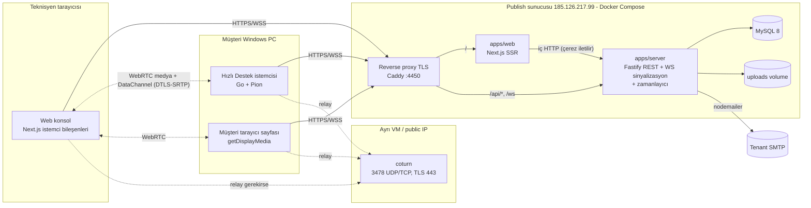

# Mimari — Remote Support (Uzaktan Destek) Platformu
Tarih: 2026-11-10 · Durum: TASLAK r2 — güvenlik raporu Tur 0 (`docs/guvenlik-raporu.md`, G-01..G-25) işlendi; izlenebilirlik §5.5, AC değişiklik talebi §13 · Girdi: `docs/gereksinimler.md`, `docs/gereksinimler-kabul-kriterleri.md` (AC-1..AC-111)
Ekler: `docs/tasarim-kontrol.md`, `docs/adr/0001..0012`. Repo GitHub'da **açık kaynak, Apache-2.0** (K7 kapandı, ADR-0011); istemci **imzasız** (ADR-0010). Bu belge bölüm bölüm ve ayrıntılı sözleşme alt dosyalarıyla tamamlanır:
- `docs/mimari-akislar.md` — sequence akışları (mermaid)
- `docs/mimari-protokol.md` — WS mesaj sözleşmesi + DataChannel protokolü
- `docs/mimari-api.md` — REST API sözleşmesi

## 1. Özet ve kısıtlar
Self-hosted, çok kiracılı uzaktan destek. Teknisyen Next.js konsolundan oturum açar; müşteri ya
taşınabilir (imzasız, açık kaynak) **Go Hızlı Destek istemcisi** (tam erişim) ya da **tarayıcı** (yalnız görüntü)
ile katılır. Medya P2P WebRTC (DTLS-SRTP); sunucu yalnız sinyalizasyon + meta veri tutar; NAT
geçişi coturn (TURN-TLS 443 ayrı IP/VM).

| Kısıt / karar | Değer | Kaynak |
|---|---|---|
| Dil/Runtime | Node.js 22 LTS, TypeScript strict; Go 1.23+ (istemci) | Kullanıcı kararı, S1 |
| API + sinyalizasyon | Fastify 5 + `ws` (aynı süreç, tek instance) | ADR-0002, ADR-0005 |
| Web | Next.js App Router + Tailwind + zod; `lucide-react`; Sonner | Ortak standart 1.8 |
| DB | MySQL 8.4 + Prisma (tek DB, `tenant_id`) | V1, ADR-0003 |
| Windows istemci | Go + Pion WebRTC v4 + Win32 (`golang.org/x/sys/windows`), SendInput | S1, ADR-0004 |
| İstemci dağıtımı | İmzasız, tekrarlanabilir build, SHA-256 yayını + GitHub build provenance attestation (G-07), SmartScreen "Yine de çalıştır" rehberi; kurumsal politikada tarayıcı moda düşüş | Kullanıcı kararı, ADR-0010 |
| Referanslar / lisans | MeshCentral Assistant/relay ve RustDesk'ten tasarım ilhamı — **RustDesk'ten kod alınmaz**; proje lisansı Apache-2.0; WS relay yedeği Sonra | ADR-0011, K7 |
| Eşleme | Dosya adındaki **8 haneli** kod (`Destek-48291376.exe`, ekranda `4829 1376`) + elle kod girişi; katılım **lobi + teknisyen kabulü (admitCode)** ile tamamlanır (G-01, G-02) | S8/V6, ADR-0006 |
| TURN | coturn, `use-auth-secret` (HMAC, ≤ 60 dk + yenileme, G-13); prod: 3478 UDP/TCP + **TLS 443 ayrı public IP/VM**; dev/staging: publish sunucusunda (185.126.217.99) farklı portlarda (K3) | S3, ADR-0007 |
| Yayın | Publish sunucusu 185.126.217.99, 80/443 dolu → uygulama ayrı TLS portu (öneri `4450`, devops kesinleştirir) | V3 |
| Paket yöneticisi | pnpm workspaces (monorepo) | ADR-0001 |
| Test | Vitest (server/web/contracts), Playwright (e2e), `go test` (istemci) | Kalite std. |
| Hedef yük | 50 eşzamanlı aktif oturum, 4 vCPU/8 GB tek sunucu | NFR |

**Basitlik ilkeleri:** tek Node süreci (HTTP + WS), oda durumu bellekte, kuyruk/Redis yok,
zamanlanmış işler süreç içi zamanlayıcı. Genişleme noktaları §7'de gösterilmiştir.

### 1.1 Referans projelerden alınanlar (ayrıntı ADR-0011; kod kopyalanmaz)
| Kaynak | Alınan tasarım fikri | Bizde |
|---|---|---|
| MeshCentral Assistant | Kurulumsuz, kullanıcı yetkisinde destek aracı; onay istemi; izin bitleri; görünür bildirim çubuğu | Go istemci, KVKK onayı, `VIEW`/`CONTROL`/dosya-başı kabul, topmost gösterge şeridi |
| MeshCentral relay | HTTPS/443 WebSocket relay | **Sonra**; 443 ihtiyacını TURN-TLS 443 karşılar; genişleme noktası `internal/rtc`, `lib/webrtc/peer.ts` |
| RustDesk | hbbs/hbbr ayrımı, portable mod, değişen kare atlama, codec seçimi, input modeli, anlık izin kapatma | server ↔ coturn ayrı; tek exe; DXGI boş kare atlama + imleç ayrı; H.264→VP8; `code`+`key` input; gate |

## 2. Bileşen diyagramı ve sorumluluklar


| Bileşen | Sorumluluk | Sorumlu olmadığı |
|---|---|---|
| Caddy (reverse proxy) | TLS sonlandırma, `/api` ve `/ws` → server, kalanı → web, HSTS | İş mantığı |
| apps/web | Sayfalar (login, konsol, karşılama/müşteri, yönetim), CSP nonce middleware, tema | Veri erişimi (yalnız API üzerinden) |
| apps/server | Auth, tenant/yetki guard, REST, WS sinyalizasyon + oda durum makinesi, TURN credential, audit, e-posta, upload işleme, retention işi, `/health` `/ready` `/metrics` | Medya, dosya içeriği, chat içeriği |
| packages/contracts | zod şemaları (REST, WS, DataChannel), `permissions` tek tanımı, hata kodları, test fixture JSON'ları | Çalışma zamanı mantığı |
| apps/agent-win | Ekran yakalama + H.264 kodlama, WebRTC, input enjeksiyonu, **izin kapısı**, göstergeler, kendini kapatma | Sunucu tarafı yetki |
| coturn | STUN/TURN relay, HMAC credential doğrulama, `denied-peer-ip` (sabit liste + ortam dosyası, G-05), oturum bant sınırı | Uygulama kimliği |
| MySQL | Kalıcı veri (§3) | Oda/bağlantı anlık durumu (bellekte) |

## 3. Veri modeli
Prisma şeması `apps/server/prisma/schema.prisma` (sahibi dba). Ortak kurallar:
- PK `id` = `String @db.Char(26)` ULID (sıralı, tahmin edilemez değil ama IDOR koruması yetkiyle sağlanır).
- Her tabloda `created_at DATETIME(3)` + `updated_at DATETIME(3)` UTC; tenant verisinde `tenant_id` zorunlu FK.
- Silme: kullanıcı/tenant **soft** (`deleted_at` / `status`); oturum ve ilişkileri **hard değil**, retention işiyle anonimleştirme/silme; audit **append-only**.
- Para yok. Tarih UTC; gösterim Europe/Istanbul (`date-fns-tz`).
- Enum'lar MySQL ENUM yerine `VARCHAR(20)` + zod enum (migration kolaylığı).

### 3.1 Varlıklar
| Tablo | Alanlar (tip) | İlişki / indeks / not |
|---|---|---|
| `tenants` | id, name VARCHAR(120), slug VARCHAR(60) UQ, status `ACTIVE\|PASSIVE`, logo_path VARCHAR(200)?, deleted_at? | slug login/karşılama URL'inde |
| `tenant_settings` | tenant_id PK/FK, session_ttl_min INT(15..30, vars. 15), max_open_sessions INT(1..10, 3), max_active_hours INT(1..8, 4), max_file_mb INT(1..2048, 100), require_tech_2fa BOOL(true), retention_days INT(90..730, 365), smtp_host, smtp_port, smtp_security `NONE\|SSL\|STARTTLS`, smtp_user, smtp_pass_enc VARBINARY?, smtp_from_name, smtp_from_email | 1-1 tenants |
| `consent_texts` | id, tenant_id, version INT, body TEXT, sha256 CHAR(64), is_current BOOL, created_by | UQ(tenant_id, version); değişmez (yeni sürüm eklenir) |
| `users` | id, tenant_id? (Super Admin için NULL), email VARCHAR(190), username VARCHAR(60)?, full_name VARCHAR(100), role `SUPER_ADMIN\|ADMIN\|USER`, password_hash VARCHAR(255), must_change_password BOOL, failed_login_count INT (1 sa pencere, G-23), failed_window_at DATETIME?, locked_until DATETIME? (yalnız hesap geneli kilit; hesap+IP kilidi bellekte, G-23), totp_secret_enc VARBINARY?, totp_enabled BOOL, avatar_path?, theme `LIGHT\|DARK\|SYSTEM`(SYSTEM), status `ACTIVE\|PASSIVE`, deleted_at? | UQ(email); IX(tenant_id, status) |
| `user_permissions` | user_id FK, perm_key VARCHAR(60), granted BOOL | PK(user_id, perm_key); anahtarlar `permissions` tanımından |
| `recovery_codes` | id, user_id, code_hash CHAR(64), used_at? | 10 adet, SHA-256 |
| `auth_sessions` | id, user_id, token_hash CHAR(64) UQ, acting_tenant_id? (Super Admin geçişi), ip VARCHAR(45), user_agent VARCHAR(300), last_seen_at, expires_at (≤ 8 sa), revoked_at?, mfa_passed BOOL | IX(user_id, revoked_at) |
| `password_reset_tokens` | id, user_id, token_hash CHAR(64) UQ, expires_at (30 dk), used_at? | |
| `support_sessions` | id, tenant_id, technician_id FK users, token_hash CHAR(64) UQ, active_code CHAR(8)? (G-02), status `PENDING\|ACTIVE\|ENDED\|EXPIRED\|CANCELLED`, mode `AGENT\|BROWSER`?, tech_verify_code CHAR(4) (**teknisyen doğrulama kodu** — müşterinin teknisyeni teyidi içindir, müşteriyi doğrulamaz; G-01), expires_at, consumed_at? (= oturum başlangıcı), ended_at?, ended_by `TECH\|CUSTOMER\|ADMIN\|SYSTEM`? (ADMIN: G-04), end_reason VARCHAR(40)? (küçük harf, protokol değerleri), terminated_by FK users? (G-04), customer_name VARCHAR(100)?, customer_email VARCHAR(190)?, ticket_no VARCHAR(50)?, note TEXT(≤4000)?, quality_summary JSON?, anonymized_at? | IX(tenant_id, created_at), IX(tenant_id, technician_id, created_at), IX(tenant_id, status); **UQ(active_code)**: tek kod sütunu; yalnız **PENDING** iken dolu, admit/iptal/expiry anında NULL (MySQL NULL'ı tekil saymaz) → bekleyen kodlar **global** tekil (istemci tenant bilmeden kodla çözer, ADR-0006). Ayrı `short_code` sütunu **kaldırıldı** (G-22: geçmişte kod gerekmez; düz kod yalnız bekleme süresince DB'de) |
| `session_consents` | id, session_id, tenant_id, level `VIEW\|CONTROL`, decision `GRANTED\|DENIED\|REVOKED`, source `UI\|HOTKEY\|RECONNECT\|SYSTEM`, consent_text_id?, consent_sha256 CHAR(64)?, ip, user_agent, created_at | IX(session_id, created_at); AC-29, AC-62, AC-111 zaman çizelgesi |
| `session_files` | id, session_id, tenant_id, direction `TO_CUSTOMER\|TO_TECH`, file_name VARCHAR(255), size_bytes BIGINT, sha256 CHAR(64), result `OK\|REJECTED\|CANCELLED\|CORRUPT`, created_at | AC-55; içerik yok |
| `audit_logs` (G-15: `app` DB kullanıcısı yalnız INSERT/SELECT/DELETE; DELETE tetikleyiciyle sınırlı) | id BIGINT AI, created_at, tenant_id?, user_id?, username VARCHAR(190)?, action VARCHAR(60), entity VARCHAR(40), entity_id VARCHAR(40)?, old_value JSON?, new_value JSON?, ip_address VARCHAR(45)?, user_agent VARCHAR(300)?, result `success\|fail`, correlation_id CHAR(26)? | IX(tenant_id, created_at), IX(tenant_id, user_id, created_at), IX(tenant_id, action, created_at); `updated_at` yok (append-only istisnası) |
| `system_settings` | key VARCHAR(60) PK, value_json JSON?, secret_enc VARBINARY?, updated_by, updated_at | MySQL ayarları, sistem logosu, TURN secret (şifreli) |

İlişkiler: tenants 1-N users, support_sessions, consent_texts, audit_logs; users 1-N auth_sessions,
user_permissions, support_sessions(technician); support_sessions 1-N session_consents, session_files.
FK davranışı: `ON DELETE RESTRICT` (hiçbir cascade yok; hard delete yalnız retention işinde, çocuklardan başlayarak tek transaction).

**dba sapma notu (P1, 2026-11-11):** (1) `users.username` UQ eklendi (giriş e-posta/kullanıcı adı ile; belirsizlik olmasın, NULL'lar çoklu). (2) Retention sorguları için `IX(auth_sessions.expires_at)`, `IX(audit_logs.created_at)`. (3) VARCHAR enum'lar ve `tenant_settings` aralıkları DB'de CHECK (zod'a ek). (4) `audit_logs.user_id` FK değil. (5) Prisma 7 MySQL sürücü bağdaştırıcısı `@prisma/adapter-mariadb` (Prisma 7 zorunlu kılar). (6) `app` kullanıcısı `audit_logs`'ta P1'de yalnız SELECT/INSERT: DELETE yetkisi retention/tetikleyiciyle birlikte (P11/P13) verilecek; o pakette grants.sql güncellenir (§3.3 metnindeki INSERT/SELECT/DELETE o pakette geçerli olur). (7) GRANT betiği `prisma/sql/grants.sql`, kullanıcı oluşturma `deploy/mysql/init/01-users.sh`. Ayrıntı `docs/db-notlari.md`.

**dba sapma notu (P2, 2026-11-11):** `support_sessions` P2'de yalnız P2 alanlarıyla oluşturuldu (mode, consumed_at, started_at, terminated_by, customer_*, ticket_no, note, quality_summary, anonymized_at sonraki paketlerde expand). İndeks: IX(tenant_id, technician_id, created_at) yerine IX(technician_id, created_at) + IX(technician_id, status) (FK için technician_id önde; ULID tenant'a özgü) + IX(status, expires_at) (expiry işi); IX(tenant_id, status) P8'e. İptal zamanı `ended_at` (ayrı sütun yok). CHECK: PENDING ⇔ active_code dolu, bitmiş durum ⇔ ended_at dolu, TTL 15..30 dk (±1 dk). `app`: SELECT/INSERT/UPDATE (DELETE P13). Ayrıntı `docs/db-notlari.md` P2.

**backend-dev sapma notu (P2, 2026-11-11):** `sessions/public.ts` ek dosya; `SESSION_REF_KEY` opsiyonel (boşsa süreç başına rastgele, devops compose'a ekler); 20/sa limiti DB sayımıyla (TX + users FOR UPDATE); resolve yanıtında P3 alanları yok. Ayrıntı `docs/implementation.md` "Backend (P2)".

**mimar kararı (P3 düzeltme turu 1, QA-P3-6, 2026-11-11 — bağlayıcı):** (1) **Oturum başlangıcı = `consumed_at`** (admit = tüketim = ACTIVE başlangıcı; AC-13 max süre `consumed_at + max_active_hours`, raporlar/CSV "başlangıç" sütunu bu alandan). `started_at` modelden **çıkarıldı**, eklenmeyecek; medya/ekran paylaşımı başlangıcı gerekirse P4'te ayrı sütun değil audit/`session_consents` zaman çizelgesinden okunur. (2) **`end_reason` küçük harf** ve yalnız `mimari-protokol.md` `session.ended.reason` kümesinden (`tech`, `customer`, `timeout`, `max_duration`, `cancelled`, `tenant_passive`, `server`, `admin`, `auth_revoked`) + `expired` (PENDING süresi doldu); `rejected`/`lobby_timeout` misafire özeldir, oturuma yazılmaz. Büyük harf yazım (eski `SERVER_RESTART`/`TIMEOUT`) geçersiz; kontrat `contracts` içinde tek enum olarak tutulur, DB'de CHECK eklenmez (P8 CSV aynı değerleri gösterir, UI'da Türkçe etiket).

**backend-dev sapma notu (P3, 2026-11-11):** `hello.maxEndsAt` nullable (PENDING) ve teknisyene iceServers yalnız admit sonrası (`ice.servers`); `peer.joined.guestKind?`; consentText/consentTextId doğrulaması P4 (tablo P4); public rotalar `sessions/routes.ts` içinde, join servisi `public/service.ts`; ek `signaling/{types,store,active,admit}.ts`; `/metrics` prom-client'sız, `METRICS_TOKEN` yoksa 404; ws maxPayload 1 MB tavan + 64 KB üstü 1008; `end_reason` küçük harf protokol değerleri. Ayrıntı `docs/implementation.md` "Backend (P3)".

### 3.2 Gizli alan şifreleme
`*_enc` alanları AES-256-GCM: `ver(1B) | iv(12B) | tag(16B) | ciphertext`. Anahtar `APP_ENCRYPTION_KEYS`
(`v1:base64,...`) env'den; yeni yazımlar son sürümle, okuma `ver` baytına göre (rotasyon). Kod: `apps/server/src/lib/crypto.ts`.

### 3.3 Audit değiştirilemezliği
- API'de audit için yalnız `GET` uçları; `PUT/PATCH/DELETE` → 405 (AC-76).
- DB tetikleyicisi (dba, migration içinde raw SQL): `BEFORE UPDATE` → SIGNAL hata; `BEFORE DELETE` →
  `created_at > NOW() - INTERVAL 730 DAY` ise SIGNAL (yalnız retention silebilir).
- Maskeleme (G-15): `audit.write()` iki listeli, tek dosya `audit/mask.ts`:
  - **Açık bırakılanlar (izinli liste, önce uygulanır):** `perm_key`, `permKey`, `action`, `entity`, `level`, `decision`, `source`, `direction`, `result`, `reason`.
  - **Maskelenenler:** anahtar adı `/pass|secret|token|key|nonce|totp|code|ticket|credential|recovery|cookie|authorization|sdp|candidate|admit/i` → `***`. Değer tarafında ek tarama yok (basit tutulur; AC-90 log taraması yakalar).
- **İki DB kullanıcısı (G-15):** `migrator` (DDL + TRIGGER; yalnız tek seferlik `migrate` compose servisi kullanır) ve `app` (DML; `audit_logs` için yalnız INSERT/SELECT/DELETE; ALTER/DROP/TRIGGER/UPDATE yok). Böylece uygulama süreci tetikleyiciyi düşüremez. GRANT betiği dba'da (`prisma/sql/grants.sql`).

### 3.4 Retention (günlük 03:30 Europe/Istanbul, süreç içi zamanlayıcı)
| Veri | Süre | İşlem |
|---|---|---|
| support_sessions + consents + files | tenant `retention_days` | customer_name/email, ip, user_agent, file_name → NULL/`***`; `anonymized_at` set; ardından +30 gün hard delete |
| audit_logs | 730 gün | hard delete (tetikleyici izinli) |
| auth_sessions, reset tokens | süresi dolan +7 gün | hard delete |

### 3.5 Bellek içi (kalıcı olmayan) durum — `apps/server/src/signaling/rooms.ts`
| Yapı | Alanlar | Ömür |
|---|---|---|
| JoinNonce | nonceHash, sessionId, kind `BROWSER\|AGENT`, expiresAt (60 sn), used | AC-16 |
| Room | sessionId, tenantId, technicianId, techSocket?, guestSocket?, guestKind, caps[] (G-09), controlState `VIEW\|REQUESTED\|GRANTED`, controlRequests (sayaç ≤5), controlCooldownUntil (G-03), disconnectTimer (120 sn), maxDurationTimer, reconnectTokenHash, adminRejectCount, admitFailCount (≤5) | Oturum süresince |
| LobbyGuest (G-01) | guestId (ULID), sessionId, socket, name, email?, guestKind, ipKey, admitCodeHash (SHA-256 + oturum tuzu), consent {textId, sha256, at, ip, ua}, expiresAt (5 dk) | Oda başına ≤ 3; admit/ret/timeout'ta silinir |
Sunucu yeniden başlarsa odalar ve lobi düşer → ACTIVE oturumlar `ENDED(end_reason=server)`; PENDING oturum PENDING kalır (lobidekiler yeniden katılır). Kabul edilen sınır (ADR-0005).

## 4. API sözleşmesi
Ayrıntı (bağlayıcı): **`docs/mimari-api.md`** (REST) ve **`docs/mimari-protokol.md`** (WS + DataChannel). Akışlar: `docs/mimari-akislar.md`.
- REST `/api/v1`, çerez + CSRF, standart hata zarfı, sayfalama `page/pageSize≤100`, başka tenant → 404.
- WS: `/ws/tech` (çerez + Origin + sahiplik), `/ws/guest` (tek kullanımlık ticket; native'de Origin yerine ticket kind=AGENT).
- DataChannel: `ctl` (chat, annotation, dosya kontrol), `file` (16 KB parçalar), `input` (yalnız AGENT; izin kapısı istemcide).
- Sözleşme kaynağı `packages/contracts` (zod). OpenAPI üretimi **Sonra** (genişleme noktası: `zod-to-openapi` contracts paketine eklenir; public API kapsam dışı olduğundan şimdi gerekmez).

## 5. Güvenlik tasarımı ve tehdit modeli
### 5.1 Kimlik ve yetki modeli
| Konu | Karar |
|---|---|
| Şifre | argon2id (`argon2` paketi; m=19 MiB, t=2, p=1 — OWASP), min 12 karakter; ilk girişte zorunlu değişim (`must_change_password` guard tüm uçlarda, yalnız `/auth/password/change`, `/auth/me`, `/auth/logout` serbest) |
| Oturum | Opak 32 bayt token çerezde, DB'de SHA-256; mutlak 8 sa, boşta 30 dk (`last_seen_at` her istekte, 60 sn'de bir yazılır); `logout-all` → DB revoke; her istek DB'den doğrular → ≤ 5 sn geçersizlik (AC-68). JWT yok (ADR-0008) |
| 2FA | TOTP (`otplib`), SUPER_ADMIN/ADMIN zorunlu, USER tenant ayarıyla; `mfa_passed=false` oturum yalnız MFA uçlarına erişir; 10 kurtarma kodu SHA-256 |
| Kilitleme (G-23) | Hesap+IP ikilisi: 5 hatalı → o ikili 15 dk kilit (bellek, `rate.ts`); hesap geneli: IP'den bağımsız 1 saatte 20 hatalı → `locked_until=+15 dk` (DB) + hesap sahibine bildirim e-postası (P10 sonrası; SMTP yoksa yalnız audit); IP 20/dk login limiti; yanıt hesabın varlığını sızdırmaz. Böylece bilinen e-postayı başka IP'den kilitlemek tek denemeyle mümkün olmaz |
| Yetki | `requirePerm(key)` Fastify preHandler; anahtarlar `permissions.ts`'den. Admin yalnız kendi sahip olduğu anahtarları verebilir (sunucuda küme kontrolü, AC-73) |
| Tenant izolasyonu | `tenantScope(req)` her repository fonksiyonuna zorunlu parametre (`{ tenantId }`); Prisma Client extension ile `tenant_id` filtresi **eklenmez** (sihir yok) — bunun yerine repository imzası zorunlu kılar + AC-69 otomatik testi tüm uçları iki tenant fixture'ıyla gezer. SUPER_ADMIN `acting_tenant_id` ile tek tenant bağlamına geçer |
| Teknisyen–oturum sahipliği | `/ws/tech` ve `/sessions/:id` mutasyonları yalnız `technician_id = user.id`. **USER rolü** için liste, detay, PATCH ve export'ta repository filtresi `technician_id = user.id` (G-22). Admin/Super Admin görüntüler, PENDING'i iptal eder, ACTIVE'i **zorla sonlandırır** (G-04); odaya katılamaz (çoklu teknisyen kapsam dışı) |
| Canlı yetki iptali (G-04) | Tek giriş noktası `rooms.endByTechnician(userId, reason)` ve `rooms.applyPermChange(userId, perms)`. Çağıranlar: `users.deactivate`, `/auth/logout-all`, Admin şifre sıfırlama / MFA sıfırlama, tenant pasif (AC-70), yetki PATCH'i. `remote_control.use` kalkarsa → misafire `control.revoke` (istemci kapıyı kapatır); `file_transfer.use` kalkarsa → `caps.update`. Ek emniyet: `/ws/tech` soketi 60 sn'de bir `auth_sessions`'ı DB'den doğrular (revoke/expiry → kapat; geçerliyse `last_seen_at` günceller — WS etkinliği boşta sayılmaz) |
| Müşteri kimliği | Hesap yok. Zincir: token/kod → `joinNonce` (60 sn, tek) → `wsTicket` (60 sn, tek) + kişiye özel `admitCode` → **lobi** → teknisyen kabulü (G-01) → `reconnectToken` (yalnız admit sonrası verilir, her kullanımda yenilenir). Hepsi bellekte/DB'de yalnız hash. Ticket/reconnect URL'de taşınmaz: `Sec-WebSocket-Protocol` (G-10) |
| Gizli değer üretimi (G-20) | `lib/ids.ts` tek yer: token/nonce/ticket/reconnect = `crypto.randomBytes(32)` (256 bit) base64url; `admitCode` ve `tech_verify_code` = `crypto.randomInt(0, 10000)`; oturum kodu `randomInt(0, 10⁸)`. Tüm hash karşılaştırmaları `crypto.timingSafeEqual`. `User-Agent` hiçbir kararda kullanılmaz (yalnız log bilgisi); native kuralını `ticket.kind` belirler |
| Gerçek istemci IP'si (G-11) | Fastify `trustProxy` = yalnız Caddy'nin compose ağı adresi (`TRUSTED_PROXY_CIDR`, ör. `172.30.0.2/32`); Caddy'de `trusted_proxies` tanımsız → gelen `X-Forwarded-For` ezilir. Limit anahtarı `ipKey()`: IPv4 /32, IPv6 /64 (IPv4-mapped IPv6 → IPv4'e indirgenir); önek anahtarı `prefixKey()`: IPv4 /24, IPv6 /56 (G-02) |

### 5.2 Tehdit modeli (STRIDE özeti)
Varlıklar: müşteri ekran görüntüsü ve girdisi (en kritik), teknisyen hesapları, oturum token/kodları, tenant ayar gizlileri, audit bütünlüğü, istemci binary bütünlüğü (SHA-256 + attestation).
Saldırganlar: (A1) internetten anonim, (A2) dolandırıcı (sosyal mühendislik), (A3) kötü niyetli/ele geçirilmiş teknisyen, (A4) başka tenant kullanıcısı, (A5) ağ dinleyici, (A6) müşteri makinesindeki zararlı yazılım.

| # | Tehdit | STRIDE | Önlem | AC |
|---|---|---|---|---|
| T1 | Kodu brute-force edip (veya linki ele geçirip) müşteri yerine geçme; gerçek müşteriyi kilitleme (G-01, G-02) | S/D | 8 haneli kod (10⁸), yalnız PENDING; başarısız kod IP 10/dk + önek 30/dk (aşımda o anahtar 15 dk 429; global sayaç yalnız alarm — tek saldırgan herkesi kilitleyemez); join **tüketmez** → misafir **lobiye** girer, kişiye özel `admitCode`'u yalnız kendisi görür; teknisyen müşterinin telefonda okuduğu kodu **konsola girer**, eşleşmeyen misafir kabul edilemez; kabul gelmeden SDP/ICE iletilmez, TURN credential verilmez; tüketim admit TX'inde → reddedilen saldırgan gerçek müşteriyi kilitleyemez. Kalan risk: lobi spam'i (≤3 misafir, 5 dk, ret edilen ipKey o oturuma tekrar giremez). Hesap: ADR-0006 | AC-3, 6, 7, 16, 26, 112, 113 |
| T2 | Token'ın sızması (log, Referer, e-posta) | I | Token yalnız URL path'inde; `Referrer-Policy: no-referrer`; loglarda `/session/*` path maskeleme; DB'de hash; tek kullanım | AC-2, 6, 90 |
| T3 | Dolandırıcının platformu kullanması (tech-support scam, G-17) | S | Self-servis kayıt yok; tenant oluşturmada firma doğrulaması (runbook); karşılama + istemcide onaydan önce sabit dolandırıcılık uyarısı ve bağlanılan alan adı; "Kötüye kullanımı bildir" `mailto:` bağlantısı; ekran karartma/gizli mod **kapsam dışı**; gösterge şeridi her monitörde, 1 sn'de bir yeniden topmost; audit | AC-26, 98, 103, 125 |
| T4 | Sunucu/teknisyen müşteri izni olmadan girdi enjekte etmesi | E | İzin kapısı **istemcide**, yalnız yerel enjekte-olmayan tıklama açar; sunucu mesajı kapıyı açamaz; yeniden bağlanmada kapalı | AC-47, 99, 101 |
| T5 | Teknisyenin kontrol sırasında istemcinin "izin ver" diyaloglarını (monitör vb.) kendi tıklamasıyla onaylaması | E | İstemci penceresi `LLMHF_INJECTED`/`LLKHF_INJECTED` olayları yok sayar; kontrol aktifken diyaloglar klavye odağını almaz | AC-100 |
| T6 | Çapraz oturum SDP/ICE sızıntısı | I | Oda anahtarı sunucuda soket-bağlamından; mesajda oturum ID alınmaz | AC-20 |
| T7 | CSWSH (başka siteden WS) | S | Origin allowlist + SameSite=Strict çerez | AC-14 |
| T8 | WS kaynak tüketimi (DoS) | D | 64 KB, 50 msg/sn, ping, bağlantı başına IP 20 eşzamanlı WS, upgrade öncesi doğrulama | AC-17..19 |
| T9 | TURN'ün açık relay/SSRF olarak kullanımı (G-05, G-13) | E/I | `use-auth-secret`; credential **yalnız admit sonrası**, ömür `min(kalan süre, 60 dk)` + `ice.servers` ile yenileme; `denied-peer-ip` = sabit özel/ayrılmış/geçiş aralıkları + ortam dosyasındaki altyapı IP'leri (publish sunucusu, sağlayıcı /24, Proxmox, TURN'ün kendisi); `no-loopback-peers`, `no-multicast-peers`, `no-tcp-relay`, `no-cli`; `max-bps` 8 Mbps/oturum, `bps-capacity`; allocation/oturum oranı alarmı. Ayrıntı ADR-0007 | AC-21, 22 |
| T10 | Tenant arası veri erişimi (IDOR) | I | Zorunlu `tenantScope`, 404, otomatik test | AC-61, 69, 84 |
| T11 | XSS (chat, dosya adı, müşteri adı) | T | React metin bağlama, `dangerouslySetInnerHTML` lint yasağı, nonce CSP; Go istemci Win32 metin kontrolü (HTML yok) | AC-35 |
| T12 | Kötü amaçlı dosya gönderimi | T | Alıcı onayı zorunlu, çalıştırılabilir uyarısı, SHA-256; sunucu içerik görmez | AC-36, 54 |
| T13 | Sahte/değiştirilmiş istemci binary'si (imza yok), sunucu ele geçirilerek binary + hash'in birlikte değiştirilmesi (G-07) | S/T | Köken sunucudan bağımsız: CI'da GitHub **build provenance attestation** (Sigstore, anahtarsız) + `SHA256SUMS` Release'de; deploy betiği binary'yi volume'a koymadan önce `gh attestation verify` çalıştırır; **günlük dış gözcü** workflow'u (`agent-watch.yml`) public indirme ucundaki exe'nin hash'ini Release ile karşılaştırır, uyuşmazlıkta issue/e-posta alarmı; `serverURL` yalnız ldflags (komut satırı/env/registry yok); istemci karşılamada alan adı + sürüm + SHA-256 ilk 8 hane; SignPath başvurusu P6 ile paralel. İstemci sistem kök TLS (pinning yok) | AC-94, 96, 109, 128 |
| T18 | Açık kaynak repoda gizli bilgi sızıntısı | I | `.env*` git-ignore (yalnız `.env.example` boş anahtarlar), CI'da **gitleaks** (PR + push, bulgu = kırmızı), pre-commit gitleaks önerisi; test fixture'larında gerçek değer yok; seed şifresi env'den | — |
| T14 | Audit kaydının değiştirilmesi (G-15) | R | Append-only API + DB tetikleyicisi + `app` DB kullanıcısında TRIGGER/ALTER/DROP/UPDATE yok; kontrol izni audit'i yazılamazsa kontrol geri alınır (fail-closed) | AC-75, 76, 111, 123 |
| T19 | Kontrol/monitör/dosya izin diyaloğuna tıklama/tuş tuzağı ve istek spam'i (G-03) | E | Odak "Reddet"; Enter/Space "İzin ver"i tetiklemez; butonlar 1,5 sn sonra etkin; diyalog imlecin altında açılmaz; sunucu: ret sonrası 30 sn bekleme + oturum başına ≤5 `control.request`/`monitor.request`; dosya teklifi istemci tarafında aynı kural (DC, sunucu göremez) | AC-99, 116 |
| T20 | Gelen dosyada yol/ADS/aygıt adı/RTLO, MOTW yok (G-06) | T | Alıcıda tek ad temizleme kuralı (contracts + Go, ortak fixture); Go `:Zone.Identifier` ZoneId=3; genişletilmiş tehlikeli uzantı listesi + çift uzantı vurgusu; sınır **alınan bayt** sayacıyla; üzerine yazma yok | AC-36, 117 |
| T21 | DLL arama sırası ele geçirme (Downloads'tan çalışan exe, G-08) | E | `SetDefaultDllDirectories(LOAD_LIBRARY_SEARCH_SYSTEM32)` main başında; yalnız `windows.NewLazySystemDLL`; `%TEMP%`'e DLL/exe çıkarma yok; Procmon kanıtı | AC-118 |
| T22 | Ayar test uçlarıyla iç ağ taraması (G-12) | I | SMTP host çözümlenen IP'si özel/loopback/link-local/CGNAT/Docker ağıysa ret; bağlantı çözümlenen IP'ye (rebinding yok); genel hata metni; 5/dk/tenant; MySQL testi yalnız Super Admin | AC-122 |
| T23 | CSV formül enjeksiyonu (G-16) | T | `lib/csv.ts` tek kaçış fonksiyonu: `= + - @ \t \r` ile başlayan hücreye `'` öneki | AC-124 |
| T24 | CI/tedarik zinciri (G-18) | T | Action'lar commit SHA ile sabit, en az `permissions`, Release yalnız korumalı `v*` etiketi + onaylı `environment`, fork PR'ına secret yok, `--frozen-lockfile`, `-mod=readonly`, sabit `GOTOOLCHAIN`, Dependabot | AC-94 |
| T25 | Sinyalizasyonu kontrol eden tarafın DTLS parmak izini değiştirip MITM yapması (G-14) | I/T | **Güven varsayımı:** uygulama sunucusu güvenilir hesaplama tabanındadır; sunucu ele geçirilirse medya gizliliği garanti edilmez (konsol JS'i de aynı sunucudan geldiği için SAS bu durumda koruma sağlamaz). SAS: **Sonra** (§5.5) | — |
| T26 | P2P'de sunucunun uygulayamadığı yetkiler (G-09) | E | Sunucu misafire `caps` gönderir; istemci/müşteri sayfası `caps` dışı DC isteklerini reddeder; `control.request` yalnız WS'den kabul (DC'de tip yok) | AC-119 |
| T27 | Kötü niyetli sitenin ziyaretçi tarayıcılarıyla public resolve/join'e dağıtık kod denemesi/lobi spam'i; Agent'ın Origin'siz gelmesinin bu kapıyı açması (P3 şartı 3) | S/D | `checkPublicClient`: Origin varsa allowlist + `BROWSER`; yoksa yalnız `AGENT` ve `Sec-Fetch-*` yok; join'de `kind` nonce'tan (istemci beyanı değil); hız sınırları kind'dan bağımsız. Tarayıcı dışı saldırgana karşı koruma T1 (hız sınırı + lobi/admitCode) — Origin değil. ADR-0012 | AC-14, 16 |
| T15 | Gizli değer sızıntısı (DB dökümü) | I | AES-256-GCM, anahtar env'de, formda geri yazılmaz | AC-78 |
| T16 | Logo/avatar yüklemeyle XSS/RCE | T/E | magic bytes (`file-type`), `sharp` ile yeniden kodlama (EXIF düşer), SVG yok, rastgele ad, `Content-Type` sunucu belirler + `X-Content-Type-Options: nosniff` | AC-84 |
| T17 | A6: müşteri makinesindeki zararlının istemciyi kötüye kullanması | E | Kapsam sınırı: istemci admin değil, kalıcılık yok, yerel IPC/port açmaz (dinleyen soket yok) | AC-108 |

### 5.3 Hassas veri
| Veri | Sınıf | Depolama |
|---|---|---|
| Ekran görüntüsü, girdi, chat, dosya içeriği | Kişisel/çok hassas | **Hiç saklanmaz**; yalnız DTLS-SRTP |
| Müşteri adı/e-posta, IP, UA, onay kaydı | Kişisel veri (KVKK) | DB, retention + anonimleştirme |
| Şifre, TOTP secret, SMTP/MySQL/TURN gizlileri | Gizli | argon2id / AES-256-GCM |
| Token, nonce, ticket, kurtarma kodu | Gizli | Yalnız SHA-256 |

### 5.4 Başlıklar ve tarayıcı politikası (Next middleware + Fastify `@fastify/helmet`)
`Content-Security-Policy: default-src 'self'; script-src 'self' 'nonce-<r>' 'strict-dynamic'; style-src 'self' 'nonce-<r>'; img-src 'self' data: blob:; connect-src 'self' wss://<host>:<port>; worker-src 'self'; manifest-src 'self'; frame-ancestors 'none'; base-uri 'none'; form-action 'self'; object-src 'none'; upgrade-insecure-requests` (G-19: `connect-src` port içerir; SSR çıktısındaki `style=""` öznitelikleri nonce kapsamına girmez → JSX `style` prop'u yasak (ESLint `react/forbid-dom-props`), stil sınıf/CSS değişkeniyle; çalışma anında JS ile `el.style.*` (CSSOM, ör. işaretleme katmanı) CSP'den etkilenmez ve serbesttir; `'unsafe-inline'` **eklenmez**),
`Strict-Transport-Security: max-age=31536000` (G-19: `includeSubDomains` **K1 kapanıp alan adının diğer alt alanlarının HTTPS olduğu doğrulanana kadar eklenmez**), `Cross-Origin-Resource-Policy: same-origin` (istisna: `/public/files/logo/*` ve sistem logosu `cross-origin` — e-posta istemcileri yükler), `Server`/`X-Powered-By` yok (Caddy `-Server`, Next `poweredByHeader:false`), `X-Content-Type-Options: nosniff`, `Referrer-Policy: no-referrer`,
`Permissions-Policy: camera=(), microphone=(), geolocation=(), display-capture=(self)`, `Cross-Origin-Opener-Policy: same-origin`.
CORS: kapalı (aynı origin; `@fastify/cors` eklenmez). Gizliler: repo **public** — `.env` repo dışı, `.env.example` yalnız boş anahtar adları, CI gitleaks; TURN secret rotasyonu runbook'ta (coturn çift secret ile geçiş).

### 5.5 Güvenlik raporu Tur 0 izlenebilirliği (`docs/guvenlik-raporu.md`)
| ID | Karar | Nerede |
|---|---|---|
| G-01 | Kapsamda: lobi + kişiye özel `admitCode`, teknisyen kodu girer; tüketim admit'te; `verifyCode` → teknisyen doğrulama kodu | §3.5, §5.1, T1; protokol §3.1; akış A1/A2; ADR-0006; AC-6/7/26/98 rev., AC-112/113 |
| G-02 | Kapsamda: 8 hane; IP + önek sayacı, 15 dk blok; global = alarm. **Sadeleştirme:** üstel ceza yerine sabit 15 dk blok (aynı caydırıcılık, daha az durum) | §5.1, T1; ADR-0006; AC-3/97 rev. |
| G-03 | Kapsamda: diyalog kuralları + sunucu sayacı (WS istekleri); dosya teklifi istemcide | T19; protokol §3, §4.3; akış A3; ADR-0009; AC-116 |
| G-04 | Kapsamda: `/sessions/:id/terminate`, `endByTechnician`, `control.revoke`, 60 sn WS doğrulama | §5.1; api; protokol §3; akış A5; AC-114/115 |
| G-05 | Kapsamda: genişletilmiş liste; altyapı IP'leri ortam dosyasında (public repoya yazılmaz) | T9; ADR-0007; §8.3; AC-22 rev. |
| G-06 | Kapsamda: ad temizleme (ortak fixture), MOTW, uzantı listesi, bayt sayacı | T20; protokol §4.1–4.2; AC-36 rev., AC-117 |
| G-07 | Kapsamda: attestation + deploy'da doğrulama + günlük dış gözcü + ldflags-only URL + karşılamada parmak izi. **Sadeleştirme:** minisign/cosign anahtarı ve sunucu açılışında imza doğrulama **yok** — ele geçirilmiş sunucu kendi doğrulamasını da atlar; bağımsız kanıt GitHub attestation + dış gözcüdür, anahtar yönetimi yükü yok. Telefonla parmak izi teyidi zorunlu değil (konsol değeri de aynı sunucudan gelir) | T13; ADR-0010; AC-94/96/109 rev., AC-128 |
| G-08 | Kapsamda | T21; ADR-0004 notu (ADR-0010); AC-118 |
| G-09 | Kapsamda: `caps` + `caps.update` | T26; protokol §3; AC-119 |
| G-10 | Kapsamda: `Sec-WebSocket-Protocol`; Caddy log filtresi; reconnect çakışma reddi | §5.1, §8.2; protokol §1; akış A4; AC-14 rev., AC-120 |
| G-11 | Kapsamda | §5.1; AC-121 |
| G-12 | Kapsamda: `lib/netguard.ts` (tek yardımcı) | T22; api; AC-122 |
| G-13 | Kapsamda: 60 dk + `ice.servers` yenileme (mevcut ICE restart yolu), `max-bps`. **Sadeleştirme:** "oturumsuz allocation" eşlemesi yerine oran alarmı (`turn_allocations > 2×active_sessions+10`) | T9; ADR-0007; AC-21 rev. |
| G-14 | **Sonra** (gerekçe T25): konsol JS'i aynı sunucudan geldiğinden sunucu ele geçirilmesinde SAS korumaz; kalan senaryo (yalnız sinyalizasyonu yeniden yazan kurumsal proxy) gerçekçi değil. Genişleme noktası: `web/lib/webrtc/sas.ts` + `agent-win/internal/rtc/sas.go`, kontrol diyaloğunda gösterim | T25; gereksinimler §9 Sonra |
| G-15 | Kapsamda: izinli+kara liste, iki DB kullanıcısı, fail-closed kontrol | §3.3, T14; ADR-0003; AC-75/111 rev., AC-123 |
| G-16 | Kapsamda | T23; AC-124 |
| G-17 | Kapsamda: (1) uyarı, (2) gizli mod kapsam dışı, (3) her monitörde topmost şerit, (5) runbook. **Sadeleştirme:** (4) "Kötüye kullanımı bildir" sunucu ucu yerine `mailto:` (anonim e-posta gönderen public uç spam aracı olur); (6) oturum sonu özeti **Sonra** — AC-107 (3 sn'de kapanış) ile çelişir | T3; AC-98/103 rev., AC-125 |
| G-18 | Kapsamda. **Sadeleştirme:** Renovate yerine GitHub-yerel Dependabot; Scorecard Sonra | T24; AC-94 rev. |
| G-19 | Kapsamda | §5.4; AC-126 |
| G-20 | Kapsamda (belge kuralı) | §5.1; protokol §1 |
| G-21 | Kapsamda: yedek kısayol, ikisi de alınamazsa kontrol verilemez | protokol §4.3; AC-102 rev. |
| G-22 | Kapsamda: belge düzeltmesi + `short_code` kaldırıldı + USER kapsamı | §3.1, §5.1; api; AC-61 rev. |
| G-23 | Kapsamda | §5.1; api; AC-10/65 rev. |
| G-24 | Kapsamda | api; AC-127 |
| G-25 | Kapsamda: runbook maddesi + K8 P6 ön koşulu | §12; AC-27/92/94/96 rev. |

## 6. Dosya/klasör planı (minimum; her klasör ilk ihtiyaç duyan pakette açılır)
```
Remote/
├─ package.json, pnpm-workspace.yaml, tsconfig.base.json, eslint.config.mjs, .prettierrc, .env.example   (P1)
├─ LICENSE (Apache-2.0), NOTICE (referans projeler, "inspired by"), .gitignore (.env*, deploy/turn/*.local.conf), .gitleaks.toml   (P1)
├─ CLAUDE.md (proje kuralları), DESIGN.md (token'lar)                                                      (P1)
├─ packages/contracts/            zod şemaları — tek sözleşme kaynağı
│  └─ src/{permissions.ts, errors.ts, api/*.ts, ws.ts (P3), dc.ts (P4), files.ts (P5: ad temizleme + tehlikeli uzantı listesi, G-06)}, fixtures/*.json (P3; P5'te file-names.json)
├─ apps/server/                   Fastify + ws + Prisma
│  ├─ prisma/{schema.prisma, migrations/, seed.ts, sql/grants.sql (migrator/app, G-15)}   (dba)
│  └─ src/
│     ├─ app.ts, server.ts, env.ts                                        (P1)
│     ├─ lib/{crypto.ts, ids.ts, logger.ts, ip.ts (ipKey/prefixKey, G-11)}  (P1); rate.ts (P2); netguard.ts (P10, G-12); csv.ts (P8, G-16)
│     ├─ auth/{routes.ts, service.ts, guards.ts (requireAuth/requirePerm/tenantScope), password.ts}   (P1; mfa.ts P10)
│     ├─ audit/{service.ts (write), mask.ts (G-15), routes.ts (P11)}      (P1)
│     ├─ sessions/{routes.ts, service.ts, repo.ts, codes.ts}              (P2)
│     ├─ public/{routes.ts, service.ts}                                   (P3)
│     ├─ signaling/{ws.ts (upgrade+subprotocol auth), rooms.ts (oda + lobi), handlers.ts, turn.ts}   (P3)
│     ├─ users/, tenants/, settings/, uploads/, mail/                     (P9–P12, ilgili pakette)
│     ├─ jobs/scheduler.ts (retention, expiry)                            (P2 expiry, P13 retention)
│     └─ ops/{health.ts, metrics.ts}                                      (P1 health; P3 metrics)
│  └─ test/{integration/*.test.ts, helpers/}                             (her paket)
├─ apps/web/                      Next.js App Router
│  ├─ middleware.ts (CSP nonce, oturum yönlendirme)                       (P1)
│  ├─ app/(auth)/login, app/(auth)/change-password                       (P1)
│  ├─ app/(panel)/layout.tsx, sessions/, sessions/[id]/console/          (P2, P4)
│  ├─ app/(panel)/history/, users/, settings/, audit/, admin/            (P8–P12)
│  ├─ app/session/[token]/ (karşılama + müşteri tarayıcı modu)           (P4)
│  ├─ lib/{api.ts (fetch + CSRF), webrtc/{peer.ts, stats.ts}, dc/{chat.ts, files.ts, annot.ts}}   (P4, P5)
│  │     (Sonra genişleme noktası: webrtc/sas.ts — G-14)
│  ├─ components/ui/* (yalnız kullanılan)                                 (gerektikçe)
│  └─ e2e/*.spec.ts (Playwright)
├─ apps/agent-win/                Go istemci (`go.mod` ayrı; pnpm dışı)
│  ├─ cmd/noktadestek/main.go                                             (P6)
│  ├─ internal/{config (yalnız ldflags sunucu URL — CLI/env/registry yok, G-07), pairing (8 hane), api (resolve/join), signal (WS, lobi bekleme),
│  │            dllsafe (SetDefaultDllDirectories, G-08), files (ad temizleme + MOTW, G-06),
│  │            rtc (Pion), capture (DXGI), encode (Media Foundation H.264), ui (Win32 pencere, gösterge),
│  │            cleanup (%TEMP%)}                                         (P6)
│  ├─ internal/{control/gate.go, input (SendInput, hook), env (elevated/secure desktop)}   (P7)
│  └─ build/{app.manifest (asInvoker, PerMonitorV2), versioninfo.json}   (P6)
├─ deploy/
│  ├─ docker-compose.yml (caddy, web, server, mysql, migrate [tek seferlik, migrator kullanıcısı]), Caddyfile (log filtresi, G-10)   (P1)
│  ├─ turn/{docker-compose.yml, turnserver.base.conf, entrypoint.sh, denied-peer-ip.local.conf.example}   (P3; G-05)
│  ├─ agent/verify-and-publish.sh (gh attestation verify → volume, G-07)  (P6)
│  └─ backup/mysql-backup.sh                                              (P13)
├─ .github/workflows/{ci.yml (P1: lint, type, test, build, audit, lisans, gitleaks), agent-win.yml (P6: tekrarlanabilir build, SHA256SUMS, attestation, Release), agent-watch.yml (P6: günlük dış gözcü, G-07)}
├─ .github/dependabot.yml (P1; npm, gomod, github-actions — G-18)
└─ docs/ (mevcut + implementation.md, runbook.md, api.md …)
```
Kurallar: `components/ui` önceden doldurulmaz; servis/repo ayrımı yalnız `server`'da (kalite std.); web'de ayrı "service katmanı" yok, `lib/api.ts` yeter.
Go istemcinin `internal/*` paketleri birer dosyayla başlar; arayüz (interface) yalnız test sahtesi gerektiğinde (`input.Injector` — AC-101 testi).

## 7. Performans ve ölçek kararları
| Konu | Karar | Genişleme noktası ("sonra" nereye eklenir) |
|---|---|---|
| Sinyalizasyon ölçeği | Tek Node süreci; 50 oturum ≈ 100 WS, ihmal edilebilir yük | `signaling/rooms.ts` tek modül: çok instance gerekirse `RoomBus` (Redis pub/sub) yalnız bu dosyanın arkasına eklenir + Caddy sticky (ADR-0005) |
| Medya | P2P; sunucu medya görmez. TURN relay bitrate tavanı: teknisyen `RTCRtpSender.setParameters({maxBitrate: 4 Mbps})` (istemci tarafı; agent da encoder'da 4 Mbps tavan) | Tenant ayarına bağlanabilir (S4 netleşince) |
| Video | Agent: H.264 (MF donanım/yazılım MFT), 1080p'ye kadar, hedef 15–30 FPS, keyframe istek (PLI) desteği; tarayıcı: `contentHint="detail"`, `degradationPreference="maintain-resolution"` (10 pt metin okunurluğu, AC-41) | — |
| Girdi gecikmesi | `input` DC ordered/reliable; fare hareketi istemcide 60 Hz'e birleştirilir (coalesce) | Unreliable kanal ölçümle gerekirse (`m.move` ayrı kanal) |
| DB | Liste uçları indekslerle (§3.1), `count` + `findMany` aynı filtre; 10.000 kayıtta < 500 ms; N+1 yok (`include` yalnız detayda) | Arşiv tablo/partition: 3 yılda ~250k oturum beklenir, gerek yok |
| CSV export | Prisma cursor ile 1000'lik parti, `reply.raw` stream; üst sınır 50.000 satır | — |
| Önbellek | Yok. Yalnız `tenant_settings` 30 sn bellek içi TTL (her WS mesajında DB'ye gitmemek için); ayar PUT'unda anında invalidation | — |
| Arka plan işleri | Süreç içi: oturum TTL bitişi (`setTimeout` + açılışta ve 60 sn'de bir DB taraması), retention (günlük). E-posta istek içinde, 10 sn timeout, 1 yeniden deneme | Kuyruk gerekirse `jobs/` altına BullMQ (Redis) — şimdi değil |
| Web performans bütçesi | Müşteri karşılama sayfası JS ≤ 150 KB gz, LCP < 2,5 sn; konsol ≤ 300 KB gz | — |
| Agent | Tek binary ≤ 40 MB (`-ldflags "-s -w"`, cgo yok hedefi), açılış ≤ 5 sn | — |

## 8. Operasyon
### 8.1 Config / env (`apps/server/src/env.ts` zod; `.env.example` yalnız anahtarlar)
| Değişken | Açıklama |
|---|---|
| `NODE_ENV`, `PORT` (3001), `PUBLIC_BASE_URL` (staging: `https://185.126.217.99:4450` — K1 açıkken IP:port; prod: `https://destek.<domain>:4450`) | Link üretimi |
| `DATABASE_URL` | MySQL, **`app` kullanıcısı** (Prisma). Panel MySQL ayar ekranı bu değeri **test eder ve şifreli saklar**; uygulama yeniden başlatmada `DATABASE_URL` öncelikli (ADR-0003) |
| `MIGRATE_DATABASE_URL` | Yalnız `migrate` servisinde, **`migrator` kullanıcısı** (G-15); server konteynerine verilmez |
| `TRUSTED_PROXY_CIDR` | Caddy'nin compose ağı adresi (G-11) |
| `ABUSE_EMAIL` | "Kötüye kullanımı bildir" `mailto:` adresi (G-17) |
| `ALLOWED_ORIGINS` | WS/CSRF Origin allowlist |
| `APP_ENCRYPTION_KEYS` | `v1:<base64 32B>[,v2:...]` AES-GCM |
| `SESSION_REF_KEY`, `COOKIE_SECRET` | HMAC anahtarları |
| `TURN_URLS` (prod: `turns:turn.<domain>:443?transport=tcp,turn:turn.<domain>:3478?transport=udp,...`; staging: `stun:185.126.217.99:3478,turn:185.126.217.99:3478?transport=udp,turn:185.126.217.99:3478?transport=tcp,turns:185.126.217.99:5349?transport=tcp` — §8.3.1), `TURN_SECRET`, `TURN_CRED_TTL_MIN` (60) | Panel değeri varsa o kullanılır (G-13) |
| `METRICS_TOKEN` | `/metrics` Bearer |
| `UPLOAD_DIR` (`/data/uploads`), `AGENT_BINARY_PATH` (`/data/downloads/NoktaDestek.exe`), `AGENT_SHA256` (deploy betiği attestation doğrulamasından sonra yazar; uyuşmazlıkta indirme 503) | Volume |
| `LOG_LEVEL` | `info` |
Web: `API_INTERNAL_URL` (`http://server:3001`). Agent (derleme zamanı ldflags, **tek kaynak**; çalışma anında değiştirilemez — G-07): `serverURL`, `version`.
TURN VM (coturn, ortam başına): `denied-peer-ip.local.conf` (git-ignore; altyapı IP'leri — publish sunucusu, sağlayıcı bloğu, Proxmox yönetim IP'si, TURN'ün kendi IP'si), `TURN_MAX_BPS` (8000000), `TURN_BPS_CAPACITY` (K3 ile kesinleşir).

### 8.2 Log / metrik
- `pino` JSON; `requestId` (ULID, `X-Request-Id`) her HTTP ve WS bağlantısında; redaksiyon yolları: `req.headers.cookie`, `*.password`, `*.token`, `*.nonce`, `*.ticket`, `*.secret`, URL'de `/session/<token>` → `/session/***` (AC-90); `req.headers["sec-websocket-protocol"]` redakte (G-10).
- **Caddy access log filtresi (G-10):** `format filter` ile `request>headers>Sec-Websocket-Protocol delete`, `request>headers>Cookie delete`, `request>uri regexp "/session/[^/?]+" "/session/***"`, `request>uri query delete` (sorgu dizesi hiç yazılmaz). AC-90 log tarama testi Caddy loglarını da tarar.
- `/metrics` (`prom-client`): `rs_active_sessions`, `rs_lobby_guests`, `rs_admit_failed_total`, `rs_ws_connections{role}`, `rs_turn_allocations` (coturn Prometheus exporter'ından `--prometheus` ile, ayrı scrape) , `rs_ws_rate_exceeded_total`, `rs_resolve_failed_total`, `rs_login_failed_total`.
- Alarm (runbook): `resolve_failed` > 100/dk (global — **engelleme değil alarm**, G-02), `turn_allocations > 2×active_sessions + 10` (G-13), TURN down, `/ready` 2 dk fail, sertifika < 14 gün, `agent-watch` hash uyuşmazlığı (G-07).
- Hata izleme: Sentry **Sonra** (self-hosted gerekir); kullanıcıya `requestId` gösterilir.

### 8.3 Migration / rollback / yedek
- Prisma Migrate; `prisma migrate deploy` **ayrı tek seferlik `migrate` servisinde** `migrator` kullanıcısıyla; server `depends_on: migrate (service_completed_successfully)` ve yalnız `app` kullanıcısıyla çalışır (G-15). Her migration için `down.sql` elle (dba), ileri-uyumlu (expand → contract) değişiklik.
- Rollback: önceki imaj etiketi + gerekirse `down.sql`; imajlar `ghcr`/yerel registry'de sürüm etiketli.
- Yedek: `mysqldump --single-transaction` günlük 02:00, 14 gün, gzip + `age` ile şifreli, ayrı diske; ayda bir geri yükleme testi (AC-91). Uploads volume aynı betikle tar.
- Ortamlar: dev (compose, coturn yerel), **staging** (publish sunucusu 185.126.217.99, uygulama 4450, coturn **aynı sunucuda farklı portlarda** — K3; alan adı yokken IP:port, TLS için Caddy `tls internal` + test makinelerine kök CA, gerçek müşteri yok), prod (alan adı K1 + TURN ayrı IP/443 — prod öncesi karar). Feature flag yok.
- **Staging'de coturn = uygulama sunucusu IP'si (G-05 notu):** relay hedefi olarak 185.126.217.99 `denied-peer-ip`'tedir; iki taraf da relay kullandığında relay↔relay için TURN'ün kendi relay adresi `allowed-peer-ip` ile açılır → bu IP'deki her dinleyen UDP port relay ile erişilebilir olur ve paket host içinden döndüğü için dış (INPUT/UFW) kurallar bunu **durdurmaz** (S-P3-2). Bu yüzden **host OUTPUT kuralı zorunlu** (ADR-0007 r5 madde 4): kaynak UDP portu relay aralığında ve hedefi TURN public IP'si olan paket, hedef portu relay aralığında değilse DROP; `test-denied.sh` `<PUBLIC_IP>:3478` ve `:53` negatif. Ek olarak hiçbir servis "kaynak IP = 185.126.217.99" diye güvenmez (runbook kontrol maddesi). Prod'da TURN ayrı VM'de olsa da aynı OUTPUT kuralı uygulanır (TURN-in-TURN zincirini keser).
#### 8.3.1 Staging TURN portları (P3 coturn; publish sunucusu VM 192.168.25.10, üst NAT kaynak adresi koruyarak yalnız açıkça yönlendirilen portları geçirir)
| Dış (185.126.217.99) → VM | Proto | Amaç |
|---|---|---|
| 3478 → 3478 | UDP | STUN + TURN/UDP (birincil) |
| 3478 → 3478 | TCP | TURN/TCP (UDP kapalı ağ) |
| 5349 → 5349 | TCP | TURN-TLS (`turns:`; 443 başka serviste — staging'de 5349, prod'da 443 ayrı IP, ADR-0007) |
| 49160–49199 → **aynı portlar (1:1)** | UDP | Relay aralığı (40 port; `no-tcp-relay` → TCP gerekmez) |
Kurallar: (1) relay aralığı **port numarası değiştirilmeden** yönlendirilir (coturn relay adresini `external-ip=185.126.217.99/192.168.25.10` ile duyurur); (2) kaynak adres korunur (SNAT yok — `denied-peer-ip` ve XOR-MAPPED-ADDRESS doğruluğu için); (3) NAT UDP oturum zaman aşımı ≥ 60 sn; (4) **hairpin (NAT loopback)** 3478/udp ve 49160–49199/udp için açılırsa iki tarafın da relay kullandığı (relay↔relay) senaryo staging'de çalışır; açılamazsa bu senaryo staging'de test edilmez, P13'te ayrı IP'de doğrulanır (tek taraf relay testleri etkilenmez). Boyut hesabı: tarayıcı her TURN URL'si için ayrı allocation açar (≤3/taraf → ≤6/oturum); staging ≤ 5 eşzamanlı test oturumu → ≤30 allocation + pay = 40 port. Dışa açılmayanlar: coturn Prometheus (9641, yalnız iç ağ), CLI (`no-cli`). Host güvenlik duvarı (UFW) aynı listeyi + 22, 4450 açar; coturn konteyneri `network_mode: host` (port aralığı yayımı ve kaynak adres için). TURN-TLS sertifikası staging'de IP SAN'lı (`185.126.217.99`) staging CA'sından; kök sertifika Caddy kökü gibi test makinelerine kurulur. AC-23'ün "yalnız 443 açık ağ" ölçümü staging'de yapılamaz (5349); P4'te "UDP kapalı, 5349 açık" ölçülür, 443 doğrulaması P13.
- TURN VM: ayrı compose; `entrypoint.sh` `turnserver.base.conf` + `denied-peer-ip.local.conf`'u birleştirip `turnserver -c` ile başlatır (G-05; IP değişiminde yalnız local dosya güncellenir — runbook); secret rotasyonu: coturn'e yeni `static-auth-secret` eklenir (coturn çoklu secret destekler), server'a geçilir, eski kaldırılır.

## 9. Test stratejisi
| Seviye | Araç | Kapsam | Komut |
|---|---|---|---|
| Birim | Vitest | contracts şemaları, crypto, maskeleme, kod/token üretimi, oda durum makinesi, izin kümesi kontrolü | `pnpm -r test` |
| Entegrasyon | Vitest + gerçek MySQL (compose `mysql-test`, her test dosyası transaction/temiz şema) + `fastify.inject` + `ws` istemcisi | Tüm REST uçları, WS doğrulama/limit/relay, tenant izolasyonu (AC-69 tüm uçlar matrisi), audit maskeleme | `pnpm --filter server test:int` |
| Sözleşme | Vitest + `go test` aynı `packages/contracts/fixtures/*.json` | WS/DC mesajlarının iki dilde uyumu | `pnpm --filter contracts test`, `go test ./...` |
| E2E | Playwright (Chromium, `--use-fake-ui-for-media-stream --auto-select-desktop-capture-source`) | Login, oturum oluşturma, karşılama, tarayıcı modu paylaşım, chat/dosya/işaretleme, iptal, axe (AC-39) | `pnpm --filter web e2e` |
| Go birim | `go test` (Windows runner) | gate (AC-101 sahte Injector), pairing regex (AC-97), cleanup, normalize koordinat (AC-49) | `go test ./... ` (apps/agent-win) |
| Windows sistem | Windows 10 22H2 + 11 VM (manuel + betik) | AC-95, 96, 103, 105, 108 (iz testi PowerShell betiği `apps/agent-win/test/trace-check.ps1`), 110 | `pwsh test/trace-check.ps1` |
| Staging ölçüm | Gerçek NAT/TURN, ekran saati | AC-23, 40, 41, 42, 57 → `docs/test-raporu.md` | Runbook |
Test adı AC numarası içerir: `it("AC-17: 64 KB üstü mesaj 1008 ile kapanır")`.

Güvenlik raporu Tur 0 kaynaklı zorunlu testler:
| Test | Seviye | AC |
|---|---|---|
| Lobi: join tüketmez; yanlış admitCode kabul etmez; admit öncesi `sdp.*`/`ice` iletilmez ve `iceServers` yok; ret sonrası aynı kodla ikinci misafir kabul edilir; 5 hatalı kod → lobi boşalır | Entegrasyon (2 sahte WS) | 6, 7, 112, 113 |
| Önek limiti: aynı /24'ten 31. başarısız kod 429, farklı /24 etkilenmez; sahte `X-Forwarded-For` limiti aşmaz | Entegrasyon | 3, 121 |
| Terminate / deactivate / logout-all → iki tarafa `session.ended` ≤ 5 sn; yetki kaldırma → `control.revoke` | Entegrasyon | 114, 115 |
| Ticket URL'de reddedilir, subprotocol'de kabul; reconnect misafir bağlıyken ret + audit | Entegrasyon | 14, 120 |
| `turnutils_uclient` ile `denied-peer-ip` her aralığa ve local dosyadaki her IP'ye negatif deneme | TURN betiği `deploy/turn/test-denied.sh` | 22 |
| Dosya adı fixture'ı (`../`, ADS, `CON`, RTLO, sondaki nokta) TS + Go aynı çıktı; MOTW ADS yazıldı | Sözleşme + Go birim | 117 |
| Procmon: Downloads dizininde DLL arama olayı 0 | Windows sistem (manuel kayıt) | 118 |
| CSV `=`/`+`/`-`/`@` önekli hücre | Birim | 124 |
| SMTP test: `127.0.0.1`, `10.x`, `169.254.169.254`, `mysql` host → genel hata | Entegrasyon | 122 |
| `app` DB kullanıcısıyla `DROP TRIGGER` / `UPDATE audit_logs` → hata | Entegrasyon | 123 |
| Başlıklar: CSP `connect-src` port, CORP, `Server`/`X-Powered-By` yok | E2E | 126 |

## 10. Paket planı ve geliştirme kuralları
### 10.1 Kurallar (kullanıcı kararı — bağlayıcı)
1. İş **küçük, dikey** (uçtan uca çalışan) paketlere bölünür; her paket ayrı `/gelistir` turudur:
   `dba → (backend-dev ‖ frontend-dev ‖ devops) → (qa-denetci ‖ guvenlik) → düzeltme → test-operatoru`.
2. Bir paket **qa-denetci GEÇTİ + güvenlikte Kritik/Yüksek 0** olmadan sonrakine başlanmaz.
3. Sadece paketin AC'lerini karşılayan kod yazılır. Spekülatif soyutlama, genel çatı, "ileride lazım olur" katmanı, kullanılmayan bileşen/yardımcı **yok**. Kullanılmayan/fazla kod review'da bulgu sayılır.
4. Olgun kütüphane tercih edilir; her yeni bağımlılık `docs/implementation.md`'de gerekçelenir (§10.3 listesi dışındakiler için 3 kriter: ekip bilgisi, bakım, geri dönüş).
5. Ortak standartlar (auth, tenant guard, yetki, audit, hata zarfı, logger) **P1'de bir kez** kurulur; sonraki paketler yalnız kullanır, kopyalamaz.
6. Kapsam dışı maddeler (gereksinimler §3) kodlanmaz; "Sonra" maddelerinin yalnız genişleme noktası belgelenir.
7. Paketin "bitti" tanımı = paket tablosundaki AC testleri yeşil + kalite DoD (1–7) + `docs/implementation.md` güncel.
8. Bir AC birden fazla pakete dokunuyorsa (ör. AC-88), her paket kendi kısmını tamamlar; tam karşılama son pakette işaretlenir (§11 "son paket" sütunu).
9. Prod'a açılış P10 (2FA) tamamlanmadan yapılmaz; öncesi yalnız staging (gerçek müşteri yok).
10. AC değişiklik talebi (§13) proje-yoneticisi tarafından `docs/gereksinimler-kabul-kriterleri.md`'ye işlenmeden P3 başlamaz; K8 (imzasız metinler) kapanmadan P6 başlamaz (G-25).

### 10.2 Paket tablosu
| Paket | Ad / dikey dilim | AC | Bağımlı | Ajanlar (paralel olanlar ‖) |
|---|---|---|---|---|
| P1 | İnce iskelet: monorepo, contracts (permissions, errors), server (env, logger, hata zarfı, health/ready, `lib/ip.ts` + trustProxy), Prisma (tenants, users, user_permissions, auth_sessions, audit_logs, tenant_settings) + **migrator/app DB kullanıcıları + `migrate` servisi**, seed Super Admin + demo tenant, login/logout/**hesap+IP kilidi**, ilk giriş şifre değişimi, `requireAuth/requirePerm/tenantScope`, audit write + **izinli/kara liste mask**, CSP/helmet (G-19), web login + boş panel kabuğu + favicon + sistem logosu, compose + **Caddy log filtresi**, CI (lint, type, test, build, audit, **SHA-sabit Action, en az permissions, Dependabot**) | 64, 65(rev.), 75(rev.), 86, 90, 69(çatı+test aracı), 82(sistem logosu), 88(kısmi), 89(health/ready), 94(kısmi), 121, 123(kullanıcı ayrımı), 126 | — | dba → (backend ‖ frontend ‖ devops) |
| P2 | Oturum yaşam döngüsü (teknisyen): oluştur (**8 haneli kod**, tek `active_code` sütunu), liste (kendi), iptal, TTL/expiry işi, kopyala, limitler; karşılama sayfası iskeleti (resolve + 410 ekranları + iptal yoklaması) | 1–4(3 rev.), 5, 8, 9, 11, 12, 61(kısmi, rev.) | P1 | dba → (backend ‖ frontend) |
| P3 | **Sinyalizasyon sunucusu** + TURN: resolve/join nonce, **lobi + admitCode + guest.admit/reject**, ticket (**subprotocol**), `/ws/tech` `/ws/guest`, zod doğrulama, limitler (**IP + önek**), ping, relay, reconnect 120 sn (**çakışma reddi**), max süre, **terminate + endByTechnician + 60 sn WS doğrulama**, `caps`, **admit tüketimi tek atomik koşullu UPDATE (mimari-protokol §3.2)**, **`checkPublicClient` (ADR-0012)**, TURN HMAC credential (**admit sonrası, 60 dk + `ice.servers`**), coturn (**genişletilmiş denied-peer-ip + local dosya, max-bps**; staging'de publish sunucusunda), `/metrics`; test istemcisi = entegrasyon testleri (UI yok) | 6(rev.), 7(rev.), 13, 14(rev.)–22(21, 22 rev.), 24, 25, 16, 89, 112, 113, 114(sunucu), 115(sunucu kısmı), 120 | P2 | dba → (backend ‖ devops) |
| P4 | Tarayıcı modu medya hattı: karşılama (ad, KVKK onay, `consentTextId` doğrulaması, **dolandırıcılık uyarısı**, teknisyen doğrulama kodu), **müşteri lobi bekleme ekranı (admitCode)**, **konsol lobi paneli (bekleyen katılımcı, kod girişi, ret)**, getDisplayMedia, müşteri sayfası, teknisyen konsolu video, paylaşım durdur/yeniden, oturumu bitir; **Admin "Zorla sonlandır" butonu** (oturum listesi); staging NAT/TURN testi | 23, 26(rev.), 27(tarayıcı kısmı, rev.), 28–34, 38, 39, 40, 42, 43(kısmi), 59, 112/113(UI), 114(UI), 125(karşılama), 127 | P3 | (backend ‖ frontend ‖ devops) |
| P5 | Konsol işbirliği: chat, dosya transferi (iki yön, SHA-256, limit **alınan bayt**, **ad temizleme + genişletilmiş uyarı listesi**, `caps.file_transfer`), işaretleme + lazer + Document PiP, kalite paneli + özet | 35, 36(rev.), 37, 41, 44, 45, 46, 52–58, 117(web), 119(web) | P4 | dba (session_files) → (backend ‖ frontend) |
| P6 | Windows istemci — görüntü (imzasız, ADR-0010): Go iskelet, ldflags-only config, **dllsafe**, dosya adı/kod eşleme (8 hane), indirme ucu (**bağlayıcı, P3 şartı 1:** yalnız `PENDING` + süresi dolmamış; kod yoluyla aynı hız kovaları, 404/410/429, `no-store`, `ref` loglanmaz — mimari-api), Origin'siz resolve/join (`clientKind=AGENT`, ADR-0012), Win32 karşılama (**alan adı + sürüm + parmak izi, dolandırıcılık uyarısı**), KVKK onayı, **lobi bekleme ekranı (admitCode)**, monitör seçimi, DXGI + MF H.264, Pion, gösterge (**her monitörde, 1 sn topmost**), chat/dosya (**ad temizleme + MOTW**)/annotation overlay, `caps`, 3 sn kapanış, %TEMP% temizlik, TLS doğrulama, tekrarlanabilir CI build + SHA256SUMS + **attestation**, **verify-and-publish + agent-watch**; SignPath başvurusu paralel (süreç, kod yok). **Ön koşul: K8 (AC metinleri) kapanmış olmalı** | 27(istemci), 95, 96(rev.), 97(rev.), 98(rev.), 103(izleme, rev.), 106, 107, 108, 109(rev.), 110, 94(istemci build+hash+attestation), 36/37/52–56 (istemci), 112(istemci UI), 117(Go), 118, 119(Go), 125(istemci), 128 | P5 | (backend: indirme ucu ‖ agent: backend-dev(Go) ‖ devops) |
| P7 | Uzaktan kontrol: `control.*` akışı (**ret sonrası 30 sn, ≤5 istek**), yetki kontrolü, izin diyaloğu (**odak Reddet, 1,5 sn, imleç altında değil**), gate, input DC, SendInput (Unicode TR), hotkey (**yedek kısayol**), yerel öncelik, elevated/secure desktop uyarıları, monitör değiştirme izni, **`control.revoke`**, audit zaman çizelgesi (**fail-closed**). **Giriş şartı (S-P3-8, AC-115):** WS 60 sn yeniden doğrulaması `user_permissions`'ı tazeler; `remote_control.use`/`file_transfer.use` daralırsa `room.caps` daraltılır (`caps.update` + açık kontrol varsa `control.revoke{permission}`), kullanıcı pasif/rol değişimi/logout-all → `rooms.endByTechnician` (`session.ended{auth_revoked}`, 4401); yetki servisleri `endByTechnician`/`applyPermChange`'i doğrudan çağırır (60 sn yalnız yedek yol) | 24(izin sıfırlama), 43, 47–51, 99–105(102, 103 rev.), 111(rev.), 115(control.revoke istemci), 116 | P6 | dba (session_consents genişletme yok—P4'te var) → (backend ‖ frontend ‖ agent) |
| P8 | Oturum geçmişi: filtreli liste (rol kapsamı; **USER detay/PATCH/export'ta da yalnız kendi**), detay, not/ticket, CSV (**formül kaçışı**) | 60, 61(rev.), 62, 63, 124 | P5 (P7 verisini de gösterir; P7 sonrası çalıştırılır) | (backend ‖ frontend) |
| P9 | Kullanıcı/yetki/tenant yönetimi: kullanıcı CRUD, toggle ekranı (permissions'tan; **`sessions.terminate` dahil**), Admin sınırı, yetki audit; **deaktivasyon/yetki değişimi → canlı oturuma yansıma**; Super Admin tenant CRUD/pasif/geçiş; **tenant oluşturma firma doğrulaması (runbook adımı)** | 70–74, 115(deaktivasyon/yetki), 4(400 — `/settings/tenant` ilk açıldığı pakette) | P8 | (backend ‖ frontend) |
| P10 | Hesap güvenliği + SMTP: TOTP 2FA + kurtarma, şifre değişimi/sıfırlama e-postası, boşta 30 dk/8 sa, tüm cihazlardan çıkış (**→ endByTechnician**), **hesap geneli kilit + bildirim e-postası**; SMTP ayar + test (**netguard, genel hata, 5/dk**); oturum linki e-postası (**20/sa**) | 10(rev.), 65(rev., e-posta kısmı), 66, 67, 68, 78(SMTP), 79, 80, 115(logout-all), 122 | P9 | dba → (backend ‖ frontend) |
| P11 | Sistem ayarları + audit ekranı: MySQL ayar/test, TURN ayar, audit listesi/filtre/405, audit CSV (**formül kaçışı**), audit tetikleyicileri (**app kullanıcısıyla düşürülemez testi**), aydınlatma metni düzenleme | 76, 77, 78, 123, 124(audit CSV) | P10 | (backend ‖ frontend) |
| P12 | Marka ve kişiselleştirme: logo/avatar yükleme (magic bytes, sharp), avatar baş harf, tema (DB + flaş yok), ikon/token lint, reduced-motion | 81–85, 87 | P11 | (backend ‖ frontend) |
| P13 | Prod operasyon + dokümantasyon: prod deploy (**K1 alan adı + TURN ayrı IP/443 kararı ön koşul**), yedek/geri yükleme testi, retention işi, runbook (**attestation/yayın, denied-peer-ip güncelleme, staging güvenlik duvarı, tenant firma doğrulaması, kötüye kullanım bildirimi**), README/api/kılavuz/datasheet/PDF | 88, 91, 92(rev.), 93 (+ veri saklama NFR) | P12 | devops ‖ teknik-yazar |

### 10.3 Paket başına dokunulacak yerler ve "bitti" tanımı
Ortak "bitti" (tüm paketler): paketin AC testleri yeşil (adında AC no), lint/type temiz, qa GEÇTİ, güvenlik Kritik/Yüksek 0, test-operatoru konsol hatası/kırık link/5xx 0, migration geri alınabilir + seed güncel, `docs/implementation.md` güncel.
| Paket | Dokunulacak dosya/klasör | Pakete özgü "bitti" kanıtı |
|---|---|---|
| P1 | kök config, `packages/contracts/src/{permissions,errors}.ts`, `apps/server/{prisma,src/{app,server,env}.ts,src/lib,src/auth,src/audit,src/ops/health.ts}`, `apps/web/{middleware.ts,app/(auth),app/(panel)/layout.tsx,public/favicon*}`, `deploy/{docker-compose.yml,Caddyfile}`, `.github/workflows/ci.yml`, `CLAUDE.md`, `DESIGN.md` | Temiz makinede `docker compose up -d` → `/ready` 200 ≤120 sn; seed Super Admin ile giriş; 5 hatalı → 423; audit'te login kayıtları maskeli; AC-69 test aracı en az `/auth/me` ile çalışır; server konteynerinde `MIGRATE_DATABASE_URL` yok; Caddy logunda sorgu dizesi/subprotocol yok |
| P2 | `prisma` (support_sessions), `server/src/sessions/*`, `server/src/lib/rate.ts`, `server/src/jobs/scheduler.ts`, `web/app/(panel)/sessions/*`, `web/app/session/[token]/*` (yalnız durum ekranları) | Link/kod üretimi, iptal ≤1 sn, 410 ekranları; DB dökümünde düz token yok testi. **Giriş şartı S3-1 (§12 K11):** `rate.ts` kayıt atarken etkin kilitli kayıtları atlar |
| P3 | `contracts/src/ws.ts`, `contracts/fixtures/`, `server/src/{public,signaling}/*`, `server/src/ops/metrics.ts`, `deploy/turn/*` | İki sahte istemcili entegrasyon testi offer/answer/ICE aktarır; çapraz oturum sızıntısı yok; coturn'de `turnutils_uclient` ile HMAC credential + `test-denied.sh` ile **her** `denied-peer-ip` aralığına ve local listeye negatif test kaydı (G-05); lobi testleri (§9) yeşil; admit öncesi `iceServers` yok |
| P4 | `prisma` (consent_texts, session_consents), `contracts/src/dc.ts` (yalnız temel), `server/src/public/*`, `web/app/session/[token]/*`, `web/app/(panel)/sessions/[id]/console/*`, `web/lib/webrtc/*` | Playwright: sahte ekran kaynağıyla teknisyen videoyu görür. **mimar kararı (P4 düzeltme turu 1, QA-P4-10, 2026-11-11):** staging NAT + UDP kapalı ağda TURN-TLS ölçümü ve medya ölçümleri (AC-23, AC-40, AC-42) P4 kapanışından **ayrıldı**; pfSense TURN NAT kuralları (§8.3.1) açılınca "NAT açılınca staging ölçümü" olarak `docs/test-raporu.md`'ye eklenir (takip: `gereksinimler.md` "Sonra / açık — P4"). Gerekçe: coturn kurulu ve sunucu içi testler (P3 `turnutils_uclient`/`test-denied.sh`) geçti; eksik olan yalnız üst NAT, kod değil. P4 qa GEÇTİ bu üç AC'nin staging kanıtını beklemez; kod/birim/e2e testleri yine şarttır |
| P5 | `prisma` (session_files), `contracts/src/dc.ts`, `web/lib/{dc,webrtc/stats.ts}`, konsol + müşteri bileşenleri, `server/src/signaling/handlers.ts` (file.meta, quality.summary) | E2E: chat XSS denemesi düz metin; 100 MB sınırı; bozuk SHA-256 testinde dosya silinir |
| P6 | `apps/agent-win/**`, `server/src/public/routes.ts` (download), `.github/workflows/agent-win.yml`, `deploy/` (binary volume) | İki CI build'in SHA-256'sı eşit, `SHA256SUMS` Release'de, UPX/packer yok, versioninfo dolu, temiz Win10/11'de SmartScreen "Yine de çalıştır" yolu doğrulandı, ≤40 MB, Win10/11 standart kullanıcıda UAC'siz çalışır, `trace-check.ps1` temiz, `go test` yeşil; `gh attestation verify` Release binary'si için başarılı; Procmon'da Downloads DLL araması 0 (G-08); alınan dosyada `Zone.Identifier` var (G-06); `--server`/env ile URL değiştirilemiyor ; indirme ucu entegrasyon testi: PENDING → 302, CANCELLED/EXPIRED/ACTIVE → 410, geçersiz ref → 404, 11. başarısız deneme/dk → 429 |
| P7 | `agent-win/internal/{control,input,env}`, `server/src/signaling/handlers.ts` (control.*, env.state), konsol kontrol UI'ı, `contracts` (ws/dc input tipleri) | Sahte input enjeksiyon testi: kapalı kapıda 0 olay uygulanır (AC-101); Türkçe karakter + Alt+Tab manuel test kaydı; audit zaman çizelgesi; diyalogda Enter/Space ve ilk 1,5 sn tıklama "İzin ver"i tetiklemiyor (G-03); hotkey kaydı başarısızlığında yedek kısayol (G-21); **S-P3-8:** kontrol açıkken `remote_control.use` kaldırılınca ≤60 sn (servis çağrısıyla anında) `control.revoke` + kapı kapanır, pasifleştirilen teknisyenin tüm odaları `auth_revoked` ile biter (entegrasyon testi) |
| P8 | `server/src/sessions/*` (liste filtreleri, export), `web/app/(panel)/history/*` | 10.000 kayıt seed ile ilk sayfa < 500 ms ölçümü |
| P9 | `server/src/{users,tenants}/*`, `web/app/(panel)/{users,admin}/*` | AC-72 testi: permissions'a geçici anahtar eklenince ekranda görünür |
| P10 | `prisma` (recovery_codes, password_reset_tokens), `server/src/{auth/mfa.ts,mail/*,settings/*}`, `web/app/(auth)/*`, `web/app/(panel)/settings/smtp` | MailHog/mailpit ile test maili; 2FA zorunluluk akışı e2e |
| P11 | `prisma` (system_settings, audit tetikleyicileri), `server/src/{audit/routes.ts,settings/*}`, `web/app/(panel)/{audit,admin/settings}/*` | PUT/DELETE `/audit` → 405; DB'de UPDATE audit → hata |
| P12 | `server/src/uploads/*`, `web` profil/tenant ayarı/tema bileşenleri, ESLint token kuralı | SVG ve uzantı değiştirilmiş dosya reddi testi; iki temada axe |
| P13 | `deploy/backup/*`, `server/src/jobs/scheduler.ts` (retention), `docs/{runbook,api,KULLANIM_KILAVUZU,DATASHEET}.md`, `scripts/build-docs.sh`, `README.md` | Staging geri yükleme kaydı; 3 PDF Türkçe karakter kontrolü |

### 10.4 Onaylı bağımlılıklar (gerekçe: olgun, bakımı sürüyor, alternatifi var)
Server: `fastify`, `@fastify/{cookie,helmet,rate-limit,multipart}`, `ws`, `@prisma/client`/`prisma`, `zod`, `argon2`, `otplib`, `qrcode`, `nodemailer`, `sharp`, `file-type`, `pino`, `prom-client`, `ulid`, `date-fns`/`date-fns-tz`, `mysql2` (yalnız MySQL bağlantı testi).
Web: `next`, `react`, `tailwindcss`, `zod`, `lucide-react`, `sonner`, `react-easy-crop` (P12 avatar kırpma). State/fetch kütüphanesi **yok** (fetch + React state yeter).
Test: `vitest`, `@playwright/test`, `@axe-core/playwright`.
Go: `github.com/pion/webrtc/v4` (MIT), `github.com/coder/websocket` (ISC, bakımlı), `golang.org/x/sys/windows`, `github.com/go-ole/go-ole` (MF COM çağrıları). DXGI Desktop Duplication `x/sys/windows` syscall ile (ek paket yok). AGPL/GPL bağımlılık **yasak** (CI'da `go-licenses` + `license-checker`).

## 11. Kabul kriterleri eşlemesi (AC → bileşen/uç → paket)
| AC | Bileşen / uç / mesaj | Paket |
|---|---|---|
| 1, 2 | `sessions/codes.ts` (crypto.randomBytes(32), base64url, SHA-256), POST `/sessions` | P2 |
| 3 (rev.) | `codes.ts` 8 hane + `active_code` UQ (global), resolve IP + önek limiti (`rate.ts`, `ip.ts`) | P2 (kod), P3 (resolve) |
| 4 (okuma), 11, 12 | `tenant_settings.session_ttl_min` okunur, açık oturum sayacı (ACTIVE + süresi dolmamış PENDING), rate 20/sa | P2 |
| 4 (aralık dışı 400) | `PUT /settings/tenant` `session_ttl_min` zod aralığı (15–30) → 400 (QA-P2-7: P2'den ertelendi, uç P9/P10'da) | P9/P10 |
| 5, 6, 7 (6, 7 rev.) | resolve/join durum kontrolü, 410 ekranları, **tüketim admit TX'inde**, audit fail | P2, P3 |
| 8 | `/sessions/:id/cancel` + `/public/sessions/status` yoklama + `session.ended{cancelled}` | P2 |
| 9 | Konsol "Linki kopyala" + Sonner | P2 |
| 10 (rev.) | `/sessions/:id/email` + mail şablonu + 20/sa limit | P10 |
| 13 | `rooms.ts maxDurationTimer`, `session.warning` | P3 |
| 14 (rev.)–19 | `signaling/ws.ts` upgrade doğrulama (subprotocol ticket), zod, maxPayload, token-bucket, ping | P3 |
| 20 | `rooms.ts` relay (soket bağlamı) | P3 |
| 21, 22 (rev.) | `signaling/turn.ts` HMAC (admit sonrası, 60 dk, `ice.servers`), `deploy/turn/{turnserver.base.conf, denied-peer-ip.local.conf, test-denied.sh}` | P3 |
| 23 | TURN-TLS 443 ayrı IP (staging ölçümü) | P4 (staging ölçümü NAT açılınca, QA-P4-10) |
| 24, 25 | `rooms.ts` disconnectTimer + reconnectToken; izin sıfırlama | P3 (sunucu), P7 (istemci kapısı) |
| 26–34 (26, 27 rev.) | `web/app/session/[token]`, karşılama (teknisyen doğrulama kodu), KVKK, getDisplayMedia, `share.state`, konsol mod uyarısı | P4 (27 istemci kısmı P6) |
| 35–37 (36 rev.) | DC `ctl` chat/file/annot; `contracts/src/files.ts` uyarı listesi; Document PiP | P5 (+P6 istemci) |
| 38 | CSP `frame-ancestors 'none'` (middleware) | P1 (başlık), P4 (test) |
| 39 | axe + klavye e2e | P4 |
| 40–42 | Medya hattı (staging ölçüm), encoder ayarları | P4 (tarayıcı; 40/42 staging ölçümü NAT açılınca, QA-P4-10), P6 (istemci) |
| 43 | Konsol görüntü modları; `monitor.request` | P4, P7 |
| 44–46 | `web/lib/webrtc/stats.ts`, `quality.summary` → `support_sessions.quality_summary` | P5 |
| 47–51 | `control.request/state`, `input` DC, `requirePerm("remote_control.use")` WS'de | P7 |
| 52–58 | DC `ctl`/`file`, `file.meta` → `session_files` | P5 |
| 59 | Konsol onay diyaloğu + `session.end` | P4 |
| 60–63 (61 rev.) | GET `/sessions` filtreleri, detay, PATCH, export.csv; USER kapsamı repository'de | P8 (61 kısmi P2) |
| 64, 65 (rev.) | `auth/password.ts`, hesap+IP kilidi (P1), hesap geneli kilit + bildirim e-postası (P10), audit | P1, P10 |
| 66 | Zorunlu değişim (P1), sıfırlama e-postası (P10) | P1, P10 |
| 67, 68 | `auth/mfa.ts`, auth_sessions boşta/mutlak, logout-all | P10 |
| 69 | `tenantScope` + çapraz tenant test matrisi (her pakette genişler) | P1→tüm |
| 70 | `/admin/tenants`, switch-tenant, pasifte oturum sonlandırma | P9 |
| 71–74 | `permissions.ts`, `/users`, toggle ekranı, audit | P9 |
| 75 (rev.) | `audit/mask.ts` izinli + kara liste | P1 |
| 76 | `/audit` GET + 405, ekran | P11 |
| 77, 78 | `/admin/settings/mysql` test (mysql2, 10 sn), `crypto.ts` | P11 (78 SMTP kısmı P10) |
| 79, 80 | `/settings/tenant` SMTP, `/settings/smtp/test` | P10 |
| 81–85 | `uploads/*`, branding, avatar, tema | P12 (82 sistem logosu P1) |
| 86 | favicon seti | P1 |
| 87 | lucide ikonlar, ESLint token kuralı, reduced-motion | P12 (ikonlar her pakette) |
| 88, 89 | compose + `/health` `/ready` `/metrics` | P1, P3, P13 |
| 90 | pino redaksiyon + log tarama testi | P1 |
| 91, 92 (rev.) | yedek betiği, runbook | P13 |
| 93 | dokümantasyon + PDF | P13 |
| 94 (rev.) | `ci.yml` (P1: gitleaks, SHA-sabit Action, en az permissions), `agent-win.yml` tekrarlanabilir build + hash + attestation (P6) | P1, P6 |
| 95–98, 106–110 (96, 97, 98, 109 rev.) | `agent-win` pairing (8 hane), ui (alan adı, uyarı), capture, cleanup, TLS, ldflags-only config | P6 |
| 99–105, 111 (102, 111 rev.) | `agent-win/internal/{control,input,env}`, yedek kısayol, `control.state` audit (fail-closed) | P7 |
| 103 (rev.) | "izleniyor" (P6) / "kontrol aktif" (P7) göstergesi, her monitörde, 1 sn topmost | P6, P7 |
| 112, 113 | `rooms.ts` lobi, `guest.admit/reject`, konsol lobi paneli, müşteri/istemci bekleme ekranı | P3 (sunucu), P4 (web UI), P6 (istemci UI) |
| 114 | POST `/sessions/:id/terminate`, `session.ended{admin}`, liste "Zorla sonlandır" | P3, P4 |
| 115 | `rooms.endByTechnician` / `applyPermChange`, `control.revoke`, `caps.update`, WS 60 sn doğrulama | P3, P7, P9, P10 (son: P10) |
| 116 | İzin diyaloğu kuralları (istemci), `control.request` sayaç/bekleme (sunucu) | P7 |
| 117 | `contracts/src/files.ts` + `agent-win/internal/files` (ad temizleme, MOTW, bayt sayacı) | P5, P6 |
| 118 | `agent-win/internal/dllsafe` + Procmon kanıtı | P6 |
| 119 | `hello.caps`, istemci/müşteri sayfası DC filtresi | P5, P6 |
| 120 | `signaling/ws.ts` subprotocol, reconnect çakışma reddi, Caddy log filtresi | P3 (Caddy P1) |
| 121 | `lib/ip.ts`, trustProxy | P1 |
| 122 | `lib/netguard.ts`, `/settings/smtp/test` | P10 |
| 123 | `prisma/sql/grants.sql`, `migrate` servisi, tetikleyici testi | P1 (kullanıcılar), P11 (tetikleyici) |
| 124 | `lib/csv.ts` | P8, P11 |
| 125 | Karşılama + istemci uyarı metni, `mailto:` `ABUSE_EMAIL` | P4, P6 |
| 126 | Next middleware + helmet + Caddyfile başlıkları | P1 |
| 127 | `/public/sessions/join` `consentTextId` kontrolü | P4 |
| 128 | `agent-win.yml` attestation, `deploy/agent/verify-and-publish.sh`, `agent-watch.yml`, istemci "Hakkında" satırı | P6 |
Karşılığı olmayan AC: **yok** (AC-1..AC-111 + §13 önerilen AC-112..AC-128 dahil).

## 12. Açık kararlar
| # | Konu | Durum / varsayılan karar | Sahibi |
|---|---|---|---|
| K1 | Alan adı + TLS (S2) | **Açık.** Staging IP:port (`https://185.126.217.99:4450`, Caddy `tls internal` + test makinelerine kök CA). Prod: `destek.<domain>:4450` + `turn.<domain>:443`, Let's Encrypt. HSTS `includeSubDomains` bu karara bağlı (G-19) | Kullanıcı + devops |
| K2 | Kod imzalama (S9) | **Kapandı:** sertifika yok (ADR-0010). SignPath Foundation başvurusu P6 ile **paralel** başlatılır (G-07) | devops |
| K3 | TURN VM/IP (S3/S4) | **Kısmen kapandı:** dev/staging'de coturn publish sunucusunda (185.126.217.99) farklı portlarda (**portlar kesin, §8.3.1:** 3478 UDP/TCP, 5349 TCP/TLS, relay 49160–49199 UDP 1:1; NAT talebi ağ yöneticisine); prod öncesi **ayrı IP + 443** kararı (Proxmox 185.126.217.113 VM veya başka). `denied-peer-ip` altyapı listesi ortam dosyasıyla yapılandırılabilir (G-05) | Kullanıcı + devops |
| K4 | MF H.264 encoder yokluğu (R10) | P6 başında 2 günlük prototip; yoksa VP8 `libvpx` (cgo, BSD) ADR-0004 ek kararı | mimar + backend-dev |
| K5 | Uygulama portu | 4450 (devops çakışma kontrolü yapar) | devops |
| K6 | Teknisyen "Katılımcıyı kabul et" | **Kapandı: EKLENDİ** (G-01) — lobi + kişiye özel admitCode, teknisyen kodu girer; P3'te zorunlu (ADR-0006) | — |
| K7 | Proje lisansı | **Kapandı: Apache-2.0** (kullanıcı kararı); RustDesk'ten kod alınmaz (ADR-0011) | — |
| K8 | "İmzalı" geçen AC/gereksinim metinleri | **Kapandı (2026-11-11):** §13 revizyonları gereksinimler-kabul-kriterleri-e1-e4/e5-e8.md ve gereksinimler.md'ye işlendi; "imzalı" ifadesi kalmadı (G-25) | proje-yoneticisi |
| K9 | Staging TLS için `tls internal` yerine Let's Encrypt IP sertifikası | Varsayılan `tls internal`; devops Caddy/LE IP sertifikası desteğini doğrularsa geçilebilir (kod değişikliği yok) | devops |
| K10 | `ABUSE_EMAIL` adresi | Dev'de Super Admin e-postası fallback; **prod'da `ABUSE_EMAIL` yoksa null** (bağlantı gizlenir — QA-P4-7, sessizce kişisel adres yayınlanmaz); kullanıcı ayrı adres verebilir | Kullanıcı |
| K11 | S3-1: `rate.ts` sayaç kaydı atarken (eviction/temizlik) etkin kilitli kayıtları atlamalı | **P2 giriş şartı** — `lib/rate.ts` P2'de kurulurken kapasite dolduğunda kilidi süren (`lockedUntil > now`) kayıtlar silinmez; aksi halde sahte anahtarlarla tabloyu doldurup kilit kaldırılabilir. Birim testi P2 DoD'sine dahil | backend-dev (P2) |

## 13. AC değişiklik talebi (proje-yoneticisi → `docs/gereksinimler-kabul-kriterleri.md`)
Kaynak: `docs/guvenlik-raporu.md` Tur 0 + kullanıcı kararları K3/K6/K7. Önerilen metinler bağlayıcı taslaktır; proje-yoneticisi dil düzeltmesi yapabilir, ölçütü gevşetemez. İşlenmeden P3 başlamaz (§10.1 kural 10).

### 13.1 Revize edilecek AC'ler
| # | AC | Önerilen yeni metin | Kaynak |
|---|---|---|---|
| R1 | AC-3 | Her oturuma 8 haneli sayısal kısa kod atanır (ekranda `4829 1376` biçiminde); kod yalnız oturum bekleme (PENDING) durumundayken geçerlidir ve bekleyen oturumlar arasında global tekildir. Başarısız kod çözümlemesi IP başına (IPv4 /32, IPv6 /64) 10/dk ve ağ öneki başına (IPv4 /24, IPv6 /56) 30/dk ile sınırlıdır; aşımda yalnız o kaynak 15 dk 429 alır, diğer kaynakların kod girişi etkilenmez. | G-02 |
| R2 | AC-6 | Linkin GET ile açılması ve müşterinin katılım isteği (join) tokenı/kodu tüketmez; token/kod yalnız teknisyen katılımcıyı kabul ettiğinde (admit) tüketilir. | G-01 |
| R3 | AC-7 | Kabul edilmiş (tüketilmiş) oturumun token/kodu ile yeni katılım 410 ile reddedilir ve audit log'a `result=fail` yazılır. | G-01 |
| R4 | AC-10 | (mevcut metne ek) Oturum linki e-postası teknisyen başına saatte 20 ile sınırlıdır; aşımda 429. | G-23 |
| R5 | AC-14 | WS bağlantısı yalnız izinli Origin'den kabul edilir (tarayıcı); farklı Origin 403 alır. Native istemci Origin yerine tek kullanımlık ticket (`kind=AGENT`) ile doğrulanır; ticket ve yeniden bağlanma anahtarı URL'de taşınmaz (URL'de gelirse 403). | G-10, G-20 |
| R6 | AC-21 | TURN kimlik bilgileri coturn `use-auth-secret` ile oturum başına üretilir; yalnız teknisyen katılımcıyı kabul ettikten sonra verilir; ömrü oturumun kalan süresini ve 60 dk'yı aşmaz, oturum sürerken kesintisiz yenilenir; statik TURN şifresi istemciye gitmez; relay oturum başına 8 Mbps ile sınırlıdır. | G-13 |
| R7 | AC-22 | coturn özel, ayrılmış ve geçiş IP aralıklarına (en az: 0/8, 10/8, 100.64/10, 127/8, 169.254/16, 172.16/12, 192.0.0/24, 192.0.2/24, 192.168/16, 198.18/15, 198.51.100/24, 203.0.113/24, 224/4, 240/4, ::/128 (coturn varsayılanı + `test-denied.sh` negatif testi; liste satırı yazılmaz, ADR-0007 r5), ::1, ::ffff:0:0/96, 64:ff9b::/96, 100::/64, 2001::/32, 2001:db8::/32, 2002::/16, fc00::/7, fe80::/10, ff00::/8) ve ortam dosyasında tanımlı altyapı IP'lerine relay yapmaz; her aralık için negatif test kaydı bulunur. | G-05 |
| R8 | AC-26 | Karşılama sayfası tenant logosu, firma adı, teknisyen adı/avatarı ve "Teknisyen doğrulama kodu"nu gösterir; aynı kod teknisyen konsolunda görünür. Bu kod müşterinin teknisyeni teyit etmesi içindir; müşteriyi doğrulamaz (müşteri doğrulaması AC-112). | G-01 |
| R9 | AC-27 | "(imzalı istemci, dosya adında kısa kod)" → "(imzasız istemci, dosya adında 8 haneli kod; SmartScreen 'Ek bilgi → Yine de çalıştır' rehberi aynı adımda)". | K8, G-25 |
| R10 | AC-36 | Gelen dosya müşteri "Kabul et" demeden kaydedilmez; çalıştırılabilir/tehlikeli uzantılarda (.exe .msi .bat .cmd .ps1 .psm1 .vbs .js .wsf .sh .scr .lnk .hta .cpl .msc .jar .dll .com .pif .reg .scf .url .chm .iso .img .vhd .vhdx .appx .msix .appinstaller .application .xll .docm .xlsm) ve çift uzantıda (`.pdf.exe`) ek uyarı gösterilir. | G-06 |
| R11 | AC-61 | User yalnız kendi oturumlarını listeler, detayını görür, düzenler ve dışa aktarır; Admin kendi tenant'ının, Super Admin tüm oturumları görür; başka tenant'ın veya (User için) başka teknisyenin oturum ID'si 404 döner. | G-22 |
| R12 | AC-65 | Aynı hesap + IP ikilisi için 5 hatalı denemede o ikili 15 dk kilitlenir; IP'den bağımsız 1 saatte 20 hatalı denemede hesap 15 dk tamamen kilitlenir ve (SMTP ayarlıysa) hesap sahibine bildirim e-postası gider; başarılı/başarısız giriş, kilit ve çıkış audit log'a yazılır. | G-23 |
| R13 | AC-75 | (mevcut metne ek) ticket, TURN credential, kurtarma kodu, çerez, Authorization, SDP/ICE ve kabul kodu değerleri de maskelenir; yetki anahtarı adı (`perm_key`) açık görünür (test). | G-15 |
| R14 | AC-92 | "kod imzalama sertifikası yenileme" → "istemci sürüm yayını ve köken doğrulama (attestation), indirme bütünlük alarmı"; ek senaryolar: "TURN IP değişimi (denied-peer-ip güncelleme)", "kötüye kullanım bildirimi". | G-25, G-05, G-17 |
| R15 | AC-94 | CI hattı lint → type-check → test → build → bağımlılık + lisans + gizli bilgi taraması (Kritik/Yüksek 0) → tekrarlanabilir istemci build (iki build hash eşit) + `SHA256SUMS` + GitHub build provenance attestation adımlarını içerir; tüm Action'lar commit SHA ile sabittir, workflow izinleri en azdır, Release yalnız korumalı `v*` etiketinden üretilir. | K8, G-07, G-18 |
| R16 | AC-96 | Tek dosyadır, ≤ 40 MB'tır, imzasızdır; SHA-256'sı GitHub Release'deki `SHA256SUMS` ile eşleşir ve `gh attestation verify` başarılıdır; çift tıktan karşılama ekranına ≤ 5 sn. | K8, G-07 |
| R17 | AC-97 | İstemci 8 haneli kısa kodu dosya adından okur; okuyamazsa kod giriş alanı gösterir; geçersiz/süresi dolmuş kodda AC-5/AC-7 mesajlarını gösterir. | G-02 |
| R18 | AC-98 | Karşılama ekranında firma logosu, teknisyen adı, teknisyen doğrulama kodu, bağlanılan sunucu adresi, dolandırıcılık uyarısı (AC-125) ve KVKK onayı gösterilir; onaysız bağlantı başlamaz. | G-01, G-17 |
| R19 | AC-102 | Kontrolü anında kapatan global kısayol Ctrl+Shift+F12'dir; kaydedilemezse Ctrl+Shift+F11 kaydedilir ve ekranda o yazılır; ikisi de kaydedilemezse kontrol izni verilemez ve müşteriye nedeni gösterilir. Kısayol istemci arka plandayken de çalışır. | G-21 |
| R20 | AC-103 | (mevcut metne ek) Gösterge her monitörde bulunur ve başka bir pencere üstüne çıksa bile en geç 1 sn içinde yeniden en üste gelir. | G-17 |
| R21 | AC-109 | (mevcut metne ek) Sunucu adresi yalnız derleme zamanında belirlenir; komut satırı, ortam değişkeni veya kayıt defteri ile değiştirilemez. | G-07 |
| R22 | AC-111 | (mevcut metne ek) Kontrol verilme kaydı audit log'a yazılamazsa kontrol 1 sn içinde geri alınır ve teknisyene hata gösterilir. | G-15 |
Ayrıca `docs/gereksinimler.md` K8 düzeltmeleri: satır 28 ("imzalı build hattı"), 50 (Faz 4 "imzalı build; sertifika ön koşul"), 55 ("kritik yol kod imzalama"), 105 (NFR "Authenticode imzalı"), 119 (V6 "jenerik imzalı istemci"), 183 (DoD "imzalı build") → "imzasız, tekrarlanabilir build + SHA-256 + attestation"; V6/S8'deki 6 hane → 8 hane.

### 13.2 Eklenecek yeni AC'ler (öneri numaraları AC-112..AC-128; epik önerisi parantezde)
| # | AC | Önerilen metin | Kaynak |
|---|---|---|---|
| N1 | AC-112 (E2) | Müşteri katılım isteğinden sonra "Teknisyen onayı bekleniyor" ekranında yalnız kendisine gösterilen 4 haneli kabul kodunu görür; teknisyen konsolunda bekleyen katılımcı (ad, mod) listelenir. Teknisyen müşterinin telefonda okuduğu kodu konsola girip eşleşme sağlanmadan SDP/ICE iletilmez, TURN kimlik bilgisi verilmez ve oturum tüketilmez (entegrasyon testi). | G-01 |
| N2 | AC-113 (E2) | Teknisyenin reddettiği katılımcı "Teknisyen bağlantıyı reddetti" görür; kod geçerli kalır ve gerçek müşteri aynı kodla katılabilir; reddedilen kaynak (IP) o oturuma tekrar katılamaz. Lobide en çok 3 katılımcı bekler, bekleme 5 dk ile sınırlıdır; oturum başına 5 hatalı kabul kodu girişinde lobi boşaltılır. Bekleme, kabul, ret ve hatalı kod audit log'a yazılır. | G-01 |
| N3 | AC-114 (E1) | Admin (aynı tenant, `sessions.terminate` yetkisiyle) ve Super Admin aktif oturumu "Zorla sonlandır" ile bitirir; iki taraf 5 sn içinde "Oturum yönetici tarafından sonlandırıldı" görür, istemci AC-107'ye göre kapanır; işlem audit log'a yazılır. | G-04 |
| N4 | AC-115 (E6) | Teknisyen hesabı pasife alındığında, "Tüm cihazlardan çıkış" yaptığında, şifresi/MFA'sı yönetici tarafından sıfırlandığında veya tenant pasife alındığında aktif destek oturumları 5 sn içinde sonlanır. "Uzaktan kontrol" yetkisi kaldırılırsa açık kontrol 5 sn içinde kapanır; "Dosya transferi" yetkisi kaldırılırsa yeni transfer başlatılamaz. | G-04, G-09 |
| N5 | AC-116 (E8) | Kontrol ve monitör değiştirme izin diyaloğunda varsayılan odak "Reddet"tedir; Enter/Space ve diyalog açıldıktan sonraki ilk 1,5 sn içindeki tıklama "İzin ver"i tetiklemez; diyalog fare imlecinin altında açılmaz. Reddedilen istekten sonra 30 sn yeni istek iletilmez; oturum başına en çok 5 kontrol isteği iletilir. Dosya teklifi diyaloğunda da aynı odak/gecikme kuralı geçerlidir. | G-03 |
| N6 | AC-117 (E4/E8) | Alınan dosyanın adı temizlenir (yol bileşenleri, `: * ? " < > \| /` ve kontrol/Unicode yön karakterleri silinir; ayrılmış Windows adları `_` önekli; ≤ 255 karakter); var olan dosyanın üzerine yazılmaz (`(1)` eklenir); istemcinin yazdığı dosyaya internet bölgesi işareti (Zone.Identifier, ZoneId=3) eklenir; boyut sınırı alınan bayt sayısıyla uygulanır (test fixture'ı iki istemcide aynı sonucu verir). | G-06 |
| N7 | AC-118 (E8) | İstemci DLL'leri yalnız System32'den yükler; indirme klasörüne konan sahte DLL yüklenmez (Procmon kaydında indirme klasöründe DLL araması 0). | G-08 |
| N8 | AC-119 (E4) | Teknisyenin sahip olmadığı yetkiye (dosya transferi, uzaktan kontrol) ait DataChannel istekleri müşteri tarafında (istemci ve tarayıcı) reddedilir; kontrol isteği yalnız sunucu kanalından kabul edilir. | G-09 |
| N9 | AC-120 (E2) | Müşteri bağlıyken aynı yeniden bağlanma anahtarıyla gelen ikinci bağlantı reddedilir ve audit log'a yazılır; sunucu ve proxy loglarında ticket/yeniden bağlanma anahtarı bulunmaz (log tarama testi). | G-10 |
| N10 | AC-121 (E6) | Sahte `X-Forwarded-For` başlığı IP tabanlı limitleri atlatamaz; IPv6 istemciler /64 bazında sınırlanır (test). | G-11 |
| N11 | AC-122 (E6) | SMTP test ve kayıtta sunucu adresi özel, loopback, link-local, CGNAT veya iç Docker ağı IP'sine çözümlenirse işlem genel bir hata mesajıyla reddedilir; test 5/dk/tenant ile sınırlıdır. | G-12 |
| N12 | AC-123 (E6) | Uygulamanın çalıştığı veritabanı kullanıcısı audit_logs üzerinde UPDATE yapamaz, tetikleyiciyi silemez/değiştiremez; migration ayrı kullanıcıyla çalışır (test). | G-15 |
| N13 | AC-124 (E5/E6) | CSV dışa aktarmada `=`, `+`, `-`, `@`, sekme veya satır başı ile başlayan hücreler `'` önekiyle yazılır (oturum ve audit CSV'si; test). | G-16 |
| N14 | AC-125 (E3/E8) | Karşılama sayfası ve istemci, onaydan önce "Sizi kendiliğinden arayan biri bunu istediyse kapatın; banka veya şifre işlemi yapmayın" uyarısını ve "Kötüye kullanımı bildir" bağlantısını gösterir. | G-17 |
| N15 | AC-126 (E6) | Yanıt başlıkları: CSP `connect-src` uygulama portunu içerir, `worker-src`/`manifest-src 'self'`, `upgrade-insecure-requests`, `Cross-Origin-Resource-Policy` bulunur; `Server` ve `X-Powered-By` başlıkları yoktur; CSP'de `'unsafe-inline'` yoktur (e2e). | G-19 |
| N16 | AC-127 (E3) | Katılımda gönderilen aydınlatma metni kimliği oturumun tenant'ına ait güncel sürüm değilse katılım 400 ile reddedilir. | G-24 |
| N17 | AC-128 (E8) | İstemcinin karşılama/hakkında alanında sürüm, SHA-256'nın ilk 8 hanesi ve bağlı sunucu adresi görünür; günlük otomatik kontrol, indirme adresindeki dosyanın hash'ini GitHub Release ile karşılaştırır ve uyuşmazlıkta alarm üretir. | G-07 |

### 13.3 `docs/gereksinimler.md` kapsam değişiklikleri
- §3 Kapsam dışı'na ekle: "Ekran karartma / gizli mod (müşteriden gizli işlem yapma) — kötüye kullanım riski" (G-17).
- §9 / Sonra listesine ekle: SAS (DTLS parmak izi) doğrulaması (G-14), oturum sonu müşteri özeti (G-17-6, AC-107 ile çelişir), OpenSSF Scorecard (G-18).
- Yetki listesine `sessions.terminate` (Oturumlar modülü; Admin varsayılan açık, User kapalı) eklenir (AC-71 kapsamında, G-04).

**Toplam talep: 22 revizyon (R1–R22) + 17 yeni AC (N1–N17, AC-112..AC-128) + 3 gereksinimler kapsam maddesi + K8 metin düzeltmeleri (§13.1 sonu).**
